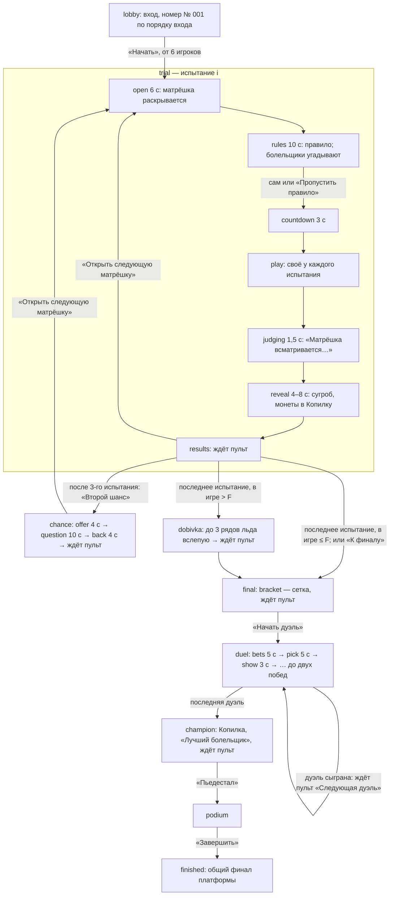

# «Игры Матрёшки» — правила (Блок 3a)

Рабочее название. Код игры — `matryoshka`. Игра идёт в игровой комнате быстрого канала (`docs/fast-room.md`), как
«Бубликатор» (`docs/bublikator.md`). Этот файл — источник правды по логике: меняется игра — сначала правится он, потом
код (`src/mechanics/matryoshka/rules/constants.ts` и этот файл — вместе).

Источники по старшинству: решения владельца 13–14 ноября 2026 (раздел ниже) → проверка готовности 13 ноября 2026
(42 находки, таблица «Находка → решение») → документы ТЗ 1 ноября 2026 («Игры Матрёшки — полная логика», «Общее и
сервер», обзор). Где ТЗ расходится с решениями или с CLAUDE.md (500 гостей, Beget, «состояние сессии 5 КБ», медленный путь
ответов, голос, звук на телефоне), ТЗ устарело. Где ТЗ молчит, решено здесь — пометка **«решение при реализации»**.

Суть: огромная Матрёшка зовёт гостей во двор. Внутри неё — матрёшки поменьше, каждая открывает дворовую игру на вылет:
«Замри!», «Пряник», «Стулья», «Канат», «Классики». Кто потерял все сердечки — падает в сугроб и становится болельщиком,
но играет дальше: угадывает, тянет канат, ставит в финале. Последние F игроков выходят в финал «Камень, ножницы, бумага»;
чемпион открывает самую маленькую матрёшку и забирает Копилку. Длительность — **20–25 минут** с объяснениями ведущего
(чистой игры ~13–15 минут).

Блок 3a — только правила: чистые функции, комнатная игра (только test), механика платформы (скрыта), тесты. Телефон
(3b), экран зала (3c), пульт и конструктор (3d) — дальше, по макетам.

## Где что лежит

| Файл | Что внутри |
| --- | --- |
| `src/mechanics/matryoshka/rules/constants.ts` | Все числа игры (меняются — правится этот документ) |
| `rules/types.ts` | Состояние (`MatState`), содержимое (`MatContent`), виды экрана, телефона и пульта |
| `rules/content.ts` | `parseContent`: содержимое из базы без исключений, непонятное — по умолчанию |
| `rules/env.ts` | Что правила знают о комнате (`Env`), время игры, время события, случайность |
| `rules/target.ts` | Цель «сколько останется», число финалистов, порядок вылета, сердечки, «Добивка» (отсечка) |
| `rules/shapes.ts` | Геометрия 7 фигур «Пряника» (равная длина контура), 200 кусочков, обводка и трещина (для телефона) |
| `rules/freeze.ts`, `ginger.ts`, `chairs.ts`, `rope.ts`, `hopscotch.ts` | Испытания: расписание, ввод, ход, порядок |
| `rules/chance.ts`, `questions.ts` | «Второй шанс» и 10 встроенных вопросов |
| `rules/final.ts` | Посев, сетка 2/4/8, дуэль до двух побед, правило трёх ничьих |
| `rules/fans.ts` | Болельщики: прогнозы, «Канат», ставки финала, «Лучший болельщик» |
| `rules/places.ts` | Копилка, места и очки для таблицы лидеров |
| `rules/game.ts` | Фазы и шаги, команды пульта, «Назад», пауза, снимок и восстановление |
| `rules/views.ts` | Что видят экран зала, телефон и пульт (без тайн на экране) |
| `rules/*.test.ts` | Тесты правил; `sim/bots.ts` — боты для сквозной игры |
| `server/src/rooms/matryoshka.ts` | `RoomGame<MatState>` — переходник правил к комнате (только test, `TEST_ONLY_GAMES`) |
| `server/src/rooms/matryoshka.test.ts` | Сквозные игры ботами в настоящем движке комнат: 6, 12, 50 и 100 игроков |
| `src/mechanics/matryoshka/index.ts`, `views.tsx` | Механика платформы: скрыта (`HIDDEN_MECHANICS`), экраны — заглушки до 3b–3d |
| `src/core/matryoshkaTitle.ts` | Название игры (одно место) |

Правила не знают про HTTP, базу и часы: время, кто на связи, случайность и отправка личного приходят аргументом (`Env` =
`RoomContext` комнаты). Поэтому те же функции возьмут телефон, экран, предпросмотр и тесты.

## Содержимое игры (`content`)

| Поле | Значения | По умолчанию |
| --- | --- | --- |
| `style` | `sunny` «Солнечный двор» (дети, день) · `night` «Ночной двор» (взрослые, неон) | `sunny` |
| `trials` | `[{ kind, on }]` в порядке игры: `freeze`, `ginger`, `chairs`, `rope`, `hopscotch`. «Замри!» всегда первым и всегда включён; остальные — включить/выключить и порядок | все пять |
| `finalists` | 2–8 | 4 |
| `lives` | 1 · 2 (сердечки) | 2 у `sunny`, 1 у `night` |
| `secondChance` | 0 (выкл) · 5 · 10 · 20 (% от **всех** выбывших) | 10 |
| `questions` | свои вопросы «Второго шанса» `{ q, options[2–4], correct }`, 3–10; меньше 3 — встроенные | встроенные 10 |
| `tempo` | `short` ×0,75 · `normal` ×1 · `long` ×1,25 — множитель длительностей шагов | `normal` |
| `fanBets` | прогнозы и ставки болельщиков: да / нет | да |
| `shapes` | 4 фигуры «Пряника» из 7: `circle`, `star`, `tree`, `matryoshka`, `umbrella`, `heart`, `house` | круг, звезда, ёлочка, матрёшка |

Режим участников — **только «каждый сам»** (решение владельца 14 ноября). Командная сессия комнату не ломает: игра
считает каждого лично, команды не видит (`supports.teams = false` у механики платформы). Экран зала обязателен.

## Ход игры (блок-схема)

Автопереходы (open → rules → countdown → play → … → results) делает комната по своему времени. Дальше `results`, итогов
«Второго шанса» и «Добивки», сетки, конца дуэли и чемпиона ведёт только пульт: ведущий решает, когда зал готов.

Подшаги `play` по испытаниям:

| Испытание | Подшаги | Длительность (темп «обычно») |
| --- | --- | --- |
| `freeze` «Замри!» | `run` — весь бег; внутри расписание фраз, обманок и взглядов | 80 с |
| `ginger` «Пряник» | `pick` 10 с → `unbox` 5 с → `trace` 45 с | 60 с |
| `chairs` «Стулья» | три захода: `music` 12–30 с → `stop` (стулья через 0,3–1,5 с, окно 3 с, сбор 1,5 с) → `seat` 3 с | ~1,5 мин |
| `rope` «Канат» | `split` 4 с → `pull` до 3 попыток по 15 с, передышка `rest` 5 с, до двух побед | до 59 с |
| `hopscotch` «Классики» | до 6 рядов: `brave` 3 с → (`jump` 5 с, если есть смельчаки) → `choose` 10 с → `crack` 3 с | до ~2 мин |

Темп `short`/`long` умножает все длительности шагов, кроме окна реакции 0,3 с, обманок, окна посадки 3 с и сборов 1,5 с.

## Сердечки и вылет

**Сердечки — настоящие жизни** (решение владельца 1): у детей 2 (`sunny`), у взрослых 1 (`night`). Выбывает только тот, у
кого сердечек 0. Вылет испытания устроен так:

1. **Цель.** На старте испытания (вход в `play`) комната считает по тем, кто в игре: `A` — игроков, `k` — включённых
   испытаний от текущего до последнего, `F` — финалистов игры. `T = max(F, ⌈A · (F ÷ A)^(1/k)⌉)`; если `A ≤ F` — испытание
   **«на посев»**: `T = A`, никто не теряет сердечко, пульт подсвечивает «К финалу». Нужно «наказать» `need = max(0, A′ − T)`,
   где `A′` — участники испытания к его концу (убранных посреди испытания нет: цель остаётся `T`).
2. **Порядок испытания** (лучший → худший): **исход → результат → сердечки → жребий** (технические решения владельца; L2).
   Исход и результат — свои у каждого испытания (ниже). Сердечки — только при равенстве исхода и результата: у кого
   больше, тот выше. Жребий — из зерна комнаты, повторяем.
3. **Кто теряет сердечко.** Последние `need` по порядку среди тех, кто «может проиграть» (в «Замри», «Прянике», «Стульях» —
   все; в «Канате» — только проигравшая сторона; в «Классиках» — только упавшие на тонкий лёд). Каждый из них теряет одно
   сердечко; у кого стало 0 — **выбывает** (болельщик, монета в Копилку). Кто потерял сердечко, но не последнее, —
   «Минус сердечко — ты ещё в игре».
4. **Недобор переносится.** Сердечки у детей, проигравшая сторона «Каната» меньше `need`, упавших в «Классиках» меньше
   `need` — в игре остаётся больше `T`; следующая цель считается заново по `A`. Лишних перед финалом убирает «Добивка».

Финалистов `F` — из настройки, но **не больше половины зала**: `F = max(2, min(finalists, ⌊A₀ ÷ 2⌋))`, `A₀` — игроков на
«Начать» (L22; 6 гостей при `finalists = 8` → в финале 3). Пульт с «Начать» пишет «Финалистов будет N». Не меняется до конца
игры («Вернуть» и «Убрать» её не трогают).

### «Добивка» (перед финалом)

После последнего испытания в игре больше `F` → «Добивка»: до 3 рядов ледяных классиков **вслепую** (без смельчаков). Каждый
в игре выбирает «Влево» / «Вправо» за 10 с (не выбрал — клетка выпадает по жребию). Упавший на тонкий лёд — в сугробе;
**сердечки в «Добивке» не спасают**, только решают порядок (**решение при реализации**: «Добивка» — инструмент свести к
ровно `F`, иначе у детей с 2 сердечками она не сходилась бы). Ряды идут, пока упавших меньше `need = A − F` и рядов меньше 3.
Кто выбывает: упавшие по порядку «упал раньше (в более раннем ряду) → меньше сердечек → больше сумма мест в испытаниях →
меньше монет смельчака → жребий», ровно `need`; лишние упавшие «выбегают из сугроба». Упавших после 3 рядов меньше `need` —
выбывают все упавшие и ещё не упавшие по той же отсечке (сердечки → сумма мест → монеты → жребий; L21). Итог — в финале
**ровно F** (тест на сетке параметров).

## Испытания

Все длительности — темп «обычно». Время в правилах — «время игры»: часы сервера минус паузы. Наружу (экран, телефон) моменты
уходят по часам сервера.

### 1. «Замри!» (`freeze`)

- Дорожка 1 000 делений, длительность `D = 80 с`. Скорость — 1 000 делений за `0,45 · D` = **36 с удержания** (решение
  владельца 2: обычный игрок добегает и после одной поимки).
- **Расписание** на старте `play`: фразы песенки по 4–9 с (случайно), в конце фразы — взгляд Матрёшки `T` длиной 2–4 с.
  С вероятностью 25% внутри фразы — **обманка** (вздрогнула, не обернулась), не позже чем за 1 с до `T`. Взгляды — пока
  конец взгляда не позже `D`. Первая фраза начинается через 0,5 с после старта.
- **Окно поимки** — полуинтервал `[T + 0,3 с; конец взгляда)` (L4): держит кнопку в любой момент окна — **пойман**.
  Отпустил ровно в `T + 0,3 с` — не пойман. Во время окна путь не растёт.
- Пойманный откатывается на 300 делений (30% дорожки, ~11 с удержания), не ниже 0, и бежит дальше. Пойманных объявляют, когда
  взгляд «устоялся»: через 1,5 с после конца взгляда (`FREEZE_SETTLE_MS`, все свежие события к этому моменту уже пришли).
- **Финиш** — путь дошёл до 1 000 (вне окна): время финиша, кнопка гаснет, больше не ловят.
- Исход и результат: добежавшие — по времени финиша, недобежавшие — по пути. Кто ни разу не нажал — путь 0, внизу (L2, L8).
  Никого не поймали — вылет всё равно ровно по цели, по пути. «Ошибся» для прогнозов — пойман хотя бы раз.
- **Время событий** (L5): «нажал» и «отпустил» телефон шлёт «сейчас» (отдельным запросом). Свежее событие — по заявленному
  времени (его предел ставит движок: интервал пачки + 0,5 с, не больше 4 с); событие из повторённой пачки (`delayed`) — по
  времени прихода (честный повтор после обрыва может дать поимку — так же у «Бубликатора», пишем честно). Правило
  «Бубликатора» «задним числом не больше 0,3 с» здесь **не берём**: честное «отпустил», пришедшее с пачкой через 1 с,
  сдвинулось бы на «приход − 0,3» и поймало бы зря. Событие не раньше последнего «устоявшегося» момента (1,5 с назад), не
  раньше конца паузы, не раньше прошлого события этого телефона и не позже «сейчас».
- **Нет связи** (L6): пока держит, телефон повторяет «держу» в каждой пачке (раз в 1 с). Удержание считается только до
  последней дошедшей пачки + 2 с (`HOLD_GRACE_MS`); дальше игрок «стоит» и не пойман. Выигрыша нет: путь не растёт.
- **Пауза** (L7): на паузе движок выбрасывает пачки, поэтому комната **всех ставит в «отпустил»** в момент паузы, телефоны
  гасят кнопку; после «Продолжить» гость жмёт заново. Время игры на паузе стоит — взгляд во время паузы невозможен.
  Телефонам уходят новые моменты по часам сервера (старые отменяются тем же личным видом).
- **Назначенные моменты** (L9, «как через потоки»): телефону следующий взгляд `{ at, end }` приходит **за 1 с** — личный вид
  этого телефона пересчитывается и уходит в тот шаг цикла (100 мс), когда до `T` осталось ≤ 1 с. Экрану фраза `{ start, at,
  end, decoy? }` приходит **в начале фразы** (до 9 с заранее): сводка экрана помечается изменённой в этот шаг цикла и уходит
  не позже чем через 200 мс (5 раз в секунду). Экран играет мелодию синтезом и ставит последнюю ноту ровно в `T`, голова
  начинает поворачиваться за 0,4 с до `T`. Будущие фразы (после текущей) не уходят никуда. Тайна мягкая: поток экрана может
  открыть любой вошедший — он узнает `T` за фразу до взгляда, как и зал, глядя на экран.
- «+10 секунд»: `D` растёт на 10 с (до +60 с), расписание дописывается фразами на добавленное время.
- «Закончить сейчас»: бег кончается в эту секунду; взгляд, который идёт, ещё ловит до своего конца, если начался.

### 2. «Пряник» (`ginger`)

- `pick` 10 с: на телефоне 4 жестяные коробки. Какая фигура в какой — тайна комнаты (из зерна, одинаково для всех), до
  `unbox` её нет ни на экране, ни на телефонах. `{ t: "box", n: 0–3 }`, можно передумать. Не выбрал — коробка по жребию.
- `unbox` 5 с: экран открывает коробки по очереди (раз в 1,25 с), рядом — сколько выбрали каждую. Телефон узнаёт свою фигуру
  в начале `unbox`.
- `trace` 45 с: обводка. Телефон сам проверяет касания (`rules/shapes.ts`): контур делится на **200 кусочков**; касание
  засчитывает **ближайший** к пальцу кусочек, если до него не дальше полосы допуска (3% ширины поля у `night`, 6% у `sunny`;
  L10: ближайший — поэтому полосы соседних рёбер во внутренних углах не засчитывают кусочки без обводки). **Трещина** (аудит 3a:
  быстрый зигзаг поперёк контура больше не обводит пряник): палец вне полосы дольше 0,2 с подряд (`CRACK_OUT_MS`, честное
  дрожание у линии прощается); палец дальше **трёх полос** от контура хоть на миг (`CRACK_FAR`; так «режут» пряник поперёк); вне
  полосы **в сумме дольше 0,3 с за последнюю секунду** (`CRACK_WINDOW_OUT_MS` за `CRACK_WINDOW_MS`: короткие выходы складываются,
  время между касаниями делится по промежуточным точкам). Поэтому зигзаг шире двух полос целого пряника не даёт никогда (шире трёх
  — сразу трещина); у́же — это дрожание у линии: на ёлочке и звезде такой палец всё время у какого-то края, а честный срыв на 1,6
  полосы на 0,15 с проходит (тесты). Кусочек засчитывается по близости, без проверки направления: проверка «вдоль контура»
  пробовалась и отбрасывала честные кусочки в углах (палец идёт по одному ребру, ближайшим оказывается соседнее). Телефон шлёт число обведённых кусочков `{ t: "g", c }` в каждой пачке (L11), трещину
  `{ t: "g", c, crack: true }` и целый пряник `{ t: "g", c: 200 }`; обводку хранит в `sessionStorage` (перезагрузка не
  теряет работу). Сервер берёт наибольшее `c`; после трещины `c` не растёт. Защита мягкая (L12): считает телефон.
- Исход и результат: целые — по времени (раньше — выше); недообведённые — по кусочкам; треснувшие — по кусочкам в момент
  трещины. «Ошибся» — треснул.
- **Фигуры** (L10): круг, звезда, ёлочка, матрёшка, зонтик, сердце, домик; сложность 1, 2, 3, 4, 3, 2, 2. Все — замкнутые
  ломаные в долях поля 0…1, **одинаковой длины контура** (`SHAPE_LENGTH` = 2,2 ширины поля — круг Ø 0,7; тест — ±2%), каждая целиком в поле с
  отступом 5%. Обвод «Зонтика» — купол с тремя фестонами, ручка с крючком (узкий контур; ближайший кусочек решает спор).
- «+10 секунд» — к `trace`. «Закончить сейчас» — `trace` кончается сейчас.

### 3. «Стулья» (`chairs`)

- Три захода. В заход идут только севшие в прошлом (L13). Стульев: 1-й `c₁ = clamp(round(A · q), T, A)`, 2-й
  `c₂ = clamp(round(n₂ · (T ÷ n₂)^(1/2)), T, n₂)`, 3-й **ровно `min(T, n₃)`**, где `q = (T ÷ A)^(1/3)`, `nᵢ` — играющих в
  заходе. Поэтому «сел в 3-м заходе — остался» (если сели все, кому положено).
- `music` 12–30 с: экран играет плясовую, телефон — «Танцуй!». С вероятностью 30% — обманка: музыка замирает на 0,6 с и
  играет дальше (стульев нет).
- `stop` в момент `T`: музыка обрывается; стулья на телефонах — в `T + d`, `d` = 0,3–1,5 с (одно на всех). Телефону `{ stop,
  appear }` приходит **за 1 с** до `T`, экрану `{ stop, decoy? }` — **за 3 с** (экран сам останавливает музыку). Окно
  посадки — 3 с от появления.
- Касание стула `{ t: "sit", rt }`: реакцию `rt` мерит телефон от появления стульев (L14; иначе слабая сеть проигрывает).
  Принимается: `rt` 150–3 000 мс, заявленное время касания не раньше появления − 0,3 с (запас часов) и пришло не позже конца
  окна + 1,5 с; повтор — без изменений. Подделку `rt` принимаем как мягкую защиту. Через 1,5 с после окна (`seat`) комната
  сажает по `rt` (меньше — раньше; равные — жребий), пока есть стулья. Не успел или не нажал — «Стула не хватило».
- Исход и результат: число заходов со стулом → средняя реакция по севшим заходам. «Ошибся» для прогнозов — **«прозевал»
  в 1-м заходе: сел позже 1 с или не сел** (решение при реализации; число «не сели всего» известно заранее по формуле —
  вопрос владельцу ниже).
- Нет «+10 секунд» и «Закончить сейчас» (L34, L35): заход короткий.

### 4. «Канат» (`rope`)

- `split` 4 с: игроки делятся на две стороны случайно и поровну (разница не больше одного): **коралловая** и
  **шалфейная** (на экране — ещё и подпись и узор, L42). Болельщики — по сторонам по очереди (в порядке номеров), новый
  болельщик — в меньшую болельщицкую сторону.
- `pull` — до 3 попыток по 15 с, до двух побед; передышка `rest` 5 с, на экране счёт «1 : 0». Телефон шлёт сводку нажатий
  `{ t: "tap", n }` (пачкой раз в 1 с и «сейчас» не чаще 150 мс), комната срезает до 15 в секунду (запас 30).
- Каждые 200 мс: **сила стороны = нажатия её игроков за 2 с ÷ 2 с ÷ игроков стороны на связи + 0,5 × нажатия её
  болельщиков за 2 с ÷ 2 с ÷ болельщиков стороны, кто тапал за последние 3 с** (L16: болельщики — прибавка, а не
  знаменатель; кто не тапает — не тянет назад). **Сдвиг узла = 4 × (A − B) ÷ ((A + B) ÷ 2)** делений за тик (L15; перевес
  20% за 15 с — ~55–60 делений при любом темпе). Никто не тапает — узел стоит.
- Узел дошёл до ±100 — попытка выиграна досрочно. Время вышло — побеждает сторона, на чьей половине узел; узел ровно в 0 — у
  кого больше нажатий игроков за попытку; поровну — жребий (L17).
- Исход и результат: победившая сторона — вся выше (между собой — по нажатиям в секунду за все попытки); проигравшие — по
  нажатиям в секунду. **Сердечко теряют только из проигравшей стороны** (L17), последние `need`; проигравших меньше
  `need` — недобор переносится. Без «Пропустить» у сторон: игроков меньше 2 — испытание пропускается само. «Ошибся» — у
  «Каната» прогноза нет: болельщики тянут (решение при реализации).
- «Закончить сейчас»: идущая попытка кончается сейчас по правилу «время вышло»; побед поровну — по узлу последней попытки,
  дальше — нажатия, дальше жребий. «+10 секунд» нет (L34).

### 5. «Классики» (`hopscotch`)

- До 6 рядов; в ряду одна клетка крепкая, другая — тонкий лёд (зерно, 50 на 50; тайна до `crack` — нет ни на экране, ни
  у пульта, ни на телефонах).
- `brave` 3 с: у тех, кто в игре и не упал, — «Прыгаю первым!» `{ t: "brave", rt }`, реакцию мерит телефон от появления кнопки
  (L19, как «Стулья»; `rt` ≥ 150 мс; `delayed` не участвуют). Первые 3 по `rt` (равные — жребий) — смельчаки.
- `jump` 5 с (если есть смельчаки; их подводят через 0,5 с после кнопки): смельчаки выбирают клетку `{ t: "cell", side: "L" | "R" }`.
  С начала `choose` экран (по очереди с дробью) и телефоны прыгающих видят, **куда** они прыгнули, но **не чем кончилось**
  (решение владельца 10): риск остаётся у всех, смельчак — заводила.
- `choose` 10 с: остальные выбирают клетку (можно передумать). Не выбрал — по жребию.
- `crack` 3 с: тонкий лёд трескается у всех сразу, на экране «налево 54% · направо 46%». Упавшие — в сугробе этого испытания
  и дальше не прыгают.
- Следующий ряд — пока упавших меньше `need` и есть ряды и неупавшие.
- Смельчак на крепком льду — **+3 монеты** (личные, не в Копилку): решают равенство мест и посев в финале.
- Исход и результат: пройдено рядов (не упавшие — все сыгранные) → монеты → сердечки → жребий. Теряют сердечко только
  упавшие, последние `need`; упавших больше — Матрёшка «вытаскивает из сугроба» лучших по порядку (упал позже, больше монет;
  **решение при реализации** вместо «случайных» ТЗ — по технической строке «исход → результат → сердечки»). «Ошибся» —
  упал.
- «Закончить сейчас» — рядов больше не будет (идущий доигрывается). «+10 секунд» нет.

## «Второй шанс» (`chance`)

- Один раз, на итогах **3-го включённого испытания**, если включён (`secondChance` > 0), после него есть ещё испытание и
  кто-то выбыл. Пульт: «Второй шанс» (или просто «Открыть следующую матрёшку» — пропустить).
- Вернуть: **⌈p × всех выбывших к этому моменту⌉** (решение владельца 9; при 50 гостях и 10% — около 4). Выбывшие — те, кого
  выбила игра (не опоздавшие болельщики и не убранные).
- `offer` 4 с (дверца матрёшки) → `question` 10 с: всем выбывшим — один вопрос с вариантами (`{ t: "ans", i, rt }`, один раз,
  реакция по телефону от появления, `rt` ≥ 300 мс). Вопрос — по кругу из набора, без повтора в игре (после «Назад» — следующий).
  → `back` 4 с: возвращаются первые по `rt` верно ответившие; ответивших верно меньше — все верно ответившие (L23). Каждому —
  1 сердечко, монета остаётся в Копилке. → ждёт пульт.
- Те, кто в игре, видят «Ждём выбывших».

## Финал (`final`)

- **Посев** (L24): финалисты — по сумме мест во всех сыгранных испытаниях (меньше — лучше; в испытании, где игрок не играл,
  — худшее место: число участников + 1), потом монеты смельчака, потом жребий.
- **Сетка** на 2, 4 или 8 мест (2 → сразу финал; 3–4 → полуфиналы; 5–8 → четвертьфиналы), пары по посеву 1–8, 4–5, 2–7, 3–6
  (1–4, 2–3); номера без соперника проходят без боя: F = 3 — 1-й; 5 — 1, 2, 3; 6 — 1, 2; 7 — 1. Игроков к финалу меньше 2
  (убрали) — 1: сразу чемпион; 0: «Награждение без чемпиона» (L33).
- **Дуэль** до двух побед: `bets` 5 с (только перед первым раундом дуэли; болельщики `{ t: "bet", side: 0 | 1 }` — на первого или второго) → раунды: `pick` 5 с
  (дуэлянты `{ t: "rps", g: "r" | "p" | "s" }`, можно передумать; время выбора — по заявленному времени последней смены от
  начала `pick`, у `delayed` — время прихода) → `show` 3 с. Не выбрал — «Матрёшка выбрала за тебя» (по жребию), такой жест
  всегда медленнее. Ничья — раунд переигрывается; **на третьей ничьей подряд** побеждает тот, кто выбрал быстрее; оба
  выбраны Матрёшкой или время равно — жребий (L25).
- Две победы — дуэлянт дальше, угадавшие болельщики +1. Пульт: «Следующая дуэль»; «Переиграть раунд» (у дуэлянта пропала
  связь); «Засчитать победу сопернику» (ушёл насовсем, с подтверждением; L26).
- Места финала: 1 — чемпион, 2 — проиграл финал, 3 — проигравшие полуфиналы (делят), 5–8 — проигравшие четвертьфиналы по
  посеву (L27). **На любой момент финала** (аудит 3a: пульт 3d пишет из них таблицу лидеров платформы): кто ещё в сетке — выше
  всех проигравших, между собой — кто прошёл дальше по сетке, потом по посеву (без общих мест); проигравшие — по кругу, где
  проиграли (финал и полуфиналы — общее место, четвертьфиналы — по посеву). Пример: после первого полуфинала — 1 победитель,
  2–3 ещё играющие во втором, 4 проигравший; после второго — 1–2 финалисты по посеву, 3–3 проигравшие.
- **Убранный финалист** (`remove` на сетке или в дуэли, ушёл из сессии) мест финала не получает: его место — как выбывшего в
  момент «Убрать» (выше выбывших раньше, ниже всех оставшихся финалистов), на пьедестал и в «восьмёрку» экрана он не выходит
  (`Standing.removed`, `podiumOf`; пульт 3d тоже не ставит его на пьедестал платформы). Убрали всех финалистов — чемпиона нет.
  После последней дуэли (`champion`) «Убрать» недоступна: места финала уже не меняются.
- `champion`: последняя матрёшка, Копилка взрывается, «Лучший болельщик» → «Пьедестал» → `podium` → «Завершить» → общий финал
  платформы (`standalone.finale`).

## Болельщики, Копилка, места, очки

- **Болельщик** — выбывший (у кого 0 сердечек) или опоздавший (вошёл после «Начать»). Опоздавшие в таблице не играют (L28).
- **Прогноз** (решение владельца 3): если `fanBets`, перед испытанием (`open` и `rules`) болельщик ползунком угадывает,
  **сколько игроков ошибутся**: «Замри!» — поймают хотя бы раз, «Пряник» — треснет, «Стулья» — прозевают в 1-м заходе,
  «Классики» — упадут. `{ t: "guess", n }`, можно передумать до `countdown`. Самый близкий (все одинаково близкие) — **+3**,
  остальные в пределах 10% от ответа (не меньше ±1) — **+1**. У «Каната» прогноза нет.
- **«Канат»** — тапают за свою сторону (прибавка 0,5), очков нет.
- **Ставка в финале** — на одного из двух дуэлянтов, угадал — **+1**.
- **«Лучший болельщик»** — только кто **заканчивает игру болельщиком** (аудит 3a: вернувшийся «Вторым шансом» или «Вернуть» и
  снова играющий — в том числе финалист — нет; убранный и ушедший — нет; вернулся и снова выбыл — да, с прежними очками), больше
  всех очков болельщика (> 0); равенство — кто болел дольше: опоздавшие — дольше всех, выбывшие — кто выбыл раньше (L31); дальше
  — жребий.
- **Копилка** — монета за каждый вылет (выбывший второй раз — ещё монета); «Убрать игрока» монету не даёт; вернувшийся
  монету не забирает. В конце Копилка «достаётся» чемпиону (экран, карточка).
- **Места**: финалисты — по финалу; остальные — по порядку вылета (выбыл позже — выше; в одном испытании — по порядку
  испытания; «Добивка» — выше всех испытаний). Убранный — как выбывший в момент «Убрать» (ниже выбывших того же испытания).
- **Очки** в таблице лидеров: `(N − место + 1) × 10`, `N` — игроков в таблице; равные места — равные очки (L28). В итогах
  платформы — только место и очки; «пережил испытаний» и очки болельщика — на экране и в карточке.
- **Баллы ведущему** (решение владельца 8): игра «сыграна до конца» (`playedToEnd`) — пройдены чемпион и пьедестал и сыграно
  не меньше 3 испытаний (пропущенные не в счёт). Остальное — как у игр в комнате: больше 10 телефонов, игровые действия в 2
  разных раундах (`playUnit`): раунд = испытание (номер 0–4; прогноз, удержание, обводка, посадка, тапы, клетка — всё в
  счёт), «Второй шанс» — 10, «Добивка» — 11, финал (жест, ставка) — 20. «Я на связи», мусор, ввод не в свой шаг — не в счёт.

## Команды пульта

`POST /api/rooms/:id/command`, только ведущий; `expect` = `moment` = `фаза:испытание:шаг:подшаг:попытка` (двойное касание и
второй пульт → 409 `moved`, ничего не сделано; повтор по `id` — прежний ответ — движок).

| Команда | Когда доступна | Вперёд | Назад |
| --- | --- | --- | --- |
| `start` «Начать» | лобби, от 6 игроков | Номера и сердечки, вход закрыт (дальше — болельщики), `F`, первая матрёшка | — |
| `skip-rules` «Пропустить правило» | `rules` | Сразу отсчёт | — |
| `next` «Открыть следующую матрёшку» | итоги испытания, итоги «Второго шанса», итоги «Добивки» | Следующее испытание; после последнего — «Добивка» (в игре > F) или сетка | `back` |
| `chance` «Второй шанс» | итоги 3-го испытания, если положен | `offer` | `back` — к итогам 3-го испытания, «Второй шанс» снят |
| `skip-trial` «Пропустить испытание» | `open`, `rules` | Испытание не играется, никто не выбывает, цель — на оставшиеся | — |
| `more-time` «+10 секунд» | `play` «Замри!» и «Пряника» (`trace`) | +10 с (до +60 с за испытание) | — |
| `end-now` «Закончить сейчас» | `play` «Замри!», «Пряника» (только `trace`), «Каната», «Классиков» | Время выходит сейчас, дальше обычная проверка | — |
| `back` «Назад» | `reveal` и `results` испытания; «Второй шанс» (любой шаг); итоги «Добивки»; сетка до первой дуэли | Точка — начало испытания (как `base` «Бубликатора»): вылет снят, сердечки, очки болельщиков, монеты и Копилка — как до испытания, испытание снова с `open` и новой случайностью. Остаются: вошедшие (болельщики) и убранные | — |
| `return { pid }` «Вернуть игрока» | итоги испытания и «Второго шанса», `rules` — если впереди есть испытание (L33) | Выбывший — снова в игре с 1 сердечком со следующего испытания (на `rules` — с этого) | `remove` |
| `remove { pid }` «Убрать игрока» | всегда после «Начать» (игроку), кроме чемпиона и пьедестала | Ушедший больше не участвует: болельщик, без монеты, место — как выбывший сейчас; дуэлянт — соперник проходит | `return` |
| `to-final` «К финалу» | итоги, итоги «Второго шанса», `rules`, когда в игре ≤ F | Оставшиеся испытания не играются, сетка | — |
| `duel` «Начать дуэль» / «Следующая дуэль» | сетка; конец дуэли | Следующая дуэль; после последней — чемпион | — |
| `rerun` «Переиграть раунд» | `pick`, `show` дуэли | Раунд заново (ничья не считается) | — |
| `forfeit { pid }` «Засчитать победу сопернику» | дуэль | `pid` проиграл дуэль | — |
| `podium` «Пьедестал» | чемпион | Пьедестал | — |
| `finish` «Завершить» | пьедестал | Конец игры | — |
| `board` «Табло на экран» | всегда | Поверх сцены: кто в игре, сердечки, болельщики (ещё раз — убрать) | — |
| `pause` / `resume` | всегда (движок) | Время игры стоит, все отпускают кнопку | — |

Каждая команда отвечает `{ ok: false, error }` не в свой шаг (`wrong-phase`), без игроков (`no-players`), без такого игрока
(`no-player`) и т. п.

## Кто что видит

- **Экран зала** (`screen`, ≤ 5 раз в секунду; раз в секунду без перемен): фаза, испытание, шаг, отсчёты по часам сервера,
  «В игре N · Выбыли M», Копилка, «Только что в сугробе» (до 10), табло (по команде). Игроки — сжатыми массивами `[номер, путь
  или кусочки, флаги]`, имена — только у лидеров и упомянутых (сводка ≤ 4 КБ при 100 игроках с длинными именами — тест).
  По испытаниям: «Замри!» — текущая фраза с моментами (с её начала); «Пряник» — сколько выбрали каждую коробку, фигуры —
  только с `unbox` и по очереди; «Стулья» — заход, стульев, `stop` за 3 с, рассадка после `seat`; «Канат» — стороны, узел,
  попытки; «Классики» — ряд, смельчаки и **куда** они прыгнули, проценты и крепкий лёд — только на `crack`; «Второй шанс» —
  вопрос и варианты, сколько ответили, вернувшиеся; финал — сетка, счёт, жесты только на `show`, сколько поставили.
  **Нет никогда**: зерна, крепкого льда до `crack`, фигур до `unbox`, будущих фраз, `stop` раньше 3 с, жестов до `show`,
  верного ответа до `back`, прогнозов болельщиков до итогов.
- **Телефон** (личный поток; снимок при подписке, дальше `{ t: "me", me }` целиком, когда вид изменился — моменты и
  поимка сразу, остальное не чаще раза в 0,5 с): свой номер, имя, роль, сердечки; своё испытание (путь, «держу», финиш,
  следующий взгляд за 1 с; коробка и фигура; кусочки и трещина; заход, `stop` и `appear` за 1 с, «сел, стул № N»; сторона, свои
  нажатия, узел; «Прыгаю первым!», моя клетка, упал; вопрос «Второго шанса» — только выбывшим; жест дуэлянта, соперник и
  счёт); болельщику — прогноз (до скольких), ставка (номера и имена двух дуэлянтов); итог испытания (место, минус сердечко, выбыл). **Чужого нет**: ни путей,
  ни коробок, ни клеток, ни ответов, ни ставок, ни pid других (кроме соперника в своей дуэли и пары дуэлянтов для ставки) — тест.
- **Пульт** (`host`, раз в секунду): этап и `moment`, какие команды доступны, цель `T` и `need`, `F`, счётчики, список игроков
  (номер, имя, роль, сердечки, на связи, выбыл где), выбывшие для «Вернуть», сетка финала, отсчёты. Крепкого льда, фигур
  коробок и жестов до раскрытия у пульта тоже нет — их нет в личном и общем, их не нужно и ведущему.
- **Звук и голос**: на телефоне звука нет — вибрация, где есть, и тряска картинки (решение владельца). Голоса нет: мелодия в
  браузере экрана и крупная надпись «Раз, два, три — замри!» (решение владельца 6). Музыка и звуки — скриптом и синтезом (3c).

## Особые случаи

| Случай | Что происходит |
| --- | --- |
| Гость вошёл после «Начать» | Сразу болельщик (`late`): прогнозы, «Канат», ставки; в таблице не играет; номер ему тоже даётся |
| Больше 100 игроков на «Начать» | Первые 100 по порядку входа — игроки, остальные — болельщики (**решение при реализации**: расчётный максимум 100) |
| Пропала связь у игрока | Место хранится. «Замри!» — стоит, не пойман; «Пряник» — время идёт, после возврата продолжает с сохранённой обводкой; «Стулья» — стул не достался; «Канат» — нет нажатий, из знаменателя стороны выпал; «Классики» — клетка по жребию; дуэль — жест по жребию, ведущий может «Переиграть раунд» |
| Перезагрузил страницу | Снимок личного потока; номер, роль, сердечки и испытание — как были |
| Пульт закрыт | Шаги с таймером идут сами; на итогах игра ждёт пульт («Ждём ведущего» — экран) |
| Два пульта | Команда со старым `moment` — 409 `moved`, пульт ждёт свежую сводку |
| Пауза | Время игры стоит, все «отпустили», назначенные моменты сдвигаются, телефоны получают новые |
| Перезапуск сервера | Комната из снимка (не старше 10 с), **на паузе**. Шаг, который «шёл» (отсчёт, игра, проверка; вопрос «Второго шанса»; ряд «Добивки»; раунд дуэли), правила возвращают к его началу: испытание — точка `base` и снова отсчёт с новой случайностью (прогнозы остаются), вопрос — снова `offer`, ряд и раунд — заново. Вскрытие, итоги, сетка — как были |
| В игре ≤ F | Оставшиеся испытания — «на посев» без потерь, «К финалу» подсвечена |
| Зал меньше F | `F = max(2, min(finalists, ⌊A₀ ÷ 2⌋))`; 6 гостей — в финале не больше 3 |
| «Убрать» опустило ниже F | Сетка — по фактическому числу; 1 — сразу чемпион; 0 — без чемпиона |
| «Назад» после «Второго шанса» | К итогам 3-го испытания, вернувшиеся — снова болельщики, «Второй шанс» снова доступен (следующий вопрос) |
| Три ничьи в финале | Третья ничья подряд — быстрее выбравший; оба Матрёшкой — жребий |
| Никого не поймали / не треснул никто | Вылет всё равно ровно по цели — по пути, по кусочкам и времени |
| Все ошиблись | «Матрёшка сегодня добрая»: остаются лучшие из ошибившихся, вылет ровно по цели |
| Игроков в испытании меньше 2 | Испытание пропускается само («мало игроков») |
| Равенство | Жребий из зерна комнаты, повторяем в тестах |

## Числа

Все — в `rules/constants.ts`: 6–100 игроков; финалистов 2–8 (не больше половины зала); сердечки 2 / 1; «Второй шанс» 0 / 5 /
10 / 20%; темп 0,75 / 1 / 1,25; `open` 6 с, `rules` 10 с, `countdown` 3 с, `judging` 1,5 с, `reveal` 4 с + 0,15 с за
выбывшего, до 8 с. «Замри!»: 80 с, дорожка 1 000, 36 с удержания, откат 300, фразы 4–9 с, взгляд 2–4 с, обманка 25% и
0,3 с, окно с 0,3 с, телефону за 1 с, сбор 1,5 с, держит без пачки 2 с, +10 с до +60. «Пряник»: 10 + 5 + 45 с, 4 коробки,
200 кусочков, полоса 3% / 6%, вне полосы 0,2 с подряд, дальше 3 полос — сразу, вне полосы 0,3 с за секунду, длина контура 2,2 ± 2%. «Стулья»: 3 захода, музыка 12–30 с, обманка 30% и
0,6 с, стулья через 0,3–1,5 с, окно 3 с, реакция 150–3 000 мс, сбор 1,5 с, рассадка 3 с, экрану за 3 с, «прозевал» — позже 1 с.
«Канат»: 4 с, 3 × 15 с, передышка 5 с, тик 200 мс, k = 4, черта 100, окно нажатий 2 с, болельщик 0,5 и активен 3 с, нажатий
15/с (запас 30). «Классики»: 6 рядов, 3 с, 3 смельчака, 5 с, 10 с, 3 с, +3 монеты. «Добивка»: 3 ряда, 10 с, 3 с. «Второй
шанс»: 4 + 10 + 4 с, реакция от 300 мс. Финал: ставки 5 с, жест 5 с, показ 3 с, до 2 побед, третья ничья. Болельщики: +3 / +1
(10%, не меньше 1), ставка +1. Очки `(N − место + 1) × 10`. Связь: «без связи» 3 с, пачка раз в 1 с, событий 10 в секунду.

## Находка → решение (проверка готовности 13 ноября 2026)

| № | Находка | Решение |
| --- | --- | --- |
| L1 | Сердечки противоречат формуле | Сердечки — жизни: вылет только при 0, недобор переносится, лишних убирает «Добивка» (решение владельца 1). Тест «сердечки — жизни» |
| L2 | «Стоять выгоднее, чем бежать» | Порядок «исход → результат → сердечки»; кто не нажал — путь 0, внизу. Тест «бездельник выбывает» |
| L3 | «Замри»: 48 из 80 с | 36 с удержания (0,45·D) — решение владельца 2. Тест «обычный бот добегает и после поимки» |
| L4 | Окно 0,3 с: когда телефон узнаёт конец, граница | Телефону `{ at, end }` за 1 с; окно `[T + 0,3; end)`. Тест границы |
| L5 | Время событий | «Сейчас» для нажал/отпустил; свежие — по заявленному (предел движка), `delayed` — по приходу; правило 0,3 с не берём. Тест «честное отпустил с пачкой не ловит», «delayed — по приходу» |
| L6 | Нет связи | Удержание — до последней пачки + 2 с, дальше стоит. Тест |
| L7 | Пауза выбрасывает пачки | На паузе все «отпустили», жать заново; время игры стоит. Тест в настоящем движке |
| L8 | Порядок «Замри» | Финиш по времени, потом путь; никого не поймали — по пути. Тест |
| L9 | Песенка и экран | Экрану — фраза в её начале; мелодия — синтез (3c); голоса нет (решение 6). Тест «экран видит фразу с её начала, не раньше» |
| L10 | Равная длина и полосы | 7 фигур, длина 2,2 ± 2%, ближайший кусочек. Тесты геометрии и «внутренний угол» |
| L11 | Проценты на сервере | Телефон шлёт кусочки 0–200 каждой пачкой, обводка в `sessionStorage` (3b). Тест порядка по кусочкам |
| L12 | «Пряник»: мягкая защита | Оставить (считает телефон) |
| L13 | Стулья не дают T | В заход — только севшие, 3-й заход ровно `min(T, n₃)`. Тест на сетке A 6–100 |
| L14 | Реакция | По телефону, 150–3 000 мс, не раньше появления; жребий. Тест |
| L15 | k «Каната» | Сдвиг по доле: 4 × (A − B) ÷ среднее. Тест «20% — одинаково при разных темпах» |
| L16 | Болельщики тянут назад | Болельщики — прибавка, знаменатель — кто тапал за 3 с; игроки — кто на связи. Тест |
| L17 | Ничья, кто теряет | Узел в 0 — по нажатиям, потом жребий; сердечко — только у проигравших, последних `need`. Тест |
| L18 | «Классики» пустые или жестокие | Остальные видят, куда прыгнули смельчаки, но не результат (решение владельца 10). Тест «вид не открывает лёд» |
| L19 | Смельчаки по часам сервера | Как «Стулья»: реакция телефона, `delayed` не участвуют. Тест |
| L20 | «Классики» и сердечки | Общий порядок: теряют сердечко упавшие, последние `need`. Тест |
| L21 | «Добивка» | 3 ряда вслепую, отсечка «упал раньше → сердечки → сумма мест → монеты». Тест «ровно F» |
| L22 | Формула: A < F, нули, большие залы | `F ≤ ⌊A₀ ÷ 2⌋`, не меньше 2; без вылета — «на посев». Тесты |
| L23 | «Второй шанс»: три числа | ⌈p × всех выбывших⌉; верных меньше — все верные (решение 9). Тест |
| L24 | Сетка | Посев по сумме мест, сетка 2/4/8 без боя лучшим. Тест F = 2–8 |
| L25 | Три ничьи | Время выбора от начала `pick`, Матрёшкин жест медленнее, оба — жребий. Тест |
| L26 | Пропал финалист | «Засчитать победу сопернику», «Переиграть раунд». Тест |
| L27 | Места 5–8 | По посеву. Тест |
| L28 | Очки, опоздавшие | `(N − место + 1) × 10`; в итогах платформы — место и очки; опоздавшие в таблице не играют. Тест |
| L29 | Командный режим | Нет в v1 (решение владельца 4) |
| L30 | Прогноз угадывается по формуле | Угадывают, сколько ошибутся (решение 3). Тест |
| L31 | «Лучший болельщик» | Опоздавший — болел дольше всех, дальше жребий. Тест |
| L32 | «Назад» | Одна точка — начало испытания, откат всего, кроме вошедших и убранных; после «Второго шанса» — к итогам 3-го. Тест |
| L33 | «Вернуть», «Убрать» | «Вернуть» — на итогах и `rules`, если впереди испытание; «Убрать» ниже F — сетка по факту, 1 — чемпион, 0 — без чемпиона. Тесты |
| L34 | «+10 секунд» | «Замри!» и «Пряник»; «Канат», «Классики», «Стулья» — нет. Тест |
| L35 | «Закончить сейчас» в «Стульях» | Нет кнопки. Тест (`wrong-phase`) |
| L36 | Длительность | 20–25 минут (решение 7), в инструкции и продажах — так же |
| L37 | Звук на телефоне | Нет, вибрация, где есть (решение) |
| L38 | Вкладки пульта | Standalone-игра: правила показывает сама игра (шаг `rules`), текст — `src/core/rules.ts` |
| L39 | Не задано вовсе | Длительности `split`, рассадки, шагов «Классиков», порядок испытаний, минимум 6, номер по входу (сервер читает участников по `joined_at`), вошедший во время испытания — всё в этом файле |
| L40 | «Игра в кальмара» | Зонтик, «№ 001», Копилка, ледяные классики остаются (решение владельца 5) |
| L41 | «Тульский пряник» | В текстах — просто «Пряник» |
| L42 | Цвета | Серый и мел — только рисунки; стороны «Каната» — с подписью и узором (3c, тест контраста) |

## Действие → что происходит → тест

Тесты: `T` — `src/mechanics/matryoshka/rules/target.test.ts`, `G` — `rules/trials.test.ts`, `H` — `rules/shapes.test.ts`,
`M` — `rules/game.test.ts`, `S` — `server/src/rooms/matryoshka.test.ts`.

| Действие | Что происходит | Тест |
| --- | --- | --- |
| Цель на сетке A 6–100, F 2–8, 1–5 испытаний, сердечки 1/2, «Второй шанс» 0/10% | К финалу ровно `F` (с «Добивкой») | T «ровно F на сетке параметров» |
| Зал меньше F | Финалистов не больше половины зала | T «F не больше половины» |
| `A ≤ F` | Испытание на посев, никто не теряет | T «на посев» |
| Порядок исход → результат → сердечки | Сердечки — только при равенстве | T «порядок вылета» |
| Сердечки 2 | Последние `need` теряют одно, выбывает только при 0 | T «сердечки — жизни» |
| «Добивка» | Упавшие раньше выбывают первыми, отсечка после 3 рядов | T «Добивка» |
| «Замри!»: расписание | Фразы 4–9 с, взгляды 2–4 с, в пределах D, обманки | G «расписание» |
| Окно поимки | `[T + 0,3; end)`, путь в окне не растёт, откат 300 | G «окно», «откат» |
| Скорость | 36 с удержания — финиш | G «финиш за 36 с» |
| Нет связи | До последней пачки + 2 с | G «держит без пачки» |
| Время событий | Свежее — заявленное, `delayed` — приход | G, M |
| Бездельник | Путь 0, выбывает | G |
| «Пряник» | Коробки по зерну, порядок целые → кусочки → треснувшие | G |
| Геометрия | 7 фигур, длина ±2%, в поле, 200 кусочков, ближайший кусочек, трещина 0,2 с | H |
| Зигзаг поперёк контура | Шире 2 полос — целого пряника нет, шире 3 — трещина; честная обводка с дрожанием и срывом 0,15 с проходит | H «зигзаг», «честная обводка» |
| «Стулья» | c₁, c₂, c₃ = T; реакция ≥ 150; жребий; не раньше появления | G «стулья на сетке» |
| «Канат» | Сила по доле, болельщики прибавкой, досрочная победа, ничья, только проигравшие | G |
| «Классики» | Смельчаки по реакции, вид не открывает лёд, +3 монеты, вытаскивает лучших | G, M |
| «Второй шанс» | ⌈p × выбывших⌉, все верные, 1 сердечко, монета остаётся | M |
| Финал | Посев, сетка, без боя, третья ничья, Матрёшкин жест, «Засчитать победу» | G «финал» |
| Болельщики | +3 / +1, ставка +1, лучший болельщик | G |
| Места и очки | Финал, вылет, равные места | M |
| Места во время финала | Кто в сетке — выше проигравших, полуфиналы делят 3-е, четвертьфиналы 5–8 по посеву — на каждом шаге | G «места во время финала» |
| Убрали финалистов (1–4) | Место — как выбывший, не на пьедестале и не на экране, все — без чемпиона; после последней дуэли «Убрать» нет | G «убранный финалист», «после последней дуэли» |
| «Лучший болельщик» | Только кто болельщик к концу игры | G «только кто заканчивает игру болельщиком» |
| Команды пульта вперёд и назад | Каждая команда в свой шаг и отказ не в свой; «Назад» откатывает всё | M «команды пульта» |
| Пауза | Все «отпустили», время стоит, моменты сдвинуты | M, S |
| Снимок → восстановление | Шаг возвращается к началу | M, S |
| Номера по входу | `№ 001…` в порядке входа (сервер читает по `joined_at`) | M |
| Личное без чужого | Нет чужих pid и данных | M, S |
| Экран без тайн, ≤ 4 КБ на 100 | Ни льда, ни фигур, ни будущих фраз | M, S |
| Баллы | `playUnit` по раундам, `playedToEnd` — чемпион, пьедестал и ≥ 3 испытаний | M, S |
| Сквозная игра | 6, 12, 50, 100 ботов в настоящем движке — до пьедестала, в финале ровно F | S |

## Решения владельца 13–14 ноября 2026

1. **Сердечки — настоящие жизни.** Выбывает только тот, у кого 0. Детям 2, взрослым 1. Лишних перед финалом убирает «Добивка».
2. **«Замри!»:** чтобы добежать, держать около 36 с из 80; обычный игрок добегает и после одной поимки.
3. **Болельщики угадывают, сколько ошибутся** (поймают, треснет, не сядут), а не «сколько останется».
4. **Командного режима в первой версии нет**, только «каждый сам».
5. **Отход от «Игры в кальмара» — как в документе:** зонтик в фигурах, номера «№ 001», Копилка за каждого выбывшего, ледяные
   классики остаются (владелец решил осознанно).
6. **Голоса нет:** мелодия в браузере и крупная надпись «Раз, два, три — замри!».
7. **Длительность — 20–25 минут.** Так же в инструкции и продажах.
8. **Баллы ведущему:** «сыграна до конца» — пройдены финал и пьедестал и сыграно ≥ 3 испытаний; остальное — как у игр в
   комнате (> 10 телефонов, действия в 2 разных раундах).
9. **«Второй шанс» — 10% от всех выбывших** к этому моменту (при 50 гостях — около 4).
10. **«Классики»:** остальные видят, куда прыгнули смельчаки, но не видят, чем кончилось.
11. **Матрёшка рисуется в коде** (SVG, народный стиль); Figma — только 2 фона двора.

Технические (без вопросов): всё — в игровой комнате, без медленного пути; порядок «исход → результат → сердечки»; финалистов
не больше половины зала; «Стулья» — третий заход ровно до цели; сила «Каната» по доле, болельщики прибавкой; «Вернуть» — только
между испытаниями; на телефоне без звука, вибрация где есть; не блок вечера (`NOT_IN_EVENING`); после игры — общий финал
платформы; замеры на 50 ботах, максимум 100 гостей; музыка и звуки — скриптом и синтезом.

## Решения при реализации (3a)

- «Замри!» всегда первым и всегда включён; остальные четыре — в любом порядке, любые выключены (как в обзоре ТЗ).
- Ширина полосы «Пряника» — по стилю (`sunny` 6%, `night` 3%), а сердечки — своей настройкой (по умолчанию тоже по стилю).
- «Добивка»: сердечки не спасают, только решают порядок упавших.
- «Классики»: при перевылете Матрёшка вытаскивает лучших упавших по порядку (а не случайных).
- «Стулья»: «ошибся» для прогноза — прозевал в 1-м заходе (позже 1 с или не сел).
- «Канат»: прогноза нет, болельщики тянут.
- Цель `T` считается на входе в `play` (а не на `open`): «Вернуть» на `rules` и «Убрать» до старта её учитывают.
- Больше 100 игроков на «Начать» — первые 100 по входу играют, остальные болеют.
- Прогнозы — на `open` и `rules`; закрываются отсчётом.
- «Второй шанс»: ответ один раз, реакция от 300 мс; после «Назад» — следующий вопрос.
- Дуэль: ставки — только перед первым раундом дуэли.
- Финальные места 5–8 и места финалистов без боя — по посеву.
- Номер игрока — в порядке входа (`№ 001`); опоздавший болельщик тоже получает номер (на экране не показывается).
- `reveal` — 4 с + 0,15 с за каждого выбывшего, не больше 8 с.
- «Вернуть» возвращает только выбывших игрой и убранных (не опоздавших болельщиков).

## Что дальше (3b–3d)

Телефон игрока и болельщика по макетам (удержание без лупы, обводка по `rules/shapes.ts`, `sessionStorage`), экран зала
(двор двух стилей, Матрёшка SVG, толпа на холсте, песенка синтезом под `T`), пульт и конструктор, предпросмотр с ботами
(`sim/bots.ts`), инструкции (`guide.ts`, `editorGuide/matryoshka.ts`, `rules.ts`), шаблоны «Солнечный двор» и «Ночной двор»,
открытие игры (`HIDDEN_MECHANICS` пуст, комната — в `GAMES`).
