# Ревизор — что видят ведущий и гости

Прогонов: 43 · видов игры проверено: 1964 · разных находок: 245

Размеры: Большой праздник: 10 команд или 40 гостей, телевизор (1920x1080).

## Мешает игре — 38

### не успел · страница

TimeoutError: page.waitForFunction: Timeout 600000ms exceeded.

- где: `—`
- игры (1): mafia 1-й шаблон, каждый сам ×20, большой праздник: 10 команд или 40 гостей, телевизор
- раз: 1

### не успел · страница

TimeoutError: page.waitForFunction: Timeout 600000ms exceeded.

- где: `—`
- игры (1): mafia 1-й шаблон, каждый сам ×20, большой праздник: 10 команд или 40 гостей, телевизор
- раз: 1

### не успел · страница

TimeoutError: page.waitForFunction: Timeout 600000ms exceeded.

- где: `—`
- игры (1): spy 1-й шаблон, каждый сам ×20, большой праздник: 10 команд или 40 гостей, телевизор
- раз: 1

### не успел · страница

TimeoutError: page.waitForFunction: Timeout 600000ms exceeded.

- где: `—`
- игры (1): spy 1-й шаблон, каждый сам ×20, большой праздник: 10 команд или 40 гостей, телевизор
- раз: 1

### не успел · страница

TimeoutError: page.waitForFunction: Timeout 600000ms exceeded.

- где: `—`
- игры (1): truth 1-й шаблон, каждый сам ×40, большой праздник: 10 команд или 40 гостей, телевизор
- раз: 1

### не успел · страница

TimeoutError: page.waitForFunction: Timeout 600000ms exceeded.

- где: `—`
- игры (1): truth 1-й шаблон, каждый сам ×40, большой праздник: 10 команд или 40 гостей, телевизор
- раз: 1

### за краем · пульт

текст выходит за край области вбок на 145 px — «— «Робот пишет ответ 97»»

- где: `div.sv-marks > div.sv-mark-row > button.column-opt > span.line-clamp`, этап `playing/3/question/`
- игры (1): survival 1-й шаблон, команды ×10, большой праздник: 10 команд или 40 гостей, телевизор
- раз: 35

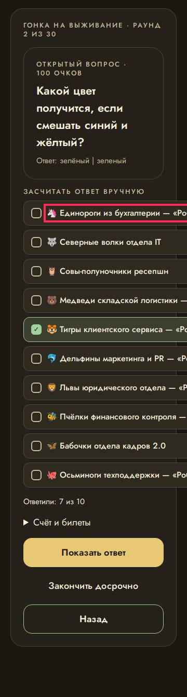

### закрыт другим элементом · экран зала

«Вход: localhost:37895/j · код 123 456» закрыт элементом div.dk-vote — «Вход: localhost:37895/j · код 123 456»

- где: `div.hall > main.quiz-stage > p.stage-code`, этап `playing/2/question/vote`
- игры (4): durak 1-й шаблон, каждый сам ×4, большой праздник: 10 команд или 40 гостей, телевизор; bunker 1-й шаблон, каждый сам ×16, большой праздник: 10 команд или 40 гостей, телевизор; mafia 1-й шаблон, каждый сам ×20, большой праздник: 10 команд или 40 гостей, телевизор; wager 1-й шаблон, команды ×10, большой праздник: 10 команд или 40 гостей, телевизор
- раз: 10

### закрыт другим элементом · телефон

«Максимилиан Константинова» закрыт элементом strong.mf-tally__n — «Максимилиан Константинова»

- где: `ul.mf-tally > li.mf-tally__row > span.mf-tally__name > span`, этап `playing/1/reveal/verdict`
- игры (1): mafia 1-й шаблон, каждый сам ×20, большой праздник: 10 команд или 40 гостей, телевизор
- раз: 55

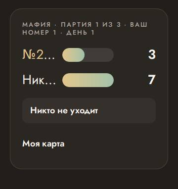

### закрыт другим элементом · экран зала

«50% · 0» закрыт элементом img.stage-dancer — «50% · 0»

- где: `div.stage-screen.stage-screen--battle > div.stage-tug > div.stage-tug__bar > span`, этап `playing/10/reveal/result`
- игры (1): stage 1-й шаблон, команды ×10, большой праздник: 10 команд или 40 гостей, телевизор; stage 2-й шаблон, команды ×10, большой праздник: 10 команд или 40 гостей, телевизор
- раз: 4

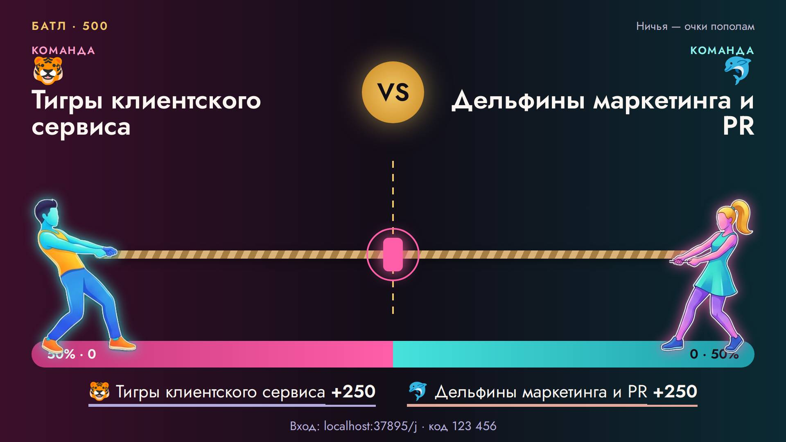

### закрыт другим элементом · экран зала

«Александра Константинова» закрыт элементом span.name-emoji — «Александра Константинова»

- где: `div.dk-seat__card > span.dk-seat__text > span.dk-seat__name > span`, этап `playing/1/question/deal`
- игры (1): durak 1-й шаблон, каждый сам ×4, большой праздник: 10 команд или 40 гостей, телевизор
- раз: 4

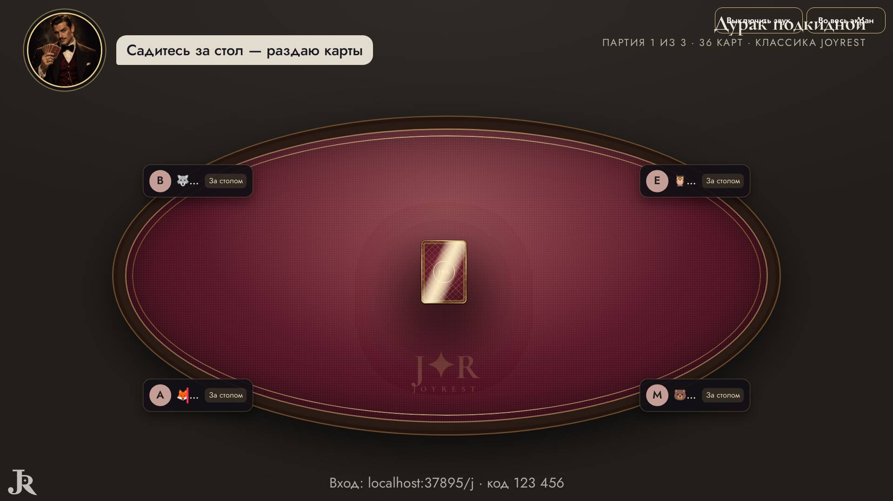

### закрыт другим элементом · экран зала

«Спальник» закрыт элементом p.stage-code — «Спальник»

- где: `article.bk-dossier > ul.bk-dossier__rows > li.bk-row.bk-row--baggage > span.bk-row__text`, этап `playing/109/reveal/final`
- игры (1): bunker 1-й шаблон, каждый сам ×16, большой праздник: 10 команд или 40 гостей, телевизор
- раз: 4

### закрыт другим элементом · экран зала

«,» закрыт элементом span — «,»

- где: `section.mil-screen__bars > div.mil-bars-window > p.mil-bars-window__more > span`, этап `playing/0/ready/turn`
- игры (1): millionaire 1-й шаблон, каждый сам ×40, большой праздник: 10 команд или 40 гостей, телевизор
- раз: 3

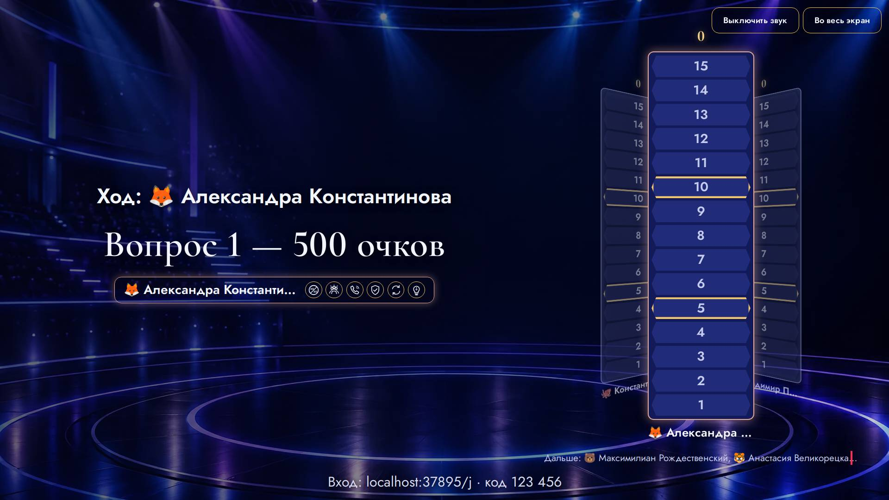

### закрыт другим элементом · телефон

«100%» закрыт элементом span.mil-option__text — «100%»

- где: `div.mil-question.mil-question--phone > ol.mil-options > li.mil-option > span.mil-option__pct`, этап `playing/8/reveal/reveal`
- игры (1): millionaire 1-й шаблон, команды ×10, большой праздник: 10 команд или 40 гостей, телевизор; millionaire 1-й шаблон, каждый сам ×40, большой праздник: 10 команд или 40 гостей, телевизор
- раз: 2

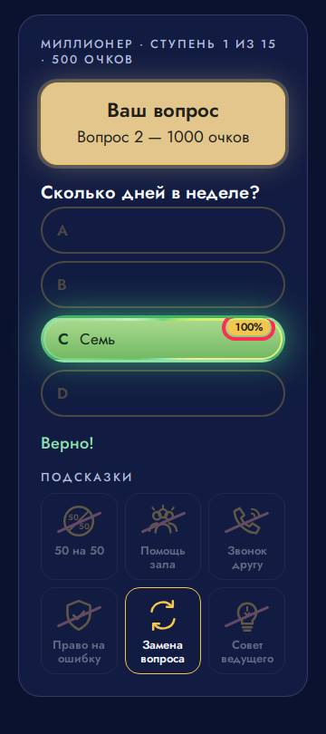

### закрыт другим элементом · экран зала

«Выбираем колоду — голосуйте на телефонах» закрыт элементом h2 — «Выбираем колоду — голосуйте на телефонах»

- где: `div.dk-hall.dk-felt--bordeaux > div.dk-hall__top > div.dk-croupier > p.dk-croupier__line`, этап `playing/2/question/vote`
- игры (1): durak 1-й шаблон, каждый сам ×4, большой праздник: 10 команд или 40 гостей, телевизор
- раз: 1

### закрыт другим элементом · экран зала

«Дурак подкидной» закрыт элементом h2 — «Дурак подкидной»

- где: `div.dk-hall.dk-felt--bordeaux > div.dk-hall__top > div.dk-hall__title > span`, этап `playing/2/question/vote`
- игры (1): durak 1-й шаблон, каждый сам ×4, большой праздник: 10 команд или 40 гостей, телевизор
- раз: 1

### закрыт другим элементом · экран зала

«партия 1 из 3 · 36 карт · Классика JoyRe» закрыт элементом h2 — «партия 1 из 3 · 36 карт · Классика JoyRest»

- где: `div.dk-hall.dk-felt--bordeaux > div.dk-hall__top > div.dk-hall__title > small`, этап `playing/2/question/vote`
- игры (1): durak 1-й шаблон, каждый сам ×4, большой праздник: 10 команд или 40 гостей, телевизор
- раз: 1

### закрыт другим элементом · экран зала

«Е» закрыт элементом div.dk-card.dk-d--rome — «Е»

- где: `div.dk-table > div.dk-seat.dk-seat--wait > div.dk-seat__card > span.dk-seat__avatar`, этап `playing/2/question/vote`
- игры (1): durak 1-й шаблон, каждый сам ×4, большой праздник: 10 команд или 40 гостей, телевизор
- раз: 1

### закрыт другим элементом · экран зала

«В игре» закрыт элементом h2.bk-title — «В игре»

- где: `div.bk-screen > header.bk-screen__top > p.bk-screen__status > span`, этап `playing/82/question/justify`
- игры (1): bunker 1-й шаблон, каждый сам ×16, большой праздник: 10 команд или 40 гостей, телевизор
- раз: 1

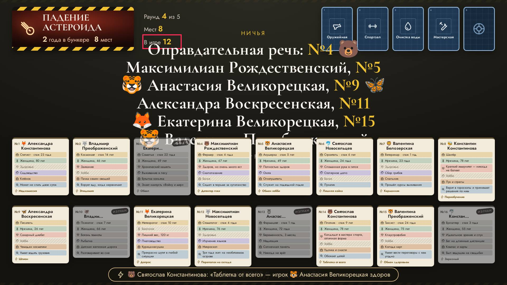

### закрыт другим элементом · экран зала

«12» закрыт элементом h2.bk-title — «12»

- где: `header.bk-screen__top > p.bk-screen__status > span > b`, этап `playing/82/question/justify`
- игры (1): bunker 1-й шаблон, каждый сам ×16, большой праздник: 10 команд или 40 гостей, телевизор
- раз: 1

### закрыт другим элементом · экран зала

«🐯» закрыт элементом article.bk-dossier — «🐯»

- где: `div.bk-stage__text > h2.bk-title > span > span.name-emoji`, этап `playing/82/question/justify`
- игры (1): bunker 1-й шаблон, каждый сам ×16, большой праздник: 10 команд или 40 гостей, телевизор
- раз: 1

### закрыт другим элементом · экран зала

«Валентина Преображенский» закрыт элементом article.bk-dossier — «Валентина Преображенский»

- где: `div.bk-stage__text > h2.bk-title > span > span`, этап `playing/82/question/justify`
- игры (1): bunker 1-й шаблон, каждый сам ×16, большой праздник: 10 команд или 40 гостей, телевизор
- раз: 1

### надписи наезжают · пульт

«400» и «кот» друг на друге — «400 \| кот»

- где: `div.board-host__grid > div.board-host__row > button.board-host__cell > span`, этап `playing/0/ready/`
- игры (1): board 1-й шаблон, команды ×10, большой праздник: 10 команд или 40 гостей, телевизор; board 1-й шаблон, каждый сам ×40, большой праздник: 10 команд или 40 гостей, телевизор
- раз: 26

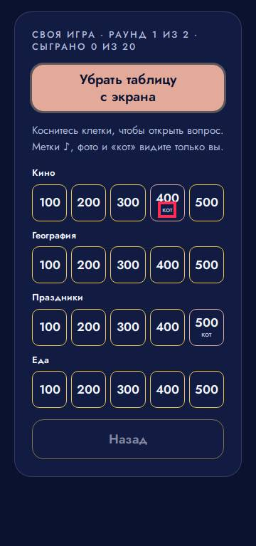

### надписи наезжают · пульт

«100» и «🔒 батл» друг на друге — «100 \| 🔒 батл»

- где: `div.stage-field.stage-field--compact > div.stage-field__row > button.stage-tile > span.stage-tile__points`, этап `playing/0/reveal/pick`
- игры (1): stage 1-й шаблон, команды ×10, большой праздник: 10 команд или 40 гостей, телевизор; stage 2-й шаблон, команды ×10, большой праздник: 10 команд или 40 гостей, телевизор
- раз: 20

### надписи наезжают · экран зала

«Валентина Преображенский» и «Изгнан» друг на друге — «Валентина Преображенский \| Изгнан»

- где: `div.bk-stage__text > h2.bk-title > span > span`, этап `playing/82/question/justify`
- игры (1): bunker 1-й шаблон, каждый сам ×16, большой праздник: 10 команд или 40 гостей, телевизор
- раз: 10

### надписи наезжают · экран зала

«🦁 Валентина Белозерская: «Кар» и «Вход: localhost:37895/j · код » друг на друге — «🦁 Валентина Белозерская: «Карманник» — забрал багаж игрока 🐬 Константин Воскре»

- где: `div.hall > main.quiz-stage > div.bk-screen > p.bk-screen__log`, этап `playing/16/question/open`
- игры (1): bunker 1-й шаблон, каждый сам ×16, большой праздник: 10 команд или 40 гостей, телевизор
- раз: 5

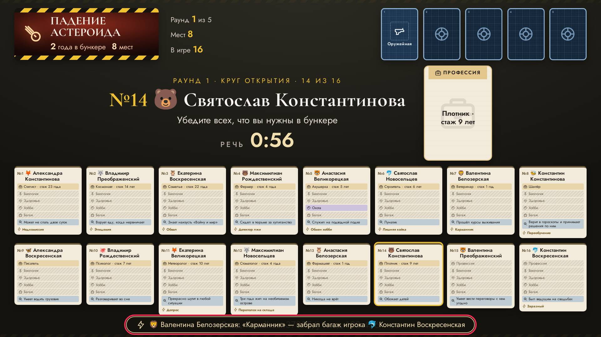

### надписи наезжают · экран зала

«🐯» и «Тигры клиентского сервиса» друг на друге — «🐯 \| Тигры клиентского сервиса»

- где: `div.stage-tug > div.stage-tug__names > span > span.name-emoji`, этап `playing/10/reveal/result`
- игры (1): stage 1-й шаблон, команды ×10, большой праздник: 10 команд или 40 гостей, телевизор; stage 2-й шаблон, команды ×10, большой праздник: 10 команд или 40 гостей, телевизор
- раз: 4

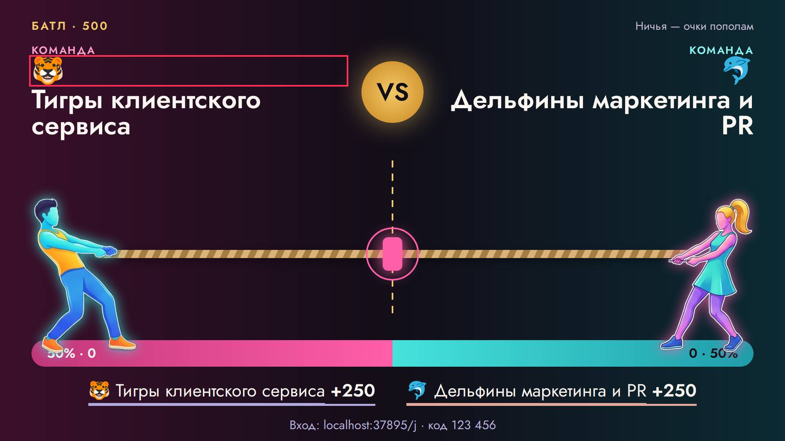

### надписи наезжают · экран зала

«🐯» и «№3» друг на друге — «🐯 \| №3»

- где: `div.bk-stage__text > h2.bk-title > span > span.name-emoji`, этап `playing/82/question/justify`
- игры (1): bunker 1-й шаблон, каждый сам ×16, большой праздник: 10 команд или 40 гостей, телевизор
- раз: 3

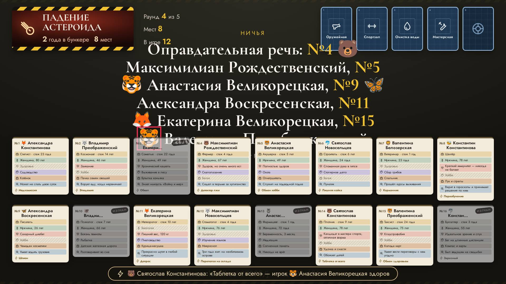

### надписи наезжают · экран зала

«Выбираем колоду — голосуйте на» и «Какой колодой играем?» друг на друге — «Выбираем колоду — голосуйте на телефонах \| Какой колодой играем?»

- где: `div.dk-hall.dk-felt--bordeaux > div.dk-hall__top > div.dk-croupier > p.dk-croupier__line`, этап `playing/2/question/vote`
- игры (1): durak 1-й шаблон, каждый сам ×4, большой праздник: 10 команд или 40 гостей, телевизор
- раз: 2

### надписи наезжают · экран зала

«Снова ничья — решит жребий.» и «Фермер · стаж 4 года» друг на друге — «Снова ничья — решит жребий. \| Фермер · стаж 4 года»

- где: `section.bk-screen__stage > div.bk-stage.bk-stage--turn > div.bk-stage__text > p.bk-lead.bk-lead--muted`, этап `playing/82/question/justify`
- игры (1): bunker 1-й шаблон, каждый сам ×16, большой праздник: 10 команд или 40 гостей, телевизор
- раз: 2

### надписи наезжают · экран зала

«🐻 Святослав Константинова: «Т» и «Вход: localhost:37895/j · код » друг на друге — «🐻 Святослав Константинова: «Таблетка от всего» — игрок 🐯 Анастасия Великорецка»

- где: `div.hall > main.quiz-stage > div.bk-screen.bk-screen--big > p.bk-screen__log`, этап `playing/84/question/exile`
- игры (1): bunker 1-й шаблон, каждый сам ×16, большой праздник: 10 команд или 40 гостей, телевизор
- раз: 2

### надписи наезжают · экран зала

«В игре» и «Оправдательная речь:» друг на друге — «В игре \| Оправдательная речь:»

- где: `div.bk-screen > header.bk-screen__top > p.bk-screen__status > span`, этап `playing/82/question/justify`
- игры (1): bunker 1-й шаблон, каждый сам ×16, большой праздник: 10 команд или 40 гостей, телевизор
- раз: 1

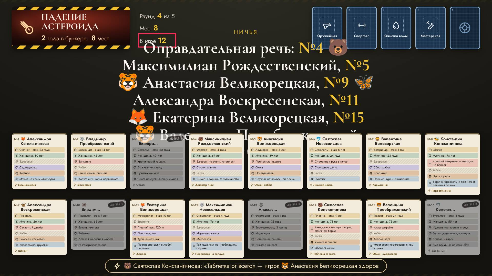

### надписи наезжают · экран зала

«12» и «Оправдательная речь:» друг на друге — «12 \| Оправдательная речь:»

- где: `header.bk-screen__top > p.bk-screen__status > span > b`, этап `playing/82/question/justify`
- игры (1): bunker 1-й шаблон, каждый сам ×16, большой праздник: 10 команд или 40 гостей, телевизор
- раз: 1

### надписи наезжают · экран зала

«Обсуждение» и «8:00» друг на друге — «Обсуждение \| 8:00»

- где: `div.sp-screen > section.sp-screen__main > div.sp-timer > span.sp-timer__label`, этап `playing/1/question/talk`
- игры (1): spy 1-й шаблон, каждый сам ×20, большой праздник: 10 команд или 40 гостей, телевизор
- раз: 1

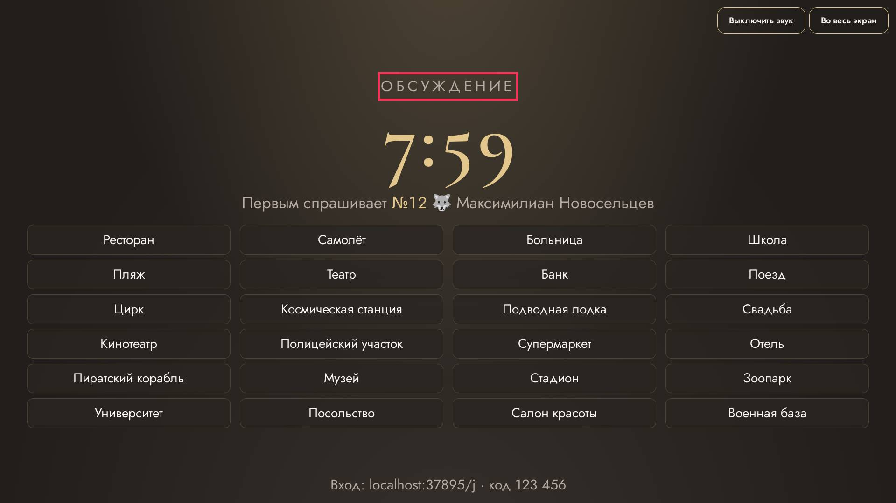

### надписи наезжают · экран зала

«Ближе всех» и «Вход: localhost:37895/j · код » друг на друге — «Ближе всех \| Вход: localhost:37895/j · код 123 456»

- где: `div.wager-table__felt > ol.wager-board > li.wager-slot.wager-slot--low > span.wager-slot__flag`, этап `playing/2/reveal/answer`
- игры (1): wager 1-й шаблон, команды ×10, большой праздник: 10 команд или 40 гостей, телевизор
- раз: 1

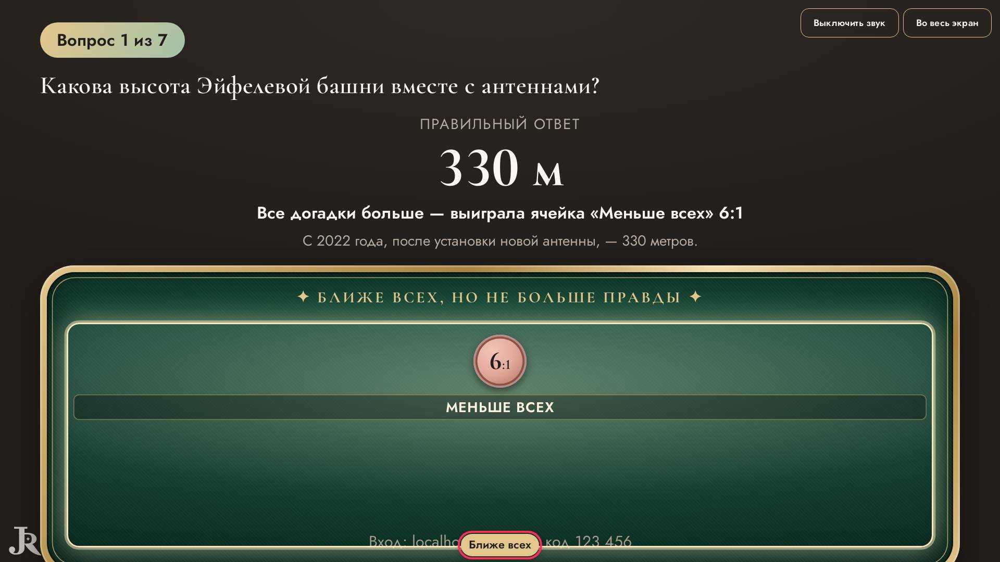

### прокрутка вбок · пульт

страница шире экрана на 195 px (div.sv-mark-row)

- где: `div.stack.host-quiz > section.stack.stack--tight > div.sv-marks > div.sv-mark-row`, этап `playing/3/question/`
- игры (1): survival 1-й шаблон, команды ×10, большой праздник: 10 команд или 40 гостей, телевизор
- раз: 4

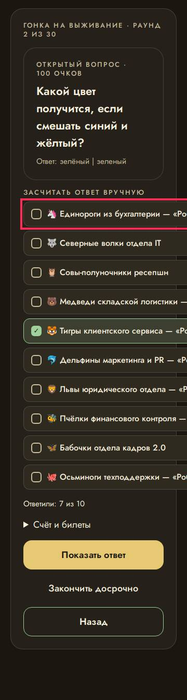

### прокрутка вбок · телефон

страница шире экрана на 10 px (span) — «Максимилиан Рождественский»

- где: `div.dk-phone__opps > span.dk-opp.dk-opp--wait > span.dk-opp__name > span`, этап `playing/68/question/play`
- игры (1): durak 1-й шаблон, каждый сам ×4, большой праздник: 10 команд или 40 гостей, телевизор
- раз: 2

### прокрутка вбок · телефон

страница шире экрана на 10 px (span) — «Максимилиан Рождественский»

- где: `div.dk-phone__opps > span.dk-opp.dk-opp--throw > span.dk-opp__name > span`, этап `playing/17/question/play`
- игры (1): durak 1-й шаблон, каждый сам ×4, большой праздник: 10 команд или 40 гостей, телевизор
- раз: 1

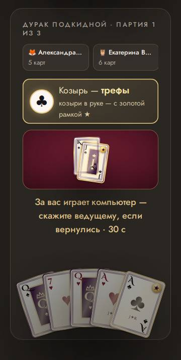

## Заметно — 146

### обрезан текст · экран зала

текст обрезан по высоте на 4 px (p.podium__name) — «🦋»

- где: `div.podium__slot > div.podium__names > p.podium__name > span.name-emoji`, этап `finished/7/podium/`
- игры (2): quiz 1-й шаблон, каждый сам ×40, большой праздник: 10 команд или 40 гостей, телевизор; bunker 1-й шаблон, каждый сам ×16, большой праздник: 10 команд или 40 гостей, телевизор
- раз: 10

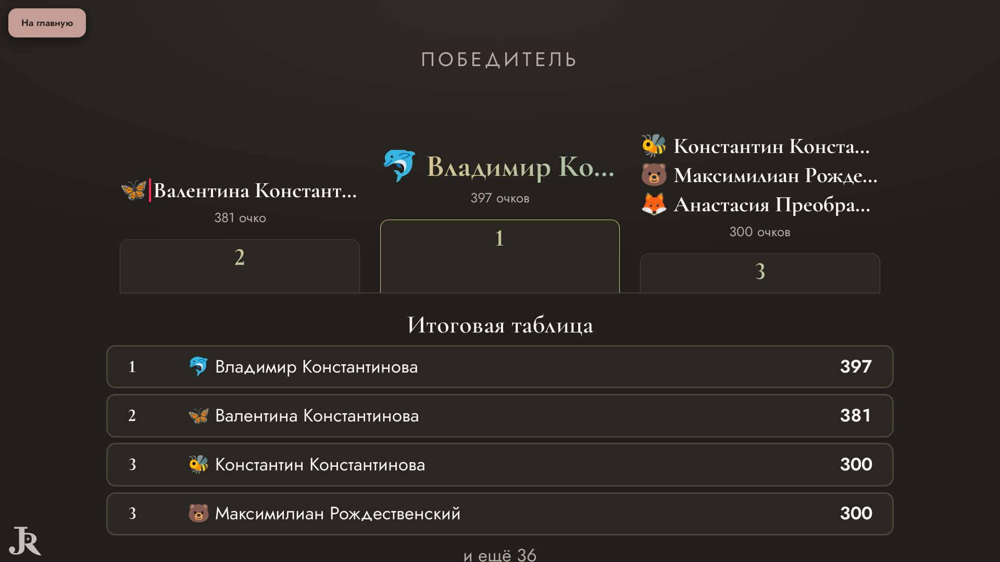

### обрезан текст · экран зала

текст обрезан по высоте на 4 px (p.podium__name) — «Валентина Константинова»

- где: `div.podium__slot > div.podium__names > p.podium__name > span`, этап `finished/7/podium/`
- игры (2): quiz 1-й шаблон, каждый сам ×40, большой праздник: 10 команд или 40 гостей, телевизор; bunker 1-й шаблон, каждый сам ×16, большой праздник: 10 команд или 40 гостей, телевизор
- раз: 10

### обрезан текст · экран зала

текст обрезан по высоте на 4 px (span.wine-cell__label) — «Красное»

- где: `div.wine-row > span.wine-row__cells > span.wine-cell > span.wine-cell__label`, этап `playing/1/question/bet`
- игры (1): wine 1-й шаблон, команды ×10, большой праздник: 10 команд или 40 гостей, телевизор; wine 1-й шаблон, каждый сам ×40, большой праздник: 10 команд или 40 гостей, телевизор
- раз: 200

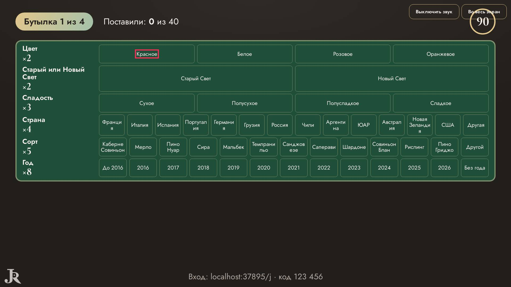

### обрезан текст · телефон

текст обрезан вбок на 28 px (div.dk-card.dk-d--gothic) — «6»

- где: `div.dk-hand__row > button.dk-hand__slot > div.dk-card.dk-d--gothic > span.dk-idx.dk-idx--b`, этап `playing/56/question/play`
- игры (1): durak 1-й шаблон, каждый сам ×4, большой праздник: 10 команд или 40 гостей, телевизор
- раз: 48

### обрезан текст · экран зала

текст обрезан по высоте на 8 px (span.hd-row__text) — ««Горько!»»

- где: `div.hd-row > div.hd-row__inner > div.hd-row__face.hd-row__face--open > span.hd-row__text`, этап `playing/2/reveal/play`
- игры (1): hundred 1-й шаблон, команды ×10, большой праздник: 10 команд или 40 гостей, телевизор; hundred 2-й шаблон, команды ×10, большой праздник: 10 команд или 40 гостей, телевизор; hundred 1-й шаблон, каждый сам ×40, большой праздник: 10 команд или 40 гостей, телевизор; hundred 2-й шаблон, каждый сам ×40, большой праздник: 10 команд или 40 гостей, телевизор; hundred 3-й шаблон, команды ×10, большой праздник: 10 команд или 40 гостей, телевизор; hundred 3-й шаблон, каждый сам ×40, большой праздник: 10 команд или 40 гостей, телевизор
- раз: 45

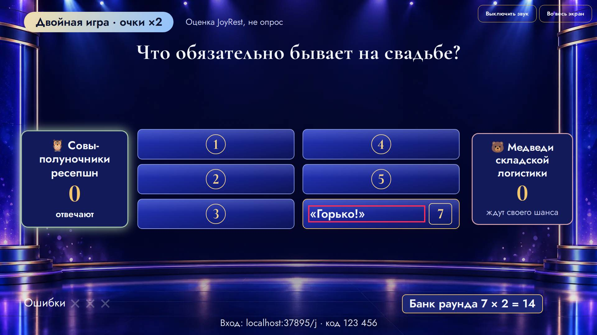

### обрезан текст · телефон

текст обрезан вбок на 23 px (div.dk-card.dk-d--rome) — «10»

- где: `div.dk-hand__row > button.dk-hand__slot > div.dk-card.dk-d--rome > span.dk-idx.dk-idx--b`, этап `playing/17/question/play`
- игры (1): durak 1-й шаблон, каждый сам ×4, большой праздник: 10 команд или 40 гостей, телевизор
- раз: 36

### обрезан текст · телефон

текст обрезан вбок на 29 px (div.dk-card.dk-d--cyber) — «10»

- где: `div.dk-hand__row > button.dk-hand__slot > div.dk-card.dk-d--cyber > span.dk-idx.dk-idx--b`, этап `playing/4/question/play`
- игры (1): durak 1-й шаблон, каждый сам ×4, большой праздник: 10 команд или 40 гостей, телевизор
- раз: 24

### обрезан текст · телефон

текст обрезан вбок на 23 px (div.dk-card.dk-d--russia) — «10»

- где: `div.dk-hand__row > button.dk-hand__slot > div.dk-card.dk-d--russia > span.dk-idx.dk-idx--b`, этап `playing/13/question/play`
- игры (1): durak 1-й шаблон, каждый сам ×4, большой праздник: 10 команд или 40 гостей, телевизор
- раз: 24

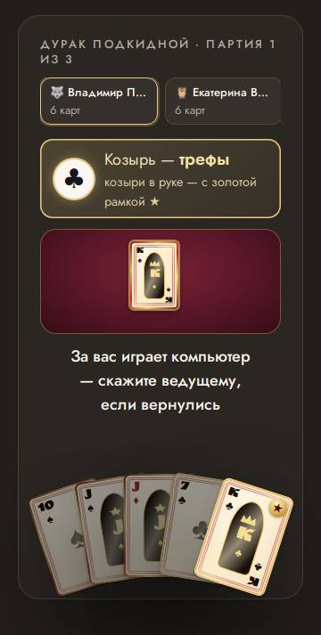

### обрезан текст · телефон

текст обрезан вбок на 23 px (div.dk-card.dk-d--classic) — «6»

- где: `div.dk-hand__row > button.dk-hand__slot > div.dk-card.dk-d--classic > span.dk-idx.dk-idx--b`, этап `playing/92/question/play`
- игры (1): durak 1-й шаблон, каждый сам ×4, большой праздник: 10 команд или 40 гостей, телевизор
- раз: 24

### обрезан текст · телефон

текст обрезан вбок на 29 px (div.dk-card.dk-d--greece) — «7»

- где: `div.dk-hand__row > button.dk-hand__slot > div.dk-card.dk-d--greece > span.dk-idx.dk-idx--b`, этап `playing/117/question/play`
- игры (1): durak 1-й шаблон, каждый сам ×4, большой праздник: 10 команд или 40 гостей, телевизор
- раз: 24

### обрезан текст · телефон

текст обрезан вбок на 23 px (div.dk-card.dk-d--gothic) — «♠︎»

- где: `button.dk-hand__slot > div.dk-card.dk-d--gothic > span.dk-idx.dk-idx--b > span`, этап `playing/56/question/play`
- игры (1): durak 1-й шаблон, каждый сам ×4, большой праздник: 10 команд или 40 гостей, телевизор
- раз: 21

### обрезан текст · экран зала

текст обрезан по высоте на 4 px (span.dg-team__nm) — «🦄»

- где: `ul.dg-teams.dg-teams--l > li.dg-team > span.dg-team__nm > span.name-emoji`, этап `playing/1/question/`
- игры (1): dragon 2-й шаблон, команды ×10, большой праздник: 10 команд или 40 гостей, телевизор
- раз: 20

### обрезан текст · экран зала

текст обрезан по высоте на 4 px (span.dg-team__nm) — «Единороги из бухгалтерии»

- где: `ul.dg-teams.dg-teams--l > li.dg-team > span.dg-team__nm > span`, этап `playing/1/question/`
- игры (1): dragon 2-й шаблон, команды ×10, большой праздник: 10 команд или 40 гостей, телевизор
- раз: 20

### обрезан текст · экран зала

текст обрезан по высоте на 4 px (span.dg-team__nm) — «🐬»

- где: `ul.dg-teams.dg-teams--r > li.dg-team > span.dg-team__nm > span.name-emoji`, этап `playing/1/question/`
- игры (1): dragon 2-й шаблон, команды ×10, большой праздник: 10 команд или 40 гостей, телевизор
- раз: 20

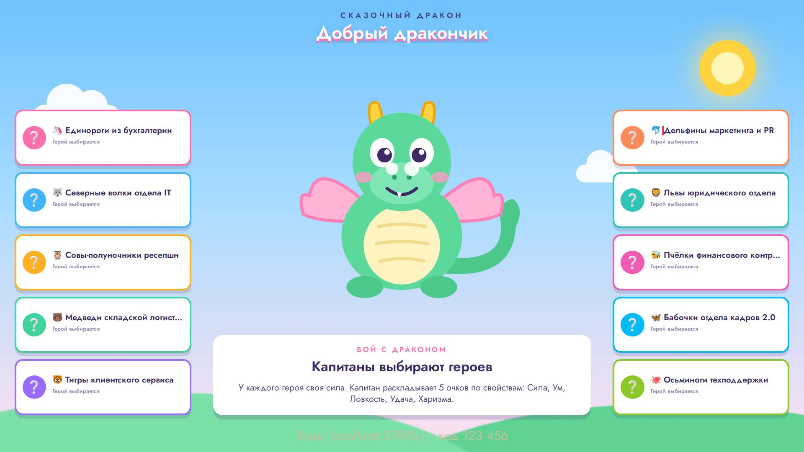

### обрезан текст · экран зала

текст обрезан по высоте на 4 px (span.dg-team__nm) — «Дельфины маркетинга и PR»

- где: `ul.dg-teams.dg-teams--r > li.dg-team > span.dg-team__nm > span`, этап `playing/1/question/`
- игры (1): dragon 2-й шаблон, команды ×10, большой праздник: 10 команд или 40 гостей, телевизор
- раз: 20

### обрезан текст · экран зала

текст обрезан по высоте на 5 px (span.mil-bar__points) — «0»

- где: `div.mil-bars-window > div.mil-carousel > div.mil-bar > span.mil-bar__points`, этап `playing/0/ready/turn`
- игры (1): millionaire 1-й шаблон, команды ×10, большой праздник: 10 команд или 40 гостей, телевизор; millionaire 1-й шаблон, каждый сам ×40, большой праздник: 10 команд или 40 гостей, телевизор
- раз: 18

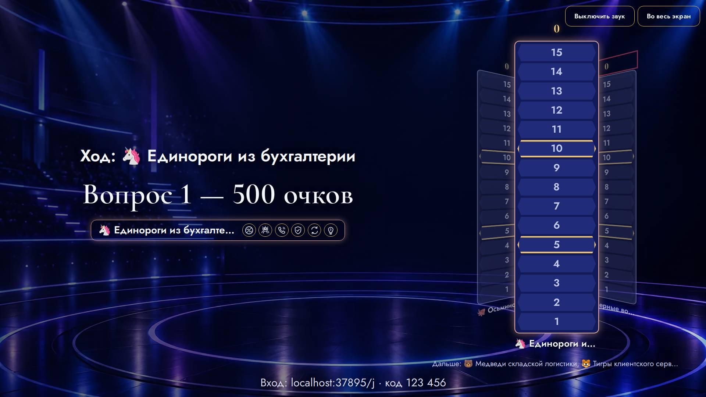

### обрезан текст · экран зала

текст обрезан по высоте на 53 px (span.mil-bar__name) — «Северные волки отдела IT»

- где: `div.mil-carousel > div.mil-bar > span.mil-bar__name > span`, этап `playing/0/ready/turn`
- игры (1): millionaire 1-й шаблон, команды ×10, большой праздник: 10 команд или 40 гостей, телевизор; millionaire 1-й шаблон, каждый сам ×40, большой праздник: 10 команд или 40 гостей, телевизор
- раз: 18

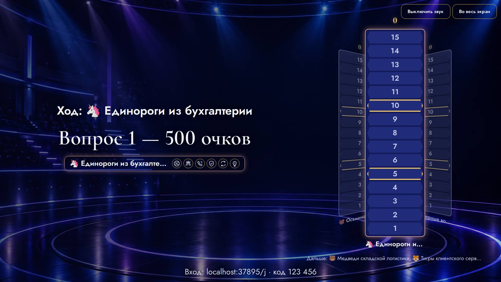

### обрезан текст · телефон

текст обрезан вбок на 13 px (div.dk-card.dk-d--rome) — «♠︎»

- где: `button.dk-hand__slot > div.dk-card.dk-d--rome > span.dk-idx.dk-idx--b > span`, этап `playing/17/question/play`
- игры (1): durak 1-й шаблон, каждый сам ×4, большой праздник: 10 команд или 40 гостей, телевизор
- раз: 18

### обрезан текст · телефон

текст обрезан вбок на 17 px (div.dk-card.dk-d--cyber) — «♠︎»

- где: `button.dk-hand__slot > div.dk-card.dk-d--cyber > span.dk-idx.dk-idx--b > span`, этап `playing/4/question/play`
- игры (1): durak 1-й шаблон, каждый сам ×4, большой праздник: 10 команд или 40 гостей, телевизор
- раз: 12

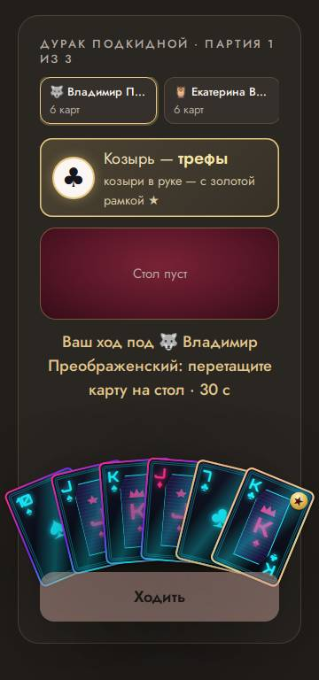

### обрезан текст · телефон

текст обрезан вбок на 29 px (div.dk-card.dk-d--wedding) — «6»

- где: `div.dk-hand__row > button.dk-hand__slot > div.dk-card.dk-d--wedding > span.dk-idx.dk-idx--b`, этап `playing/53/question/play`
- игры (1): durak 1-й шаблон, каждый сам ×4, большой праздник: 10 команд или 40 гостей, телевизор
- раз: 12

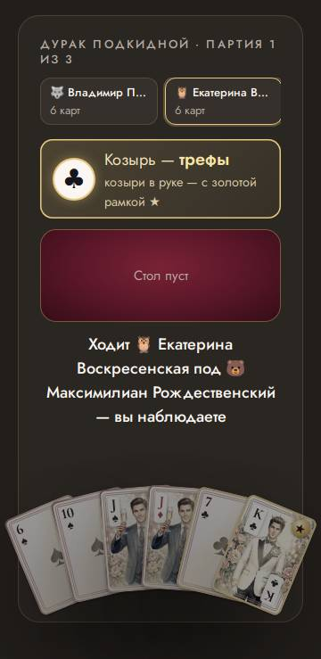

### обрезан текст · телефон

текст обрезан вбок на 13 px (div.dk-card.dk-d--russia) — «♠︎»

- где: `button.dk-hand__slot > div.dk-card.dk-d--russia > span.dk-idx.dk-idx--b > span`, этап `playing/13/question/play`
- игры (1): durak 1-й шаблон, каждый сам ×4, большой праздник: 10 команд или 40 гостей, телевизор
- раз: 11

### обрезан текст · телефон

текст обрезан вбок на 18 px (div.dk-card.dk-d--classic) — «♠︎»

- где: `button.dk-hand__slot > div.dk-card.dk-d--classic > span.dk-idx.dk-idx--b > span`, этап `playing/92/question/play`
- игры (1): durak 1-й шаблон, каждый сам ×4, большой праздник: 10 команд или 40 гостей, телевизор
- раз: 11

### обрезан текст · телефон

текст обрезан вбок на 22 px (div.dk-card.dk-d--greece) — «♠︎»

- где: `button.dk-hand__slot > div.dk-card.dk-d--greece > span.dk-idx.dk-idx--b > span`, этап `playing/117/question/play`
- игры (1): durak 1-й шаблон, каждый сам ×4, большой праздник: 10 команд или 40 гостей, телевизор
- раз: 11

### обрезан текст · пульт

текст обрезан вбок на 3 px (span.wine-cell__label) — «Новый Свет»

- где: `div.wine-row > span.wine-row__cells > span.wine-cell > span.wine-cell__label`, этап `playing/1/reveal/open`
- игры (1): wine 1-й шаблон, команды ×10, большой праздник: 10 команд или 40 гостей, телевизор; wine 1-й шаблон, каждый сам ×40, большой праздник: 10 команд или 40 гостей, телевизор
- раз: 10

### обрезан текст · экран зала

текст обрезан по высоте на 26 px (span.mil-bar__name) — «🐙»

- где: `div.mil-carousel > div.mil-bar > span.mil-bar__name > span.name-emoji`, этап `playing/0/ready/turn`
- игры (1): millionaire 1-й шаблон, команды ×10, большой праздник: 10 команд или 40 гостей, телевизор; millionaire 1-й шаблон, каждый сам ×40, большой праздник: 10 команд или 40 гостей, телевизор
- раз: 9

### обрезан текст · экран зала

текст обрезан по высоте на 5 px (span.line-clamp) — «Кино»

- где: `div.board-grid > div.board-grid__row > div.board-grid__title > span.line-clamp`, этап `playing/2/ready/pick`
- игры (1): board 1-й шаблон, команды ×10, большой праздник: 10 команд или 40 гостей, телевизор; board 1-й шаблон, каждый сам ×40, большой праздник: 10 команд или 40 гостей, телевизор
- раз: 8

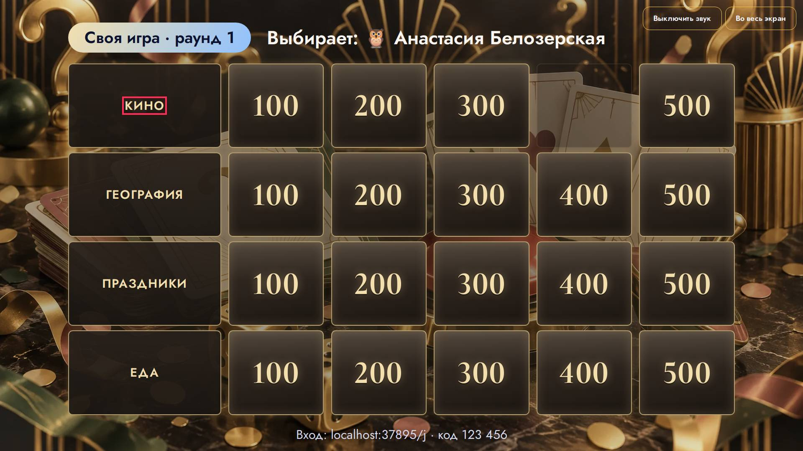

### обрезан текст · телефон

текст обрезан по высоте на 4 px (div.dk-card.dk-d--rome) — «J»

- где: `div.dk-mini > span.dk-mini__pair > div.dk-card.dk-d--rome > span.dk-idx.dk-idx--b`, этап `playing/17/question/play`
- игры (1): durak 1-й шаблон, каждый сам ×4, большой праздник: 10 команд или 40 гостей, телевизор
- раз: 8

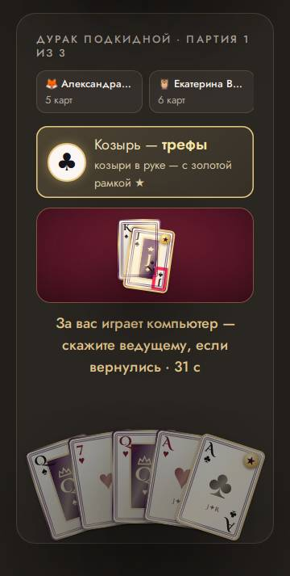

### обрезан текст · телефон

текст обрезан вбок на 23 px (div.dk-card.dk-d--wedding) — «♠︎»

- где: `button.dk-hand__slot > div.dk-card.dk-d--wedding > span.dk-idx.dk-idx--b > span`, этап `playing/53/question/play`
- игры (1): durak 1-й шаблон, каждый сам ×4, большой праздник: 10 команд или 40 гостей, телевизор
- раз: 6

### обрезан текст · экран зала

текст обрезан по высоте на 8 px (div.dg-boss__name) — «Добрый дракончик»

- где: `div.dg-stage.dg-stage--kid > div.dg-frame > div.dg-boss > div.dg-boss__name`, этап `playing/1/question/`
- игры (1): dragon 2-й шаблон, команды ×10, большой праздник: 10 команд или 40 гостей, телевизор
- раз: 4

### обрезан текст · экран зала

текст обрезан по высоте на 30 px (span.mil-bar__name) — «· пропуск хода»

- где: `div.mil-carousel > div.mil-bar > span.mil-bar__name > span.mil-bar__tag`, этап `playing/3/reveal/reveal`
- игры (1): millionaire 1-й шаблон, команды ×10, большой праздник: 10 команд или 40 гостей, телевизор
- раз: 3

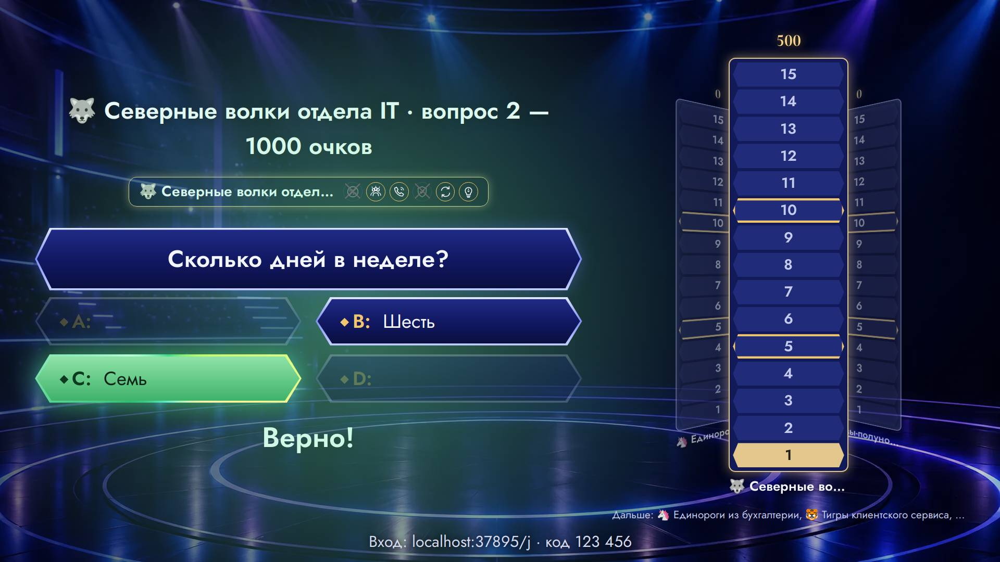

### обрезан текст · телефон

текст обрезан вбок на 8 px (div.dk-card.dk-d--russia) — «♣︎»

- где: `div.dk-hand__row > button.dk-hand__slot > div.dk-card.dk-d--russia > span.dk-pip.dk-pip--ace`, этап `playing/13/question/play`
- игры (1): durak 1-й шаблон, каждый сам ×4, большой праздник: 10 команд или 40 гостей, телевизор
- раз: 3

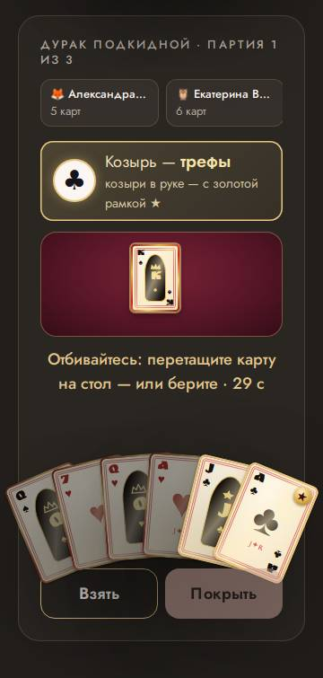

### обрезан текст · телефон

текст обрезан по высоте на 3 px (div.dk-card.dk-d--classic) — «7»

- где: `div.dk-mini > span.dk-mini__pair > div.dk-card.dk-d--classic > span.dk-idx.dk-idx--b`, этап `playing/92/question/play`
- игры (1): durak 1-й шаблон, каждый сам ×4, большой праздник: 10 команд или 40 гостей, телевизор
- раз: 3

### обрезан текст · экран зала

текст обрезан по высоте на 57 px (div.mf-screen) — «№17»

- где: `ul.mf-reveal > li.mf-reveal__item.mf-role--civilian > span.mf-reveal__name > span.mf-num`, этап `playing/54/reveal/over`
- игры (1): mafia 1-й шаблон, каждый сам ×20, большой праздник: 10 команд или 40 гостей, телевизор
- раз: 3

### обрезан текст · экран зала

текст обрезан по высоте на 57 px (div.mf-screen) — «🦁»

- где: `ul.mf-reveal > li.mf-reveal__item.mf-role--civilian > span.mf-reveal__name > span.name-emoji`, этап `playing/54/reveal/over`
- игры (1): mafia 1-й шаблон, каждый сам ×20, большой праздник: 10 команд или 40 гостей, телевизор
- раз: 3

### обрезан текст · экран зала

текст обрезан по высоте на 100 px (div.mf-screen) — «Мирный житель»

- где: `section.mf-screen__main > ul.mf-reveal > li.mf-reveal__item.mf-role--civilian > span.mf-reveal__role`, этап `playing/54/reveal/over`
- игры (1): mafia 1-й шаблон, каждый сам ×20, большой праздник: 10 команд или 40 гостей, телевизор
- раз: 3

### обрезан текст · телефон

текст обрезан вбок на 8 px (div.dk-card.dk-d--cyber) — «♣︎»

- где: `div.dk-hand__row > button.dk-hand__slot > div.dk-card.dk-d--cyber > span.dk-pip.dk-pip--ace`, этап `playing/4/question/play`
- игры (1): durak 1-й шаблон, каждый сам ×4, большой праздник: 10 команд или 40 гостей, телевизор
- раз: 2

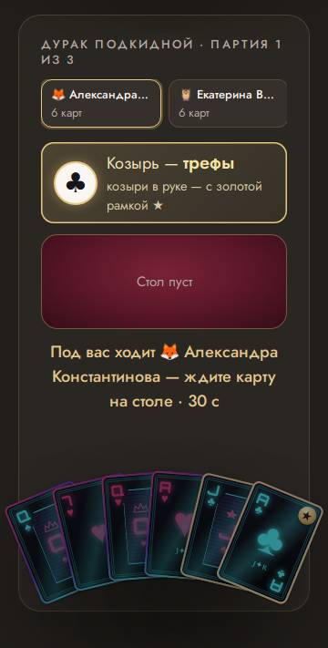

### обрезан текст · телефон

текст обрезан вбок на 8 px (div.dk-card.dk-d--wedding) — «♣︎»

- где: `div.dk-hand__row > button.dk-hand__slot > div.dk-card.dk-d--wedding > span.dk-pip.dk-pip--ace`, этап `playing/53/question/play`
- игры (1): durak 1-й шаблон, каждый сам ×4, большой праздник: 10 команд или 40 гостей, телевизор
- раз: 2

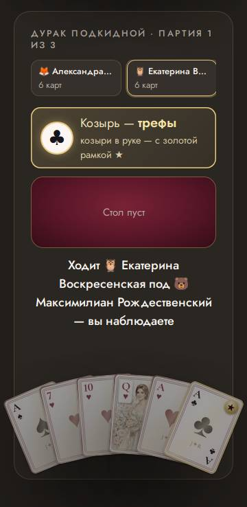

### обрезан текст · телефон

текст обрезан вбок на 8 px (div.dk-card.dk-d--gothic) — «♣︎»

- где: `div.dk-hand__row > button.dk-hand__slot > div.dk-card.dk-d--gothic > span.dk-pip.dk-pip--ace`, этап `playing/56/question/play`
- игры (1): durak 1-й шаблон, каждый сам ×4, большой праздник: 10 команд или 40 гостей, телевизор
- раз: 2

### обрезан текст · телефон

текст обрезан вбок на 8 px (div.dk-card.dk-d--classic) — «♣︎»

- где: `div.dk-hand__row > button.dk-hand__slot > div.dk-card.dk-d--classic > span.dk-pip.dk-pip--ace`, этап `playing/92/question/play`
- игры (1): durak 1-й шаблон, каждый сам ×4, большой праздник: 10 команд или 40 гостей, телевизор
- раз: 2

### обрезан текст · экран зала

текст обрезан по высоте на 10 px (div.dk-card.dk-d--rome) — «8»

- где: `div.dk-battle > div.dk-pair > div.dk-card.dk-d--rome > span.dk-idx.dk-idx--b`, этап `playing/18/question/play`
- игры (1): durak 1-й шаблон, каждый сам ×4, большой праздник: 10 команд или 40 гостей, телевизор
- раз: 2

### обрезан текст · экран зала

текст обрезан по высоте на 10 px (div.dk-card.dk-d--greece) — «8»

- где: `div.dk-battle > div.dk-pair > div.dk-card.dk-d--greece > span.dk-idx.dk-idx--b`, этап `playing/20/question/play`
- игры (1): durak 1-й шаблон, каждый сам ×4, большой праздник: 10 команд или 40 гостей, телевизор
- раз: 2

### обрезан текст · экран зала

текст обрезан по высоте на 57 px (div.mf-screen) — «№16»

- где: `ul.mf-reveal > li.mf-reveal__item.mf-role--mafia > span.mf-reveal__name > span.mf-num`, этап `playing/54/reveal/over`
- игры (1): mafia 1-й шаблон, каждый сам ×20, большой праздник: 10 команд или 40 гостей, телевизор
- раз: 2

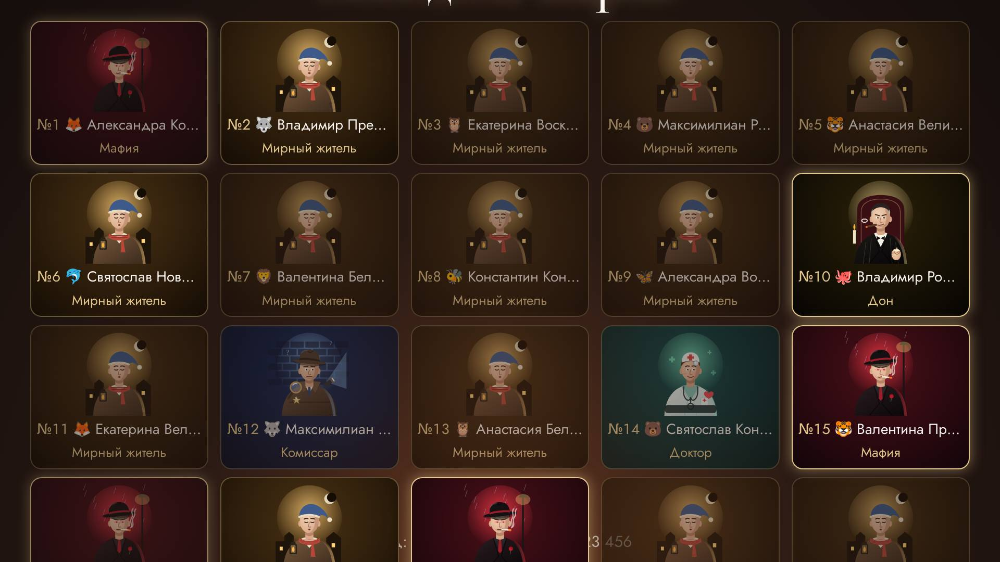

### обрезан текст · экран зала

текст обрезан по высоте на 57 px (div.mf-screen) — «🐬»

- где: `ul.mf-reveal > li.mf-reveal__item.mf-role--mafia > span.mf-reveal__name > span.name-emoji`, этап `playing/54/reveal/over`
- игры (1): mafia 1-й шаблон, каждый сам ×20, большой праздник: 10 команд или 40 гостей, телевизор
- раз: 2

### обрезан текст · экран зала

текст обрезан по высоте на 100 px (div.mf-screen) — «Мафия»

- где: `section.mf-screen__main > ul.mf-reveal > li.mf-reveal__item.mf-role--mafia > span.mf-reveal__role`, этап `playing/54/reveal/over`
- игры (1): mafia 1-й шаблон, каждый сам ×20, большой праздник: 10 команд или 40 гостей, телевизор
- раз: 2

### обрезан текст · телефон

текст обрезан вбок на 8 px (div.dk-card.dk-d--rome) — «♣︎»

- где: `div.dk-hand__row > button.dk-hand__slot > div.dk-card.dk-d--rome > span.dk-pip.dk-pip--ace`, этап `playing/17/question/play`
- игры (1): durak 1-й шаблон, каждый сам ×4, большой праздник: 10 команд или 40 гостей, телевизор
- раз: 1

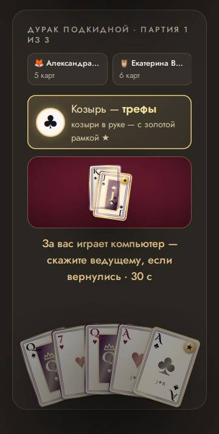

### обрезан текст · экран зала

текст обрезан по высоте на 3 px (div.dk-card.dk-d--classic) — «K»

- где: `div.dk-vote__grid > div.dk-vote__tile > div.dk-card.dk-d--classic > span.dk-idx.dk-idx--b`, этап `playing/2/question/vote`
- игры (1): durak 1-й шаблон, каждый сам ×4, большой праздник: 10 команд или 40 гостей, телевизор
- раз: 1

### обрезан текст · экран зала

текст обрезан по высоте на 5 px (div.dk-card.dk-d--gothic) — «K»

- где: `div.dk-vote__grid > div.dk-vote__tile > div.dk-card.dk-d--gothic > span.dk-idx.dk-idx--b`, этап `playing/2/question/vote`
- игры (1): durak 1-й шаблон, каждый сам ×4, большой праздник: 10 команд или 40 гостей, телевизор
- раз: 1

### обрезан текст · экран зала

текст обрезан по высоте на 8 px (div.dk-card.dk-d--greece) — «K»

- где: `div.dk-vote__grid > div.dk-vote__tile > div.dk-card.dk-d--greece > span.dk-idx.dk-idx--b`, этап `playing/2/question/vote`
- игры (1): durak 1-й шаблон, каждый сам ×4, большой праздник: 10 команд или 40 гостей, телевизор
- раз: 1

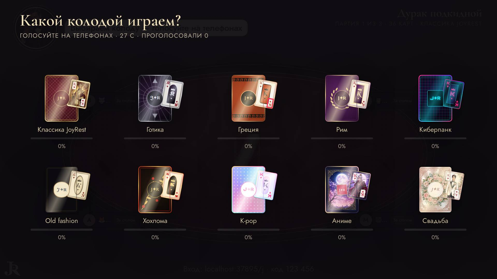

### обрезан текст · экран зала

текст обрезан по высоте на 8 px (div.dk-card.dk-d--rome) — «K»

- где: `div.dk-vote__grid > div.dk-vote__tile > div.dk-card.dk-d--rome > span.dk-idx.dk-idx--b`, этап `playing/2/question/vote`
- игры (1): durak 1-й шаблон, каждый сам ×4, большой праздник: 10 команд или 40 гостей, телевизор
- раз: 1

### обрезан текст · экран зала

текст обрезан по высоте на 7 px (div.dk-card.dk-d--cyber) — «K»

- где: `div.dk-vote__grid > div.dk-vote__tile > div.dk-card.dk-d--cyber > span.dk-idx.dk-idx--b`, этап `playing/2/question/vote`
- игры (1): durak 1-й шаблон, каждый сам ×4, большой праздник: 10 команд или 40 гостей, телевизор
- раз: 1

### обрезан текст · экран зала

текст обрезан по высоте на 7 px (div.dk-card.dk-d--vintage) — «K»

- где: `div.dk-vote__grid > div.dk-vote__tile > div.dk-card.dk-d--vintage > span.dk-idx.dk-idx--b`, этап `playing/2/question/vote`
- игры (1): durak 1-й шаблон, каждый сам ×4, большой праздник: 10 команд или 40 гостей, телевизор
- раз: 1

### обрезан текст · экран зала

текст обрезан по высоте на 5 px (div.dk-card.dk-d--russia) — «K»

- где: `div.dk-vote__grid > div.dk-vote__tile > div.dk-card.dk-d--russia > span.dk-idx.dk-idx--b`, этап `playing/2/question/vote`
- игры (1): durak 1-й шаблон, каждый сам ×4, большой праздник: 10 команд или 40 гостей, телевизор
- раз: 1

### обрезан текст · экран зала

текст обрезан по высоте на 7 px (div.dk-card.dk-d--kpop) — «K»

- где: `div.dk-vote__grid > div.dk-vote__tile > div.dk-card.dk-d--kpop > span.dk-idx.dk-idx--b`, этап `playing/2/question/vote`
- игры (1): durak 1-й шаблон, каждый сам ×4, большой праздник: 10 команд или 40 гостей, телевизор
- раз: 1

### обрезан текст · экран зала

текст обрезан по высоте на 5 px (div.dk-card.dk-d--anime) — «K»

- где: `div.dk-vote__grid > div.dk-vote__tile > div.dk-card.dk-d--anime > span.dk-idx.dk-idx--b`, этап `playing/2/question/vote`
- игры (1): durak 1-й шаблон, каждый сам ×4, большой праздник: 10 команд или 40 гостей, телевизор
- раз: 1

### обрезан текст · экран зала

текст обрезан по высоте на 3 px (div.dk-card.dk-d--wedding) — «K»

- где: `div.dk-vote__grid > div.dk-vote__tile > div.dk-card.dk-d--wedding > span.dk-idx.dk-idx--b`, этап `playing/2/question/vote`
- игры (1): durak 1-й шаблон, каждый сам ×4, большой праздник: 10 команд или 40 гостей, телевизор
- раз: 1

### обрезан текст · экран зала

текст обрезан вбок на 35 px (div.dk-card.dk-d--rome) — «7»

- где: `div.dk-table__felt > div.dk-stock > div.dk-card.dk-d--rome > span.dk-idx`, этап `playing/18/question/play`
- игры (1): durak 1-й шаблон, каждый сам ×4, большой праздник: 10 команд или 40 гостей, телевизор
- раз: 1

### обрезан текст · экран зала

текст обрезан вбок на 18 px (div.dk-card.dk-d--rome) — «♦︎»

- где: `div.dk-stock > div.dk-card.dk-d--rome > span.dk-idx > span`, этап `playing/18/question/play`
- игры (1): durak 1-й шаблон, каждый сам ×4, большой праздник: 10 команд или 40 гостей, телевизор
- раз: 1

### обрезан текст · экран зала

текст обрезан вбок на 3 px (div.dk-card.dk-d--rome) — «♦︎»

- где: `div.dk-table__felt > div.dk-stock > div.dk-card.dk-d--rome > span.dk-pip`, этап `playing/18/question/play`
- игры (1): durak 1-й шаблон, каждый сам ×4, большой праздник: 10 команд или 40 гостей, телевизор
- раз: 1

### обрезан текст · экран зала

текст обрезан вбок на 35 px (div.dk-card.dk-d--greece) — «7»

- где: `div.dk-table__felt > div.dk-stock > div.dk-card.dk-d--greece > span.dk-idx`, этап `playing/20/question/play`
- игры (1): durak 1-й шаблон, каждый сам ×4, большой праздник: 10 команд или 40 гостей, телевизор
- раз: 1

### обрезан текст · экран зала

текст обрезан вбок на 18 px (div.dk-card.dk-d--greece) — «♦︎»

- где: `div.dk-stock > div.dk-card.dk-d--greece > span.dk-idx > span`, этап `playing/20/question/play`
- игры (1): durak 1-й шаблон, каждый сам ×4, большой праздник: 10 команд или 40 гостей, телевизор
- раз: 1

### обрезан текст · экран зала

текст обрезан вбок на 3 px (div.dk-card.dk-d--greece) — «♦︎»

- где: `div.dk-table__felt > div.dk-stock > div.dk-card.dk-d--greece > span.dk-pip`, этап `playing/20/question/play`
- игры (1): durak 1-й шаблон, каждый сам ×4, большой праздник: 10 команд или 40 гостей, телевизор
- раз: 1

### обрезан текст · экран зала

текст обрезан по высоте на 164 px (div.mf-screen) — «Партия 1 из 3 · итог»

- где: `main.quiz-stage > div.mf-screen > section.mf-screen__main > span.quiz-screen__badge`, этап `playing/54/reveal/over`
- игры (1): mafia 1-й шаблон, каждый сам ×20, большой праздник: 10 команд или 40 гостей, телевизор
- раз: 1

### обрезан текст · экран зала

текст обрезан по высоте на 92 px (div.mf-screen) — «Победила мафия!»

- где: `main.quiz-stage > div.mf-screen > section.mf-screen__main > h2.mf-title`, этап `playing/54/reveal/over`
- игры (1): mafia 1-й шаблон, каждый сам ×20, большой праздник: 10 команд или 40 гостей, телевизор
- раз: 1

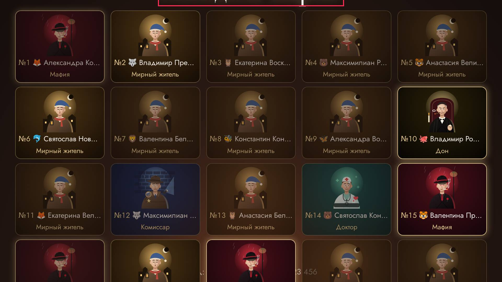

### прячется за прокруткой · экран зала

на экране зала текст виден только прокруткой (по высоте на 12 px) — «и ещё 36»

- где: `div.final > div.final__board > div.board-view > p.board-view__more`, этап `finished/7/podium/`
- игры (6): quiz 1-й шаблон, каждый сам ×40, большой праздник: 10 команд или 40 гостей, телевизор; lotto 1-й шаблон, команды ×10, большой праздник: 10 команд или 40 гостей, телевизор; stage 1-й шаблон, команды ×10, большой праздник: 10 команд или 40 гостей, телевизор; stage 2-й шаблон, команды ×10, большой праздник: 10 команд или 40 гостей, телевизор; survival 1-й шаблон, команды ×10, большой праздник: 10 команд или 40 гостей, телевизор; bunker 1-й шаблон, каждый сам ×16, большой праздник: 10 команд или 40 гостей, телевизор …
- раз: 7

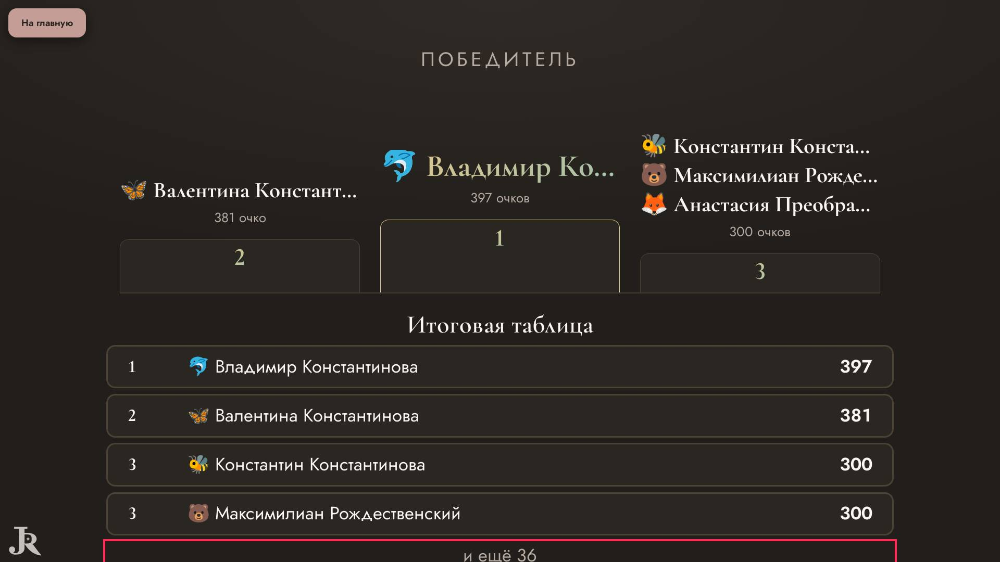

### прячется за прокруткой · экран зала

на экране зала текст виден только прокруткой (по высоте на 167 px) — «Карманник»

- где: `ol.bk-screen__dossiers.bk-final__survivors > li > article.bk-dossier > p.bk-dossier__used`, этап `playing/109/reveal/final`
- игры (1): bunker 1-й шаблон, каждый сам ×16, большой праздник: 10 команд или 40 гостей, телевизор
- раз: 4

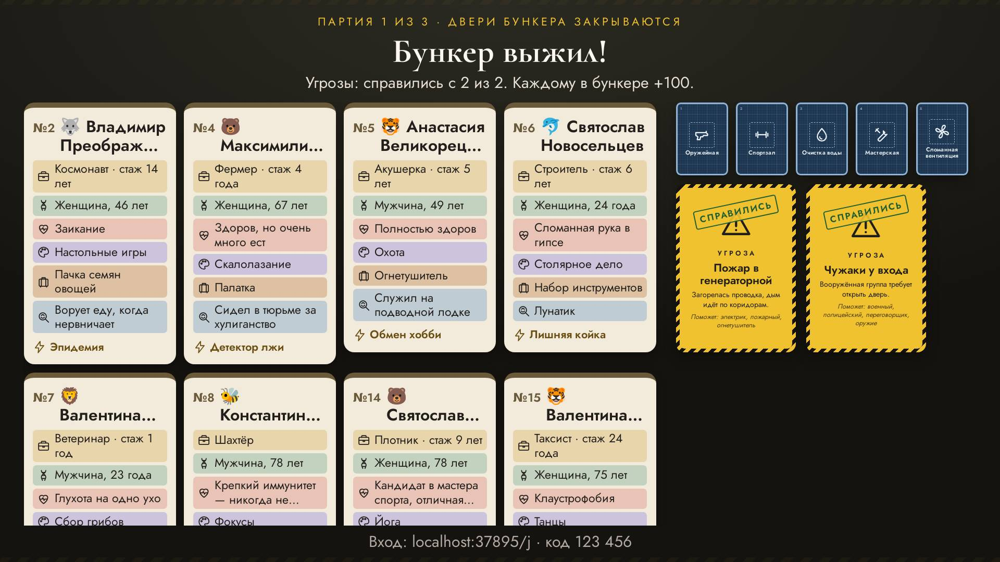

### бледный текст · телефон

контраст 1.14 (нужно от 4.5) — «B»

- где: `div.mil-question.mil-question--phone > ol.mil-options > li.mil-option > span.mil-option__letter`, этап `playing/0/reveal/reveal`
- игры (1): millionaire 1-й шаблон, команды ×10, большой праздник: 10 команд или 40 гостей, телевизор; millionaire 1-й шаблон, каждый сам ×40, большой праздник: 10 команд или 40 гостей, телевизор
- раз: 54

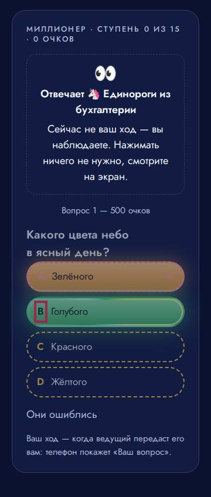

### бледный текст · телефон

контраст 1.01 (нужно от 4.5) — «100%»

- где: `div.mil-question.mil-question--phone > ol.mil-options > li.mil-option > span.mil-option__pct`, этап `playing/8/question/question`
- игры (1): millionaire 1-й шаблон, команды ×10, большой праздник: 10 команд или 40 гостей, телевизор; millionaire 1-й шаблон, каждый сам ×40, большой праздник: 10 команд или 40 гостей, телевизор
- раз: 39

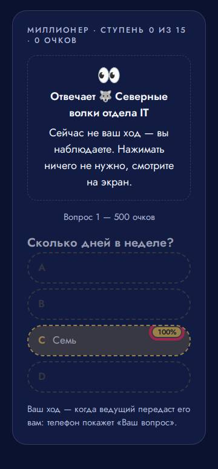

### бледный текст · телефон

контраст 1.01 (нужно от 4.5) — «Зелёного»

- где: `div.mil-question.mil-question--phone > ol.mil-options > li.mil-option > span.mil-option__text`, этап `playing/0/reveal/reveal`
- игры (1): millionaire 1-й шаблон, команды ×10, большой праздник: 10 команд или 40 гостей, телевизор; millionaire 1-й шаблон, каждый сам ×40, большой праздник: 10 команд или 40 гостей, телевизор
- раз: 28

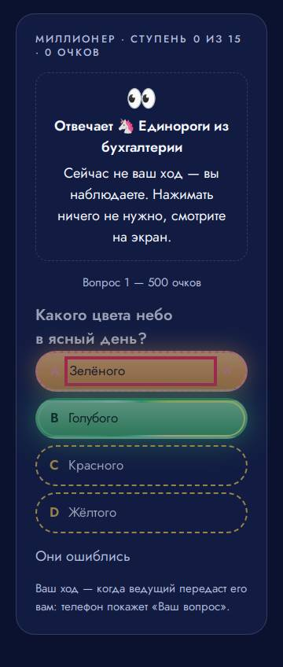

### бледный текст · экран зала

контраст 3.27 (нужно от 4.5) — «Герой выбирается»

- где: `div.dg-frame > ul.dg-teams.dg-teams--l > li.dg-team > span.dg-team__hero`, этап `playing/1/question/`
- игры (1): dragon 2-й шаблон, команды ×10, большой праздник: 10 команд или 40 гостей, телевизор
- раз: 20

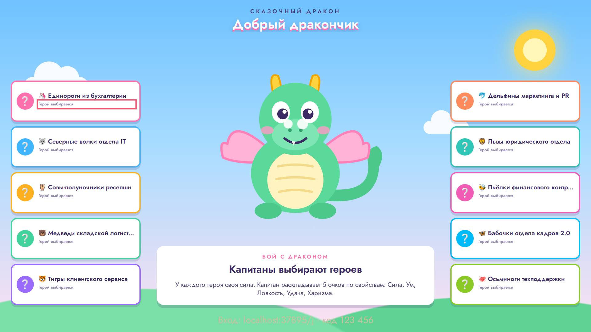

### бледный текст · экран зала

контраст 3.27 (нужно от 4.5) — «Герой выбирается»

- где: `div.dg-frame > ul.dg-teams.dg-teams--r > li.dg-team > span.dg-team__hero`, этап `playing/1/question/`
- игры (1): dragon 2-й шаблон, команды ×10, большой праздник: 10 команд или 40 гостей, телевизор
- раз: 20

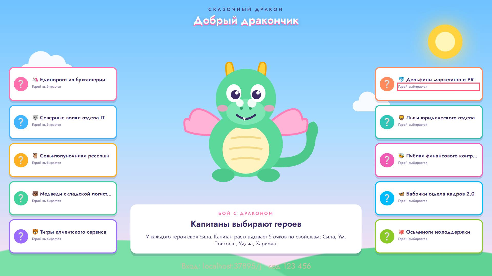

### бледный текст · пульт

контраст 3.55 (нужно от 4.5) — «Пять»

- где: `div.stack.host-quiz > div.card.stack > ol.mil-host-options > li`, этап `playing/3/question/question`
- игры (1): millionaire 1-й шаблон, команды ×10, большой праздник: 10 команд или 40 гостей, телевизор
- раз: 17

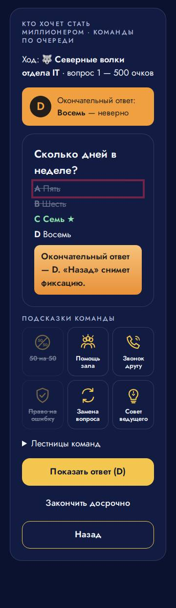

### бледный текст · пульт

контраст 3.55 (нужно от 4.5) — «A»

- где: `div.card.stack > ol.mil-host-options > li > strong`, этап `playing/3/question/question`
- игры (1): millionaire 1-й шаблон, команды ×10, большой праздник: 10 команд или 40 гостей, телевизор
- раз: 17

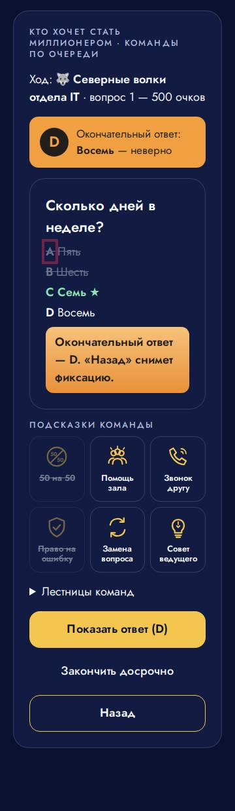

### бледный текст · экран зала

контраст 2.44 (нужно от 3) — «1»

- где: `section.mf-screen__seats > ol.mf-seats.mf-seats--screen > li.mf-seat > span.mf-seat__num`, этап `playing/7/question/night`
- игры (1): mafia 1-й шаблон, каждый сам ×20, большой праздник: 10 команд или 40 гостей, телевизор
- раз: 12

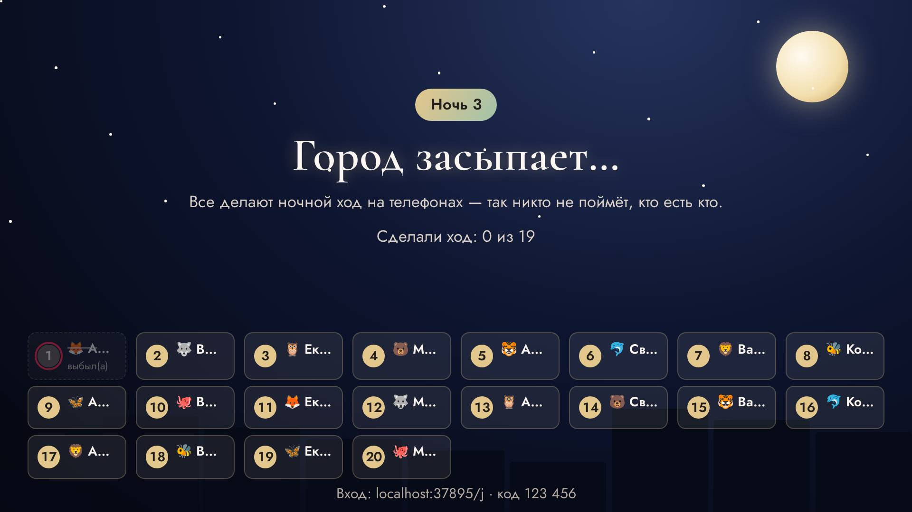

### бледный текст · пульт

контраст 3.07 (нужно от 4.5) — «Германия»

- где: `div.wine-row > span.wine-row__cells > span.wine-cell > span.wine-cell__label`, этап `playing/1/reveal/open`
- игры (1): wine 1-й шаблон, команды ×10, большой праздник: 10 команд или 40 гостей, телевизор; wine 1-й шаблон, каждый сам ×40, большой праздник: 10 команд или 40 гостей, телевизор
- раз: 12

### бледный текст · экран зала

контраст 2.58 (нужно от 3) — «А»

- где: `div.dg-q > ol.dg-q__ans > li > b`, этап `playing/3/reveal/`
- игры (1): dragon 2-й шаблон, команды ×10, большой праздник: 10 команд или 40 гостей, телевизор
- раз: 4

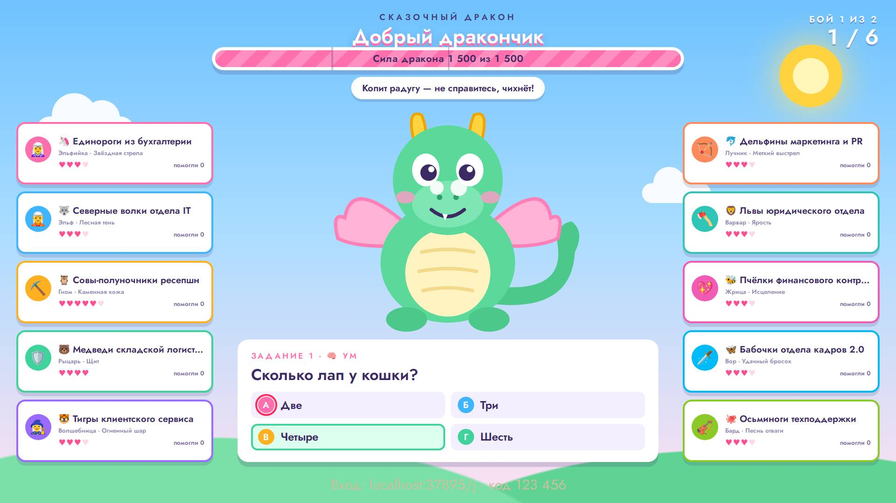

### бледный текст · телефон

контраст 1.07 (нужно от 4.5) — «Анастасия Белозерская»

- где: `div.mf-targets > button.mf-target > span.mf-target__name > span`, этап `playing/2/question/night`
- игры (1): mafia 1-й шаблон, каждый сам ×20, большой праздник: 10 команд или 40 гостей, телевизор
- раз: 4

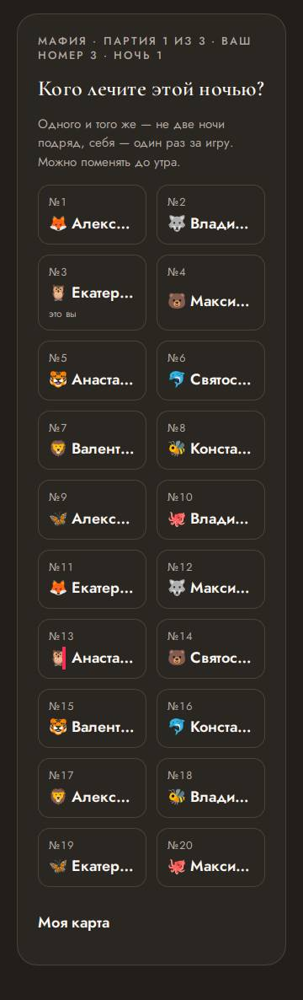

### бледный текст · экран зала

контраст 1.09 (нужно от 4.5) — «А»

- где: `div.dk-table > div.dk-seat.dk-seat--wait > div.dk-seat__card > span.dk-seat__avatar`, этап `playing/2/question/vote`
- игры (1): durak 1-й шаблон, каждый сам ×4, большой праздник: 10 команд или 40 гостей, телевизор
- раз: 3

### бледный текст · экран зала

контраст 2.58 (нужно от 4.5) — «Бой с драконом»

- где: `div.dg-stage.dg-stage--kid > div.dg-frame > div.dg-q.dg-q--center > div.dg-q__eye`, этап `playing/1/question/`
- игры (1): dragon 2-й шаблон, команды ×10, большой праздник: 10 команд или 40 гостей, телевизор
- раз: 2

### бледный текст · экран зала

контраст 2.58 (нужно от 4.5) — «Задание 1 · 🧠 Ум»

- где: `div.dg-stage.dg-stage--kid > div.dg-frame > div.dg-q > div.dg-q__eye`, этап `playing/3/reveal/`
- игры (1): dragon 2-й шаблон, команды ×10, большой праздник: 10 команд или 40 гостей, телевизор
- раз: 2

### бледный текст · телефон

контраст 3.34 (нужно от 4.5) — «7»

- где: `div.dk-hand__row > button.dk-hand__slot > div.dk-card.dk-d--russia > span.dk-idx.dk-idx--b`, этап `playing/13/question/play`
- игры (1): durak 1-й шаблон, каждый сам ×4, большой праздник: 10 команд или 40 гостей, телевизор
- раз: 2

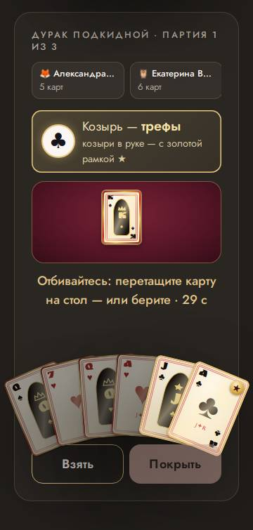

### бледный текст · экран зала

контраст 1.21 (нужно от 3) — «A»

- где: `div.mil-question.mil-question--screen > ol.mil-options > li.mil-option > span.mil-option__letter`, этап `playing/0/question/question`
- игры (1): millionaire 1-й шаблон, каждый сам ×40, большой праздник: 10 команд или 40 гостей, телевизор
- раз: 1

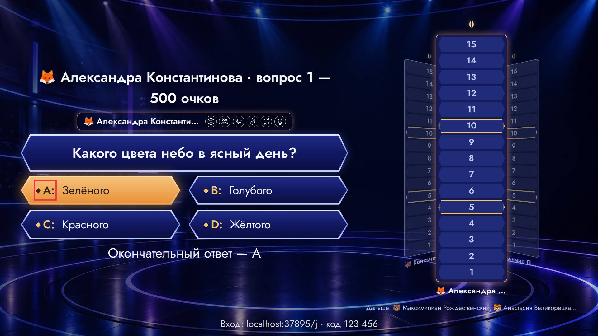

### бледный текст · экран зала

контраст 1.04 (нужно от 3) — «Зелёного»

- где: `div.mil-question.mil-question--screen > ol.mil-options > li.mil-option > span.mil-option__text`, этап `playing/0/question/question`
- игры (1): millionaire 1-й шаблон, каждый сам ×40, большой праздник: 10 команд или 40 гостей, телевизор
- раз: 1

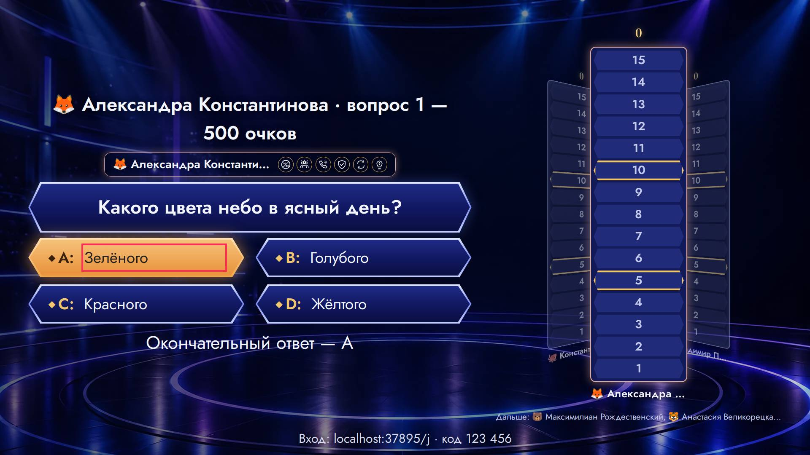

### бледный текст · пульт

контраст 1.85 (нужно от 4.5) — «ещё: бельё, плед»

- где: `li > button.hd-host__row > span.hd-host__text > small`, этап `playing/0/reveal/play`
- игры (1): hundred 1-й шаблон, команды ×10, большой праздник: 10 команд или 40 гостей, телевизор
- раз: 1

### бледный текст · экран зала

контраст 1.18 (нужно от 3) — «6»

- где: `div.dk-battle > div.dk-pair > div.dk-card.dk-d--greece > span.dk-idx.dk-idx--b`, этап `playing/20/question/play`
- игры (1): durak 1-й шаблон, каждый сам ×4, большой праздник: 10 команд или 40 гостей, телевизор
- раз: 1

### мелко для зала · экран зала

шрифт 16.2 px — 16 px на Full HD (нужно от 18) — «кл. 0»

- где: `aside.qx-panel > ol.qx-panel__list > li.qx-row > span.qx-row__cell`, этап `playing/0/question/roll`
- игры (1): quest 1-й шаблон, команды ×10, большой праздник: 10 команд или 40 гостей, телевизор; quest 2-й шаблон, команды ×10, большой праздник: 10 команд или 40 гостей, телевизор
- раз: 80

### мелко для зала · экран зала

шрифт 11.7 px — 12 px на Full HD (нужно от 18) — «№1»

- где: `li > article.bk-dossier > header.bk-dossier__head > span.bk-dossier__seat`, этап `playing/16/question/open`
- игры (1): bunker 1-й шаблон, каждый сам ×16, большой праздник: 10 команд или 40 гостей, телевизор
- раз: 80

### мелко для зала · экран зала

шрифт 16.0 px — 16 px на Full HD (нужно от 18) — «Александра Константинова»

- где: `article.bk-dossier > header.bk-dossier__head > span.bk-dossier__name > span`, этап `playing/16/question/open`
- игры (1): bunker 1-й шаблон, каждый сам ×16, большой праздник: 10 команд или 40 гостей, телевизор
- раз: 80

### мелко для зала · экран зала

шрифт 11.7 px — 12 px на Full HD (нужно от 18) — «Стилист · стаж 23 года»

- где: `article.bk-dossier > ul.bk-dossier__rows > li.bk-row.bk-row--profession > span.bk-row__text`, этап `playing/16/question/open`
- игры (1): bunker 1-й шаблон, каждый сам ×16, большой праздник: 10 команд или 40 гостей, телевизор
- раз: 80

### мелко для зала · экран зала

шрифт 11.7 px — 12 px на Full HD (нужно от 18) — «Биология»

- где: `article.bk-dossier > ul.bk-dossier__rows > li.bk-row.bk-row--biology > span.bk-row__text`, этап `playing/16/question/open`
- игры (1): bunker 1-й шаблон, каждый сам ×16, большой праздник: 10 команд или 40 гостей, телевизор
- раз: 80

### мелко для зала · экран зала

шрифт 11.7 px — 12 px на Full HD (нужно от 18) — «Здоровье»

- где: `article.bk-dossier > ul.bk-dossier__rows > li.bk-row.bk-row--health > span.bk-row__text`, этап `playing/16/question/open`
- игры (1): bunker 1-й шаблон, каждый сам ×16, большой праздник: 10 команд или 40 гостей, телевизор
- раз: 80

### мелко для зала · экран зала

шрифт 11.7 px — 12 px на Full HD (нужно от 18) — «Хобби»

- где: `article.bk-dossier > ul.bk-dossier__rows > li.bk-row.bk-row--hobby > span.bk-row__text`, этап `playing/16/question/open`
- игры (1): bunker 1-й шаблон, каждый сам ×16, большой праздник: 10 команд или 40 гостей, телевизор
- раз: 80

### мелко для зала · экран зала

шрифт 11.7 px — 12 px на Full HD (нужно от 18) — «Багаж»

- где: `article.bk-dossier > ul.bk-dossier__rows > li.bk-row.bk-row--baggage > span.bk-row__text`, этап `playing/16/question/open`
- игры (1): bunker 1-й шаблон, каждый сам ×16, большой праздник: 10 команд или 40 гостей, телевизор
- раз: 80

### мелко для зала · экран зала

шрифт 11.7 px — 12 px на Full HD (нужно от 18) — «Может не спать двое суток»

- где: `article.bk-dossier > ul.bk-dossier__rows > li.bk-row.bk-row--fact > span.bk-row__text`, этап `playing/16/question/open`
- игры (1): bunker 1-й шаблон, каждый сам ×16, большой праздник: 10 команд или 40 гостей, телевизор
- раз: 80

### мелко для зала · экран зала

шрифт 13.4 px — 13 px на Full HD (нужно от 18) — «0»

- где: `li.dg-team > span.dg-team__row > span.dg-team__dm > b`, этап `playing/2/ready/`
- игры (1): dragon 1-й шаблон, команды ×10, большой праздник: 10 команд или 40 гостей, телевизор; dragon 2-й шаблон, команды ×10, большой праздник: 10 команд или 40 гостей, телевизор
- раз: 60

### мелко для зала · экран зала

шрифт 10.9 px — 11 px на Full HD (нужно от 18) — «Медкомиссия»

- где: `ol.bk-screen__dossiers > li > article.bk-dossier > p.bk-dossier__used`, этап `playing/16/question/open`
- игры (1): bunker 1-й шаблон, каждый сам ×16, большой праздник: 10 команд или 40 гостей, телевизор
- раз: 60

### мелко для зала · экран зала

шрифт 13.4 px — 13 px на Full HD (нужно от 18) — «Герой выбирается»

- где: `div.dg-frame > ul.dg-teams.dg-teams--l > li.dg-team > span.dg-team__hero`, этап `playing/1/question/`
- игры (1): dragon 1-й шаблон, команды ×10, большой праздник: 10 команд или 40 гостей, телевизор; dragon 2-й шаблон, команды ×10, большой праздник: 10 команд или 40 гостей, телевизор
- раз: 40

### мелко для зала · экран зала

шрифт 13.4 px — 13 px на Full HD (нужно от 18) — «Герой выбирается»

- где: `div.dg-frame > ul.dg-teams.dg-teams--r > li.dg-team > span.dg-team__hero`, этап `playing/1/question/`
- игры (1): dragon 1-й шаблон, команды ×10, большой праздник: 10 команд или 40 гостей, телевизор; dragon 2-й шаблон, команды ×10, большой праздник: 10 команд или 40 гостей, телевизор
- раз: 40

### мелко для зала · экран зала

шрифт 7.9 px — 8 px на Full HD (нужно от 18) — «1»

- где: `li > div.bk-card.bk-plan > div.bk-in > span.bk-plan__num`, этап `playing/16/question/open`
- игры (1): bunker 1-й шаблон, каждый сам ×16, большой праздник: 10 команд или 40 гостей, телевизор
- раз: 40

### мелко для зала · экран зала

шрифт 13.4 px — 13 px на Full HD (нужно от 18) — «урон»

- где: `ul.dg-teams.dg-teams--l > li.dg-team > span.dg-team__row > span.dg-team__dm`, этап `playing/2/ready/`
- игры (1): dragon 1-й шаблон, команды ×10, большой праздник: 10 команд или 40 гостей, телевизор; dragon 2-й шаблон, команды ×10, большой праздник: 10 команд или 40 гостей, телевизор
- раз: 30

### мелко для зала · экран зала

шрифт 13.4 px — 13 px на Full HD (нужно от 18) — «урон»

- где: `ul.dg-teams.dg-teams--r > li.dg-team > span.dg-team__row > span.dg-team__dm`, этап `playing/2/ready/`
- игры (1): dragon 1-й шаблон, команды ×10, большой праздник: 10 команд или 40 гостей, телевизор; dragon 2-й шаблон, команды ×10, большой праздник: 10 команд или 40 гостей, телевизор
- раз: 30

### мелко для зала · экран зала

шрифт 13.6 px — 14 px на Full HD (нужно от 18) — «Оружейная»

- где: `li > div.bk-card.bk-plan > div.bk-in > span.bk-plan__title`, этап `playing/16/question/open`
- игры (1): bunker 1-й шаблон, каждый сам ×16, большой праздник: 10 команд или 40 гостей, телевизор
- раз: 25

### мелко для зала · экран зала

шрифт 16.2 px — 16 px на Full HD (нужно от 18) — «За столом»

- где: `div.dk-table > div.dk-seat.dk-seat--wait > div.dk-seat__card > span.dk-seat__status`, этап `playing/1/question/deal`
- игры (1): durak 1-й шаблон, каждый сам ×4, большой праздник: 10 команд или 40 гостей, телевизор
- раз: 8

### мелко для зала · экран зала

шрифт 10.9 px — 11 px на Full HD (нужно от 18) — «Изгнан»

- где: `ol.bk-screen__dossiers > li > article.bk-dossier > span.bk-dossier__stamp`, этап `playing/82/question/justify`
- игры (1): bunker 1-й шаблон, каждый сам ×16, большой праздник: 10 команд или 40 гостей, телевизор
- раз: 8

### мелко для зала · экран зала

шрифт 15.1 px — 15 px на Full HD (нужно от 18) — «Бросает кубик»

- где: `div.quest-screen.qx--classic > div.qx-turn > div.qx-turn__who > span.qx-turn__label`, этап `playing/0/question/roll`
- игры (1): quest 1-й шаблон, команды ×10, большой праздник: 10 команд или 40 гостей, телевизор
- раз: 7

### мелко для зала · экран зала

шрифт 15.1 px — 15 px на Full HD (нужно от 18) — «Бросает кубик»

- где: `div.quest-screen.qx--adult > div.qx-turn > div.qx-turn__who > span.qx-turn__label`, этап `playing/0/question/roll`
- игры (1): quest 2-й шаблон, команды ×10, большой праздник: 10 команд или 40 гостей, телевизор
- раз: 7

### мелко для зала · экран зала

шрифт 18.2 px — 18 px на Full HD (нужно от 18) — «Бой 1 из 2»

- где: `div.dg-stage.dg-stage--adult > div.dg-frame > div.dg-boss > div.dg-boss__rank`, этап `playing/1/question/`
- игры (1): dragon 1-й шаблон, команды ×10, большой праздник: 10 команд или 40 гостей, телевизор
- раз: 4

### мелко для зала · экран зала

шрифт 18.2 px — 18 px на Full HD (нужно от 18) — «Сказочный дракон»

- где: `div.dg-stage.dg-stage--kid > div.dg-frame > div.dg-boss > div.dg-boss__rank`, этап `playing/1/question/`
- игры (1): dragon 2-й шаблон, команды ×10, большой праздник: 10 команд или 40 гостей, телевизор
- раз: 4

### мелко для зала · экран зала

шрифт 17.3 px — 17 px на Full HD (нужно от 18) — «4 карт»

- где: `div.dk-seat.dk-seat--throw > div.dk-seat__card > span.dk-seat__text > span.dk-seat__meta`, этап `playing/18/question/play`
- игры (1): durak 1-й шаблон, каждый сам ×4, большой праздник: 10 команд или 40 гостей, телевизор
- раз: 4

### мелко для зала · экран зала

шрифт 16.2 px — 16 px на Full HD (нужно от 18) — «Ходит»

- где: `div.dk-table > div.dk-seat.dk-seat--throw > div.dk-seat__card > span.dk-seat__status`, этап `playing/18/question/play`
- игры (1): durak 1-й шаблон, каждый сам ×4, большой праздник: 10 команд или 40 гостей, телевизор
- раз: 4

### мелко для зала · экран зала

шрифт 14.3 px — 14 px на Full HD (нужно от 18) — «💃 Латина»

- где: `div.db-pick__cards > span.db-card.db-card--dance > span.db-card__label > span.db-card__style`, этап `playing/0/question/pick`
- игры (1): dance 1-й шаблон, команды ×10, большой праздник: 10 команд или 40 гостей, телевизор
- раз: 3

### мелко для зала · экран зала

шрифт 11.5 px — 11 px на Full HD (нужно от 18) — «№ 1»

- где: `div.db-pick__cards > span.db-card.db-card--dance > span.db-card__label > span.db-card__n`, этап `playing/0/question/pick`
- игры (1): dance 1-й шаблон, команды ×10, большой праздник: 10 команд или 40 гостей, телевизор
- раз: 3

### мелко для зала · экран зала

шрифт 11.5 px — 11 px на Full HD (нужно от 18) — «№ 2»

- где: `div.db-pick__cards > span.db-card.db-card--karaoke > span.db-card__label > span.db-card__n`, этап `playing/0/question/pick`
- игры (1): dance 1-й шаблон, команды ×10, большой праздник: 10 команд или 40 гостей, телевизор
- раз: 3

### мелко для зала · экран зала

шрифт 14.3 px — 14 px на Full HD (нужно от 18) — «🎉 Вечеринка»

- где: `div.db-pick__cards > span.db-card.db-card--battle > span.db-card__label > span.db-card__style`, этап `playing/0/question/pick`
- игры (1): dance 1-й шаблон, команды ×10, большой праздник: 10 команд или 40 гостей, телевизор
- раз: 3

### мелко для зала · экран зала

шрифт 11.5 px — 11 px на Full HD (нужно от 18) — «№ 3»

- где: `div.db-pick__cards > span.db-card.db-card--battle > span.db-card__label > span.db-card__n`, этап `playing/0/question/pick`
- игры (1): dance 1-й шаблон, команды ×10, большой праздник: 10 команд или 40 гостей, телевизор
- раз: 3

### мелко для зала · экран зала

шрифт 17.3 px — 17 px на Full HD (нужно от 18) — «Бой с драконом»

- где: `div.dg-stage.dg-stage--adult > div.dg-frame > div.dg-q.dg-q--center > div.dg-q__eye`, этап `playing/1/question/`
- игры (1): dragon 1-й шаблон, команды ×10, большой праздник: 10 команд или 40 гостей, телевизор
- раз: 2

### мелко для зала · экран зала

шрифт 17.3 px — 17 px на Full HD (нужно от 18) — «Задание 1 · 🧠 Ум»

- где: `div.dg-stage.dg-stage--adult > div.dg-frame > div.dg-q > div.dg-q__eye`, этап `playing/3/reveal/`
- игры (1): dragon 1-й шаблон, команды ×10, большой праздник: 10 команд или 40 гостей, телевизор
- раз: 2

### мелко для зала · экран зала

шрифт 17.3 px — 17 px на Full HD (нужно от 18) — «Бой с драконом»

- где: `div.dg-stage.dg-stage--kid > div.dg-frame > div.dg-q.dg-q--center > div.dg-q__eye`, этап `playing/1/question/`
- игры (1): dragon 2-й шаблон, команды ×10, большой праздник: 10 команд или 40 гостей, телевизор
- раз: 2

### мелко для зала · экран зала

шрифт 17.3 px — 17 px на Full HD (нужно от 18) — «Задание 1 · 🧠 Ум»

- где: `div.dg-stage.dg-stage--kid > div.dg-frame > div.dg-q > div.dg-q__eye`, этап `playing/3/reveal/`
- игры (1): dragon 2-й шаблон, команды ×10, большой праздник: 10 команд или 40 гостей, телевизор
- раз: 2

### мелко для зала · экран зала

шрифт 17.3 px — 17 px на Full HD (нужно от 18) — «4 карт»

- где: `div.dk-seat.dk-seat--defend > div.dk-seat__card > span.dk-seat__text > span.dk-seat__meta`, этап `playing/18/question/play`
- игры (1): durak 1-й шаблон, каждый сам ×4, большой праздник: 10 команд или 40 гостей, телевизор
- раз: 2

### мелко для зала · экран зала

шрифт 16.2 px — 16 px на Full HD (нужно от 18) — «Бьётся»

- где: `div.dk-table > div.dk-seat.dk-seat--defend > div.dk-seat__card > span.dk-seat__status`, этап `playing/18/question/play`
- игры (1): durak 1-й шаблон, каждый сам ×4, большой праздник: 10 команд или 40 гостей, телевизор
- раз: 2

### мелко для зала · экран зала

шрифт 17.3 px — 17 px на Full HD (нужно от 18) — «6 карт»

- где: `div.dk-seat.dk-seat--wait > div.dk-seat__card > span.dk-seat__text > span.dk-seat__meta`, этап `playing/18/question/play`
- игры (1): durak 1-й шаблон, каждый сам ×4, большой праздник: 10 команд или 40 гостей, телевизор
- раз: 2

### мелко для зала · экран зала

шрифт 15.9 px — 16 px на Full HD (нужно от 18) — «Профессия»

- где: `div.bk-card.bk-trait > div.bk-in > span.bk-trait__band > span`, этап `playing/16/question/open`
- игры (1): bunker 1-й шаблон, каждый сам ×16, большой праздник: 10 команд или 40 гостей, телевизор
- раз: 2

### мелко для зала · экран зала

шрифт 13.0 px — 13 px на Full HD (нужно от 18) — «Угроза»

- где: `li > div.bk-card.bk-threat > div.bk-in > span.bk-threat__kicker`, этап `playing/109/reveal/final`
- игры (1): bunker 1-й шаблон, каждый сам ×16, большой праздник: 10 команд или 40 гостей, телевизор
- раз: 2

### мелко для зала · экран зала

шрифт 14.3 px — 14 px на Full HD (нужно от 18) — «Загорелась проводка, дым идёт по коридорам.»

- где: `li > div.bk-card.bk-threat > div.bk-in > span.bk-threat__text`, этап `playing/109/reveal/final`
- игры (1): bunker 1-й шаблон, каждый сам ×16, большой праздник: 10 команд или 40 гостей, телевизор
- раз: 2

### мелко для зала · экран зала

шрифт 12.6 px — 13 px на Full HD (нужно от 18) — «Поможет: электрик, пожарный, огнетушитель»

- где: `li > div.bk-card.bk-threat > div.bk-in > span.bk-threat__helps`, этап `playing/109/reveal/final`
- игры (1): bunker 1-й шаблон, каждый сам ×16, большой праздник: 10 команд или 40 гостей, телевизор
- раз: 2

### мелко для зала · экран зала

шрифт 17.3 px — 17 px на Full HD (нужно от 18) — «Справились»

- где: `li > div.bk-card.bk-threat > div.bk-in > span.bk-threat__stamp`, этап `playing/109/reveal/final`
- игры (1): bunker 1-й шаблон, каждый сам ×16, большой праздник: 10 команд или 40 гостей, телевизор
- раз: 2

### мелко для зала · экран зала

шрифт 15.1 px — 15 px на Full HD (нужно от 18) — «K»

- где: `div.dk-vote__grid > div.dk-vote__tile > div.dk-card.dk-d--classic > span.dk-idx`, этап `playing/2/question/vote`
- игры (1): durak 1-й шаблон, каждый сам ×4, большой праздник: 10 команд или 40 гостей, телевизор
- раз: 1

### мелко для зала · экран зала

шрифт 15.1 px — 15 px на Full HD (нужно от 18) — «K»

- где: `div.dk-vote__grid > div.dk-vote__tile > div.dk-card.dk-d--classic > span.dk-idx.dk-idx--b`, этап `playing/2/question/vote`
- игры (1): durak 1-й шаблон, каждый сам ×4, большой праздник: 10 команд или 40 гостей, телевизор
- раз: 1

### мелко для зала · экран зала

шрифт 15.1 px — 15 px на Full HD (нужно от 18) — «K»

- где: `div.dk-vote__grid > div.dk-vote__tile > div.dk-card.dk-d--gothic > span.dk-idx`, этап `playing/2/question/vote`
- игры (1): durak 1-й шаблон, каждый сам ×4, большой праздник: 10 команд или 40 гостей, телевизор
- раз: 1

### мелко для зала · экран зала

шрифт 15.1 px — 15 px на Full HD (нужно от 18) — «K»

- где: `div.dk-vote__grid > div.dk-vote__tile > div.dk-card.dk-d--gothic > span.dk-idx.dk-idx--b`, этап `playing/2/question/vote`
- игры (1): durak 1-й шаблон, каждый сам ×4, большой праздник: 10 команд или 40 гостей, телевизор
- раз: 1

### мелко для зала · экран зала

шрифт 15.1 px — 15 px на Full HD (нужно от 18) — «K»

- где: `div.dk-vote__grid > div.dk-vote__tile > div.dk-card.dk-d--greece > span.dk-idx`, этап `playing/2/question/vote`
- игры (1): durak 1-й шаблон, каждый сам ×4, большой праздник: 10 команд или 40 гостей, телевизор
- раз: 1

### мелко для зала · экран зала

шрифт 15.1 px — 15 px на Full HD (нужно от 18) — «K»

- где: `div.dk-vote__grid > div.dk-vote__tile > div.dk-card.dk-d--greece > span.dk-idx.dk-idx--b`, этап `playing/2/question/vote`
- игры (1): durak 1-й шаблон, каждый сам ×4, большой праздник: 10 команд или 40 гостей, телевизор
- раз: 1

### мелко для зала · экран зала

шрифт 15.1 px — 15 px на Full HD (нужно от 18) — «K»

- где: `div.dk-vote__grid > div.dk-vote__tile > div.dk-card.dk-d--rome > span.dk-idx`, этап `playing/2/question/vote`
- игры (1): durak 1-й шаблон, каждый сам ×4, большой праздник: 10 команд или 40 гостей, телевизор
- раз: 1

### мелко для зала · экран зала

шрифт 15.1 px — 15 px на Full HD (нужно от 18) — «K»

- где: `div.dk-vote__grid > div.dk-vote__tile > div.dk-card.dk-d--rome > span.dk-idx.dk-idx--b`, этап `playing/2/question/vote`
- игры (1): durak 1-й шаблон, каждый сам ×4, большой праздник: 10 команд или 40 гостей, телевизор
- раз: 1

### мелко для зала · экран зала

шрифт 15.1 px — 15 px на Full HD (нужно от 18) — «K»

- где: `div.dk-vote__grid > div.dk-vote__tile > div.dk-card.dk-d--cyber > span.dk-idx`, этап `playing/2/question/vote`
- игры (1): durak 1-й шаблон, каждый сам ×4, большой праздник: 10 команд или 40 гостей, телевизор
- раз: 1

### мелко для зала · экран зала

шрифт 15.1 px — 15 px на Full HD (нужно от 18) — «K»

- где: `div.dk-vote__grid > div.dk-vote__tile > div.dk-card.dk-d--cyber > span.dk-idx.dk-idx--b`, этап `playing/2/question/vote`
- игры (1): durak 1-й шаблон, каждый сам ×4, большой праздник: 10 команд или 40 гостей, телевизор
- раз: 1

### мелко для зала · экран зала

шрифт 15.1 px — 15 px на Full HD (нужно от 18) — «K»

- где: `div.dk-vote__grid > div.dk-vote__tile > div.dk-card.dk-d--vintage > span.dk-idx`, этап `playing/2/question/vote`
- игры (1): durak 1-й шаблон, каждый сам ×4, большой праздник: 10 команд или 40 гостей, телевизор
- раз: 1

### мелко для зала · экран зала

шрифт 15.1 px — 15 px на Full HD (нужно от 18) — «K»

- где: `div.dk-vote__grid > div.dk-vote__tile > div.dk-card.dk-d--vintage > span.dk-idx.dk-idx--b`, этап `playing/2/question/vote`
- игры (1): durak 1-й шаблон, каждый сам ×4, большой праздник: 10 команд или 40 гостей, телевизор
- раз: 1

### мелко для зала · экран зала

шрифт 15.1 px — 15 px на Full HD (нужно от 18) — «K»

- где: `div.dk-vote__grid > div.dk-vote__tile > div.dk-card.dk-d--russia > span.dk-idx`, этап `playing/2/question/vote`
- игры (1): durak 1-й шаблон, каждый сам ×4, большой праздник: 10 команд или 40 гостей, телевизор
- раз: 1

### мелко для зала · экран зала

шрифт 15.1 px — 15 px на Full HD (нужно от 18) — «K»

- где: `div.dk-vote__grid > div.dk-vote__tile > div.dk-card.dk-d--russia > span.dk-idx.dk-idx--b`, этап `playing/2/question/vote`
- игры (1): durak 1-й шаблон, каждый сам ×4, большой праздник: 10 команд или 40 гостей, телевизор
- раз: 1

### мелко для зала · экран зала

шрифт 15.1 px — 15 px на Full HD (нужно от 18) — «K»

- где: `div.dk-vote__grid > div.dk-vote__tile > div.dk-card.dk-d--kpop > span.dk-idx`, этап `playing/2/question/vote`
- игры (1): durak 1-й шаблон, каждый сам ×4, большой праздник: 10 команд или 40 гостей, телевизор
- раз: 1

### мелко для зала · экран зала

шрифт 15.1 px — 15 px на Full HD (нужно от 18) — «K»

- где: `div.dk-vote__grid > div.dk-vote__tile > div.dk-card.dk-d--kpop > span.dk-idx.dk-idx--b`, этап `playing/2/question/vote`
- игры (1): durak 1-й шаблон, каждый сам ×4, большой праздник: 10 команд или 40 гостей, телевизор
- раз: 1

### мелко для зала · экран зала

шрифт 15.1 px — 15 px на Full HD (нужно от 18) — «K»

- где: `div.dk-vote__grid > div.dk-vote__tile > div.dk-card.dk-d--anime > span.dk-idx`, этап `playing/2/question/vote`
- игры (1): durak 1-й шаблон, каждый сам ×4, большой праздник: 10 команд или 40 гостей, телевизор
- раз: 1

### мелко для зала · экран зала

шрифт 15.1 px — 15 px на Full HD (нужно от 18) — «K»

- где: `div.dk-vote__grid > div.dk-vote__tile > div.dk-card.dk-d--anime > span.dk-idx.dk-idx--b`, этап `playing/2/question/vote`
- игры (1): durak 1-й шаблон, каждый сам ×4, большой праздник: 10 команд или 40 гостей, телевизор
- раз: 1

### мелко для зала · экран зала

шрифт 15.1 px — 15 px на Full HD (нужно от 18) — «K»

- где: `div.dk-vote__grid > div.dk-vote__tile > div.dk-card.dk-d--wedding > span.dk-idx`, этап `playing/2/question/vote`
- игры (1): durak 1-й шаблон, каждый сам ×4, большой праздник: 10 команд или 40 гостей, телевизор
- раз: 1

### мелко для зала · экран зала

шрифт 15.1 px — 15 px на Full HD (нужно от 18) — «K»

- где: `div.dk-vote__grid > div.dk-vote__tile > div.dk-card.dk-d--wedding > span.dk-idx.dk-idx--b`, этап `playing/2/question/vote`
- игры (1): durak 1-й шаблон, каждый сам ×4, большой праздник: 10 команд или 40 гостей, телевизор
- раз: 1

## Мелочи — 61

### мелкий текст · телефон

шрифт 10.0 px (нужно от 12) — «Звезда по имени Солнце»

- где: `div.lotto-ticket.lotto-ticket--evening > div.lotto-card > button.lotto-card__cell > span.lotto-card__title`, этап `playing/0/question/`
- игры (1): lotto 1-й шаблон, команды ×10, большой праздник: 10 команд или 40 гостей, телевизор; lotto 1-й шаблон, каждый сам ×40, большой праздник: 10 команд или 40 гостей, телевизор
- раз: 1008

### мелкий текст · телефон

шрифт 10.0 px (нужно от 12) — «Любэ»

- где: `div.lotto-ticket.lotto-ticket--evening > div.lotto-card > button.lotto-card__cell > span.lotto-card__artist`, этап `playing/0/question/`
- игры (1): lotto 1-й шаблон, команды ×10, большой праздник: 10 команд или 40 гостей, телевизор; lotto 1-й шаблон, каждый сам ×40, большой праздник: 10 команд или 40 гостей, телевизор
- раз: 855

### мелкий текст · телефон

шрифт 9.2 px (нужно от 12) — «Профессия»

- где: `div.bk-card.bk-trait > div.bk-in > span.bk-trait__band > span`, этап `playing/2/question/bunker`
- игры (1): bunker 1-й шаблон, каждый сам ×16, большой праздник: 10 команд или 40 гостей, телевизор
- раз: 630

### мелкий текст · пульт

шрифт 10.0 px (нужно от 12) — «Красное»

- где: `div.wine-row > span.wine-row__cells > span.wine-cell > span.wine-cell__label`, этап `playing/1/question/bet`
- игры (1): wine 1-й шаблон, команды ×10, большой праздник: 10 команд или 40 гостей, телевизор; wine 1-й шаблон, каждый сам ×40, большой праздник: 10 команд или 40 гостей, телевизор
- раз: 400

### мелкий текст · телефон

шрифт 7.2 px (нужно от 12) — «Особое условие»

- где: `div.bk-card.bk-special > div.bk-in > span.bk-special__band > span`, этап `playing/2/question/bunker`
- игры (1): bunker 1-й шаблон, каждый сам ×16, большой праздник: 10 команд или 40 гостей, телевизор
- раз: 105

### мелкий текст · телефон

шрифт 11.0 px (нужно от 12) — «Лишняя койка»

- где: `div.bk-phone__specialcard > div.bk-card.bk-special > div.bk-in > span.bk-special__title`, этап `playing/2/question/bunker`
- игры (1): bunker 1-й шаблон, каждый сам ×16, большой праздник: 10 команд или 40 гостей, телевизор
- раз: 105

### мелкий текст · телефон

шрифт 7.3 px (нужно от 12) — «В бункере нашлось ещё одно место: изгоняем на одного меньше.»

- где: `div.bk-phone__specialcard > div.bk-card.bk-special > div.bk-in > span.bk-special__text`, этап `playing/2/question/bunker`
- игры (1): bunker 1-й шаблон, каждый сам ×16, большой праздник: 10 команд или 40 гостей, телевизор
- раз: 105

### мелкий текст · телефон

шрифт 9.9 px (нужно от 12) — «сыграно»

- где: `div.bk-phone__specialcard > div.bk-card.bk-special > div.bk-in > span.bk-special__stamp`, этап `playing/3/question/open`
- игры (1): bunker 1-й шаблон, каждый сам ×16, большой праздник: 10 команд или 40 гостей, телевизор
- раз: 82

### мелкий текст · телефон

шрифт 11.9 px (нужно от 12) — «от гостя: Игрок»

- где: `div.quiz-phone.td-phone > div.td-flip.td-flip--phone > div.td-face.td-face--dare > span.td-face__from`, этап `playing/0/reveal/done`
- игры (1): truth 1-й шаблон, команды ×10, большой праздник: 10 команд или 40 гостей, телевизор; truth 2-й шаблон, команды ×10, большой праздник: 10 команд или 40 гостей, телевизор; truth 1-й шаблон, каждый сам ×40, большой праздник: 10 команд или 40 гостей, телевизор; truth 2-й шаблон, каждый сам ×40, большой праздник: 10 команд или 40 гостей, телевизор
- раз: 72

### мелкий текст · телефон

шрифт 10.0 px (нужно от 12) — «Одна линия»

- где: `div.quiz-phone.lotto-phone > div.lotto-ticket.lotto-ticket--evening > div.lotto-ticket__head > p.lotto-ticket__rule`, этап `playing/0/question/`
- игры (1): lotto 1-й шаблон, команды ×10, большой праздник: 10 команд или 40 гостей, телевизор; lotto 1-й шаблон, каждый сам ×40, большой праздник: 10 команд или 40 гостей, телевизор
- раз: 63

### мелкий текст · пульт

шрифт 11.0 px (нужно от 12) — «Цвет»

- где: `div.wine-table.wine-table--compact > div.wine-row > span.wine-row__head > span.wine-row__title`, этап `playing/1/question/bet`
- игры (1): wine 1-й шаблон, команды ×10, большой праздник: 10 команд или 40 гостей, телевизор; wine 1-й шаблон, каждый сам ×40, большой праздник: 10 команд или 40 гостей, телевизор
- раз: 48

### мелкий текст · телефон

шрифт 11.0 px (нужно от 12) — «Эльфийка»

- где: `div.stack > div.dr-pick > button.dr-pick__item > span.dr-pick__name`, этап `playing/1/question/`
- игры (1): dragon 1-й шаблон, команды ×10, большой праздник: 10 команд или 40 гостей, телевизор; dragon 2-й шаблон, команды ×10, большой праздник: 10 команд или 40 гостей, телевизор
- раз: 40

### мелкий текст · пульт

шрифт 9.0 px (нужно от 12) — «🔒 батл»

- где: `div.stage-field.stage-field--compact > div.stage-field__row > button.stage-tile > span.stage-tile__tag`, этап `playing/0/reveal/pick`
- игры (1): stage 1-й шаблон, команды ×10, большой праздник: 10 команд или 40 гостей, телевизор; stage 2-й шаблон, команды ×10, большой праздник: 10 команд или 40 гостей, телевизор
- раз: 34

### мелкий текст · пульт

шрифт 11.0 px (нужно от 12) — «3 М»

- где: `div.stage-field.stage-field--compact > div.stage-field__row > div.stage-tile > span.stage-tile__who`, этап `playing/2/reveal/pick`
- игры (1): stage 1-й шаблон, команды ×10, большой праздник: 10 команд или 40 гостей, телевизор; stage 2-й шаблон, команды ×10, большой праздник: 10 команд или 40 гостей, телевизор
- раз: 34

### мелкий текст · пульт

шрифт 11.0 px (нужно от 12) — «кот»

- где: `div.board-host__grid > div.board-host__row > button.board-host__cell > small`, этап `playing/0/ready/`
- игры (1): board 1-й шаблон, команды ×10, большой праздник: 10 команд или 40 гостей, телевизор; board 1-й шаблон, каждый сам ×40, большой праздник: 10 команд или 40 гостей, телевизор
- раз: 26

### мелкий текст · телефон

шрифт 11.9 px (нужно от 12) — «Константин Преображенский»

- где: `div.td-flip.td-flip--phone > div.td-face.td-face--dare > span.td-face__from > span`, этап `playing/3/question/card`
- игры (1): truth 1-й шаблон, каждый сам ×40, большой праздник: 10 команд или 40 гостей, телевизор; truth 2-й шаблон, каждый сам ×40, большой праздник: 10 команд или 40 гостей, телевизор
- раз: 24

### мелкий текст · телефон

шрифт 11.9 px (нужно от 12) — «от гостя: Игрок»

- где: `div.quiz-phone.td-phone > div.td-flip.td-flip--phone > div.td-face.td-face--truth > span.td-face__from`, этап `playing/10/reveal/done`
- игры (1): truth 1-й шаблон, команды ×10, большой праздник: 10 команд или 40 гостей, телевизор; truth 2-й шаблон, команды ×10, большой праздник: 10 команд или 40 гостей, телевизор; truth 1-й шаблон, каждый сам ×40, большой праздник: 10 команд или 40 гостей, телевизор; truth 2-й шаблон, каждый сам ×40, большой праздник: 10 команд или 40 гостей, телевизор
- раз: 18

### мелкий текст · телефон

шрифт 10.8 px (нужно от 12) — «K»

- где: `div.dk-mini > span.dk-mini__pair > div.dk-card.dk-d--rome > span.dk-idx`, этап `playing/17/question/play`
- игры (1): durak 1-й шаблон, каждый сам ×4, большой праздник: 10 команд или 40 гостей, телевизор
- раз: 17

### мелкий текст · телефон

шрифт 10.8 px (нужно от 12) — «K»

- где: `div.dk-mini > span.dk-mini__pair > div.dk-card.dk-d--rome > span.dk-idx.dk-idx--b`, этап `playing/17/question/play`
- игры (1): durak 1-й шаблон, каждый сам ×4, большой праздник: 10 команд или 40 гостей, телевизор
- раз: 17

### мелкий текст · телефон

шрифт 10.8 px (нужно от 12) — «6»

- где: `div.dk-mini > span.dk-mini__pair > div.dk-card.dk-d--gothic > span.dk-idx`, этап `playing/56/question/play`
- игры (1): durak 1-й шаблон, каждый сам ×4, большой праздник: 10 команд или 40 гостей, телевизор
- раз: 12

### мелкий текст · телефон

шрифт 10.8 px (нужно от 12) — «6»

- где: `div.dk-mini > span.dk-mini__pair > div.dk-card.dk-d--gothic > span.dk-idx.dk-idx--b`, этап `playing/56/question/play`
- игры (1): durak 1-й шаблон, каждый сам ×4, большой праздник: 10 команд или 40 гостей, телевизор
- раз: 12

### мелкий текст · телефон

шрифт 11.9 px (нужно от 12) — «Валентина Белозерская»

- где: `div.td-flip.td-flip--phone > div.td-face.td-face--truth > span.td-face__from > span`, этап `playing/43/question/card`
- игры (1): truth 1-й шаблон, каждый сам ×40, большой праздник: 10 команд или 40 гостей, телевизор; truth 2-й шаблон, каждый сам ×40, большой праздник: 10 команд или 40 гостей, телевизор
- раз: 12

### мелкий текст · телефон

шрифт 8.3 px (нужно от 12) — «J✦R»

- где: `div.dk-hand__row > button.dk-hand__slot > div.dk-card.dk-d--gothic > span.dk-brand`, этап `playing/56/question/play`
- игры (1): durak 1-й шаблон, каждый сам ×4, большой праздник: 10 команд или 40 гостей, телевизор
- раз: 10

### мелкий текст · телефон

шрифт 10.8 px (нужно от 12) — «K»

- где: `div.dk-mini > span.dk-mini__pair > div.dk-card.dk-d--russia > span.dk-idx`, этап `playing/13/question/play`
- игры (1): durak 1-й шаблон, каждый сам ×4, большой праздник: 10 команд или 40 гостей, телевизор
- раз: 9

### мелкий текст · телефон

шрифт 10.8 px (нужно от 12) — «K»

- где: `div.dk-mini > span.dk-mini__pair > div.dk-card.dk-d--russia > span.dk-idx.dk-idx--b`, этап `playing/13/question/play`
- игры (1): durak 1-й шаблон, каждый сам ×4, большой праздник: 10 команд или 40 гостей, телевизор
- раз: 9

### мелкий текст · пульт

шрифт 11.0 px (нужно от 12) — «Меньше всех»

- где: `div.stack.stack--tight > ol.wager-board.wager-board--compact > li.wager-slot.wager-slot--low > span.wager-slot__value`, этап `playing/2/question/bet`
- игры (1): wager 1-й шаблон, команды ×10, большой праздник: 10 команд или 40 гостей, телевизор; wager 1-й шаблон, каждый сам ×40, большой праздник: 10 команд или 40 гостей, телевизор
- раз: 9

### мелкий текст · пульт

шрифт 11.3 px (нужно от 12) — «№ 3»

- где: `div.stack.host-quiz > div.dance-cards > button.dance-card.dance-card--battle > span.dance-card__n`, этап `playing/0/question/pick`
- игры (1): dance 1-й шаблон, команды ×10, большой праздник: 10 команд или 40 гостей, телевизор
- раз: 8

### мелкий текст · пульт

шрифт 11.3 px (нужно от 12) — «№ 1»

- где: `div.stack.host-quiz > div.dance-cards > button.dance-card.dance-card--dance > span.dance-card__n`, этап `playing/0/question/pick`
- игры (1): dance 1-й шаблон, команды ×10, большой праздник: 10 команд или 40 гостей, телевизор
- раз: 7

### мелкий текст · телефон

шрифт 8.3 px (нужно от 12) — «J✦R»

- где: `div.dk-hand__row > button.dk-hand__slot > div.dk-card.dk-d--russia > span.dk-brand`, этап `playing/13/question/play`
- игры (1): durak 1-й шаблон, каждый сам ×4, большой праздник: 10 команд или 40 гостей, телевизор
- раз: 6

### мелкий текст · телефон

шрифт 8.3 px (нужно от 12) — «J✦R»

- где: `div.dk-hand__row > button.dk-hand__slot > div.dk-card.dk-d--rome > span.dk-brand`, этап `playing/17/question/play`
- игры (1): durak 1-й шаблон, каждый сам ×4, большой праздник: 10 команд или 40 гостей, телевизор
- раз: 6

### мелкий текст · телефон

шрифт 10.8 px (нужно от 12) — «6»

- где: `div.dk-mini > span.dk-mini__pair > div.dk-card.dk-d--classic > span.dk-idx`, этап `playing/92/question/play`
- игры (1): durak 1-й шаблон, каждый сам ×4, большой праздник: 10 команд или 40 гостей, телевизор
- раз: 6

### мелкий текст · телефон

шрифт 10.8 px (нужно от 12) — «6»

- где: `div.dk-mini > span.dk-mini__pair > div.dk-card.dk-d--classic > span.dk-idx.dk-idx--b`, этап `playing/92/question/play`
- игры (1): durak 1-й шаблон, каждый сам ×4, большой праздник: 10 команд или 40 гостей, телевизор
- раз: 6

### мелкий текст · телефон

шрифт 8.3 px (нужно от 12) — «J✦R»

- где: `div.dk-hand__row > button.dk-hand__slot > div.dk-card.dk-d--classic > span.dk-brand`, этап `playing/92/question/play`
- игры (1): durak 1-й шаблон, каждый сам ×4, большой праздник: 10 команд или 40 гостей, телевизор
- раз: 6

### мелкий текст · телефон

шрифт 8.3 px (нужно от 12) — «J✦R»

- где: `div.dk-hand__row > button.dk-hand__slot > div.dk-card.dk-d--greece > span.dk-brand`, этап `playing/117/question/play`
- игры (1): durak 1-й шаблон, каждый сам ×4, большой праздник: 10 команд или 40 гостей, телевизор
- раз: 6

### мелкий текст · телефон

шрифт 10.8 px (нужно от 12) — «№ 1»

- где: `button.mf-card > span.mf-card__inner > div.mf-card__face.mf-card__front > span.mf-card__seat`, этап `playing/0/reveal/meet`
- игры (1): mafia 1-й шаблон, каждый сам ×20, большой праздник: 10 команд или 40 гостей, телевизор
- раз: 6

### мелкий текст · телефон

шрифт 10.8 px (нужно от 12) — «Город»

- где: `button.mf-card > span.mf-card__inner > div.mf-card__face.mf-card__front > span.mf-card__side`, этап `playing/0/reveal/meet`
- игры (1): mafia 1-й шаблон, каждый сам ×20, большой праздник: 10 команд или 40 гостей, телевизор
- раз: 6

### мелкий текст · телефон

шрифт 11.6 px (нужно от 12) — «Ночью спите. Днём — ваш голос решает, кто покинет город.»

- где: `button.mf-card > span.mf-card__inner > div.mf-card__face.mf-card__front > p.mf-card__power`, этап `playing/0/reveal/meet`
- игры (1): mafia 1-й шаблон, каждый сам ×20, большой праздник: 10 команд или 40 гостей, телевизор
- раз: 6

### мелкий текст · пульт

шрифт 11.3 px (нужно от 12) — «№ 2»

- где: `div.stack.host-quiz > div.dance-cards > button.dance-card.dance-card--karaoke > span.dance-card__n`, этап `playing/0/question/pick`
- игры (1): dance 1-й шаблон, команды ×10, большой праздник: 10 команд или 40 гостей, телевизор
- раз: 5

### мелкий текст · пульт

шрифт 11.3 px (нужно от 12) — «№ 2»

- где: `div.stack.host-quiz > div.dance-cards > div.dance-card.dance-card--karaoke > span.dance-card__n`, этап `playing/6/question/pick`
- игры (1): dance 1-й шаблон, команды ×10, большой праздник: 10 команд или 40 гостей, телевизор
- раз: 4

### мелкий текст · телефон

шрифт 8.3 px (нужно от 12) — «J✦R»

- где: `div.dk-hand__row > button.dk-hand__slot > div.dk-card.dk-d--cyber > span.dk-brand`, этап `playing/4/question/play`
- игры (1): durak 1-й шаблон, каждый сам ×4, большой праздник: 10 команд или 40 гостей, телевизор
- раз: 4

### мелкий текст · телефон

шрифт 8.3 px (нужно от 12) — «J✦R»

- где: `div.dk-hand__row > button.dk-hand__slot > div.dk-card.dk-d--wedding > span.dk-brand`, этап `playing/53/question/play`
- игры (1): durak 1-й шаблон, каждый сам ×4, большой праздник: 10 команд или 40 гостей, телевизор
- раз: 4

### мелкий текст · телефон

шрифт 10.1 px (нужно от 12) — «💃 Латина»

- где: `button.db-swipe__item > span.db-card.db-card--dance > span.db-card__label > span.db-card__style`, этап `playing/0/question/pick`
- игры (1): dance 1-й шаблон, команды ×10, большой праздник: 10 команд или 40 гостей, телевизор
- раз: 3

### мелкий текст · телефон

шрифт 8.1 px (нужно от 12) — «№ 1»

- где: `button.db-swipe__item > span.db-card.db-card--dance > span.db-card__label > span.db-card__n`, этап `playing/0/question/pick`
- игры (1): dance 1-й шаблон, команды ×10, большой праздник: 10 команд или 40 гостей, телевизор
- раз: 3

### мелкий текст · телефон

шрифт 8.1 px (нужно от 12) — «№ 2»

- где: `button.db-swipe__item > span.db-card.db-card--karaoke > span.db-card__label > span.db-card__n`, этап `playing/0/question/pick`
- игры (1): dance 1-й шаблон, команды ×10, большой праздник: 10 команд или 40 гостей, телевизор
- раз: 3

### мелкий текст · телефон

шрифт 10.1 px (нужно от 12) — «🎉 Вечеринка»

- где: `button.db-swipe__item > span.db-card.db-card--battle > span.db-card__label > span.db-card__style`, этап `playing/0/question/pick`
- игры (1): dance 1-й шаблон, команды ×10, большой праздник: 10 команд или 40 гостей, телевизор
- раз: 3

### мелкий текст · телефон

шрифт 8.1 px (нужно от 12) — «№ 3»

- где: `button.db-swipe__item > span.db-card.db-card--battle > span.db-card__label > span.db-card__n`, этап `playing/0/question/pick`
- игры (1): dance 1-й шаблон, команды ×10, большой праздник: 10 команд или 40 гостей, телевизор
- раз: 3

### мелкий текст · телефон

шрифт 10.8 px (нужно от 12) — «8»

- где: `div.dk-mini > span.dk-mini__pair > div.dk-card.dk-d--greece > span.dk-idx`, этап `playing/119/reveal/over`
- игры (1): durak 1-й шаблон, каждый сам ×4, большой праздник: 10 команд или 40 гостей, телевизор
- раз: 3

### мелкий текст · телефон

шрифт 10.8 px (нужно от 12) — «8»

- где: `div.dk-mini > span.dk-mini__pair > div.dk-card.dk-d--greece > span.dk-idx.dk-idx--b`, этап `playing/119/reveal/over`
- игры (1): durak 1-й шаблон, каждый сам ×4, большой праздник: 10 команд или 40 гостей, телевизор
- раз: 3

### мелкий текст · телефон

шрифт 10.6 px (нужно от 12) — «Бункер»

- где: `div.bk-phone__back > div.bk-card.bk-back > div.bk-in > span.bk-back__word`, этап `playing/0/question/deal`
- игры (1): bunker 1-й шаблон, каждый сам ×16, большой праздник: 10 команд или 40 гостей, телевизор
- раз: 3

### мелкий текст · телефон

шрифт 10.8 px (нужно от 12) — «№ 1»

- где: `div.mf-card.mf-card--still > span.mf-card__inner > div.mf-card__face.mf-card__front > span.mf-card__seat`, этап `playing/47/reveal/over`
- игры (1): mafia 1-й шаблон, каждый сам ×20, большой праздник: 10 команд или 40 гостей, телевизор
- раз: 3

### мелкий текст · телефон

шрифт 10.8 px (нужно от 12) — «Город»

- где: `div.mf-card.mf-card--still > span.mf-card__inner > div.mf-card__face.mf-card__front > span.mf-card__side`, этап `playing/47/reveal/over`
- игры (1): mafia 1-й шаблон, каждый сам ×20, большой праздник: 10 команд или 40 гостей, телевизор
- раз: 3

### мелкий текст · телефон

шрифт 11.6 px (нужно от 12) — «Ночью спите. Днём — ваш голос решает, кто покинет город.»

- где: `div.mf-card.mf-card--still > span.mf-card__inner > div.mf-card__face.mf-card__front > p.mf-card__power`, этап `playing/47/reveal/over`
- игры (1): mafia 1-й шаблон, каждый сам ×20, большой праздник: 10 команд или 40 гостей, телевизор
- раз: 3

### мелкий текст · пульт

шрифт 11.3 px (нужно от 12) — «№ 1»

- где: `div.stack.host-quiz > div.dance-cards > div.dance-card.dance-card--dance > span.dance-card__n`, этап `playing/6/question/pick`
- игры (1): dance 1-й шаблон, команды ×10, большой праздник: 10 команд или 40 гостей, телевизор
- раз: 2

### мелкий текст · телефон

шрифт 11.0 px (нужно от 12) — «Меньше всех»

- где: `div.quiz-phone > ol.wager-board.wager-board--compact > li.wager-slot.wager-slot--low > span.wager-slot__value`, этап `playing/2/question/bet`
- игры (1): wager 1-й шаблон, команды ×10, большой праздник: 10 команд или 40 гостей, телевизор
- раз: 2

### мелкий текст · пульт

шрифт 11.3 px (нужно от 12) — «№ 9»

- где: `div.stack.host-quiz > div.dance-cards > div.dance-card.dance-card--battle > span.dance-card__n`, этап `playing/8/question/pick`
- игры (1): dance 1-й шаблон, команды ×10, большой праздник: 10 команд или 40 гостей, телевизор
- раз: 1

### мелкий текст · телефон

шрифт 10.8 px (нужно от 12) — «6»

- где: `div.dk-mini > span.dk-mini__pair > div.dk-card.dk-d--wedding > span.dk-idx`, этап `playing/53/question/play`
- игры (1): durak 1-й шаблон, каждый сам ×4, большой праздник: 10 команд или 40 гостей, телевизор
- раз: 1

### мелкий текст · телефон

шрифт 10.8 px (нужно от 12) — «6»

- где: `div.dk-mini > span.dk-mini__pair > div.dk-card.dk-d--wedding > span.dk-idx.dk-idx--b`, этап `playing/53/question/play`
- игры (1): durak 1-й шаблон, каждый сам ×4, большой праздник: 10 команд или 40 гостей, телевизор
- раз: 1

### мелкая кнопка · пульт

кнопка 33×48 px (пальцу нужно от 40×40) — «100»

- где: `div.stack.host-quiz > div.stage-field.stage-field--compact > div.stage-field__row > button.stage-tile`, этап `playing/0/reveal/pick`
- игры (1): stage 1-й шаблон, команды ×10, большой праздник: 10 команд или 40 гостей, телевизор; stage 2-й шаблон, команды ×10, большой праздник: 10 команд или 40 гостей, телевизор
- раз: 106

### мелкая кнопка · пульт

кнопка 32×56 px (пальцу нужно от 40×40)

- где: `div.stack.host-quiz > section.card.stack > div.pr-faces > button.pr-face`, этап `playing/1/question/bid`
- игры (1): perudo 1-й шаблон, каждый сам ×4, большой праздник: 10 команд или 40 гостей, телевизор; perudo 1-й шаблон, команды ×4, большой праздник: 10 команд или 40 гостей, телевизор
- раз: 98

### мелкая кнопка · телефон

кнопка 33×33 px (пальцу нужно от 40×40)

- где: `div.quiz-phone.quiz-phone--center > div.stack.stack--tight > div.checkers.checkers--phone > button.checkers__cell`, этап `playing/1/question/move`
- игры (1): checkers 1-й шаблон, команды ×2, большой праздник: 10 команд или 40 гостей, телевизор
- раз: 48

### мелкая кнопка · пульт

кнопка 33×33 px (пальцу нужно от 40×40)

- где: `div.stack.host-quiz > div.stack.stack--tight > div.checkers.checkers--phone > button.checkers__cell`, этап `playing/1/question/move`
- игры (1): checkers 1-й шаблон, команды ×2, большой праздник: 10 команд или 40 гостей, телевизор
- раз: 47

