# Ревизор — что видят ведущий и гости

Прогонов: 47 · видов игры проверено: 2006 · разных находок: 36

Размеры: Зал на 100: 100 гостей или 25 команд, телевизор (1920x1080).

## Мешает игре — 16

### не успел · страница

TimeoutError: page.waitForFunction: Timeout 600000ms exceeded.

- где: `—`
- игры (1): truth 1-й шаблон, каждый сам ×100, зал на 100: 100 гостей или 25 команд, телевизор; truth 1-й шаблон, команды ×25, зал на 100: 100 гостей или 25 команд, телевизор; truth 2-й шаблон, каждый сам ×100, зал на 100: 100 гостей или 25 команд, телевизор; truth 2-й шаблон, команды ×25, зал на 100: 100 гостей или 25 команд, телевизор
- раз: 4

### не успел · страница

TimeoutError: page.waitForFunction: Timeout 600000ms exceeded.

- где: `—`
- игры (1): truth 1-й шаблон, каждый сам ×100, зал на 100: 100 гостей или 25 команд, телевизор; truth 1-й шаблон, команды ×25, зал на 100: 100 гостей или 25 команд, телевизор; truth 2-й шаблон, каждый сам ×100, зал на 100: 100 гостей или 25 команд, телевизор; truth 2-й шаблон, команды ×25, зал на 100: 100 гостей или 25 команд, телевизор
- раз: 4

### не успел · страница

TimeoutError: page.waitForFunction: Timeout 600000ms exceeded.

- где: `—`
- игры (1): board 1-й шаблон, каждый сам ×100, зал на 100: 100 гостей или 25 команд, телевизор
- раз: 1

### не успел · страница

TimeoutError: page.waitForFunction: Timeout 600000ms exceeded.

- где: `—`
- игры (1): board 1-й шаблон, каждый сам ×100, зал на 100: 100 гостей или 25 команд, телевизор
- раз: 1

### не успел · страница

TimeoutError: page.waitForFunction: Timeout 600000ms exceeded.

- где: `—`
- игры (1): hundred 4-й шаблон, каждый сам ×100, зал на 100: 100 гостей или 25 команд, телевизор
- раз: 1

### не успел · страница

TimeoutError: page.waitForFunction: Timeout 600000ms exceeded.

- где: `—`
- игры (1): hundred 4-й шаблон, каждый сам ×100, зал на 100: 100 гостей или 25 команд, телевизор
- раз: 1

### не успел · страница

TimeoutError: page.waitForFunction: Timeout 600000ms exceeded.

- где: `—`
- игры (1): mafia 1-й шаблон, каждый сам ×30, зал на 100: 100 гостей или 25 команд, телевизор
- раз: 1

### не успел · страница

TimeoutError: page.waitForFunction: Timeout 600000ms exceeded.

- где: `—`
- игры (1): mafia 1-й шаблон, каждый сам ×30, зал на 100: 100 гостей или 25 команд, телевизор
- раз: 1

### не успел · страница

TimeoutError: page.waitForFunction: Timeout 600000ms exceeded.

- где: `—`
- игры (1): spy 1-й шаблон, каждый сам ×20, зал на 100: 100 гостей или 25 команд, телевизор
- раз: 1

### не успел · страница

TimeoutError: page.waitForFunction: Timeout 600000ms exceeded.

- где: `—`
- игры (1): spy 1-й шаблон, каждый сам ×20, зал на 100: 100 гостей или 25 команд, телевизор
- раз: 1

### не успел · страница

TimeoutError: page.waitForFunction: Timeout 600000ms exceeded.

- где: `—`
- игры (1): bunker 1-й шаблон, каждый сам ×16, зал на 100: 100 гостей или 25 команд, телевизор
- раз: 1

### не успел · страница

TimeoutError: page.waitForFunction: Timeout 600000ms exceeded.

- где: `—`
- игры (1): bunker 1-й шаблон, каждый сам ×16, зал на 100: 100 гостей или 25 команд, телевизор
- раз: 1

### не успел · страница

TimeoutError: page.waitForFunction: Timeout 600000ms exceeded.

- где: `—`
- игры (1): story 1-й шаблон, каждый сам ×100, зал на 100: 100 гостей или 25 команд, телевизор
- раз: 1

### не успел · страница

TimeoutError: page.waitForFunction: Timeout 600000ms exceeded.

- где: `—`
- игры (1): story 1-й шаблон, каждый сам ×100, зал на 100: 100 гостей или 25 команд, телевизор
- раз: 1

### закрыт другим элементом · экран зала

«Первым ходит» закрыт элементом div.draw-coin__rays — «Первым ходит»

- где: `div.hall > main.quiz-stage > div.slide.slide--draw > p.slide__eyebrow`, этап `playing/4/board/`
- игры (6): quiz 4-й шаблон, команды ×25, зал на 100: 100 гостей или 25 команд, телевизор; board 1-й шаблон, команды ×25, зал на 100: 100 гостей или 25 команд, телевизор; board 1-й шаблон, каждый сам ×100, зал на 100: 100 гостей или 25 команд, телевизор; mafia 1-й шаблон, каждый сам ×30, зал на 100: 100 гостей или 25 команд, телевизор; bunker 1-й шаблон, каждый сам ×16, зал на 100: 100 гостей или 25 команд, телевизор; truth 1-й шаблон, каждый сам ×100, зал на 100: 100 гостей или 25 команд, телевизор …
- раз: 29

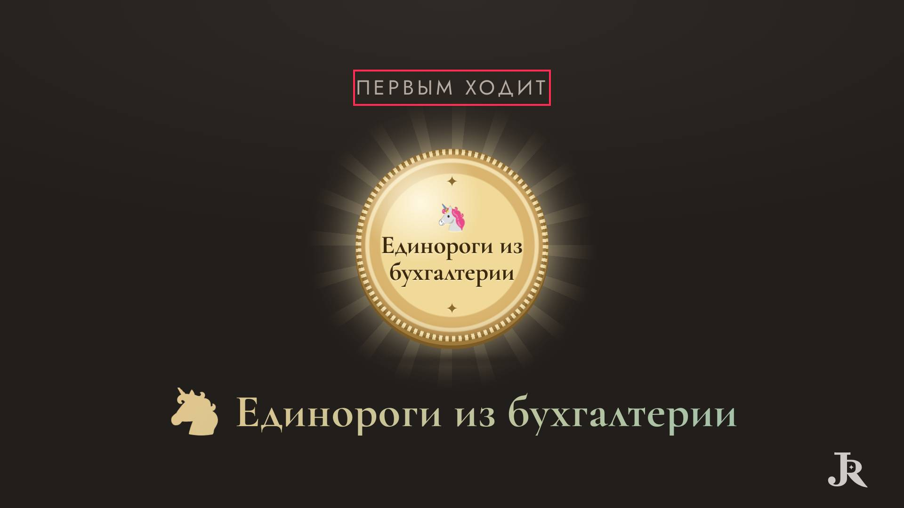

### закрыт другим элементом · экран зала

«,» закрыт элементом span — «,»

- где: `section.mil-screen__bars > div.mil-bars-window > p.mil-bars-window__more > span`, этап `playing/1/question/question`
- игры (1): millionaire 1-й шаблон, каждый сам ×100, зал на 100: 100 гостей или 25 команд, телевизор
- раз: 2

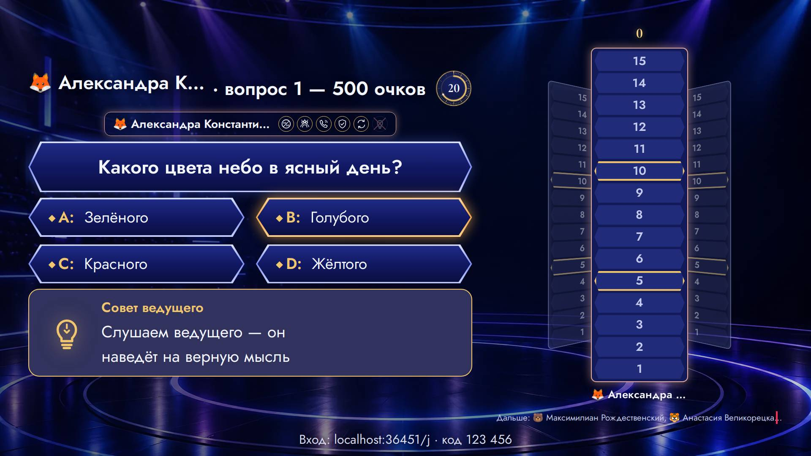

## Заметно — 20

### обрезан текст · экран зала

текст обрезан по высоте на 4 px (li.dg-team) — «🦄»

- где: `ul.dg-teams.dg-teams--l > li.dg-team > span.dg-team__nm > span.name-emoji`, этап `playing/5/question/`
- игры (1): dragon 2-й шаблон, команды ×25, зал на 100: 100 гостей или 25 команд, телевизор
- раз: 39

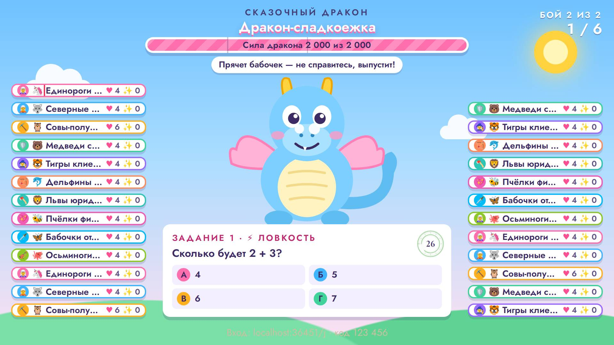

### обрезан текст · экран зала

текст обрезан по высоте на 4 px (span.hd-row__text) — «Компьютер»

- где: `div.hd-row > div.hd-row__inner > div.hd-row__face.hd-row__face--open > span.hd-row__text`, этап `playing/3/reveal/play`
- игры (1): hundred 2-й шаблон, команды ×25, зал на 100: 100 гостей или 25 команд, телевизор; hundred 1-й шаблон, команды ×25, зал на 100: 100 гостей или 25 команд, телевизор; hundred 1-й шаблон, каждый сам ×100, зал на 100: 100 гостей или 25 команд, телевизор; hundred 3-й шаблон, команды ×25, зал на 100: 100 гостей или 25 команд, телевизор; hundred 2-й шаблон, каждый сам ×100, зал на 100: 100 гостей или 25 команд, телевизор; hundred 4-й шаблон, команды ×25, зал на 100: 100 гостей или 25 команд, телевизор …
- раз: 36

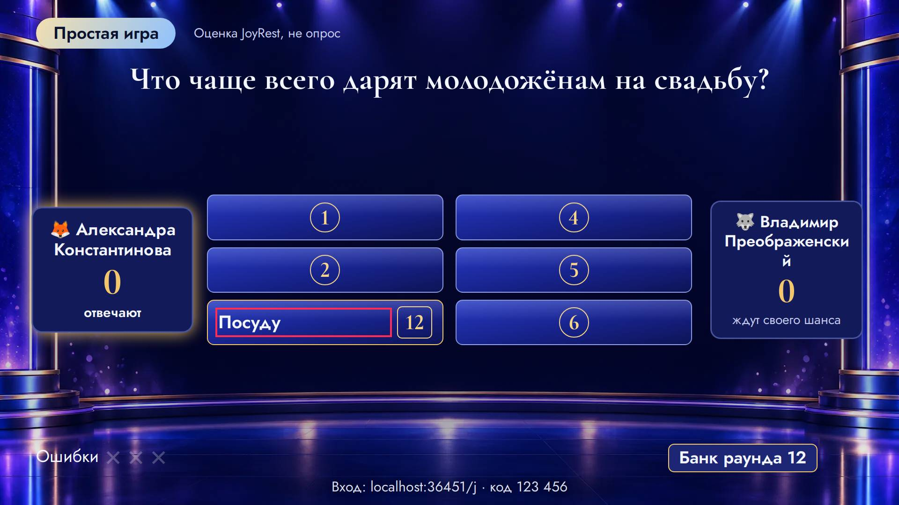

### обрезан текст · экран зала

текст обрезан по высоте на 4 px (li.dg-team) — «🐻»

- где: `ul.dg-teams.dg-teams--r > li.dg-team > span.dg-team__nm > span.name-emoji`, этап `playing/5/question/`
- игры (1): dragon 2-й шаблон, команды ×25, зал на 100: 100 гостей или 25 команд, телевизор
- раз: 36

### обрезан текст · экран зала

текст обрезан по высоте на 4 px (span.mil-screen__team) — «🦄»

- где: `section.mil-screen__main > p.mil-screen__who > span.mil-screen__team > span.name-emoji`, этап `playing/3/question/question`
- игры (1): millionaire 1-й шаблон, команды ×25, зал на 100: 100 гостей или 25 команд, телевизор; millionaire 1-й шаблон, каждый сам ×100, зал на 100: 100 гостей или 25 команд, телевизор
- раз: 8

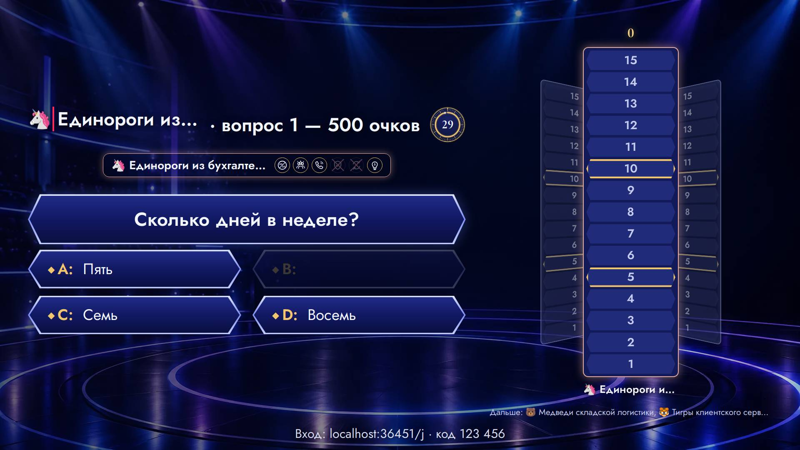

### обрезан текст · экран зала

текст обрезан по высоте на 4 px (span.mil-screen__team) — «Единороги из бухгалтерии»

- где: `section.mil-screen__main > p.mil-screen__who > span.mil-screen__team > span`, этап `playing/3/question/question`
- игры (1): millionaire 1-й шаблон, команды ×25, зал на 100: 100 гостей или 25 команд, телевизор; millionaire 1-й шаблон, каждый сам ×100, зал на 100: 100 гостей или 25 команд, телевизор
- раз: 8

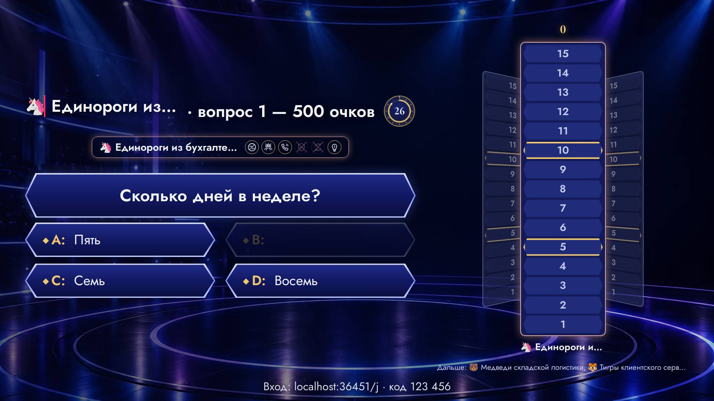

### обрезан текст · экран зала

текст обрезан по высоте на 5 px (span.quiz-auction__who) — «Отвечает · ставка 200 очков»

- где: `div.quiz-screen > div.quiz-screen__top > span.quiz-auction__plate > span.quiz-auction__who`, этап `playing/2/reveal/`
- игры (1): quiz 4-й шаблон, команды ×25, зал на 100: 100 гостей или 25 команд, телевизор
- раз: 1

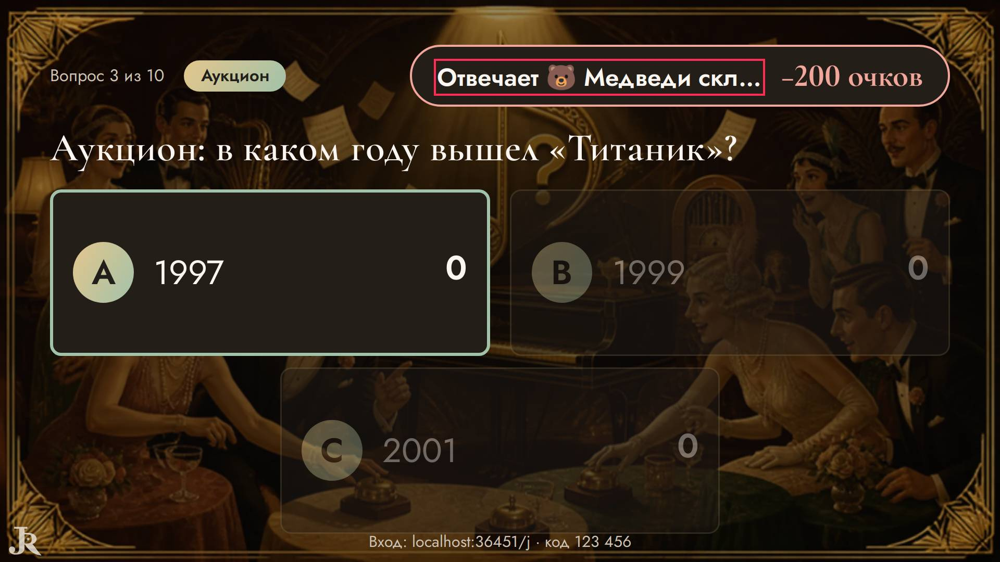

### обрезан текст · экран зала

текст обрезан по высоте на 5 px (span.quiz-auction__who) — «🐻»

- где: `span.quiz-auction__plate > span.quiz-auction__who > strong > span.name-emoji`, этап `playing/2/reveal/`
- игры (1): quiz 4-й шаблон, команды ×25, зал на 100: 100 гостей или 25 команд, телевизор
- раз: 1

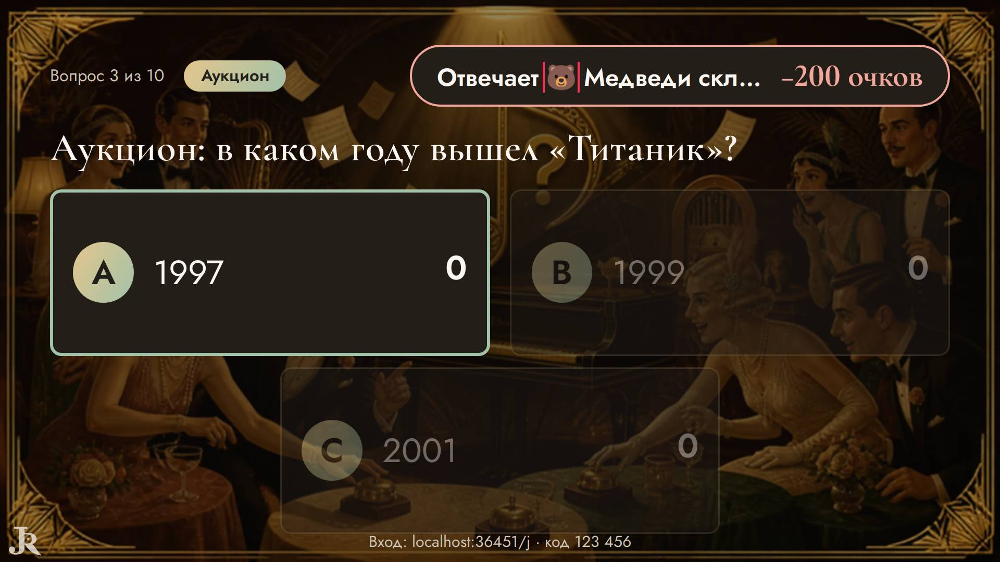

### обрезан текст · экран зала

текст обрезан по высоте на 5 px (span.quiz-auction__who) — «Медведи складской логистики»

- где: `span.quiz-auction__plate > span.quiz-auction__who > strong > span`, этап `playing/2/reveal/`
- игры (1): quiz 4-й шаблон, команды ×25, зал на 100: 100 гостей или 25 команд, телевизор
- раз: 1

### бледный текст · телефон

контраст 1.00 (нужно от 4.5) — «37%»

- где: `div.mil-question.mil-question--phone > ol.mil-options > li.mil-option > span.mil-option__pct`, этап `playing/5/question/question`
- игры (1): millionaire 1-й шаблон, команды ×25, зал на 100: 100 гостей или 25 команд, телевизор
- раз: 37

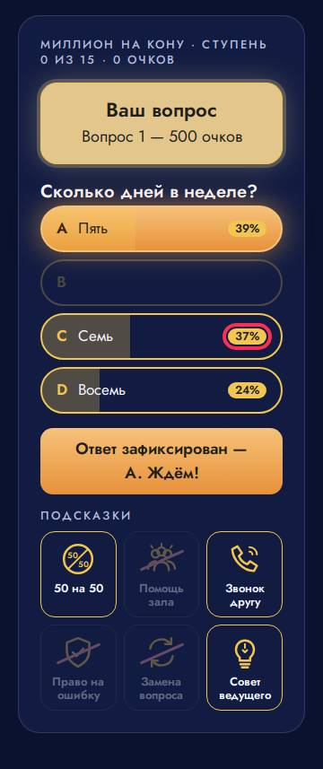

### бледный текст · телефон

контраст 1.10 (нужно от 4.5) — «B»

- где: `div.mil-question.mil-question--phone > ol.mil-options > li.mil-option > span.mil-option__letter`, этап `playing/2/question/question`
- игры (1): millionaire 1-й шаблон, команды ×25, зал на 100: 100 гостей или 25 команд, телевизор; millionaire 1-й шаблон, каждый сам ×100, зал на 100: 100 гостей или 25 команд, телевизор
- раз: 33

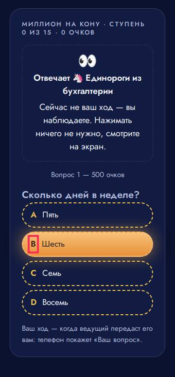

### бледный текст · телефон

контраст 1.00 (нужно от 4.5) — «Шесть»

- где: `div.mil-question.mil-question--phone > ol.mil-options > li.mil-option > span.mil-option__text`, этап `playing/2/question/question`
- игры (1): millionaire 1-й шаблон, команды ×25, зал на 100: 100 гостей или 25 команд, телевизор; millionaire 1-й шаблон, каждый сам ×100, зал на 100: 100 гостей или 25 команд, телевизор
- раз: 19

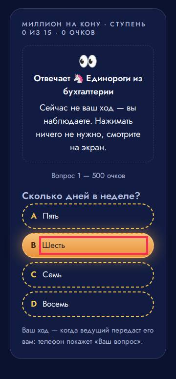

### бледный текст · экран зала

контраст 1.34 (нужно от 3) — «0%»

- где: `div.mil-question.mil-question--screen > ol.mil-options > li.mil-option > span.mil-option__pct`, этап `playing/4/question/audience`
- игры (1): millionaire 1-й шаблон, команды ×25, зал на 100: 100 гостей или 25 команд, телевизор; millionaire 1-й шаблон, каждый сам ×100, зал на 100: 100 гостей или 25 команд, телевизор
- раз: 10

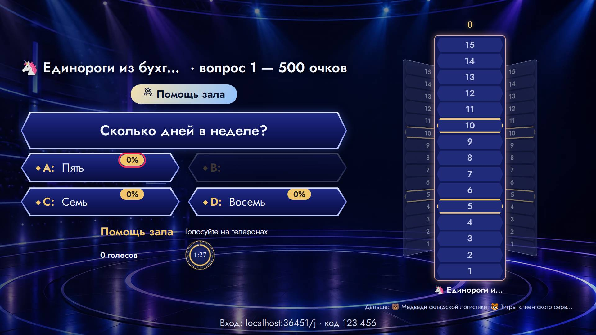

### бледный текст · экран зала

контраст 1.69 (нужно от 3) — «B»

- где: `div.mil-question.mil-question--screen > ol.mil-options > li.mil-option > span.mil-option__letter`, этап `playing/3/question/question`
- игры (1): millionaire 1-й шаблон, команды ×25, зал на 100: 100 гостей или 25 команд, телевизор; millionaire 1-й шаблон, каждый сам ×100, зал на 100: 100 гостей или 25 команд, телевизор
- раз: 6

### бледный текст · пульт

контраст 1.07 (нужно от 4.5) — «ждём…»

- где: `div.stack.stack--tight > ul.wager-host-list > li > span`, этап `playing/2/question/bet`
- игры (1): wager 1-й шаблон, команды ×25, зал на 100: 100 гостей или 25 команд, телевизор; wager 1-й шаблон, каждый сам ×100, зал на 100: 100 гостей или 25 команд, телевизор
- раз: 4

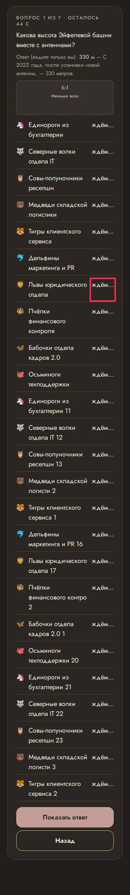

### бледный текст · экран зала

контраст 1.04 (нужно от 3) — «Пять»

- где: `div.mil-question.mil-question--screen > ol.mil-options > li.mil-option > span.mil-option__text`, этап `playing/5/question/question`
- игры (1): millionaire 1-й шаблон, команды ×25, зал на 100: 100 гостей или 25 команд, телевизор; millionaire 1-й шаблон, каждый сам ×100, зал на 100: 100 гостей или 25 команд, телевизор
- раз: 3

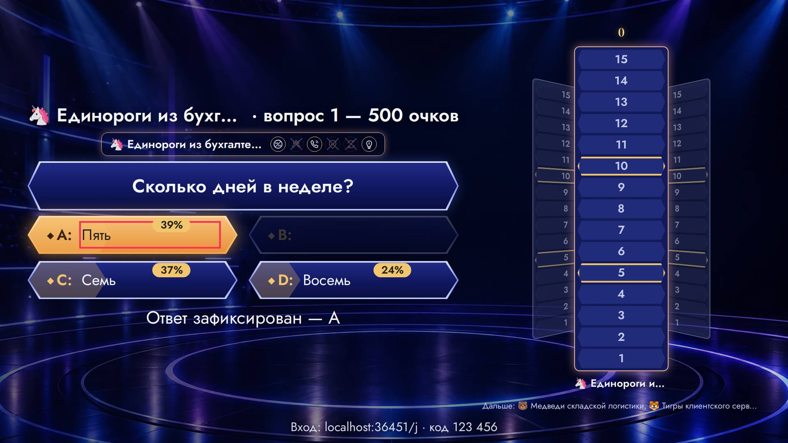

### бледный текст · пульт

контраст 1.85 (нужно от 4.5) — «ещё: бельё, плед»

- где: `li > button.hd-host__row > span.hd-host__text > small`, этап `playing/1/reveal/play`
- игры (1): hundred 1-й шаблон, команды ×25, зал на 100: 100 гостей или 25 команд, телевизор; hundred 1-й шаблон, каждый сам ×100, зал на 100: 100 гостей или 25 команд, телевизор
- раз: 3

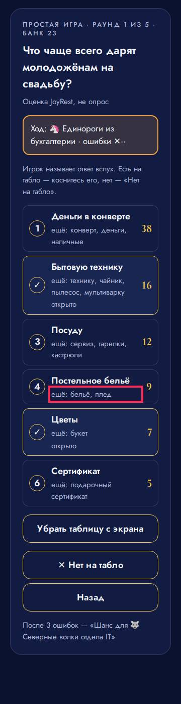

### бледный текст · телефон

контраст 3.34 (нужно от 4.5) — «Q»

- где: `div.dk-hand__row > button.dk-hand__slot > div.dk-card.dk-d--russia > span.dk-idx.dk-idx--b`, этап `playing/13/question/play`
- игры (1): durak 1-й шаблон, каждый сам ×4, зал на 100: 100 гостей или 25 команд, телевизор
- раз: 3

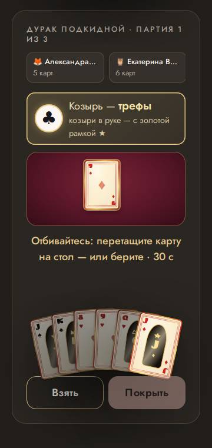

### бледный текст · экран зала

контраст 1.49 (нужно от 3) — «Помощь зала»

- где: `main.quiz-stage > div.mil-screen.mil-screen--audience > section.mil-screen__main > p.mil-flash`, этап `playing/4/question/audience`
- игры (1): millionaire 1-й шаблон, команды ×25, зал на 100: 100 гостей или 25 команд, телевизор; millionaire 1-й шаблон, каждый сам ×100, зал на 100: 100 гостей или 25 команд, телевизор
- раз: 2

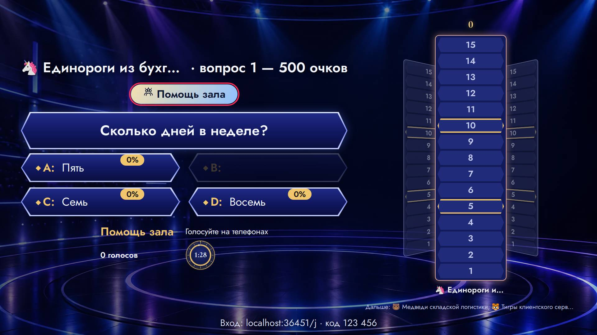

### бледный текст · экран зала

контраст 2.14 (нужно от 3) — «🌹 Вальс и медленный»

- где: `div.db-pick__cards > span.db-card.db-card--battle > span.db-card__label > span.db-card__style`, этап `playing/2/question/pick`
- игры (1): dance 1-й шаблон, команды ×25, зал на 100: 100 гостей или 25 команд, телевизор
- раз: 1

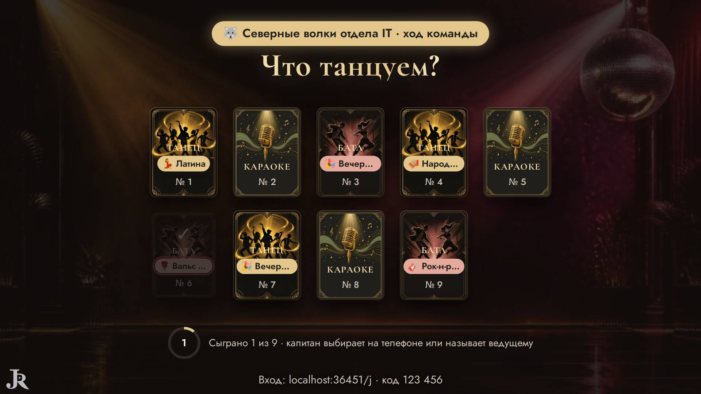

### бледный текст · пульт

контраст 1.96 (нужно от 4.5) — «🔒 Батлы откроются, когда каждая команда хотя бы раз выступит (чтобы у всех были»

- где: `section.card > div.stack.host-quiz > div.stack.stack--tight > p.muted.small`, этап `playing/10/reveal/pick`
- игры (1): stage 1-й шаблон, команды ×25, зал на 100: 100 гостей или 25 команд, телевизор
- раз: 1

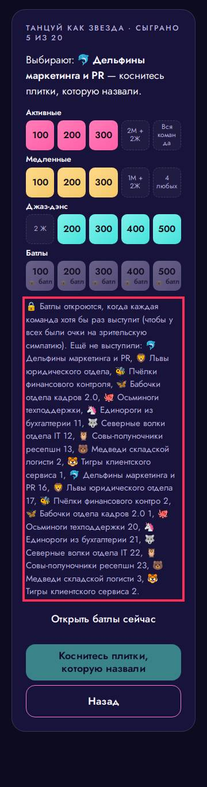

## Мелочи — 0

