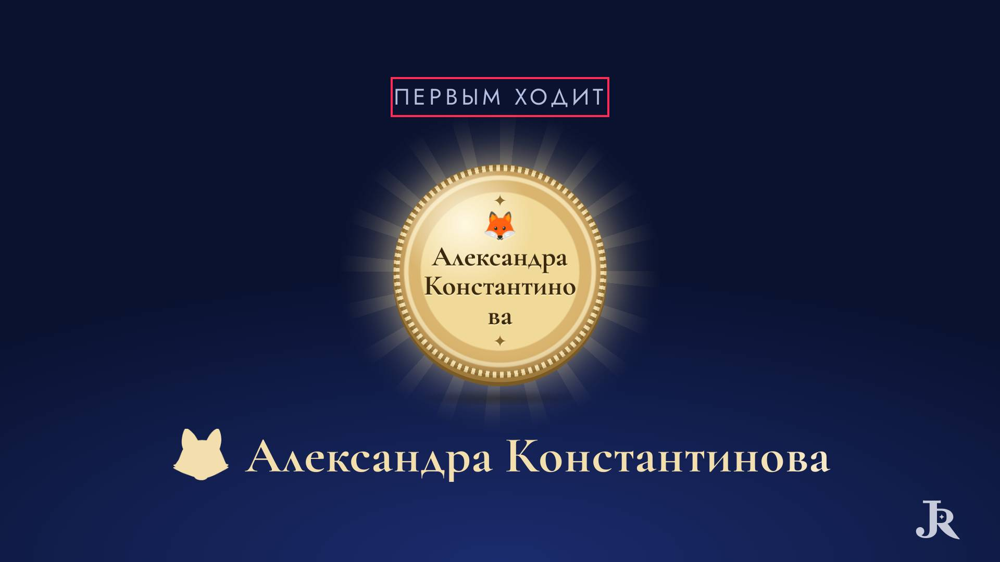
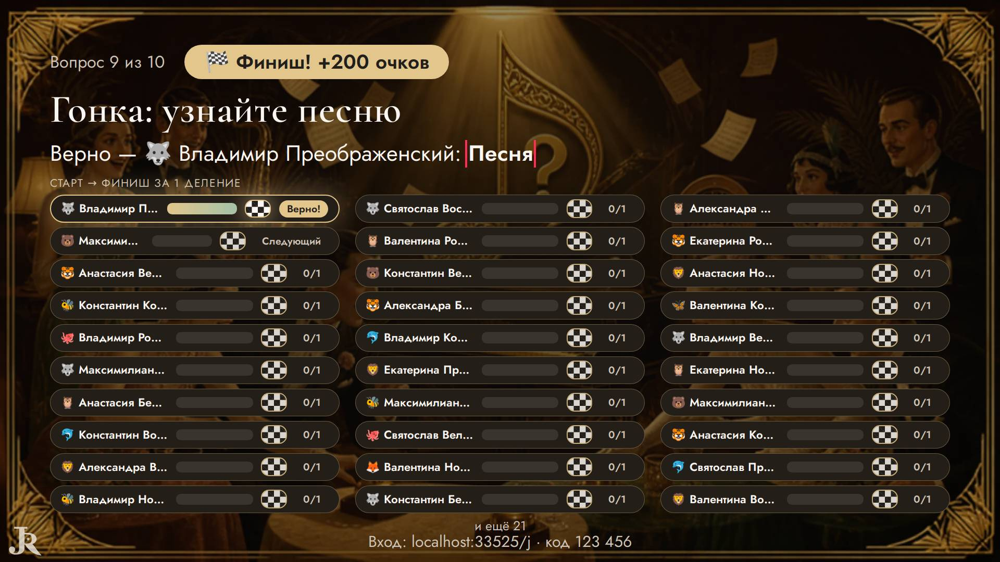
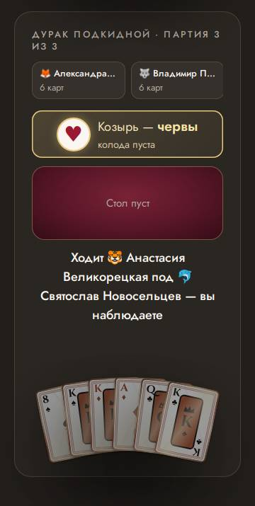
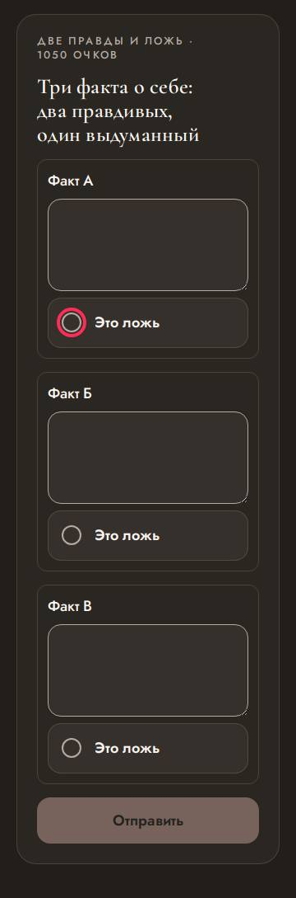

# Ревизор — что видят ведущий и гости

Прогонов: 47 · видов игры проверено: 2103 · разных находок: 26

Размеры: Зал на 50: 50 гостей или 16 команд, телевизор (1920x1080).

## Мешает игре — 9

### не успел · страница

TimeoutError: page.waitForFunction: Timeout 600000ms exceeded.

- где: `—`
- игры (1): truth 1-й шаблон, каждый сам ×50, зал на 50: 50 гостей или 16 команд, телевизор; truth 2-й шаблон, каждый сам ×50, зал на 50: 50 гостей или 16 команд, телевизор
- раз: 2

### не успел · страница

TimeoutError: page.waitForFunction: Timeout 600000ms exceeded.

- где: `—`
- игры (1): truth 1-й шаблон, каждый сам ×50, зал на 50: 50 гостей или 16 команд, телевизор; truth 2-й шаблон, каждый сам ×50, зал на 50: 50 гостей или 16 команд, телевизор
- раз: 2

### не успел · страница

TimeoutError: page.waitForFunction: Timeout 600000ms exceeded.

- где: `—`
- игры (1): mafia 1-й шаблон, каждый сам ×30, зал на 50: 50 гостей или 16 команд, телевизор
- раз: 1

### не успел · страница

TimeoutError: page.waitForFunction: Timeout 600000ms exceeded.

- где: `—`
- игры (1): mafia 1-й шаблон, каждый сам ×30, зал на 50: 50 гостей или 16 команд, телевизор
- раз: 1

### не успел · страница

TimeoutError: page.waitForFunction: Timeout 600000ms exceeded.

- где: `—`
- игры (1): spy 1-й шаблон, каждый сам ×20, зал на 50: 50 гостей или 16 команд, телевизор
- раз: 1

### не успел · страница

TimeoutError: page.waitForFunction: Timeout 600000ms exceeded.

- где: `—`
- игры (1): spy 1-й шаблон, каждый сам ×20, зал на 50: 50 гостей или 16 команд, телевизор
- раз: 1

### не успел · страница

TimeoutError: page.waitForFunction: Timeout 600000ms exceeded.

- где: `—`
- игры (1): bunker 1-й шаблон, каждый сам ×16, зал на 50: 50 гостей или 16 команд, телевизор
- раз: 1

### не успел · страница

TimeoutError: page.waitForFunction: Timeout 600000ms exceeded.

- где: `—`
- игры (1): bunker 1-й шаблон, каждый сам ×16, зал на 50: 50 гостей или 16 команд, телевизор
- раз: 1

### закрыт другим элементом · экран зала

«Первым ходит» закрыт элементом div.draw-coin__rays — «Первым ходит»

- где: `div.hall > main.quiz-stage > div.slide.slide--draw > p.slide__eyebrow`, этап `playing/21/reveal/`
- игры (8): lotto 1-й шаблон, команды ×16, зал на 50: 50 гостей или 16 команд, телевизор; lotto 1-й шаблон, каждый сам ×50, зал на 50: 50 гостей или 16 команд, телевизор; board 1-й шаблон, каждый сам ×50, зал на 50: 50 гостей или 16 команд, телевизор; survival 1-й шаблон, команды ×16, зал на 50: 50 гостей или 16 команд, телевизор; durak 1-й шаблон, каждый сам ×4, зал на 50: 50 гостей или 16 команд, телевизор; mafia 1-й шаблон, каждый сам ×30, зал на 50: 50 гостей или 16 команд, телевизор …
- раз: 35

## Заметно — 16

### обрезан текст · экран зала

текст обрезан по высоте на 4 px (span.hd-row__text) — «Торт»

- где: `div.hd-row > div.hd-row__inner > div.hd-row__face.hd-row__face--open > span.hd-row__text`, этап `playing/3/reveal/steal`
- игры (1): hundred 1-й шаблон, команды ×16, зал на 50: 50 гостей или 16 команд, телевизор; hundred 1-й шаблон, каждый сам ×50, зал на 50: 50 гостей или 16 команд, телевизор; hundred 2-й шаблон, команды ×16, зал на 50: 50 гостей или 16 команд, телевизор; hundred 2-й шаблон, каждый сам ×50, зал на 50: 50 гостей или 16 команд, телевизор; hundred 3-й шаблон, команды ×16, зал на 50: 50 гостей или 16 команд, телевизор; hundred 3-й шаблон, каждый сам ×50, зал на 50: 50 гостей или 16 команд, телевизор …
- раз: 67

### обрезан текст · экран зала

текст обрезан по высоте на 4 px (span.mil-screen__team) — «🦄»

- где: `section.mil-screen__main > p.mil-screen__who > span.mil-screen__team > span.name-emoji`, этап `playing/0/ready/turn`
- игры (1): millionaire 1-й шаблон, команды ×16, зал на 50: 50 гостей или 16 команд, телевизор; millionaire 1-й шаблон, каждый сам ×50, зал на 50: 50 гостей или 16 команд, телевизор
- раз: 5

### обрезан текст · экран зала

текст обрезан по высоте на 4 px (span.mil-screen__team) — «Единороги из бухгалтерии»

- где: `section.mil-screen__main > p.mil-screen__who > span.mil-screen__team > span`, этап `playing/0/ready/turn`
- игры (1): millionaire 1-й шаблон, команды ×16, зал на 50: 50 гостей или 16 команд, телевизор; millionaire 1-й шаблон, каждый сам ×50, зал на 50: 50 гостей или 16 команд, телевизор
- раз: 5

### обрезан текст · экран зала

текст обрезан по высоте на 5 px (p.quiz-screen__race-answer) — «Верно — :»

- где: `div.hall > main.quiz-stage.show-stage > div.quiz-screen.quiz-screen--race > p.quiz-screen__race-answer`, этап `playing/8/reveal/`
- игры (1): quiz 4-й шаблон, каждый сам ×50, зал на 50: 50 гостей или 16 команд, телевизор
- раз: 1

### обрезан текст · экран зала

текст обрезан по высоте на 5 px (p.quiz-screen__race-answer) — «🐺»

- где: `main.quiz-stage.show-stage > div.quiz-screen.quiz-screen--race > p.quiz-screen__race-answer > span.name-emoji`, этап `playing/8/reveal/`
- игры (1): quiz 4-й шаблон, каждый сам ×50, зал на 50: 50 гостей или 16 команд, телевизор
- раз: 1

### обрезан текст · экран зала

текст обрезан по высоте на 5 px (p.quiz-screen__race-answer) — «Владимир Преображенский»

- где: `main.quiz-stage.show-stage > div.quiz-screen.quiz-screen--race > p.quiz-screen__race-answer > span`, этап `playing/8/reveal/`
- игры (1): quiz 4-й шаблон, каждый сам ×50, зал на 50: 50 гостей или 16 команд, телевизор
- раз: 1

### обрезан текст · экран зала

текст обрезан по высоте на 5 px (p.quiz-screen__race-answer) — «Песня»

- где: `main.quiz-stage.show-stage > div.quiz-screen.quiz-screen--race > p.quiz-screen__race-answer > strong`, этап `playing/8/reveal/`
- игры (1): quiz 4-й шаблон, каждый сам ×50, зал на 50: 50 гостей или 16 команд, телевизор
- раз: 1

### бледный текст · телефон

контраст 1.00 (нужно от 4.5) — «Жёлтого»

- где: `div.mil-question.mil-question--phone > ol.mil-options > li.mil-option > span.mil-option__text`, этап `playing/0/question/question`
- игры (1): millionaire 1-й шаблон, команды ×16, зал на 50: 50 гостей или 16 команд, телевизор; millionaire 1-й шаблон, каждый сам ×50, зал на 50: 50 гостей или 16 команд, телевизор
- раз: 26

### бледный текст · телефон

контраст 1.10 (нужно от 4.5) — «D»

- где: `div.mil-question.mil-question--phone > ol.mil-options > li.mil-option > span.mil-option__letter`, этап `playing/0/question/question`
- игры (1): millionaire 1-й шаблон, команды ×16, зал на 50: 50 гостей или 16 команд, телевизор; millionaire 1-й шаблон, каждый сам ×50, зал на 50: 50 гостей или 16 команд, телевизор
- раз: 20

### бледный текст · пульт

контраст 1.07 (нужно от 4.5) — «ждём…»

- где: `div.stack.stack--tight > ul.wager-host-list > li > span`, этап `playing/2/question/bet`
- игры (1): wager 1-й шаблон, команды ×16, зал на 50: 50 гостей или 16 команд, телевизор; wager 1-й шаблон, каждый сам ×50, зал на 50: 50 гостей или 16 команд, телевизор
- раз: 5

### бледный текст · телефон

контраст 1.00 (нужно от 4.5) — «28%»

- где: `div.mil-question.mil-question--phone > ol.mil-options > li.mil-option > span.mil-option__pct`, этап `playing/13/question/question`
- игры (1): millionaire 1-й шаблон, каждый сам ×50, зал на 50: 50 гостей или 16 команд, телевизор
- раз: 4

### бледный текст · пульт

контраст 1.85 (нужно от 4.5) — «ещё: бельё, плед»

- где: `li > button.hd-host__row > span.hd-host__text > small`, этап `playing/1/reveal/play`
- игры (1): hundred 1-й шаблон, команды ×16, зал на 50: 50 гостей или 16 команд, телевизор; hundred 1-й шаблон, каждый сам ×50, зал на 50: 50 гостей или 16 команд, телевизор
- раз: 3

### бледный текст · экран зала

контраст 1.34 (нужно от 3) — «34%»

- где: `div.mil-question.mil-question--screen > ol.mil-options > li.mil-option > span.mil-option__pct`, этап `playing/13/question/question`
- игры (1): millionaire 1-й шаблон, каждый сам ×50, зал на 50: 50 гостей или 16 команд, телевизор
- раз: 2

### бледный текст · экран зала

контраст 1.69 (нужно от 3) — «C»

- где: `div.mil-question.mil-question--screen > ol.mil-options > li.mil-option > span.mil-option__letter`, этап `playing/13/question/question`
- игры (1): millionaire 1-й шаблон, каждый сам ×50, зал на 50: 50 гостей или 16 команд, телевизор
- раз: 2

### бледный текст · телефон

контраст 1.00 (нужно от 4.5) — «9»

- где: `div.dk-hand__row > button.dk-hand__slot > div.dk-card.dk-d--russia > span.dk-idx.dk-idx--b`, этап `playing/12/question/play`
- игры (1): durak 1-й шаблон, каждый сам ×4, зал на 50: 50 гостей или 16 команд, телевизор
- раз: 2

### бледный текст · телефон

контраст 1.18 (нужно от 4.5) — «A»

- где: `div.dk-hand__row > button.dk-hand__slot > div.dk-card.dk-d--greece > span.dk-idx.dk-idx--b`, этап `playing/115/reveal/over`
- игры (1): durak 1-й шаблон, каждый сам ×4, зал на 50: 50 гостей или 16 команд, телевизор
- раз: 1

## Мелочи — 1

### мелкая кнопка · телефон

кнопка 24×24 px (пальцу нужно от 40×40)

- где: `div.quiz-phone.st-phone > div.sl-input > label.choice > input`, этап `playing/32/question/write`
- игры (1): story 1-й шаблон, команды ×16, зал на 50: 50 гостей или 16 команд, телевизор
- раз: 9

