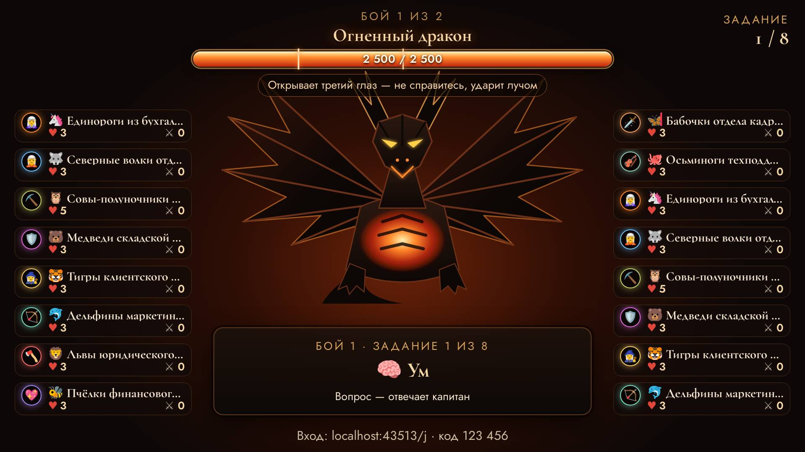
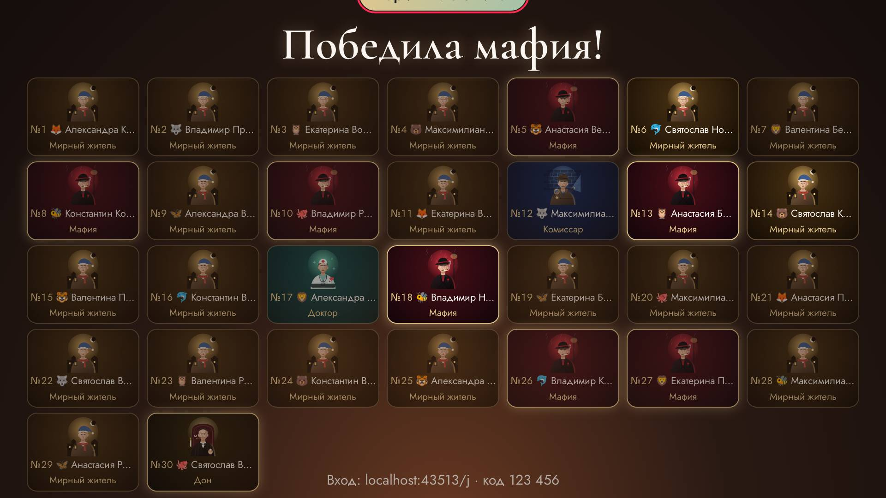
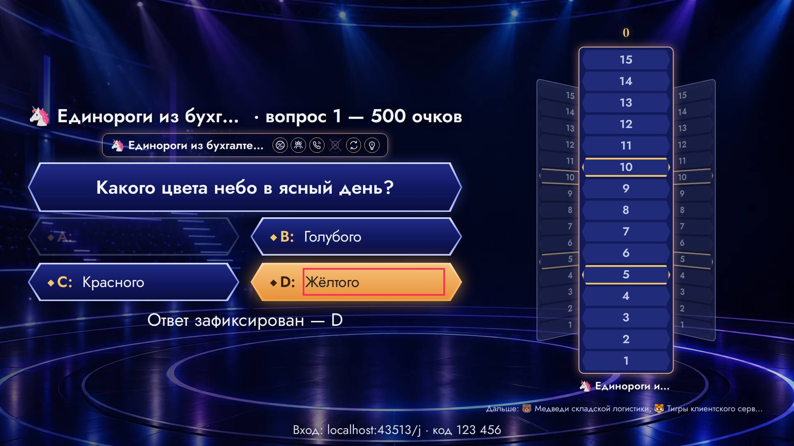
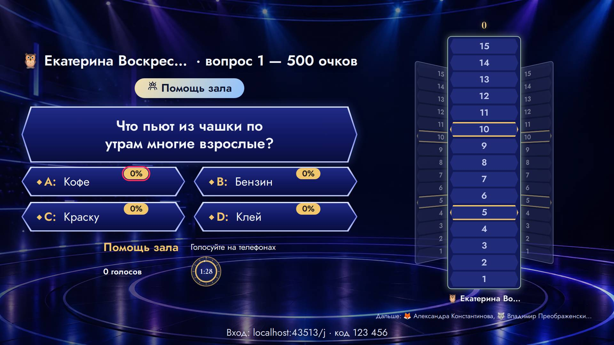
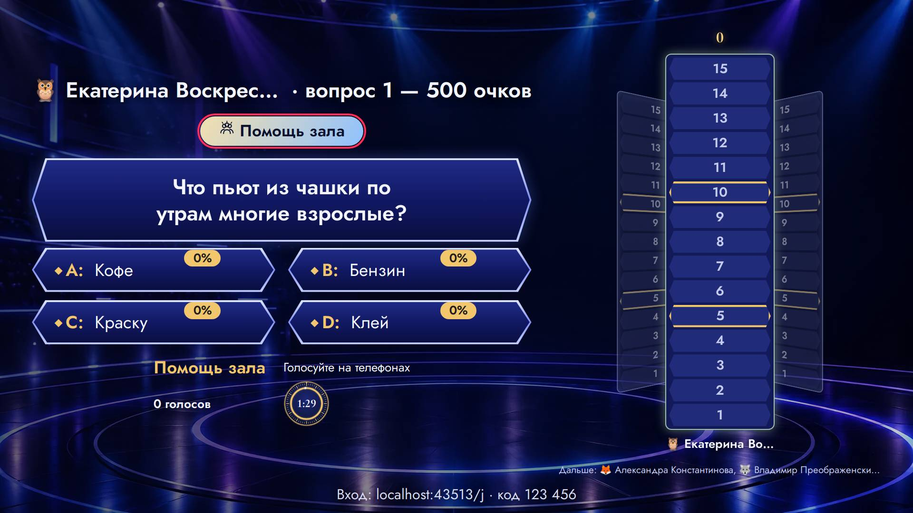

# Ревизор — что видят ведущий и гости

Прогонов: 47 · видов игры проверено: 635 · разных находок: 31

Размеры: Зал на 50: 50 гостей или 16 команд, телевизор (1920x1080).

## Мешает игре — 14

### тупик · пульт

пульт: Большая игра · 🐝 Пчёлки финансового контроля · первый игрок12 сОчки: 32 из 200Игрок отвечает вслух — коснитесь его ответа под вопросом или «Нет на табло». Ответ первого игрока второму повторять нельзя.1. Назовите свадебную традициюОтвет: Выкуп невесты · 32Выкуп невесты · 32Бросание букета · 20Карав \| кнопки: Выкуп невесты · 32 / Бросание букета · 20 / Каравай · 14 / Похищение невесты · 10 / Конкурсы · 8 / Бросание подвязки · 6 / ✕ Нет на табло / Белый · 55 / Айвори · 14 / Кремовый · 9 / Розовый · 7 / Голу

- где: `—`
- игры (1): hundred 1-й шаблон, команды ×16, зал на 50: 50 гостей или 16 команд, телевизор; hundred 1-й шаблон, каждый сам ×50, зал на 50: 50 гостей или 16 команд, телевизор; hundred 2-й шаблон, команды ×16, зал на 50: 50 гостей или 16 команд, телевизор; hundred 2-й шаблон, каждый сам ×50, зал на 50: 50 гостей или 16 команд, телевизор; hundred 3-й шаблон, команды ×16, зал на 50: 50 гостей или 16 команд, телевизор; hundred 3-й шаблон, каждый сам ×50, зал на 50: 50 гостей или 16 команд, телевизор
- раз: 12

### тупик · пульт

пульт: Ставка на знания · раунд 1 из 2 · сыграно 0 из 20Таблица очков на экранКоснитесь клетки, чтобы открыть вопрос. Метки ♪, фото и «кот» видите только вы.Кино100200300400кот500География100200300400500Праздники100200300400500котЕда100200300400500Назад \| кнопки: Таблица очков на экран / 100 / 200 / 300 / 400кот / 500 / 100 / 200 / 300 / 400 / 500 / 100 / 200 / 300 / 400 / 500кот / 100 / 200 / 300 / 400 / 500

- где: `—`
- игры (1): board 1-й шаблон, каждый сам ×50, зал на 50: 50 гостей или 16 команд, телевизор; board 1-й шаблон, команды ×16, зал на 50: 50 гостей или 16 команд, телевизор
- раз: 4

### тупик · пульт

пульт: Кости лжеца · раунд 4 · стаканов 4, костей 17Первая ставка раунда. Ход: 🦉 Екатерина ВоскресенскаяКости всех стаканов (только вам)🦊 Александра Константинова🐺 Владимир Преображенский🦉 Екатерина Воскресенская🐻 Максимилиан РождественскийЗа стакан «🦉 Екатерина Воскресенская» (если нет телефона)−1 × \| кнопки:  /  /  /  /  / + / Ставка за стакан: одна двойка / Назад

- где: `—`
- игры (1): perudo 1-й шаблон, каждый сам ×4, зал на 50: 50 гостей или 16 команд, телевизор; perudo 1-й шаблон, команды ×4, зал на 50: 50 гостей или 16 команд, телевизор
- раз: 4

### не успел · страница

TimeoutError: page.waitForFunction: Timeout 600000ms exceeded.

- где: `—`
- игры (1): mafia 1-й шаблон, каждый сам ×30, зал на 50: 50 гостей или 16 команд, телевизор
- раз: 1

### не успел · страница

TimeoutError: page.waitForFunction: Timeout 600000ms exceeded.

- где: `—`
- игры (1): mafia 1-й шаблон, каждый сам ×30, зал на 50: 50 гостей или 16 команд, телевизор
- раз: 1

### не успел · страница

TimeoutError: page.waitForFunction: Timeout 600000ms exceeded.

- где: `—`
- игры (1): spy 1-й шаблон, каждый сам ×20, зал на 50: 50 гостей или 16 команд, телевизор
- раз: 1

### не успел · страница

TimeoutError: page.waitForFunction: Timeout 600000ms exceeded.

- где: `—`
- игры (1): spy 1-й шаблон, каждый сам ×20, зал на 50: 50 гостей или 16 команд, телевизор
- раз: 1

### не успел · страница

TimeoutError: page.waitForFunction: Timeout 600000ms exceeded.

- где: `—`
- игры (1): bunker 1-й шаблон, каждый сам ×16, зал на 50: 50 гостей или 16 команд, телевизор
- раз: 1

### не успел · страница

TimeoutError: page.waitForFunction: Timeout 600000ms exceeded.

- где: `—`
- игры (1): bunker 1-й шаблон, каждый сам ×16, зал на 50: 50 гостей или 16 команд, телевизор
- раз: 1

### не успел · страница

TimeoutError: page.waitForFunction: Timeout 600000ms exceeded.

- где: `—`
- игры (1): truth 1-й шаблон, каждый сам ×50, зал на 50: 50 гостей или 16 команд, телевизор
- раз: 1

### не успел · страница

TimeoutError: page.waitForFunction: Timeout 600000ms exceeded.

- где: `—`
- игры (1): truth 1-й шаблон, каждый сам ×50, зал на 50: 50 гостей или 16 команд, телевизор
- раз: 1

### закрыт другим элементом · экран зала

«,» закрыт элементом span — «,»

- где: `section.mil-screen__bars > div.mil-bars-window > p.mil-bars-window__more > span`, этап `playing/0/ready/turn`
- игры (1): millionaire 1-й шаблон, каждый сам ×50, зал на 50: 50 гостей или 16 команд, телевизор
- раз: 5

### закрыт другим элементом · экран зала

«💃 Танец · латина» закрыт элементом p.stage-code — «💃 Танец · латина»

- где: `div.hall > main.quiz-stage > div.dance-screen.db-stage > p.db-foot`, этап `playing/1/question/vote`
- игры (1): dance 1-й шаблон, команды ×16, зал на 50: 50 гостей или 16 команд, телевизор
- раз: 1

### надписи наезжают · экран зала

«💃 Танец · латина» и «Вход: localhost:43513/j · код » друг на друге — «💃 Танец · латина \| Вход: localhost:43513/j · код 123 456»

- где: `div.hall > main.quiz-stage > div.dance-screen.db-stage > p.db-foot`, этап `playing/1/question/vote`
- игры (1): dance 1-й шаблон, команды ×16, зал на 50: 50 гостей или 16 команд, телевизор
- раз: 1

## Заметно — 17

### обрезан текст · экран зала

текст обрезан по высоте на 6 px (span.dg-team__nm) — «🦄»

- где: `ul.dg-teams.dg-teams--l > li.dg-team > span.dg-team__nm > span.name-emoji`, этап `playing/2/ready/`
- игры (1): dragon 1-й шаблон, команды ×16, зал на 50: 50 гостей или 16 команд, телевизор; dragon 2-й шаблон, команды ×16, зал на 50: 50 гостей или 16 команд, телевизор
- раз: 48

### обрезан текст · экран зала

текст обрезан по высоте на 6 px (span.dg-team__nm) — «Единороги из бухгалтерии»

- где: `ul.dg-teams.dg-teams--l > li.dg-team > span.dg-team__nm > span`, этап `playing/2/ready/`
- игры (1): dragon 1-й шаблон, команды ×16, зал на 50: 50 гостей или 16 команд, телевизор; dragon 2-й шаблон, команды ×16, зал на 50: 50 гостей или 16 команд, телевизор
- раз: 48

### обрезан текст · экран зала

текст обрезан по высоте на 6 px (span.dg-team__nm) — «🦋»

- где: `ul.dg-teams.dg-teams--r > li.dg-team > span.dg-team__nm > span.name-emoji`, этап `playing/2/ready/`
- игры (1): dragon 1-й шаблон, команды ×16, зал на 50: 50 гостей или 16 команд, телевизор; dragon 2-й шаблон, команды ×16, зал на 50: 50 гостей или 16 команд, телевизор
- раз: 48

### обрезан текст · экран зала

текст обрезан по высоте на 6 px (span.dg-team__nm) — «Бабочки отдела кадров 2.0»

- где: `ul.dg-teams.dg-teams--r > li.dg-team > span.dg-team__nm > span`, этап `playing/2/ready/`
- игры (1): dragon 1-й шаблон, команды ×16, зал на 50: 50 гостей или 16 команд, телевизор; dragon 2-й шаблон, команды ×16, зал на 50: 50 гостей или 16 команд, телевизор
- раз: 48

### обрезан текст · экран зала

текст обрезан по высоте на 4 px (span.hd-row__text) — «Деньги в конверте»

- где: `div.hd-row > div.hd-row__inner > div.hd-row__face.hd-row__face--open > span.hd-row__text`, этап `playing/1/reveal/done`
- игры (1): hundred 1-й шаблон, команды ×16, зал на 50: 50 гостей или 16 команд, телевизор; hundred 1-й шаблон, каждый сам ×50, зал на 50: 50 гостей или 16 команд, телевизор; hundred 2-й шаблон, команды ×16, зал на 50: 50 гостей или 16 команд, телевизор; hundred 2-й шаблон, каждый сам ×50, зал на 50: 50 гостей или 16 команд, телевизор; hundred 3-й шаблон, команды ×16, зал на 50: 50 гостей или 16 команд, телевизор; hundred 3-й шаблон, каждый сам ×50, зал на 50: 50 гостей или 16 команд, телевизор
- раз: 36

### обрезан текст · экран зала

текст обрезан по высоте на 4 px (span.stage-teams__name) — «🦄»

- где: `div.stage-teams > div.stage-teams__one > span.stage-teams__name > span.name-emoji`, этап `playing/0/reveal/pick`
- игры (1): stage 1-й шаблон, команды ×16, зал на 50: 50 гостей или 16 команд, телевизор; stage 2-й шаблон, команды ×16, зал на 50: 50 гостей или 16 команд, телевизор
- раз: 16

### обрезан текст · экран зала

текст обрезан по высоте на 4 px (span.stage-teams__name) — «Единороги из бухгалтерии»

- где: `div.stage-teams > div.stage-teams__one > span.stage-teams__name > span`, этап `playing/0/reveal/pick`
- игры (1): stage 1-й шаблон, команды ×16, зал на 50: 50 гостей или 16 команд, телевизор; stage 2-й шаблон, команды ×16, зал на 50: 50 гостей или 16 команд, телевизор
- раз: 16

### обрезан текст · экран зала

текст обрезан по высоте на 4 px (span.mil-screen__team) — «🦄»

- где: `section.mil-screen__main > p.mil-screen__who > span.mil-screen__team > span.name-emoji`, этап `playing/0/ready/turn`
- игры (1): millionaire 1-й шаблон, команды ×16, зал на 50: 50 гостей или 16 команд, телевизор; millionaire 1-й шаблон, каждый сам ×50, зал на 50: 50 гостей или 16 команд, телевизор
- раз: 11

### обрезан текст · экран зала

текст обрезан по высоте на 4 px (span.mil-screen__team) — «Единороги из бухгалтерии»

- где: `section.mil-screen__main > p.mil-screen__who > span.mil-screen__team > span`, этап `playing/0/ready/turn`
- игры (1): millionaire 1-й шаблон, команды ×16, зал на 50: 50 гостей или 16 команд, телевизор; millionaire 1-й шаблон, каждый сам ×50, зал на 50: 50 гостей или 16 команд, телевизор
- раз: 11

### обрезан текст · экран зала

текст обрезан по высоте на 35 px (div.mf-screen) — «Партия 1 из 3 · итог»

- где: `main.quiz-stage > div.mf-screen > section.mf-screen__main > span.quiz-screen__badge`, этап `playing/90/reveal/over`
- игры (1): mafia 1-й шаблон, каждый сам ×30, зал на 50: 50 гостей или 16 команд, телевизор
- раз: 1

### бледный текст · телефон

контраст 1.00 (нужно от 4.5) — «Зелёного»

- где: `div.mil-question.mil-question--phone > ol.mil-options > li.mil-option > span.mil-option__text`, этап `playing/1/reveal/reveal`
- игры (1): millionaire 1-й шаблон, команды ×16, зал на 50: 50 гостей или 16 команд, телевизор; millionaire 1-й шаблон, каждый сам ×50, зал на 50: 50 гостей или 16 команд, телевизор
- раз: 14

### бледный текст · телефон

контраст 1.79 (нужно от 4.5) — «A»

- где: `div.mil-question.mil-question--phone > ol.mil-options > li.mil-option > span.mil-option__letter`, этап `playing/2/question/question`
- игры (1): millionaire 1-й шаблон, команды ×16, зал на 50: 50 гостей или 16 команд, телевизор; millionaire 1-й шаблон, каждый сам ×50, зал на 50: 50 гостей или 16 команд, телевизор
- раз: 14

### бледный текст · экран зала

контраст 1.21 (нужно от 3) — «D»

- где: `div.mil-question.mil-question--screen > ol.mil-options > li.mil-option > span.mil-option__letter`, этап `playing/2/question/question`
- игры (1): millionaire 1-й шаблон, команды ×16, зал на 50: 50 гостей или 16 команд, телевизор; millionaire 1-й шаблон, каждый сам ×50, зал на 50: 50 гостей или 16 команд, телевизор
- раз: 8

### бледный текст · экран зала

контраст 1.34 (нужно от 3) — «Жёлтого»

- где: `div.mil-question.mil-question--screen > ol.mil-options > li.mil-option > span.mil-option__text`, этап `playing/2/question/question`
- игры (1): millionaire 1-й шаблон, команды ×16, зал на 50: 50 гостей или 16 команд, телевизор; millionaire 1-й шаблон, каждый сам ×50, зал на 50: 50 гостей или 16 команд, телевизор
- раз: 8

### бледный текст · экран зала

контраст 1.34 (нужно от 3) — «0%»

- где: `div.mil-question.mil-question--screen > ol.mil-options > li.mil-option > span.mil-option__pct`, этап `playing/4/question/audience`
- игры (1): millionaire 1-й шаблон, каждый сам ×50, зал на 50: 50 гостей или 16 команд, телевизор
- раз: 4

### бледный текст · пульт

контраст 1.07 (нужно от 4.5) — «ждём…»

- где: `div.stack.stack--tight > ul.wager-host-list > li > span`, этап `playing/2/question/bet`
- игры (1): wager 1-й шаблон, команды ×16, зал на 50: 50 гостей или 16 команд, телевизор; wager 1-й шаблон, каждый сам ×50, зал на 50: 50 гостей или 16 команд, телевизор
- раз: 2

### бледный текст · экран зала

контраст 1.49 (нужно от 3) — «Помощь зала»

- где: `main.quiz-stage > div.mil-screen.mil-screen--audience > section.mil-screen__main > p.mil-flash`, этап `playing/4/question/audience`
- игры (1): millionaire 1-й шаблон, каждый сам ×50, зал на 50: 50 гостей или 16 команд, телевизор
- раз: 1

## Мелочи — 0

