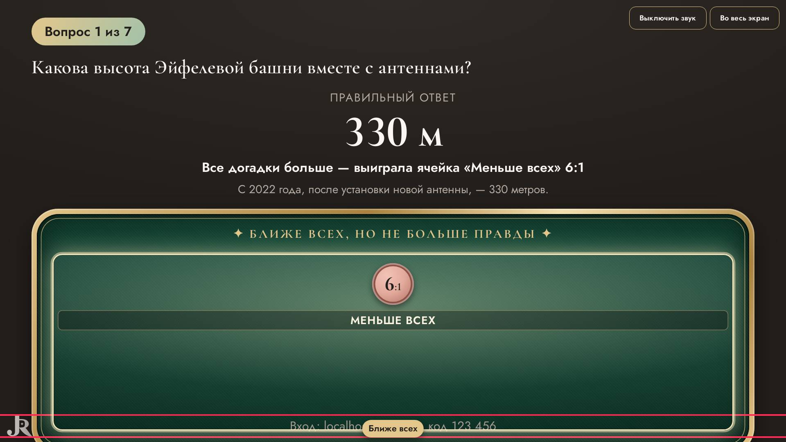
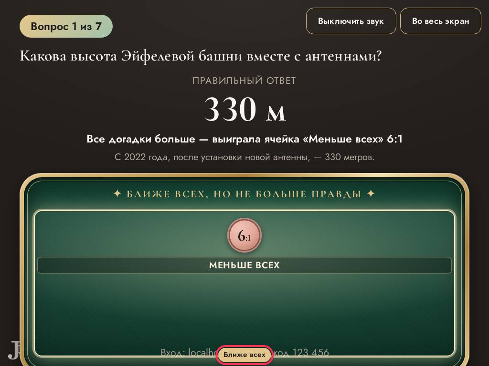

# Ревизор — что видят ведущий и гости

Прогонов: 36 · видов игры проверено: 1092 · разных находок: 14

Размеры: Телевизор Full HD (1920x1080); Проектор 4:3, маленький телефон, длинные имена (1024x768); Ноутбук 16:10, большой зал, длинные имена (1280x800).

## Мешает игре — 3

### закрыт другим элементом · экран зала

«Вход: localhost:40707/j · код 123 456» закрыт элементом li.wager-slot.wager-slot--low — «Вход: localhost:40707/j · код 123 456»

- где: `div.hall > main.quiz-stage > p.stage-code`, этап `playing/2/reveal/answer`
- игры (1): wager 1-й шаблон, каждый сам ×4, проектор 4:3, маленький телефон, длинные имена; wager 1-й шаблон, каждый сам ×4, телевизор full hd
- раз: 2

### надписи наезжают · экран зала

«Ближе всех» и «Вход: localhost:40707/j · код » друг на друге — «Ближе всех \| Вход: localhost:40707/j · код 123 456»

- где: `div.wager-table__felt > ol.wager-board > li.wager-slot.wager-slot--low > span.wager-slot__flag`, этап `playing/2/reveal/answer`
- игры (1): wager 1-й шаблон, каждый сам ×4, проектор 4:3, маленький телефон, длинные имена; wager 1-й шаблон, каждый сам ×4, телевизор full hd
- раз: 2

### надписи наезжают · экран зала

«🐻» и «Максимилиан Рождественский» друг на друге — «🐻 \| Максимилиан Рождественский»

- где: `div.podium__slot > div.podium__names > p.podium__name > span.name-emoji`, этап `playing/7/podium/`
- игры (1): quiz 1-й шаблон, каждый сам ×4, проектор 4:3, маленький телефон, длинные имена
- раз: 1

## Заметно — 5

### обрезан текст · телефон

текст обрезан по высоте на 5 px (span.lotto-card__artist) — «Ирина Аллегрова»

- где: `div.lotto-ticket.lotto-ticket--evening > div.lotto-card > button.lotto-card__cell > span.lotto-card__artist`, этап `playing/0/question/`
- игры (1): lotto 1-й шаблон, каждый сам ×4, проектор 4:3, маленький телефон, длинные имена; lotto 1-й шаблон, команды ×4, проектор 4:3, маленький телефон, длинные имена
- раз: 31

### обрезан текст · экран зала

текст обрезан по высоте на 4 px (div.podium__names) — «🦊»

- где: `div.podium__slot > div.podium__names > p.podium__name > span.name-emoji`, этап `playing/7/podium/`
- игры (1): quiz 1-й шаблон, каждый сам ×4, проектор 4:3, маленький телефон, длинные имена; quiz 1-й шаблон, каждый сам ×16, ноутбук 16:10, большой зал, длинные имена; quiz 4-й шаблон, каждый сам ×16, ноутбук 16:10, большой зал, длинные имена
- раз: 5

### обрезан текст · экран зала

текст обрезан по высоте на 6 px (div.podium__names) — «Гость 1»

- где: `div.podium__stage > div.podium__slot > div.podium__names > p.podium__name`, этап `playing/7/podium/`
- игры (1): quiz 1-й шаблон, каждый сам ×4, телевизор full hd
- раз: 3

### обрезан текст · экран зала

текст обрезан по высоте на 4 px (div.podium__names) — «Владимир Преображенский»

- где: `div.podium__slot > div.podium__names > p.podium__name > span`, этап `playing/7/podium/`
- игры (1): quiz 1-й шаблон, каждый сам ×4, проектор 4:3, маленький телефон, длинные имена
- раз: 1

### прячется за прокруткой · экран зала

на экране зала текст виден только прокруткой (по высоте на 7 px) — «и ещё 2»

- где: `div.final > div.final__board > div.board-view > p.board-view__more`, этап `finished/7/podium/`
- игры (2): quiz 1-й шаблон, каждый сам ×4, проектор 4:3, маленький телефон, длинные имена; quiz 1-й шаблон, каждый сам ×4, телевизор full hd; quiz 1-й шаблон, каждый сам ×16, ноутбук 16:10, большой зал, длинные имена; quiz 1-й шаблон, команды ×8, ноутбук 16:10, большой зал, длинные имена; quiz 3-й шаблон, каждый сам ×16, ноутбук 16:10, большой зал, длинные имена; quiz 3-й шаблон, команды ×4, телевизор full hd …
- раз: 13

## Мелочи — 6

### мелкий текст · телефон

шрифт 10.0 px (нужно от 12) — «Серебро»

- где: `div.lotto-ticket.lotto-ticket--evening > div.lotto-card > button.lotto-card__cell > span.lotto-card__artist`, этап `playing/0/question/`
- игры (1): lotto 1-й шаблон, каждый сам ×4, телевизор full hd; lotto 1-й шаблон, каждый сам ×4, проектор 4:3, маленький телефон, длинные имена; lotto 1-й шаблон, команды ×4, телевизор full hd; lotto 1-й шаблон, каждый сам ×16, ноутбук 16:10, большой зал, длинные имена; lotto 1-й шаблон, команды ×4, проектор 4:3, маленький телефон, длинные имена; lotto 1-й шаблон, команды ×8, ноутбук 16:10, большой зал, длинные имена
- раз: 2505

### мелкий текст · телефон

шрифт 10.0 px (нужно от 12) — «Звезда по имени Солнце»

- где: `div.lotto-ticket.lotto-ticket--evening > div.lotto-card > button.lotto-card__cell > span.lotto-card__title`, этап `playing/0/question/`
- игры (1): lotto 1-й шаблон, каждый сам ×4, телевизор full hd; lotto 1-й шаблон, каждый сам ×4, проектор 4:3, маленький телефон, длинные имена; lotto 1-й шаблон, команды ×4, телевизор full hd; lotto 1-й шаблон, каждый сам ×16, ноутбук 16:10, большой зал, длинные имена; lotto 1-й шаблон, команды ×4, проектор 4:3, маленький телефон, длинные имена; lotto 1-й шаблон, команды ×8, ноутбук 16:10, большой зал, длинные имена
- раз: 2283

### мелкий текст · телефон

шрифт 10.0 px (нужно от 12) — «Одна линия»

- где: `div.quiz-phone.lotto-phone > div.lotto-ticket.lotto-ticket--evening > div.lotto-ticket__head > p.lotto-ticket__rule`, этап `playing/0/question/`
- игры (1): lotto 1-й шаблон, каждый сам ×4, телевизор full hd; lotto 1-й шаблон, каждый сам ×4, проектор 4:3, маленький телефон, длинные имена; lotto 1-й шаблон, команды ×4, телевизор full hd; lotto 1-й шаблон, каждый сам ×16, ноутбук 16:10, большой зал, длинные имена; lotto 1-й шаблон, команды ×4, проектор 4:3, маленький телефон, длинные имена; lotto 1-й шаблон, команды ×8, ноутбук 16:10, большой зал, длинные имена
- раз: 186

### мелкий текст · пульт

шрифт 11.0 px (нужно от 12) — «Меньше всех»

- где: `div.stack.stack--tight > ol.wager-board.wager-board--compact > li.wager-slot.wager-slot--low > span.wager-slot__value`, этап `playing/2/question/bet`
- игры (1): wager 1-й шаблон, команды ×4, проектор 4:3, маленький телефон, длинные имена; wager 1-й шаблон, команды ×4, телевизор full hd; wager 1-й шаблон, команды ×8, ноутбук 16:10, большой зал, длинные имена; wager 1-й шаблон, каждый сам ×4, проектор 4:3, маленький телефон, длинные имена; wager 1-й шаблон, каждый сам ×4, телевизор full hd; wager 1-й шаблон, каждый сам ×16, ноутбук 16:10, большой зал, длинные имена
- раз: 29

### мелкий текст · телефон

шрифт 11.0 px (нужно от 12) — «Меньше всех»

- где: `div.quiz-phone > ol.wager-board.wager-board--compact > li.wager-slot.wager-slot--low > span.wager-slot__value`, этап `playing/2/question/bet`
- игры (1): wager 1-й шаблон, команды ×4, проектор 4:3, маленький телефон, длинные имена; wager 1-й шаблон, команды ×4, телевизор full hd; wager 1-й шаблон, команды ×8, ноутбук 16:10, большой зал, длинные имена
- раз: 5

### мелкая кнопка · телефон

кнопка 45×36 px (пальцу нужно от 40×40) — «Звезда по имени Солнце»

- где: `div.quiz-phone.lotto-phone > div.lotto-ticket.lotto-ticket--evening > div.lotto-card > button.lotto-card__cell`, этап `playing/0/question/`
- игры (1): lotto 1-й шаблон, каждый сам ×4, проектор 4:3, маленький телефон, длинные имена; lotto 1-й шаблон, команды ×4, проектор 4:3, маленький телефон, длинные имена
- раз: 960

