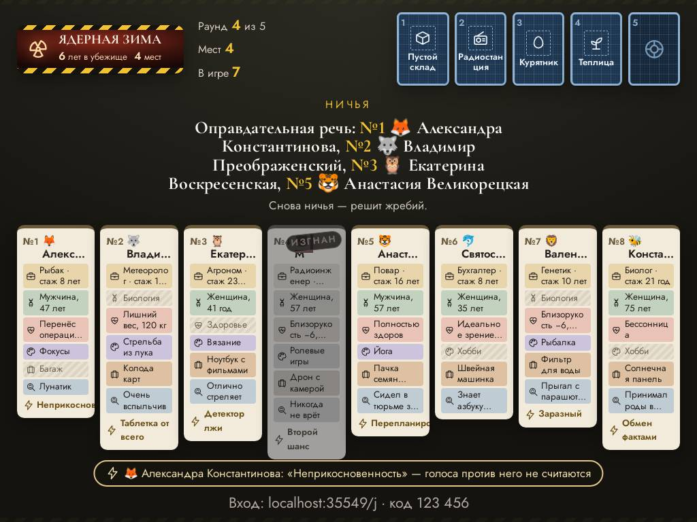
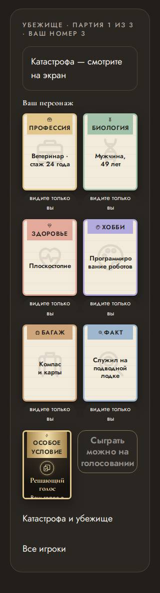
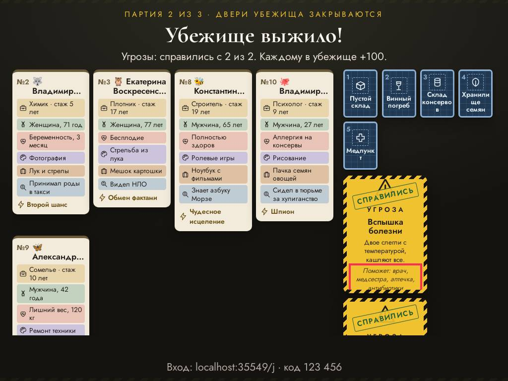
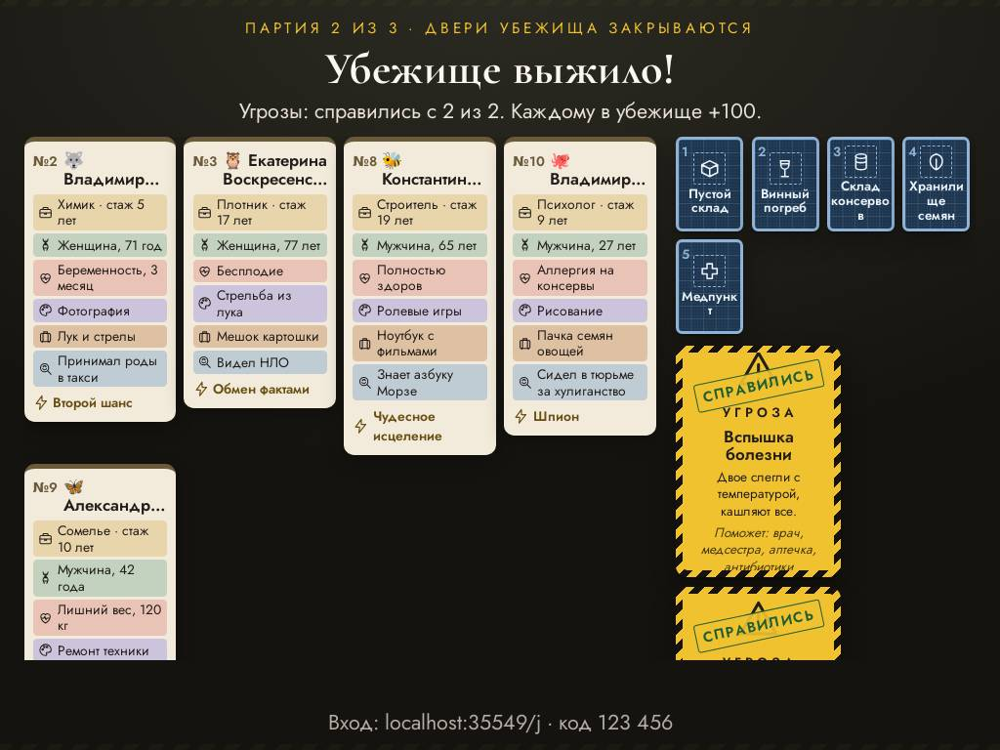
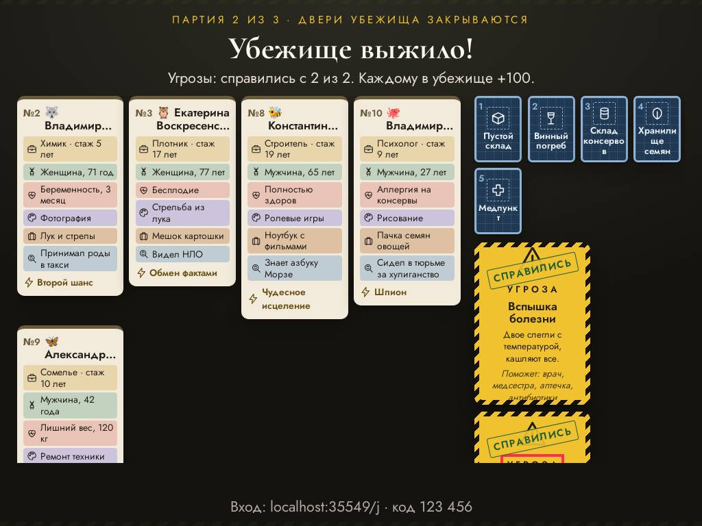

# Ревизор — что видят ведущий и гости

Прогонов: 8 · видов игры проверено: 454 · разных находок: 14

Размеры: Телевизор Full HD (1920x1080); Проектор 4:3, маленький телефон, длинные имена (1024x768).

## Мешает игре — 3

### закрыт другим элементом · экран зала

«Вязание» закрыт элементом p.stage-code — «Вязание»

- где: `article.bk-dossier > ul.bk-dossier__rows > li.bk-row.bk-row--hobby > span.bk-row__text`, этап `playing/143/reveal/final`
- игры (1): bunker 1-й шаблон, каждый сам ×8, телевизор full hd
- раз: 2

### закрыт другим элементом · экран зала

«🐻» закрыт элементом span.bk-dossier__stamp — «🐻»

- где: `article.bk-dossier > header.bk-dossier__head > span.bk-dossier__name > span.name-emoji`, этап `playing/48/question/justify`
- игры (1): bunker 1-й шаблон, каждый сам ×8, проектор 4:3, маленький телефон, длинные имена
- раз: 1

### закрыт другим элементом · экран зала

«Прыгал с парашютом 50 раз» закрыт элементом p.stage-code — «Прыгал с парашютом 50 раз»

- где: `article.bk-dossier > ul.bk-dossier__rows > li.bk-row.bk-row--fact > span.bk-row__text`, этап `playing/152/reveal/final`
- игры (1): bunker 1-й шаблон, каждый сам ×8, проектор 4:3, маленький телефон, длинные имена
- раз: 1

## Заметно — 11

### обрезан текст · телефон

текст обрезан по высоте на 25 px (div.bk-in) — «Последний изгнанный возвращается в игру.»

- где: `div.bk-phone__specialcard > div.bk-card.bk-special > div.bk-in > span.bk-special__text`, этап `playing/1/question/catastrophe`
- игры (1): bunker 1-й шаблон, каждый сам ×8, телевизор full hd; bunker 1-й шаблон, каждый сам ×8, проектор 4:3, маленький телефон, длинные имена
- раз: 204

### обрезан текст · телефон

текст обрезан по высоте на 80 px (div.bk-in) — «во время голосования»

- где: `div.bk-phone__specialcard > div.bk-card.bk-special > div.bk-in > span.bk-special__when`, этап `playing/1/question/catastrophe`
- игры (1): bunker 1-й шаблон, каждый сам ×8, телевизор full hd; bunker 1-й шаблон, каждый сам ×8, проектор 4:3, маленький телефон, длинные имена
- раз: 27

### обрезан текст · экран зала

текст обрезан вбок на 24 px (article.bk-dossier) — «Перепланировка»

- где: `ol.bk-screen__dossiers > li > article.bk-dossier > p.bk-dossier__used`, этап `playing/16/question/open`
- игры (1): bunker 1-й шаблон, каждый сам ×8, проектор 4:3, маленький телефон, длинные имена
- раз: 5

### обрезан текст · экран зала

текст обрезан по высоте на 3 px (div.podium__names) — «Гость 1»

- где: `div.podium__stage > div.podium__slot > div.podium__names > p.podium__name`, этап `finished/66/podium/over`
- игры (1): mafia 1-й шаблон, каждый сам ×9, телевизор full hd
- раз: 1

### обрезан текст · экран зала

текст обрезан по высоте на 5 px (div.bk-in) — «Поможет: врач, медсестра, аптечка, антибиотики»

- где: `li > div.bk-card.bk-threat > div.bk-in > span.bk-threat__helps`, этап `playing/152/reveal/final`
- игры (1): bunker 1-й шаблон, каждый сам ×8, проектор 4:3, маленький телефон, длинные имена
- раз: 1

### прячется за прокруткой · экран зала

на экране зала текст виден только прокруткой (по высоте на 107 px) — «Допрос»

- где: `ol.bk-screen__dossiers.bk-final__survivors > li > article.bk-dossier > p.bk-dossier__used`, этап `playing/152/reveal/final`
- игры (1): bunker 1-й шаблон, каждый сам ×8, проектор 4:3, маленький телефон, длинные имена; bunker 1-й шаблон, каждый сам ×8, телевизор full hd
- раз: 2

### прячется за прокруткой · экран зала

на экране зала текст виден только прокруткой (по высоте на 41 px) — «Генератор на бензине»

- где: `article.bk-dossier > ul.bk-dossier__rows > li.bk-row.bk-row--baggage > span.bk-row__text`, этап `playing/152/reveal/final`
- игры (1): bunker 1-й шаблон, каждый сам ×8, проектор 4:3, маленький телефон, длинные имена
- раз: 1

### прячется за прокруткой · экран зала

на экране зала текст виден только прокруткой (по высоте на 12 px) — «Угроза»

- где: `li > div.bk-card.bk-threat > div.bk-in > span.bk-threat__kicker`, этап `playing/152/reveal/final`
- игры (1): bunker 1-й шаблон, каждый сам ×8, проектор 4:3, маленький телефон, длинные имена
- раз: 1

### прячется за прокруткой · экран зала

на экране зала текст виден только прокруткой (по высоте на 39 px) — «Кончилась еда»

- где: `li > div.bk-card.bk-threat > div.bk-in > span.bk-threat__title`, этап `playing/152/reveal/final`
- игры (1): bunker 1-й шаблон, каждый сам ×8, проектор 4:3, маленький телефон, длинные имена
- раз: 1

### прячется за прокруткой · экран зала

на экране зала текст виден только прокруткой (по высоте на 94 px) — «Крысы добрались до склада, еды осталось на неделю.»

- где: `li > div.bk-card.bk-threat > div.bk-in > span.bk-threat__text`, этап `playing/152/reveal/final`
- игры (1): bunker 1-й шаблон, каждый сам ×8, проектор 4:3, маленький телефон, длинные имена
- раз: 1

### прячется за прокруткой · экран зала

на экране зала текст виден только прокруткой (по высоте на 151 px) — «Поможет: фермер, охотник, семена, повар»

- где: `li > div.bk-card.bk-threat > div.bk-in > span.bk-threat__helps`, этап `playing/152/reveal/final`
- игры (1): bunker 1-й шаблон, каждый сам ×8, проектор 4:3, маленький телефон, длинные имена
- раз: 1

## Мелочи — 0

