# Ревизор — что видят ведущий и гости

Прогонов: 129 · видов игры проверено: 5847 · разных находок: 545

Размеры: Телевизор Full HD (1920x1080); Проектор 4:3, маленький телефон, длинные имена (1024x768); Ноутбук 16:10, большой зал, длинные имена (1280x800).

## Мешает игре — 272

### не успел · страница

TimeoutError: page.waitForFunction: Timeout 600000ms exceeded.

- где: `—`
- игры (1): bunker 1-й шаблон, каждый сам ×8, телевизор full hd; bunker 1-й шаблон, каждый сам ×8, проектор 4:3, маленький телефон, длинные имена; bunker 1-й шаблон, каждый сам ×8, ноутбук 16:10, большой зал, длинные имена
- раз: 3

### не успел · страница

TimeoutError: page.waitForFunction: Timeout 600000ms exceeded.

- где: `—`
- игры (1): bunker 1-й шаблон, каждый сам ×8, телевизор full hd; bunker 1-й шаблон, каждый сам ×8, проектор 4:3, маленький телефон, длинные имена; bunker 1-й шаблон, каждый сам ×8, ноутбук 16:10, большой зал, длинные имена
- раз: 3

### за краем экрана · экран зала

текст выходит за край экрана по высоте на 8 px — «🦊»

- где: `section.td-screen__main > p.td-who > span.td-who__name > span.name-emoji`, этап `playing/0/question/pick`
- игры (1): truth 1-й шаблон, каждый сам ×4, проектор 4:3, маленький телефон, длинные имена; truth 1-й шаблон, команды ×4, проектор 4:3, маленький телефон, длинные имена; truth 1-й шаблон, каждый сам ×16, ноутбук 16:10, большой зал, длинные имена; truth 2-й шаблон, каждый сам ×4, проектор 4:3, маленький телефон, длинные имена; truth 2-й шаблон, команды ×4, проектор 4:3, маленький телефон, длинные имена; truth 2-й шаблон, каждый сам ×16, ноутбук 16:10, большой зал, длинные имена
- раз: 14

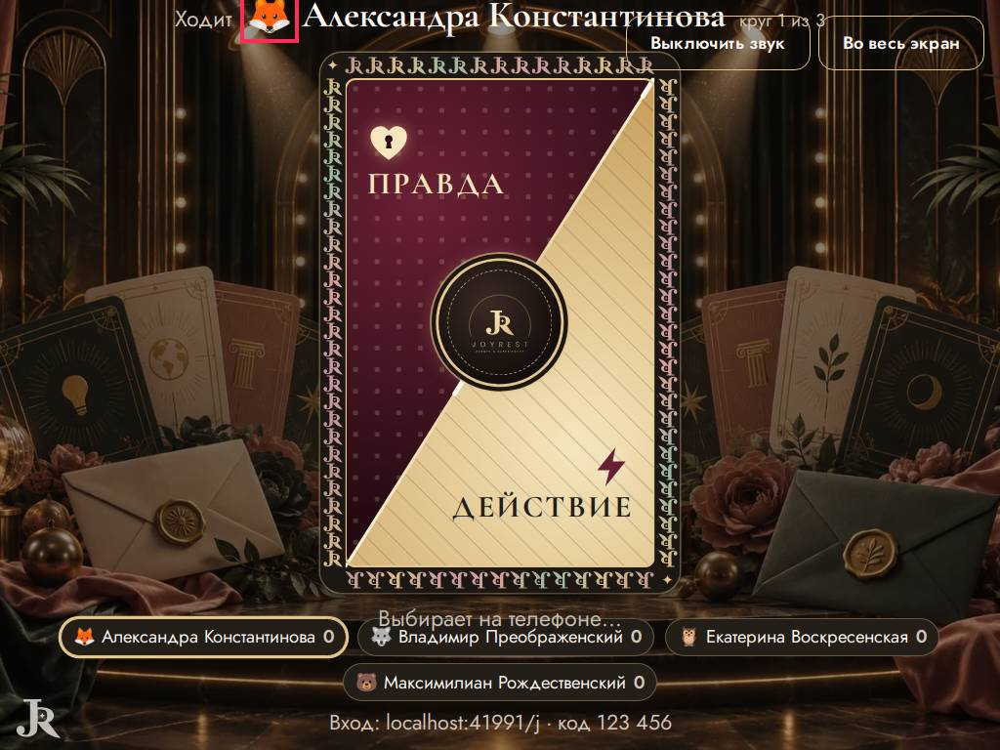

### за краем экрана · экран зала

текст выходит за край экрана по высоте на 8 px — «Александра Константинова»

- где: `section.td-screen__main > p.td-who > span.td-who__name > span`, этап `playing/0/question/pick`
- игры (1): truth 1-й шаблон, каждый сам ×4, проектор 4:3, маленький телефон, длинные имена; truth 1-й шаблон, команды ×4, проектор 4:3, маленький телефон, длинные имена; truth 1-й шаблон, каждый сам ×16, ноутбук 16:10, большой зал, длинные имена; truth 2-й шаблон, каждый сам ×4, проектор 4:3, маленький телефон, длинные имена; truth 2-й шаблон, команды ×4, проектор 4:3, маленький телефон, длинные имена; truth 2-й шаблон, каждый сам ×16, ноутбук 16:10, большой зал, длинные имена
- раз: 14

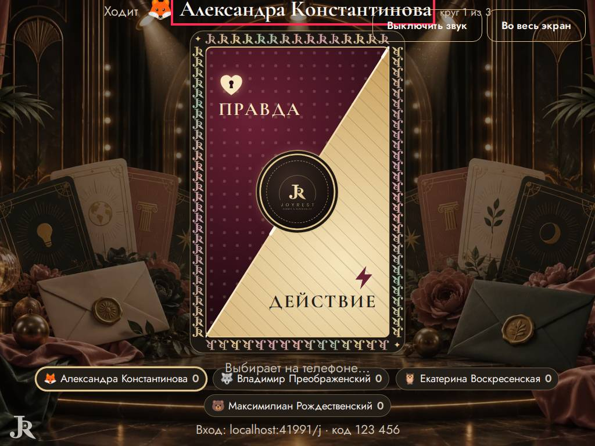

### за краем экрана · экран зала

текст выходит за край экрана по высоте на 187 px — «🦄»

- где: `div.checkers-screen__side > div.checkers-side.checkers-side--w > span.checkers-side__name > span.name-emoji`, этап `playing/7/question/task`
- игры (1): checkers 1-й шаблон, команды ×2, проектор 4:3, маленький телефон, длинные имена; checkers 1-й шаблон, команды ×2, ноутбук 16:10, большой зал, длинные имена
- раз: 6

### за краем экрана · экран зала

текст выходит за край экрана по высоте на 132 px — «0 очков»

- где: `div.checkers-screen > div.checkers-screen__side > div.checkers-side.checkers-side--w > span.checkers-side__score`, этап `playing/7/question/task`
- игры (1): checkers 1-й шаблон, команды ×2, проектор 4:3, маленький телефон, длинные имена; checkers 1-й шаблон, команды ×2, ноутбук 16:10, большой зал, длинные имена
- раз: 6

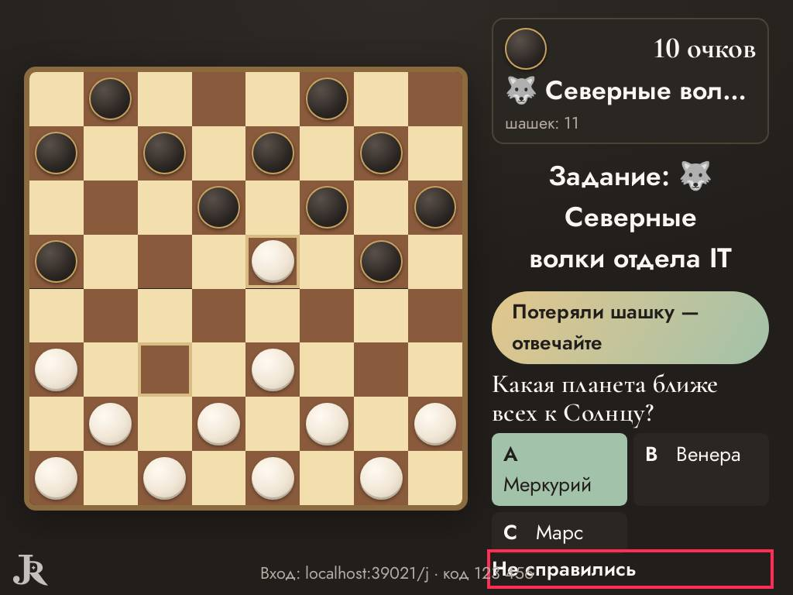

### за краем экрана · экран зала

текст выходит за край экрана по высоте на 220 px — «шашек: 11»

- где: `div.checkers-screen > div.checkers-screen__side > div.checkers-side.checkers-side--w > span.checkers-side__left`, этап `playing/7/question/task`
- игры (1): checkers 1-й шаблон, команды ×2, проектор 4:3, маленький телефон, длинные имена; checkers 1-й шаблон, команды ×2, ноутбук 16:10, большой зал, длинные имена
- раз: 6

### за краем экрана · экран зала

текст выходит за край экрана по высоте на 21 px — «Ходит»

- где: `div.td-screen > section.td-screen__main > p.td-who > span.td-who__label`, этап `playing/7/question/pick`
- игры (1): truth 1-й шаблон, команды ×4, проектор 4:3, маленький телефон, длинные имена; truth 1-й шаблон, каждый сам ×16, ноутбук 16:10, большой зал, длинные имена; truth 2-й шаблон, команды ×4, проектор 4:3, маленький телефон, длинные имена; truth 2-й шаблон, каждый сам ×16, ноутбук 16:10, большой зал, длинные имена
- раз: 6

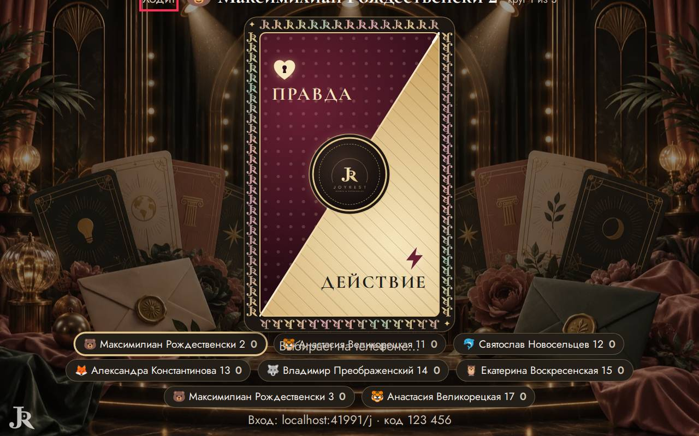

### за краем экрана · экран зала

текст выходит за край экрана по высоте на 16 px — «круг 2 из 3»

- где: `div.td-screen > section.td-screen__main > p.td-who > span.td-who__round`, этап `playing/7/question/pick`
- игры (1): truth 1-й шаблон, команды ×4, проектор 4:3, маленький телефон, длинные имена; truth 1-й шаблон, каждый сам ×16, ноутбук 16:10, большой зал, длинные имена; truth 2-й шаблон, команды ×4, проектор 4:3, маленький телефон, длинные имена; truth 2-й шаблон, каждый сам ×16, ноутбук 16:10, большой зал, длинные имена
- раз: 6

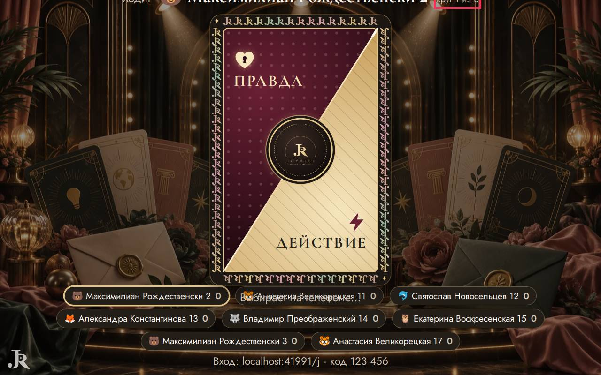

### за краем экрана · экран зала

текст выходит за край экрана по высоте на 21 px — «🐺»

- где: `div.st-reveal > ul.st-votes > li > span.name-emoji`, этап `playing/39/reveal/guess`
- игры (1): story 1-й шаблон, каждый сам ×6, ноутбук 16:10, большой зал, длинные имена
- раз: 3

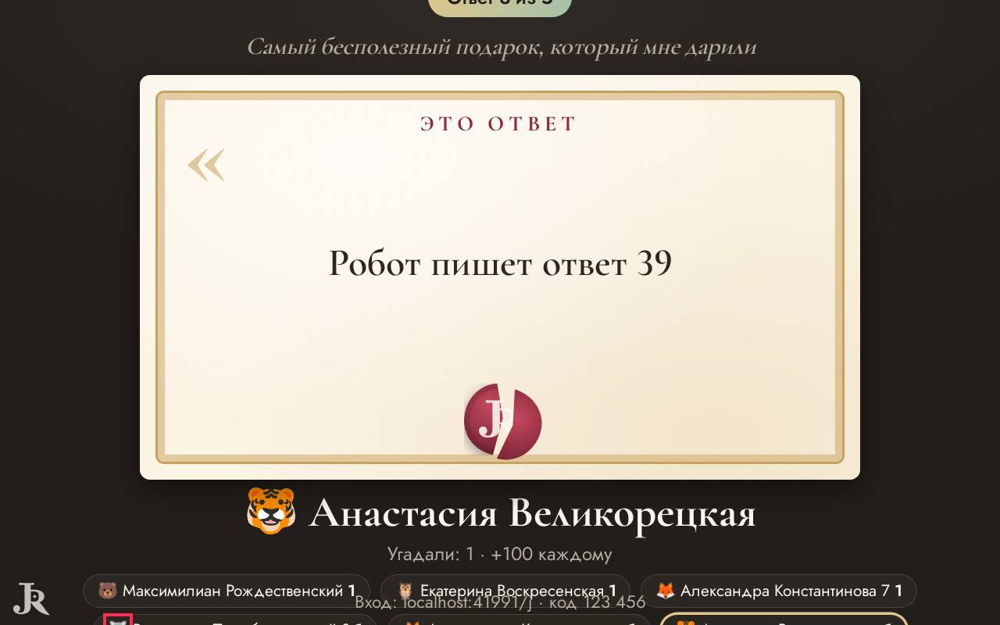

### за краем экрана · экран зала

текст выходит за край экрана по высоте на 21 px — «Владимир Преображенский 8»

- где: `div.st-reveal > ul.st-votes > li > span`, этап `playing/39/reveal/guess`
- игры (1): story 1-й шаблон, каждый сам ×6, ноутбук 16:10, большой зал, длинные имена
- раз: 3

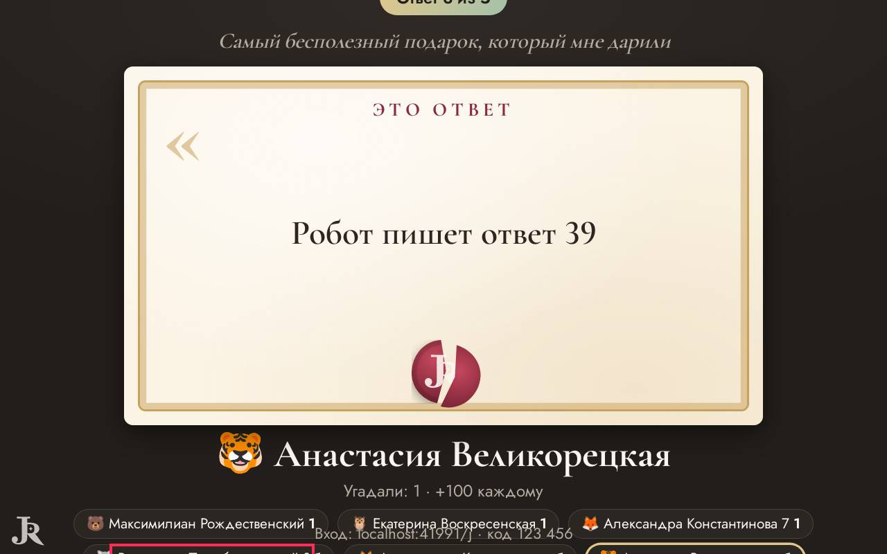

### за краем экрана · экран зала

текст выходит за край экрана по высоте на 21 px — «1»

- где: `div.st-reveal > ul.st-votes > li > strong`, этап `playing/39/reveal/guess`
- игры (1): story 1-й шаблон, каждый сам ×6, ноутбук 16:10, большой зал, длинные имена
- раз: 3

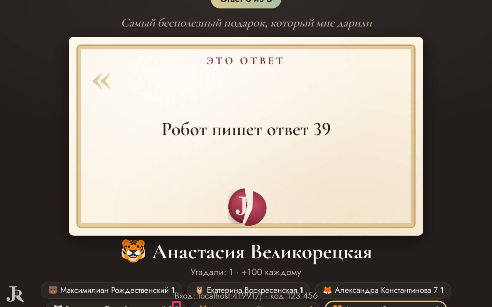

### за краем экрана · экран зала

текст выходит за край экрана по высоте на 39 px — «365»

- где: `div.checkers-screen__side > div.checkers-screen__question > ol.checkers-screen__options > li`, этап `playing/7/question/task`
- игры (1): checkers 1-й шаблон, команды ×2, проектор 4:3, маленький телефон, длинные имена
- раз: 2

### за краем экрана · экран зала

текст выходит за край экрана по высоте на 39 px — «C»

- где: `div.checkers-screen__question > ol.checkers-screen__options > li > span`, этап `playing/7/question/task`
- игры (1): checkers 1-й шаблон, команды ×2, проектор 4:3, маленький телефон, длинные имена
- раз: 2

### за краем экрана · экран зала

текст выходит за край экрана по высоте на 20 px — «Не справились»

- где: `div.checkers-screen > div.checkers-screen__side > div.checkers-screen__question > p.checkers-screen__verdict`, этап `playing/23/reveal/task`
- игры (1): checkers 1-й шаблон, команды ×2, проектор 4:3, маленький телефон, длинные имена
- раз: 1

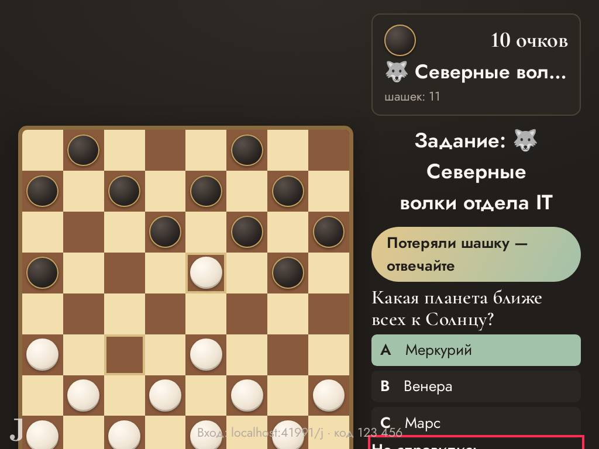

### за краем экрана · экран зала

текст выходит за край экрана по высоте на 21 px — «Ответ 3 из 5»

- где: `main.quiz-stage > div.st-screen > section.st-screen__main > span.quiz-screen__badge`, этап `playing/39/reveal/guess`
- игры (1): story 1-й шаблон, каждый сам ×6, ноутбук 16:10, большой зал, длинные имена
- раз: 1

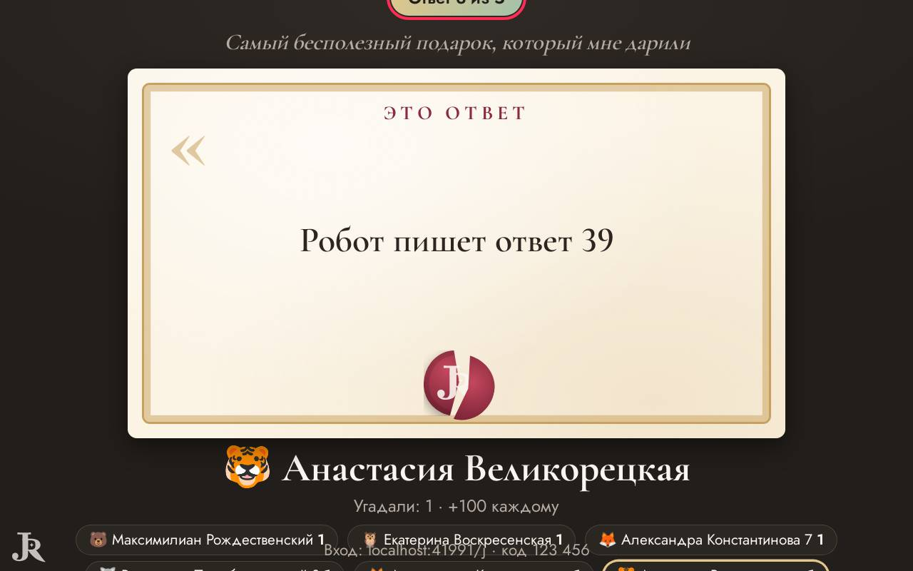

### за краем · пульт

текст выходит за край области вбок на 7 px — «Команда 2 — «Робот пишет ответ 57»»

- где: `div.sv-marks > div.sv-mark-row > button.column-opt > span.line-clamp`, этап `playing/5/reveal/`
- игры (1): survival 1-й шаблон, команды ×4, телевизор full hd; survival 1-й шаблон, команды ×4, проектор 4:3, маленький телефон, длинные имена; survival 1-й шаблон, команды ×8, ноутбук 16:10, большой зал, длинные имена
- раз: 91

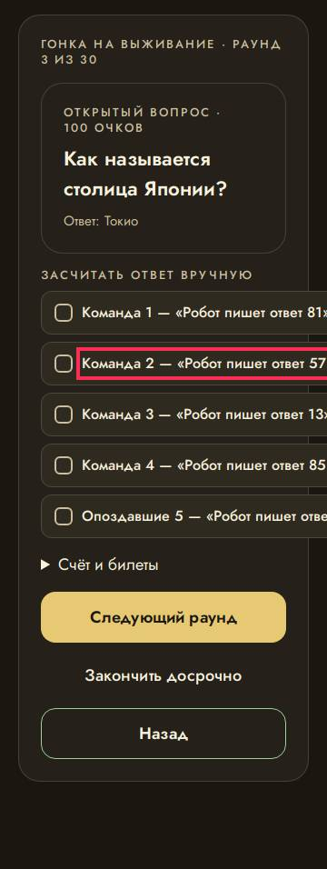

### за краем · пульт

текст выходит за край области вбок на 109 px — «Шанс для : один ответ. Есть на табло — банк их, нет — банк .»

- где: `main.page.page--pult > section.card > div.stack.host-quiz > p.mil-host-live`, этап `playing/1/reveal/steal`
- игры (1): hundred 1-й шаблон, команды ×4, проектор 4:3, маленький телефон, длинные имена; hundred 1-й шаблон, команды ×8, ноутбук 16:10, большой зал, длинные имена; hundred 1-й шаблон, каждый сам ×4, проектор 4:3, маленький телефон, длинные имена; hundred 1-й шаблон, каждый сам ×16, ноутбук 16:10, большой зал, длинные имена; hundred 2-й шаблон, команды ×4, проектор 4:3, маленький телефон, длинные имена; hundred 2-й шаблон, команды ×8, ноутбук 16:10, большой зал, длинные имена …
- раз: 36

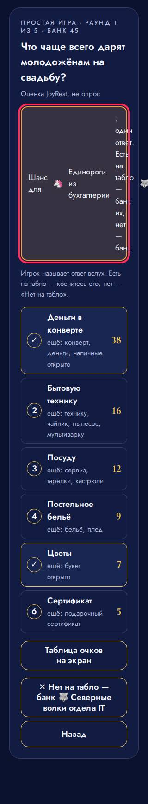

### за краем · пульт

текст выходит за край области вбок на 92 px — «Северные волки отдела IT»

- где: `section.card > div.stack.host-quiz > p.mil-host-live > span`, этап `playing/1/reveal/steal`
- игры (1): hundred 1-й шаблон, команды ×4, проектор 4:3, маленький телефон, длинные имена; hundred 1-й шаблон, команды ×8, ноутбук 16:10, большой зал, длинные имена; hundred 1-й шаблон, каждый сам ×4, проектор 4:3, маленький телефон, длинные имена; hundred 1-й шаблон, каждый сам ×16, ноутбук 16:10, большой зал, длинные имена; hundred 2-й шаблон, команды ×4, проектор 4:3, маленький телефон, длинные имена; hundred 2-й шаблон, команды ×8, ноутбук 16:10, большой зал, длинные имена …
- раз: 33

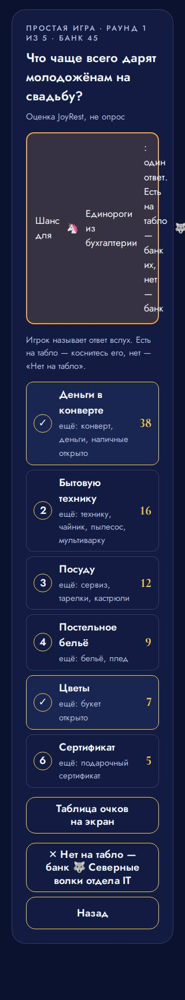

### за краем · пульт

текст выходит за край области вбок на 4 px — «Совы-полуночники ресепшн»

- где: `div.sv-mark-row > button.column-opt > span.line-clamp > span`, этап `playing/3/question/`
- игры (1): survival 1-й шаблон, команды ×4, проектор 4:3, маленький телефон, длинные имена
- раз: 10

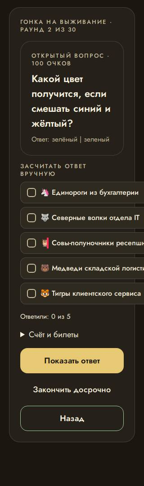

### за краем · пульт

текст выходит за край области вбок на 43 px — «🦊»

- где: `section.card > div.stack.host-quiz > p.mil-host-live > span.name-emoji`, этап `playing/1/reveal/steal`
- игры (1): hundred 1-й шаблон, каждый сам ×4, проектор 4:3, маленький телефон, длинные имена; hundred 2-й шаблон, каждый сам ×4, проектор 4:3, маленький телефон, длинные имена; hundred 3-й шаблон, каждый сам ×4, проектор 4:3, маленький телефон, длинные имена
- раз: 9

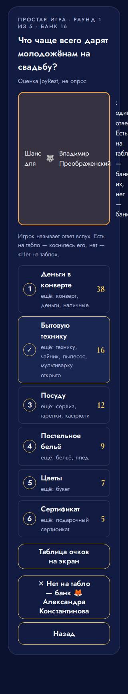

### за краем · пульт

текст выходит за край области вбок на 5 px — «Не выполнено»

- где: `div.stack.host-quiz > div.actions > div.host-buzz__verdict > button.btn.btn--secondary`, этап `playing/0/reveal/cell`
- игры (1): quest 1-й шаблон, команды ×4, проектор 4:3, маленький телефон, длинные имена; quest 2-й шаблон, команды ×4, проектор 4:3, маленький телефон, длинные имена
- раз: 8

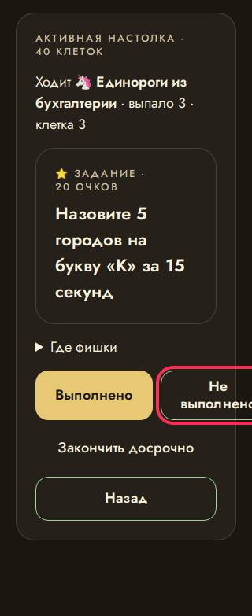

### за краем · телефон

текст выходит за край области вбок на 7 px — «7»

- где: `div.dk-hand__row > button.dk-hand__slot > div.dk-card.dk-d--wedding > span.dk-idx`, этап `playing/54/question/play`
- игры (1): durak 1-й шаблон, каждый сам ×4, телевизор full hd; durak 1-й шаблон, каждый сам ×4, проектор 4:3, маленький телефон, длинные имена; durak 1-й шаблон, каждый сам ×4, ноутбук 16:10, большой зал, длинные имена
- раз: 8

### за краем · пульт

текст выходит за край области вбок на 105 px — «Анастасия Великорецкая»

- где: `div.stack.host-quiz > p.mil-host-live > strong > span`, этап `playing/42/question/bet`
- игры (1): board 1-й шаблон, каждый сам ×4, проектор 4:3, маленький телефон, длинные имена; board 1-й шаблон, каждый сам ×16, ноутбук 16:10, большой зал, длинные имена; board 1-й шаблон, команды ×4, проектор 4:3, маленький телефон, длинные имена; board 1-й шаблон, команды ×8, ноутбук 16:10, большой зал, длинные имена
- раз: 6

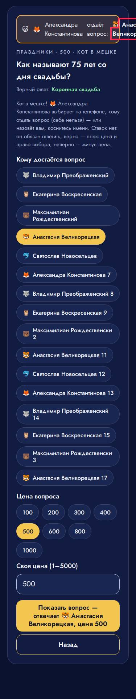

### за краем · телефон

текст выходит за край области вбок на 7 px — «7»

- где: `div.dk-hand__row > button.dk-hand__slot > div.dk-card.dk-d--gothic > span.dk-idx`, этап `playing/56/question/play`
- игры (1): durak 1-й шаблон, каждый сам ×4, телевизор full hd; durak 1-й шаблон, каждый сам ×4, проектор 4:3, маленький телефон, длинные имена; durak 1-й шаблон, каждый сам ×4, ноутбук 16:10, большой зал, длинные имена
- раз: 6

### за краем · телефон

текст выходит за край области вбок на 8 px — «10»

- где: `div.dk-hand__row > button.dk-hand__slot > div.dk-card.dk-d--classic > span.dk-idx`, этап `playing/92/question/play`
- игры (1): durak 1-й шаблон, каждый сам ×4, телевизор full hd; durak 1-й шаблон, каждый сам ×4, проектор 4:3, маленький телефон, длинные имена; durak 1-й шаблон, каждый сам ×4, ноутбук 16:10, большой зал, длинные имена
- раз: 5

### за краем · телефон

текст выходит за край области вбок на 7 px — «10»

- где: `div.dk-hand__row > button.dk-hand__slot > div.dk-card.dk-d--russia > span.dk-idx`, этап `playing/68/question/play`
- игры (1): durak 1-й шаблон, каждый сам ×4, телевизор full hd; durak 1-й шаблон, каждый сам ×4, проектор 4:3, маленький телефон, длинные имена; durak 1-й шаблон, каждый сам ×4, ноутбук 16:10, большой зал, длинные имена
- раз: 3

### за краем · телефон

текст выходит за край области вбок на 8 px — «7»

- где: `div.dk-hand__row > button.dk-hand__slot > div.dk-card.dk-d--rome > span.dk-idx`, этап `playing/19/question/play`
- игры (1): durak 1-й шаблон, каждый сам ×4, телевизор full hd
- раз: 2

### за краем · телефон

текст выходит за край области вбок на 14 px — «♥︎»

- где: `button.dk-hand__slot > div.dk-card.dk-d--gothic > span.dk-idx > span`, этап `playing/56/question/play`
- игры (1): durak 1-й шаблон, каждый сам ×4, телевизор full hd; durak 1-й шаблон, каждый сам ×4, ноутбук 16:10, большой зал, длинные имена
- раз: 2

### за краем · пульт

текст выходит за край области вбок на 11 px — «🐯»

- где: `div.stack.host-quiz > p.mil-host-live > strong > span.name-emoji`, этап `playing/42/question/bet`
- игры (1): board 1-й шаблон, каждый сам ×4, проектор 4:3, маленький телефон, длинные имена
- раз: 1

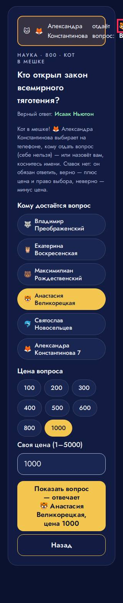

### за краем · телефон

текст выходит за край области вбок на 8 px — «7»

- где: `div.dk-hand__row > button.dk-hand__slot > div.dk-card.dk-d--kpop > span.dk-idx`, этап `playing/26/question/play`
- игры (1): durak 1-й шаблон, каждый сам ×4, телевизор full hd
- раз: 1

### закрыт другим элементом · экран зала

«Вход: localhost:41991/j · код 123 456» закрыт элементом li.mf-reveal__item.mf-role--mafia — «Вход: localhost:41991/j · код 123 456»

- где: `div.hall > main.quiz-stage > p.stage-code`, этап `playing/87/reveal/over`
- игры (4): mafia 1-й шаблон, каждый сам ×9, телевизор full hd; mafia 1-й шаблон, каждый сам ×9, ноутбук 16:10, большой зал, длинные имена; mafia 1-й шаблон, каждый сам ×9, проектор 4:3, маленький телефон, длинные имена; durak 1-й шаблон, каждый сам ×4, телевизор full hd; bunker 1-й шаблон, каждый сам ×8, телевизор full hd; bunker 1-й шаблон, каждый сам ×8, проектор 4:3, маленький телефон, длинные имена …
- раз: 30

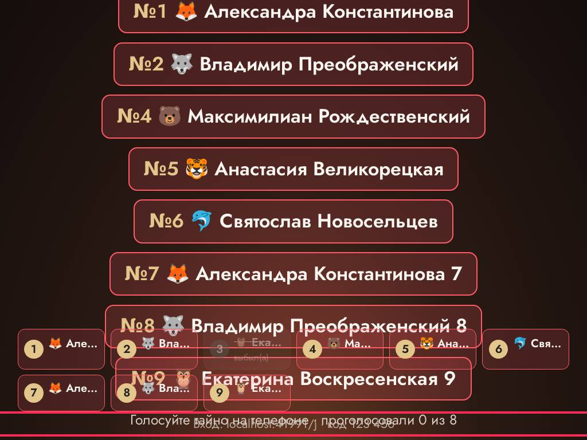

### закрыт другим элементом · телефон

«♥︎» закрыт элементом span.dk-face — «♥︎»

- где: `button.dk-hand__slot > div.dk-card.dk-d--rome > span.dk-idx.dk-idx--b > span`, этап `playing/19/question/play`
- игры (1): durak 1-й шаблон, каждый сам ×4, телевизор full hd; durak 1-й шаблон, каждый сам ×4, проектор 4:3, маленький телефон, длинные имена; durak 1-й шаблон, каждый сам ×4, ноутбук 16:10, большой зал, длинные имена
- раз: 195

### закрыт другим элементом · телефон

«7» закрыт элементом span.dk-face — «7»

- где: `div.dk-hand__row > button.dk-hand__slot > div.dk-card.dk-d--rome > span.dk-idx.dk-idx--b`, этап `playing/19/question/play`
- игры (1): durak 1-й шаблон, каждый сам ×4, телевизор full hd; durak 1-й шаблон, каждый сам ×4, проектор 4:3, маленький телефон, длинные имена; durak 1-й шаблон, каждый сам ×4, ноутбук 16:10, большой зал, длинные имена
- раз: 193

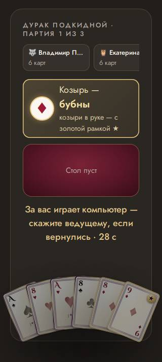

### закрыт другим элементом · телефон

«Максимилиан Рождественский» закрыт элементом span.sp-tally__fill — «Максимилиан Рождественский»

- где: `ul.sp-tally > li.sp-tally__row > span.sp-tally__name > span`, этап `playing/2/reveal/verdict`
- игры (1): spy 1-й шаблон, каждый сам ×11, проектор 4:3, маленький телефон, длинные имена; spy 1-й шаблон, каждый сам ×11, ноутбук 16:10, большой зал, длинные имена
- раз: 153

### закрыт другим элементом · телефон

«Александра Константинова» закрыт элементом span.name-emoji — «Александра Константинова»

- где: `div.mf-targets > button.mf-target > span.mf-target__name > span`, этап `playing/1/question/vote`
- игры (1): mafia 1-й шаблон, каждый сам ×9, проектор 4:3, маленький телефон, длинные имена; mafia 1-й шаблон, каждый сам ×9, ноутбук 16:10, большой зал, длинные имена
- раз: 133

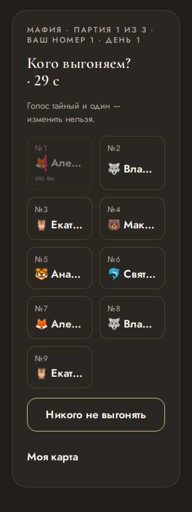

### закрыт другим элементом · телефон

«♥︎» закрыт элементом div.dk-card.dk-d--wedding — «♥︎»

- где: `button.dk-hand__slot > div.dk-card.dk-d--wedding > span.dk-idx.dk-idx--b > span`, этап `playing/54/question/play`
- игры (1): durak 1-й шаблон, каждый сам ×4, телевизор full hd; durak 1-й шаблон, каждый сам ×4, проектор 4:3, маленький телефон, длинные имена; durak 1-й шаблон, каждый сам ×4, ноутбук 16:10, большой зал, длинные имена
- раз: 91

### закрыт другим элементом · телефон

«7» закрыт элементом div.dk-card.dk-d--wedding — «7»

- где: `div.dk-hand__row > button.dk-hand__slot > div.dk-card.dk-d--wedding > span.dk-idx.dk-idx--b`, этап `playing/54/question/play`
- игры (1): durak 1-й шаблон, каждый сам ×4, телевизор full hd; durak 1-й шаблон, каждый сам ×4, проектор 4:3, маленький телефон, длинные имена; durak 1-й шаблон, каждый сам ×4, ноутбук 16:10, большой зал, длинные имена
- раз: 89

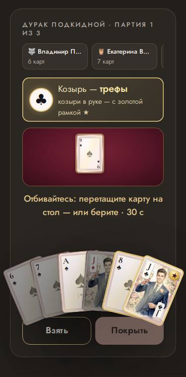

### закрыт другим элементом · телефон

«♥︎» закрыт элементом span.dk-face — «♥︎»

- где: `button.dk-hand__slot > div.dk-card.dk-d--gothic > span.dk-idx.dk-idx--b > span`, этап `playing/56/question/play`
- игры (1): durak 1-й шаблон, каждый сам ×4, телевизор full hd; durak 1-й шаблон, каждый сам ×4, проектор 4:3, маленький телефон, длинные имена; durak 1-й шаблон, каждый сам ×4, ноутбук 16:10, большой зал, длинные имена
- раз: 89

### закрыт другим элементом · телефон

«Q» закрыт элементом span.dk-pip.dk-pip--ace — «Q»

- где: `div.dk-hand__row > button.dk-hand__slot > div.dk-card.dk-d--russia > span.dk-idx.dk-idx--b`, этап `playing/14/question/play`
- игры (1): durak 1-й шаблон, каждый сам ×4, телевизор full hd; durak 1-й шаблон, каждый сам ×4, проектор 4:3, маленький телефон, длинные имена; durak 1-й шаблон, каждый сам ×4, ноутбук 16:10, большой зал, длинные имена
- раз: 87

### закрыт другим элементом · телефон

«♥︎» закрыт элементом span.dk-brand — «♥︎»

- где: `button.dk-hand__slot > div.dk-card.dk-d--russia > span.dk-idx.dk-idx--b > span`, этап `playing/14/question/play`
- игры (1): durak 1-й шаблон, каждый сам ×4, телевизор full hd; durak 1-й шаблон, каждый сам ×4, проектор 4:3, маленький телефон, длинные имена; durak 1-й шаблон, каждый сам ×4, ноутбук 16:10, большой зал, длинные имена
- раз: 87

### закрыт другим элементом · телефон

«7» закрыт элементом span.dk-face — «7»

- где: `div.dk-hand__row > button.dk-hand__slot > div.dk-card.dk-d--gothic > span.dk-idx.dk-idx--b`, этап `playing/56/question/play`
- игры (1): durak 1-й шаблон, каждый сам ×4, телевизор full hd; durak 1-й шаблон, каждый сам ×4, проектор 4:3, маленький телефон, длинные имена; durak 1-й шаблон, каждый сам ×4, ноутбук 16:10, большой зал, длинные имена
- раз: 87

### закрыт другим элементом · экран зала

«Северные волки отдела IT» закрыт элементом span.qx-row__score — «Северные волки отдела IT»

- где: `ol.qx-panel__list > li.qx-row > span.qx-row__name > span`, этап `playing/0/question/roll`
- игры (1): quest 1-й шаблон, команды ×4, проектор 4:3, маленький телефон, длинные имена; quest 2-й шаблон, команды ×4, проектор 4:3, маленький телефон, длинные имена; quest 1-й шаблон, команды ×8, ноутбук 16:10, большой зал, длинные имена; quest 2-й шаблон, команды ×8, ноутбук 16:10, большой зал, длинные имена
- раз: 78

### закрыт другим элементом · экран зала

«Единороги из бухгалтерии» закрыт элементом span.sv-lane__track — «Единороги из бухгалтерии»

- где: `li.sv-lane > span.sv-lane__who > span.sv-lane__name > span`, этап `playing/0/ready/`
- игры (1): survival 1-й шаблон, команды ×4, проектор 4:3, маленький телефон, длинные имена; survival 1-й шаблон, команды ×8, ноутбук 16:10, большой зал, длинные имена
- раз: 74

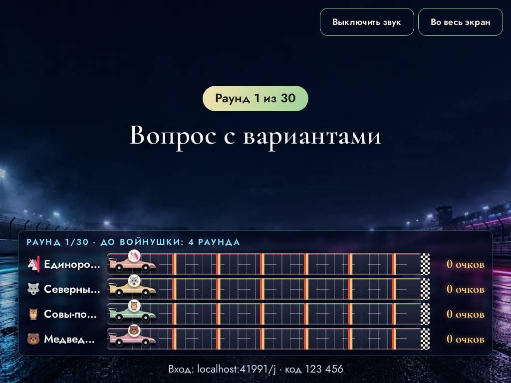

### закрыт другим элементом · телефон

«7» закрыт элементом span.dk-face — «7»

- где: `div.dk-hand__row > button.dk-hand__slot > div.dk-card.dk-d--classic > span.dk-idx.dk-idx--b`, этап `playing/92/question/play`
- игры (1): durak 1-й шаблон, каждый сам ×4, телевизор full hd; durak 1-й шаблон, каждый сам ×4, проектор 4:3, маленький телефон, длинные имена; durak 1-й шаблон, каждый сам ×4, ноутбук 16:10, большой зал, длинные имена
- раз: 66

### закрыт другим элементом · телефон

«♥︎» закрыт элементом span.dk-face — «♥︎»

- где: `button.dk-hand__slot > div.dk-card.dk-d--classic > span.dk-idx.dk-idx--b > span`, этап `playing/92/question/play`
- игры (1): durak 1-й шаблон, каждый сам ×4, телевизор full hd; durak 1-й шаблон, каждый сам ×4, проектор 4:3, маленький телефон, длинные имена; durak 1-й шаблон, каждый сам ×4, ноутбук 16:10, большой зал, длинные имена
- раз: 66

### закрыт другим элементом · телефон

«7» закрыт элементом div.dk-card.dk-d--kpop — «7»

- где: `div.dk-hand__row > button.dk-hand__slot > div.dk-card.dk-d--kpop > span.dk-idx.dk-idx--b`, этап `playing/26/question/play`
- игры (1): durak 1-й шаблон, каждый сам ×4, телевизор full hd; durak 1-й шаблон, каждый сам ×4, проектор 4:3, маленький телефон, длинные имена; durak 1-й шаблон, каждый сам ×4, ноутбук 16:10, большой зал, длинные имена
- раз: 60

### закрыт другим элементом · телефон

«♥︎» закрыт элементом span.dk-face — «♥︎»

- где: `button.dk-hand__slot > div.dk-card.dk-d--kpop > span.dk-idx.dk-idx--b > span`, этап `playing/26/question/play`
- игры (1): durak 1-й шаблон, каждый сам ×4, телевизор full hd; durak 1-й шаблон, каждый сам ×4, проектор 4:3, маленький телефон, длинные имена; durak 1-й шаблон, каждый сам ×4, ноутбук 16:10, большой зал, длинные имена
- раз: 60

### закрыт другим элементом · телефон

«Q» закрыт элементом span.dk-pip.dk-pip--ace — «Q»

- где: `div.dk-hand__row > button.dk-hand__slot > div.dk-card.dk-d--cyber > span.dk-idx.dk-idx--b`, этап `playing/4/question/play`
- игры (1): durak 1-й шаблон, каждый сам ×4, телевизор full hd; durak 1-й шаблон, каждый сам ×4, проектор 4:3, маленький телефон, длинные имена; durak 1-й шаблон, каждый сам ×4, ноутбук 16:10, большой зал, длинные имена
- раз: 57

### закрыт другим элементом · телефон

«♥︎» закрыт элементом span.dk-brand — «♥︎»

- где: `button.dk-hand__slot > div.dk-card.dk-d--cyber > span.dk-idx.dk-idx--b > span`, этап `playing/4/question/play`
- игры (1): durak 1-й шаблон, каждый сам ×4, телевизор full hd; durak 1-й шаблон, каждый сам ×4, проектор 4:3, маленький телефон, длинные имена; durak 1-й шаблон, каждый сам ×4, ноутбук 16:10, большой зал, длинные имена
- раз: 57

### закрыт другим элементом · телефон

«Владимир Преображенский» закрыт элементом button.mf-target — «Владимир Преображенский»

- где: `div.st-targets > button.mf-target > span.mf-target__name > span`, этап `playing/14/question/guess`
- игры (1): story 1-й шаблон, каждый сам ×6, ноутбук 16:10, большой зал, длинные имена; story 1-й шаблон, каждый сам ×6, проектор 4:3, маленький телефон, длинные имена
- раз: 57

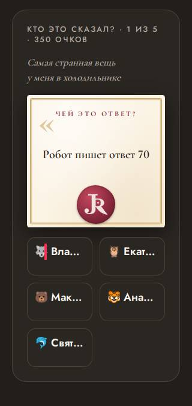

### закрыт другим элементом · экран зала

«Александра Константинова» закрыт элементом span.mf-seat__num — «Александра Константинова»

- где: `ol.mf-seats.mf-seats--screen > li.mf-seat > span.mf-seat__name > span`, этап `playing/2/question/vote`
- игры (1): mafia 1-й шаблон, каждый сам ×9, ноутбук 16:10, большой зал, длинные имена; mafia 1-й шаблон, каждый сам ×9, проектор 4:3, маленький телефон, длинные имена
- раз: 56

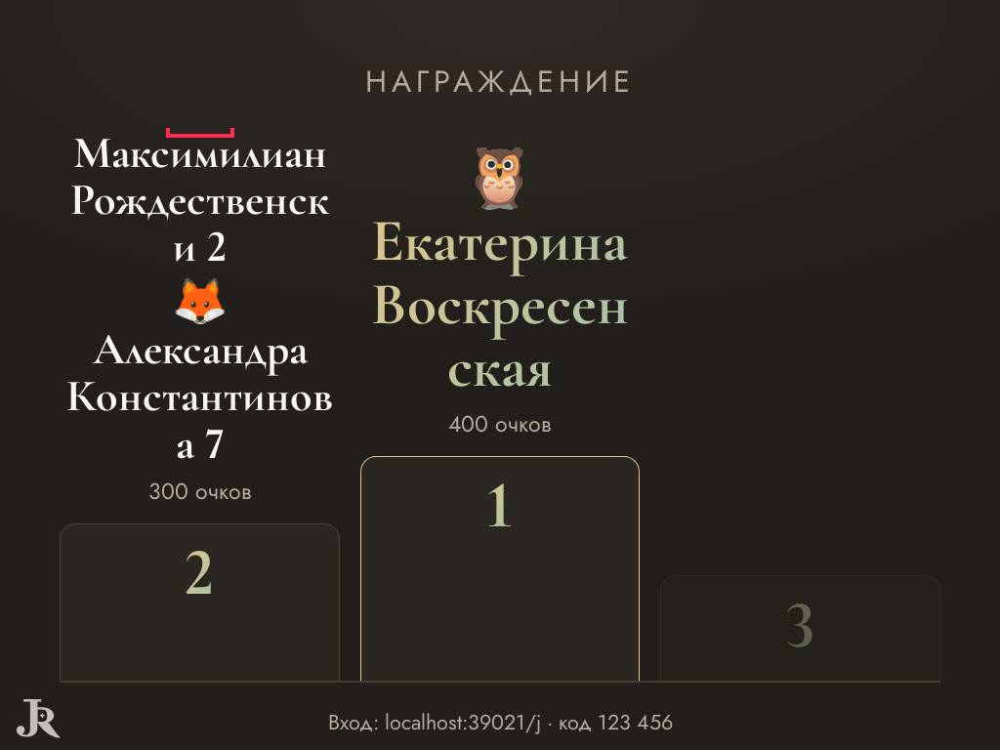

### закрыт другим элементом · телефон

«Владимир Преображенский» закрыт элементом strong.mf-tally__n — «Владимир Преображенский»

- где: `ul.mf-tally > li.mf-tally__row > span.mf-tally__name > span`, этап `playing/1/reveal/verdict`
- игры (1): mafia 1-й шаблон, каждый сам ×9, ноутбук 16:10, большой зал, длинные имена
- раз: 55

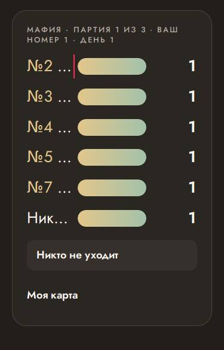

### закрыт другим элементом · телефон

«Гость 2» закрыт элементом span.mf-tally__fill — «Гость 2»

- где: `div.stack > ul.mf-tally > li.mf-tally__row > span.mf-tally__name`, этап `playing/1/reveal/verdict`
- игры (1): mafia 1-й шаблон, каждый сам ×9, телевизор full hd
- раз: 52

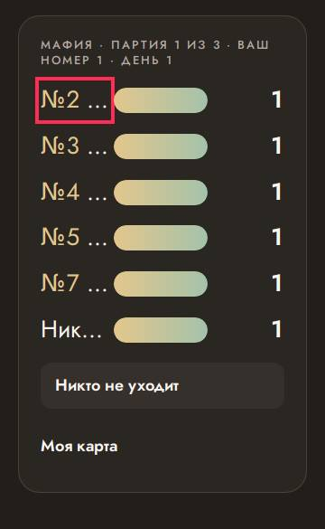

### закрыт другим элементом · телефон

«№ 1» закрыт элементом div.mf-card__pattern — «№ 1»

- где: `button.mf-card > span.mf-card__inner > div.mf-card__face.mf-card__front > span.mf-card__seat`, этап `playing/0/reveal/roles`
- игры (1): mafia 1-й шаблон, каждый сам ×9, проектор 4:3, маленький телефон, длинные имена; mafia 1-й шаблон, каждый сам ×9, телевизор full hd; mafia 1-й шаблон, каждый сам ×9, ноутбук 16:10, большой зал, длинные имена
- раз: 36

### закрыт другим элементом · телефон

«Город» закрыт элементом div.mf-card__pattern — «Город»

- где: `button.mf-card > span.mf-card__inner > div.mf-card__face.mf-card__front > span.mf-card__side`, этап `playing/0/reveal/roles`
- игры (1): mafia 1-й шаблон, каждый сам ×9, проектор 4:3, маленький телефон, длинные имена; mafia 1-й шаблон, каждый сам ×9, телевизор full hd; mafia 1-й шаблон, каждый сам ×9, ноутбук 16:10, большой зал, длинные имена
- раз: 36

### закрыт другим элементом · телефон

«Ночью спите. Днём — ваш голос решает, кт» закрыт элементом div.mf-card__pattern — «Ночью спите. Днём — ваш голос решает, кто покинет город.»

- где: `button.mf-card > span.mf-card__inner > div.mf-card__face.mf-card__front > p.mf-card__power`, этап `playing/0/reveal/roles`
- игры (1): mafia 1-й шаблон, каждый сам ×9, проектор 4:3, маленький телефон, длинные имена; mafia 1-й шаблон, каждый сам ×9, телевизор full hd; mafia 1-й шаблон, каждый сам ×9, ноутбук 16:10, большой зал, длинные имена
- раз: 36

### закрыт другим элементом · телефон

«Мирный житель» закрыт элементом div.mf-card__pattern — «Мирный житель»

- где: `button.mf-card > span.mf-card__inner > div.mf-card__face.mf-card__front > h3.mf-card__title`, этап `playing/0/reveal/roles`
- игры (1): mafia 1-й шаблон, каждый сам ×9, проектор 4:3, маленький телефон, длинные имена; mafia 1-й шаблон, каждый сам ×9, телевизор full hd; mafia 1-й шаблон, каждый сам ×9, ноутбук 16:10, большой зал, длинные имена
- раз: 34

### закрыт другим элементом · телефон

«♠︎» закрыт элементом span.dk-pip.dk-pip--ace — «♠︎»

- где: `div.dk-mini > span.dk-mini__pair > div.dk-card.dk-d--rome > span.dk-pip`, этап `playing/16/question/play`
- игры (1): durak 1-й шаблон, каждый сам ×4, проектор 4:3, маленький телефон, длинные имена; durak 1-й шаблон, каждый сам ×4, ноутбук 16:10, большой зал, длинные имена
- раз: 20

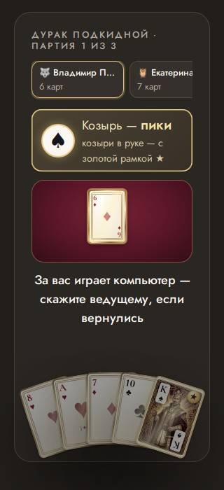

### закрыт другим элементом · экран зала

«Александра Константинова» закрыт элементом div.dk-table__felt — «Александра Константинова»

- где: `div.dk-seat__card > span.dk-seat__text > span.dk-seat__name > span`, этап `playing/1/question/deal`
- игры (1): durak 1-й шаблон, каждый сам ×4, проектор 4:3, маленький телефон, длинные имена; durak 1-й шаблон, каждый сам ×4, ноутбук 16:10, большой зал, длинные имена
- раз: 18

### закрыт другим элементом · телефон

«от гостя:» закрыт элементом span.td-stamp.td-stamp--done — «от гостя:»

- где: `div.quiz-phone.td-phone > div.td-flip.td-flip--phone > div.td-face.td-face--dare > span.td-face__from`, этап `playing/7/reveal/done`
- игры (1): truth 1-й шаблон, каждый сам ×16, ноутбук 16:10, большой зал, длинные имена; truth 2-й шаблон, каждый сам ×16, ноутбук 16:10, большой зал, длинные имена
- раз: 18

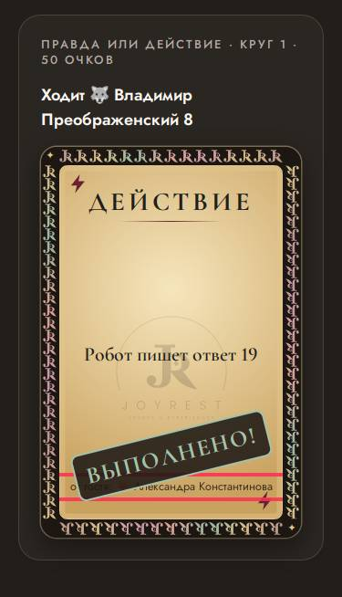

### закрыт другим элементом · телефон

«🦊» закрыт элементом span.td-stamp.td-stamp--done — «🦊»

- где: `div.td-flip.td-flip--phone > div.td-face.td-face--dare > span.td-face__from > span.name-emoji`, этап `playing/7/reveal/done`
- игры (1): truth 1-й шаблон, каждый сам ×16, ноутбук 16:10, большой зал, длинные имена; truth 2-й шаблон, каждый сам ×16, ноутбук 16:10, большой зал, длинные имена
- раз: 18

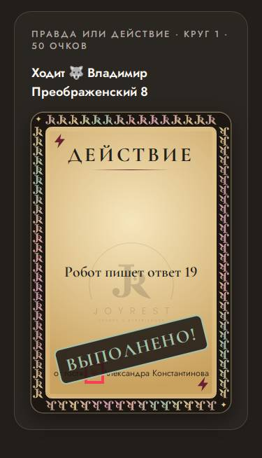

### закрыт другим элементом · телефон

«♦︎» закрыт элементом span.dk-pip — «♦︎»

- где: `div.dk-mini > span.dk-mini__pair > div.dk-card.dk-d--classic > span.dk-pip`, этап `playing/92/question/play`
- игры (1): durak 1-й шаблон, каждый сам ×4, телевизор full hd; durak 1-й шаблон, каждый сам ×4, проектор 4:3, маленький телефон, длинные имена; durak 1-й шаблон, каждый сам ×4, ноутбук 16:10, большой зал, длинные имена
- раз: 15

### закрыт другим элементом · экран зала

«Единороги из бухгалтерии» закрыт элементом span.name-emoji — «Единороги из бухгалтерии»

- где: `div.stage-teams > div.stage-teams__one > span.stage-teams__name > span`, этап `playing/8/reveal/pick`
- игры (1): stage 1-й шаблон, команды ×8, ноутбук 16:10, большой зал, длинные имена; stage 2-й шаблон, команды ×8, ноутбук 16:10, большой зал, длинные имена
- раз: 14

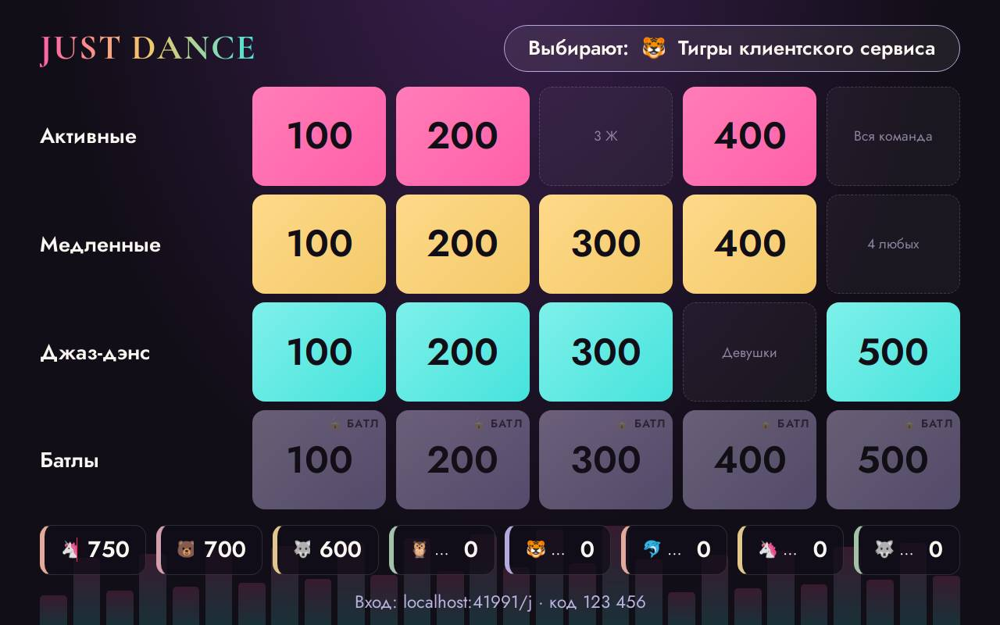

### закрыт другим элементом · телефон

«Ваша семья: 🦉 Екатерина Воскресенская (» закрыт элементом div.mf-card__pattern — «Ваша семья: 🦉 Екатерина Воскресенская (Дон)»

- где: `button.mf-card > span.mf-card__inner > div.mf-card__face.mf-card__front > p.mf-card__family`, этап `playing/0/reveal/roles`
- игры (1): mafia 1-й шаблон, каждый сам ×9, проектор 4:3, маленький телефон, длинные имена; mafia 1-й шаблон, каждый сам ×9, телевизор full hd; mafia 1-й шаблон, каждый сам ×9, ноутбук 16:10, большой зал, длинные имена
- раз: 11

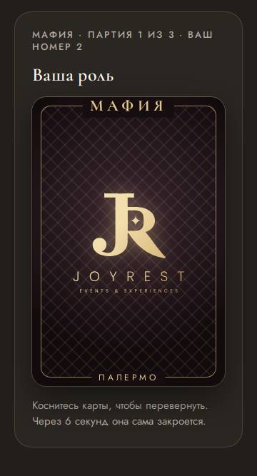

### закрыт другим элементом · телефон

«7» закрыт элементом span.dk-pip.dk-pip--ace — «7»

- где: `div.dk-hand__row > button.dk-hand__slot > div.dk-card.dk-d--greece > span.dk-idx.dk-idx--b`, этап `playing/21/question/play`
- игры (1): durak 1-й шаблон, каждый сам ×4, ноутбук 16:10, большой зал, длинные имена
- раз: 11

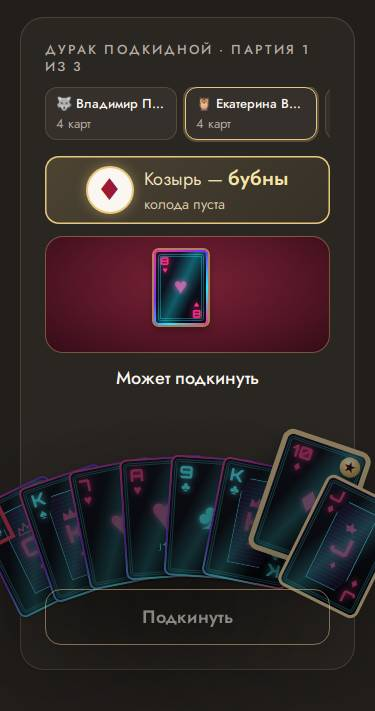

### закрыт другим элементом · телефон

«♠︎» закрыт элементом span.dk-brand — «♠︎»

- где: `button.dk-hand__slot > div.dk-card.dk-d--greece > span.dk-idx.dk-idx--b > span`, этап `playing/21/question/play`
- игры (1): durak 1-й шаблон, каждый сам ×4, ноутбук 16:10, большой зал, длинные имена
- раз: 11

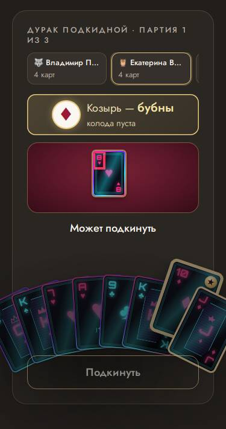

### закрыт другим элементом · экран зала

«50% · 0» закрыт элементом img.stage-dancer — «50% · 0»

- где: `div.stage-screen.stage-screen--battle > div.stage-tug > div.stage-tug__bar > span`, этап `playing/36/reveal/result`
- игры (1): stage 1-й шаблон, команды ×8, ноутбук 16:10, большой зал, длинные имена; stage 1-й шаблон, команды ×4, проектор 4:3, маленький телефон, длинные имена; stage 2-й шаблон, команды ×8, ноутбук 16:10, большой зал, длинные имена; stage 2-й шаблон, команды ×4, проектор 4:3, маленький телефон, длинные имена
- раз: 8

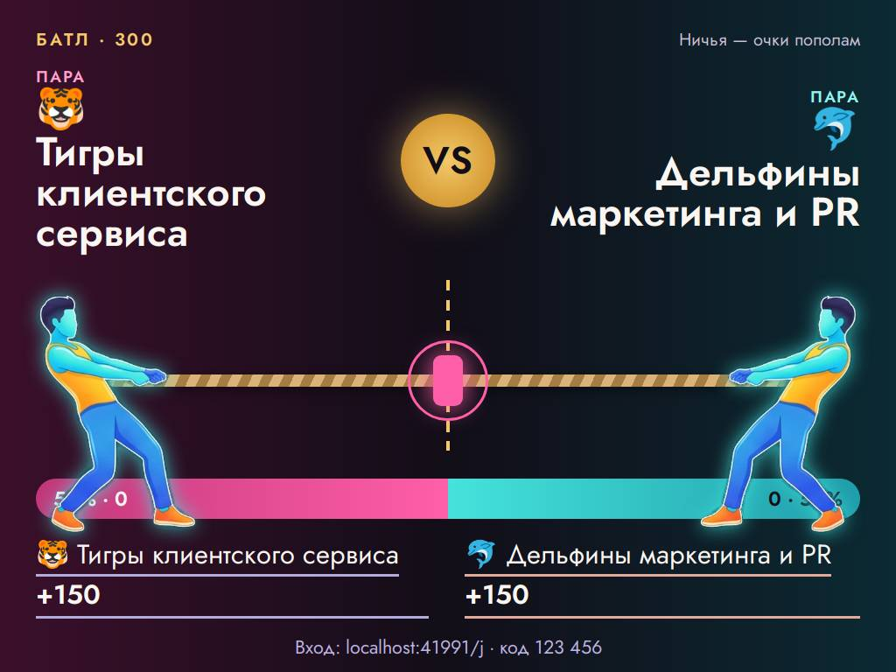

### закрыт другим элементом · пульт

«Единороги из бухгалтерии» закрыт элементом span.buzz-queue__state — «Единороги из бухгалтерии»

- где: `ul.buzz-queue.buzz-queue--plain > li > span.buzz-queue__name > span`, этап `playing/5/reveal/result`
- игры (1): stage 1-й шаблон, команды ×4, проектор 4:3, маленький телефон, длинные имена; stage 2-й шаблон, команды ×4, проектор 4:3, маленький телефон, длинные имена
- раз: 8

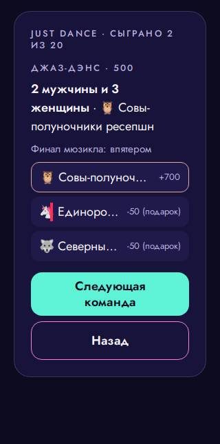

### закрыт другим элементом · телефон

«Локация» закрыт элементом span.sp-card__face.sp-card__face--back — «Локация»

- где: `button.sp-card > span.sp-card__inner > span.sp-card__face.sp-card__face--place > span.sp-card__label`, этап `playing/0/reveal/cards`
- игры (1): spy 1-й шаблон, каждый сам ×11, телевизор full hd; spy 1-й шаблон, каждый сам ×11, проектор 4:3, маленький телефон, длинные имена
- раз: 8

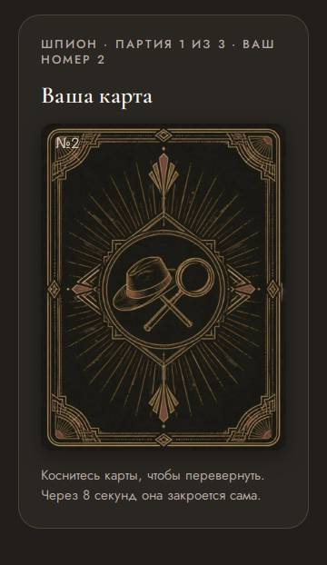

### закрыт другим элементом · экран зала

«1» закрыт элементом p.stage-code — «1»

- где: `div.st-reveal > ul.st-votes > li > strong`, этап `playing/27/reveal/guess`
- игры (1): story 1-й шаблон, каждый сам ×6, проектор 4:3, маленький телефон, длинные имена; story 1-й шаблон, команды ×6, телевизор full hd; story 1-й шаблон, каждый сам ×6, ноутбук 16:10, большой зал, длинные имена
- раз: 8

### закрыт другим элементом · телефон

«0%» закрыт элементом span.mil-option__text — «0%»

- где: `div.mil-question.mil-question--phone > ol.mil-options > li.mil-option > span.mil-option__pct`, этап `playing/4/reveal/reveal`
- игры (1): millionaire 1-й шаблон, команды ×8, ноутбук 16:10, большой зал, длинные имена; millionaire 1-й шаблон, каждый сам ×4, телевизор full hd; millionaire 1-й шаблон, каждый сам ×4, проектор 4:3, маленький телефон, длинные имена; millionaire 1-й шаблон, каждый сам ×16, ноутбук 16:10, большой зал, длинные имена
- раз: 6

### закрыт другим элементом · телефон

«№1» закрыт элементом span.sp-card__face.sp-card__face--back — «№1»

- где: `div.quiz-phone.sp-phone > div.sp-phone__card > button.sp-card > span.sp-card__seat`, этап `playing/0/reveal/cards`
- игры (1): spy 1-й шаблон, каждый сам ×11, телевизор full hd; spy 1-й шаблон, каждый сам ×11, проектор 4:3, маленький телефон, длинные имена
- раз: 6

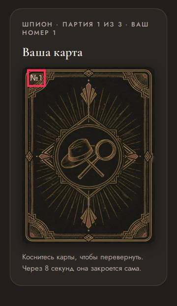

### закрыт другим элементом · телефон

«♦︎» закрыт элементом span.dk-pip — «♦︎»

- где: `div.dk-mini > span.dk-mini__pair > div.dk-card.dk-d--russia > span.dk-pip`, этап `playing/68/question/play`
- игры (1): durak 1-й шаблон, каждый сам ×4, телевизор full hd; durak 1-й шаблон, каждый сам ×4, ноутбук 16:10, большой зал, длинные имена
- раз: 6

### закрыт другим элементом · экран зала

«Г» закрыт элементом div.dk-card.dk-d--rome — «Г»

- где: `div.dk-table > div.dk-seat.dk-seat--wait > div.dk-seat__card > span.dk-seat__avatar`, этап `playing/2/question/vote`
- игры (1): durak 1-й шаблон, каждый сам ×4, телевизор full hd; durak 1-й шаблон, каждый сам ×4, проектор 4:3, маленький телефон, длинные имена; durak 1-й шаблон, каждый сам ×4, ноутбук 16:10, большой зал, длинные имена
- раз: 6

### закрыт другим элементом · телефон

«♦︎» закрыт элементом span.dk-pip — «♦︎»

- где: `div.dk-mini > span.dk-mini__pair > div.dk-card.dk-d--greece > span.dk-pip`, этап `playing/21/question/play`
- игры (1): durak 1-й шаблон, каждый сам ×4, ноутбук 16:10, большой зал, длинные имена
- раз: 6

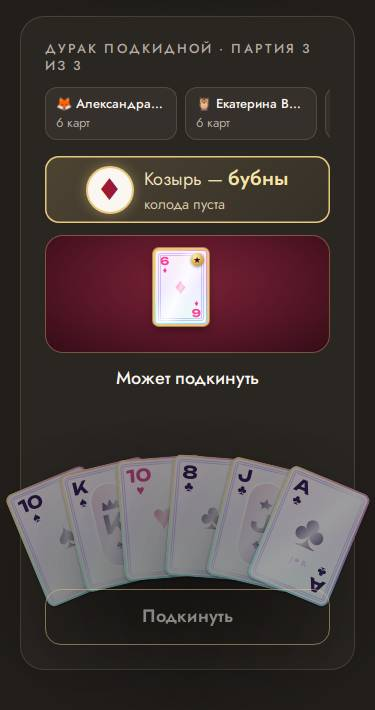

### закрыт другим элементом · экран зала

«🦉» закрыт элементом p.td-note — «🦉»

- где: `ol.td-queue > li > span.td-queue__name > span.name-emoji`, этап `playing/7/question/pick`
- игры (1): truth 1-й шаблон, команды ×4, проектор 4:3, маленький телефон, длинные имена; truth 1-й шаблон, каждый сам ×16, ноутбук 16:10, большой зал, длинные имена; truth 2-й шаблон, команды ×4, проектор 4:3, маленький телефон, длинные имена; truth 2-й шаблон, каждый сам ×16, ноутбук 16:10, большой зал, длинные имена
- раз: 6

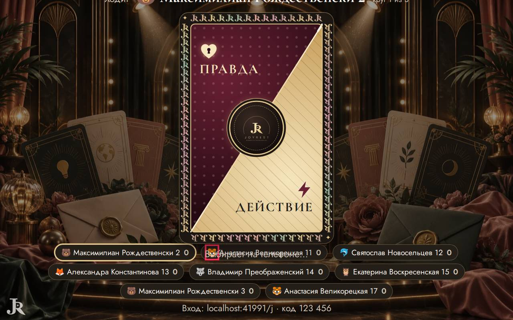

### закрыт другим элементом · телефон

«от гостя:» закрыт элементом span.td-stamp.td-stamp--done — «от гостя:»

- где: `div.quiz-phone.td-phone > div.td-flip.td-flip--phone > div.td-face.td-face--truth > span.td-face__from`, этап `playing/1/reveal/done`
- игры (1): truth 1-й шаблон, каждый сам ×16, ноутбук 16:10, большой зал, длинные имена; truth 2-й шаблон, каждый сам ×16, ноутбук 16:10, большой зал, длинные имена
- раз: 6

### закрыт другим элементом · телефон

«🐺» закрыт элементом span.td-stamp.td-stamp--done — «🐺»

- где: `div.td-flip.td-flip--phone > div.td-face.td-face--truth > span.td-face__from > span.name-emoji`, этап `playing/1/reveal/done`
- игры (1): truth 1-й шаблон, каждый сам ×16, ноутбук 16:10, большой зал, длинные имена; truth 2-й шаблон, каждый сам ×16, ноутбук 16:10, большой зал, длинные имена
- раз: 6

### закрыт другим элементом · телефон

«J✦R» закрыт элементом div.dk-card.dk-d--wedding — «J✦R»

- где: `div.dk-hand__row > button.dk-hand__slot > div.dk-card.dk-d--wedding > span.dk-brand`, этап `playing/54/question/play`
- игры (1): durak 1-й шаблон, каждый сам ×4, телевизор full hd
- раз: 5

### закрыт другим элементом · телефон

«♥︎» закрыт элементом div.dk-card.dk-d--classic — «♥︎»

- где: `div.dk-hand__row > button.dk-hand__slot > div.dk-card.dk-d--classic > span.dk-pip`, этап `playing/92/question/play`
- игры (1): durak 1-й шаблон, каждый сам ×4, проектор 4:3, маленький телефон, длинные имена
- раз: 5

### закрыт другим элементом · телефон

«♥︎» закрыт элементом div.dk-card.dk-d--gothic — «♥︎»

- где: `div.dk-hand__row > button.dk-hand__slot > div.dk-card.dk-d--gothic > span.dk-pip`, этап `playing/114/reveal/over`
- игры (1): durak 1-й шаблон, каждый сам ×4, проектор 4:3, маленький телефон, длинные имена
- раз: 5

### закрыт другим элементом · телефон

«Пиратский корабль» закрыт элементом span.sp-card__face.sp-card__face--back — «Пиратский корабль»

- где: `button.sp-card > span.sp-card__inner > span.sp-card__face.sp-card__face--place > strong.sp-card__title`, этап `playing/0/reveal/cards`
- игры (1): spy 1-й шаблон, каждый сам ×11, телевизор full hd; spy 1-й шаблон, каждый сам ×11, проектор 4:3, маленький телефон, длинные имена
- раз: 4

### закрыт другим элементом · телефон

«Пленник» закрыт элементом span.sp-card__face.sp-card__face--back — «Пленник»

- где: `button.sp-card > span.sp-card__inner > span.sp-card__face.sp-card__face--place > strong.sp-card__role`, этап `playing/0/reveal/cards`
- игры (1): spy 1-й шаблон, каждый сам ×11, телевизор full hd; spy 1-й шаблон, каждый сам ×11, проектор 4:3, маленький телефон, длинные имена
- раз: 4

### закрыт другим элементом · экран зала

«Анастасия Великорецкая 11» закрыт элементом p.td-note — «Анастасия Великорецкая 11»

- где: `ol.td-queue > li > span.td-queue__name > span`, этап `playing/9/question/pick`
- игры (1): truth 1-й шаблон, каждый сам ×16, ноутбук 16:10, большой зал, длинные имена; truth 2-й шаблон, каждый сам ×16, ноутбук 16:10, большой зал, длинные имена
- раз: 4

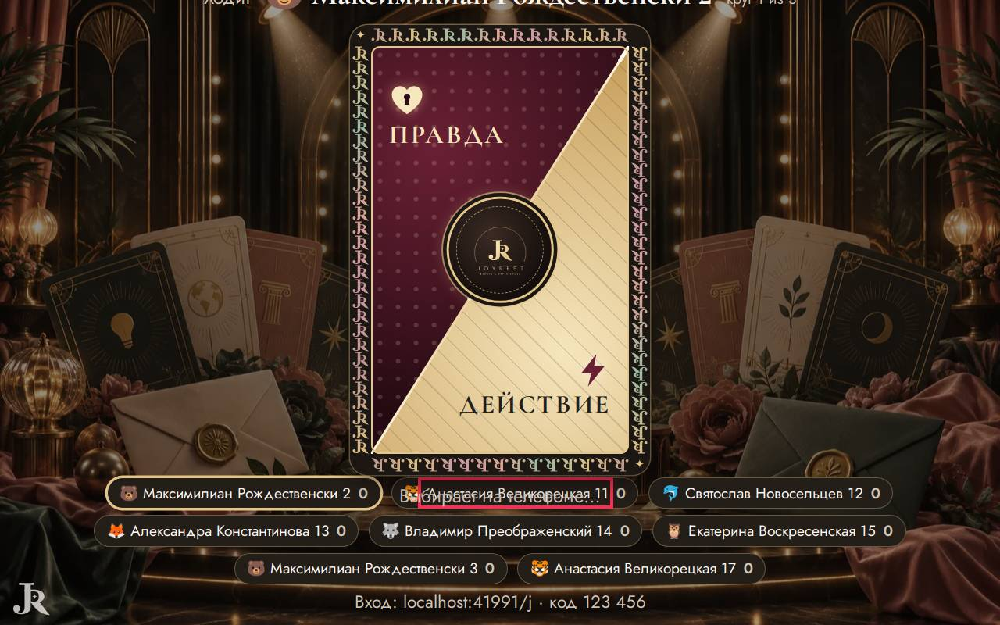

### закрыт другим элементом · экран зала

«🐺» закрыт элементом p.stage-code — «🐺»

- где: `div.st-reveal > ul.st-votes > li > span.name-emoji`, этап `playing/27/reveal/guess`
- игры (1): story 1-й шаблон, каждый сам ×6, проектор 4:3, маленький телефон, длинные имена; story 1-й шаблон, каждый сам ×6, ноутбук 16:10, большой зал, длинные имена
- раз: 4

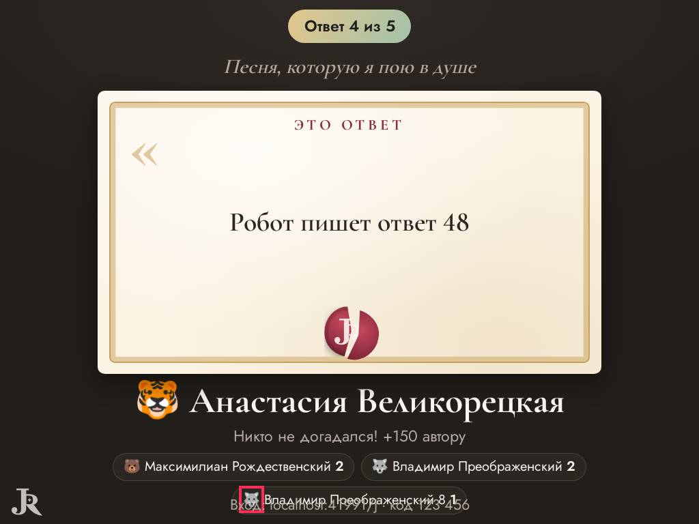

### закрыт другим элементом · экран зала

«Владимир Преображенский 8» закрыт элементом p.stage-code — «Владимир Преображенский 8»

- где: `div.st-reveal > ul.st-votes > li > span`, этап `playing/27/reveal/guess`
- игры (1): story 1-й шаблон, каждый сам ×6, проектор 4:3, маленький телефон, длинные имена; story 1-й шаблон, каждый сам ×6, ноутбук 16:10, большой зал, длинные имена
- раз: 4

### закрыт другим элементом · экран зала

«Игрок 5» закрыт элементом p.stage-code — «Игрок 5»

- где: `section.st-screen__main > div.st-reveal > ul.st-votes > li`, этап `playing/3/reveal/guess`
- игры (1): story 1-й шаблон, команды ×6, телевизор full hd
- раз: 4

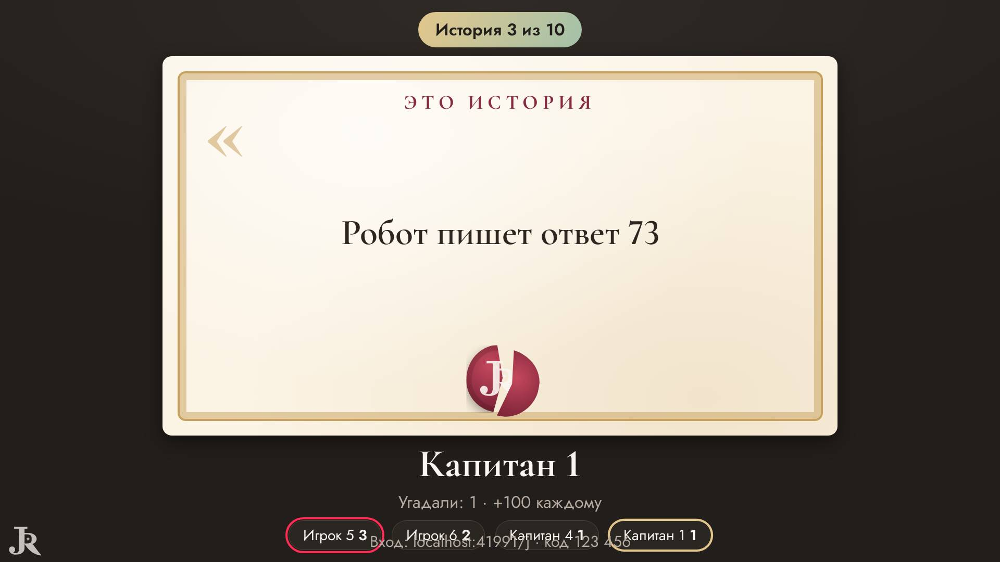

### закрыт другим элементом · экран зала

«Владимир Преображенский» закрыт элементом li.mf-reveal__item.mf-role--civilian — «Владимир Преображенский»

- где: `ul.mf-reveal > li.mf-reveal__item.mf-role--civilian > span.mf-reveal__name > span`, этап `playing/76/reveal/over`
- игры (1): mafia 1-й шаблон, каждый сам ×9, проектор 4:3, маленький телефон, длинные имена
- раз: 3

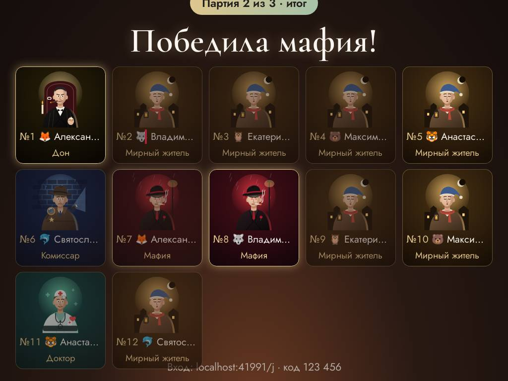

### закрыт другим элементом · телефон

«J✦R» закрыт элементом div.dk-card.dk-d--gothic — «J✦R»

- где: `div.dk-hand__row > button.dk-hand__slot > div.dk-card.dk-d--gothic > span.dk-brand`, этап `playing/56/question/play`
- игры (1): durak 1-й шаблон, каждый сам ×4, телевизор full hd
- раз: 3

### закрыт другим элементом · телефон

«♦︎» закрыт элементом span.dk-pip — «♦︎»

- где: `div.dk-mini > span.dk-mini__pair > div.dk-card.dk-d--wedding > span.dk-pip`, этап `playing/94/question/play`
- игры (1): durak 1-й шаблон, каждый сам ×4, телевизор full hd
- раз: 3

### закрыт другим элементом · экран зала

«Выбираем колоду — голосуйте на телефонах» закрыт элементом h2 — «Выбираем колоду — голосуйте на телефонах»

- где: `div.dk-hall.dk-felt--bordeaux > div.dk-hall__top > div.dk-croupier > p.dk-croupier__line`, этап `playing/2/question/vote`
- игры (1): durak 1-й шаблон, каждый сам ×4, телевизор full hd; durak 1-й шаблон, каждый сам ×4, проектор 4:3, маленький телефон, длинные имена; durak 1-й шаблон, каждый сам ×4, ноутбук 16:10, большой зал, длинные имена
- раз: 3

### закрыт другим элементом · телефон

«♥︎» закрыт элементом span.dk-idx.dk-idx--b — «♥︎»

- где: `span.dk-mini__pair > div.dk-card.dk-d--classic > span.dk-face > i`, этап `playing/92/question/play`
- игры (1): durak 1-й шаблон, каждый сам ×4, проектор 4:3, маленький телефон, длинные имена
- раз: 3

### закрыт другим элементом · экран зала

«366» закрыт элементом p.stage-code — «366»

- где: `div.checkers-screen__side > div.checkers-screen__question > ol.checkers-screen__options > li`, этап `playing/7/question/task`
- игры (1): checkers 1-й шаблон, команды ×2, проектор 4:3, маленький телефон, длинные имена
- раз: 2

### закрыт другим элементом · экран зала

«B» закрыт элементом p.stage-code — «B»

- где: `div.checkers-screen__question > ol.checkers-screen__options > li > span`, этап `playing/7/question/task`
- игры (1): checkers 1-й шаблон, команды ×2, проектор 4:3, маленький телефон, длинные имена
- раз: 2

### закрыт другим элементом · телефон

«Вы — шпион» закрыт элементом span.sp-card__face.sp-card__face--back — «Вы — шпион»

- где: `button.sp-card > span.sp-card__inner > span.sp-card__face.sp-card__face--spy > strong.sp-card__title`, этап `playing/0/reveal/cards`
- игры (1): spy 1-й шаблон, каждый сам ×11, телевизор full hd; spy 1-й шаблон, каждый сам ×11, проектор 4:3, маленький телефон, длинные имена
- раз: 2

### закрыт другим элементом · телефон

«Вы не знаете, где все. Слушайте и угадай» закрыт элементом span.sp-card__face.sp-card__face--back — «Вы не знаете, где все. Слушайте и угадайте локацию — или не выдайте себя.»

- где: `button.sp-card > span.sp-card__inner > span.sp-card__face.sp-card__face--spy > span.sp-card__hint`, этап `playing/0/reveal/cards`
- игры (1): spy 1-й шаблон, каждый сам ×11, телевизор full hd; spy 1-й шаблон, каждый сам ×11, проектор 4:3, маленький телефон, длинные имена
- раз: 2

### закрыт другим элементом · экран зала

«Голосуйте тайно на телефоне · проголосов» закрыт элементом span — «Голосуйте тайно на телефоне · проголосовали 0 из 9»

- где: `main.quiz-stage > div.mf-screen > section.mf-screen__main > p.mf-note`, этап `playing/2/question/vote`
- игры (1): mafia 1-й шаблон, каждый сам ×9, ноутбук 16:10, большой зал, длинные имена; mafia 1-й шаблон, каждый сам ×9, проектор 4:3, маленький телефон, длинные имена
- раз: 2

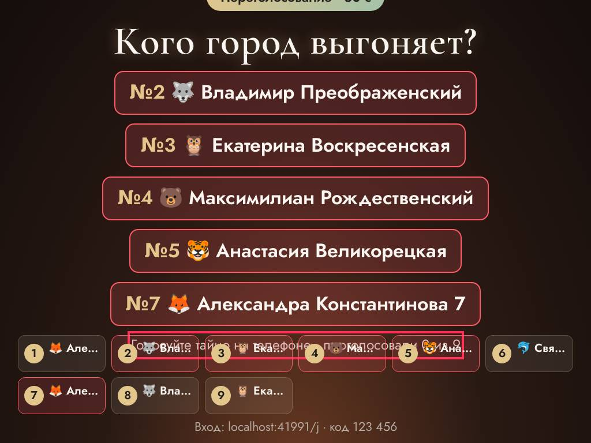

### закрыт другим элементом · экран зала

«Александра Константинова 7» закрыт элементом span.mf-num — «Александра Константинова 7»

- где: `ul.mf-reveal > li.mf-reveal__item.mf-role--mafia > span.mf-reveal__name > span`, этап `playing/76/reveal/over`
- игры (1): mafia 1-й шаблон, каждый сам ×9, проектор 4:3, маленький телефон, длинные имена
- раз: 2

### закрыт другим элементом · телефон

«J✦R» закрыт элементом div.dk-card.dk-d--russia — «J✦R»

- где: `div.dk-hand__row > button.dk-hand__slot > div.dk-card.dk-d--russia > span.dk-brand`, этап `playing/14/question/play`
- игры (1): durak 1-й шаблон, каждый сам ×4, телевизор full hd
- раз: 2

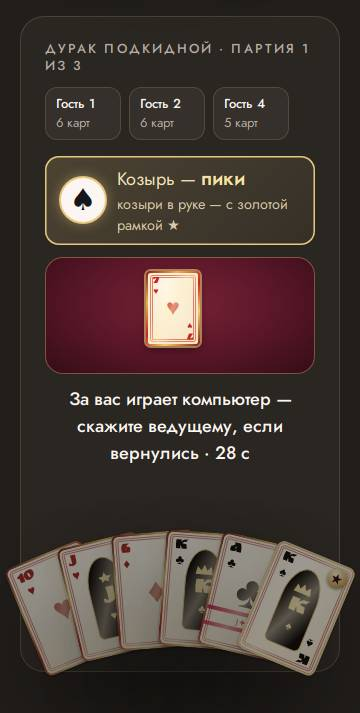

### закрыт другим элементом · телефон

«J✦R» закрыт элементом div.dk-card.dk-d--rome — «J✦R»

- где: `div.dk-hand__row > button.dk-hand__slot > div.dk-card.dk-d--rome > span.dk-brand`, этап `playing/19/question/play`
- игры (1): durak 1-й шаблон, каждый сам ×4, телевизор full hd
- раз: 2

### закрыт другим элементом · экран зала

«7» закрыт элементом div.dk-card.dk-back — «7»

- где: `div.dk-table__felt > div.dk-stock > div.dk-card.dk-d--anime > span.dk-idx`, этап `playing/55/question/play`
- игры (1): durak 1-й шаблон, каждый сам ×4, телевизор full hd; durak 1-й шаблон, каждый сам ×4, проектор 4:3, маленький телефон, длинные имена
- раз: 2

### закрыт другим элементом · экран зала

«♣︎» закрыт элементом div.dk-card.dk-back — «♣︎»

- где: `div.dk-stock > div.dk-card.dk-d--anime > span.dk-idx > span`, этап `playing/55/question/play`
- игры (1): durak 1-й шаблон, каждый сам ×4, телевизор full hd; durak 1-й шаблон, каждый сам ×4, проектор 4:3, маленький телефон, длинные имена
- раз: 2

### закрыт другим элементом · экран зала

«♣︎» закрыт элементом div.dk-card.dk-back — «♣︎»

- где: `div.dk-table__felt > div.dk-stock > div.dk-card.dk-d--anime > span.dk-pip`, этап `playing/55/question/play`
- игры (1): durak 1-й шаблон, каждый сам ×4, телевизор full hd; durak 1-й шаблон, каждый сам ×4, проектор 4:3, маленький телефон, длинные имена
- раз: 2

### закрыт другим элементом · телефон

«Q» закрыт элементом div.dk-card.dk-d--gothic — «Q»

- где: `button.dk-hand__slot > div.dk-card.dk-d--gothic > span.dk-face > b`, этап `playing/114/reveal/over`
- игры (1): durak 1-й шаблон, каждый сам ×4, проектор 4:3, маленький телефон, длинные имена
- раз: 2

### закрыт другим элементом · телефон

«♠︎» закрыт элементом span.dk-pip — «♠︎»

- где: `button.dk-hand__slot > div.dk-card.dk-d--gothic > span.dk-face > i`, этап `playing/114/reveal/over`
- игры (1): durak 1-й шаблон, каждый сам ×4, проектор 4:3, маленький телефон, длинные имена
- раз: 2

### закрыт другим элементом · экран зала

«100» закрыт элементом p.td-note — «100»

- где: `div.td-screen > ol.td-queue > li > span.td-queue__score`, этап `playing/7/question/pick`
- игры (1): truth 1-й шаблон, команды ×4, проектор 4:3, маленький телефон, длинные имена; truth 2-й шаблон, команды ×4, проектор 4:3, маленький телефон, длинные имена
- раз: 2

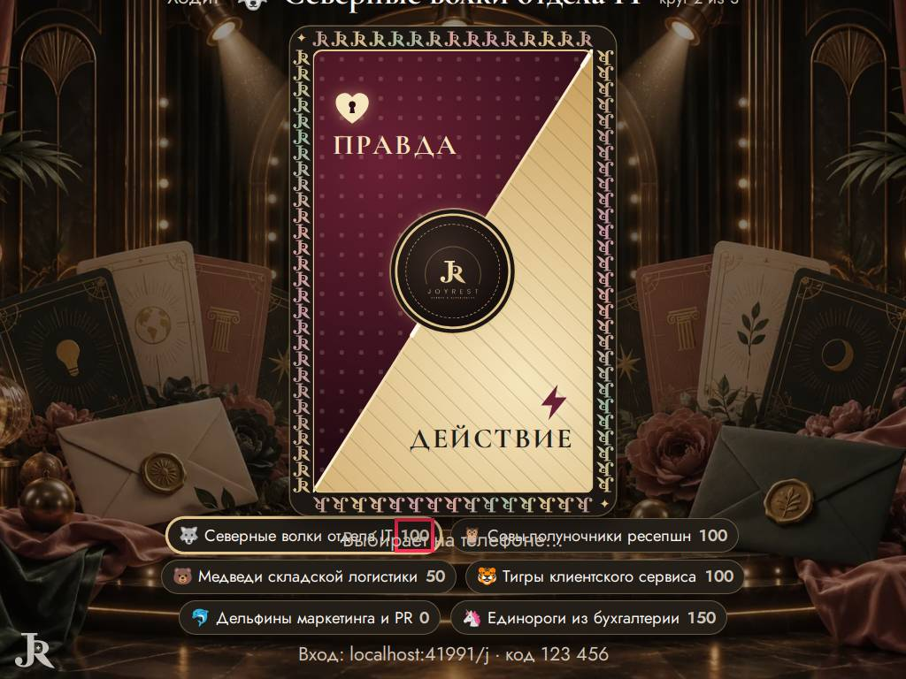

### закрыт другим элементом · экран зала

«Максимилиан Рождественски 3» закрыт элементом span.name-emoji — «Максимилиан Рождественски 3»

- где: `div.podium__slot > div.podium__names > p.podium__name > span`, этап `finished/7/podium/`
- игры (1): quiz 1-й шаблон, каждый сам ×16, ноутбук 16:10, большой зал, длинные имена
- раз: 1

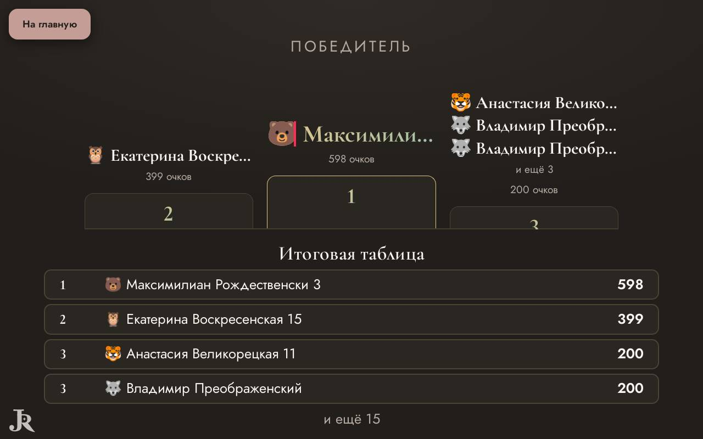

### закрыт другим элементом · экран зала

«Александра Константинова» закрыт элементом li.mf-reveal__item.mf-role--civilian — «Александра Константинова»

- где: `ul.mf-reveal > li.mf-reveal__item.mf-role--don > span.mf-reveal__name > span`, этап `playing/76/reveal/over`
- игры (1): mafia 1-й шаблон, каждый сам ×9, проектор 4:3, маленький телефон, длинные имена
- раз: 1

### закрыт другим элементом · экран зала

«Анастасия Великорецкая 11» закрыт элементом span.mf-num — «Анастасия Великорецкая 11»

- где: `ul.mf-reveal > li.mf-reveal__item.mf-role--doctor > span.mf-reveal__name > span`, этап `playing/76/reveal/over`
- игры (1): mafia 1-й шаблон, каждый сам ×9, проектор 4:3, маленький телефон, длинные имена
- раз: 1

### закрыт другим элементом · экран зала

«Святослав Новосельцев» закрыт элементом span.sp-reveal__role — «Святослав Новосельцев»

- где: `ul.sp-reveal__list > li.sp-reveal__item > span.sp-reveal__name > span`, этап `playing/125/reveal/over`
- игры (1): spy 1-й шаблон, каждый сам ×11, проектор 4:3, маленький телефон, длинные имена
- раз: 1

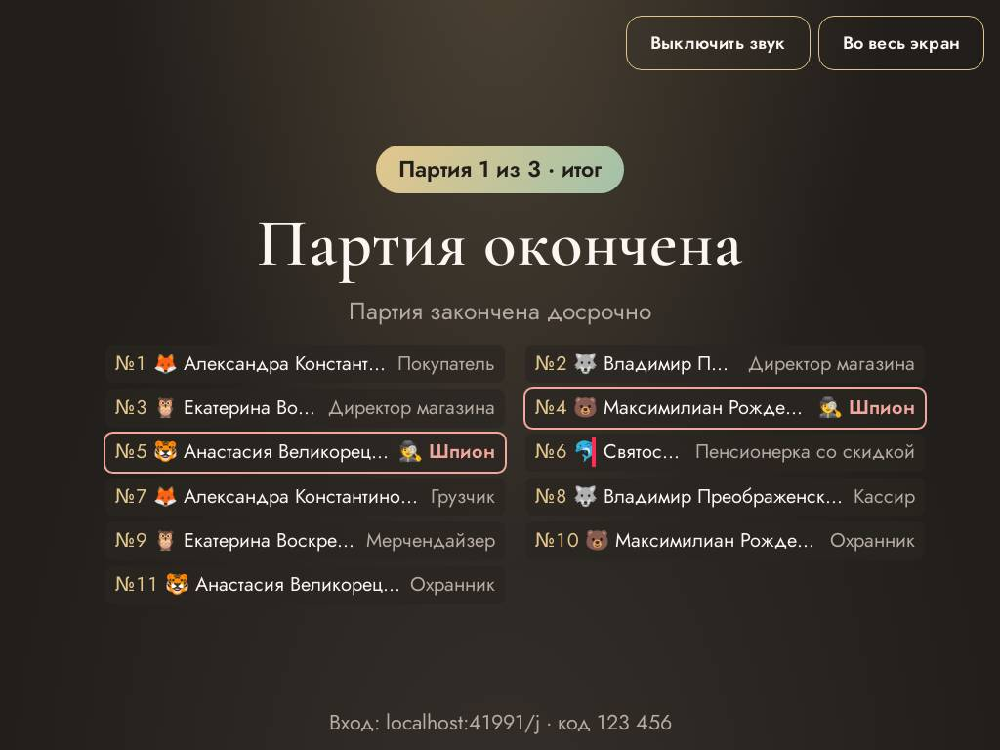

### закрыт другим элементом · телефон

«J✦R» закрыт элементом div.dk-card.dk-d--cyber — «J✦R»

- где: `div.dk-hand__row > button.dk-hand__slot > div.dk-card.dk-d--cyber > span.dk-brand`, этап `playing/4/question/play`
- игры (1): durak 1-й шаблон, каждый сам ×4, телевизор full hd
- раз: 1

### закрыт другим элементом · телефон

«J✦R» закрыт элементом div.dk-card.dk-d--kpop — «J✦R»

- где: `div.dk-hand__row > button.dk-hand__slot > div.dk-card.dk-d--kpop > span.dk-brand`, этап `playing/26/question/play`
- игры (1): durak 1-й шаблон, каждый сам ×4, телевизор full hd
- раз: 1

### закрыт другим элементом · экран зала

«Дурак подкидной» закрыт элементом h2 — «Дурак подкидной»

- где: `div.dk-hall.dk-felt--bordeaux > div.dk-hall__top > div.dk-hall__title > span`, этап `playing/2/question/vote`
- игры (1): durak 1-й шаблон, каждый сам ×4, телевизор full hd
- раз: 1

### закрыт другим элементом · экран зала

«партия 1 из 3 · 36 карт · Классика JoyRe» закрыт элементом h2 — «партия 1 из 3 · 36 карт · Классика JoyRest»

- где: `div.dk-hall.dk-felt--bordeaux > div.dk-hall__top > div.dk-hall__title > small`, этап `playing/2/question/vote`
- игры (1): durak 1-й шаблон, каждый сам ×4, телевизор full hd
- раз: 1

### закрыт другим элементом · экран зала

«♠︎» закрыт элементом span — «♠︎»

- где: `div.dk-battle > div.dk-pair > div.dk-card.dk-d--anime > span.dk-pip`, этап `playing/55/question/play`
- игры (1): durak 1-й шаблон, каждый сам ×4, телевизор full hd
- раз: 1

### закрыт другим элементом · телефон

«Q» закрыт элементом span — «Q»

- где: `span.dk-mini__pair > div.dk-card.dk-d--classic > span.dk-face > b`, этап `playing/92/question/play`
- игры (1): durak 1-й шаблон, каждый сам ×4, проектор 4:3, маленький телефон, длинные имена
- раз: 1

### закрыт другим элементом · телефон

«Q» закрыт элементом div.dk-card.dk-d--classic — «Q»

- где: `button.dk-hand__slot > div.dk-card.dk-d--classic > span.dk-face > b`, этап `playing/92/question/play`
- игры (1): durak 1-й шаблон, каждый сам ×4, проектор 4:3, маленький телефон, длинные имена
- раз: 1

### закрыт другим элементом · телефон

«♠︎» закрыт элементом span.dk-pip — «♠︎»

- где: `button.dk-hand__slot > div.dk-card.dk-d--classic > span.dk-face > i`, этап `playing/92/question/play`
- игры (1): durak 1-й шаблон, каждый сам ×4, проектор 4:3, маленький телефон, длинные имена
- раз: 1

### закрыт другим элементом · экран зала

«♣︎» закрыт элементом div.dk-card.dk-back — «♣︎»

- где: `div.dk-stock > div.dk-card.dk-d--rome > span.dk-face > i`, этап `playing/16/question/play`
- игры (1): durak 1-й шаблон, каждый сам ×4, ноутбук 16:10, большой зал, длинные имена
- раз: 1

### надписи наезжают · экран зала

«Александра Константинова» и «500 очков» друг на друге — «Александра Константинова \| 500 очков»

- где: `div.podium__slot > div.podium__names > p.podium__name > span`, этап `finished/7/podium/`
- игры (4): quiz 1-й шаблон, каждый сам ×4, проектор 4:3, маленький телефон, длинные имена; quiz 1-й шаблон, каждый сам ×16, ноутбук 16:10, большой зал, длинные имена; mafia 1-й шаблон, каждый сам ×9, проектор 4:3, маленький телефон, длинные имена; truth 1-й шаблон, каждый сам ×4, проектор 4:3, маленький телефон, длинные имена; truth 2-й шаблон, каждый сам ×4, проектор 4:3, маленький телефон, длинные имена; story 1-й шаблон, каждый сам ×6, проектор 4:3, маленький телефон, длинные имена
- раз: 17

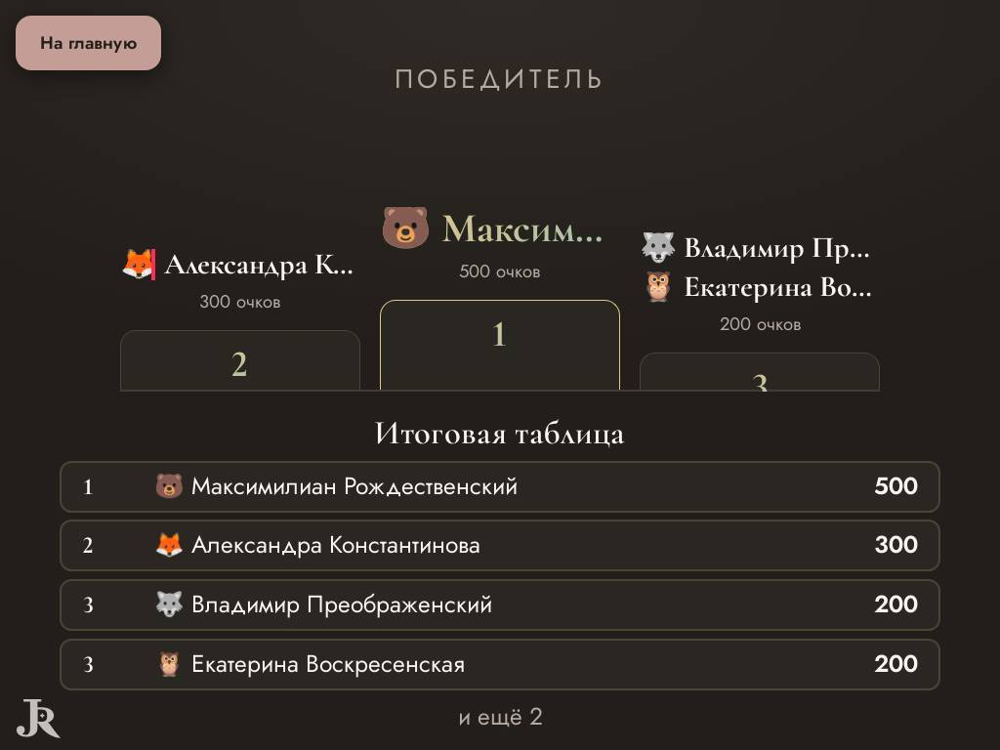

### надписи наезжают · экран зала

«Награждение» и «🐻» друг на друге — «Награждение \| 🐻»

- где: `div.hall > main.quiz-stage > div.podium > p.podium__eyebrow`, этап `playing/7/podium/`
- игры (3): quiz 1-й шаблон, каждый сам ×4, проектор 4:3, маленький телефон, длинные имена; mafia 1-й шаблон, каждый сам ×9, проектор 4:3, маленький телефон, длинные имена; perudo 1-й шаблон, каждый сам ×4, проектор 4:3, маленький телефон, длинные имена
- раз: 3

### надписи наезжают · пульт

«Единороги из бухгалтерии» и «+75» друг на друге — «Единороги из бухгалтерии \| +75»

- где: `ul.buzz-queue.buzz-queue--plain > li > span.buzz-queue__name > span`, этап `playing/1/reveal/result`
- игры (2): dance 1-й шаблон, команды ×4, проектор 4:3, маленький телефон, длинные имена; dance 1-й шаблон, команды ×8, ноутбук 16:10, большой зал, длинные имена; stage 1-й шаблон, команды ×8, ноутбук 16:10, большой зал, длинные имена; stage 1-й шаблон, команды ×4, проектор 4:3, маленький телефон, длинные имена; stage 2-й шаблон, команды ×8, ноутбук 16:10, большой зал, длинные имена; stage 2-й шаблон, команды ×4, проектор 4:3, маленький телефон, длинные имена
- раз: 71

### надписи наезжают · экран зала

«Медведи складской логистики» и «🦄» друг на друге — «Медведи складской логистики \| 🦄»

- где: `div.podium__slot > div.podium__names > p.podium__name.podium__name--team > span`, этап `finished/17/podium/result`
- игры (2): dance 1-й шаблон, команды ×4, проектор 4:3, маленький телефон, длинные имена; truth 1-й шаблон, команды ×4, проектор 4:3, маленький телефон, длинные имена; truth 2-й шаблон, команды ×4, проектор 4:3, маленький телефон, длинные имена
- раз: 4

### надписи наезжают · телефон

«Александра Константинова» и «🐺» друг на друге — «Александра Константинова \| 🐺»

- где: `div.mf-targets > button.mf-target > span.mf-target__name > span`, этап `playing/1/question/vote`
- игры (1): mafia 1-й шаблон, каждый сам ×9, проектор 4:3, маленький телефон, длинные имена; mafia 1-й шаблон, каждый сам ×9, ноутбук 16:10, большой зал, длинные имена
- раз: 391

### надписи наезжают · телефон

«Полковнику никто не пишет» и «Нас не догонят» друг на друге — «Полковнику никто не пишет \| Нас не догонят»

- где: `div.lotto-ticket.lotto-ticket--evening > div.lotto-card > button.lotto-card__cell > span.lotto-card__title`, этап `playing/0/question/`
- игры (1): lotto 1-й шаблон, каждый сам ×4, проектор 4:3, маленький телефон, длинные имена; lotto 1-й шаблон, команды ×4, проектор 4:3, маленький телефон, длинные имена
- раз: 358

### надписи наезжают · телефон

«Ирина Аллегрова» и «Сплин» друг на друге — «Ирина Аллегрова \| Сплин»

- где: `div.lotto-ticket.lotto-ticket--evening > div.lotto-card > button.lotto-card__cell > span.lotto-card__artist`, этап `playing/0/question/`
- игры (1): lotto 1-й шаблон, каждый сам ×4, телевизор full hd; lotto 1-й шаблон, каждый сам ×4, проектор 4:3, маленький телефон, длинные имена; lotto 1-й шаблон, команды ×4, телевизор full hd; lotto 1-й шаблон, каждый сам ×16, ноутбук 16:10, большой зал, длинные имена; lotto 1-й шаблон, команды ×4, проектор 4:3, маленький телефон, длинные имена; lotto 1-й шаблон, команды ×8, ноутбук 16:10, большой зал, длинные имена
- раз: 311

### надписи наезжают · экран зала

«Александра Константинова» и «2» друг на друге — «Александра Константинова \| 2»

- где: `ol.mf-seats.mf-seats--screen > li.mf-seat > span.mf-seat__name > span`, этап `playing/2/question/vote`
- игры (1): mafia 1-й шаблон, каждый сам ×9, ноутбук 16:10, большой зал, длинные имена; mafia 1-й шаблон, каждый сам ×9, проектор 4:3, маленький телефон, длинные имена
- раз: 307

### надписи наезжают · экран зала

«Северные волки отдела IT» и «кл. 0» друг на друге — «Северные волки отдела IT \| кл. 0»

- где: `ol.qx-panel__list > li.qx-row > span.qx-row__name > span`, этап `playing/0/question/roll`
- игры (1): quest 1-й шаблон, команды ×4, проектор 4:3, маленький телефон, длинные имена; quest 2-й шаблон, команды ×4, проектор 4:3, маленький телефон, длинные имена; quest 1-й шаблон, команды ×8, ноутбук 16:10, большой зал, длинные имена; quest 2-й шаблон, команды ×8, ноутбук 16:10, большой зал, длинные имена
- раз: 236

### надписи наезжают · телефон

«Максимилиан Рождественский» и «2» друг на друге — «Максимилиан Рождественский \| 2»

- где: `ul.sp-tally > li.sp-tally__row > span.sp-tally__name > span`, этап `playing/2/reveal/verdict`
- игры (1): spy 1-й шаблон, каждый сам ×11, проектор 4:3, маленький телефон, длинные имена; spy 1-й шаблон, каждый сам ×11, ноутбук 16:10, большой зал, длинные имена
- раз: 219

### надписи наезжают · телефон

«Лишняя койка» и «сыграно» друг на друге — «Лишняя койка \| сыграно»

- где: `div.bk-phone__specialcard > div.bk-card.bk-special > div.bk-in > span.bk-special__title`, этап `playing/3/question/open`
- игры (1): bunker 1-й шаблон, каждый сам ×8, телевизор full hd; bunker 1-й шаблон, каждый сам ×8, проектор 4:3, маленький телефон, длинные имена; bunker 1-й шаблон, каждый сам ×8, ноутбук 16:10, большой зал, длинные имена
- раз: 214

### надписи наезжают · экран зала

«Александра Константинова» и «Инженер-электрик · стаж 8 лет» друг на друге — «Александра Константинова \| Инженер-электрик · стаж 8 лет»

- где: `article.bk-dossier > header.bk-dossier__head > span.bk-dossier__name > span`, этап `playing/3/question/open`
- игры (1): bunker 1-й шаблон, каждый сам ×8, проектор 4:3, маленький телефон, длинные имена; bunker 1-й шаблон, каждый сам ×8, ноутбук 16:10, большой зал, длинные имена
- раз: 153

### надписи наезжают · телефон

«Владимир Преображенский» и «🦉» друг на друге — «Владимир Преображенский \| 🦉»

- где: `div.dk-phone__opps > span.dk-opp.dk-opp--wait > span.dk-opp__name > span`, этап `playing/4/question/play`
- игры (1): durak 1-й шаблон, каждый сам ×4, проектор 4:3, маленький телефон, длинные имена; durak 1-й шаблон, каждый сам ×4, ноутбук 16:10, большой зал, длинные имена
- раз: 144

### надписи наезжают · телефон

«Владимир Преображенский» и «🦉» друг на друге — «Владимир Преображенский \| 🦉»

- где: `div.st-targets > button.mf-target > span.mf-target__name > span`, этап `playing/14/question/guess`
- игры (1): story 1-й шаблон, каждый сам ×6, ноутбук 16:10, большой зал, длинные имена; story 1-й шаблон, каждый сам ×6, проектор 4:3, маленький телефон, длинные имена
- раз: 132

### надписи наезжают · телефон

«Владимир Преображенский» и «1» друг на друге — «Владимир Преображенский \| 1»

- где: `ul.mf-tally > li.mf-tally__row > span.mf-tally__name > span`, этап `playing/1/reveal/verdict`
- игры (1): mafia 1-й шаблон, каждый сам ×9, проектор 4:3, маленький телефон, длинные имена; mafia 1-й шаблон, каждый сам ×9, ноутбук 16:10, большой зал, длинные имена
- раз: 115

### надписи наезжают · телефон

«Александра Константинова» и «🦉» друг на друге — «Александра Константинова \| 🦉»

- где: `div.dk-phone__opps > span.dk-opp.dk-opp--defend > span.dk-opp__name > span`, этап `playing/4/question/play`
- игры (1): durak 1-й шаблон, каждый сам ×4, проектор 4:3, маленький телефон, длинные имена; durak 1-й шаблон, каждый сам ×4, ноутбук 16:10, большой зал, длинные имена
- раз: 102

### надписи наезжают · телефон

«Q» и «♥︎» друг на друге — «Q \| ♥︎»

- где: `button.dk-hand__slot > div.dk-card.dk-d--rome > span.dk-face > b`, этап `playing/19/question/play`
- игры (1): durak 1-й шаблон, каждый сам ×4, телевизор full hd; durak 1-й шаблон, каждый сам ×4, проектор 4:3, маленький телефон, длинные имена; durak 1-й шаблон, каждый сам ×4, ноутбук 16:10, большой зал, длинные имена
- раз: 95

### надписи наезжают · пульт

«400» и «кот» друг на друге — «400 \| кот»

- где: `div.board-host__grid > div.board-host__row > button.board-host__cell > span`, этап `playing/0/ready/`
- игры (1): board 1-й шаблон, каждый сам ×4, телевизор full hd; board 1-й шаблон, каждый сам ×4, проектор 4:3, маленький телефон, длинные имена; board 1-й шаблон, команды ×4, телевизор full hd; board 1-й шаблон, каждый сам ×16, ноутбук 16:10, большой зал, длинные имена; board 1-й шаблон, команды ×4, проектор 4:3, маленький телефон, длинные имена; board 1-й шаблон, команды ×8, ноутбук 16:10, большой зал, длинные имена
- раз: 91

### надписи наезжают · телефон

«Екатерина Воскресенская» и «🐻» друг на друге — «Екатерина Воскресенская \| 🐻»

- где: `div.dk-phone__opps > span.dk-opp.dk-opp--throw > span.dk-opp__name > span`, этап `playing/16/question/play`
- игры (1): durak 1-й шаблон, каждый сам ×4, проектор 4:3, маленький телефон, длинные имена; durak 1-й шаблон, каждый сам ×4, ноутбук 16:10, большой зал, длинные имена
- раз: 82

### надписи наезжают · экран зала

«Единороги из бухгалтерии» и «750» друг на друге — «Единороги из бухгалтерии \| 750»

- где: `div.stage-teams > div.stage-teams__one > span.stage-teams__name > span`, этап `playing/8/reveal/pick`
- игры (1): stage 1-й шаблон, команды ×8, ноутбук 16:10, большой зал, длинные имена; stage 1-й шаблон, команды ×4, проектор 4:3, маленький телефон, длинные имена; stage 2-й шаблон, команды ×8, ноутбук 16:10, большой зал, длинные имена; stage 2-й шаблон, команды ×4, проектор 4:3, маленький телефон, длинные имена
- раз: 74

### надписи наезжают · пульт

«100» и «🔒 батл» друг на друге — «100 \| 🔒 батл»

- где: `div.stage-field.stage-field--compact > div.stage-field__row > button.stage-tile > span.stage-tile__points`, этап `playing/0/reveal/pick`
- игры (1): stage 1-й шаблон, команды ×4, телевизор full hd; stage 1-й шаблон, команды ×8, ноутбук 16:10, большой зал, длинные имена; stage 1-й шаблон, команды ×4, проектор 4:3, маленький телефон, длинные имена; stage 2-й шаблон, команды ×4, телевизор full hd; stage 2-й шаблон, команды ×8, ноутбук 16:10, большой зал, длинные имена; stage 2-й шаблон, команды ×4, проектор 4:3, маленький телефон, длинные имена
- раз: 70

### надписи наезжают · телефон

«Владимир Преображенский» и «Екатерина Воскресенская» друг на друге — «Владимир Преображенский \| Екатерина Воскресенская»

- где: `div.sp-targets > button.sp-target > span.sp-target__name > span`, этап `playing/2/question/vote`
- игры (1): spy 1-й шаблон, каждый сам ×11, проектор 4:3, маленький телефон, длинные имена
- раз: 56

### надписи наезжают · телефон

«♠︎» и «A» друг на друге — «♠︎ \| A»

- где: `div.dk-mini > span.dk-mini__pair > div.dk-card.dk-d--rome > span.dk-pip`, этап `playing/16/question/play`
- игры (1): durak 1-й шаблон, каждый сам ×4, проектор 4:3, маленький телефон, длинные имена; durak 1-й шаблон, каждый сам ×4, ноутбук 16:10, большой зал, длинные имена
- раз: 48

### надписи наезжают · телефон

«от гостя: Игрок» и «Выполнено!» друг на друге — «от гостя: Игрок \| Выполнено!»

- где: `div.quiz-phone.td-phone > div.td-flip.td-flip--phone > div.td-face.td-face--dare > span.td-face__from`, этап `playing/2/reveal/done`
- игры (1): truth 1-й шаблон, команды ×4, телевизор full hd; truth 1-й шаблон, команды ×4, проектор 4:3, маленький телефон, длинные имена; truth 1-й шаблон, каждый сам ×16, ноутбук 16:10, большой зал, длинные имена; truth 2-й шаблон, команды ×4, телевизор full hd; truth 1-й шаблон, команды ×8, ноутбук 16:10, большой зал, длинные имена; truth 2-й шаблон, команды ×4, проектор 4:3, маленький телефон, длинные имена …
- раз: 48

### надписи наезжают · телефон

«♥︎» и «J✦R» друг на друге — «♥︎ \| J✦R»

- где: `div.dk-hand__row > button.dk-hand__slot > div.dk-card.dk-d--rome > span.dk-pip.dk-pip--ace`, этап `playing/19/question/play`
- игры (1): durak 1-й шаблон, каждый сам ×4, телевизор full hd; durak 1-й шаблон, каждый сам ×4, проектор 4:3, маленький телефон, длинные имена; durak 1-й шаблон, каждый сам ×4, ноутбук 16:10, большой зал, длинные имена
- раз: 46

### надписи наезжают · телефон

«Александра Константинова» и «🦉» друг на друге — «Александра Константинова \| 🦉»

- где: `div.dk-phone__opps > span.dk-opp.dk-opp--turn > span.dk-opp__name > span`, этап `playing/54/question/play`
- игры (1): durak 1-й шаблон, каждый сам ×4, проектор 4:3, маленький телефон, длинные имена; durak 1-й шаблон, каждый сам ×4, ноутбук 16:10, большой зал, длинные имена
- раз: 45

### надписи наезжают · телефон

«♥︎» и «♥︎» друг на друге — «♥︎ \| ♥︎»

- где: `button.dk-hand__slot > div.dk-card.dk-d--rome > span.dk-idx.dk-idx--b > span`, этап `playing/19/question/play`
- игры (1): durak 1-й шаблон, каждый сам ×4, телевизор full hd; durak 1-й шаблон, каждый сам ×4, проектор 4:3, маленький телефон, длинные имена; durak 1-й шаблон, каждый сам ×4, ноутбук 16:10, большой зал, длинные имена
- раз: 36

### надписи наезжают · экран зала

«Александра Константинова» и «За столом» друг на друге — «Александра Константинова \| За столом»

- где: `div.dk-seat__card > span.dk-seat__text > span.dk-seat__name > span`, этап `playing/1/question/deal`
- игры (1): durak 1-й шаблон, каждый сам ×4, проектор 4:3, маленький телефон, длинные имена; durak 1-й шаблон, каждый сам ×4, ноутбук 16:10, большой зал, длинные имена
- раз: 35

### надписи наезжают · экран зала

«Александра Константинова» и «🐺» друг на друге — «Александра Константинова \| 🐺»

- где: `ul.pr-cups > li.pr-cup > span.pr-cup__name > span`, этап `playing/0/question/deal`
- игры (1): perudo 1-й шаблон, каждый сам ×4, проектор 4:3, маленький телефон, длинные имена; perudo 1-й шаблон, команды ×4, проектор 4:3, маленький телефон, длинные имена
- раз: 33

### надписи наезжают · экран зала

«Единороги из бухгалтерии» и «🐺» друг на друге — «Единороги из бухгалтерии \| 🐺»

- где: `ul.mil-lifeboard > li.mil-lifeboard__team > span.mil-lifeboard__name > span`, этап `playing/5/ready/turn`
- игры (1): millionaire 1-й шаблон, команды ×8, ноутбук 16:10, большой зал, длинные имена; millionaire 1-й шаблон, команды ×4, проектор 4:3, маленький телефон, длинные имена; millionaire 1-й шаблон, каждый сам ×4, проектор 4:3, маленький телефон, длинные имена; millionaire 1-й шаблон, каждый сам ×16, ноутбук 16:10, большой зал, длинные имена
- раз: 30

### надписи наезжают · телефон

«♦︎» и «8» друг на друге — «♦︎ \| 8»

- где: `div.dk-mini > span.dk-mini__pair > div.dk-card.dk-d--classic > span.dk-pip`, этап `playing/92/question/play`
- игры (1): durak 1-й шаблон, каждый сам ×4, телевизор full hd; durak 1-й шаблон, каждый сам ×4, проектор 4:3, маленький телефон, длинные имена; durak 1-й шаблон, каждый сам ×4, ноутбук 16:10, большой зал, длинные имена
- раз: 30

### надписи наезжают · телефон

«Q» и «♥︎» друг на друге — «Q \| ♥︎»

- где: `button.dk-hand__slot > div.dk-card.dk-d--cyber > span.dk-face > b`, этап `playing/4/question/play`
- игры (1): durak 1-й шаблон, каждый сам ×4, телевизор full hd; durak 1-й шаблон, каждый сам ×4, проектор 4:3, маленький телефон, длинные имена; durak 1-й шаблон, каждый сам ×4, ноутбук 16:10, большой зал, длинные имена
- раз: 24

### надписи наезжают · экран зала

«Выбирает на телефоне…» и «🐺» друг на друге — «Выбирает на телефоне… \| 🐺»

- где: `main.quiz-stage.show-stage > div.td-screen > section.td-screen__main > p.td-note`, этап `playing/0/question/pick`
- игры (1): truth 1-й шаблон, каждый сам ×4, проектор 4:3, маленький телефон, длинные имена; truth 1-й шаблон, команды ×4, проектор 4:3, маленький телефон, длинные имена; truth 1-й шаблон, каждый сам ×16, ноутбук 16:10, большой зал, длинные имена; truth 2-й шаблон, каждый сам ×4, проектор 4:3, маленький телефон, длинные имена; truth 2-й шаблон, команды ×4, проектор 4:3, маленький телефон, длинные имена; truth 2-й шаблон, каждый сам ×16, ноутбук 16:10, большой зал, длинные имена
- раз: 24

### надписи наезжают · экран зала

«Голосуйте тайно на телефоне · » и «Владимир Преображенский» друг на друге — «Голосуйте тайно на телефоне · проголосовали 0 из 9 \| Владимир Преображенский»

- где: `main.quiz-stage > div.mf-screen > section.mf-screen__main > p.mf-note`, этап `playing/2/question/vote`
- игры (1): mafia 1-й шаблон, каждый сам ×9, ноутбук 16:10, большой зал, длинные имена; mafia 1-й шаблон, каждый сам ×9, проектор 4:3, маленький телефон, длинные имена
- раз: 23

### надписи наезжают · экран зала

«Александра Константинова» и «№2» друг на друге — «Александра Константинова \| №2»

- где: `ul.mf-reveal > li.mf-reveal__item.mf-role--civilian > span.mf-reveal__name > span`, этап `playing/89/reveal/over`
- игры (1): mafia 1-й шаблон, каждый сам ×9, ноутбук 16:10, большой зал, длинные имена; mafia 1-й шаблон, каждый сам ×9, проектор 4:3, маленький телефон, длинные имена
- раз: 22

### надписи наезжают · телефон

«Q» и «♥︎» друг на друге — «Q \| ♥︎»

- где: `button.dk-hand__slot > div.dk-card.dk-d--russia > span.dk-face > b`, этап `playing/14/question/play`
- игры (1): durak 1-й шаблон, каждый сам ×4, телевизор full hd; durak 1-й шаблон, каждый сам ×4, проектор 4:3, маленький телефон, длинные имена; durak 1-й шаблон, каждый сам ×4, ноутбук 16:10, большой зал, длинные имена
- раз: 22

### надписи наезжают · телефон

«Q» и «♥︎» друг на друге — «Q \| ♥︎»

- где: `button.dk-hand__slot > div.dk-card.dk-d--kpop > span.dk-face > b`, этап `playing/26/question/play`
- игры (1): durak 1-й шаблон, каждый сам ×4, телевизор full hd; durak 1-й шаблон, каждый сам ×4, проектор 4:3, маленький телефон, длинные имена; durak 1-й шаблон, каждый сам ×4, ноутбук 16:10, большой зал, длинные имена
- раз: 22

### надписи наезжают · телефон

«♥︎» и «♥︎» друг на друге — «♥︎ \| ♥︎»

- где: `button.dk-hand__slot > div.dk-card.dk-d--russia > span.dk-idx.dk-idx--b > span`, этап `playing/14/question/play`
- игры (1): durak 1-й шаблон, каждый сам ×4, телевизор full hd; durak 1-й шаблон, каждый сам ×4, проектор 4:3, маленький телефон, длинные имена; durak 1-й шаблон, каждый сам ×4, ноутбук 16:10, большой зал, длинные имена
- раз: 21

### надписи наезжают · экран зала

«Владимир Преображенский 8» и «🦉» друг на друге — «Владимир Преображенский 8 \| 🦉»

- где: `section.mf-screen__main > ul.mf-nominees > li > span`, этап `playing/12/question/vote`
- игры (1): mafia 1-й шаблон, каждый сам ×9, ноутбук 16:10, большой зал, длинные имена; mafia 1-й шаблон, каждый сам ×9, проектор 4:3, маленький телефон, длинные имена
- раз: 20

### надписи наезжают · телефон

«♥︎» и «♥︎» друг на друге — «♥︎ \| ♥︎»

- где: `button.dk-hand__slot > div.dk-card.dk-d--gothic > span.dk-idx.dk-idx--b > span`, этап `playing/56/question/play`
- игры (1): durak 1-й шаблон, каждый сам ×4, телевизор full hd; durak 1-й шаблон, каждый сам ×4, проектор 4:3, маленький телефон, длинные имена; durak 1-й шаблон, каждый сам ×4, ноутбук 16:10, большой зал, длинные имена
- раз: 20

### надписи наезжают · телефон

«6» и «♠︎» друг на друге — «6 \| ♠︎»

- где: `div.dk-mini > span.dk-mini__pair > div.dk-card.dk-d--rome > span.dk-idx.dk-idx--b`, этап `playing/16/question/play`
- игры (1): durak 1-й шаблон, каждый сам ×4, проектор 4:3, маленький телефон, длинные имена; durak 1-й шаблон, каждый сам ×4, ноутбук 16:10, большой зал, длинные имена
- раз: 20

### надписи наезжают · телефон

«♠︎» и «♠︎» друг на друге — «♠︎ \| ♠︎»

- где: `span.dk-mini__pair > div.dk-card.dk-d--rome > span.dk-idx.dk-idx--b > span`, этап `playing/16/question/play`
- игры (1): durak 1-й шаблон, каждый сам ×4, проектор 4:3, маленький телефон, длинные имена; durak 1-й шаблон, каждый сам ×4, ноутбук 16:10, большой зал, длинные имена
- раз: 20

### надписи наезжают · телефон

«♥︎» и «J✦R» друг на друге — «♥︎ \| J✦R»

- где: `div.dk-hand__row > button.dk-hand__slot > div.dk-card.dk-d--kpop > span.dk-pip.dk-pip--ace`, этап `playing/26/question/play`
- игры (1): durak 1-й шаблон, каждый сам ×4, телевизор full hd; durak 1-й шаблон, каждый сам ×4, проектор 4:3, маленький телефон, длинные имена; durak 1-й шаблон, каждый сам ×4, ноутбук 16:10, большой зал, длинные имена
- раз: 18

### надписи наезжают · телефон

«♥︎» и «J✦R» друг на друге — «♥︎ \| J✦R»

- где: `div.dk-hand__row > button.dk-hand__slot > div.dk-card.dk-d--wedding > span.dk-pip.dk-pip--ace`, этап `playing/54/question/play`
- игры (1): durak 1-й шаблон, каждый сам ×4, телевизор full hd; durak 1-й шаблон, каждый сам ×4, проектор 4:3, маленький телефон, длинные имена; durak 1-й шаблон, каждый сам ×4, ноутбук 16:10, большой зал, длинные имена
- раз: 18

### надписи наезжают · телефон

«Q» и «♥︎» друг на друге — «Q \| ♥︎»

- где: `button.dk-hand__slot > div.dk-card.dk-d--gothic > span.dk-face > b`, этап `playing/56/question/play`
- игры (1): durak 1-й шаблон, каждый сам ×4, телевизор full hd; durak 1-й шаблон, каждый сам ×4, проектор 4:3, маленький телефон, длинные имена; durak 1-й шаблон, каждый сам ×4, ноутбук 16:10, большой зал, длинные имена
- раз: 18

### надписи наезжают · телефон

«🦊» и «Выполнено!» друг на друге — «🦊 \| Выполнено!»

- где: `div.td-flip.td-flip--phone > div.td-face.td-face--dare > span.td-face__from > span.name-emoji`, этап `playing/7/reveal/done`
- игры (1): truth 1-й шаблон, каждый сам ×16, ноутбук 16:10, большой зал, длинные имена; truth 2-й шаблон, каждый сам ×16, ноутбук 16:10, большой зал, длинные имена
- раз: 18

### надписи наезжают · телефон

«Александра Константинова» и «Выполнено!» друг на друге — «Александра Константинова \| Выполнено!»

- где: `div.td-flip.td-flip--phone > div.td-face.td-face--dare > span.td-face__from > span`, этап `playing/7/reveal/done`
- игры (1): truth 1-й шаблон, каждый сам ×16, ноутбук 16:10, большой зал, длинные имена; truth 2-й шаблон, каждый сам ×16, ноутбук 16:10, большой зал, длинные имена
- раз: 18

### надписи наезжают · телефон

«♥︎» и «J✦R» друг на друге — «♥︎ \| J✦R»

- где: `div.dk-hand__row > button.dk-hand__slot > div.dk-card.dk-d--russia > span.dk-pip.dk-pip--ace`, этап `playing/14/question/play`
- игры (1): durak 1-й шаблон, каждый сам ×4, телевизор full hd; durak 1-й шаблон, каждый сам ×4, проектор 4:3, маленький телефон, длинные имена; durak 1-й шаблон, каждый сам ×4, ноутбук 16:10, большой зал, длинные имена
- раз: 17

### надписи наезжают · телефон

«♥︎» и «J✦R» друг на друге — «♥︎ \| J✦R»

- где: `div.dk-hand__row > button.dk-hand__slot > div.dk-card.dk-d--cyber > span.dk-pip.dk-pip--ace`, этап `playing/4/question/play`
- игры (1): durak 1-й шаблон, каждый сам ×4, телевизор full hd; durak 1-й шаблон, каждый сам ×4, проектор 4:3, маленький телефон, длинные имена; durak 1-й шаблон, каждый сам ×4, ноутбук 16:10, большой зал, длинные имена
- раз: 16

### надписи наезжают · телефон

«♥︎» и «♥︎» друг на друге — «♥︎ \| ♥︎»

- где: `button.dk-hand__slot > div.dk-card.dk-d--classic > span.dk-idx.dk-idx--b > span`, этап `playing/92/question/play`
- игры (1): durak 1-й шаблон, каждый сам ×4, телевизор full hd; durak 1-й шаблон, каждый сам ×4, проектор 4:3, маленький телефон, длинные имена; durak 1-й шаблон, каждый сам ×4, ноутбук 16:10, большой зал, длинные имена
- раз: 16

### надписи наезжают · телефон

«♥︎» и «J✦R» друг на друге — «♥︎ \| J✦R»

- где: `div.dk-hand__row > button.dk-hand__slot > div.dk-card.dk-d--gothic > span.dk-pip.dk-pip--ace`, этап `playing/56/question/play`
- игры (1): durak 1-й шаблон, каждый сам ×4, телевизор full hd; durak 1-й шаблон, каждый сам ×4, проектор 4:3, маленький телефон, длинные имена; durak 1-й шаблон, каждый сам ×4, ноутбук 16:10, большой зал, длинные имена
- раз: 15

### надписи наезжают · телефон

«8» и «♠︎» друг на друге — «8 \| ♠︎»

- где: `div.dk-mini > span.dk-mini__pair > div.dk-card.dk-d--classic > span.dk-idx.dk-idx--b`, этап `playing/92/question/play`
- игры (1): durak 1-й шаблон, каждый сам ×4, телевизор full hd; durak 1-й шаблон, каждый сам ×4, проектор 4:3, маленький телефон, длинные имена; durak 1-й шаблон, каждый сам ×4, ноутбук 16:10, большой зал, длинные имена
- раз: 15

### надписи наезжают · телефон

«♦︎» и «♠︎» друг на друге — «♦︎ \| ♠︎»

- где: `span.dk-mini__pair > div.dk-card.dk-d--classic > span.dk-idx.dk-idx--b > span`, этап `playing/92/question/play`
- игры (1): durak 1-й шаблон, каждый сам ×4, телевизор full hd; durak 1-й шаблон, каждый сам ×4, проектор 4:3, маленький телефон, длинные имена; durak 1-й шаблон, каждый сам ×4, ноутбук 16:10, большой зал, длинные имена
- раз: 15

### надписи наезжают · телефон

«♥︎» и «♥︎» друг на друге — «♥︎ \| ♥︎»

- где: `button.dk-hand__slot > div.dk-card.dk-d--wedding > span.dk-idx.dk-idx--b > span`, этап `playing/54/question/play`
- игры (1): durak 1-й шаблон, каждый сам ×4, телевизор full hd; durak 1-й шаблон, каждый сам ×4, проектор 4:3, маленький телефон, длинные имена; durak 1-й шаблон, каждый сам ×4, ноутбук 16:10, большой зал, длинные имена
- раз: 14

### надписи наезжают · экран зала

«Гость 2: «Карманник» — забрал » и «Вход: localhost:41991/j · код » друг на друге — «Гость 2: «Карманник» — забрал багаж игрока Гость 8 \| Вход: localhost:41991/j · к»

- где: `div.hall > main.quiz-stage > div.bk-screen > p.bk-screen__log`, этап `playing/3/question/open`
- игры (1): bunker 1-й шаблон, каждый сам ×8, телевизор full hd; bunker 1-й шаблон, каждый сам ×8, проектор 4:3, маленький телефон, длинные имена; bunker 1-й шаблон, каждый сам ×8, ноутбук 16:10, большой зал, длинные имена
- раз: 14

### надписи наезжают · телефон

«♥︎» и «♥︎» друг на друге — «♥︎ \| ♥︎»

- где: `button.dk-hand__slot > div.dk-card.dk-d--cyber > span.dk-idx.dk-idx--b > span`, этап `playing/4/question/play`
- игры (1): durak 1-й шаблон, каждый сам ×4, телевизор full hd; durak 1-й шаблон, каждый сам ×4, проектор 4:3, маленький телефон, длинные имена; durak 1-й шаблон, каждый сам ×4, ноутбук 16:10, большой зал, длинные имена
- раз: 13

### надписи наезжают · телефон

«♣︎» и «♣︎» друг на друге — «♣︎ \| ♣︎»

- где: `button.dk-hand__slot > div.dk-card.dk-d--rome > span.dk-idx > span`, этап `playing/19/question/play`
- игры (1): durak 1-й шаблон, каждый сам ×4, телевизор full hd; durak 1-й шаблон, каждый сам ×4, проектор 4:3, маленький телефон, длинные имена; durak 1-й шаблон, каждый сам ×4, ноутбук 16:10, большой зал, длинные имена
- раз: 13

### надписи наезжают · телефон

«♦︎» и «8» друг на друге — «♦︎ \| 8»

- где: `div.dk-mini > span.dk-mini__pair > div.dk-card.dk-d--russia > span.dk-pip`, этап `playing/68/question/play`
- игры (1): durak 1-й шаблон, каждый сам ×4, телевизор full hd; durak 1-й шаблон, каждый сам ×4, ноутбук 16:10, большой зал, длинные имена
- раз: 12

### надписи наезжают · экран зала

«Учитель начальных классов · ст» и «Биология» друг на друге — «Учитель начальных классов · стаж 15 лет \| Биология»

- где: `article.bk-dossier > ul.bk-dossier__rows > li.bk-row.bk-row--profession > span.bk-row__text`, этап `playing/9/question/open`
- игры (1): bunker 1-й шаблон, каждый сам ×8, телевизор full hd; bunker 1-й шаблон, каждый сам ×8, проектор 4:3, маленький телефон, длинные имена; bunker 1-й шаблон, каждый сам ×8, ноутбук 16:10, большой зал, длинные имена
- раз: 12

### надписи наезжают · телефон

«♦︎» и «10» друг на друге — «♦︎ \| 10»

- где: `div.dk-mini > span.dk-mini__pair > div.dk-card.dk-d--greece > span.dk-pip`, этап `playing/21/question/play`
- игры (1): durak 1-й шаблон, каждый сам ×4, ноутбук 16:10, большой зал, длинные имена
- раз: 12

### надписи наезжают · телефон

«от гостя:» и «Выполнено!» друг на друге — «от гостя: \| Выполнено!»

- где: `div.quiz-phone.td-phone > div.td-flip.td-flip--phone > div.td-face.td-face--truth > span.td-face__from`, этап `playing/1/reveal/done`
- игры (1): truth 1-й шаблон, каждый сам ×16, ноутбук 16:10, большой зал, длинные имена; truth 1-й шаблон, команды ×8, ноутбук 16:10, большой зал, длинные имена; truth 2-й шаблон, каждый сам ×16, ноутбук 16:10, большой зал, длинные имена; truth 2-й шаблон, команды ×8, ноутбук 16:10, большой зал, длинные имена
- раз: 12

### надписи наезжают · телефон

«Q» и «♥︎» друг на друге — «Q \| ♥︎»

- где: `button.dk-hand__slot > div.dk-card.dk-d--classic > span.dk-face > b`, этап `playing/92/question/play`
- игры (1): durak 1-й шаблон, каждый сам ×4, телевизор full hd; durak 1-й шаблон, каждый сам ×4, проектор 4:3, маленький телефон, длинные имена; durak 1-й шаблон, каждый сам ×4, ноутбук 16:10, большой зал, длинные имена
- раз: 11

### надписи наезжают · телефон

«♥︎» и «J✦R» друг на друге — «♥︎ \| J✦R»

- где: `div.dk-hand__row > button.dk-hand__slot > div.dk-card.dk-d--classic > span.dk-pip.dk-pip--ace`, этап `playing/92/question/play`
- игры (1): durak 1-й шаблон, каждый сам ×4, телевизор full hd; durak 1-й шаблон, каждый сам ×4, проектор 4:3, маленький телефон, длинные имена; durak 1-й шаблон, каждый сам ×4, ноутбук 16:10, большой зал, длинные имена
- раз: 11

### надписи наезжают · экран зала

«−1 кость» и «Вход: localhost:41991/j · код » друг на друге — «−1 кость \| Вход: localhost:41991/j · код 123 456»

- где: `section.pr-screen__table > ul.pr-cups > li.pr-cup > span.pr-cup__mark`, этап `playing/10/reveal/reveal`
- игры (1): perudo 1-й шаблон, каждый сам ×4, телевизор full hd; perudo 1-й шаблон, каждый сам ×4, проектор 4:3, маленький телефон, длинные имена; perudo 1-й шаблон, каждый сам ×4, ноутбук 16:10, большой зал, длинные имена; perudo 1-й шаблон, команды ×4, телевизор full hd; perudo 1-й шаблон, команды ×4, проектор 4:3, маленький телефон, длинные имена; perudo 1-й шаблон, команды ×4, ноутбук 16:10, большой зал, длинные имена
- раз: 11

### надписи наезжают · экран зала

«Екатерина Воскресенская» и «№4» друг на друге — «Екатерина Воскресенская \| №4»

- где: `ul.mf-reveal > li.mf-reveal__item.mf-role--mafia > span.mf-reveal__name > span`, этап `playing/89/reveal/over`
- игры (1): mafia 1-й шаблон, каждый сам ×9, ноутбук 16:10, большой зал, длинные имена; mafia 1-й шаблон, каждый сам ×9, проектор 4:3, маленький телефон, длинные имена
- раз: 10

### надписи наезжают · экран зала

«Отвечает» и «Гость 1» друг на друге — «Отвечает \| Гость 1»

- где: `main.quiz-stage > div.board-screen.board-screen--question > div.board-screen__speaker > span`, этап `playing/41/question/buzz`
- игры (1): board 1-й шаблон, каждый сам ×4, телевизор full hd; board 1-й шаблон, каждый сам ×4, проектор 4:3, маленький телефон, длинные имена; board 1-й шаблон, команды ×4, телевизор full hd; board 1-й шаблон, команды ×4, проектор 4:3, маленький телефон, длинные имена; board 1-й шаблон, команды ×8, ноутбук 16:10, большой зал, длинные имена
- раз: 8

### надписи наезжают · экран зала

«🐺» и «Северные волки отдела IT 8» друг на друге — «🐺 \| Северные волки отдела IT 8»

- где: `div.stage-tug > div.stage-tug__names > span > span.name-emoji`, этап `playing/36/reveal/result`
- игры (1): stage 1-й шаблон, команды ×8, ноутбук 16:10, большой зал, длинные имена; stage 1-й шаблон, команды ×4, проектор 4:3, маленький телефон, длинные имена; stage 2-й шаблон, команды ×8, ноутбук 16:10, большой зал, длинные имена; stage 2-й шаблон, команды ×4, проектор 4:3, маленький телефон, длинные имена
- раз: 8

### надписи наезжают · телефон

«♥︎» и «♥︎» друг на друге — «♥︎ \| ♥︎»

- где: `button.dk-hand__slot > div.dk-card.dk-d--kpop > span.dk-idx.dk-idx--b > span`, этап `playing/26/question/play`
- игры (1): durak 1-й шаблон, каждый сам ×4, телевизор full hd; durak 1-й шаблон, каждый сам ×4, проектор 4:3, маленький телефон, длинные имена; durak 1-й шаблон, каждый сам ×4, ноутбук 16:10, большой зал, длинные имена
- раз: 8

### надписи наезжают · телефон

«♣︎» и «♣︎» друг на друге — «♣︎ \| ♣︎»

- где: `button.dk-hand__slot > div.dk-card.dk-d--kpop > span.dk-idx > span`, этап `playing/26/question/play`
- игры (1): durak 1-й шаблон, каждый сам ×4, телевизор full hd; durak 1-й шаблон, каждый сам ×4, проектор 4:3, маленький телефон, длинные имена; durak 1-й шаблон, каждый сам ×4, ноутбук 16:10, большой зал, длинные имена
- раз: 8

### надписи наезжают · экран зала

«Г» и «♥︎» друг на друге — «Г \| ♥︎»

- где: `div.dk-table > div.dk-seat.dk-seat--wait > div.dk-seat__card > span.dk-seat__avatar`, этап `playing/2/question/vote`
- игры (1): durak 1-й шаблон, каждый сам ×4, телевизор full hd; durak 1-й шаблон, каждый сам ×4, проектор 4:3, маленький телефон, длинные имена; durak 1-й шаблон, каждый сам ×4, ноутбук 16:10, большой зал, длинные имена
- раз: 8

### надписи наезжают · телефон

«♠︎» и «J✦R» друг на друге — «♠︎ \| J✦R»

- где: `div.dk-mini > span.dk-mini__pair > div.dk-card.dk-d--rome > span.dk-pip.dk-pip--ace`, этап `playing/16/question/play`
- игры (1): durak 1-й шаблон, каждый сам ×4, проектор 4:3, маленький телефон, длинные имена
- раз: 8

### надписи наезжают · экран зала

«Владимир Преображенский» и «Директор магазина» друг на друге — «Владимир Преображенский \| Директор магазина»

- где: `ul.sp-reveal__list > li.sp-reveal__item > span.sp-reveal__name > span`, этап `playing/125/reveal/over`
- игры (1): spy 1-й шаблон, каждый сам ×11, проектор 4:3, маленький телефон, длинные имена
- раз: 7

### надписи наезжают · экран зала

«Северные волки отдела IT» и «Медведи складской логистики» друг на друге — «Северные волки отдела IT \| Медведи складской логистики»

- где: `div.mil-carousel > div.mil-bar > span.mil-bar__name > span`, этап `playing/0/ready/turn`
- игры (1): millionaire 1-й шаблон, команды ×4, проектор 4:3, маленький телефон, длинные имена; millionaire 1-й шаблон, каждый сам ×4, проектор 4:3, маленький телефон, длинные имена
- раз: 6

### надписи наезжают · экран зала

«№9» и «Александра Константинова 7» друг на друге — «№9 \| Александра Константинова 7»

- где: `section.mf-screen__main > ul.mf-nominees > li > span.mf-num`, этап `playing/12/question/vote`
- игры (1): mafia 1-й шаблон, каждый сам ×9, ноутбук 16:10, большой зал, длинные имена; mafia 1-й шаблон, каждый сам ×9, проектор 4:3, маленький телефон, длинные имена
- раз: 6

### надписи наезжают · экран зала

«Владимир Преображенский 8» и «№9» друг на друге — «Владимир Преображенский 8 \| №9»

- где: `ul.mf-reveal > li.mf-reveal__item.mf-role--don > span.mf-reveal__name > span`, этап `playing/89/reveal/over`
- игры (1): mafia 1-й шаблон, каждый сам ×9, ноутбук 16:10, большой зал, длинные имена; mafia 1-й шаблон, каждый сам ×9, проектор 4:3, маленький телефон, длинные имена
- раз: 6

### надписи наезжают · телефон

«♥︎» и «♥︎» друг на друге — «♥︎ \| ♥︎»

- где: `div.dk-hand__row > button.dk-hand__slot > div.dk-card.dk-d--rome > span.dk-pip`, этап `playing/19/question/play`
- игры (1): durak 1-й шаблон, каждый сам ×4, телевизор full hd; durak 1-й шаблон, каждый сам ×4, ноутбук 16:10, большой зал, длинные имена
- раз: 6

### надписи наезжают · телефон

«♥︎» и «J» друг на друге — «♥︎ \| J»

- где: `div.dk-hand__row > button.dk-hand__slot > div.dk-card.dk-d--gothic > span.dk-pip`, этап `playing/56/question/play`
- игры (1): durak 1-й шаблон, каждый сам ×4, телевизор full hd; durak 1-й шаблон, каждый сам ×4, проектор 4:3, маленький телефон, длинные имена; durak 1-й шаблон, каждый сам ×4, ноутбук 16:10, большой зал, длинные имена
- раз: 6

### надписи наезжают · телефон

«8» и «♠︎» друг на друге — «8 \| ♠︎»

- где: `div.dk-mini > span.dk-mini__pair > div.dk-card.dk-d--russia > span.dk-idx.dk-idx--b`, этап `playing/68/question/play`
- игры (1): durak 1-й шаблон, каждый сам ×4, телевизор full hd; durak 1-й шаблон, каждый сам ×4, ноутбук 16:10, большой зал, длинные имена
- раз: 6

### надписи наезжают · телефон

«♦︎» и «♠︎» друг на друге — «♦︎ \| ♠︎»

- где: `span.dk-mini__pair > div.dk-card.dk-d--russia > span.dk-idx.dk-idx--b > span`, этап `playing/68/question/play`
- игры (1): durak 1-й шаблон, каждый сам ×4, телевизор full hd; durak 1-й шаблон, каждый сам ×4, ноутбук 16:10, большой зал, длинные имена
- раз: 6

### надписи наезжают · телефон

«♦︎» и «8» друг на друге — «♦︎ \| 8»

- где: `div.dk-mini > span.dk-mini__pair > div.dk-card.dk-d--wedding > span.dk-pip`, этап `playing/94/question/play`
- игры (1): durak 1-й шаблон, каждый сам ×4, телевизор full hd
- раз: 6

### надписи наезжают · экран зала

«Выбираем колоду — голосуйте на» и «Какой колодой играем?» друг на друге — «Выбираем колоду — голосуйте на телефонах \| Какой колодой играем?»

- где: `div.dk-hall.dk-felt--bordeaux > div.dk-hall__top > div.dk-croupier > p.dk-croupier__line`, этап `playing/2/question/vote`
- игры (1): durak 1-й шаблон, каждый сам ×4, телевизор full hd; durak 1-й шаблон, каждый сам ×4, проектор 4:3, маленький телефон, длинные имена; durak 1-й шаблон, каждый сам ×4, ноутбук 16:10, большой зал, длинные имена
- раз: 6

### надписи наезжают · экран зала

«Гость 3: «Допрос» — игрок Гост» и «Вход: localhost:41991/j · код » друг на друге — «Гость 3: «Допрос» — игрок Гость 8 открывает «Здоровье» \| Вход: localhost:41991/j»

- где: `div.hall > main.quiz-stage > div.bk-screen.bk-screen--big > p.bk-screen__log`, этап `playing/24/question/exile`
- игры (1): bunker 1-й шаблон, каждый сам ×8, телевизор full hd; bunker 1-й шаблон, каждый сам ×8, проектор 4:3, маленький телефон, длинные имена; bunker 1-й шаблон, каждый сам ×8, ноутбук 16:10, большой зал, длинные имена
- раз: 6

### надписи наезжают · экран зала

«Три года жил на необитаемом ос» и «Обмен здоровьем» друг на друге — «Три года жил на необитаемом острове \| Обмен здоровьем»

- где: `article.bk-dossier > ul.bk-dossier__rows > li.bk-row.bk-row--fact > span.bk-row__text`, этап `playing/44/question/vote`
- игры (1): bunker 1-й шаблон, каждый сам ×8, проектор 4:3, маленький телефон, длинные имена; bunker 1-й шаблон, каждый сам ×8, ноутбук 16:10, большой зал, длинные имена
- раз: 6

### надписи наезжают · телефон

«6» и «♦︎» друг на друге — «6 \| ♦︎»

- где: `div.dk-mini > span.dk-mini__pair > div.dk-card.dk-d--greece > span.dk-idx.dk-idx--b`, этап `playing/21/question/play`
- игры (1): durak 1-й шаблон, каждый сам ×4, ноутбук 16:10, большой зал, длинные имена
- раз: 6

### надписи наезжают · телефон

«♦︎» и «♦︎» друг на друге — «♦︎ \| ♦︎»

- где: `span.dk-mini__pair > div.dk-card.dk-d--greece > span.dk-idx.dk-idx--b > span`, этап `playing/21/question/play`
- игры (1): durak 1-й шаблон, каждый сам ×4, ноутбук 16:10, большой зал, длинные имена
- раз: 6

### надписи наезжают · телефон

«J» и «♦︎» друг на друге — «J \| ♦︎»

- где: `button.dk-hand__slot > div.dk-card.dk-d--greece > span.dk-face > b`, этап `playing/21/question/play`
- игры (1): durak 1-й шаблон, каждый сам ×4, ноутбук 16:10, большой зал, длинные имена
- раз: 6

### надписи наезжают · телефон

«🐺» и «Выполнено!» друг на друге — «🐺 \| Выполнено!»

- где: `div.td-flip.td-flip--phone > div.td-face.td-face--truth > span.td-face__from > span.name-emoji`, этап `playing/1/reveal/done`
- игры (1): truth 1-й шаблон, каждый сам ×16, ноутбук 16:10, большой зал, длинные имена; truth 2-й шаблон, каждый сам ×16, ноутбук 16:10, большой зал, длинные имена
- раз: 6

### надписи наезжают · телефон

«Владимир Преображенский 8» и «Выполнено!» друг на друге — «Владимир Преображенский 8 \| Выполнено!»

- где: `div.td-flip.td-flip--phone > div.td-face.td-face--truth > span.td-face__from > span`, этап `playing/1/reveal/done`
- игры (1): truth 1-й шаблон, каждый сам ×16, ноутбук 16:10, большой зал, длинные имена; truth 2-й шаблон, каждый сам ×16, ноутбук 16:10, большой зал, длинные имена
- раз: 6

### надписи наезжают · экран зала

«1» и «Вход: localhost:41991/j · код » друг на друге — «1 \| Вход: localhost:41991/j · код 123 456»

- где: `div.st-reveal > ul.st-votes > li > strong`, этап `playing/27/reveal/guess`
- игры (1): story 1-й шаблон, каждый сам ×6, проектор 4:3, маленький телефон, длинные имена; story 1-й шаблон, команды ×6, телевизор full hd; story 1-й шаблон, каждый сам ×6, ноутбук 16:10, большой зал, длинные имена; story 1-й шаблон, команды ×6, ноутбук 16:10, большой зал, длинные имена
- раз: 6

### надписи наезжают · экран зала

«🐺» и «Медведи складской логистики» друг на друге — «🐺 \| Медведи складской логистики»

- где: `div.mil-carousel > div.mil-bar > span.mil-bar__name > span.name-emoji`, этап `playing/0/ready/turn`
- игры (1): millionaire 1-й шаблон, команды ×4, проектор 4:3, маленький телефон, длинные имена; millionaire 1-й шаблон, каждый сам ×4, проектор 4:3, маленький телефон, длинные имена
- раз: 5

### надписи наезжают · экран зала

«Владимир Преображенский» и «№3» друг на друге — «Владимир Преображенский \| №3»

- где: `ul.mf-reveal > li.mf-reveal__item.mf-role--commissar > span.mf-reveal__name > span`, этап `playing/89/reveal/over`
- игры (1): mafia 1-й шаблон, каждый сам ×9, ноутбук 16:10, большой зал, длинные имена; mafia 1-й шаблон, каждый сам ×9, проектор 4:3, маленький телефон, длинные имена
- раз: 5

### надписи наезжают · телефон

«Q» и «♥︎» друг на друге — «Q \| ♥︎»

- где: `div.dk-hand__row > button.dk-hand__slot > div.dk-card.dk-d--rome > span.dk-idx.dk-idx--b`, этап `playing/19/question/play`
- игры (1): durak 1-й шаблон, каждый сам ×4, телевизор full hd; durak 1-й шаблон, каждый сам ×4, проектор 4:3, маленький телефон, длинные имена; durak 1-й шаблон, каждый сам ×4, ноутбук 16:10, большой зал, длинные имена
- раз: 5

### надписи наезжают · телефон

«♥︎» и «♥︎» друг на друге — «♥︎ \| ♥︎»

- где: `div.dk-hand__row > button.dk-hand__slot > div.dk-card.dk-d--wedding > span.dk-pip`, этап `playing/54/question/play`
- игры (1): durak 1-й шаблон, каждый сам ×4, телевизор full hd; durak 1-й шаблон, каждый сам ×4, ноутбук 16:10, большой зал, длинные имена
- раз: 5

### надписи наезжают · телефон

«♣︎» и «♣︎» друг на друге — «♣︎ \| ♣︎»

- где: `button.dk-hand__slot > div.dk-card.dk-d--wedding > span.dk-idx > span`, этап `playing/54/question/play`
- игры (1): durak 1-й шаблон, каждый сам ×4, телевизор full hd; durak 1-й шаблон, каждый сам ×4, проектор 4:3, маленький телефон, длинные имена
- раз: 5

### надписи наезжают · телефон

«9» и «♦︎» друг на друге — «9 \| ♦︎»

- где: `div.dk-hand__row > button.dk-hand__slot > div.dk-card.dk-d--classic > span.dk-idx.dk-idx--b`, этап `playing/92/question/play`
- игры (1): durak 1-й шаблон, каждый сам ×4, телевизор full hd; durak 1-й шаблон, каждый сам ×4, проектор 4:3, маленький телефон, длинные имена; durak 1-й шаблон, каждый сам ×4, ноутбук 16:10, большой зал, длинные имена
- раз: 5

### надписи наезжают · телефон

«♣︎» и «♣︎» друг на друге — «♣︎ \| ♣︎»

- где: `button.dk-hand__slot > div.dk-card.dk-d--russia > span.dk-idx > span`, этап `playing/14/question/play`
- игры (1): durak 1-й шаблон, каждый сам ×4, телевизор full hd; durak 1-й шаблон, каждый сам ×4, проектор 4:3, маленький телефон, длинные имена
- раз: 4

### надписи наезжают · телефон

«♣︎» и «♣︎» друг на друге — «♣︎ \| ♣︎»

- где: `button.dk-hand__slot > div.dk-card.dk-d--gothic > span.dk-idx > span`, этап `playing/56/question/play`
- игры (1): durak 1-й шаблон, каждый сам ×4, телевизор full hd; durak 1-й шаблон, каждый сам ×4, проектор 4:3, маленький телефон, длинные имена
- раз: 4

### надписи наезжают · экран зала

«Игрок 6» и «Вход: localhost:41991/j · код » друг на друге — «Игрок 6 \| Вход: localhost:41991/j · код 123 456»

- где: `section.st-screen__main > div.st-reveal > ul.st-votes > li`, этап `playing/3/reveal/guess`
- игры (1): story 1-й шаблон, команды ×6, телевизор full hd; story 1-й шаблон, команды ×6, ноутбук 16:10, большой зал, длинные имена
- раз: 4

### надписи наезжают · экран зала

«B» и «Вход: localhost:41991/j · код » друг на друге — «B \| Вход: localhost:41991/j · код 123 456»

- где: `div.checkers-screen__question > ol.checkers-screen__options > li > span`, этап `playing/7/question/task`
- игры (1): checkers 1-й шаблон, команды ×2, проектор 4:3, маленький телефон, длинные имена
- раз: 3

### надписи наезжают · экран зала

«Обсуждение» и «8:00» друг на друге — «Обсуждение \| 8:00»

- где: `div.sp-screen > section.sp-screen__main > div.sp-timer > span.sp-timer__label`, этап `playing/1/question/talk`
- игры (1): spy 1-й шаблон, каждый сам ×11, телевизор full hd; spy 1-й шаблон, каждый сам ×11, проектор 4:3, маленький телефон, длинные имена; spy 1-й шаблон, каждый сам ×11, ноутбук 16:10, большой зал, длинные имена
- раз: 3

### надписи наезжают · экран зала

«🦉» и «Владимир Преображенский 8» друг на друге — «🦉 \| Владимир Преображенский 8»

- где: `section.mf-screen__main > ul.mf-nominees > li > span.name-emoji`, этап `playing/12/question/vote`
- игры (1): mafia 1-й шаблон, каждый сам ×9, ноутбук 16:10, большой зал, длинные имена; mafia 1-й шаблон, каждый сам ×9, проектор 4:3, маленький телефон, длинные имена
- раз: 3

### надписи наезжают · экран зала

«Анастасия Великорецкая 11» и «№12» друг на друге — «Анастасия Великорецкая 11 \| №12»

- где: `ul.mf-reveal > li.mf-reveal__item.mf-role--doctor > span.mf-reveal__name > span`, этап `playing/76/reveal/over`
- игры (1): mafia 1-й шаблон, каждый сам ×9, проектор 4:3, маленький телефон, длинные имена
- раз: 3

### надписи наезжают · телефон

«♣︎» и «♣︎» друг на друге — «♣︎ \| ♣︎»

- где: `button.dk-hand__slot > div.dk-card.dk-d--cyber > span.dk-idx > span`, этап `playing/4/question/play`
- игры (1): durak 1-й шаблон, каждый сам ×4, телевизор full hd; durak 1-й шаблон, каждый сам ×4, проектор 4:3, маленький телефон, длинные имена
- раз: 3

### надписи наезжают · телефон

«♥︎» и «♥︎» друг на друге — «♥︎ \| ♥︎»

- где: `div.dk-hand__row > button.dk-hand__slot > div.dk-card.dk-d--russia > span.dk-pip`, этап `playing/14/question/play`
- игры (1): durak 1-й шаблон, каждый сам ×4, телевизор full hd; durak 1-й шаблон, каждый сам ×4, ноутбук 16:10, большой зал, длинные имена
- раз: 3

### надписи наезжают · телефон

«♣︎» и «♣︎» друг на друге — «♣︎ \| ♣︎»

- где: `button.dk-hand__slot > div.dk-card.dk-d--classic > span.dk-idx > span`, этап `playing/92/question/play`
- игры (1): durak 1-й шаблон, каждый сам ×4, телевизор full hd; durak 1-й шаблон, каждый сам ×4, проектор 4:3, маленький телефон, длинные имена
- раз: 3

### надписи наезжают · телефон

«8» и «♠︎» друг на друге — «8 \| ♠︎»

- где: `div.dk-mini > span.dk-mini__pair > div.dk-card.dk-d--wedding > span.dk-idx.dk-idx--b`, этап `playing/94/question/play`
- игры (1): durak 1-й шаблон, каждый сам ×4, телевизор full hd
- раз: 3

### надписи наезжают · телефон

«♦︎» и «♠︎» друг на друге — «♦︎ \| ♠︎»

- где: `span.dk-mini__pair > div.dk-card.dk-d--wedding > span.dk-idx.dk-idx--b > span`, этап `playing/94/question/play`
- игры (1): durak 1-й шаблон, каждый сам ×4, телевизор full hd
- раз: 3

### надписи наезжают · экран зала

«K» и «♥︎» друг на друге — «K \| ♥︎»

- где: `div.dk-vote__tile > div.dk-card.dk-d--greece > span.dk-face > b`, этап `playing/2/question/vote`
- игры (1): durak 1-й шаблон, каждый сам ×4, телевизор full hd; durak 1-й шаблон, каждый сам ×4, проектор 4:3, маленький телефон, длинные имена; durak 1-й шаблон, каждый сам ×4, ноутбук 16:10, большой зал, длинные имена
- раз: 3

### надписи наезжают · экран зала

«K» и «♥︎» друг на друге — «K \| ♥︎»

- где: `div.dk-vote__tile > div.dk-card.dk-d--rome > span.dk-face > b`, этап `playing/2/question/vote`
- игры (1): durak 1-й шаблон, каждый сам ×4, телевизор full hd; durak 1-й шаблон, каждый сам ×4, проектор 4:3, маленький телефон, длинные имена; durak 1-й шаблон, каждый сам ×4, ноутбук 16:10, большой зал, длинные имена
- раз: 3

### надписи наезжают · экран зала

«K» и «♥︎» друг на друге — «K \| ♥︎»

- где: `div.dk-vote__tile > div.dk-card.dk-d--cyber > span.dk-face > b`, этап `playing/2/question/vote`
- игры (1): durak 1-й шаблон, каждый сам ×4, телевизор full hd; durak 1-й шаблон, каждый сам ×4, проектор 4:3, маленький телефон, длинные имена; durak 1-й шаблон, каждый сам ×4, ноутбук 16:10, большой зал, длинные имена
- раз: 3

### надписи наезжают · экран зала

«K» и «♥︎» друг на друге — «K \| ♥︎»

- где: `div.dk-vote__tile > div.dk-card.dk-d--vintage > span.dk-face > b`, этап `playing/2/question/vote`
- игры (1): durak 1-й шаблон, каждый сам ×4, телевизор full hd; durak 1-й шаблон, каждый сам ×4, проектор 4:3, маленький телефон, длинные имена; durak 1-й шаблон, каждый сам ×4, ноутбук 16:10, большой зал, длинные имена
- раз: 3

### надписи наезжают · экран зала

«K» и «♥︎» друг на друге — «K \| ♥︎»

- где: `div.dk-vote__tile > div.dk-card.dk-d--kpop > span.dk-face > b`, этап `playing/2/question/vote`
- игры (1): durak 1-й шаблон, каждый сам ×4, телевизор full hd; durak 1-й шаблон, каждый сам ×4, проектор 4:3, маленький телефон, длинные имена; durak 1-й шаблон, каждый сам ×4, ноутбук 16:10, большой зал, длинные имена
- раз: 3

### надписи наезжают · экран зала

«Гость 5» и «Учитель начальных классов · ст» друг на друге — «Гость 5 \| Учитель начальных классов · стаж 15 лет»

- где: `li > article.bk-dossier > header.bk-dossier__head > span.bk-dossier__name`, этап `playing/23/question/vote`
- игры (1): bunker 1-й шаблон, каждый сам ×8, телевизор full hd
- раз: 3

### надписи наезжают · телефон

«Q» и «♥︎» друг на друге — «Q \| ♥︎»

- где: `span.dk-mini__pair > div.dk-card.dk-d--classic > span.dk-face > b`, этап `playing/92/question/play`
- игры (1): durak 1-й шаблон, каждый сам ×4, проектор 4:3, маленький телефон, длинные имена
- раз: 3

### надписи наезжают · экран зала

«Коснитесь карточек на телефоне» и «Вход: localhost:41991/j · код » друг на друге — «Коснитесь карточек на телефоне по порядку \| Вход: localhost:41991/j · код 123 45»

- где: `div.hall > main.quiz-stage.show-stage > div.quiz-screen > p.quiz-screen__hint`, этап `playing/0/question/`
- игры (1): quiz 2-й шаблон, каждый сам ×4, проектор 4:3, маленький телефон, длинные имена; quiz 2-й шаблон, команды ×4, проектор 4:3, маленький телефон, длинные имена
- раз: 2

### надписи наезжают · экран зала

«Пара» и «🐯» друг на друге — «Пара \| 🐯»

- где: `div.stage-tug > div.stage-tug__names > span > small`, этап `playing/38/reveal/result`
- игры (1): stage 1-й шаблон, команды ×4, проектор 4:3, маленький телефон, длинные имена
- раз: 2

### надписи наезжают · телефон

«♥︎» и «♥︎» друг на друге — «♥︎ \| ♥︎»

- где: `div.dk-hand__row > button.dk-hand__slot > div.dk-card.dk-d--classic > span.dk-pip`, этап `playing/92/question/play`
- игры (1): durak 1-й шаблон, каждый сам ×4, телевизор full hd
- раз: 2

### надписи наезжают · экран зала

«♠︎» и «10» друг на друге — «♠︎ \| 10»

- где: `div.dk-battle > div.dk-pair > div.dk-card.dk-d--anime > span.dk-pip`, этап `playing/55/question/play`
- игры (1): durak 1-й шаблон, каждый сам ×4, телевизор full hd
- раз: 2

### надписи наезжают · экран зала

«Храпит так, что слышно в сосед» и «Рыбалка» друг на друге — «Храпит так, что слышно в соседней комнате \| Рыбалка»

- где: `article.bk-dossier > ul.bk-dossier__rows > li.bk-row.bk-row--health > span.bk-row__text`, этап `playing/44/question/vote`
- игры (1): bunker 1-й шаблон, каждый сам ×8, проектор 4:3, маленький телефон, длинные имена
- раз: 2

### надписи наезжают · телефон

«8» и «♦︎» друг на друге — «8 \| ♦︎»

- где: `div.dk-hand__row > button.dk-hand__slot > div.dk-card.dk-d--gothic > span.dk-idx.dk-idx--b`, этап `playing/56/question/play`
- игры (1): durak 1-й шаблон, каждый сам ×4, проектор 4:3, маленький телефон, длинные имена; durak 1-й шаблон, каждый сам ×4, ноутбук 16:10, большой зал, длинные имена
- раз: 2

### надписи наезжают · телефон

«♠︎» и «♠︎» друг на друге — «♠︎ \| ♠︎»

- где: `button.dk-hand__slot > div.dk-card.dk-d--greece > span.dk-idx.dk-idx--b > span`, этап `playing/21/question/play`
- игры (1): durak 1-й шаблон, каждый сам ×4, ноутбук 16:10, большой зал, длинные имена
- раз: 2

### надписи наезжают · экран зала

«Ближе всех» и «Вход: localhost:41991/j · код » друг на друге — «Ближе всех \| Вход: localhost:41991/j · код 123 456»

- где: `div.wager-table__felt > ol.wager-board > li.wager-slot.wager-slot--low > span.wager-slot__flag`, этап `playing/2/reveal/answer`
- игры (1): wager 1-й шаблон, каждый сам ×4, проектор 4:3, маленький телефон, длинные имена; wager 1-й шаблон, каждый сам ×4, телевизор full hd
- раз: 2

### надписи наезжают · экран зала

«🐺» и «Вход: localhost:41991/j · код » друг на друге — «🐺 \| Вход: localhost:41991/j · код 123 456»

- где: `div.st-reveal > ul.st-votes > li > span.name-emoji`, этап `playing/27/reveal/guess`
- игры (1): story 1-й шаблон, каждый сам ×6, проектор 4:3, маленький телефон, длинные имена; story 1-й шаблон, каждый сам ×6, ноутбук 16:10, большой зал, длинные имена
- раз: 2

### надписи наезжают · экран зала

«Владимир Преображенский 8» и «Вход: localhost:41991/j · код » друг на друге — «Владимир Преображенский 8 \| Вход: localhost:41991/j · код 123 456»

- где: `div.st-reveal > ul.st-votes > li > span`, этап `playing/27/reveal/guess`
- игры (1): story 1-й шаблон, каждый сам ×6, проектор 4:3, маленький телефон, длинные имена; story 1-й шаблон, каждый сам ×6, ноутбук 16:10, большой зал, длинные имена
- раз: 2

### надписи наезжают · экран зала

«+650» и «из них симпатия зала: +250» друг на друге — «+650 \| из них симпатия зала: +250»

- где: `main.quiz-stage > div.stage-screen.stage-screen--result > div.stage-result > strong.stage-result__points`, этап `playing/3/reveal/result`
- игры (1): stage 1-й шаблон, команды ×8, ноутбук 16:10, большой зал, длинные имена
- раз: 1

### надписи наезжают · экран зала

«+650» и «из них симпатия зала: +250» друг на друге — «+650 \| из них симпатия зала: +250»

- где: `main.quiz-stage.show-stage > div.stage-screen.stage-screen--result > div.stage-result > strong.stage-result__points`, этап `playing/3/reveal/result`
- игры (1): stage 2-й шаблон, команды ×8, ноутбук 16:10, большой зал, длинные имена
- раз: 1

### надписи наезжают · экран зала

«Окончательный ответ — C» и «Вход: localhost:41991/j · код » друг на друге — «Окончательный ответ — C \| Вход: localhost:41991/j · код 123 456»

- где: `main.quiz-stage > div.mil-screen.show-stage > section.mil-screen__main > p.mil-screen__note.mil-screen__note--big`, этап `playing/6/question/question`
- игры (1): millionaire 1-й шаблон, команды ×4, проектор 4:3, маленький телефон, длинные имена
- раз: 1

### надписи наезжают · экран зала

«Мирный житель» и «Вход: localhost:41991/j · код » друг на друге — «Мирный житель \| Вход: localhost:41991/j · код 123 456»

- где: `section.mf-screen__main > ul.mf-reveal > li.mf-reveal__item.mf-role--civilian > span.mf-reveal__role`, этап `playing/76/reveal/over`
- игры (1): mafia 1-й шаблон, каждый сам ×9, проектор 4:3, маленький телефон, длинные имена
- раз: 1

### надписи наезжают · экран зала

«K» и «♥︎» друг на друге — «K \| ♥︎»

- где: `div.dk-vote__tile > div.dk-card.dk-d--gothic > span.dk-face > b`, этап `playing/2/question/vote`
- игры (1): durak 1-й шаблон, каждый сам ×4, телевизор full hd
- раз: 1

### надписи наезжают · экран зала

«9» и «♣︎» друг на друге — «9 \| ♣︎»

- где: `div.dk-battle > div.dk-pair > div.dk-card.dk-d--anime > span.dk-idx.dk-idx--b`, этап `playing/55/question/play`
- игры (1): durak 1-й шаблон, каждый сам ×4, телевизор full hd
- раз: 1

### надписи наезжают · экран зала

«♠︎» и «♣︎» друг на друге — «♠︎ \| ♣︎»

- где: `div.dk-pair > div.dk-card.dk-d--anime > span.dk-idx.dk-idx--b > span`, этап `playing/55/question/play`
- игры (1): durak 1-й шаблон, каждый сам ×4, телевизор full hd
- раз: 1

### надписи наезжают · телефон

«♠︎» и «J✦R» друг на друге — «♠︎ \| J✦R»

- где: `div.dk-hand__row > button.dk-hand__slot > div.dk-card.dk-d--greece > span.dk-pip.dk-pip--ace`, этап `playing/21/question/play`
- игры (1): durak 1-й шаблон, каждый сам ×4, ноутбук 16:10, большой зал, длинные имена
- раз: 1

### надписи наезжают · телефон

«♥︎» и «♥︎» друг на друге — «♥︎ \| ♥︎»

- где: `div.dk-hand__row > button.dk-hand__slot > div.dk-card.dk-d--greece > span.dk-pip`, этап `playing/21/question/play`
- игры (1): durak 1-й шаблон, каждый сам ×4, ноутбук 16:10, большой зал, длинные имена
- раз: 1

### надписи наезжают · экран зала

«Q» и «♣︎» друг на друге — «Q \| ♣︎»

- где: `div.dk-stock > div.dk-card.dk-d--rome > span.dk-face > b`, этап `playing/16/question/play`
- игры (1): durak 1-й шаблон, каждый сам ×4, ноутбук 16:10, большой зал, длинные имена
- раз: 1

### прокрутка вбок · пульт

страница шире экрана на 109 px (span) — «Северные волки отдела IT»

- где: `section.card > div.stack.host-quiz > p.mil-host-live > span`, этап `playing/1/reveal/steal`
- игры (1): hundred 1-й шаблон, команды ×4, проектор 4:3, маленький телефон, длинные имена; hundred 1-й шаблон, команды ×8, ноутбук 16:10, большой зал, длинные имена; hundred 1-й шаблон, каждый сам ×4, проектор 4:3, маленький телефон, длинные имена; hundred 1-й шаблон, каждый сам ×16, ноутбук 16:10, большой зал, длинные имена; hundred 2-й шаблон, команды ×4, проектор 4:3, маленький телефон, длинные имена; hundred 2-й шаблон, команды ×8, ноутбук 16:10, большой зал, длинные имена …
- раз: 33

### прокрутка вбок · пульт

страница шире экрана на 4 px (button.btn.btn--secondary) — «Действие»

- где: `div.stack.host-quiz > div.card.stack > div.td-host__pick > button.btn.btn--secondary`, этап `playing/0/question/pick`
- игры (1): truth 1-й шаблон, каждый сам ×4, проектор 4:3, маленький телефон, длинные имена; truth 1-й шаблон, команды ×4, проектор 4:3, маленький телефон, длинные имена; truth 2-й шаблон, каждый сам ×4, проектор 4:3, маленький телефон, длинные имена; truth 2-й шаблон, команды ×4, проектор 4:3, маленький телефон, длинные имена
- раз: 22

### прокрутка вбок · пульт

страница шире экрана на 55 px (div.sv-mark-row)

- где: `div.stack.host-quiz > section.stack.stack--tight > div.sv-marks > div.sv-mark-row`, этап `playing/5/reveal/`
- игры (1): survival 1-й шаблон, команды ×4, телевизор full hd; survival 1-й шаблон, команды ×4, проектор 4:3, маленький телефон, длинные имена; survival 1-й шаблон, команды ×8, ноутбук 16:10, большой зал, длинные имена
- раз: 15

### прокрутка вбок · телефон

страница шире экрана на 19 px (button.dk-hand__slot)

- где: `div.quiz-phone.dk-phone > div.dk-hand > div.dk-hand__row > button.dk-hand__slot`, этап `playing/19/question/play`
- игры (1): durak 1-й шаблон, каждый сам ×4, телевизор full hd
- раз: 12

### прокрутка вбок · пульт

страница шире экрана на 5 px (button.btn.btn--quiet) — «Играет компьютер»

- где: `div.stack.stack--tight > ul.dk-host__seats > li > button.btn.btn--quiet`, этап `playing/4/question/play`
- игры (1): durak 1-й шаблон, каждый сам ×4, проектор 4:3, маленький телефон, длинные имена
- раз: 11

### прокрутка вбок · пульт

страница шире экрана на 30 px (button.btn.btn--secondary) — «Не выполнено»

- где: `div.stack.host-quiz > div.actions > div.host-buzz__verdict > button.btn.btn--secondary`, этап `playing/0/reveal/cell`
- игры (1): quest 1-й шаблон, команды ×4, проектор 4:3, маленький телефон, длинные имена; quest 2-й шаблон, команды ×4, проектор 4:3, маленький телефон, длинные имена
- раз: 8

### прокрутка вбок · телефон

страница шире экрана на 10 px (span) — «Максимилиан Рождественский»

- где: `div.dk-phone__opps > span.dk-opp.dk-opp--wait > span.dk-opp__name > span`, этап `playing/17/question/play`
- игры (1): durak 1-й шаблон, каждый сам ×4, проектор 4:3, маленький телефон, длинные имена; durak 1-й шаблон, каждый сам ×4, ноутбук 16:10, большой зал, длинные имена
- раз: 8

### прокрутка вбок · пульт

страница шире экрана на 105 px (strong)

- где: `section.card > div.stack.host-quiz > p.mil-host-live > strong`, этап `playing/42/question/bet`
- игры (1): board 1-й шаблон, каждый сам ×4, проектор 4:3, маленький телефон, длинные имена; board 1-й шаблон, каждый сам ×16, ноутбук 16:10, большой зал, длинные имена; board 1-й шаблон, команды ×4, проектор 4:3, маленький телефон, длинные имена; board 1-й шаблон, команды ×8, ноутбук 16:10, большой зал, длинные имена
- раз: 6

### прокрутка вбок · пульт

страница шире экрана на 12 px (button.btn.btn--secondary) — «Победил:»

- где: `div.stack.stack--tight > div.stack.stack--tight > div.row > button.btn.btn--secondary`, этап `playing/29/reveal/result`
- игры (1): stage 1-й шаблон, команды ×4, проектор 4:3, маленький телефон, длинные имена; stage 2-й шаблон, команды ×4, проектор 4:3, маленький телефон, длинные имена
- раз: 6

### прокрутка вбок · телефон

страница шире экрана на 31 px (span) — «Максимилиан Рождественский»

- где: `div.dk-phone__opps > span.dk-opp.dk-opp--throw > span.dk-opp__name > span`, этап `playing/67/question/play`
- игры (1): durak 1-й шаблон, каждый сам ×4, проектор 4:3, маленький телефон, длинные имена; durak 1-й шаблон, каждый сам ×4, ноутбук 16:10, большой зал, длинные имена
- раз: 4

### прокрутка вбок · пульт

страница шире экрана на 15 px ()

- где: `—`, этап `playing/1/reveal/play`
- игры (1): hundred 1-й шаблон, каждый сам ×4, проектор 4:3, маленький телефон, длинные имена; hundred 2-й шаблон, каждый сам ×4, проектор 4:3, маленький телефон, длинные имена; hundred 3-й шаблон, каждый сам ×4, проектор 4:3, маленький телефон, длинные имена
- раз: 3

### прокрутка вбок · пульт

страница шире экрана на 12 px (span) — «Медведи складской логистики»

- где: `ul.buzz-queue.buzz-queue--plain > li > span.buzz-queue__name > span`, этап `playing/18/reveal/result`
- игры (1): stage 1-й шаблон, команды ×4, проектор 4:3, маленький телефон, длинные имена; stage 2-й шаблон, команды ×4, проектор 4:3, маленький телефон, длинные имена
- раз: 2

### прокрутка вбок · телефон

страница шире экрана на 34 px (div.dk-card.dk-d--classic)

- где: `div.dk-hand > div.dk-hand__row > button.dk-hand__slot > div.dk-card.dk-d--classic`, этап `playing/92/question/play`
- игры (1): durak 1-й шаблон, каждый сам ×4, телевизор full hd
- раз: 2

### прокрутка вбок · телефон

страница шире экрана на 10 px (div.dk-card.dk-d--rome)

- где: `div.dk-hand > div.dk-hand__row > button.dk-hand__slot > div.dk-card.dk-d--rome`, этап `playing/19/question/play`
- игры (1): durak 1-й шаблон, каждый сам ×4, телевизор full hd
- раз: 1

### прокрутка вбок · телефон

страница шире экрана на 10 px (div.dk-card.dk-d--wedding)

- где: `div.dk-hand > div.dk-hand__row > button.dk-hand__slot > div.dk-card.dk-d--wedding`, этап `playing/54/question/play`
- игры (1): durak 1-й шаблон, каждый сам ×4, телевизор full hd
- раз: 1

### прокрутка вбок · телефон

страница шире экрана на 10 px (div.dk-card.dk-d--russia)

- где: `div.dk-hand > div.dk-hand__row > button.dk-hand__slot > div.dk-card.dk-d--russia`, этап `playing/68/question/play`
- игры (1): durak 1-й шаблон, каждый сам ×4, телевизор full hd
- раз: 1

### прокрутка вбок · телефон

страница шире экрана на 20 px (span) — «Максимилиан Рождественский»

- где: `div.dk-phone__opps > span.dk-opp.dk-opp--defend > span.dk-opp__name > span`, этап `playing/92/question/play`
- игры (1): durak 1-й шаблон, каждый сам ×4, проектор 4:3, маленький телефон, длинные имена
- раз: 1

### прокрутка вбок · телефон

страница шире экрана на 20 px (span) — «Максимилиан Рождественский»

- где: `div.dk-phone__opps > span.dk-opp.dk-opp--turn > span.dk-opp__name > span`, этап `playing/114/reveal/over`
- игры (1): durak 1-й шаблон, каждый сам ×4, проектор 4:3, маленький телефон, длинные имена
- раз: 1

## Заметно — 202

### обрезан текст · экран зала

текст обрезан по высоте на 18 px (div.podium.podium--final) — «3»

- где: `div.podium__stage > div.podium__slot > div.podium__step > span.podium__num`, этап `finished/7/podium/`
- игры (12): quiz 1-й шаблон, каждый сам ×4, проектор 4:3, маленький телефон, длинные имена; quiz 1-й шаблон, каждый сам ×16, ноутбук 16:10, большой зал, длинные имена; quiz 1-й шаблон, каждый сам ×4, телевизор full hd; quiz 1-й шаблон, команды ×8, ноутбук 16:10, большой зал, длинные имена; lotto 1-й шаблон, каждый сам ×16, ноутбук 16:10, большой зал, длинные имена; lotto 1-й шаблон, команды ×8, ноутбук 16:10, большой зал, длинные имена …
- раз: 58

### обрезан текст · экран зала

текст обрезан по высоте на 4 px (div.podium__names) — «🦊»

- где: `div.podium__slot > div.podium__names > p.podium__name > span.name-emoji`, этап `playing/7/podium/`
- игры (7): quiz 1-й шаблон, каждый сам ×4, проектор 4:3, маленький телефон, длинные имена; quiz 1-й шаблон, каждый сам ×16, ноутбук 16:10, большой зал, длинные имена; lotto 1-й шаблон, каждый сам ×16, ноутбук 16:10, большой зал, длинные имена; hundred 1-й шаблон, каждый сам ×4, проектор 4:3, маленький телефон, длинные имена; hundred 1-й шаблон, каждый сам ×16, ноутбук 16:10, большой зал, длинные имена; hundred 2-й шаблон, каждый сам ×4, проектор 4:3, маленький телефон, длинные имена …
- раз: 41

### обрезан текст · экран зала

текст обрезан по высоте на 4 px (div.podium__names) — «Владимир Преображенский»

- где: `div.podium__slot > div.podium__names > p.podium__name > span`, этап `playing/7/podium/`
- игры (7): quiz 1-й шаблон, каждый сам ×4, проектор 4:3, маленький телефон, длинные имена; quiz 1-й шаблон, каждый сам ×16, ноутбук 16:10, большой зал, длинные имена; lotto 1-й шаблон, каждый сам ×16, ноутбук 16:10, большой зал, длинные имена; hundred 1-й шаблон, каждый сам ×4, проектор 4:3, маленький телефон, длинные имена; hundred 1-й шаблон, каждый сам ×16, ноутбук 16:10, большой зал, длинные имена; hundred 2-й шаблон, каждый сам ×4, проектор 4:3, маленький телефон, длинные имена …
- раз: 31

### обрезан текст · экран зала

текст обрезан по высоте на 4 px (span.board-view__name) — «Команда 1»

- где: `div.board-view > ol.board-view__list > li.board-view__row.board-view__row--team > span.board-view__name`, этап `playing/1/board/`
- игры (6): quiz 2-й шаблон, команды ×4, телевизор full hd; board 1-й шаблон, команды ×4, телевизор full hd; stage 1-й шаблон, команды ×4, телевизор full hd; stage 2-й шаблон, команды ×4, телевизор full hd; quest 1-й шаблон, команды ×4, телевизор full hd; quest 2-й шаблон, команды ×4, телевизор full hd …
- раз: 110

### обрезан текст · экран зала

текст обрезан по высоте на 4 px (span.board-view__name) — «🐯»

- где: `ol.board-view__list > li.board-view__row.board-view__row--team > span.board-view__name > span.name-emoji`, этап `playing/1/board/`
- игры (6): quiz 2-й шаблон, команды ×4, проектор 4:3, маленький телефон, длинные имена; board 1-й шаблон, команды ×4, проектор 4:3, маленький телефон, длинные имена; stage 1-й шаблон, команды ×4, проектор 4:3, маленький телефон, длинные имена; stage 2-й шаблон, команды ×4, проектор 4:3, маленький телефон, длинные имена; quest 2-й шаблон, команды ×4, проектор 4:3, маленький телефон, длинные имена; hundred 1-й шаблон, команды ×4, проектор 4:3, маленький телефон, длинные имена …
- раз: 104

### обрезан текст · экран зала

текст обрезан по высоте на 4 px (span.board-view__name) — «Тигры клиентского сервиса»

- где: `ol.board-view__list > li.board-view__row.board-view__row--team > span.board-view__name > span`, этап `playing/1/board/`
- игры (6): quiz 2-й шаблон, команды ×4, проектор 4:3, маленький телефон, длинные имена; board 1-й шаблон, команды ×4, проектор 4:3, маленький телефон, длинные имена; stage 1-й шаблон, команды ×4, проектор 4:3, маленький телефон, длинные имена; stage 2-й шаблон, команды ×4, проектор 4:3, маленький телефон, длинные имена; quest 2-й шаблон, команды ×4, проектор 4:3, маленький телефон, длинные имена; hundred 1-й шаблон, команды ×4, проектор 4:3, маленький телефон, длинные имена …
- раз: 104

### обрезан текст · экран зала

текст обрезан по высоте на 6 px (div.podium__names) — «Гость 1»

- где: `div.podium__stage > div.podium__slot > div.podium__names > p.podium__name`, этап `playing/7/podium/`
- игры (6): quiz 1-й шаблон, каждый сам ×4, телевизор full hd; hundred 1-й шаблон, каждый сам ×4, телевизор full hd; hundred 2-й шаблон, каждый сам ×4, телевизор full hd; hundred 3-й шаблон, каждый сам ×4, телевизор full hd; mafia 1-й шаблон, каждый сам ×9, телевизор full hd; truth 1-й шаблон, каждый сам ×4, телевизор full hd …
- раз: 42

### обрезан текст · экран зала

текст обрезан по высоте на 4 px (span.board-view__name) — «🦊»

- где: `ol.board-view__list > li.board-view__row > span.board-view__name > span.name-emoji`, этап `playing/0/board/`
- игры (5): quiz 1-й шаблон, каждый сам ×4, проектор 4:3, маленький телефон, длинные имена; quiz 2-й шаблон, каждый сам ×4, проектор 4:3, маленький телефон, длинные имена; board 1-й шаблон, каждый сам ×4, проектор 4:3, маленький телефон, длинные имена; hundred 1-й шаблон, каждый сам ×4, проектор 4:3, маленький телефон, длинные имена; hundred 2-й шаблон, каждый сам ×4, проектор 4:3, маленький телефон, длинные имена; hundred 3-й шаблон, каждый сам ×4, проектор 4:3, маленький телефон, длинные имена …
- раз: 81

### обрезан текст · экран зала

текст обрезан по высоте на 4 px (span.board-view__name) — «Александра Константинова»

- где: `ol.board-view__list > li.board-view__row > span.board-view__name > span`, этап `playing/0/board/`
- игры (5): quiz 1-й шаблон, каждый сам ×4, проектор 4:3, маленький телефон, длинные имена; quiz 2-й шаблон, каждый сам ×4, проектор 4:3, маленький телефон, длинные имена; board 1-й шаблон, каждый сам ×4, проектор 4:3, маленький телефон, длинные имена; hundred 1-й шаблон, каждый сам ×4, проектор 4:3, маленький телефон, длинные имена; hundred 2-й шаблон, каждый сам ×4, проектор 4:3, маленький телефон, длинные имена; hundred 3-й шаблон, каждый сам ×4, проектор 4:3, маленький телефон, длинные имена …
- раз: 81

### обрезан текст · экран зала

текст обрезан по высоте на 4 px (span.board-view__name) — «Гость 1»

- где: `div.board-view > ol.board-view__list > li.board-view__row > span.board-view__name`, этап `playing/0/board/`
- игры (5): quiz 1-й шаблон, каждый сам ×4, телевизор full hd; quiz 2-й шаблон, каждый сам ×4, телевизор full hd; board 1-й шаблон, каждый сам ×4, телевизор full hd; hundred 1-й шаблон, каждый сам ×4, телевизор full hd; hundred 2-й шаблон, каждый сам ×4, телевизор full hd; hundred 3-й шаблон, каждый сам ×4, телевизор full hd …
- раз: 81

### обрезан текст · экран зала

текст обрезан по высоте на 4 px (span.wine-cell__label) — «Красное»

- где: `div.wine-row > span.wine-row__cells > span.wine-cell > span.wine-cell__label`, этап `playing/1/question/bet`
- игры (1): wine 1-й шаблон, каждый сам ×4, телевизор full hd; wine 1-й шаблон, каждый сам ×4, проектор 4:3, маленький телефон, длинные имена; wine 1-й шаблон, команды ×4, проектор 4:3, маленький телефон, длинные имена; wine 1-й шаблон, команды ×4, телевизор full hd
- раз: 212

### обрезан текст · экран зала

текст обрезан по высоте на 5 px (span.hd-row__text) — «Букет невесты»

- где: `div.hd-row > div.hd-row__inner > div.hd-row__face.hd-row__face--open > span.hd-row__text`, этап `playing/3/reveal/play`
- игры (1): hundred 1-й шаблон, команды ×4, проектор 4:3, маленький телефон, длинные имена; hundred 1-й шаблон, команды ×4, телевизор full hd; hundred 1-й шаблон, каждый сам ×4, телевизор full hd; hundred 1-й шаблон, команды ×8, ноутбук 16:10, большой зал, длинные имена; hundred 1-й шаблон, каждый сам ×4, проектор 4:3, маленький телефон, длинные имена; hundred 1-й шаблон, каждый сам ×16, ноутбук 16:10, большой зал, длинные имена …
- раз: 180

### обрезан текст · телефон

текст обрезан вбок на 33 px (div.dk-card.dk-d--rome) — «7»

- где: `div.dk-hand__row > button.dk-hand__slot > div.dk-card.dk-d--rome > span.dk-idx.dk-idx--b`, этап `playing/19/question/play`
- игры (1): durak 1-й шаблон, каждый сам ×4, телевизор full hd; durak 1-й шаблон, каждый сам ×4, проектор 4:3, маленький телефон, длинные имена; durak 1-й шаблон, каждый сам ×4, ноутбук 16:10, большой зал, длинные имена
- раз: 176

### обрезан текст · телефон

текст обрезан вбок на 26 px (div.dk-card.dk-d--rome) — «♥︎»

- где: `button.dk-hand__slot > div.dk-card.dk-d--rome > span.dk-idx.dk-idx--b > span`, этап `playing/19/question/play`
- игры (1): durak 1-й шаблон, каждый сам ×4, телевизор full hd; durak 1-й шаблон, каждый сам ×4, проектор 4:3, маленький телефон, длинные имена; durak 1-й шаблон, каждый сам ×4, ноутбук 16:10, большой зал, длинные имена
- раз: 86

### обрезан текст · телефон

текст обрезан вбок на 33 px (div.dk-card.dk-d--wedding) — «7»

- где: `div.dk-hand__row > button.dk-hand__slot > div.dk-card.dk-d--wedding > span.dk-idx.dk-idx--b`, этап `playing/54/question/play`
- игры (1): durak 1-й шаблон, каждый сам ×4, телевизор full hd; durak 1-й шаблон, каждый сам ×4, проектор 4:3, маленький телефон, длинные имена; durak 1-й шаблон, каждый сам ×4, ноутбук 16:10, большой зал, длинные имена
- раз: 85

### обрезан текст · телефон

текст обрезан вбок на 32 px (div.dk-card.dk-d--gothic) — «7»

- где: `div.dk-hand__row > button.dk-hand__slot > div.dk-card.dk-d--gothic > span.dk-idx.dk-idx--b`, этап `playing/56/question/play`
- игры (1): durak 1-й шаблон, каждый сам ×4, телевизор full hd; durak 1-й шаблон, каждый сам ×4, проектор 4:3, маленький телефон, длинные имена; durak 1-й шаблон, каждый сам ×4, ноутбук 16:10, большой зал, длинные имена
- раз: 84

### обрезан текст · телефон

текст обрезан вбок на 29 px (div.dk-card.dk-d--russia) — «Q»

- где: `div.dk-hand__row > button.dk-hand__slot > div.dk-card.dk-d--russia > span.dk-idx.dk-idx--b`, этап `playing/14/question/play`
- игры (1): durak 1-й шаблон, каждый сам ×4, телевизор full hd; durak 1-й шаблон, каждый сам ×4, проектор 4:3, маленький телефон, длинные имена; durak 1-й шаблон, каждый сам ×4, ноутбук 16:10, большой зал, длинные имена
- раз: 78

### обрезан текст · телефон

текст обрезан вбок на 29 px (div.dk-card.dk-d--classic) — «7»

- где: `div.dk-hand__row > button.dk-hand__slot > div.dk-card.dk-d--classic > span.dk-idx.dk-idx--b`, этап `playing/92/question/play`
- игры (1): durak 1-й шаблон, каждый сам ×4, телевизор full hd; durak 1-й шаблон, каждый сам ×4, проектор 4:3, маленький телефон, длинные имена; durak 1-й шаблон, каждый сам ×4, ноутбук 16:10, большой зал, длинные имена
- раз: 68

### обрезан текст · телефон

текст обрезан вбок на 33 px (div.dk-card.dk-d--kpop) — «7»

- где: `div.dk-hand__row > button.dk-hand__slot > div.dk-card.dk-d--kpop > span.dk-idx.dk-idx--b`, этап `playing/26/question/play`
- игры (1): durak 1-й шаблон, каждый сам ×4, телевизор full hd; durak 1-й шаблон, каждый сам ×4, проектор 4:3, маленький телефон, длинные имена; durak 1-й шаблон, каждый сам ×4, ноутбук 16:10, большой зал, длинные имена
- раз: 50

### обрезан текст · телефон

текст обрезан вбок на 29 px (div.dk-card.dk-d--cyber) — «Q»

- где: `div.dk-hand__row > button.dk-hand__slot > div.dk-card.dk-d--cyber > span.dk-idx.dk-idx--b`, этап `playing/4/question/play`
- игры (1): durak 1-й шаблон, каждый сам ×4, телевизор full hd; durak 1-й шаблон, каждый сам ×4, проектор 4:3, маленький телефон, длинные имена; durak 1-й шаблон, каждый сам ×4, ноутбук 16:10, большой зал, длинные имена
- раз: 48

### обрезан текст · телефон

текст обрезан вбок на 27 px (div.dk-card.dk-d--wedding) — «♥︎»

- где: `button.dk-hand__slot > div.dk-card.dk-d--wedding > span.dk-idx.dk-idx--b > span`, этап `playing/54/question/play`
- игры (1): durak 1-й шаблон, каждый сам ×4, телевизор full hd; durak 1-й шаблон, каждый сам ×4, проектор 4:3, маленький телефон, длинные имена; durak 1-й шаблон, каждый сам ×4, ноутбук 16:10, большой зал, длинные имена
- раз: 42

### обрезан текст · телефон

текст обрезан вбок на 27 px (div.dk-card.dk-d--gothic) — «♥︎»

- где: `button.dk-hand__slot > div.dk-card.dk-d--gothic > span.dk-idx.dk-idx--b > span`, этап `playing/56/question/play`
- игры (1): durak 1-й шаблон, каждый сам ×4, телевизор full hd; durak 1-й шаблон, каждый сам ×4, проектор 4:3, маленький телефон, длинные имена; durak 1-й шаблон, каждый сам ×4, ноутбук 16:10, большой зал, длинные имена
- раз: 40

### обрезан текст · телефон

текст обрезан вбок на 22 px (div.dk-card.dk-d--russia) — «♥︎»

- где: `button.dk-hand__slot > div.dk-card.dk-d--russia > span.dk-idx.dk-idx--b > span`, этап `playing/14/question/play`
- игры (1): durak 1-й шаблон, каждый сам ×4, телевизор full hd; durak 1-й шаблон, каждый сам ×4, проектор 4:3, маленький телефон, длинные имена; durak 1-й шаблон, каждый сам ×4, ноутбук 16:10, большой зал, длинные имена
- раз: 39

### обрезан текст · телефон

текст обрезан вбок на 23 px (div.dk-card.dk-d--classic) — «♥︎»

- где: `button.dk-hand__slot > div.dk-card.dk-d--classic > span.dk-idx.dk-idx--b > span`, этап `playing/92/question/play`
- игры (1): durak 1-й шаблон, каждый сам ×4, телевизор full hd; durak 1-й шаблон, каждый сам ×4, проектор 4:3, маленький телефон, длинные имена; durak 1-й шаблон, каждый сам ×4, ноутбук 16:10, большой зал, длинные имена
- раз: 34

### обрезан текст · экран зала

текст обрезан по высоте на 5 px (span.line-clamp) — «Кино»

- где: `div.board-grid > div.board-grid__row > div.board-grid__title > span.line-clamp`, этап `playing/8/ready/pick`
- игры (1): board 1-й шаблон, каждый сам ×4, телевизор full hd; board 1-й шаблон, каждый сам ×4, проектор 4:3, маленький телефон, длинные имена; board 1-й шаблон, команды ×4, телевизор full hd; board 1-й шаблон, каждый сам ×16, ноутбук 16:10, большой зал, длинные имена; board 1-й шаблон, команды ×4, проектор 4:3, маленький телефон, длинные имена; board 1-й шаблон, команды ×8, ноутбук 16:10, большой зал, длинные имена
- раз: 32

### обрезан текст · телефон

текст обрезан по высоте на 5 px (span.lotto-card__artist) — «Ирина Аллегрова»

- где: `div.lotto-ticket.lotto-ticket--evening > div.lotto-card > button.lotto-card__cell > span.lotto-card__artist`, этап `playing/0/question/`
- игры (1): lotto 1-й шаблон, каждый сам ×4, проектор 4:3, маленький телефон, длинные имена; lotto 1-й шаблон, команды ×4, проектор 4:3, маленький телефон, длинные имена
- раз: 31

### обрезан текст · пульт

текст обрезан вбок на 3 px (span.wine-cell__label) — «Новый Свет»

- где: `div.wine-row > span.wine-row__cells > span.wine-cell > span.wine-cell__label`, этап `playing/1/reveal/open`
- игры (1): wine 1-й шаблон, каждый сам ×4, телевизор full hd; wine 1-й шаблон, каждый сам ×4, проектор 4:3, маленький телефон, длинные имена; wine 1-й шаблон, каждый сам ×16, ноутбук 16:10, большой зал, длинные имена; wine 1-й шаблон, команды ×4, телевизор full hd; wine 1-й шаблон, команды ×4, проектор 4:3, маленький телефон, длинные имена; wine 1-й шаблон, команды ×8, ноутбук 16:10, большой зал, длинные имена
- раз: 29

### обрезан текст · телефон

текст обрезан вбок на 20 px (div.dk-card.dk-d--cyber) — «♥︎»

- где: `button.dk-hand__slot > div.dk-card.dk-d--cyber > span.dk-idx.dk-idx--b > span`, этап `playing/4/question/play`
- игры (1): durak 1-й шаблон, каждый сам ×4, телевизор full hd; durak 1-й шаблон, каждый сам ×4, проектор 4:3, маленький телефон, длинные имена; durak 1-й шаблон, каждый сам ×4, ноутбук 16:10, большой зал, длинные имена
- раз: 24

### обрезан текст · телефон

текст обрезан вбок на 25 px (div.dk-card.dk-d--kpop) — «♥︎»

- где: `button.dk-hand__slot > div.dk-card.dk-d--kpop > span.dk-idx.dk-idx--b > span`, этап `playing/26/question/play`
- игры (1): durak 1-й шаблон, каждый сам ×4, телевизор full hd; durak 1-й шаблон, каждый сам ×4, проектор 4:3, маленький телефон, длинные имена; durak 1-й шаблон, каждый сам ×4, ноутбук 16:10, большой зал, длинные имена
- раз: 23

### обрезан текст · телефон

текст обрезан по высоте на 4 px (div.dk-card.dk-d--rome) — «A»

- где: `div.dk-mini > span.dk-mini__pair > div.dk-card.dk-d--rome > span.dk-idx.dk-idx--b`, этап `playing/16/question/play`
- игры (1): durak 1-й шаблон, каждый сам ×4, проектор 4:3, маленький телефон, длинные имена; durak 1-й шаблон, каждый сам ×4, ноутбук 16:10, большой зал, длинные имена
- раз: 20

### обрезан текст · экран зала

текст обрезан по высоте на 15 px (span.mil-bar__name) — «Единороги из бухгалтерии»

- где: `div.mil-carousel > div.mil-bar > span.mil-bar__name > span`, этап `playing/5/ready/turn`
- игры (1): millionaire 1-й шаблон, команды ×8, ноутбук 16:10, большой зал, длинные имена; millionaire 1-й шаблон, команды ×4, проектор 4:3, маленький телефон, длинные имена; millionaire 1-й шаблон, каждый сам ×4, проектор 4:3, маленький телефон, длинные имена; millionaire 1-й шаблон, каждый сам ×16, ноутбук 16:10, большой зал, длинные имена
- раз: 16

### обрезан текст · телефон

текст обрезан по высоте на 3 px (div.dk-card.dk-d--classic) — «8»

- где: `div.dk-mini > span.dk-mini__pair > div.dk-card.dk-d--classic > span.dk-idx.dk-idx--b`, этап `playing/92/question/play`
- игры (1): durak 1-й шаблон, каждый сам ×4, телевизор full hd; durak 1-й шаблон, каждый сам ×4, проектор 4:3, маленький телефон, длинные имена; durak 1-й шаблон, каждый сам ×4, ноутбук 16:10, большой зал, длинные имена
- раз: 15

### обрезан текст · экран зала

текст обрезан по высоте на 5 px (span.mil-bar__points) — «0»

- где: `div.mil-bars-window > div.mil-carousel > div.mil-bar > span.mil-bar__points`, этап `playing/0/ready/turn`
- игры (1): millionaire 1-й шаблон, команды ×4, телевизор full hd; millionaire 1-й шаблон, каждый сам ×4, телевизор full hd; millionaire 1-й шаблон, каждый сам ×16, ноутбук 16:10, большой зал, длинные имена
- раз: 13

### обрезан текст · экран зала

текст обрезан по высоте на 18 px (span.mil-bar__name) — «Команда 2»

- где: `div.mil-bars-window > div.mil-carousel > div.mil-bar > span.mil-bar__name`, этап `playing/0/ready/turn`
- игры (1): millionaire 1-й шаблон, команды ×4, телевизор full hd; millionaire 1-й шаблон, каждый сам ×4, телевизор full hd
- раз: 12

### обрезан текст · экран зала

текст обрезан по высоте на 6 px (span.dg-team__nm) — «Команда 1»

- где: `div.dg-frame > ul.dg-teams.dg-teams--l > li.dg-team > span.dg-team__nm`, этап `playing/1/question/`
- игры (1): dragon 2-й шаблон, команды ×4, телевизор full hd
- раз: 12

### обрезан текст · экран зала

текст обрезан по высоте на 6 px (div.dg-boss__name) — «Дракон-сладкоежка»

- где: `div.dg-stage.dg-stage--kid > div.dg-frame > div.dg-boss > div.dg-boss__name`, этап `playing/20/reveal/`
- игры (1): dragon 2-й шаблон, команды ×8, ноутбук 16:10, большой зал, длинные имена; dragon 2-й шаблон, команды ×4, телевизор full hd; dragon 2-й шаблон, команды ×4, проектор 4:3, маленький телефон, длинные имена
- раз: 10

### обрезан текст · экран зала

текст обрезан по высоте на 6 px (span.dg-team__nm) — «Команда 3»

- где: `div.dg-frame > ul.dg-teams.dg-teams--r > li.dg-team > span.dg-team__nm`, этап `playing/1/question/`
- игры (1): dragon 2-й шаблон, команды ×4, телевизор full hd
- раз: 10

### обрезан текст · экран зала

текст обрезан по высоте на 16 px (span.mil-bar__name) — «🦄»

- где: `div.mil-carousel > div.mil-bar > span.mil-bar__name > span.name-emoji`, этап `playing/5/ready/turn`
- игры (1): millionaire 1-й шаблон, команды ×8, ноутбук 16:10, большой зал, длинные имена; millionaire 1-й шаблон, команды ×4, проектор 4:3, маленький телефон, длинные имена; millionaire 1-й шаблон, каждый сам ×4, проектор 4:3, маленький телефон, длинные имена; millionaire 1-й шаблон, каждый сам ×16, ноутбук 16:10, большой зал, длинные имена
- раз: 8

### обрезан текст · экран зала

текст обрезан по высоте на 4 px (span.dg-team__nm) — «🦄»

- где: `ul.dg-teams.dg-teams--l > li.dg-team > span.dg-team__nm > span.name-emoji`, этап `playing/1/question/`
- игры (1): dragon 2-й шаблон, команды ×4, проектор 4:3, маленький телефон, длинные имена
- раз: 8

### обрезан текст · экран зала

текст обрезан по высоте на 4 px (span.dg-team__nm) — «Единороги из бухгалтерии»

- где: `ul.dg-teams.dg-teams--l > li.dg-team > span.dg-team__nm > span`, этап `playing/1/question/`
- игры (1): dragon 2-й шаблон, команды ×4, проектор 4:3, маленький телефон, длинные имена
- раз: 8

### обрезан текст · экран зала

текст обрезан по высоте на 4 px (span.board-view__name) — «Гость 1»

- где: `div.board-view.board-view--paged > ol.board-view__list > li.board-view__row > span.board-view__name`, этап `playing/21/question/open`
- игры (1): bunker 1-й шаблон, каждый сам ×8, телевизор full hd
- раз: 8

### обрезан текст · телефон

текст обрезан вбок на 17 px (div.dk-card.dk-d--greece) — «7»

- где: `div.dk-hand__row > button.dk-hand__slot > div.dk-card.dk-d--greece > span.dk-idx.dk-idx--b`, этап `playing/21/question/play`
- игры (1): durak 1-й шаблон, каждый сам ×4, ноутбук 16:10, большой зал, длинные имена
- раз: 8

### обрезан текст · экран зала

текст обрезан по высоте на 4 px (span.dg-team__nm) — «🦉»

- где: `ul.dg-teams.dg-teams--r > li.dg-team > span.dg-team__nm > span.name-emoji`, этап `playing/1/question/`
- игры (1): dragon 2-й шаблон, команды ×4, проектор 4:3, маленький телефон, длинные имена
- раз: 7

### обрезан текст · экран зала

текст обрезан по высоте на 4 px (span.dg-team__nm) — «Совы-полуночники ресепшн»

- где: `ul.dg-teams.dg-teams--r > li.dg-team > span.dg-team__nm > span`, этап `playing/1/question/`
- игры (1): dragon 2-й шаблон, команды ×4, проектор 4:3, маленький телефон, длинные имена
- раз: 7

### обрезан текст · экран зала

текст обрезан по высоте на 18 px (div.mf-screen) — «Партия 3 из 3 · итог»

- где: `main.quiz-stage > div.mf-screen > section.mf-screen__main > span.quiz-screen__badge`, этап `playing/87/reveal/over`
- игры (1): mafia 1-й шаблон, каждый сам ×9, телевизор full hd; mafia 1-й шаблон, каждый сам ×9, ноутбук 16:10, большой зал, длинные имена; mafia 1-й шаблон, каждый сам ×9, проектор 4:3, маленький телефон, длинные имена
- раз: 7

### обрезан текст · телефон

текст обрезан вбок на 5 px (div.dk-card.dk-d--rome) — «♦︎»

- где: `div.dk-hand__row > button.dk-hand__slot > div.dk-card.dk-d--rome > span.dk-pip.dk-pip--ace`, этап `playing/121/question/play`
- игры (1): durak 1-й шаблон, каждый сам ×4, телевизор full hd; durak 1-й шаблон, каждый сам ×4, проектор 4:3, маленький телефон, длинные имена; durak 1-й шаблон, каждый сам ×4, ноутбук 16:10, большой зал, длинные имена
- раз: 7

### обрезан текст · телефон

текст обрезан по высоте на 4 px (div.dk-card.dk-d--greece) — «10»

- где: `div.dk-mini > span.dk-mini__pair > div.dk-card.dk-d--greece > span.dk-idx.dk-idx--b`, этап `playing/21/question/play`
- игры (1): durak 1-й шаблон, каждый сам ×4, ноутбук 16:10, большой зал, длинные имена
- раз: 6

### обрезан текст · экран зала

текст обрезан по высоте на 59 px (div.podium__names) — «🐺»

- где: `div.podium__slot > div.podium__names > p.podium__name.podium__name--team > span.name-emoji`, этап `playing/20/podium/done`
- игры (1): truth 1-й шаблон, команды ×4, проектор 4:3, маленький телефон, длинные имена; truth 1-й шаблон, команды ×8, ноутбук 16:10, большой зал, длинные имена; truth 2-й шаблон, команды ×4, проектор 4:3, маленький телефон, длинные имена; truth 2-й шаблон, команды ×8, ноутбук 16:10, большой зал, длинные имена
- раз: 6

### обрезан текст · экран зала

текст обрезан по высоте на 59 px (div.podium__names) — «Северные волки отдела IT»

- где: `div.podium__slot > div.podium__names > p.podium__name.podium__name--team > span`, этап `playing/20/podium/done`
- игры (1): truth 1-й шаблон, команды ×4, проектор 4:3, маленький телефон, длинные имена; truth 1-й шаблон, команды ×8, ноутбук 16:10, большой зал, длинные имена; truth 2-й шаблон, команды ×4, проектор 4:3, маленький телефон, длинные имена; truth 2-й шаблон, команды ×8, ноутбук 16:10, большой зал, длинные имена
- раз: 6

### обрезан текст · телефон

текст обрезан вбок на 13 px (div.dk-card.dk-d--greece) — «♠︎»

- где: `button.dk-hand__slot > div.dk-card.dk-d--greece > span.dk-idx.dk-idx--b > span`, этап `playing/21/question/play`
- игры (1): durak 1-й шаблон, каждый сам ×4, ноутбук 16:10, большой зал, длинные имена
- раз: 4

### обрезан текст · телефон

текст обрезан по высоте на 3 px (div.dk-card.dk-d--wedding) — «8»

- где: `div.dk-mini > span.dk-mini__pair > div.dk-card.dk-d--wedding > span.dk-idx.dk-idx--b`, этап `playing/94/question/play`
- игры (1): durak 1-й шаблон, каждый сам ×4, телевизор full hd
- раз: 3

### обрезан текст · экран зала

текст обрезан по высоте на 3 px (div.dk-card.dk-d--classic) — «K»

- где: `div.dk-vote__grid > div.dk-vote__tile > div.dk-card.dk-d--classic > span.dk-idx.dk-idx--b`, этап `playing/2/question/vote`
- игры (1): durak 1-й шаблон, каждый сам ×4, телевизор full hd; durak 1-й шаблон, каждый сам ×4, проектор 4:3, маленький телефон, длинные имена; durak 1-й шаблон, каждый сам ×4, ноутбук 16:10, большой зал, длинные имена
- раз: 3

### обрезан текст · экран зала

текст обрезан по высоте на 5 px (div.dk-card.dk-d--gothic) — «K»

- где: `div.dk-vote__grid > div.dk-vote__tile > div.dk-card.dk-d--gothic > span.dk-idx.dk-idx--b`, этап `playing/2/question/vote`
- игры (1): durak 1-й шаблон, каждый сам ×4, телевизор full hd; durak 1-й шаблон, каждый сам ×4, проектор 4:3, маленький телефон, длинные имена; durak 1-й шаблон, каждый сам ×4, ноутбук 16:10, большой зал, длинные имена
- раз: 3

### обрезан текст · экран зала

текст обрезан по высоте на 8 px (div.dk-card.dk-d--greece) — «K»

- где: `div.dk-vote__grid > div.dk-vote__tile > div.dk-card.dk-d--greece > span.dk-idx.dk-idx--b`, этап `playing/2/question/vote`
- игры (1): durak 1-й шаблон, каждый сам ×4, телевизор full hd; durak 1-й шаблон, каждый сам ×4, проектор 4:3, маленький телефон, длинные имена; durak 1-й шаблон, каждый сам ×4, ноутбук 16:10, большой зал, длинные имена
- раз: 3

### обрезан текст · экран зала

текст обрезан по высоте на 8 px (div.dk-card.dk-d--rome) — «K»

- где: `div.dk-vote__grid > div.dk-vote__tile > div.dk-card.dk-d--rome > span.dk-idx.dk-idx--b`, этап `playing/2/question/vote`
- игры (1): durak 1-й шаблон, каждый сам ×4, телевизор full hd; durak 1-й шаблон, каждый сам ×4, проектор 4:3, маленький телефон, длинные имена; durak 1-й шаблон, каждый сам ×4, ноутбук 16:10, большой зал, длинные имена
- раз: 3

### обрезан текст · экран зала

текст обрезан по высоте на 7 px (div.dk-card.dk-d--cyber) — «K»

- где: `div.dk-vote__grid > div.dk-vote__tile > div.dk-card.dk-d--cyber > span.dk-idx.dk-idx--b`, этап `playing/2/question/vote`
- игры (1): durak 1-й шаблон, каждый сам ×4, телевизор full hd; durak 1-й шаблон, каждый сам ×4, проектор 4:3, маленький телефон, длинные имена; durak 1-й шаблон, каждый сам ×4, ноутбук 16:10, большой зал, длинные имена
- раз: 3

### обрезан текст · экран зала

текст обрезан по высоте на 7 px (div.dk-card.dk-d--vintage) — «K»

- где: `div.dk-vote__grid > div.dk-vote__tile > div.dk-card.dk-d--vintage > span.dk-idx.dk-idx--b`, этап `playing/2/question/vote`
- игры (1): durak 1-й шаблон, каждый сам ×4, телевизор full hd; durak 1-й шаблон, каждый сам ×4, проектор 4:3, маленький телефон, длинные имена; durak 1-й шаблон, каждый сам ×4, ноутбук 16:10, большой зал, длинные имена
- раз: 3

### обрезан текст · экран зала

текст обрезан по высоте на 5 px (div.dk-card.dk-d--russia) — «K»

- где: `div.dk-vote__grid > div.dk-vote__tile > div.dk-card.dk-d--russia > span.dk-idx.dk-idx--b`, этап `playing/2/question/vote`
- игры (1): durak 1-й шаблон, каждый сам ×4, телевизор full hd; durak 1-й шаблон, каждый сам ×4, проектор 4:3, маленький телефон, длинные имена; durak 1-й шаблон, каждый сам ×4, ноутбук 16:10, большой зал, длинные имена
- раз: 3

### обрезан текст · экран зала

текст обрезан по высоте на 7 px (div.dk-card.dk-d--kpop) — «K»

- где: `div.dk-vote__grid > div.dk-vote__tile > div.dk-card.dk-d--kpop > span.dk-idx.dk-idx--b`, этап `playing/2/question/vote`
- игры (1): durak 1-й шаблон, каждый сам ×4, телевизор full hd; durak 1-й шаблон, каждый сам ×4, проектор 4:3, маленький телефон, длинные имена; durak 1-й шаблон, каждый сам ×4, ноутбук 16:10, большой зал, длинные имена
- раз: 3

### обрезан текст · экран зала

текст обрезан по высоте на 5 px (div.dk-card.dk-d--anime) — «K»

- где: `div.dk-vote__grid > div.dk-vote__tile > div.dk-card.dk-d--anime > span.dk-idx.dk-idx--b`, этап `playing/2/question/vote`
- игры (1): durak 1-й шаблон, каждый сам ×4, телевизор full hd; durak 1-й шаблон, каждый сам ×4, проектор 4:3, маленький телефон, длинные имена; durak 1-й шаблон, каждый сам ×4, ноутбук 16:10, большой зал, длинные имена
- раз: 3

### обрезан текст · экран зала

текст обрезан по высоте на 3 px (div.dk-card.dk-d--wedding) — «K»

- где: `div.dk-vote__grid > div.dk-vote__tile > div.dk-card.dk-d--wedding > span.dk-idx.dk-idx--b`, этап `playing/2/question/vote`
- игры (1): durak 1-й шаблон, каждый сам ×4, телевизор full hd; durak 1-й шаблон, каждый сам ×4, проектор 4:3, маленький телефон, длинные имена; durak 1-й шаблон, каждый сам ×4, ноутбук 16:10, большой зал, длинные имена
- раз: 3

### обрезан текст · экран зала

текст обрезан вбок на 35 px (div.dk-card.dk-d--rome) — «7»

- где: `div.dk-table__felt > div.dk-stock > div.dk-card.dk-d--rome > span.dk-idx`, этап `playing/16/question/play`
- игры (1): durak 1-й шаблон, каждый сам ×4, телевизор full hd; durak 1-й шаблон, каждый сам ×4, проектор 4:3, маленький телефон, длинные имена; durak 1-й шаблон, каждый сам ×4, ноутбук 16:10, большой зал, длинные имена
- раз: 3

### обрезан текст · экран зала

текст обрезан вбок на 18 px (div.dk-card.dk-d--rome) — «♣︎»

- где: `div.dk-stock > div.dk-card.dk-d--rome > span.dk-idx > span`, этап `playing/16/question/play`
- игры (1): durak 1-й шаблон, каждый сам ×4, телевизор full hd; durak 1-й шаблон, каждый сам ×4, проектор 4:3, маленький телефон, длинные имена; durak 1-й шаблон, каждый сам ×4, ноутбук 16:10, большой зал, длинные имена
- раз: 3

### обрезан текст · экран зала

текст обрезан по высоте на 25 px (span.mil-bar__name) — «· пропуск хода»

- где: `div.mil-carousel > div.mil-bar > span.mil-bar__name > span.mil-bar__tag`, этап `playing/5/ready/turn`
- игры (1): millionaire 1-й шаблон, команды ×8, ноутбук 16:10, большой зал, длинные имена; millionaire 1-й шаблон, команды ×4, проектор 4:3, маленький телефон, длинные имена
- раз: 2

### обрезан текст · экран зала

текст обрезан по высоте на 118 px (div.mf-screen) — «Кого город выгоняет?»

- где: `main.quiz-stage > div.mf-screen > section.mf-screen__main > h2.mf-title`, этап `playing/12/question/vote`
- игры (1): mafia 1-й шаблон, каждый сам ×9, ноутбук 16:10, большой зал, длинные имена; mafia 1-й шаблон, каждый сам ×9, проектор 4:3, маленький телефон, длинные имена
- раз: 2

### обрезан текст · экран зала

текст обрезан по высоте на 6 px (div.mf-screen) — «№1»

- где: `section.mf-screen__main > ul.mf-nominees > li > span.mf-num`, этап `playing/12/question/vote`
- игры (1): mafia 1-й шаблон, каждый сам ×9, ноутбук 16:10, большой зал, длинные имена; mafia 1-й шаблон, каждый сам ×9, проектор 4:3, маленький телефон, длинные имена
- раз: 2

### обрезан текст · экран зала

текст обрезан по высоте на 6 px (div.mf-screen) — «🦊»

- где: `section.mf-screen__main > ul.mf-nominees > li > span.name-emoji`, этап `playing/12/question/vote`
- игры (1): mafia 1-й шаблон, каждый сам ×9, ноутбук 16:10, большой зал, длинные имена; mafia 1-й шаблон, каждый сам ×9, проектор 4:3, маленький телефон, длинные имена
- раз: 2

### обрезан текст · экран зала

текст обрезан по высоте на 6 px (div.mf-screen) — «Александра Константинова»

- где: `section.mf-screen__main > ul.mf-nominees > li > span`, этап `playing/12/question/vote`
- игры (1): mafia 1-й шаблон, каждый сам ×9, ноутбук 16:10, большой зал, длинные имена; mafia 1-й шаблон, каждый сам ×9, проектор 4:3, маленький телефон, длинные имена
- раз: 2

### обрезан текст · экран зала

текст обрезан вбок на 37 px (div.dk-card.dk-d--anime) — «7»

- где: `div.dk-table__felt > div.dk-stock > div.dk-card.dk-d--anime > span.dk-idx`, этап `playing/55/question/play`
- игры (1): durak 1-й шаблон, каждый сам ×4, телевизор full hd; durak 1-й шаблон, каждый сам ×4, проектор 4:3, маленький телефон, длинные имена
- раз: 2

### обрезан текст · экран зала

текст обрезан вбок на 18 px (div.dk-card.dk-d--anime) — «♣︎»

- где: `div.dk-stock > div.dk-card.dk-d--anime > span.dk-idx > span`, этап `playing/55/question/play`
- игры (1): durak 1-й шаблон, каждый сам ×4, телевизор full hd; durak 1-й шаблон, каждый сам ×4, проектор 4:3, маленький телефон, длинные имена
- раз: 2

### обрезан текст · телефон

текст обрезан вбок на 4 px (div.dk-card.dk-d--cyber) — «♦︎»

- где: `div.dk-hand__row > button.dk-hand__slot > div.dk-card.dk-d--cyber > span.dk-pip.dk-pip--ace`, этап `playing/4/question/play`
- игры (1): durak 1-й шаблон, каждый сам ×4, проектор 4:3, маленький телефон, длинные имена
- раз: 2

### обрезан текст · телефон

текст обрезан вбок на 4 px (div.dk-card.dk-d--russia) — «♦︎»

- где: `div.dk-hand__row > button.dk-hand__slot > div.dk-card.dk-d--russia > span.dk-pip.dk-pip--ace`, этап `playing/12/question/play`
- игры (1): durak 1-й шаблон, каждый сам ×4, проектор 4:3, маленький телефон, длинные имена
- раз: 2

### обрезан текст · телефон

текст обрезан вбок на 4 px (div.dk-card.dk-d--wedding) — «♦︎»

- где: `div.dk-hand__row > button.dk-hand__slot > div.dk-card.dk-d--wedding > span.dk-pip.dk-pip--ace`, этап `playing/54/question/play`
- игры (1): durak 1-й шаблон, каждый сам ×4, проектор 4:3, маленький телефон, длинные имена
- раз: 2

### обрезан текст · телефон

текст обрезан вбок на 4 px (div.dk-card.dk-d--gothic) — «♦︎»

- где: `div.dk-hand__row > button.dk-hand__slot > div.dk-card.dk-d--gothic > span.dk-pip.dk-pip--ace`, этап `playing/56/question/play`
- игры (1): durak 1-й шаблон, каждый сам ×4, проектор 4:3, маленький телефон, длинные имена
- раз: 2

### обрезан текст · телефон

текст обрезан вбок на 6 px (div.dk-card.dk-d--kpop) — «♥︎»

- где: `div.dk-hand__row > button.dk-hand__slot > div.dk-card.dk-d--kpop > span.dk-pip.dk-pip--ace`, этап `playing/123/reveal/over`
- игры (1): durak 1-й шаблон, каждый сам ×4, проектор 4:3, маленький телефон, длинные имена; durak 1-й шаблон, каждый сам ×4, ноутбук 16:10, большой зал, длинные имена
- раз: 2

### обрезан текст · экран зала

текст обрезан вбок на 3 px (div.dk-card.dk-d--rome) — «♣︎»

- где: `div.dk-table__felt > div.dk-stock > div.dk-card.dk-d--rome > span.dk-pip`, этап `playing/16/question/play`
- игры (1): durak 1-й шаблон, каждый сам ×4, телевизор full hd
- раз: 1

### обрезан текст · экран зала

текст обрезан вбок на 3 px (div.dk-card.dk-d--anime) — «♣︎»

- где: `div.dk-table__felt > div.dk-stock > div.dk-card.dk-d--anime > span.dk-pip`, этап `playing/55/question/play`
- игры (1): durak 1-й шаблон, каждый сам ×4, телевизор full hd
- раз: 1

### обрезан текст · экран зала

текст обрезан по высоте на 12 px (div.dk-card.dk-d--anime) — «10»

- где: `div.dk-battle > div.dk-pair > div.dk-card.dk-d--anime > span.dk-idx.dk-idx--b`, этап `playing/55/question/play`
- игры (1): durak 1-й шаблон, каждый сам ×4, телевизор full hd
- раз: 1

### бледный текст · пульт

контраст 3.41 (нужно от 4.5) — «Ждём выбор капитана…»

- где: `section.card > div.stack.host-quiz > div.actions > button.btn.btn--block`, этап `playing/0/question/pick`
- игры (6): dance 1-й шаблон, команды ×4, телевизор full hd; dance 1-й шаблон, команды ×8, ноутбук 16:10, большой зал, длинные имена; stage 1-й шаблон, команды ×4, телевизор full hd; stage 1-й шаблон, команды ×8, ноутбук 16:10, большой зал, длинные имена; stage 1-й шаблон, команды ×4, проектор 4:3, маленький телефон, длинные имена; stage 2-й шаблон, команды ×4, телевизор full hd …
- раз: 72

### бледный текст · телефон

контраст 2.50 (нужно от 4.5) — «Поставить»

- где: `div.card > div.quiz-phone > div.stack > button.btn.btn--block`, этап `playing/2/question/bet`
- игры (2): wager 1-й шаблон, команды ×4, телевизор full hd; wager 1-й шаблон, команды ×4, проектор 4:3, маленький телефон, длинные имена; wager 1-й шаблон, команды ×8, ноутбук 16:10, большой зал, длинные имена; wager 1-й шаблон, каждый сам ×4, телевизор full hd; wine 1-й шаблон, каждый сам ×4, телевизор full hd; wager 1-й шаблон, каждый сам ×4, проектор 4:3, маленький телефон, длинные имена …
- раз: 63

### бледный текст · телефон

контраст 2.50 (нужно от 3) — «Лото!»

- где: `main.page.page--play > div.card > div.quiz-phone.lotto-phone > button.btn.btn--block`, этап `playing/0/question/`
- игры (1): lotto 1-й шаблон, каждый сам ×4, телевизор full hd; lotto 1-й шаблон, каждый сам ×4, проектор 4:3, маленький телефон, длинные имена; lotto 1-й шаблон, команды ×4, телевизор full hd; lotto 1-й шаблон, каждый сам ×16, ноутбук 16:10, большой зал, длинные имена; lotto 1-й шаблон, команды ×4, проектор 4:3, маленький телефон, длинные имена; lotto 1-й шаблон, команды ×8, ноутбук 16:10, большой зал, длинные имена
- раз: 146

### бледный текст · телефон

контраст 1.01 (нужно от 4.5) — «33%»

- где: `div.mil-question.mil-question--phone > ol.mil-options > li.mil-option > span.mil-option__pct`, этап `playing/13/question/question`
- игры (1): millionaire 1-й шаблон, команды ×4, телевизор full hd; millionaire 1-й шаблон, команды ×4, проектор 4:3, маленький телефон, длинные имена; millionaire 1-й шаблон, команды ×8, ноутбук 16:10, большой зал, длинные имена; millionaire 1-й шаблон, каждый сам ×4, телевизор full hd; millionaire 1-й шаблон, каждый сам ×4, проектор 4:3, маленький телефон, длинные имена; millionaire 1-й шаблон, каждый сам ×16, ноутбук 16:10, большой зал, длинные имена
- раз: 95

### бледный текст · телефон

контраст 1.01 (нужно от 4.5) — «Зелёного»

- где: `div.mil-question.mil-question--phone > ol.mil-options > li.mil-option > span.mil-option__text`, этап `playing/2/question/question`
- игры (1): millionaire 1-й шаблон, команды ×4, телевизор full hd; millionaire 1-й шаблон, команды ×4, проектор 4:3, маленький телефон, длинные имена; millionaire 1-й шаблон, команды ×8, ноутбук 16:10, большой зал, длинные имена; millionaire 1-й шаблон, каждый сам ×4, телевизор full hd; millionaire 1-й шаблон, каждый сам ×4, проектор 4:3, маленький телефон, длинные имена; millionaire 1-й шаблон, каждый сам ×16, ноутбук 16:10, большой зал, длинные имена
- раз: 62

### бледный текст · телефон

контраст 1.04 (нужно от 4.5) — «A»

- где: `div.mil-question.mil-question--phone > ol.mil-options > li.mil-option > span.mil-option__letter`, этап `playing/2/question/question`
- игры (1): millionaire 1-й шаблон, команды ×4, телевизор full hd; millionaire 1-й шаблон, команды ×4, проектор 4:3, маленький телефон, длинные имена; millionaire 1-й шаблон, команды ×8, ноутбук 16:10, большой зал, длинные имена; millionaire 1-й шаблон, каждый сам ×4, телевизор full hd; millionaire 1-й шаблон, каждый сам ×4, проектор 4:3, маленький телефон, длинные имена; millionaire 1-й шаблон, каждый сам ×16, ноутбук 16:10, большой зал, длинные имена
- раз: 55

### бледный текст · телефон

контраст 3.16 (нужно от 4.5) — «Отправить ответы»

- где: `div.card > div.quiz-phone > form.stack.hd-hall-form > button.btn.btn--block`, этап `playing/1/question/hall`
- игры (1): hundred 4-й шаблон, команды ×4, телевизор full hd; hundred 4-й шаблон, команды ×4, проектор 4:3, маленький телефон, длинные имена; hundred 4-й шаблон, каждый сам ×4, телевизор full hd; hundred 4-й шаблон, команды ×8, ноутбук 16:10, большой зал, длинные имена; hundred 4-й шаблон, каждый сам ×4, проектор 4:3, маленький телефон, длинные имена; hundred 4-й шаблон, каждый сам ×16, ноутбук 16:10, большой зал, длинные имена
- раз: 51

### бледный текст · телефон

контраст 2.50 (нужно от 4.5) — «Отправить ответ»

- где: `div.card > div.quiz-phone > form.stack > button.btn.btn--block`, этап `playing/2/question/`
- игры (1): quiz 1-й шаблон, каждый сам ×4, телевизор full hd; quiz 1-й шаблон, команды ×4, телевизор full hd; quiz 1-й шаблон, каждый сам ×4, проектор 4:3, маленький телефон, длинные имена; quiz 1-й шаблон, каждый сам ×16, ноутбук 16:10, большой зал, длинные имена; quiz 2-й шаблон, каждый сам ×4, телевизор full hd; quiz 2-й шаблон, каждый сам ×4, проектор 4:3, маленький телефон, длинные имена …
- раз: 50

### бледный текст · телефон

контраст 2.49 (нужно от 4.5) — «№1»

- где: `div.stack > div.mf-targets > button.mf-target > span.mf-target__num`, этап `playing/1/question/vote`
- игры (1): mafia 1-й шаблон, каждый сам ×9, проектор 4:3, маленький телефон, длинные имена; mafia 1-й шаблон, каждый сам ×9, телевизор full hd; mafia 1-й шаблон, каждый сам ×9, ноутбук 16:10, большой зал, длинные имена
- раз: 49

### бледный текст · телефон

контраст 2.49 (нужно от 4.5) — «это вы»

- где: `div.stack > div.mf-targets > button.mf-target > span.mf-target__tag`, этап `playing/1/question/vote`
- игры (1): mafia 1-й шаблон, каждый сам ×9, проектор 4:3, маленький телефон, длинные имена; mafia 1-й шаблон, каждый сам ×9, телевизор full hd; mafia 1-й шаблон, каждый сам ×9, ноутбук 16:10, большой зал, длинные имена
- раз: 47

### бледный текст · пульт

контраст 3.07 (нужно от 4.5) — «Германия»

- где: `div.wine-row > span.wine-row__cells > span.wine-cell > span.wine-cell__label`, этап `playing/1/reveal/open`
- игры (1): wine 1-й шаблон, каждый сам ×4, телевизор full hd; wine 1-й шаблон, каждый сам ×4, проектор 4:3, маленький телефон, длинные имена; wine 1-й шаблон, каждый сам ×16, ноутбук 16:10, большой зал, длинные имена; wine 1-й шаблон, команды ×4, телевизор full hd; wine 1-й шаблон, команды ×4, проектор 4:3, маленький телефон, длинные имена; wine 1-й шаблон, команды ×8, ноутбук 16:10, большой зал, длинные имена
- раз: 38

### бледный текст · экран зала

контраст 3.27 (нужно от 4.5) — «Эльф · Лесная тень»

- где: `div.dg-frame > ul.dg-teams.dg-teams--l > li.dg-team > span.dg-team__hero`, этап `playing/20/reveal/`
- игры (1): dragon 2-й шаблон, команды ×8, ноутбук 16:10, большой зал, длинные имена; dragon 2-й шаблон, команды ×4, телевизор full hd; dragon 2-й шаблон, команды ×4, проектор 4:3, маленький телефон, длинные имена
- раз: 30

### бледный текст · телефон

контраст 2.50 (нужно от 4.5) — «Отправить (осталось 4)»

- где: `div.quiz-phone > div.stack.stack--tight > div.actions > button.btn.btn--block`, этап `playing/0/question/`
- игры (1): quiz 2-й шаблон, каждый сам ×4, телевизор full hd; quiz 2-й шаблон, каждый сам ×4, проектор 4:3, маленький телефон, длинные имена; quiz 2-й шаблон, команды ×4, телевизор full hd; quiz 2-й шаблон, каждый сам ×16, ноутбук 16:10, большой зал, длинные имена; quiz 2-й шаблон, команды ×4, проектор 4:3, маленький телефон, длинные имена; quiz 2-й шаблон, команды ×8, ноутбук 16:10, большой зал, длинные имена
- раз: 24

### бледный текст · экран зала

контраст 3.27 (нужно от 4.5) — «Варвар · Ярость»

- где: `div.dg-frame > ul.dg-teams.dg-teams--r > li.dg-team > span.dg-team__hero`, этап `playing/20/reveal/`
- игры (1): dragon 2-й шаблон, команды ×8, ноутбук 16:10, большой зал, длинные имена; dragon 2-й шаблон, команды ×4, телевизор full hd; dragon 2-й шаблон, команды ×4, проектор 4:3, маленький телефон, длинные имена
- раз: 24

### бледный текст · телефон

контраст 2.50 (нужно от 4.5) — «Отправить историю»

- где: `main.page.page--play > div.card > div.quiz-phone.st-phone > button.btn.btn--block`, этап `playing/0/question/write`
- игры (1): story 1-й шаблон, команды ×6, телевизор full hd; story 1-й шаблон, каждый сам ×6, телевизор full hd; story 1-й шаблон, каждый сам ×6, ноутбук 16:10, большой зал, длинные имена; story 1-й шаблон, каждый сам ×6, проектор 4:3, маленький телефон, длинные имена; story 1-й шаблон, команды ×6, проектор 4:3, маленький телефон, длинные имена; story 1-й шаблон, команды ×6, ноутбук 16:10, большой зал, длинные имена
- раз: 24

### бледный текст · телефон

контраст 2.26 (нужно от 4.5) — «видите только вы»

- где: `section.bk-phone__mine > ul.bk-phone__cards > li > span.bk-phone__state`, этап `playing/2/question/bunker`
- игры (1): bunker 1-й шаблон, каждый сам ×8, проектор 4:3, маленький телефон, длинные имена
- раз: 22

### бледный текст · экран зала

контраст 2.44 (нужно от 3) — «3»

- где: `section.mf-screen__seats > ol.mf-seats.mf-seats--screen > li.mf-seat > span.mf-seat__num`, этап `playing/5/question/night`
- игры (1): mafia 1-й шаблон, каждый сам ×9, телевизор full hd; mafia 1-й шаблон, каждый сам ×9, ноутбук 16:10, большой зал, длинные имена; mafia 1-й шаблон, каждый сам ×9, проектор 4:3, маленький телефон, длинные имена
- раз: 19

### бледный текст · телефон

контраст 2.50 (нужно от 4.5) — «Больше не подкидываю»

- где: `div.card > div.quiz-phone.dk-phone > div.dk-phone__actions > button.btn`, этап `playing/26/question/play`
- игры (1): durak 1-й шаблон, каждый сам ×4, телевизор full hd; durak 1-й шаблон, каждый сам ×4, проектор 4:3, маленький телефон, длинные имена; durak 1-й шаблон, каждый сам ×4, ноутбук 16:10, большой зал, длинные имена
- раз: 16

### бледный текст · пульт

контраст 3.55 (нужно от 4.5) — «Восемь»

- где: `div.stack.host-quiz > div.card.stack > ol.mil-host-options > li`, этап `playing/5/reveal/reveal`
- игры (1): millionaire 1-й шаблон, каждый сам ×4, телевизор full hd; millionaire 1-й шаблон, каждый сам ×4, проектор 4:3, маленький телефон, длинные имена; millionaire 1-й шаблон, каждый сам ×16, ноутбук 16:10, большой зал, длинные имена
- раз: 11

### бледный текст · пульт

контраст 3.55 (нужно от 4.5) — «D»

- где: `div.card.stack > ol.mil-host-options > li > strong`, этап `playing/5/reveal/reveal`
- игры (1): millionaire 1-й шаблон, каждый сам ×4, телевизор full hd; millionaire 1-й шаблон, каждый сам ×4, проектор 4:3, маленький телефон, длинные имена; millionaire 1-й шаблон, каждый сам ×16, ноутбук 16:10, большой зал, длинные имена
- раз: 11

### бледный текст · экран зала

контраст 2.58 (нужно от 3) — «А»

- где: `div.dg-q > ol.dg-q__ans > li > b`, этап `playing/15/reveal/`
- игры (1): dragon 2-й шаблон, команды ×4, телевизор full hd; dragon 2-й шаблон, команды ×4, проектор 4:3, маленький телефон, длинные имена
- раз: 8

### бледный текст · пульт

контраст 3.42 (нужно от 4.5) — «мимо ✕»

- где: `section.stack.stack--tight > ol.buzz-queue > li > span.buzz-queue__state`, этап `playing/7/question/buzz`
- игры (1): board 1-й шаблон, каждый сам ×4, телевизор full hd; board 1-й шаблон, каждый сам ×4, проектор 4:3, маленький телефон, длинные имена; board 1-й шаблон, каждый сам ×16, ноутбук 16:10, большой зал, длинные имена; board 1-й шаблон, команды ×8, ноутбук 16:10, большой зал, длинные имена
- раз: 7

### бледный текст · телефон

контраст 3.00 (нужно от 4.5) — «Ответить»

- где: `div.card > div.quiz-phone > form.stack.stack--tight > button.btn.btn--block`, этап `playing/3/question/`
- игры (1): survival 1-й шаблон, команды ×4, телевизор full hd; survival 1-й шаблон, команды ×4, проектор 4:3, маленький телефон, длинные имена; survival 1-й шаблон, команды ×8, ноутбук 16:10, большой зал, длинные имена
- раз: 7

### бледный текст · экран зала

контраст 1.09 (нужно от 4.5) — «Г»

- где: `div.dk-table > div.dk-seat.dk-seat--wait > div.dk-seat__card > span.dk-seat__avatar`, этап `playing/2/question/vote`
- игры (1): durak 1-й шаблон, каждый сам ×4, телевизор full hd; durak 1-й шаблон, каждый сам ×4, проектор 4:3, маленький телефон, длинные имена; durak 1-й шаблон, каждый сам ×4, ноутбук 16:10, большой зал, длинные имена
- раз: 7

### бледный текст · телефон

контраст 3.34 (нужно от 4.5) — «7»

- где: `div.dk-hand__row > button.dk-hand__slot > div.dk-card.dk-d--russia > span.dk-idx.dk-idx--b`, этап `playing/68/question/play`
- игры (1): durak 1-й шаблон, каждый сам ×4, телевизор full hd; durak 1-й шаблон, каждый сам ×4, проектор 4:3, маленький телефон, длинные имена; durak 1-й шаблон, каждый сам ×4, ноутбук 16:10, большой зал, длинные имена
- раз: 6

### бледный текст · экран зала

контраст 2.49 (нужно от 4.5) — «выбыл»

- где: `ul.pr-cups > li.pr-cup > span.pr-cup__dice > span.pr-cup__out`, этап `playing/21/reveal/over`
- игры (1): perudo 1-й шаблон, каждый сам ×4, телевизор full hd; perudo 1-й шаблон, каждый сам ×4, проектор 4:3, маленький телефон, длинные имена; perudo 1-й шаблон, каждый сам ×4, ноутбук 16:10, большой зал, длинные имена
- раз: 6

### бледный текст · пульт

контраст 1.07 (нужно от 4.5) — «Постельное бельё»

- где: `li > button.hd-host__row > span.hd-host__text > strong`, этап `playing/1/reveal/play`
- игры (1): hundred 1-й шаблон, команды ×8, ноутбук 16:10, большой зал, длинные имена; hundred 1-й шаблон, каждый сам ×16, ноутбук 16:10, большой зал, длинные имена; hundred 2-й шаблон, команды ×4, телевизор full hd
- раз: 5

### бледный текст · экран зала

контраст 2.58 (нужно от 4.5) — «Бой с драконом»

- где: `div.dg-stage.dg-stage--kid > div.dg-frame > div.dg-q.dg-q--center > div.dg-q__eye`, этап `playing/1/question/`
- игры (1): dragon 2-й шаблон, команды ×4, телевизор full hd; dragon 2-й шаблон, команды ×4, проектор 4:3, маленький телефон, длинные имена
- раз: 4

### бледный текст · экран зала

контраст 2.58 (нужно от 4.5) — «Задание 6 · 🧠 Ум»

- где: `div.dg-stage.dg-stage--kid > div.dg-frame > div.dg-q > div.dg-q__eye`, этап `playing/15/reveal/`
- игры (1): dragon 2-й шаблон, команды ×4, телевизор full hd; dragon 2-й шаблон, команды ×4, проектор 4:3, маленький телефон, длинные имена
- раз: 4

### бледный текст · экран зала

контраст 2.72 (нужно от 4.5) — «−1 кость»

- где: `section.pr-screen__table > ul.pr-cups > li.pr-cup > span.pr-cup__mark`, этап `playing/21/reveal/over`
- игры (1): perudo 1-й шаблон, каждый сам ×4, телевизор full hd; perudo 1-й шаблон, каждый сам ×4, проектор 4:3, маленький телефон, длинные имена; perudo 1-й шаблон, каждый сам ×4, ноутбук 16:10, большой зал, длинные имена
- раз: 3

### бледный текст · телефон

контраст 1.07 (нужно от 4.5) — «50 на 50»

- где: `section.stack.stack--tight > div.mil-phone-lifelines > button.mil-phone-lifeline > span.mil-phone-lifeline__label`, этап `playing/1/question/question`
- игры (1): millionaire 1-й шаблон, команды ×4, проектор 4:3, маленький телефон, длинные имена; millionaire 1-й шаблон, каждый сам ×4, проектор 4:3, маленький телефон, длинные имена
- раз: 2

### бледный текст · пульт

контраст 1.85 (нужно от 4.5) — «ещё: столы»

- где: `li > button.hd-host__row > span.hd-host__text > small`, этап `playing/3/reveal/play`
- игры (1): hundred 2-й шаблон, команды ×4, проектор 4:3, маленький телефон, длинные имена
- раз: 2

### бледный текст · пульт

контраст 1.62 (нужно от 3) — «120»

- где: `ol.hd-host__list > li > button.hd-host__row > span.hd-host__points`, этап `playing/7/reveal/play`
- игры (1): hundred 3-й шаблон, команды ×4, проектор 4:3, маленький телефон, длинные имена
- раз: 1

### мелко для зала · экран зала

шрифт 16.2 px — 16 px на Full HD (нужно от 18) — «кл. 0»

- где: `aside.qx-panel > ol.qx-panel__list > li.qx-row > span.qx-row__cell`, этап `playing/0/question/roll`
- игры (1): quest 1-й шаблон, команды ×4, телевизор full hd; quest 1-й шаблон, команды ×4, проектор 4:3, маленький телефон, длинные имена; quest 2-й шаблон, команды ×4, проектор 4:3, маленький телефон, длинные имена; quest 2-й шаблон, команды ×4, телевизор full hd; quest 1-й шаблон, команды ×8, ноутбук 16:10, большой зал, длинные имена; quest 2-й шаблон, команды ×8, ноутбук 16:10, большой зал, длинные имена
- раз: 156

### мелко для зала · экран зала

шрифт 17.3 px — 17 px на Full HD (нужно от 18) — «№1»

- где: `li > article.bk-dossier > header.bk-dossier__head > span.bk-dossier__seat`, этап `playing/3/question/open`
- игры (1): bunker 1-й шаблон, каждый сам ×8, телевизор full hd; bunker 1-й шаблон, каждый сам ×8, проектор 4:3, маленький телефон, длинные имена; bunker 1-й шаблон, каждый сам ×8, ноутбук 16:10, большой зал, длинные имена
- раз: 121

### мелко для зала · экран зала

шрифт 17.3 px — 17 px на Full HD (нужно от 18) — «Профессия»

- где: `article.bk-dossier > ul.bk-dossier__rows > li.bk-row.bk-row--profession > span.bk-row__text`, этап `playing/3/question/open`
- игры (1): bunker 1-й шаблон, каждый сам ×8, телевизор full hd; bunker 1-й шаблон, каждый сам ×8, проектор 4:3, маленький телефон, длинные имена; bunker 1-й шаблон, каждый сам ×8, ноутбук 16:10, большой зал, длинные имена
- раз: 121

### мелко для зала · экран зала

шрифт 17.3 px — 17 px на Full HD (нужно от 18) — «Биология»

- где: `article.bk-dossier > ul.bk-dossier__rows > li.bk-row.bk-row--biology > span.bk-row__text`, этап `playing/3/question/open`
- игры (1): bunker 1-й шаблон, каждый сам ×8, телевизор full hd; bunker 1-й шаблон, каждый сам ×8, проектор 4:3, маленький телефон, длинные имена; bunker 1-й шаблон, каждый сам ×8, ноутбук 16:10, большой зал, длинные имена
- раз: 121

### мелко для зала · экран зала

шрифт 17.3 px — 17 px на Full HD (нужно от 18) — «Здоровье»

- где: `article.bk-dossier > ul.bk-dossier__rows > li.bk-row.bk-row--health > span.bk-row__text`, этап `playing/3/question/open`
- игры (1): bunker 1-й шаблон, каждый сам ×8, телевизор full hd; bunker 1-й шаблон, каждый сам ×8, проектор 4:3, маленький телефон, длинные имена; bunker 1-й шаблон, каждый сам ×8, ноутбук 16:10, большой зал, длинные имена
- раз: 121

### мелко для зала · экран зала

шрифт 17.3 px — 17 px на Full HD (нужно от 18) — «Хобби»

- где: `article.bk-dossier > ul.bk-dossier__rows > li.bk-row.bk-row--hobby > span.bk-row__text`, этап `playing/3/question/open`
- игры (1): bunker 1-й шаблон, каждый сам ×8, телевизор full hd; bunker 1-й шаблон, каждый сам ×8, проектор 4:3, маленький телефон, длинные имена; bunker 1-й шаблон, каждый сам ×8, ноутбук 16:10, большой зал, длинные имена
- раз: 121

### мелко для зала · экран зала

шрифт 17.3 px — 17 px на Full HD (нужно от 18) — «Багаж»

- где: `article.bk-dossier > ul.bk-dossier__rows > li.bk-row.bk-row--baggage > span.bk-row__text`, этап `playing/3/question/open`
- игры (1): bunker 1-й шаблон, каждый сам ×8, телевизор full hd; bunker 1-й шаблон, каждый сам ×8, проектор 4:3, маленький телефон, длинные имена; bunker 1-й шаблон, каждый сам ×8, ноутбук 16:10, большой зал, длинные имена
- раз: 121

### мелко для зала · экран зала

шрифт 17.3 px — 17 px на Full HD (нужно от 18) — «Факт»

- где: `article.bk-dossier > ul.bk-dossier__rows > li.bk-row.bk-row--fact > span.bk-row__text`, этап `playing/3/question/open`
- игры (1): bunker 1-й шаблон, каждый сам ×8, телевизор full hd; bunker 1-й шаблон, каждый сам ×8, проектор 4:3, маленький телефон, длинные имена; bunker 1-й шаблон, каждый сам ×8, ноутбук 16:10, большой зал, длинные имена
- раз: 121

### мелко для зала · экран зала

шрифт 9.8 px — 14 px на Full HD (нужно от 18) — «0»

- где: `li.dg-team > span.dg-team__row > span.dg-team__dm > b`, этап `playing/2/ready/`
- игры (1): dragon 1-й шаблон, команды ×4, проектор 4:3, маленький телефон, длинные имена; dragon 1-й шаблон, команды ×8, ноутбук 16:10, большой зал, длинные имена; dragon 2-й шаблон, команды ×8, ноутбук 16:10, большой зал, длинные имена; dragon 2-й шаблон, команды ×4, телевизор full hd; dragon 2-й шаблон, команды ×4, проектор 4:3, маленький телефон, длинные имена
- раз: 106

### мелко для зала · экран зала

шрифт 7.9 px — 8 px на Full HD (нужно от 18) — «1»

- где: `li > div.bk-card.bk-plan > div.bk-in > span.bk-plan__num`, этап `playing/1/question/catastrophe`
- игры (1): bunker 1-й шаблон, каждый сам ×8, телевизор full hd; bunker 1-й шаблон, каждый сам ×8, проектор 4:3, маленький телефон, длинные имена; bunker 1-й шаблон, каждый сам ×8, ноутбук 16:10, большой зал, длинные имена
- раз: 100

### мелко для зала · экран зала

шрифт 16.2 px — 16 px на Full HD (нужно от 18) — «Карманник»

- где: `ol.bk-screen__dossiers > li > article.bk-dossier > p.bk-dossier__used`, этап `playing/3/question/open`
- игры (1): bunker 1-й шаблон, каждый сам ×8, телевизор full hd; bunker 1-й шаблон, каждый сам ×8, проектор 4:3, маленький телефон, длинные имена; bunker 1-й шаблон, каждый сам ×8, ноутбук 16:10, большой зал, длинные имена
- раз: 79

### мелко для зала · экран зала

шрифт 13.6 px — 14 px на Full HD (нужно от 18) — «Оружейная»

- где: `li > div.bk-card.bk-plan > div.bk-in > span.bk-plan__title`, этап `playing/3/question/open`
- игры (1): bunker 1-й шаблон, каждый сам ×8, телевизор full hd; bunker 1-й шаблон, каждый сам ×8, проектор 4:3, маленький телефон, длинные имена; bunker 1-й шаблон, каждый сам ×8, ноутбук 16:10, большой зал, длинные имена
- раз: 72

### мелко для зала · экран зала

шрифт 9.8 px — 14 px на Full HD (нужно от 18) — «урон»

- где: `ul.dg-teams.dg-teams--l > li.dg-team > span.dg-team__row > span.dg-team__dm`, этап `playing/2/ready/`
- игры (1): dragon 1-й шаблон, команды ×4, проектор 4:3, маленький телефон, длинные имена; dragon 1-й шаблон, команды ×8, ноутбук 16:10, большой зал, длинные имена; dragon 2-й шаблон, команды ×8, ноутбук 16:10, большой зал, длинные имена; dragon 2-й шаблон, команды ×4, телевизор full hd; dragon 2-й шаблон, команды ×4, проектор 4:3, маленький телефон, длинные имена
- раз: 57

### мелко для зала · экран зала

шрифт 9.8 px — 14 px на Full HD (нужно от 18) — «урон»

- где: `ul.dg-teams.dg-teams--r > li.dg-team > span.dg-team__row > span.dg-team__dm`, этап `playing/2/ready/`
- игры (1): dragon 1-й шаблон, команды ×4, проектор 4:3, маленький телефон, длинные имена; dragon 1-й шаблон, команды ×8, ноутбук 16:10, большой зал, длинные имена; dragon 2-й шаблон, команды ×8, ноутбук 16:10, большой зал, длинные имена; dragon 2-й шаблон, команды ×4, телевизор full hd; dragon 2-й шаблон, команды ×4, проектор 4:3, маленький телефон, длинные имена
- раз: 49

### мелко для зала · экран зала

шрифт 9.8 px — 14 px на Full HD (нужно от 18) — «Герой выбирается»

- где: `div.dg-frame > ul.dg-teams.dg-teams--l > li.dg-team > span.dg-team__hero`, этап `playing/1/question/`
- игры (1): dragon 1-й шаблон, команды ×4, проектор 4:3, маленький телефон, длинные имена; dragon 1-й шаблон, команды ×8, ноутбук 16:10, большой зал, длинные имена; dragon 2-й шаблон, команды ×8, ноутбук 16:10, большой зал, длинные имена; dragon 2-й шаблон, команды ×4, телевизор full hd; dragon 2-й шаблон, команды ×4, проектор 4:3, маленький телефон, длинные имена
- раз: 42

### мелко для зала · экран зала

шрифт 9.8 px — 14 px на Full HD (нужно от 18) — «Герой выбирается»

- где: `div.dg-frame > ul.dg-teams.dg-teams--r > li.dg-team > span.dg-team__hero`, этап `playing/1/question/`
- игры (1): dragon 1-й шаблон, команды ×4, проектор 4:3, маленький телефон, длинные имена; dragon 1-й шаблон, команды ×8, ноутбук 16:10, большой зал, длинные имена; dragon 2-й шаблон, команды ×8, ноутбук 16:10, большой зал, длинные имена; dragon 2-й шаблон, команды ×4, телевизор full hd; dragon 2-й шаблон, команды ×4, проектор 4:3, маленький телефон, длинные имена
- раз: 38

### мелко для зала · экран зала

шрифт 12.7 px — 18 px на Full HD (нужно от 18) — «Александра Константинова»

- где: `article.bk-dossier > header.bk-dossier__head > span.bk-dossier__name > span`, этап `playing/3/question/open`
- игры (1): bunker 1-й шаблон, каждый сам ×8, проектор 4:3, маленький телефон, длинные имена
- раз: 32

### мелко для зала · экран зала

шрифт 16.2 px — 16 px на Full HD (нужно от 18) — «За столом»

- где: `div.dk-table > div.dk-seat.dk-seat--wait > div.dk-seat__card > span.dk-seat__status`, этап `playing/1/question/deal`
- игры (1): durak 1-й шаблон, каждый сам ×4, телевизор full hd; durak 1-й шаблон, каждый сам ×4, проектор 4:3, маленький телефон, длинные имена; durak 1-й шаблон, каждый сам ×4, ноутбук 16:10, большой зал, длинные имена
- раз: 25

### мелко для зала · экран зала

шрифт 15.1 px — 15 px на Full HD (нужно от 18) — «Бросает кубик»

- где: `div.quest-screen.qx--classic > div.qx-turn > div.qx-turn__who > span.qx-turn__label`, этап `playing/0/question/roll`
- игры (1): quest 1-й шаблон, команды ×4, телевизор full hd; quest 1-й шаблон, команды ×4, проектор 4:3, маленький телефон, длинные имена; quest 1-й шаблон, команды ×8, ноутбук 16:10, большой зал, длинные имена
- раз: 21

### мелко для зала · экран зала

шрифт 10.8 px — 15 px на Full HD (нужно от 18) — «Бросает кубик»

- где: `div.quest-screen.qx--adult > div.qx-turn > div.qx-turn__who > span.qx-turn__label`, этап `playing/0/question/roll`
- игры (1): quest 2-й шаблон, команды ×4, проектор 4:3, маленький телефон, длинные имена; quest 2-й шаблон, команды ×4, телевизор full hd; quest 2-й шаблон, команды ×8, ноутбук 16:10, большой зал, длинные имена
- раз: 21

### мелко для зала · экран зала

шрифт 10.2 px — 14 px на Full HD (нужно от 18) — «А»

- где: `div.dg-q > ol.dg-q__ans > li > b`, этап `playing/15/reveal/`
- игры (1): dragon 1-й шаблон, команды ×4, проектор 4:3, маленький телефон, длинные имена; dragon 1-й шаблон, команды ×8, ноутбук 16:10, большой зал, длинные имена; dragon 2-й шаблон, команды ×4, проектор 4:3, маленький телефон, длинные имена
- раз: 20

### мелко для зала · экран зала

шрифт 8.9 px — 12 px на Full HD (нужно от 18) — «🎲 2»

- где: `li.dg-team > span.dg-team__row > span.dg-team__dm > span.dg-team__roll`, этап `playing/20/reveal/`
- игры (1): dragon 2-й шаблон, команды ×8, ноутбук 16:10, большой зал, длинные имена
- раз: 20

### мелко для зала · экран зала

шрифт 18.2 px — 18 px на Full HD (нужно от 18) — «Бой 1 из 2»

- где: `div.dg-stage.dg-stage--adult > div.dg-frame > div.dg-boss > div.dg-boss__rank`, этап `playing/1/question/`
- игры (1): dragon 1-й шаблон, команды ×4, телевизор full hd; dragon 1-й шаблон, команды ×4, проектор 4:3, маленький телефон, длинные имена; dragon 1-й шаблон, команды ×8, ноутбук 16:10, большой зал, длинные имена
- раз: 13

### мелко для зала · экран зала

шрифт 12.3 px — 17 px на Full HD (нужно от 18) — «года в бункере»

- где: `div.bk-card.bk-cata > div.bk-in > span.bk-cata__facts > span`, этап `playing/3/question/open`
- игры (1): bunker 1-й шаблон, каждый сам ×8, проектор 4:3, маленький телефон, длинные имена
- раз: 12

### мелко для зала · экран зала

шрифт 16.0 px — 16 px на Full HD (нужно от 18) — «Гость 1»

- где: `li > article.bk-dossier > header.bk-dossier__head > span.bk-dossier__name`, этап `playing/136/question/justify`
- игры (1): bunker 1-й шаблон, каждый сам ×8, телевизор full hd
- раз: 11

### мелко для зала · экран зала

шрифт 12.2 px — 16 px на Full HD (нужно от 18) — «Сказочный дракон»

- где: `div.dg-stage.dg-stage--kid > div.dg-frame > div.dg-boss > div.dg-boss__rank`, этап `playing/20/reveal/`
- игры (1): dragon 2-й шаблон, команды ×8, ноутбук 16:10, большой зал, длинные имена; dragon 2-й шаблон, команды ×4, телевизор full hd; dragon 2-й шаблон, команды ×4, проектор 4:3, маленький телефон, длинные имена
- раз: 10

### мелко для зала · экран зала

шрифт 13.4 px — 18 px на Full HD (нужно от 18) — «Единороги из бухгалтерии»

- где: `ul.dg-teams.dg-teams--l > li.dg-team > span.dg-team__nm > span`, этап `playing/20/reveal/`
- игры (1): dragon 2-й шаблон, команды ×8, ноутбук 16:10, большой зал, длинные имена
- раз: 10

### мелко для зала · экран зала

шрифт 13.4 px — 18 px на Full HD (нужно от 18) — «Дельфины маркетинга и PR»

- где: `ul.dg-teams.dg-teams--r > li.dg-team > span.dg-team__nm > span`, этап `playing/20/reveal/`
- игры (1): dragon 2-й шаблон, команды ×8, ноутбук 16:10, большой зал, длинные имена
- раз: 10

### мелко для зала · экран зала

шрифт 16.2 px — 16 px на Full HD (нужно от 18) — «Изгнан»

- где: `ol.bk-screen__dossiers > li > article.bk-dossier > span.bk-dossier__stamp`, этап `playing/23/question/vote`
- игры (1): bunker 1-й шаблон, каждый сам ×8, телевизор full hd; bunker 1-й шаблон, каждый сам ×8, проектор 4:3, маленький телефон, длинные имена; bunker 1-й шаблон, каждый сам ×8, ноутбук 16:10, большой зал, длинные имена
- раз: 10

### мелко для зала · экран зала

шрифт 10.2 px — 14 px на Full HD (нужно от 18) — «Задание»

- где: `main.quiz-stage > div.dg-stage.dg-stage--adult > div.dg-frame > div.dg-round`, этап `playing/2/ready/`
- игры (1): dragon 1-й шаблон, команды ×4, проектор 4:3, маленький телефон, длинные имена; dragon 1-й шаблон, команды ×8, ноутбук 16:10, большой зал, длинные имена
- раз: 8

### мелко для зала · экран зала

шрифт 12.8 px — 18 px на Full HD (нужно от 18) — «Гоголь»

- где: `div.dg-q > ol.dg-q__ans > li > span`, этап `playing/15/reveal/`
- игры (1): dragon 1-й шаблон, команды ×4, проектор 4:3, маленький телефон, длинные имена; dragon 2-й шаблон, команды ×4, проектор 4:3, маленький телефон, длинные имена
- раз: 8

### мелко для зала · экран зала

шрифт 17.3 px — 17 px на Full HD (нужно от 18) — «6 карт»

- где: `div.dk-seat.dk-seat--wait > div.dk-seat__card > span.dk-seat__text > span.dk-seat__meta`, этап `playing/16/question/play`
- игры (1): durak 1-й шаблон, каждый сам ×4, телевизор full hd; durak 1-й шаблон, каждый сам ×4, проектор 4:3, маленький телефон, длинные имена; durak 1-й шаблон, каждый сам ×4, ноутбук 16:10, большой зал, длинные имена
- раз: 8

### мелко для зала · экран зала

шрифт 17.3 px — 17 px на Full HD (нужно от 18) — «Задание 6 · 🧠 Ум»

- где: `div.dg-stage.dg-stage--adult > div.dg-frame > div.dg-q > div.dg-q__eye`, этап `playing/15/reveal/`
- игры (1): dragon 1-й шаблон, команды ×4, телевизор full hd; dragon 1-й шаблон, команды ×4, проектор 4:3, маленький телефон, длинные имена; dragon 1-й шаблон, команды ×8, ноутбук 16:10, большой зал, длинные имена
- раз: 7

### мелко для зала · экран зала

шрифт 10.8 px — 15 px на Full HD (нужно от 18) — «Открывает третий глаз — не справитесь, ударит лучом»

- где: `main.quiz-stage > div.dg-stage.dg-stage--adult > div.dg-frame > div.dg-intent`, этап `playing/2/ready/`
- игры (1): dragon 1-й шаблон, команды ×4, проектор 4:3, маленький телефон, длинные имена; dragon 1-й шаблон, команды ×8, ноутбук 16:10, большой зал, длинные имена
- раз: 7

### мелко для зала · экран зала

шрифт 14.3 px — 14 px на Full HD (нужно от 18) — «💃 Латина»

- где: `div.db-pick__cards > span.db-card.db-card--dance > span.db-card__label > span.db-card__style`, этап `playing/0/question/pick`
- игры (1): dance 1-й шаблон, команды ×4, телевизор full hd; dance 1-й шаблон, команды ×4, проектор 4:3, маленький телефон, длинные имена
- раз: 6

### мелко для зала · экран зала

шрифт 11.5 px — 11 px на Full HD (нужно от 18) — «№ 1»

- где: `div.db-pick__cards > span.db-card.db-card--dance > span.db-card__label > span.db-card__n`, этап `playing/0/question/pick`
- игры (1): dance 1-й шаблон, команды ×4, телевизор full hd; dance 1-й шаблон, команды ×4, проектор 4:3, маленький телефон, длинные имена
- раз: 6

### мелко для зала · экран зала

шрифт 11.5 px — 11 px на Full HD (нужно от 18) — «№ 2»

- где: `div.db-pick__cards > span.db-card.db-card--karaoke > span.db-card__label > span.db-card__n`, этап `playing/0/question/pick`
- игры (1): dance 1-й шаблон, команды ×4, телевизор full hd; dance 1-й шаблон, команды ×4, проектор 4:3, маленький телефон, длинные имена
- раз: 6

### мелко для зала · экран зала

шрифт 14.3 px — 14 px на Full HD (нужно от 18) — «🎉 Вечеринка»

- где: `div.db-pick__cards > span.db-card.db-card--battle > span.db-card__label > span.db-card__style`, этап `playing/0/question/pick`
- игры (1): dance 1-й шаблон, команды ×4, телевизор full hd; dance 1-й шаблон, команды ×4, проектор 4:3, маленький телефон, длинные имена
- раз: 6

### мелко для зала · экран зала

шрифт 11.5 px — 11 px на Full HD (нужно от 18) — «№ 3»

- где: `div.db-pick__cards > span.db-card.db-card--battle > span.db-card__label > span.db-card__n`, этап `playing/0/question/pick`
- игры (1): dance 1-й шаблон, команды ×4, телевизор full hd; dance 1-й шаблон, команды ×4, проектор 4:3, маленький телефон, длинные имена
- раз: 6

### мелко для зала · экран зала

шрифт 17.3 px — 17 px на Full HD (нужно от 18) — «Бой с драконом»

- где: `div.dg-stage.dg-stage--adult > div.dg-frame > div.dg-q.dg-q--center > div.dg-q__eye`, этап `playing/1/question/`
- игры (1): dragon 1-й шаблон, команды ×4, телевизор full hd; dragon 1-й шаблон, команды ×4, проектор 4:3, маленький телефон, длинные имена; dragon 1-й шаблон, команды ×8, ноутбук 16:10, большой зал, длинные имена
- раз: 5

### мелко для зала · экран зала

шрифт 17.3 px — 17 px на Full HD (нужно от 18) — «6 карт»

- где: `div.dk-seat.dk-seat--defend > div.dk-seat__card > span.dk-seat__text > span.dk-seat__meta`, этап `playing/16/question/play`
- игры (1): durak 1-й шаблон, каждый сам ×4, телевизор full hd; durak 1-й шаблон, каждый сам ×4, проектор 4:3, маленький телефон, длинные имена; durak 1-й шаблон, каждый сам ×4, ноутбук 16:10, большой зал, длинные имена
- раз: 5

### мелко для зала · экран зала

шрифт 16.2 px — 16 px на Full HD (нужно от 18) — «Отбивается»

- где: `div.dk-table > div.dk-seat.dk-seat--defend > div.dk-seat__card > span.dk-seat__status`, этап `playing/16/question/play`
- игры (1): durak 1-й шаблон, каждый сам ×4, телевизор full hd; durak 1-й шаблон, каждый сам ×4, проектор 4:3, маленький телефон, длинные имена; durak 1-й шаблон, каждый сам ×4, ноутбук 16:10, большой зал, длинные имена
- раз: 5

### мелко для зала · экран зала

шрифт 13.0 px — 13 px на Full HD (нужно от 18) — «Угроза»

- где: `li > div.bk-card.bk-threat > div.bk-in > span.bk-threat__kicker`, этап `playing/59/question/final`
- игры (1): bunker 1-й шаблон, каждый сам ×8, телевизор full hd; bunker 1-й шаблон, каждый сам ×8, проектор 4:3, маленький телефон, длинные имена; bunker 1-й шаблон, каждый сам ×8, ноутбук 16:10, большой зал, длинные имена
- раз: 5

### мелко для зала · экран зала

шрифт 14.3 px — 14 px на Full HD (нужно от 18) — «Крысы добрались до склада, еды осталось на неделю.»

- где: `li > div.bk-card.bk-threat > div.bk-in > span.bk-threat__text`, этап `playing/59/question/final`
- игры (1): bunker 1-й шаблон, каждый сам ×8, телевизор full hd; bunker 1-й шаблон, каждый сам ×8, проектор 4:3, маленький телефон, длинные имена; bunker 1-й шаблон, каждый сам ×8, ноутбук 16:10, большой зал, длинные имена
- раз: 5

### мелко для зала · экран зала

шрифт 12.6 px — 13 px на Full HD (нужно от 18) — «Поможет: фермер, охотник, семена, повар»

- где: `li > div.bk-card.bk-threat > div.bk-in > span.bk-threat__helps`, этап `playing/59/question/final`
- игры (1): bunker 1-й шаблон, каждый сам ×8, телевизор full hd; bunker 1-й шаблон, каждый сам ×8, проектор 4:3, маленький телефон, длинные имена; bunker 1-й шаблон, каждый сам ×8, ноутбук 16:10, большой зал, длинные имена
- раз: 5

### мелко для зала · экран зала

шрифт 11.5 px — 16 px на Full HD (нужно от 18) — «Карманник»

- где: `ol.bk-screen__dossiers.bk-final__survivors > li > article.bk-dossier > p.bk-dossier__used`, этап `playing/127/reveal/final`
- игры (1): bunker 1-й шаблон, каждый сам ×8, проектор 4:3, маленький телефон, длинные имена
- раз: 5

### мелко для зала · экран зала

шрифт 12.8 px — 17 px на Full HD (нужно от 18) — «и ещё 1»

- где: `main.quiz-stage > div.quest-screen.qx--classic > aside.qx-panel > p.qx-panel__more`, этап `playing/26/question/roll`
- игры (1): quest 1-й шаблон, команды ×8, ноутбук 16:10, большой зал, длинные имена
- раз: 4

### мелко для зала · экран зала

шрифт 12.8 px — 17 px на Full HD (нужно от 18) — «и ещё 1»

- где: `main.quiz-stage > div.quest-screen.qx--adult > aside.qx-panel > p.qx-panel__more`, этап `playing/26/question/roll`
- игры (1): quest 2-й шаблон, команды ×8, ноутбук 16:10, большой зал, длинные имена
- раз: 4

### мелко для зала · экран зала

шрифт 12.8 px — 17 px на Full HD (нужно от 18) — «Бой 2 из 2»

- где: `main.quiz-stage > div.dg-stage.dg-stage--kid > div.dg-frame > div.dg-round`, этап `playing/20/reveal/`
- игры (1): dragon 2-й шаблон, команды ×8, ноутбук 16:10, большой зал, длинные имена; dragon 2-й шаблон, команды ×4, проектор 4:3, маленький телефон, длинные имена
- раз: 4

### мелко для зала · экран зала

шрифт 17.3 px — 17 px на Full HD (нужно от 18) — «Бой с драконом»

- где: `div.dg-stage.dg-stage--kid > div.dg-frame > div.dg-q.dg-q--center > div.dg-q__eye`, этап `playing/1/question/`
- игры (1): dragon 2-й шаблон, команды ×4, телевизор full hd; dragon 2-й шаблон, команды ×4, проектор 4:3, маленький телефон, длинные имена
- раз: 4

### мелко для зала · экран зала

шрифт 17.3 px — 17 px на Full HD (нужно от 18) — «Задание 6 · 🧠 Ум»

- где: `div.dg-stage.dg-stage--kid > div.dg-frame > div.dg-q > div.dg-q__eye`, этап `playing/15/reveal/`
- игры (1): dragon 2-й шаблон, команды ×4, телевизор full hd; dragon 2-й шаблон, команды ×4, проектор 4:3, маленький телефон, длинные имена
- раз: 4

### мелко для зала · экран зала

шрифт 17.3 px — 17 px на Full HD (нужно от 18) — «6 карт»

- где: `div.dk-seat.dk-seat--turn > div.dk-seat__card > span.dk-seat__text > span.dk-seat__meta`, этап `playing/16/question/play`
- игры (1): durak 1-й шаблон, каждый сам ×4, телевизор full hd; durak 1-й шаблон, каждый сам ×4, проектор 4:3, маленький телефон, длинные имена; durak 1-й шаблон, каждый сам ×4, ноутбук 16:10, большой зал, длинные имена
- раз: 4

### мелко для зала · экран зала

шрифт 16.2 px — 16 px на Full HD (нужно от 18) — «Ходит»

- где: `div.dk-table > div.dk-seat.dk-seat--turn > div.dk-seat__card > span.dk-seat__status`, этап `playing/16/question/play`
- игры (1): durak 1-й шаблон, каждый сам ×4, телевизор full hd; durak 1-й шаблон, каждый сам ×4, проектор 4:3, маленький телефон, длинные имена; durak 1-й шаблон, каждый сам ×4, ноутбук 16:10, большой зал, длинные имена
- раз: 4

### мелко для зала · экран зала

шрифт 8.7 px — 12 px на Full HD (нужно от 18) — «Справились»

- где: `li > div.bk-card.bk-threat > div.bk-in > span.bk-threat__stamp`, этап `playing/127/reveal/final`
- игры (1): bunker 1-й шаблон, каждый сам ×8, проектор 4:3, маленький телефон, длинные имена; bunker 1-й шаблон, каждый сам ×8, ноутбук 16:10, большой зал, длинные имена
- раз: 4

### мелко для зала · экран зала

шрифт 11.3 px — 16 px на Full HD (нужно от 18) — «2 500 / 2 500»

- где: `div.dg-stage.dg-stage--adult > div.dg-frame > div.dg-hp > div.dg-hp__num`, этап `playing/2/ready/`
- игры (1): dragon 1-й шаблон, команды ×4, проектор 4:3, маленький телефон, длинные имена
- раз: 3

### мелко для зала · экран зала

шрифт 11.3 px — 16 px на Full HD (нужно от 18) — «Сила дракона 1 500 из 1 500»

- где: `div.dg-stage.dg-stage--kid > div.dg-frame > div.dg-hp > div.dg-hp__num`, этап `playing/2/ready/`
- игры (1): dragon 2-й шаблон, команды ×4, проектор 4:3, маленький телефон, длинные имена
- раз: 3

### мелко для зала · экран зала

шрифт 10.8 px — 15 px на Full HD (нужно от 18) — «Копит радугу — не справитесь, чихнёт!»

- где: `main.quiz-stage > div.dg-stage.dg-stage--kid > div.dg-frame > div.dg-intent`, этап `playing/2/ready/`
- игры (1): dragon 2-й шаблон, команды ×4, проектор 4:3, маленький телефон, длинные имена
- раз: 3

### мелко для зала · экран зала

шрифт 15.1 px — 15 px на Full HD (нужно от 18) — «K»

- где: `div.dk-vote__grid > div.dk-vote__tile > div.dk-card.dk-d--classic > span.dk-idx`, этап `playing/2/question/vote`
- игры (1): durak 1-й шаблон, каждый сам ×4, телевизор full hd; durak 1-й шаблон, каждый сам ×4, проектор 4:3, маленький телефон, длинные имена; durak 1-й шаблон, каждый сам ×4, ноутбук 16:10, большой зал, длинные имена
- раз: 3

### мелко для зала · экран зала

шрифт 15.1 px — 15 px на Full HD (нужно от 18) — «K»

- где: `div.dk-vote__grid > div.dk-vote__tile > div.dk-card.dk-d--classic > span.dk-idx.dk-idx--b`, этап `playing/2/question/vote`
- игры (1): durak 1-й шаблон, каждый сам ×4, телевизор full hd; durak 1-й шаблон, каждый сам ×4, проектор 4:3, маленький телефон, длинные имена; durak 1-й шаблон, каждый сам ×4, ноутбук 16:10, большой зал, длинные имена
- раз: 3

### мелко для зала · экран зала

шрифт 15.1 px — 15 px на Full HD (нужно от 18) — «K»

- где: `div.dk-vote__grid > div.dk-vote__tile > div.dk-card.dk-d--gothic > span.dk-idx`, этап `playing/2/question/vote`
- игры (1): durak 1-й шаблон, каждый сам ×4, телевизор full hd; durak 1-й шаблон, каждый сам ×4, проектор 4:3, маленький телефон, длинные имена; durak 1-й шаблон, каждый сам ×4, ноутбук 16:10, большой зал, длинные имена
- раз: 3

### мелко для зала · экран зала

шрифт 15.1 px — 15 px на Full HD (нужно от 18) — «K»

- где: `div.dk-vote__grid > div.dk-vote__tile > div.dk-card.dk-d--gothic > span.dk-idx.dk-idx--b`, этап `playing/2/question/vote`
- игры (1): durak 1-й шаблон, каждый сам ×4, телевизор full hd; durak 1-й шаблон, каждый сам ×4, проектор 4:3, маленький телефон, длинные имена; durak 1-й шаблон, каждый сам ×4, ноутбук 16:10, большой зал, длинные имена
- раз: 3

### мелко для зала · экран зала

шрифт 15.1 px — 15 px на Full HD (нужно от 18) — «K»

- где: `div.dk-vote__grid > div.dk-vote__tile > div.dk-card.dk-d--greece > span.dk-idx`, этап `playing/2/question/vote`
- игры (1): durak 1-й шаблон, каждый сам ×4, телевизор full hd; durak 1-й шаблон, каждый сам ×4, проектор 4:3, маленький телефон, длинные имена; durak 1-й шаблон, каждый сам ×4, ноутбук 16:10, большой зал, длинные имена
- раз: 3

### мелко для зала · экран зала

шрифт 15.1 px — 15 px на Full HD (нужно от 18) — «K»

- где: `div.dk-vote__grid > div.dk-vote__tile > div.dk-card.dk-d--greece > span.dk-idx.dk-idx--b`, этап `playing/2/question/vote`
- игры (1): durak 1-й шаблон, каждый сам ×4, телевизор full hd; durak 1-й шаблон, каждый сам ×4, проектор 4:3, маленький телефон, длинные имена; durak 1-й шаблон, каждый сам ×4, ноутбук 16:10, большой зал, длинные имена
- раз: 3

### мелко для зала · экран зала

шрифт 15.1 px — 15 px на Full HD (нужно от 18) — «K»

- где: `div.dk-vote__grid > div.dk-vote__tile > div.dk-card.dk-d--rome > span.dk-idx`, этап `playing/2/question/vote`
- игры (1): durak 1-й шаблон, каждый сам ×4, телевизор full hd; durak 1-й шаблон, каждый сам ×4, проектор 4:3, маленький телефон, длинные имена; durak 1-й шаблон, каждый сам ×4, ноутбук 16:10, большой зал, длинные имена
- раз: 3

### мелко для зала · экран зала

шрифт 15.1 px — 15 px на Full HD (нужно от 18) — «K»

- где: `div.dk-vote__grid > div.dk-vote__tile > div.dk-card.dk-d--rome > span.dk-idx.dk-idx--b`, этап `playing/2/question/vote`
- игры (1): durak 1-й шаблон, каждый сам ×4, телевизор full hd; durak 1-й шаблон, каждый сам ×4, проектор 4:3, маленький телефон, длинные имена; durak 1-й шаблон, каждый сам ×4, ноутбук 16:10, большой зал, длинные имена
- раз: 3

### мелко для зала · экран зала

шрифт 15.1 px — 15 px на Full HD (нужно от 18) — «K»

- где: `div.dk-vote__grid > div.dk-vote__tile > div.dk-card.dk-d--cyber > span.dk-idx`, этап `playing/2/question/vote`
- игры (1): durak 1-й шаблон, каждый сам ×4, телевизор full hd; durak 1-й шаблон, каждый сам ×4, проектор 4:3, маленький телефон, длинные имена; durak 1-й шаблон, каждый сам ×4, ноутбук 16:10, большой зал, длинные имена
- раз: 3

### мелко для зала · экран зала

шрифт 15.1 px — 15 px на Full HD (нужно от 18) — «K»

- где: `div.dk-vote__grid > div.dk-vote__tile > div.dk-card.dk-d--cyber > span.dk-idx.dk-idx--b`, этап `playing/2/question/vote`
- игры (1): durak 1-й шаблон, каждый сам ×4, телевизор full hd; durak 1-й шаблон, каждый сам ×4, проектор 4:3, маленький телефон, длинные имена; durak 1-й шаблон, каждый сам ×4, ноутбук 16:10, большой зал, длинные имена
- раз: 3

### мелко для зала · экран зала

шрифт 15.1 px — 15 px на Full HD (нужно от 18) — «K»

- где: `div.dk-vote__grid > div.dk-vote__tile > div.dk-card.dk-d--vintage > span.dk-idx`, этап `playing/2/question/vote`
- игры (1): durak 1-й шаблон, каждый сам ×4, телевизор full hd; durak 1-й шаблон, каждый сам ×4, проектор 4:3, маленький телефон, длинные имена; durak 1-й шаблон, каждый сам ×4, ноутбук 16:10, большой зал, длинные имена
- раз: 3

### мелко для зала · экран зала

шрифт 15.1 px — 15 px на Full HD (нужно от 18) — «K»

- где: `div.dk-vote__grid > div.dk-vote__tile > div.dk-card.dk-d--vintage > span.dk-idx.dk-idx--b`, этап `playing/2/question/vote`
- игры (1): durak 1-й шаблон, каждый сам ×4, телевизор full hd; durak 1-й шаблон, каждый сам ×4, проектор 4:3, маленький телефон, длинные имена; durak 1-й шаблон, каждый сам ×4, ноутбук 16:10, большой зал, длинные имена
- раз: 3

### мелко для зала · экран зала

шрифт 15.1 px — 15 px на Full HD (нужно от 18) — «K»

- где: `div.dk-vote__grid > div.dk-vote__tile > div.dk-card.dk-d--russia > span.dk-idx`, этап `playing/2/question/vote`
- игры (1): durak 1-й шаблон, каждый сам ×4, телевизор full hd; durak 1-й шаблон, каждый сам ×4, проектор 4:3, маленький телефон, длинные имена; durak 1-й шаблон, каждый сам ×4, ноутбук 16:10, большой зал, длинные имена
- раз: 3

### мелко для зала · экран зала

шрифт 15.1 px — 15 px на Full HD (нужно от 18) — «K»

- где: `div.dk-vote__grid > div.dk-vote__tile > div.dk-card.dk-d--russia > span.dk-idx.dk-idx--b`, этап `playing/2/question/vote`
- игры (1): durak 1-й шаблон, каждый сам ×4, телевизор full hd; durak 1-й шаблон, каждый сам ×4, проектор 4:3, маленький телефон, длинные имена; durak 1-й шаблон, каждый сам ×4, ноутбук 16:10, большой зал, длинные имена
- раз: 3

### мелко для зала · экран зала

шрифт 15.1 px — 15 px на Full HD (нужно от 18) — «K»

- где: `div.dk-vote__grid > div.dk-vote__tile > div.dk-card.dk-d--kpop > span.dk-idx`, этап `playing/2/question/vote`
- игры (1): durak 1-й шаблон, каждый сам ×4, телевизор full hd; durak 1-й шаблон, каждый сам ×4, проектор 4:3, маленький телефон, длинные имена; durak 1-й шаблон, каждый сам ×4, ноутбук 16:10, большой зал, длинные имена
- раз: 3

### мелко для зала · экран зала

шрифт 15.1 px — 15 px на Full HD (нужно от 18) — «K»

- где: `div.dk-vote__grid > div.dk-vote__tile > div.dk-card.dk-d--kpop > span.dk-idx.dk-idx--b`, этап `playing/2/question/vote`
- игры (1): durak 1-й шаблон, каждый сам ×4, телевизор full hd; durak 1-й шаблон, каждый сам ×4, проектор 4:3, маленький телефон, длинные имена; durak 1-й шаблон, каждый сам ×4, ноутбук 16:10, большой зал, длинные имена
- раз: 3

### мелко для зала · экран зала

шрифт 15.1 px — 15 px на Full HD (нужно от 18) — «K»

- где: `div.dk-vote__grid > div.dk-vote__tile > div.dk-card.dk-d--anime > span.dk-idx`, этап `playing/2/question/vote`
- игры (1): durak 1-й шаблон, каждый сам ×4, телевизор full hd; durak 1-й шаблон, каждый сам ×4, проектор 4:3, маленький телефон, длинные имена; durak 1-й шаблон, каждый сам ×4, ноутбук 16:10, большой зал, длинные имена
- раз: 3

### мелко для зала · экран зала

шрифт 15.1 px — 15 px на Full HD (нужно от 18) — «K»

- где: `div.dk-vote__grid > div.dk-vote__tile > div.dk-card.dk-d--anime > span.dk-idx.dk-idx--b`, этап `playing/2/question/vote`
- игры (1): durak 1-й шаблон, каждый сам ×4, телевизор full hd; durak 1-й шаблон, каждый сам ×4, проектор 4:3, маленький телефон, длинные имена; durak 1-й шаблон, каждый сам ×4, ноутбук 16:10, большой зал, длинные имена
- раз: 3

### мелко для зала · экран зала

шрифт 15.1 px — 15 px на Full HD (нужно от 18) — «K»

- где: `div.dk-vote__grid > div.dk-vote__tile > div.dk-card.dk-d--wedding > span.dk-idx`, этап `playing/2/question/vote`
- игры (1): durak 1-й шаблон, каждый сам ×4, телевизор full hd; durak 1-й шаблон, каждый сам ×4, проектор 4:3, маленький телефон, длинные имена; durak 1-й шаблон, каждый сам ×4, ноутбук 16:10, большой зал, длинные имена
- раз: 3

### мелко для зала · экран зала

шрифт 15.1 px — 15 px на Full HD (нужно от 18) — «K»

- где: `div.dk-vote__grid > div.dk-vote__tile > div.dk-card.dk-d--wedding > span.dk-idx.dk-idx--b`, этап `playing/2/question/vote`
- игры (1): durak 1-й шаблон, каждый сам ×4, телевизор full hd; durak 1-й шаблон, каждый сам ×4, проектор 4:3, маленький телефон, длинные имена; durak 1-й шаблон, каждый сам ×4, ноутбук 16:10, большой зал, длинные имена
- раз: 3

### мелко для зала · экран зала

шрифт 17.3 px — 17 px на Full HD (нужно от 18) — «6 карт»

- где: `div.dk-seat.dk-seat--throw > div.dk-seat__card > span.dk-seat__text > span.dk-seat__meta`, этап `playing/55/question/play`
- игры (1): durak 1-й шаблон, каждый сам ×4, телевизор full hd
- раз: 3

### мелко для зала · экран зала

шрифт 16.2 px — 16 px на Full HD (нужно от 18) — «Может подкинуть»

- где: `div.dk-table > div.dk-seat.dk-seat--throw > div.dk-seat__card > span.dk-seat__status`, этап `playing/55/question/play`
- игры (1): durak 1-й шаблон, каждый сам ×4, телевизор full hd
- раз: 3

### мелко для зала · экран зала

шрифт 16.9 px — 17 px на Full HD (нужно от 18) — «Профессия»

- где: `div.bk-card.bk-trait > div.bk-in > span.bk-trait__band > span`, этап `playing/9/question/open`
- игры (1): bunker 1-й шаблон, каждый сам ×8, телевизор full hd; bunker 1-й шаблон, каждый сам ×8, проектор 4:3, маленький телефон, длинные имена; bunker 1-й шаблон, каждый сам ×8, ноутбук 16:10, большой зал, длинные имена
- раз: 3

### мелко для зала · экран зала

шрифт 11.3 px — 16 px на Full HD (нужно от 18) — «У каждого героя своя сила. Капитан раскладывает 5 очков по свойствам: Сила, Ум, »

- где: `div.dg-stage.dg-stage--adult > div.dg-frame > div.dg-q.dg-q--center > p.dg-q__note`, этап `playing/1/question/`
- игры (1): dragon 1-й шаблон, команды ×4, проектор 4:3, маленький телефон, длинные имена
- раз: 2

### мелко для зала · экран зала

шрифт 11.3 px — 16 px на Full HD (нужно от 18) — «У каждого героя своя сила. Капитан раскладывает 5 очков по свойствам: Сила, Ум, »

- где: `div.dg-stage.dg-stage--kid > div.dg-frame > div.dg-q.dg-q--center > p.dg-q__note`, этап `playing/1/question/`
- игры (1): dragon 2-й шаблон, команды ×4, проектор 4:3, маленький телефон, длинные имена
- раз: 2

### мелко для зала · экран зала

шрифт 10.9 px — 15 px на Full HD (нужно от 18) — «Депрессия»

- где: `li > div.bk-card.bk-threat > div.bk-in > span.bk-threat__title`, этап `playing/127/reveal/final`
- игры (1): bunker 1-й шаблон, каждый сам ×8, проектор 4:3, маленький телефон, длинные имена
- раз: 2

### мелко для зала · экран зала

шрифт 10.8 px — 15 px на Full HD (нужно от 18) — «● ИДЁТ ВЫСТУПЛЕНИЕ»

- где: `main.quiz-stage > div.dance-screen.db-stage > div.db-video.db-video--art > span.db-live`, этап `playing/0/reveal/perform`
- игры (1): dance 1-й шаблон, команды ×4, проектор 4:3, маленький телефон, длинные имена
- раз: 1

### мелко для зала · экран зала

шрифт 10.8 px — 15 px на Full HD (нужно от 18) — «На сцене»

- где: `div.dance-screen.db-stage > div.db-side > div > span.db-kicker`, этап `playing/0/reveal/perform`
- игры (1): dance 1-й шаблон, команды ×4, проектор 4:3, маленький телефон, длинные имена
- раз: 1

### мелко для зала · экран зала

шрифт 11.8 px — 17 px на Full HD (нужно от 18) — «Латина»

- где: `div.db-side > div.db-mini > div.db-mini__text > span`, этап `playing/0/reveal/perform`
- игры (1): dance 1-й шаблон, команды ×4, проектор 4:3, маленький телефон, длинные имена
- раз: 1

### мелко для зала · экран зала

шрифт 12.3 px — 17 px на Full HD (нужно от 18) — «Вся команда выходит и повторяет за ведущим»

- где: `main.quiz-stage > div.dance-screen.db-stage > div.db-side > p.db-hint`, этап `playing/0/reveal/perform`
- игры (1): dance 1-й шаблон, команды ×4, проектор 4:3, маленький телефон, длинные имена
- раз: 1

### мелко для зала · экран зала

шрифт 11.3 px — 16 px на Full HD (нужно от 18) — «Выполняйте — ведущий засчитает удар»

- где: `div.dg-stage.dg-stage--adult > div.dg-frame > div.dg-q > p.dg-q__note`, этап `playing/21/reveal/`
- игры (1): dragon 1-й шаблон, команды ×4, проектор 4:3, маленький телефон, длинные имена
- раз: 1

### мелко для зала · экран зала

шрифт 11.3 px — 16 px на Full HD (нужно от 18) — «Выполняйте — ведущий засчитает удар»

- где: `div.dg-stage.dg-stage--kid > div.dg-frame > div.dg-q > p.dg-q__note`, этап `playing/20/reveal/`
- игры (1): dragon 2-й шаблон, команды ×4, проектор 4:3, маленький телефон, длинные имена
- раз: 1

### мелко для зала · экран зала

шрифт 13.1 px — 18 px на Full HD (нужно от 18) — «Обмен здоровьем»

- где: `div.bk-stage.bk-stage--exile > div.bk-stage__dossier > article.bk-dossier.bk-dossier--big > p.bk-dossier__used`, этап `playing/45/question/exile`
- игры (1): bunker 1-й шаблон, каждый сам ×8, проектор 4:3, маленький телефон, длинные имена
- раз: 1

### мелко для зала · экран зала

шрифт 13.1 px — 18 px на Full HD (нужно от 18) — «Изгнан»

- где: `div.bk-stage.bk-stage--exile > div.bk-stage__dossier > article.bk-dossier.bk-dossier--big > span.bk-dossier__stamp`, этап `playing/45/question/exile`
- игры (1): bunker 1-й шаблон, каждый сам ×8, проектор 4:3, маленький телефон, длинные имена
- раз: 1

## Мелочи — 71

### мелкий текст · телефон

шрифт 10.0 px (нужно от 12) — «Серебро»

- где: `div.lotto-ticket.lotto-ticket--evening > div.lotto-card > button.lotto-card__cell > span.lotto-card__artist`, этап `playing/0/question/`
- игры (1): lotto 1-й шаблон, каждый сам ×4, телевизор full hd; lotto 1-й шаблон, каждый сам ×4, проектор 4:3, маленький телефон, длинные имена; lotto 1-й шаблон, команды ×4, телевизор full hd; lotto 1-й шаблон, каждый сам ×16, ноутбук 16:10, большой зал, длинные имена; lotto 1-й шаблон, команды ×4, проектор 4:3, маленький телефон, длинные имена; lotto 1-й шаблон, команды ×8, ноутбук 16:10, большой зал, длинные имена
- раз: 2505

### мелкий текст · телефон

шрифт 10.0 px (нужно от 12) — «Звезда по имени Солнце»

- где: `div.lotto-ticket.lotto-ticket--evening > div.lotto-card > button.lotto-card__cell > span.lotto-card__title`, этап `playing/0/question/`
- игры (1): lotto 1-й шаблон, каждый сам ×4, телевизор full hd; lotto 1-й шаблон, каждый сам ×4, проектор 4:3, маленький телефон, длинные имена; lotto 1-й шаблон, команды ×4, телевизор full hd; lotto 1-й шаблон, каждый сам ×16, ноутбук 16:10, большой зал, длинные имена; lotto 1-й шаблон, команды ×4, проектор 4:3, маленький телефон, длинные имена; lotto 1-й шаблон, команды ×8, ноутбук 16:10, большой зал, длинные имена
- раз: 2283

### мелкий текст · телефон

шрифт 9.2 px (нужно от 12) — «Профессия»

- где: `div.bk-card.bk-trait > div.bk-in > span.bk-trait__band > span`, этап `playing/1/question/catastrophe`
- игры (1): bunker 1-й шаблон, каждый сам ×8, телевизор full hd; bunker 1-й шаблон, каждый сам ×8, проектор 4:3, маленький телефон, длинные имена; bunker 1-й шаблон, каждый сам ×8, ноутбук 16:10, большой зал, длинные имена
- раз: 1920

### мелкий текст · пульт

шрифт 10.0 px (нужно от 12) — «Красное»

- где: `div.wine-row > span.wine-row__cells > span.wine-cell > span.wine-cell__label`, этап `playing/1/question/bet`
- игры (1): wine 1-й шаблон, каждый сам ×4, телевизор full hd; wine 1-й шаблон, каждый сам ×4, проектор 4:3, маленький телефон, длинные имена; wine 1-й шаблон, каждый сам ×16, ноутбук 16:10, большой зал, длинные имена; wine 1-й шаблон, команды ×4, телевизор full hd; wine 1-й шаблон, команды ×4, проектор 4:3, маленький телефон, длинные имена; wine 1-й шаблон, команды ×8, ноутбук 16:10, большой зал, длинные имена
- раз: 1200

### мелкий текст · телефон

шрифт 10.8 px (нужно от 12) — «Ветеринар · стаж 11 лет»

- где: `li > div.bk-card.bk-trait > div.bk-in > span.bk-trait__text`, этап `playing/1/question/catastrophe`
- игры (1): bunker 1-й шаблон, каждый сам ×8, проектор 4:3, маленький телефон, длинные имена
- раз: 684

### мелкий текст · телефон

шрифт 7.2 px (нужно от 12) — «Особое условие»

- где: `div.bk-card.bk-special > div.bk-in > span.bk-special__band > span`, этап `playing/1/question/catastrophe`
- игры (1): bunker 1-й шаблон, каждый сам ×8, телевизор full hd; bunker 1-й шаблон, каждый сам ×8, проектор 4:3, маленький телефон, длинные имена; bunker 1-й шаблон, каждый сам ×8, ноутбук 16:10, большой зал, длинные имена
- раз: 320

### мелкий текст · телефон

шрифт 11.0 px (нужно от 12) — «Шпион»

- где: `div.bk-phone__specialcard > div.bk-card.bk-special > div.bk-in > span.bk-special__title`, этап `playing/1/question/catastrophe`
- игры (1): bunker 1-й шаблон, каждый сам ×8, телевизор full hd; bunker 1-й шаблон, каждый сам ×8, проектор 4:3, маленький телефон, длинные имена; bunker 1-й шаблон, каждый сам ×8, ноутбук 16:10, большой зал, длинные имена
- раз: 320

### мелкий текст · телефон

шрифт 7.3 px (нужно от 12) — «Посмотрите одну закрытую карту выбранного игрока. Увидите только вы.»

- где: `div.bk-phone__specialcard > div.bk-card.bk-special > div.bk-in > span.bk-special__text`, этап `playing/1/question/catastrophe`
- игры (1): bunker 1-й шаблон, каждый сам ×8, телевизор full hd; bunker 1-й шаблон, каждый сам ×8, проектор 4:3, маленький телефон, длинные имена; bunker 1-й шаблон, каждый сам ×8, ноутбук 16:10, большой зал, длинные имена
- раз: 320

### мелкий текст · телефон

шрифт 9.9 px (нужно от 12) — «сыграно»

- где: `div.bk-phone__specialcard > div.bk-card.bk-special > div.bk-in > span.bk-special__stamp`, этап `playing/3/question/open`
- игры (1): bunker 1-й шаблон, каждый сам ×8, телевизор full hd; bunker 1-й шаблон, каждый сам ×8, проектор 4:3, маленький телефон, длинные имена; bunker 1-й шаблон, каждый сам ×8, ноутбук 16:10, большой зал, длинные имена
- раз: 214

### мелкий текст · телефон

шрифт 10.0 px (нужно от 12) — «Одна линия»

- где: `div.quiz-phone.lotto-phone > div.lotto-ticket.lotto-ticket--evening > div.lotto-ticket__head > p.lotto-ticket__rule`, этап `playing/0/question/`
- игры (1): lotto 1-й шаблон, каждый сам ×4, телевизор full hd; lotto 1-й шаблон, каждый сам ×4, проектор 4:3, маленький телефон, длинные имена; lotto 1-й шаблон, команды ×4, телевизор full hd; lotto 1-й шаблон, каждый сам ×16, ноутбук 16:10, большой зал, длинные имена; lotto 1-й шаблон, команды ×4, проектор 4:3, маленький телефон, длинные имена; lotto 1-й шаблон, команды ×8, ноутбук 16:10, большой зал, длинные имена
- раз: 186

### мелкий текст · пульт

шрифт 11.0 px (нужно от 12) — «Цвет»

- где: `div.wine-table.wine-table--compact > div.wine-row > span.wine-row__head > span.wine-row__title`, этап `playing/1/question/bet`
- игры (1): wine 1-й шаблон, каждый сам ×4, телевизор full hd; wine 1-й шаблон, каждый сам ×4, проектор 4:3, маленький телефон, длинные имена; wine 1-й шаблон, каждый сам ×16, ноутбук 16:10, большой зал, длинные имена; wine 1-й шаблон, команды ×4, телевизор full hd; wine 1-й шаблон, команды ×4, проектор 4:3, маленький телефон, длинные имена; wine 1-й шаблон, команды ×8, ноутбук 16:10, большой зал, длинные имена
- раз: 144

### мелкий текст · телефон

шрифт 11.0 px (нужно от 12) — «Эльфийка»

- где: `div.stack > div.dr-pick > button.dr-pick__item > span.dr-pick__name`, этап `playing/1/question/`
- игры (1): dragon 1-й шаблон, команды ×4, телевизор full hd; dragon 1-й шаблон, команды ×4, проектор 4:3, маленький телефон, длинные имена; dragon 1-й шаблон, команды ×8, ноутбук 16:10, большой зал, длинные имена; dragon 2-й шаблон, команды ×4, телевизор full hd; dragon 2-й шаблон, команды ×4, проектор 4:3, маленький телефон, длинные имена; dragon 2-й шаблон, команды ×8, ноутбук 16:10, большой зал, длинные имена
- раз: 120

### мелкий текст · пульт

шрифт 9.0 px (нужно от 12) — «🔒 батл»

- где: `div.stage-field.stage-field--compact > div.stage-field__row > button.stage-tile > span.stage-tile__tag`, этап `playing/0/reveal/pick`
- игры (1): stage 1-й шаблон, команды ×4, телевизор full hd; stage 1-й шаблон, команды ×8, ноутбук 16:10, большой зал, длинные имена; stage 1-й шаблон, команды ×4, проектор 4:3, маленький телефон, длинные имена; stage 2-й шаблон, команды ×4, телевизор full hd; stage 2-й шаблон, команды ×8, ноутбук 16:10, большой зал, длинные имена; stage 2-й шаблон, команды ×4, проектор 4:3, маленький телефон, длинные имена
- раз: 106

### мелкий текст · пульт

шрифт 11.0 px (нужно от 12) — «кот»

- где: `div.board-host__grid > div.board-host__row > button.board-host__cell > small`, этап `playing/0/ready/`
- игры (1): board 1-й шаблон, каждый сам ×4, телевизор full hd; board 1-й шаблон, каждый сам ×4, проектор 4:3, маленький телефон, длинные имена; board 1-й шаблон, команды ×4, телевизор full hd; board 1-й шаблон, каждый сам ×16, ноутбук 16:10, большой зал, длинные имена; board 1-й шаблон, команды ×4, проектор 4:3, маленький телефон, длинные имена; board 1-й шаблон, команды ×8, ноутбук 16:10, большой зал, длинные имена
- раз: 91

### мелкий текст · пульт

шрифт 11.0 px (нужно от 12) — «2 М»

- где: `div.stage-field.stage-field--compact > div.stage-field__row > div.stage-tile > span.stage-tile__who`, этап `playing/2/reveal/pick`
- игры (1): stage 1-й шаблон, команды ×4, телевизор full hd; stage 1-й шаблон, команды ×8, ноутбук 16:10, большой зал, длинные имена; stage 1-й шаблон, команды ×4, проектор 4:3, маленький телефон, длинные имена; stage 2-й шаблон, команды ×4, телевизор full hd; stage 2-й шаблон, команды ×8, ноутбук 16:10, большой зал, длинные имена; stage 2-й шаблон, команды ×4, проектор 4:3, маленький телефон, длинные имена
- раз: 88

### мелкий текст · телефон

шрифт 10.8 px (нужно от 12) — «7»

- где: `div.dk-mini > span.dk-mini__pair > div.dk-card.dk-d--rome > span.dk-idx`, этап `playing/19/question/play`
- игры (1): durak 1-й шаблон, каждый сам ×4, телевизор full hd; durak 1-й шаблон, каждый сам ×4, проектор 4:3, маленький телефон, длинные имена; durak 1-й шаблон, каждый сам ×4, ноутбук 16:10, большой зал, длинные имена
- раз: 49

### мелкий текст · телефон

шрифт 10.8 px (нужно от 12) — «7»

- где: `div.dk-mini > span.dk-mini__pair > div.dk-card.dk-d--rome > span.dk-idx.dk-idx--b`, этап `playing/19/question/play`
- игры (1): durak 1-й шаблон, каждый сам ×4, телевизор full hd; durak 1-й шаблон, каждый сам ×4, проектор 4:3, маленький телефон, длинные имена; durak 1-й шаблон, каждый сам ×4, ноутбук 16:10, большой зал, длинные имена
- раз: 49

### мелкий текст · телефон

шрифт 6.1 px (нужно от 12) — «во время голосования»

- где: `div.bk-phone__specialcard > div.bk-card.bk-special > div.bk-in > span.bk-special__when`, этап `playing/2/question/bunker`
- игры (1): bunker 1-й шаблон, каждый сам ×8, телевизор full hd; bunker 1-й шаблон, каждый сам ×8, проектор 4:3, маленький телефон, длинные имена; bunker 1-й шаблон, каждый сам ×8, ноутбук 16:10, большой зал, длинные имена
- раз: 45

### мелкий текст · телефон

шрифт 9.2 px (нужно от 12) — «№ 1»

- где: `button.mf-card > span.mf-card__inner > div.mf-card__face.mf-card__front > span.mf-card__seat`, этап `playing/0/reveal/roles`
- игры (1): mafia 1-й шаблон, каждый сам ×9, проектор 4:3, маленький телефон, длинные имена; mafia 1-й шаблон, каждый сам ×9, телевизор full hd; mafia 1-й шаблон, каждый сам ×9, ноутбук 16:10, большой зал, длинные имена
- раз: 36

### мелкий текст · телефон

шрифт 9.2 px (нужно от 12) — «Город»

- где: `button.mf-card > span.mf-card__inner > div.mf-card__face.mf-card__front > span.mf-card__side`, этап `playing/0/reveal/roles`
- игры (1): mafia 1-й шаблон, каждый сам ×9, проектор 4:3, маленький телефон, длинные имена; mafia 1-й шаблон, каждый сам ×9, телевизор full hd; mafia 1-й шаблон, каждый сам ×9, ноутбук 16:10, большой зал, длинные имена
- раз: 36

### мелкий текст · телефон

шрифт 11.9 px (нужно от 12) — «от гостя: Игрок»

- где: `div.quiz-phone.td-phone > div.td-flip.td-flip--phone > div.td-face.td-face--dare > span.td-face__from`, этап `playing/2/reveal/done`
- игры (1): truth 1-й шаблон, команды ×4, телевизор full hd; truth 1-й шаблон, команды ×4, проектор 4:3, маленький телефон, длинные имена; truth 2-й шаблон, команды ×4, телевизор full hd; truth 2-й шаблон, команды ×4, проектор 4:3, маленький телефон, длинные имена
- раз: 36

### мелкий текст · телефон

шрифт 10.8 px (нужно от 12) — «8»

- где: `div.dk-mini > span.dk-mini__pair > div.dk-card.dk-d--classic > span.dk-idx`, этап `playing/92/question/play`
- игры (1): durak 1-й шаблон, каждый сам ×4, телевизор full hd; durak 1-й шаблон, каждый сам ×4, проектор 4:3, маленький телефон, длинные имена; durak 1-й шаблон, каждый сам ×4, ноутбук 16:10, большой зал, длинные имена
- раз: 30

### мелкий текст · телефон

шрифт 10.8 px (нужно от 12) — «8»

- где: `div.dk-mini > span.dk-mini__pair > div.dk-card.dk-d--classic > span.dk-idx.dk-idx--b`, этап `playing/92/question/play`
- игры (1): durak 1-й шаблон, каждый сам ×4, телевизор full hd; durak 1-й шаблон, каждый сам ×4, проектор 4:3, маленький телефон, длинные имена; durak 1-й шаблон, каждый сам ×4, ноутбук 16:10, большой зал, длинные имена
- раз: 30

### мелкий текст · пульт

шрифт 11.0 px (нужно от 12) — «Меньше всех»

- где: `div.stack.stack--tight > ol.wager-board.wager-board--compact > li.wager-slot.wager-slot--low > span.wager-slot__value`, этап `playing/2/question/bet`
- игры (1): wager 1-й шаблон, команды ×4, телевизор full hd; wager 1-й шаблон, команды ×4, проектор 4:3, маленький телефон, длинные имена; wager 1-й шаблон, команды ×8, ноутбук 16:10, большой зал, длинные имена; wager 1-й шаблон, каждый сам ×4, телевизор full hd; wager 1-й шаблон, каждый сам ×4, проектор 4:3, маленький телефон, длинные имена; wager 1-й шаблон, каждый сам ×16, ноутбук 16:10, большой зал, длинные имена
- раз: 29

### мелкий текст · телефон

шрифт 9.2 px (нужно от 12) — «№ 1»

- где: `div.mf-card.mf-card--still > span.mf-card__inner > div.mf-card__face.mf-card__front > span.mf-card__seat`, этап `playing/10/reveal/over`
- игры (1): mafia 1-й шаблон, каждый сам ×9, проектор 4:3, маленький телефон, длинные имена; mafia 1-й шаблон, каждый сам ×9, телевизор full hd; mafia 1-й шаблон, каждый сам ×9, ноутбук 16:10, большой зал, длинные имена
- раз: 27

### мелкий текст · телефон

шрифт 9.2 px (нужно от 12) — «Город»

- где: `div.mf-card.mf-card--still > span.mf-card__inner > div.mf-card__face.mf-card__front > span.mf-card__side`, этап `playing/10/reveal/over`
- игры (1): mafia 1-й шаблон, каждый сам ×9, проектор 4:3, маленький телефон, длинные имена; mafia 1-й шаблон, каждый сам ×9, телевизор full hd; mafia 1-й шаблон, каждый сам ×9, ноутбук 16:10, большой зал, длинные имена
- раз: 27

### мелкий текст · телефон

шрифт 8.3 px (нужно от 12) — «J✦R»

- где: `div.dk-hand__row > button.dk-hand__slot > div.dk-card.dk-d--rome > span.dk-brand`, этап `playing/19/question/play`
- игры (1): durak 1-й шаблон, каждый сам ×4, телевизор full hd; durak 1-й шаблон, каждый сам ×4, проектор 4:3, маленький телефон, длинные имена; durak 1-й шаблон, каждый сам ×4, ноутбук 16:10, большой зал, длинные имена
- раз: 27

### мелкий текст · телефон

шрифт 10.6 px (нужно от 12) — «Бункер»

- где: `div.bk-phone__back > div.bk-card.bk-back > div.bk-in > span.bk-back__word`, этап `playing/0/question/deal`
- игры (1): bunker 1-й шаблон, каждый сам ×8, телевизор full hd; bunker 1-й шаблон, каждый сам ×8, проектор 4:3, маленький телефон, длинные имена; bunker 1-й шаблон, каждый сам ×8, ноутбук 16:10, большой зал, длинные имена
- раз: 27

### мелкий текст · телефон

шрифт 9.9 px (нужно от 12) — «Ночью спите. Днём — ваш голос решает, кто покинет город.»

- где: `button.mf-card > span.mf-card__inner > div.mf-card__face.mf-card__front > p.mf-card__power`, этап `playing/0/reveal/roles`
- игры (1): mafia 1-й шаблон, каждый сам ×9, проектор 4:3, маленький телефон, длинные имена; mafia 1-й шаблон, каждый сам ×9, телевизор full hd
- раз: 24

### мелкий текст · пульт

шрифт 11.3 px (нужно от 12) — «№ 3»

- где: `div.stack.host-quiz > div.dance-cards > button.dance-card.dance-card--battle > span.dance-card__n`, этап `playing/0/question/pick`
- игры (1): dance 1-й шаблон, команды ×4, телевизор full hd; dance 1-й шаблон, команды ×4, проектор 4:3, маленький телефон, длинные имена; dance 1-й шаблон, команды ×8, ноутбук 16:10, большой зал, длинные имена
- раз: 21

### мелкий текст · телефон

шрифт 10.8 px (нужно от 12) — «7»

- где: `div.dk-mini > span.dk-mini__pair > div.dk-card.dk-d--russia > span.dk-idx`, этап `playing/14/question/play`
- игры (1): durak 1-й шаблон, каждый сам ×4, телевизор full hd; durak 1-й шаблон, каждый сам ×4, проектор 4:3, маленький телефон, длинные имена; durak 1-й шаблон, каждый сам ×4, ноутбук 16:10, большой зал, длинные имена
- раз: 21

### мелкий текст · телефон

шрифт 10.8 px (нужно от 12) — «7»

- где: `div.dk-mini > span.dk-mini__pair > div.dk-card.dk-d--russia > span.dk-idx.dk-idx--b`, этап `playing/14/question/play`
- игры (1): durak 1-й шаблон, каждый сам ×4, телевизор full hd; durak 1-й шаблон, каждый сам ×4, проектор 4:3, маленький телефон, длинные имена; durak 1-й шаблон, каждый сам ×4, ноутбук 16:10, большой зал, длинные имена
- раз: 21

### мелкий текст · телефон

шрифт 9.9 px (нужно от 12) — «Ночью спите. Днём — ваш голос решает, кто покинет город.»

- где: `div.mf-card.mf-card--still > span.mf-card__inner > div.mf-card__face.mf-card__front > p.mf-card__power`, этап `playing/10/reveal/over`
- игры (1): mafia 1-й шаблон, каждый сам ×9, проектор 4:3, маленький телефон, длинные имена; mafia 1-й шаблон, каждый сам ×9, телевизор full hd
- раз: 18

### мелкий текст · пульт

шрифт 11.3 px (нужно от 12) — «№ 1»

- где: `div.stack.host-quiz > div.dance-cards > button.dance-card.dance-card--dance > span.dance-card__n`, этап `playing/0/question/pick`
- игры (1): dance 1-й шаблон, команды ×4, телевизор full hd; dance 1-й шаблон, команды ×4, проектор 4:3, маленький телефон, длинные имена; dance 1-й шаблон, команды ×8, ноутбук 16:10, большой зал, длинные имена
- раз: 17

### мелкий текст · пульт

шрифт 11.3 px (нужно от 12) — «№ 2»

- где: `div.stack.host-quiz > div.dance-cards > button.dance-card.dance-card--karaoke > span.dance-card__n`, этап `playing/0/question/pick`
- игры (1): dance 1-й шаблон, команды ×4, телевизор full hd; dance 1-й шаблон, команды ×4, проектор 4:3, маленький телефон, длинные имена; dance 1-й шаблон, команды ×8, ноутбук 16:10, большой зал, длинные имена
- раз: 14

### мелкий текст · телефон

шрифт 9.2 px (нужно от 12) — «Ваша семья: 🦉 Екатерина Воскресенская (Дон)»

- где: `button.mf-card > span.mf-card__inner > div.mf-card__face.mf-card__front > p.mf-card__family`, этап `playing/0/reveal/roles`
- игры (1): mafia 1-й шаблон, каждый сам ×9, проектор 4:3, маленький телефон, длинные имена; mafia 1-й шаблон, каждый сам ×9, телевизор full hd; mafia 1-й шаблон, каждый сам ×9, ноутбук 16:10, большой зал, длинные имена
- раз: 14

### мелкий текст · пульт

шрифт 11.3 px (нужно от 12) — «№ 2»

- где: `div.stack.host-quiz > div.dance-cards > div.dance-card.dance-card--karaoke > span.dance-card__n`, этап `playing/8/question/pick`
- игры (1): dance 1-й шаблон, команды ×4, телевизор full hd; dance 1-й шаблон, команды ×4, проектор 4:3, маленький телефон, длинные имена; dance 1-й шаблон, команды ×8, ноутбук 16:10, большой зал, длинные имена
- раз: 13

### мелкий текст · телефон

шрифт 10.8 px (нужно от 12) — «6»

- где: `div.dk-mini > span.dk-mini__pair > div.dk-card.dk-d--greece > span.dk-idx`, этап `playing/21/question/play`
- игры (1): durak 1-й шаблон, каждый сам ×4, ноутбук 16:10, большой зал, длинные имена
- раз: 12

### мелкий текст · телефон

шрифт 10.8 px (нужно от 12) — «6»

- где: `div.dk-mini > span.dk-mini__pair > div.dk-card.dk-d--greece > span.dk-idx.dk-idx--b`, этап `playing/21/question/play`
- игры (1): durak 1-й шаблон, каждый сам ×4, ноутбук 16:10, большой зал, длинные имена
- раз: 12

### мелкий текст · телефон

шрифт 8.3 px (нужно от 12) — «J✦R»

- где: `div.dk-hand__row > button.dk-hand__slot > div.dk-card.dk-d--russia > span.dk-brand`, этап `playing/14/question/play`
- игры (1): durak 1-й шаблон, каждый сам ×4, телевизор full hd; durak 1-й шаблон, каждый сам ×4, проектор 4:3, маленький телефон, длинные имена; durak 1-й шаблон, каждый сам ×4, ноутбук 16:10, большой зал, длинные имена
- раз: 11

### мелкий текст · телефон

шрифт 8.3 px (нужно от 12) — «J✦R»

- где: `div.dk-hand__row > button.dk-hand__slot > div.dk-card.dk-d--kpop > span.dk-brand`, этап `playing/26/question/play`
- игры (1): durak 1-й шаблон, каждый сам ×4, телевизор full hd; durak 1-й шаблон, каждый сам ×4, проектор 4:3, маленький телефон, длинные имена; durak 1-й шаблон, каждый сам ×4, ноутбук 16:10, большой зал, длинные имена
- раз: 11

### мелкий текст · телефон

шрифт 8.3 px (нужно от 12) — «J✦R»

- где: `div.dk-hand__row > button.dk-hand__slot > div.dk-card.dk-d--wedding > span.dk-brand`, этап `playing/54/question/play`
- игры (1): durak 1-й шаблон, каждый сам ×4, телевизор full hd; durak 1-й шаблон, каждый сам ×4, проектор 4:3, маленький телефон, длинные имена; durak 1-й шаблон, каждый сам ×4, ноутбук 16:10, большой зал, длинные имена
- раз: 11

### мелкий текст · пульт

шрифт 11.3 px (нужно от 12) — «№ 1»

- где: `div.stack.host-quiz > div.dance-cards > div.dance-card.dance-card--dance > span.dance-card__n`, этап `playing/8/question/pick`
- игры (1): dance 1-й шаблон, команды ×4, телевизор full hd; dance 1-й шаблон, команды ×4, проектор 4:3, маленький телефон, длинные имена; dance 1-й шаблон, команды ×8, ноутбук 16:10, большой зал, длинные имена
- раз: 10

### мелкий текст · телефон

шрифт 8.3 px (нужно от 12) — «J✦R»

- где: `div.dk-hand__row > button.dk-hand__slot > div.dk-card.dk-d--gothic > span.dk-brand`, этап `playing/56/question/play`
- игры (1): durak 1-й шаблон, каждый сам ×4, телевизор full hd; durak 1-й шаблон, каждый сам ×4, проектор 4:3, маленький телефон, длинные имена; durak 1-й шаблон, каждый сам ×4, ноутбук 16:10, большой зал, длинные имена
- раз: 10

### мелкий текст · телефон

шрифт 10.1 px (нужно от 12) — «💃 Латина»

- где: `button.db-swipe__item > span.db-card.db-card--dance > span.db-card__label > span.db-card__style`, этап `playing/0/question/pick`
- игры (1): dance 1-й шаблон, команды ×4, телевизор full hd; dance 1-й шаблон, команды ×4, проектор 4:3, маленький телефон, длинные имена; dance 1-й шаблон, команды ×8, ноутбук 16:10, большой зал, длинные имена
- раз: 9

### мелкий текст · телефон

шрифт 8.1 px (нужно от 12) — «№ 1»

- где: `button.db-swipe__item > span.db-card.db-card--dance > span.db-card__label > span.db-card__n`, этап `playing/0/question/pick`
- игры (1): dance 1-й шаблон, команды ×4, телевизор full hd; dance 1-й шаблон, команды ×4, проектор 4:3, маленький телефон, длинные имена; dance 1-й шаблон, команды ×8, ноутбук 16:10, большой зал, длинные имена
- раз: 9

### мелкий текст · телефон

шрифт 8.1 px (нужно от 12) — «№ 2»

- где: `button.db-swipe__item > span.db-card.db-card--karaoke > span.db-card__label > span.db-card__n`, этап `playing/0/question/pick`
- игры (1): dance 1-й шаблон, команды ×4, телевизор full hd; dance 1-й шаблон, команды ×4, проектор 4:3, маленький телефон, длинные имена; dance 1-й шаблон, команды ×8, ноутбук 16:10, большой зал, длинные имена
- раз: 9

### мелкий текст · телефон

шрифт 10.1 px (нужно от 12) — «🎉 Вечеринка»

- где: `button.db-swipe__item > span.db-card.db-card--battle > span.db-card__label > span.db-card__style`, этап `playing/0/question/pick`
- игры (1): dance 1-й шаблон, команды ×4, телевизор full hd; dance 1-й шаблон, команды ×4, проектор 4:3, маленький телефон, длинные имена; dance 1-й шаблон, команды ×8, ноутбук 16:10, большой зал, длинные имена
- раз: 9

### мелкий текст · телефон

шрифт 8.1 px (нужно от 12) — «№ 3»

- где: `button.db-swipe__item > span.db-card.db-card--battle > span.db-card__label > span.db-card__n`, этап `playing/0/question/pick`
- игры (1): dance 1-й шаблон, команды ×4, телевизор full hd; dance 1-й шаблон, команды ×4, проектор 4:3, маленький телефон, длинные имена; dance 1-й шаблон, команды ×8, ноутбук 16:10, большой зал, длинные имена
- раз: 9

### мелкий текст · телефон

шрифт 8.3 px (нужно от 12) — «J✦R»

- где: `div.dk-hand__row > button.dk-hand__slot > div.dk-card.dk-d--cyber > span.dk-brand`, этап `playing/4/question/play`
- игры (1): durak 1-й шаблон, каждый сам ×4, телевизор full hd; durak 1-й шаблон, каждый сам ×4, проектор 4:3, маленький телефон, длинные имена; durak 1-й шаблон, каждый сам ×4, ноутбук 16:10, большой зал, длинные имена
- раз: 9

### мелкий текст · телефон

шрифт 10.8 px (нужно от 12) — «7»

- где: `div.dk-mini > span.dk-mini__pair > div.dk-card.dk-d--gothic > span.dk-idx`, этап `playing/116/reveal/over`
- игры (1): durak 1-й шаблон, каждый сам ×4, телевизор full hd; durak 1-й шаблон, каждый сам ×4, ноутбук 16:10, большой зал, длинные имена
- раз: 9

### мелкий текст · телефон

шрифт 10.8 px (нужно от 12) — «7»

- где: `div.dk-mini > span.dk-mini__pair > div.dk-card.dk-d--gothic > span.dk-idx.dk-idx--b`, этап `playing/116/reveal/over`
- игры (1): durak 1-й шаблон, каждый сам ×4, телевизор full hd; durak 1-й шаблон, каждый сам ×4, ноутбук 16:10, большой зал, длинные имена
- раз: 9

### мелкий текст · телефон

шрифт 8.3 px (нужно от 12) — «J✦R»

- где: `div.dk-hand__row > button.dk-hand__slot > div.dk-card.dk-d--classic > span.dk-brand`, этап `playing/92/question/play`
- игры (1): durak 1-й шаблон, каждый сам ×4, телевизор full hd; durak 1-й шаблон, каждый сам ×4, проектор 4:3, маленький телефон, длинные имена; durak 1-й шаблон, каждый сам ×4, ноутбук 16:10, большой зал, длинные имена
- раз: 8

### мелкий текст · телефон

шрифт 10.8 px (нужно от 12) — «8»

- где: `div.dk-mini > span.dk-mini__pair > div.dk-card.dk-d--wedding > span.dk-idx`, этап `playing/94/question/play`
- игры (1): durak 1-й шаблон, каждый сам ×4, телевизор full hd; durak 1-й шаблон, каждый сам ×4, ноутбук 16:10, большой зал, длинные имена
- раз: 8

### мелкий текст · телефон

шрифт 10.8 px (нужно от 12) — «8»

- где: `div.dk-mini > span.dk-mini__pair > div.dk-card.dk-d--wedding > span.dk-idx.dk-idx--b`, этап `playing/94/question/play`
- игры (1): durak 1-й шаблон, каждый сам ×4, телевизор full hd; durak 1-й шаблон, каждый сам ×4, ноутбук 16:10, большой зал, длинные имена
- раз: 8

### мелкий текст · телефон

шрифт 5.4 px (нужно от 12) — «J✦R»

- где: `div.dk-mini > span.dk-mini__pair > div.dk-card.dk-d--rome > span.dk-brand`, этап `playing/16/question/play`
- игры (1): durak 1-й шаблон, каждый сам ×4, проектор 4:3, маленький телефон, длинные имена
- раз: 8

### мелкий текст · пульт

шрифт 11.3 px (нужно от 12) — «№ 3»

- где: `div.stack.host-quiz > div.dance-cards > div.dance-card.dance-card--battle > span.dance-card__n`, этап `playing/16/question/pick`
- игры (1): dance 1-й шаблон, команды ×4, телевизор full hd; dance 1-й шаблон, команды ×4, проектор 4:3, маленький телефон, длинные имена; dance 1-й шаблон, команды ×8, ноутбук 16:10, большой зал, длинные имена
- раз: 6

### мелкий текст · телефон

шрифт 11.0 px (нужно от 12) — «Меньше всех»

- где: `div.quiz-phone > ol.wager-board.wager-board--compact > li.wager-slot.wager-slot--low > span.wager-slot__value`, этап `playing/2/question/bet`
- игры (1): wager 1-й шаблон, команды ×4, телевизор full hd; wager 1-й шаблон, команды ×4, проектор 4:3, маленький телефон, длинные имена; wager 1-й шаблон, команды ×8, ноутбук 16:10, большой зал, длинные имена
- раз: 5

### мелкий текст · телефон

шрифт 11.5 px (нужно от 12) — «Локация»

- где: `button.sp-card > span.sp-card__inner > span.sp-card__face.sp-card__face--place > span.sp-card__label`, этап `playing/0/reveal/cards`
- игры (1): spy 1-й шаблон, каждый сам ×11, проектор 4:3, маленький телефон, длинные имена
- раз: 4

### мелкий текст · телефон

шрифт 10.8 px (нужно от 12) — «7»

- где: `div.dk-mini > span.dk-mini__pair > div.dk-card.dk-d--kpop > span.dk-idx`, этап `playing/26/question/play`
- игры (1): durak 1-й шаблон, каждый сам ×4, телевизор full hd
- раз: 3

### мелкий текст · телефон

шрифт 10.8 px (нужно от 12) — «7»

- где: `div.dk-mini > span.dk-mini__pair > div.dk-card.dk-d--kpop > span.dk-idx.dk-idx--b`, этап `playing/26/question/play`
- игры (1): durak 1-й шаблон, каждый сам ×4, телевизор full hd
- раз: 3

### мелкий текст · телефон

шрифт 11.1 px (нужно от 12) — «Вы не знаете, где все. Слушайте и угадайте локацию — или не выдайте себя.»

- где: `button.sp-card > span.sp-card__inner > span.sp-card__face.sp-card__face--spy > span.sp-card__hint`, этап `playing/0/reveal/cards`
- игры (1): spy 1-й шаблон, каждый сам ×11, телевизор full hd; spy 1-й шаблон, каждый сам ×11, проектор 4:3, маленький телефон, длинные имена
- раз: 2

### мелкий текст · телефон

шрифт 10.8 px (нужно от 12) — «7»

- где: `div.dk-mini > span.dk-mini__pair > div.dk-card.dk-d--cyber > span.dk-idx`, этап `playing/4/question/play`
- игры (1): durak 1-й шаблон, каждый сам ×4, телевизор full hd
- раз: 2

### мелкий текст · телефон

шрифт 10.8 px (нужно от 12) — «7»

- где: `div.dk-mini > span.dk-mini__pair > div.dk-card.dk-d--cyber > span.dk-idx.dk-idx--b`, этап `playing/4/question/play`
- игры (1): durak 1-й шаблон, каждый сам ×4, телевизор full hd
- раз: 2

### мелкий текст · телефон

шрифт 8.6 px (нужно от 12) — «J✦R»

- где: `div.dk-hand__row > button.dk-hand__slot > div.dk-card.dk-d--greece > span.dk-brand`, этап `playing/21/question/play`
- игры (1): durak 1-й шаблон, каждый сам ×4, ноутбук 16:10, большой зал, длинные имена
- раз: 1

### мелкая кнопка · телефон

кнопка 45×36 px (пальцу нужно от 40×40) — «Звезда по имени Солнце»

- где: `div.quiz-phone.lotto-phone > div.lotto-ticket.lotto-ticket--evening > div.lotto-card > button.lotto-card__cell`, этап `playing/0/question/`
- игры (1): lotto 1-й шаблон, каждый сам ×4, проектор 4:3, маленький телефон, длинные имена; lotto 1-й шаблон, команды ×4, проектор 4:3, маленький телефон, длинные имена
- раз: 960

### мелкая кнопка · пульт

кнопка 32×56 px (пальцу нужно от 40×40)

- где: `div.stack.host-quiz > section.card.stack > div.pr-faces > button.pr-face`, этап `playing/1/question/bid`
- игры (1): perudo 1-й шаблон, каждый сам ×4, телевизор full hd; perudo 1-й шаблон, каждый сам ×4, проектор 4:3, маленький телефон, длинные имена; perudo 1-й шаблон, каждый сам ×4, ноутбук 16:10, большой зал, длинные имена; perudo 1-й шаблон, команды ×4, телевизор full hd; perudo 1-й шаблон, команды ×4, проектор 4:3, маленький телефон, длинные имена; perudo 1-й шаблон, команды ×4, ноутбук 16:10, большой зал, длинные имена
- раз: 370

### мелкая кнопка · пульт

кнопка 33×48 px (пальцу нужно от 40×40) — «100»

- где: `div.stack.host-quiz > div.stage-field.stage-field--compact > div.stage-field__row > button.stage-tile`, этап `playing/0/reveal/pick`
- игры (1): stage 1-й шаблон, команды ×4, телевизор full hd; stage 1-й шаблон, команды ×8, ноутбук 16:10, большой зал, длинные имена; stage 1-й шаблон, команды ×4, проектор 4:3, маленький телефон, длинные имена; stage 2-й шаблон, команды ×4, телевизор full hd; stage 2-й шаблон, команды ×8, ноутбук 16:10, большой зал, длинные имена; stage 2-й шаблон, команды ×4, проектор 4:3, маленький телефон, длинные имена
- раз: 282

### мелкая кнопка · телефон

кнопка 33×33 px (пальцу нужно от 40×40)

- где: `div.quiz-phone.quiz-phone--center > div.stack.stack--tight > div.checkers.checkers--phone > button.checkers__cell`, этап `playing/1/question/move`
- игры (1): checkers 1-й шаблон, команды ×2, телевизор full hd; checkers 1-й шаблон, команды ×2, проектор 4:3, маленький телефон, длинные имена; checkers 1-й шаблон, команды ×2, ноутбук 16:10, большой зал, длинные имена
- раз: 144

### мелкая кнопка · пульт

кнопка 33×33 px (пальцу нужно от 40×40)

- где: `div.stack.host-quiz > div.stack.stack--tight > div.checkers.checkers--phone > button.checkers__cell`, этап `playing/1/question/move`
- игры (1): checkers 1-й шаблон, команды ×2, телевизор full hd; checkers 1-й шаблон, команды ×2, проектор 4:3, маленький телефон, длинные имена; checkers 1-й шаблон, команды ×2, ноутбук 16:10, большой зал, длинные имена
- раз: 141

### мелкая кнопка · телефон

кнопка 33×56 px (пальцу нужно от 40×40)

- где: `div.stack > div.stack.stack--tight > div.pr-faces > button.pr-face`, этап `playing/1/question/bid`
- игры (1): perudo 1-й шаблон, каждый сам ×4, проектор 4:3, маленький телефон, длинные имена; perudo 1-й шаблон, команды ×4, проектор 4:3, маленький телефон, длинные имена
- раз: 71

