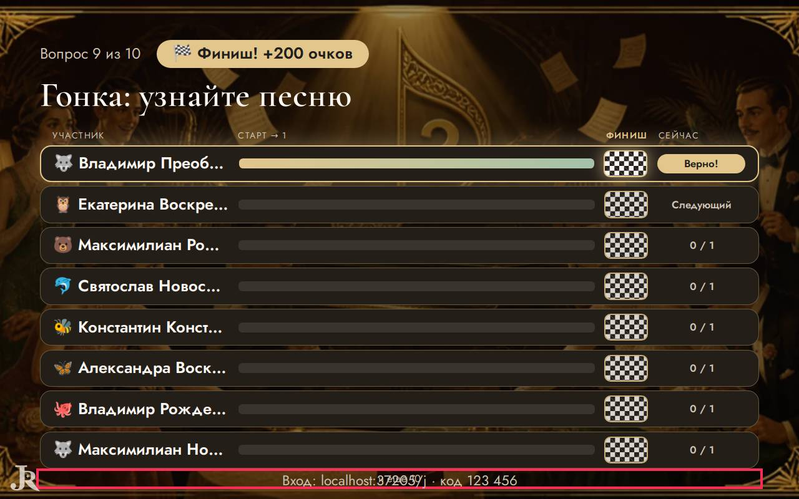
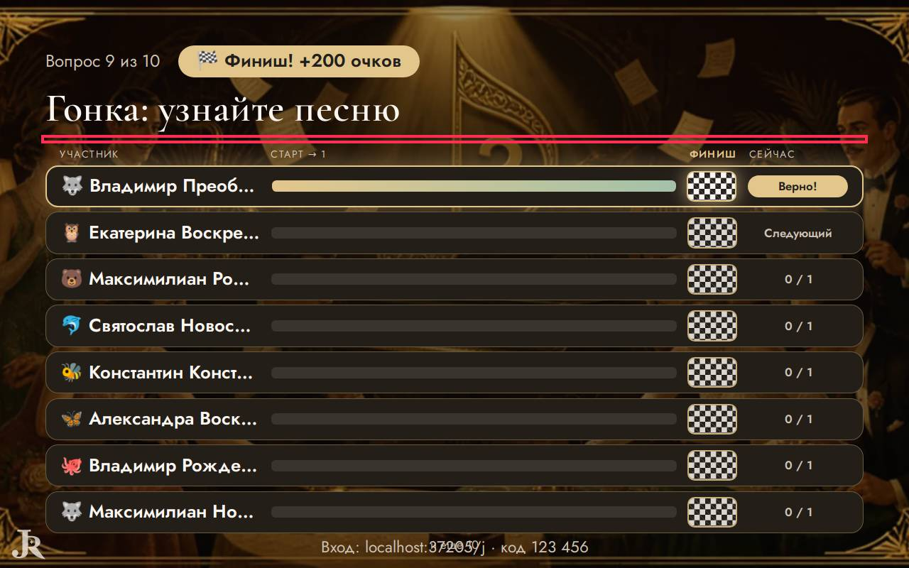
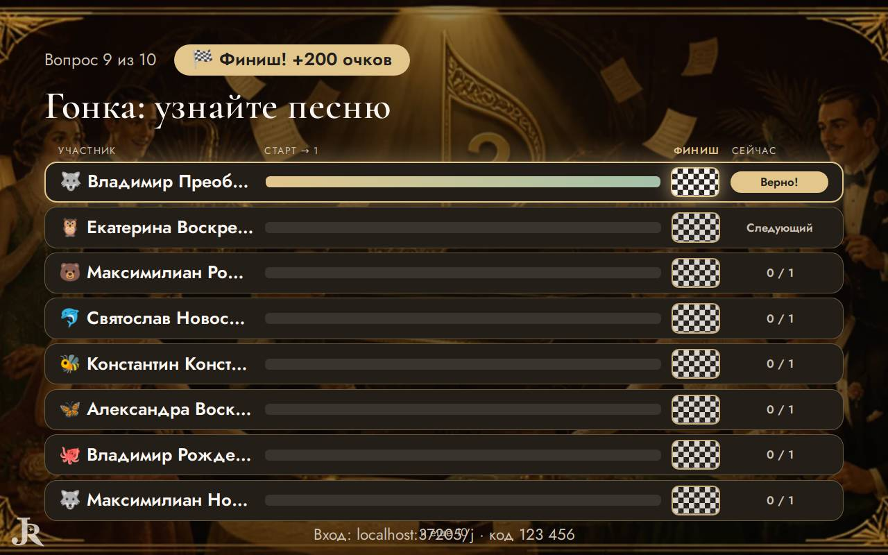
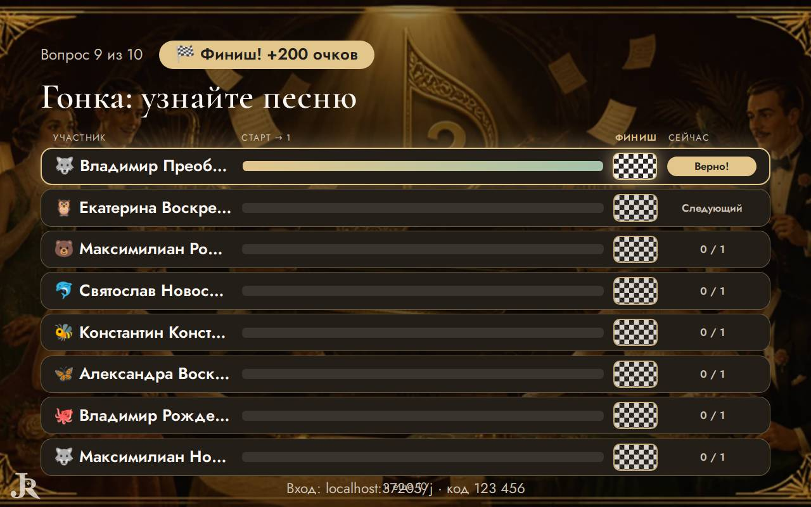

# Ревизор — что видят ведущий и гости

Прогонов: 24 · видов игры проверено: 910 · разных находок: 10

Размеры: Телевизор Full HD (1920x1080); Проектор 4:3, маленький телефон, длинные имена (1024x768); Ноутбук 16:10, большой зал, длинные имена (1280x800).

## Мешает игре — 6

### закрыт другим элементом · экран зала

«Верно — :» закрыт элементом span — «Верно — :»

- где: `div.hall > main.quiz-stage.show-stage > div.quiz-screen.quiz-screen--race > p.quiz-screen__race-answer`, этап `playing/8/reveal/`
- игры (1): quiz 4-й шаблон, каждый сам ×16, ноутбук 16:10, большой зал, длинные имена
- раз: 1

### закрыт другим элементом · экран зала

«🐺» закрыт элементом span — «🐺»

- где: `main.quiz-stage.show-stage > div.quiz-screen.quiz-screen--race > p.quiz-screen__race-answer > span.name-emoji`, этап `playing/8/reveal/`
- игры (1): quiz 4-й шаблон, каждый сам ×16, ноутбук 16:10, большой зал, длинные имена
- раз: 1

### закрыт другим элементом · экран зала

«Владимир Преображенский» закрыт элементом span — «Владимир Преображенский»

- где: `main.quiz-stage.show-stage > div.quiz-screen.quiz-screen--race > p.quiz-screen__race-answer > span`, этап `playing/8/reveal/`
- игры (1): quiz 4-й шаблон, каждый сам ×16, ноутбук 16:10, большой зал, длинные имена
- раз: 1

### закрыт другим элементом · экран зала

«Песня» закрыт элементом span — «Песня»

- где: `main.quiz-stage.show-stage > div.quiz-screen.quiz-screen--race > p.quiz-screen__race-answer > strong`, этап `playing/8/reveal/`
- игры (1): quiz 4-й шаблон, каждый сам ×16, ноутбук 16:10, большой зал, длинные имена
- раз: 1

### закрыт другим элементом · экран зала

«и ещё 10» закрыт элементом p.stage-code — «и ещё 10»

- где: `main.quiz-stage.show-stage > div.quiz-screen.quiz-screen--race > div.race > p.race__more`, этап `playing/8/reveal/`
- игры (1): quiz 4-й шаблон, каждый сам ×16, ноутбук 16:10, большой зал, длинные имена
- раз: 1

### надписи наезжают · экран зала

«и ещё 10» и «Вход: localhost:37205/j · код » друг на друге — «и ещё 10 \| Вход: localhost:37205/j · код 123 456»

- где: `main.quiz-stage.show-stage > div.quiz-screen.quiz-screen--race > div.race > p.race__more`, этап `playing/8/reveal/`
- игры (1): quiz 4-й шаблон, каждый сам ×16, ноутбук 16:10, большой зал, длинные имена
- раз: 1

## Заметно — 4

### обрезан текст · экран зала

текст обрезан по высоте на 38 px (p.quiz-screen__race-answer) — «Верно — :»

- где: `div.hall > main.quiz-stage.show-stage > div.quiz-screen.quiz-screen--race > p.quiz-screen__race-answer`, этап `playing/8/reveal/`
- игры (1): quiz 4-й шаблон, каждый сам ×16, ноутбук 16:10, большой зал, длинные имена
- раз: 1

### обрезан текст · экран зала

текст обрезан по высоте на 38 px (p.quiz-screen__race-answer) — «🐺»

- где: `main.quiz-stage.show-stage > div.quiz-screen.quiz-screen--race > p.quiz-screen__race-answer > span.name-emoji`, этап `playing/8/reveal/`
- игры (1): quiz 4-й шаблон, каждый сам ×16, ноутбук 16:10, большой зал, длинные имена
- раз: 1

### обрезан текст · экран зала

текст обрезан по высоте на 38 px (p.quiz-screen__race-answer) — «Владимир Преображенский»

- где: `main.quiz-stage.show-stage > div.quiz-screen.quiz-screen--race > p.quiz-screen__race-answer > span`, этап `playing/8/reveal/`
- игры (1): quiz 4-й шаблон, каждый сам ×16, ноутбук 16:10, большой зал, длинные имена
- раз: 1

### обрезан текст · экран зала

текст обрезан по высоте на 38 px (p.quiz-screen__race-answer) — «Песня»

- где: `main.quiz-stage.show-stage > div.quiz-screen.quiz-screen--race > p.quiz-screen__race-answer > strong`, этап `playing/8/reveal/`
- игры (1): quiz 4-й шаблон, каждый сам ×16, ноутбук 16:10, большой зал, длинные имена
- раз: 1

## Мелочи — 0

