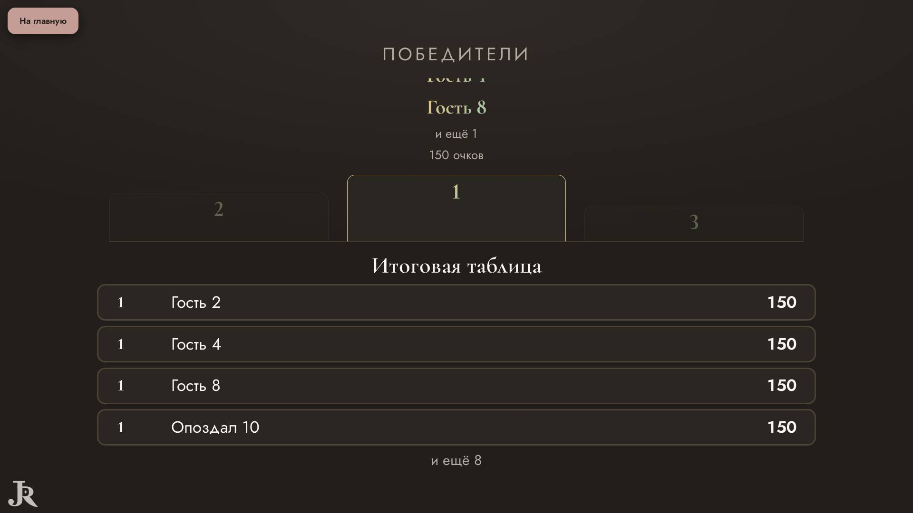

# Ревизор — что видят ведущий и гости

Прогонов: 18 · видов игры проверено: 762 · разных находок: 15

Размеры: Телевизор Full HD (1920x1080).

## Мешает игре — 6

### закрыт другим элементом · экран зала

«Гость 2» закрыт элементом p.final__eyebrow — «Гость 2»

- где: `div.podium__stage > div.podium__slot > div.podium__names > p.podium__name`, этап `finished/91/podium/over`
- игры (1): mafia 1-й шаблон, каждый сам ×9, телевизор full hd
- раз: 1

### закрыт другим элементом · экран зала

«0:30» закрыт элементом span.bk-dossier__name — «0:30»

- где: `section.bk-screen__stage > div.bk-stage.bk-stage--turn > div.bk-stage__text > p.bk-timer`, этап `playing/129/question/vote`
- игры (1): bunker 1-й шаблон, каждый сам ×8, телевизор full hd
- раз: 1

### закрыт другим элементом · экран зала

«Голосование» закрыт элементом span.bk-row__text — «Голосование»

- где: `div.bk-stage.bk-stage--turn > div.bk-stage__text > p.bk-timer > span`, этап `playing/129/question/vote`
- игры (1): bunker 1-й шаблон, каждый сам ×8, телевизор full hd
- раз: 1

### надписи наезжают · экран зала

«0:30» и «Гость 4» друг на друге — «0:30 \| Гость 4»

- где: `section.bk-screen__stage > div.bk-stage.bk-stage--turn > div.bk-stage__text > p.bk-timer`, этап `playing/129/question/vote`
- игры (1): bunker 1-й шаблон, каждый сам ×8, телевизор full hd
- раз: 2

### надписи наезжают · экран зала

«Снова ничья — решит жребий.» и «№4» друг на друге — «Снова ничья — решит жребий. \| №4»

- где: `section.bk-screen__stage > div.bk-stage.bk-stage--turn > div.bk-stage__text > p.bk-lead.bk-lead--muted`, этап `playing/130/question/justify`
- игры (1): bunker 1-й шаблон, каждый сам ×8, телевизор full hd
- раз: 2

### надписи наезжают · экран зала

«Голосование» и «Агроном · стаж 14 лет» друг на друге — «Голосование \| Агроном · стаж 14 лет»

- где: `div.bk-stage.bk-stage--turn > div.bk-stage__text > p.bk-timer > span`, этап `playing/129/question/vote`
- игры (1): bunker 1-й шаблон, каждый сам ×8, телевизор full hd
- раз: 1

## Заметно — 9

### обрезан текст · телефон

текст обрезан по высоте на 41 px (div.bk-in) — «Поменяйтесь картой «Здоровье» с любым игроком.»

- где: `div.bk-phone__specialcard > div.bk-card.bk-special > div.bk-in > span.bk-special__text`, этап `playing/1/question/catastrophe`
- игры (1): bunker 1-й шаблон, каждый сам ×8, телевизор full hd
- раз: 105

### обрезан текст · экран зала

текст обрезан по высоте на 99 px (div.podium__names) — «Гость 2»

- где: `div.podium__stage > div.podium__slot > div.podium__names > p.podium__name`, этап `finished/91/podium/over`
- игры (1): mafia 1-й шаблон, каждый сам ×9, телевизор full hd
- раз: 2

### обрезан текст · телефон

текст обрезан по высоте на 80 px (div.bk-in) — «во время голосования»

- где: `div.bk-phone__specialcard > div.bk-card.bk-special > div.bk-in > span.bk-special__when`, этап `playing/177/question/discuss`
- игры (1): bunker 1-й шаблон, каждый сам ×8, телевизор full hd
- раз: 2

### обрезан текст · экран зала

текст обрезан вбок на 18 px (div.bk-in) — «Музыкальная комната»

- где: `li > div.bk-card.bk-plan > div.bk-in > span.bk-plan__title`, этап `playing/129/question/vote`
- игры (1): bunker 1-й шаблон, каждый сам ×8, телевизор full hd
- раз: 2

### бледный текст · экран зала

контраст 2.58 (нужно от 3) — «А»

- где: `div.dg-q > ol.dg-q__ans > li > b`, этап `playing/14/reveal/`
- игры (1): dragon 2-й шаблон, команды ×4, телевизор full hd
- раз: 4

### бледный текст · телефон

контраст 1.00 (нужно от 4.5) — «A»

- где: `div.dk-hand__row > button.dk-hand__slot > div.dk-card.dk-d--russia > span.dk-idx.dk-idx--b`, этап `playing/65/question/play`
- игры (1): durak 1-й шаблон, каждый сам ×4, телевизор full hd
- раз: 2

### бледный текст · телефон

контраст 1.07 (нужно от 4.5) — «видите только вы»

- где: `section.bk-phone__mine > ul.bk-phone__cards > li > span.bk-phone__state`, этап `playing/24/question/vote`
- игры (1): bunker 1-й шаблон, каждый сам ×8, телевизор full hd
- раз: 2

### бледный текст · экран зала

контраст 1.11 (нужно от 3) — «0:30»

- где: `section.bk-screen__stage > div.bk-stage.bk-stage--turn > div.bk-stage__text > p.bk-timer`, этап `playing/129/question/vote`
- игры (1): bunker 1-й шаблон, каждый сам ×8, телевизор full hd
- раз: 1

### бледный текст · экран зала

контраст 1.90 (нужно от 4.5) — «Снова ничья — решит жребий.»

- где: `section.bk-screen__stage > div.bk-stage.bk-stage--turn > div.bk-stage__text > p.bk-lead.bk-lead--muted`, этап `playing/130/question/justify`
- игры (1): bunker 1-й шаблон, каждый сам ×8, телевизор full hd
- раз: 1

## Мелочи — 0

