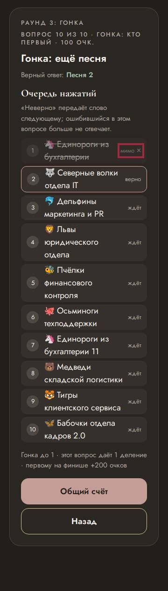

# Ревизор — что видят ведущий и гости

Прогонов: 32 · видов игры проверено: 1196 · разных находок: 1

Размеры: Телевизор Full HD (1920x1080); Проектор 4:3, маленький телефон, длинные имена (1024x768); Ноутбук 16:10, большой зал, длинные имена (1280x800); Большой праздник: 10 команд или 40 гостей, телевизор (1920x1080).

## Мешает игре — 0

## Заметно — 1

### бледный текст · пульт

контраст 2.83 (нужно от 4.5) — «мимо ✕»

- где: `section.stack.stack--tight > ol.buzz-queue > li > span.buzz-queue__state`, этап `playing/9/board/`
- игры (1): quiz 4-й шаблон, команды ×10, большой праздник: 10 команд или 40 гостей, телевизор
- раз: 1

## Мелочи — 0

