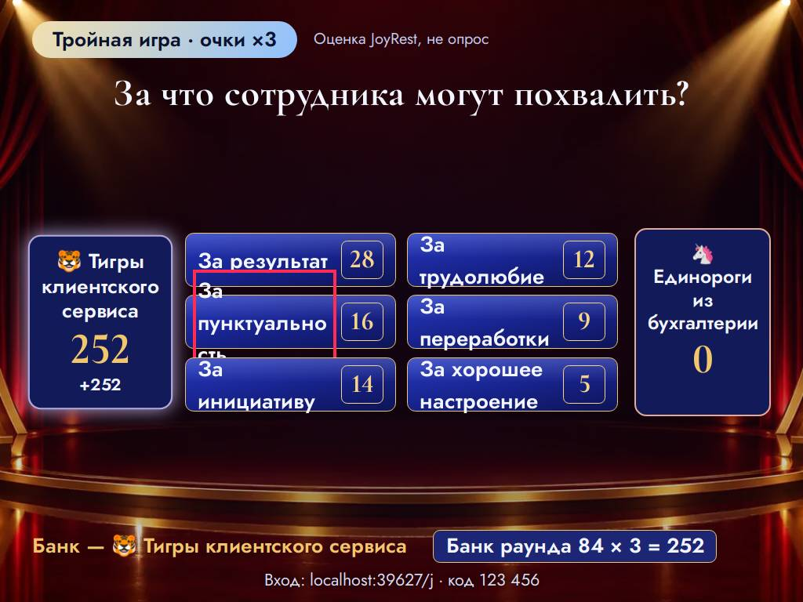
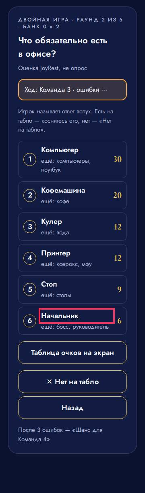
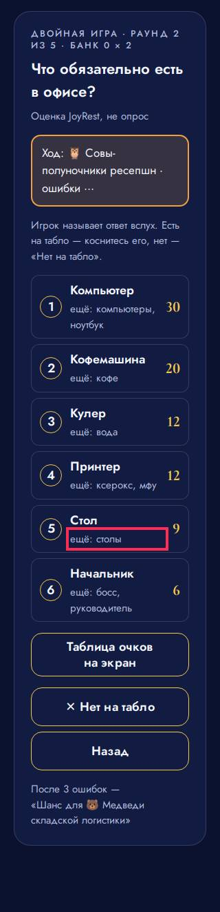

# Ревизор — что видят ведущий и гости

Прогонов: 30 · видов игры проверено: 1546 · разных находок: 3

Размеры: Телевизор Full HD (1920x1080); Проектор 4:3, маленький телефон, длинные имена (1024x768); Ноутбук 16:10, большой зал, длинные имена (1280x800).

## Мешает игре — 1

### надписи наезжают · экран зала

«За пунктуальность» и «За инициативу» друг на друге — «За пунктуальность \| За инициативу»

- где: `div.hd-row > div.hd-row__inner > div.hd-row__face.hd-row__face--open > span.hd-row__text`, этап `playing/5/reveal/done`
- игры (1): hundred 2-й шаблон, команды ×4, проектор 4:3, маленький телефон, длинные имена
- раз: 1

## Заметно — 2

### бледный текст · пульт

контраст 1.07 (нужно от 4.5) — «Начальник»

- где: `li > button.hd-host__row > span.hd-host__text > strong`, этап `playing/3/reveal/play`
- игры (1): hundred 2-й шаблон, команды ×4, телевизор full hd
- раз: 3

### бледный текст · пульт

контраст 1.85 (нужно от 4.5) — «ещё: столы»

- где: `li > button.hd-host__row > span.hd-host__text > small`, этап `playing/3/reveal/play`
- игры (1): hundred 2-й шаблон, команды ×4, проектор 4:3, маленький телефон, длинные имена
- раз: 2

## Мелочи — 0

