# Ревизор — что видят ведущий и гости

Прогонов: 141 · видов игры проверено: 6348 · разных находок: 37

Размеры: Телевизор Full HD (1920x1080); Проектор 4:3, маленький телефон, длинные имена (1024x768); Ноутбук 16:10, большой зал, длинные имена (1280x800).

## Мешает игре — 4

### закрыт другим элементом · экран зала

«Первым ходит» закрыт элементом div.draw-coin__rays — «Первым ходит»

- где: `div.hall > main.quiz-stage > div.slide.slide--draw > p.slide__eyebrow`, этап `playing/47/question/exile`
- игры (2): bunker 1-й шаблон, каждый сам ×8, телевизор full hd; bunker 1-й шаблон, каждый сам ×8, проектор 4:3, маленький телефон, длинные имена; truth 1-й шаблон, каждый сам ×16, ноутбук 16:10, большой зал, длинные имена; truth 1-й шаблон, команды ×8, ноутбук 16:10, большой зал, длинные имена; truth 2-й шаблон, команды ×8, ноутбук 16:10, большой зал, длинные имена
- раз: 6

### закрыт другим элементом · экран зала

«Проголосовали: 0 из 8» закрыт элементом article.bk-dossier.bk-dossier--dense — «Проголосовали: 0 из 8»

- где: `section.bk-screen__stage > div.bk-stage.bk-stage--turn > div.bk-stage__text > p.bk-lead`, этап `playing/120/question/vote`
- игры (1): bunker 1-й шаблон, каждый сам ×8, телевизор full hd
- раз: 1

### закрыт другим элементом · экран зала

«Голосование» закрыт элементом article.bk-dossier.bk-dossier--dense — «Голосование»

- где: `div.bk-stage.bk-stage--turn > div.bk-stage__text > div.bk-timer.bk-timer--hall > span`, этап `playing/120/question/vote`
- игры (1): bunker 1-й шаблон, каждый сам ×8, телевизор full hd
- раз: 1

### надписи наезжают · экран зала

«Снова ничья — решит жребий.» и «Екатерина Воскресенская» друг на друге — «Снова ничья — решит жребий. \| Екатерина Воскресенская»

- где: `section.bk-screen__stage > div.bk-stage.bk-stage--turn > div.bk-stage__text > p.bk-lead.bk-lead--muted`, этап `playing/136/question/justify`
- игры (1): bunker 1-й шаблон, каждый сам ×8, ноутбук 16:10, большой зал, длинные имена
- раз: 3

## Заметно — 24

### обрезан текст · экран зала

текст обрезан по высоте на 4 px (span.hd-row__text) — «Букет невесты»

- где: `div.hd-row > div.hd-row__inner > div.hd-row__face.hd-row__face--open > span.hd-row__text`, этап `playing/3/reveal/play`
- игры (1): hundred 1-й шаблон, команды ×4, телевизор full hd; hundred 1-й шаблон, каждый сам ×4, телевизор full hd; hundred 2-й шаблон, команды ×4, телевизор full hd; hundred 2-й шаблон, каждый сам ×4, телевизор full hd; hundred 3-й шаблон, команды ×4, телевизор full hd; hundred 3-й шаблон, каждый сам ×4, телевизор full hd
- раз: 45

### обрезан текст · экран зала

текст обрезан по высоте на 3 px (span.stage-teams__name) — «Единороги из бухгалтерии»

- где: `div.stage-teams > div.stage-teams__one > span.stage-teams__name > span`, этап `playing/8/reveal/pick`
- игры (1): stage 1-й шаблон, команды ×8, ноутбук 16:10, большой зал, длинные имена; stage 2-й шаблон, команды ×8, ноутбук 16:10, большой зал, длинные имена
- раз: 16

### обрезан текст · экран зала

текст обрезан по высоте на 4 px (span.mil-screen__team) — «Команда 1»

- где: `div.mil-screen.show-stage > section.mil-screen__main > p.mil-screen__who > span.mil-screen__team`, этап `playing/0/ready/turn`
- игры (1): millionaire 1-й шаблон, команды ×4, телевизор full hd; millionaire 1-й шаблон, каждый сам ×4, телевизор full hd
- раз: 6

### обрезан текст · экран зала

текст обрезан по высоте на 5 px (span.quiz-auction__who) — «Отвечает · ставка 200 очков»

- где: `div.quiz-screen > div.quiz-screen__top > span.quiz-auction__plate > span.quiz-auction__who`, этап `playing/6/reveal/`
- игры (1): quiz 4-й шаблон, команды ×4, телевизор full hd; quiz 4-й шаблон, команды ×4, проектор 4:3, маленький телефон, длинные имена
- раз: 2

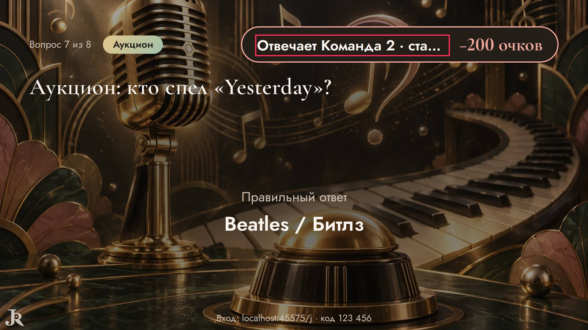

### обрезан текст · экран зала

текст обрезан по высоте на 5 px (span.quiz-auction__who) — «Команда 2»

- где: `div.quiz-screen__top > span.quiz-auction__plate > span.quiz-auction__who > strong`, этап `playing/6/reveal/`
- игры (1): quiz 4-й шаблон, команды ×4, телевизор full hd
- раз: 1

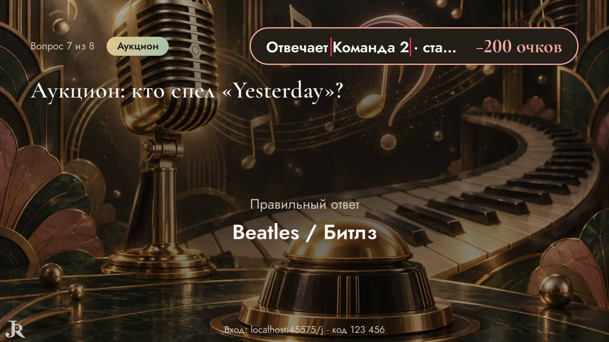

### обрезан текст · экран зала

текст обрезан по высоте на 4 px (span.quiz-auction__who) — «🐺»

- где: `span.quiz-auction__plate > span.quiz-auction__who > strong > span.name-emoji`, этап `playing/6/reveal/`
- игры (1): quiz 4-й шаблон, команды ×4, проектор 4:3, маленький телефон, длинные имена
- раз: 1

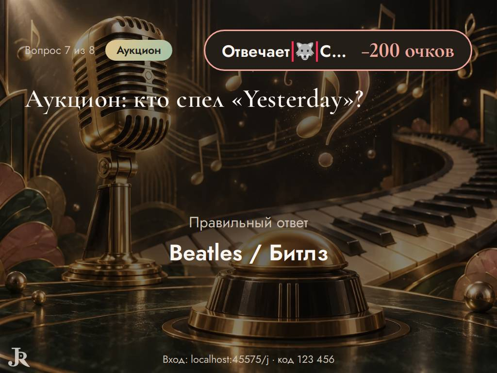

### обрезан текст · экран зала

текст обрезан по высоте на 4 px (span.quiz-auction__who) — «Северные волки отдела IT»

- где: `span.quiz-auction__plate > span.quiz-auction__who > strong > span`, этап `playing/6/reveal/`
- игры (1): quiz 4-й шаблон, команды ×4, проектор 4:3, маленький телефон, длинные имена
- раз: 1

### обрезан текст · экран зала

текст обрезан по высоте на 6 px (li.super-level.super-level--bronze) — «100 очков»

- где: `div.super-screen.super-screen--intro > ol.super-levels.super-levels--intro > li.super-level.super-level--bronze > span.super-level__points`, этап `playing/7/ready/`
- игры (1): quiz 4-й шаблон, команды ×4, проектор 4:3, маленький телефон, длинные имена
- раз: 1

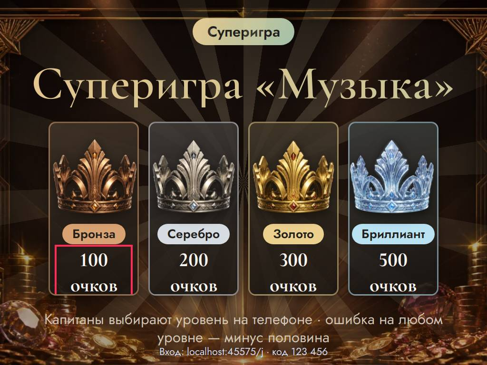

### обрезан текст · экран зала

текст обрезан по высоте на 6 px (li.super-level.super-level--silver) — «200 очков»

- где: `div.super-screen.super-screen--intro > ol.super-levels.super-levels--intro > li.super-level.super-level--silver > span.super-level__points`, этап `playing/7/ready/`
- игры (1): quiz 4-й шаблон, команды ×4, проектор 4:3, маленький телефон, длинные имена
- раз: 1

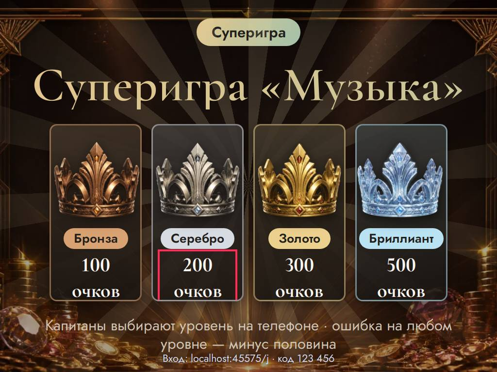

### обрезан текст · экран зала

текст обрезан по высоте на 6 px (li.super-level.super-level--gold) — «300 очков»

- где: `div.super-screen.super-screen--intro > ol.super-levels.super-levels--intro > li.super-level.super-level--gold > span.super-level__points`, этап `playing/7/ready/`
- игры (1): quiz 4-й шаблон, команды ×4, проектор 4:3, маленький телефон, длинные имена
- раз: 1

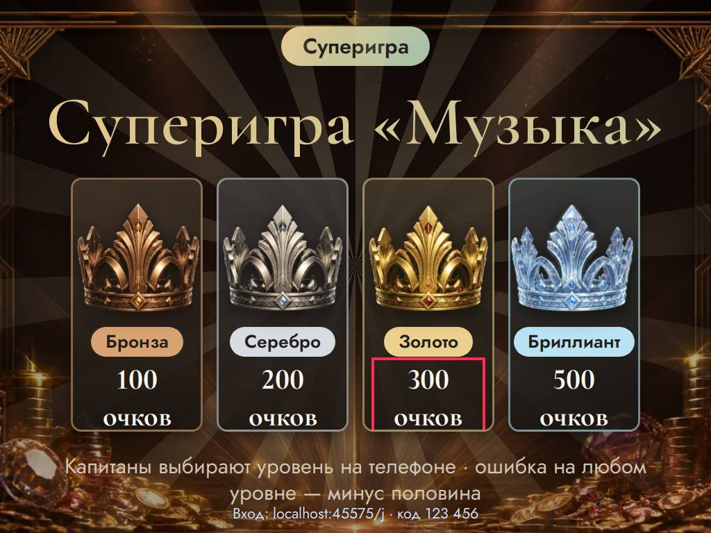

### обрезан текст · экран зала

текст обрезан по высоте на 6 px (li.super-level.super-level--diamond) — «500 очков»

- где: `div.super-screen.super-screen--intro > ol.super-levels.super-levels--intro > li.super-level.super-level--diamond > span.super-level__points`, этап `playing/7/ready/`
- игры (1): quiz 4-й шаблон, команды ×4, проектор 4:3, маленький телефон, длинные имена
- раз: 1

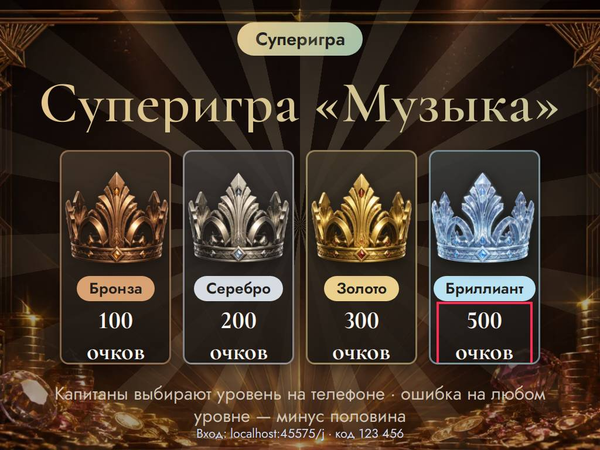

### бледный текст · телефон

контраст 1.00 (нужно от 4.5) — «33%»

- где: `div.mil-question.mil-question--phone > ol.mil-options > li.mil-option > span.mil-option__pct`, этап `playing/13/question/question`
- игры (1): millionaire 1-й шаблон, команды ×4, телевизор full hd; millionaire 1-й шаблон, команды ×8, ноутбук 16:10, большой зал, длинные имена; millionaire 1-й шаблон, команды ×4, проектор 4:3, маленький телефон, длинные имена; millionaire 1-й шаблон, каждый сам ×4, телевизор full hd; millionaire 1-й шаблон, каждый сам ×4, проектор 4:3, маленький телефон, длинные имена; millionaire 1-й шаблон, каждый сам ×16, ноутбук 16:10, большой зал, длинные имена
- раз: 95

### бледный текст · телефон

контраст 1.00 (нужно от 4.5) — «Зелёного»

- где: `div.mil-question.mil-question--phone > ol.mil-options > li.mil-option > span.mil-option__text`, этап `playing/2/question/question`
- игры (1): millionaire 1-й шаблон, команды ×4, телевизор full hd; millionaire 1-й шаблон, команды ×8, ноутбук 16:10, большой зал, длинные имена; millionaire 1-й шаблон, команды ×4, проектор 4:3, маленький телефон, длинные имена; millionaire 1-й шаблон, каждый сам ×4, телевизор full hd; millionaire 1-й шаблон, каждый сам ×4, проектор 4:3, маленький телефон, длинные имена; millionaire 1-й шаблон, каждый сам ×16, ноутбук 16:10, большой зал, длинные имена
- раз: 62

### бледный текст · телефон

контраст 1.10 (нужно от 4.5) — «A»

- где: `div.mil-question.mil-question--phone > ol.mil-options > li.mil-option > span.mil-option__letter`, этап `playing/2/question/question`
- игры (1): millionaire 1-й шаблон, команды ×4, телевизор full hd; millionaire 1-й шаблон, команды ×8, ноутбук 16:10, большой зал, длинные имена; millionaire 1-й шаблон, команды ×4, проектор 4:3, маленький телефон, длинные имена; millionaire 1-й шаблон, каждый сам ×4, телевизор full hd; millionaire 1-й шаблон, каждый сам ×4, проектор 4:3, маленький телефон, длинные имена; millionaire 1-й шаблон, каждый сам ×16, ноутбук 16:10, большой зал, длинные имена
- раз: 55

### бледный текст · пульт

контраст 3.42 (нужно от 4.5) — «мимо ✕»

- где: `section.stack.stack--tight > ol.buzz-queue > li > span.buzz-queue__state`, этап `playing/7/question/buzz`
- игры (1): board 1-й шаблон, каждый сам ×4, телевизор full hd; board 1-й шаблон, каждый сам ×4, проектор 4:3, маленький телефон, длинные имена; board 1-й шаблон, каждый сам ×16, ноутбук 16:10, большой зал, длинные имена; board 1-й шаблон, команды ×8, ноутбук 16:10, большой зал, длинные имена
- раз: 7

### бледный текст · телефон

контраст 3.34 (нужно от 4.5) — «9»

- где: `div.dk-hand__row > button.dk-hand__slot > div.dk-card.dk-d--russia > span.dk-idx.dk-idx--b`, этап `playing/67/question/play`
- игры (1): durak 1-й шаблон, каждый сам ×4, телевизор full hd; durak 1-й шаблон, каждый сам ×4, проектор 4:3, маленький телефон, длинные имена; durak 1-й шаблон, каждый сам ×4, ноутбук 16:10, большой зал, длинные имена
- раз: 4

### бледный текст · экран зала

контраст 1.05 (нужно от 4.5) — «Вход: localhost:45575/j · код 123 456»

- где: `div.hall > main.quiz-stage > p.stage-code`, этап `playing/1/reveal/done`
- игры (1): hundred 1-й шаблон, команды ×8, ноутбук 16:10, большой зал, длинные имена; hundred 2-й шаблон, команды ×8, ноутбук 16:10, большой зал, длинные имена; hundred 3-й шаблон, команды ×8, ноутбук 16:10, большой зал, длинные имена
- раз: 3

### бледный текст · пульт

контраст 1.07 (нужно от 4.5) — «Начальник»

- где: `li > button.hd-host__row > span.hd-host__text > strong`, этап `playing/3/reveal/play`
- игры (1): hundred 2-й шаблон, команды ×4, телевизор full hd
- раз: 3

### бледный текст · пульт

контраст 1.85 (нужно от 4.5) — «ещё: столы»

- где: `li > button.hd-host__row > span.hd-host__text > small`, этап `playing/3/reveal/play`
- игры (1): hundred 2-й шаблон, команды ×4, проектор 4:3, маленький телефон, длинные имена
- раз: 2

### бледный текст · экран зала

контраст 1.43 (нужно от 4.5) — «Снова ничья — решит жребий.»

- где: `section.bk-screen__stage > div.bk-stage.bk-stage--turn > div.bk-stage__text > p.bk-lead.bk-lead--muted`, этап `playing/33/question/justify`
- игры (1): bunker 1-й шаблон, каждый сам ×8, проектор 4:3, маленький телефон, длинные имена; bunker 1-й шаблон, каждый сам ×8, ноутбук 16:10, большой зал, длинные имена
- раз: 2

### бледный текст · телефон

контраст 1.85 (нужно от 4.5) — «Подсказки»

- где: `div.card > div.quiz-phone > section.stack.stack--tight > p.eyebrow`, этап `playing/2/question/question`
- игры (1): millionaire 1-й шаблон, команды ×4, проектор 4:3, маленький телефон, длинные имена
- раз: 1

### бледный текст · телефон

контраст 1.52 (нужно от 4.5) — «Они ответили верно!»

- где: `main.page.page--play > div.card > div.quiz-phone.mil-watch > p.success`, этап `playing/8/reveal/reveal`
- игры (1): millionaire 1-й шаблон, команды ×4, проектор 4:3, маленький телефон, длинные имена
- раз: 1

### бледный текст · пульт

контраст 1.07 (нужно от 4.5) — «Назад»

- где: `section.card > div.stack.host-quiz > div.actions > button.btn.btn--secondary`, этап `playing/6/reveal/answer`
- игры (1): wager 1-й шаблон, каждый сам ×4, проектор 4:3, маленький телефон, длинные имена
- раз: 1

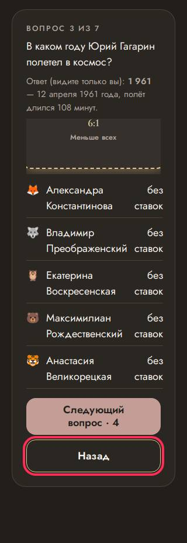

### мелко для зала · экран зала

шрифт 10.5 px — 14 px на Full HD (нужно от 18) — «Полностью здоров»

- где: `div.bk-stage__card.bk-stage__card--small > div.bk-card.bk-trait > div.bk-in > span.bk-trait__text`, этап `playing/103/question/open`
- игры (1): bunker 1-й шаблон, каждый сам ×8, ноутбук 16:10, большой зал, длинные имена
- раз: 1

## Мелочи — 9

### мелкий текст · телефон

шрифт 11.4 px (нужно от 12) — «6»

- где: `div.dk-hand__row > button.dk-hand__slot > div.dk-card.dk-d--wedding > span.dk-idx`, этап `playing/52/question/play`
- игры (1): durak 1-й шаблон, каждый сам ×4, проектор 4:3, маленький телефон, длинные имена
- раз: 14

### мелкий текст · телефон

шрифт 11.4 px (нужно от 12) — «6»

- где: `div.dk-hand__row > button.dk-hand__slot > div.dk-card.dk-d--wedding > span.dk-idx.dk-idx--b`, этап `playing/52/question/play`
- игры (1): durak 1-й шаблон, каждый сам ×4, проектор 4:3, маленький телефон, длинные имена
- раз: 14

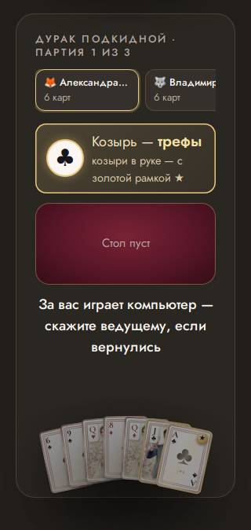

### мелкий текст · телефон

шрифт 11.4 px (нужно от 12) — «6»

- где: `div.dk-hand__row > button.dk-hand__slot > div.dk-card.dk-d--gothic > span.dk-idx`, этап `playing/54/question/play`
- игры (1): durak 1-й шаблон, каждый сам ×4, проектор 4:3, маленький телефон, длинные имена
- раз: 7

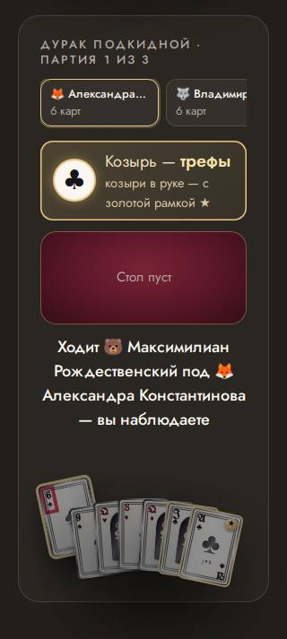

### мелкий текст · телефон

шрифт 11.4 px (нужно от 12) — «6»

- где: `div.dk-hand__row > button.dk-hand__slot > div.dk-card.dk-d--gothic > span.dk-idx.dk-idx--b`, этап `playing/54/question/play`
- игры (1): durak 1-й шаблон, каждый сам ×4, проектор 4:3, маленький телефон, длинные имена
- раз: 7

### мелкий текст · телефон

шрифт 11.4 px (нужно от 12) — «6»

- где: `div.dk-hand__row > button.dk-hand__slot > div.dk-card.dk-d--russia > span.dk-idx`, этап `playing/65/question/play`
- игры (1): durak 1-й шаблон, каждый сам ×4, проектор 4:3, маленький телефон, длинные имена
- раз: 7

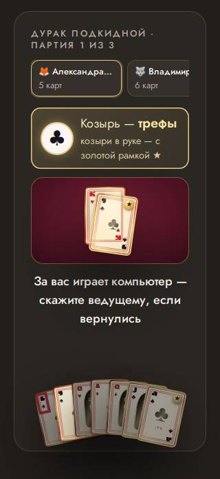

### мелкий текст · телефон

шрифт 11.4 px (нужно от 12) — «6»

- где: `div.dk-hand__row > button.dk-hand__slot > div.dk-card.dk-d--russia > span.dk-idx.dk-idx--b`, этап `playing/65/question/play`
- игры (1): durak 1-й шаблон, каждый сам ×4, проектор 4:3, маленький телефон, длинные имена
- раз: 7

### мелкий текст · телефон

шрифт 11.4 px (нужно от 12) — «6»

- где: `div.dk-hand__row > button.dk-hand__slot > div.dk-card.dk-d--classic > span.dk-idx`, этап `playing/90/question/play`
- игры (1): durak 1-й шаблон, каждый сам ×4, проектор 4:3, маленький телефон, длинные имена
- раз: 7

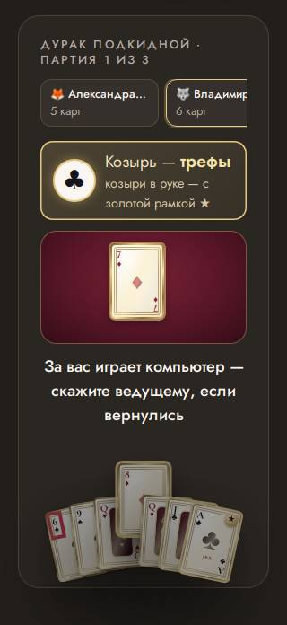

### мелкий текст · телефон

шрифт 11.4 px (нужно от 12) — «6»

- где: `div.dk-hand__row > button.dk-hand__slot > div.dk-card.dk-d--classic > span.dk-idx.dk-idx--b`, этап `playing/90/question/play`
- игры (1): durak 1-й шаблон, каждый сам ×4, проектор 4:3, маленький телефон, длинные имена
- раз: 7

### мелкий текст · телефон

шрифт 11.5 px (нужно от 12) — «Локация»

- где: `button.sp-card > span.sp-card__inner > span.sp-card__face.sp-card__face--place > span.sp-card__label`, этап `playing/0/reveal/cards`
- игры (1): spy 1-й шаблон, каждый сам ×11, проектор 4:3, маленький телефон, длинные имена
- раз: 4

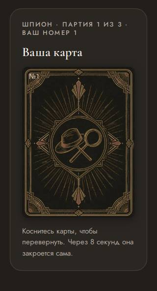

