# Ревизор — что видят ведущий и гости

Прогонов: 27 · видов игры проверено: 1177 · разных находок: 74

Размеры: Телевизор Full HD (1920x1080); Проектор 4:3, маленький телефон, длинные имена (1024x768); Ноутбук 16:10, большой зал, длинные имена (1280x800).

## Мешает игре — 5

### закрыт другим элементом · экран зала

«50% · 0» закрыт элементом img.stage-dancer — «50% · 0»

- где: `div.stage-screen.stage-screen--battle > div.stage-tug > div.stage-tug__bar > span`, этап `playing/36/reveal/result`
- игры (1): stage 1-й шаблон, команды ×8, ноутбук 16:10, большой зал, длинные имена; stage 1-й шаблон, команды ×4, проектор 4:3, маленький телефон, длинные имена; stage 2-й шаблон, команды ×8, ноутбук 16:10, большой зал, длинные имена; stage 2-й шаблон, команды ×4, проектор 4:3, маленький телефон, длинные имена
- раз: 8

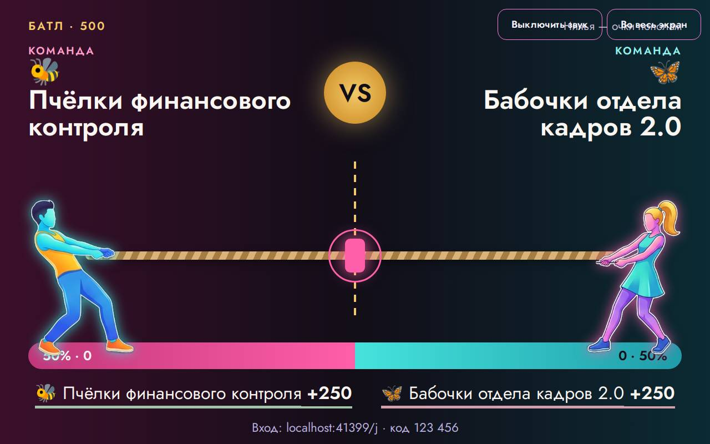

### закрыт другим элементом · экран зала

«Единороги из бухгалтерии» закрыт элементом span.name-emoji — «Единороги из бухгалтерии»

- где: `div.stage-teams > div.stage-teams__one > span.stage-teams__name > span`, этап `playing/8/reveal/pick`
- игры (1): stage 1-й шаблон, команды ×8, ноутбук 16:10, большой зал, длинные имена; stage 2-й шаблон, команды ×8, ноутбук 16:10, большой зал, длинные имена
- раз: 6

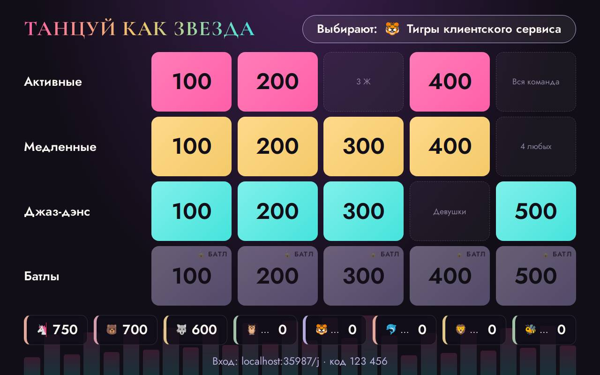

### надписи наезжают · пульт

«100» и «🔒 батл» друг на друге — «100 \| 🔒 батл»

- где: `div.stage-field.stage-field--compact > div.stage-field__row > button.stage-tile > span.stage-tile__points`, этап `playing/0/reveal/pick`
- игры (1): stage 1-й шаблон, команды ×4, телевизор full hd; stage 1-й шаблон, команды ×8, ноутбук 16:10, большой зал, длинные имена; stage 1-й шаблон, команды ×4, проектор 4:3, маленький телефон, длинные имена; stage 2-й шаблон, команды ×4, телевизор full hd; stage 2-й шаблон, команды ×8, ноутбук 16:10, большой зал, длинные имена; stage 2-й шаблон, команды ×4, проектор 4:3, маленький телефон, длинные имена
- раз: 70

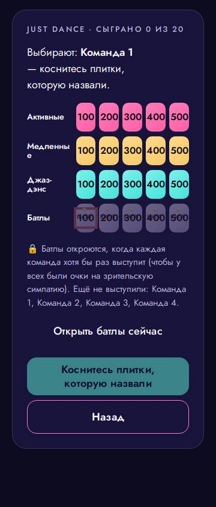

### прокрутка вбок · пульт

страница шире экрана на 12 px (button.btn.btn--secondary) — «Победил:»

- где: `div.stack.stack--tight > div.stack.stack--tight > div.row > button.btn.btn--secondary`, этап `playing/29/reveal/result`
- игры (1): stage 1-й шаблон, команды ×4, проектор 4:3, маленький телефон, длинные имена; stage 2-й шаблон, команды ×4, проектор 4:3, маленький телефон, длинные имена
- раз: 6

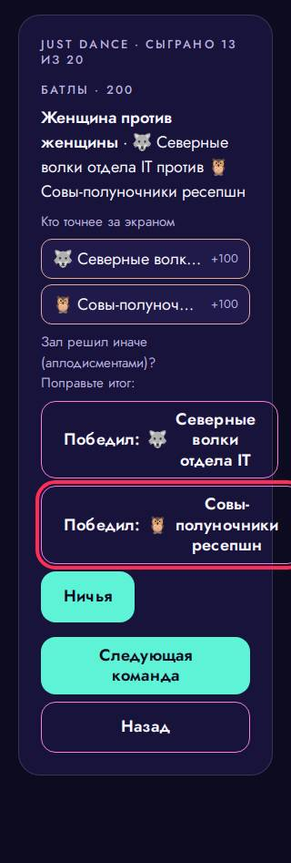

### прокрутка вбок · пульт

страница шире экрана на 12 px (span) — «Медведи складской логистики»

- где: `ul.buzz-queue.buzz-queue--plain > li > span.buzz-queue__name > span`, этап `playing/18/reveal/result`
- игры (1): stage 1-й шаблон, команды ×4, проектор 4:3, маленький телефон, длинные имена; stage 2-й шаблон, команды ×4, проектор 4:3, маленький телефон, длинные имена
- раз: 2

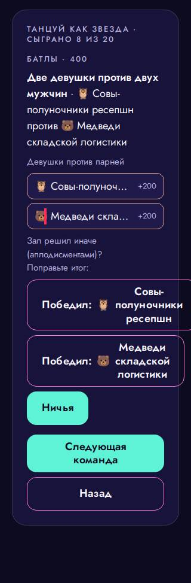

## Заметно — 52

### обрезан текст · экран зала

текст обрезан по высоте на 6 px (span.dg-team__nm) — «Команда 1»

- где: `div.dg-frame > ul.dg-teams.dg-teams--l > li.dg-team > span.dg-team__nm`, этап `playing/1/question/`
- игры (1): dragon 2-й шаблон, команды ×4, телевизор full hd
- раз: 11

### обрезан текст · экран зала

текст обрезан по высоте на 4 px (span.dg-team__nm) — «🦄»

- где: `ul.dg-teams.dg-teams--l > li.dg-team > span.dg-team__nm > span.name-emoji`, этап `playing/1/question/`
- игры (1): dragon 2-й шаблон, команды ×4, проектор 4:3, маленький телефон, длинные имена
- раз: 11

### обрезан текст · экран зала

текст обрезан по высоте на 4 px (span.dg-team__nm) — «Единороги из бухгалтерии»

- где: `ul.dg-teams.dg-teams--l > li.dg-team > span.dg-team__nm > span`, этап `playing/1/question/`
- игры (1): dragon 2-й шаблон, команды ×4, проектор 4:3, маленький телефон, длинные имена
- раз: 11

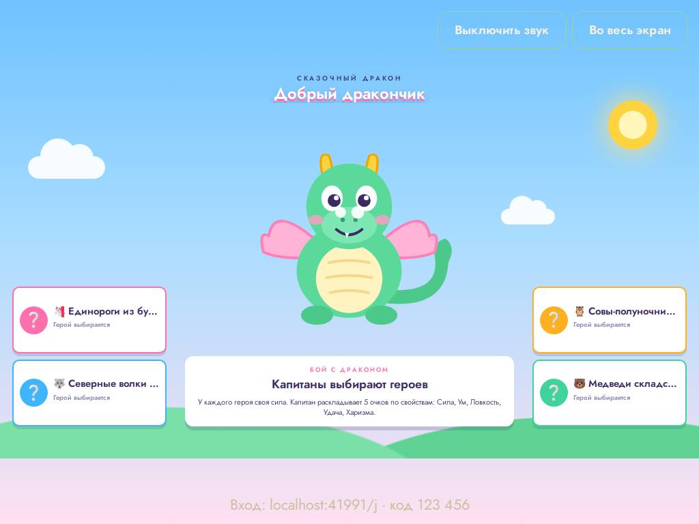

### обрезан текст · экран зала

текст обрезан по высоте на 8 px (div.dg-boss__name) — «Добрый дракончик»

- где: `div.dg-stage.dg-stage--kid > div.dg-frame > div.dg-boss > div.dg-boss__name`, этап `playing/1/question/`
- игры (1): dragon 2-й шаблон, команды ×4, телевизор full hd; dragon 2-й шаблон, команды ×4, проектор 4:3, маленький телефон, длинные имена; dragon 2-й шаблон, команды ×8, ноутбук 16:10, большой зал, длинные имена
- раз: 10

### обрезан текст · экран зала

текст обрезан по высоте на 6 px (span.dg-team__nm) — «Команда 3»

- где: `div.dg-frame > ul.dg-teams.dg-teams--r > li.dg-team > span.dg-team__nm`, этап `playing/1/question/`
- игры (1): dragon 2-й шаблон, команды ×4, телевизор full hd
- раз: 10

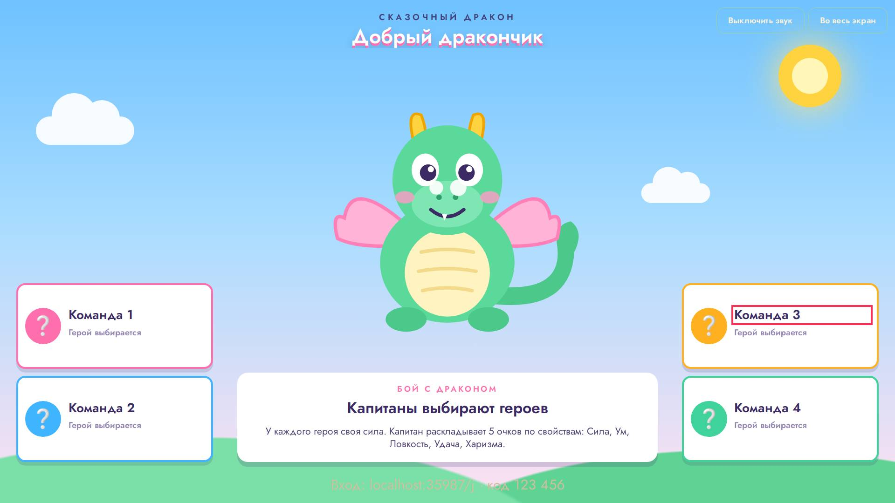

### обрезан текст · экран зала

текст обрезан по высоте на 4 px (span.dg-team__nm) — «🦉»

- где: `ul.dg-teams.dg-teams--r > li.dg-team > span.dg-team__nm > span.name-emoji`, этап `playing/1/question/`
- игры (1): dragon 2-й шаблон, команды ×4, проектор 4:3, маленький телефон, длинные имена
- раз: 10

### обрезан текст · экран зала

текст обрезан по высоте на 4 px (span.dg-team__nm) — «Совы-полуночники ресепшн»

- где: `ul.dg-teams.dg-teams--r > li.dg-team > span.dg-team__nm > span`, этап `playing/1/question/`
- игры (1): dragon 2-й шаблон, команды ×4, проектор 4:3, маленький телефон, длинные имена
- раз: 10

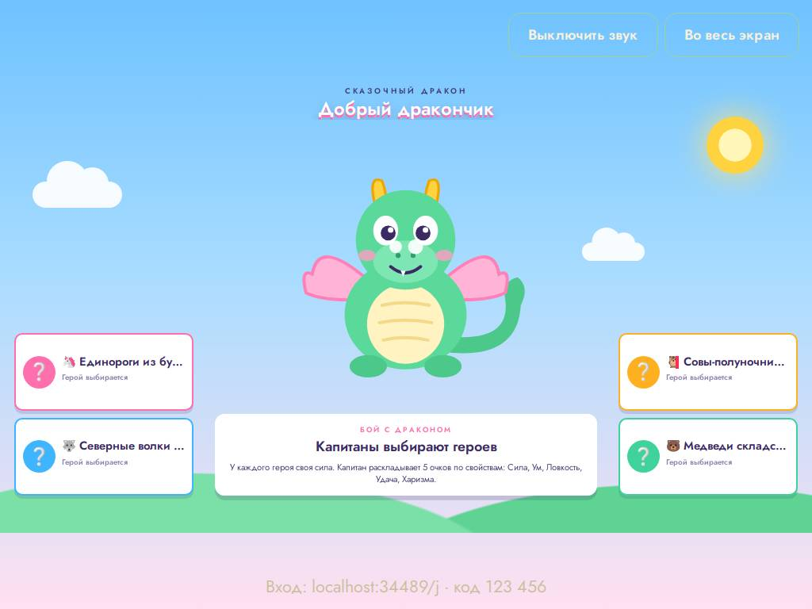

### бледный текст · экран зала

контраст 3.27 (нужно от 4.5) — «Герой выбирается»

- где: `div.dg-frame > ul.dg-teams.dg-teams--l > li.dg-team > span.dg-team__hero`, этап `playing/1/question/`
- игры (1): dragon 2-й шаблон, команды ×4, телевизор full hd; dragon 2-й шаблон, команды ×4, проектор 4:3, маленький телефон, длинные имена; dragon 2-й шаблон, команды ×8, ноутбук 16:10, большой зал, длинные имена
- раз: 30

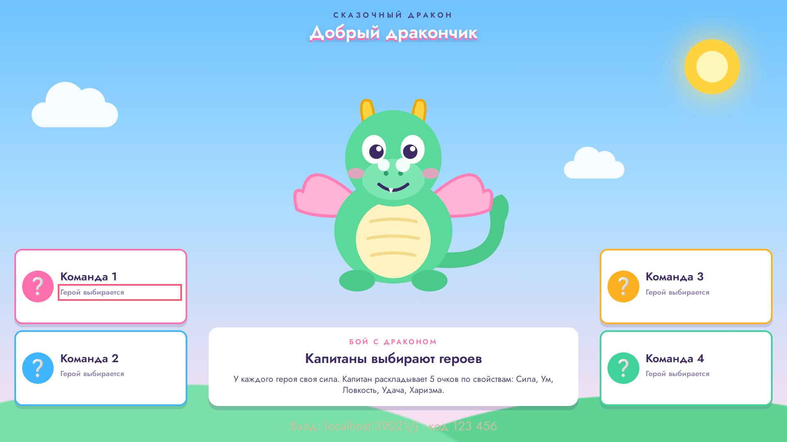

### бледный текст · экран зала

контраст 3.27 (нужно от 4.5) — «Герой выбирается»

- где: `div.dg-frame > ul.dg-teams.dg-teams--r > li.dg-team > span.dg-team__hero`, этап `playing/1/question/`
- игры (1): dragon 2-й шаблон, команды ×4, телевизор full hd; dragon 2-й шаблон, команды ×4, проектор 4:3, маленький телефон, длинные имена; dragon 2-й шаблон, команды ×8, ноутбук 16:10, большой зал, длинные имена
- раз: 26

### бледный текст · экран зала

контраст 2.58 (нужно от 4.5) — «Бой с драконом»

- где: `div.dg-stage.dg-stage--kid > div.dg-frame > div.dg-q.dg-q--center > div.dg-q__eye`, этап `playing/1/question/`
- игры (1): dragon 2-й шаблон, команды ×4, телевизор full hd; dragon 2-й шаблон, команды ×4, проектор 4:3, маленький телефон, длинные имена
- раз: 4

### бледный текст · экран зала

контраст 2.58 (нужно от 4.5) — «Задание 2 · 💪 Сила»

- где: `div.dg-stage.dg-stage--kid > div.dg-frame > div.dg-q > div.dg-q__eye`, этап `playing/19/reveal/`
- игры (1): dragon 2-й шаблон, команды ×4, телевизор full hd; dragon 2-й шаблон, команды ×4, проектор 4:3, маленький телефон, длинные имена
- раз: 2

### мелко для зала · экран зала

шрифт 11.5 px — 16 px на Full HD (нужно от 18) — «кл. 0»

- где: `aside.qx-panel > ol.qx-panel__list > li.qx-row > span.qx-row__cell`, этап `playing/0/question/roll`
- игры (1): quest 1-й шаблон, команды ×4, проектор 4:3, маленький телефон, длинные имена; quest 1-й шаблон, команды ×4, телевизор full hd; quest 2-й шаблон, команды ×4, телевизор full hd; quest 2-й шаблон, команды ×4, проектор 4:3, маленький телефон, длинные имена; quest 1-й шаблон, команды ×8, ноутбук 16:10, большой зал, длинные имена; quest 2-й шаблон, команды ×8, ноутбук 16:10, большой зал, длинные имена
- раз: 166

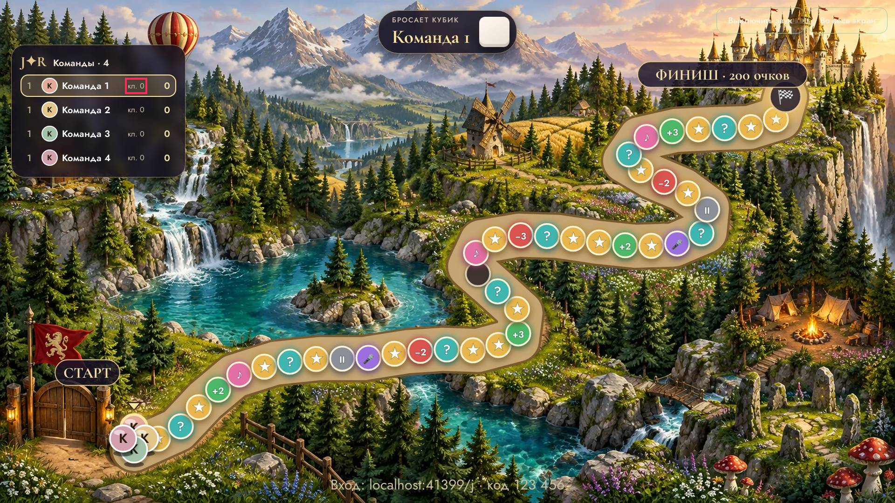

### мелко для зала · экран зала

шрифт 9.8 px — 14 px на Full HD (нужно от 18) — «0»

- где: `li.dg-team > span.dg-team__row > span.dg-team__dm > b`, этап `playing/2/ready/`
- игры (1): dragon 1-й шаблон, команды ×4, проектор 4:3, маленький телефон, длинные имена; dragon 1-й шаблон, команды ×8, ноутбук 16:10, большой зал, длинные имена; dragon 2-й шаблон, команды ×4, проектор 4:3, маленький телефон, длинные имена; dragon 2-й шаблон, команды ×8, ноутбук 16:10, большой зал, длинные имена
- раз: 98

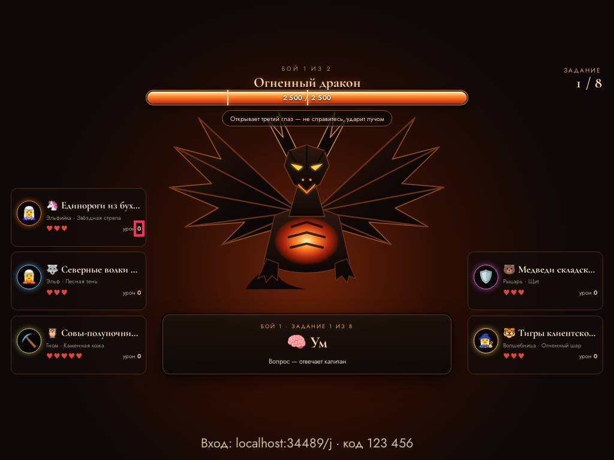

### мелко для зала · экран зала

шрифт 9.8 px — 14 px на Full HD (нужно от 18) — «урон»

- где: `ul.dg-teams.dg-teams--l > li.dg-team > span.dg-team__row > span.dg-team__dm`, этап `playing/2/ready/`
- игры (1): dragon 1-й шаблон, команды ×4, проектор 4:3, маленький телефон, длинные имена; dragon 1-й шаблон, команды ×8, ноутбук 16:10, большой зал, длинные имена; dragon 2-й шаблон, команды ×4, проектор 4:3, маленький телефон, длинные имена; dragon 2-й шаблон, команды ×8, ноутбук 16:10, большой зал, длинные имена
- раз: 52

### мелко для зала · экран зала

шрифт 9.8 px — 14 px на Full HD (нужно от 18) — «урон»

- где: `ul.dg-teams.dg-teams--r > li.dg-team > span.dg-team__row > span.dg-team__dm`, этап `playing/2/ready/`
- игры (1): dragon 1-й шаблон, команды ×4, проектор 4:3, маленький телефон, длинные имена; dragon 1-й шаблон, команды ×8, ноутбук 16:10, большой зал, длинные имена; dragon 2-й шаблон, команды ×4, проектор 4:3, маленький телефон, длинные имена; dragon 2-й шаблон, команды ×8, ноутбук 16:10, большой зал, длинные имена
- раз: 46

### мелко для зала · экран зала

шрифт 9.8 px — 14 px на Full HD (нужно от 18) — «Герой выбирается»

- где: `div.dg-frame > ul.dg-teams.dg-teams--l > li.dg-team > span.dg-team__hero`, этап `playing/1/question/`
- игры (1): dragon 1-й шаблон, команды ×4, проектор 4:3, маленький телефон, длинные имена; dragon 1-й шаблон, команды ×8, ноутбук 16:10, большой зал, длинные имена; dragon 2-й шаблон, команды ×4, проектор 4:3, маленький телефон, длинные имена; dragon 2-й шаблон, команды ×8, ноутбук 16:10, большой зал, длинные имена
- раз: 37

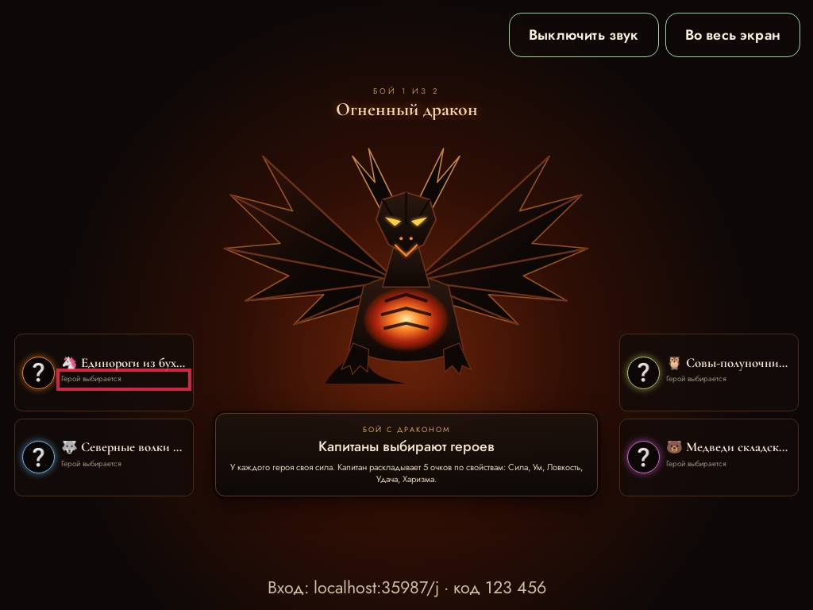

### мелко для зала · экран зала

шрифт 9.8 px — 14 px на Full HD (нужно от 18) — «Герой выбирается»

- где: `div.dg-frame > ul.dg-teams.dg-teams--r > li.dg-team > span.dg-team__hero`, этап `playing/1/question/`
- игры (1): dragon 1-й шаблон, команды ×4, проектор 4:3, маленький телефон, длинные имена; dragon 1-й шаблон, команды ×8, ноутбук 16:10, большой зал, длинные имена; dragon 2-й шаблон, команды ×4, проектор 4:3, маленький телефон, длинные имена; dragon 2-й шаблон, команды ×8, ноутбук 16:10, большой зал, длинные имена
- раз: 35

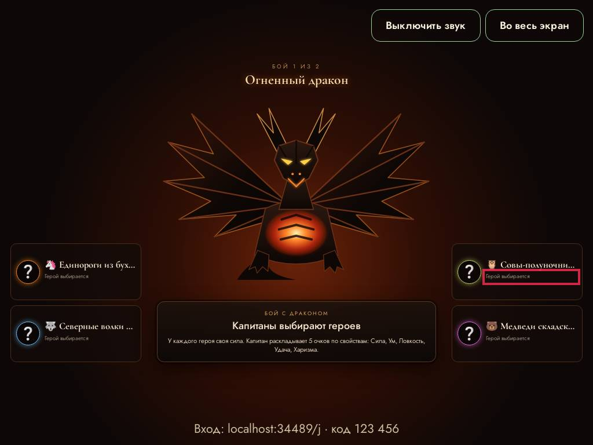

### мелко для зала · экран зала

шрифт 10.8 px — 15 px на Full HD (нужно от 18) — «Бросает кубик»

- где: `div.quest-screen.qx--classic > div.qx-turn > div.qx-turn__who > span.qx-turn__label`, этап `playing/0/question/roll`
- игры (1): quest 1-й шаблон, команды ×4, проектор 4:3, маленький телефон, длинные имена; quest 1-й шаблон, команды ×4, телевизор full hd; quest 1-й шаблон, команды ×8, ноутбук 16:10, большой зал, длинные имена
- раз: 21

### мелко для зала · экран зала

шрифт 15.1 px — 15 px на Full HD (нужно от 18) — «Бросает кубик»

- где: `div.quest-screen.qx--adult > div.qx-turn > div.qx-turn__who > span.qx-turn__label`, этап `playing/0/question/roll`
- игры (1): quest 2-й шаблон, команды ×4, телевизор full hd; quest 2-й шаблон, команды ×4, проектор 4:3, маленький телефон, длинные имена; quest 2-й шаблон, команды ×8, ноутбук 16:10, большой зал, длинные имена
- раз: 21

### мелко для зала · экран зала

шрифт 8.9 px — 12 px на Full HD (нужно от 18) — «🎲 3»

- где: `li.dg-team > span.dg-team__row > span.dg-team__dm > span.dg-team__roll`, этап `playing/20/reveal/`
- игры (1): dragon 2-й шаблон, команды ×8, ноутбук 16:10, большой зал, длинные имена
- раз: 20

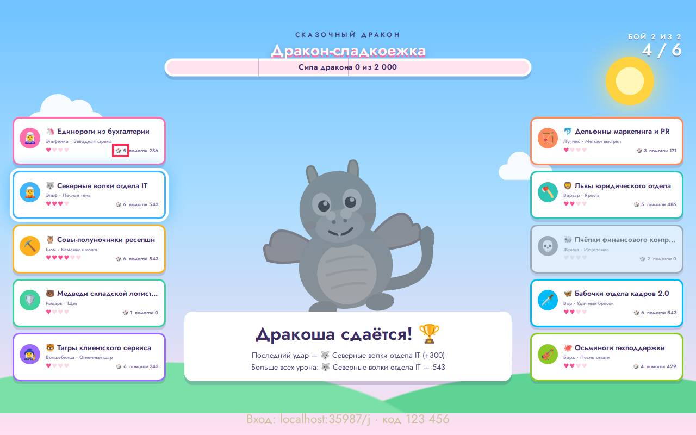

### мелко для зала · экран зала

шрифт 10.2 px — 14 px на Full HD (нужно от 18) — «А»

- где: `div.dg-q > ol.dg-q__ans > li > b`, этап `playing/15/reveal/`
- игры (1): dragon 1-й шаблон, команды ×4, проектор 4:3, маленький телефон, длинные имена; dragon 1-й шаблон, команды ×8, ноутбук 16:10, большой зал, длинные имена
- раз: 16

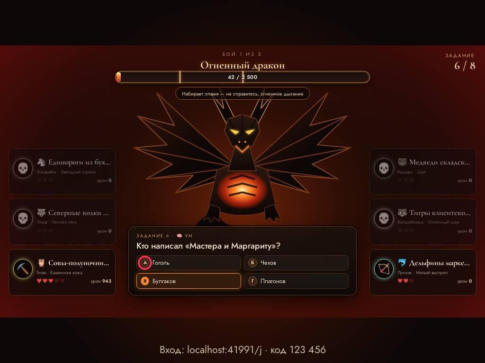

### мелко для зала · экран зала

шрифт 18.2 px — 18 px на Full HD (нужно от 18) — «Бой 1 из 2»

- где: `div.dg-stage.dg-stage--adult > div.dg-frame > div.dg-boss > div.dg-boss__rank`, этап `playing/1/question/`
- игры (1): dragon 1-й шаблон, команды ×4, телевизор full hd; dragon 1-й шаблон, команды ×4, проектор 4:3, маленький телефон, длинные имена; dragon 1-й шаблон, команды ×8, ноутбук 16:10, большой зал, длинные имена
- раз: 13

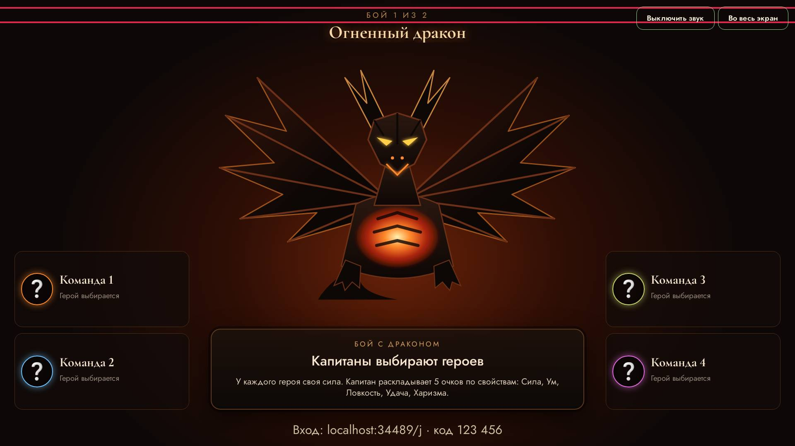

### мелко для зала · экран зала

шрифт 18.2 px — 18 px на Full HD (нужно от 18) — «Сказочный дракон»

- где: `div.dg-stage.dg-stage--kid > div.dg-frame > div.dg-boss > div.dg-boss__rank`, этап `playing/1/question/`
- игры (1): dragon 2-й шаблон, команды ×4, телевизор full hd; dragon 2-й шаблон, команды ×4, проектор 4:3, маленький телефон, длинные имена; dragon 2-й шаблон, команды ×8, ноутбук 16:10, большой зал, длинные имена
- раз: 10

### мелко для зала · экран зала

шрифт 13.4 px — 18 px на Full HD (нужно от 18) — «Единороги из бухгалтерии»

- где: `ul.dg-teams.dg-teams--l > li.dg-team > span.dg-team__nm > span`, этап `playing/20/reveal/`
- игры (1): dragon 2-й шаблон, команды ×8, ноутбук 16:10, большой зал, длинные имена
- раз: 10

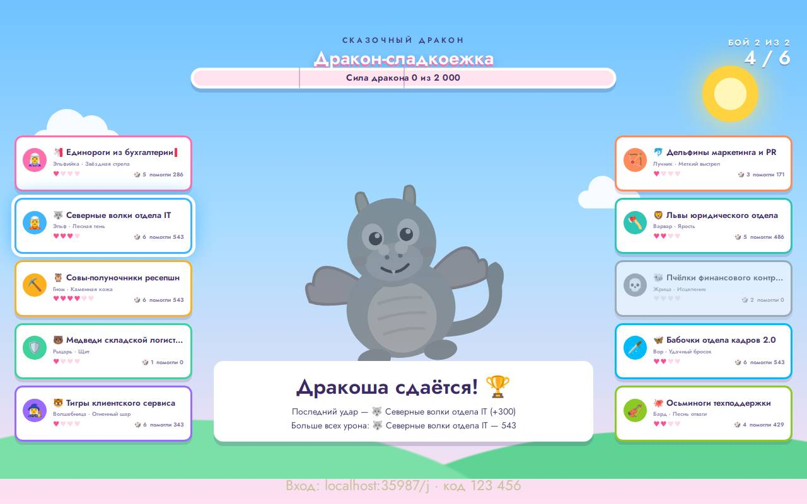

### мелко для зала · экран зала

шрифт 13.4 px — 18 px на Full HD (нужно от 18) — «Дельфины маркетинга и PR»

- где: `ul.dg-teams.dg-teams--r > li.dg-team > span.dg-team__nm > span`, этап `playing/20/reveal/`
- игры (1): dragon 2-й шаблон, команды ×8, ноутбук 16:10, большой зал, длинные имена
- раз: 10

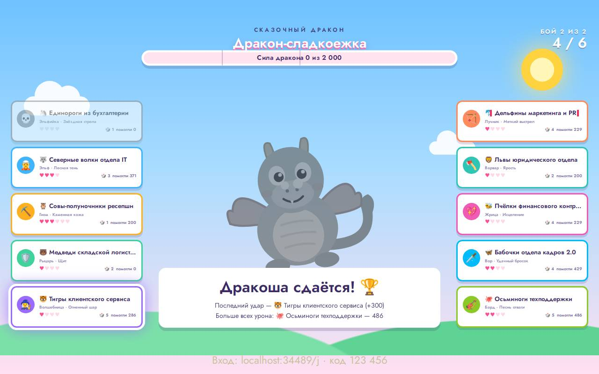

### мелко для зала · экран зала

шрифт 10.2 px — 14 px на Full HD (нужно от 18) — «Задание»

- где: `main.quiz-stage > div.dg-stage.dg-stage--adult > div.dg-frame > div.dg-round`, этап `playing/2/ready/`
- игры (1): dragon 1-й шаблон, команды ×4, проектор 4:3, маленький телефон, длинные имена; dragon 1-й шаблон, команды ×8, ноутбук 16:10, большой зал, длинные имена
- раз: 8

### мелко для зала · экран зала

шрифт 17.3 px — 17 px на Full HD (нужно от 18) — «Задание 6 · 🧠 Ум»

- где: `div.dg-stage.dg-stage--adult > div.dg-frame > div.dg-q > div.dg-q__eye`, этап `playing/15/reveal/`
- игры (1): dragon 1-й шаблон, команды ×4, телевизор full hd; dragon 1-й шаблон, команды ×4, проектор 4:3, маленький телефон, длинные имена; dragon 1-й шаблон, команды ×8, ноутбук 16:10, большой зал, длинные имена
- раз: 7

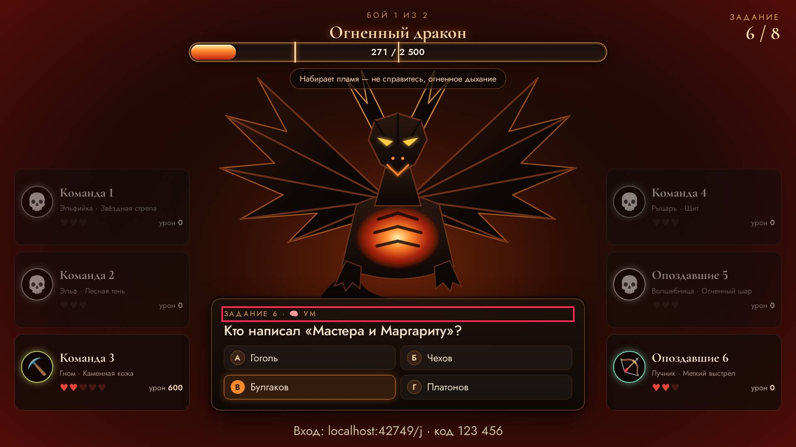

### мелко для зала · экран зала

шрифт 10.8 px — 15 px на Full HD (нужно от 18) — «Открывает третий глаз — не справитесь, ударит лучом»

- где: `main.quiz-stage > div.dg-stage.dg-stage--adult > div.dg-frame > div.dg-intent`, этап `playing/2/ready/`
- игры (1): dragon 1-й шаблон, команды ×4, проектор 4:3, маленький телефон, длинные имена; dragon 1-й шаблон, команды ×8, ноутбук 16:10, большой зал, длинные имена
- раз: 7

### мелко для зала · экран зала

шрифт 14.3 px — 14 px на Full HD (нужно от 18) — «💃 Латина»

- где: `div.db-pick__cards > span.db-card.db-card--dance > span.db-card__label > span.db-card__style`, этап `playing/0/question/pick`
- игры (1): dance 1-й шаблон, команды ×4, телевизор full hd; dance 1-й шаблон, команды ×4, проектор 4:3, маленький телефон, длинные имена
- раз: 6

### мелко для зала · экран зала

шрифт 11.5 px — 11 px на Full HD (нужно от 18) — «№ 1»

- где: `div.db-pick__cards > span.db-card.db-card--dance > span.db-card__label > span.db-card__n`, этап `playing/0/question/pick`
- игры (1): dance 1-й шаблон, команды ×4, телевизор full hd; dance 1-й шаблон, команды ×4, проектор 4:3, маленький телефон, длинные имена
- раз: 6

### мелко для зала · экран зала

шрифт 11.5 px — 11 px на Full HD (нужно от 18) — «№ 2»

- где: `div.db-pick__cards > span.db-card.db-card--karaoke > span.db-card__label > span.db-card__n`, этап `playing/0/question/pick`
- игры (1): dance 1-й шаблон, команды ×4, телевизор full hd; dance 1-й шаблон, команды ×4, проектор 4:3, маленький телефон, длинные имена
- раз: 6

### мелко для зала · экран зала

шрифт 14.3 px — 14 px на Full HD (нужно от 18) — «🎉 Вечеринка»

- где: `div.db-pick__cards > span.db-card.db-card--battle > span.db-card__label > span.db-card__style`, этап `playing/0/question/pick`
- игры (1): dance 1-й шаблон, команды ×4, телевизор full hd; dance 1-й шаблон, команды ×4, проектор 4:3, маленький телефон, длинные имена
- раз: 6

### мелко для зала · экран зала

шрифт 11.5 px — 11 px на Full HD (нужно от 18) — «№ 3»

- где: `div.db-pick__cards > span.db-card.db-card--battle > span.db-card__label > span.db-card__n`, этап `playing/0/question/pick`
- игры (1): dance 1-й шаблон, команды ×4, телевизор full hd; dance 1-й шаблон, команды ×4, проектор 4:3, маленький телефон, длинные имена
- раз: 6

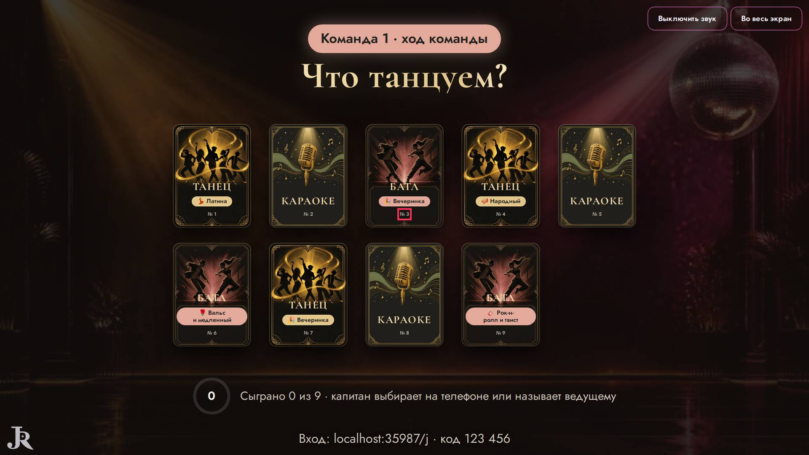

### мелко для зала · экран зала

шрифт 12.8 px — 17 px на Full HD (нужно от 18) — «и ещё 1»

- где: `main.quiz-stage > div.quest-screen.qx--adult > aside.qx-panel > p.qx-panel__more`, этап `playing/31/question/roll`
- игры (1): quest 2-й шаблон, команды ×8, ноутбук 16:10, большой зал, длинные имена
- раз: 5

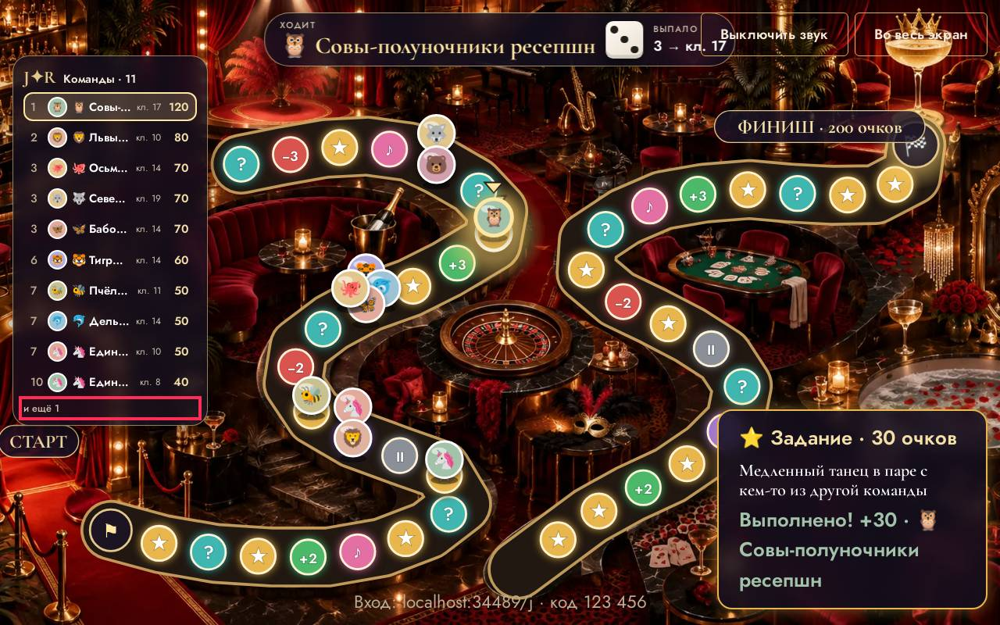

### мелко для зала · экран зала

шрифт 17.3 px — 17 px на Full HD (нужно от 18) — «Бой с драконом»

- где: `div.dg-stage.dg-stage--adult > div.dg-frame > div.dg-q.dg-q--center > div.dg-q__eye`, этап `playing/1/question/`
- игры (1): dragon 1-й шаблон, команды ×4, телевизор full hd; dragon 1-й шаблон, команды ×4, проектор 4:3, маленький телефон, длинные имена; dragon 1-й шаблон, команды ×8, ноутбук 16:10, большой зал, длинные имена
- раз: 5

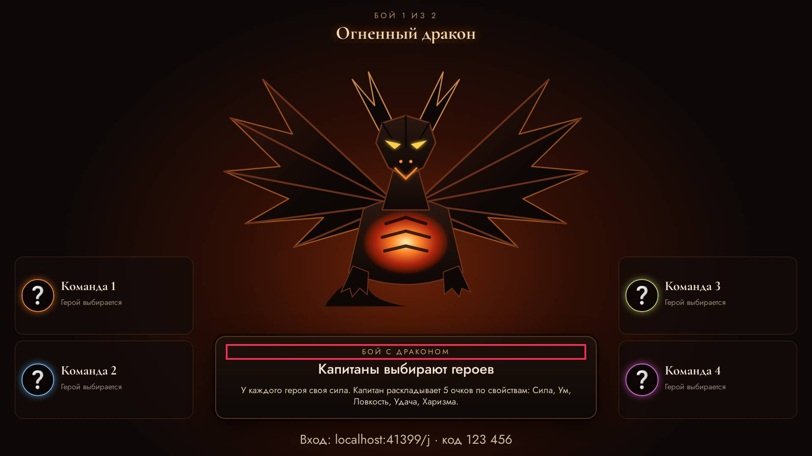

### мелко для зала · экран зала

шрифт 12.8 px — 17 px на Full HD (нужно от 18) — «и ещё 1»

- где: `main.quiz-stage > div.quest-screen.qx--classic > aside.qx-panel > p.qx-panel__more`, этап `playing/30/reveal/done`
- игры (1): quest 1-й шаблон, команды ×8, ноутбук 16:10, большой зал, длинные имена
- раз: 4

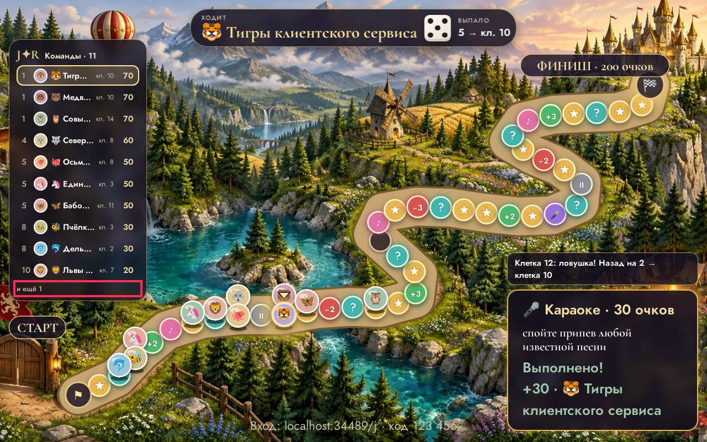

### мелко для зала · экран зала

шрифт 12.8 px — 18 px на Full HD (нужно от 18) — «Гоголь»

- где: `div.dg-q > ol.dg-q__ans > li > span`, этап `playing/15/reveal/`
- игры (1): dragon 1-й шаблон, команды ×4, проектор 4:3, маленький телефон, длинные имена
- раз: 4

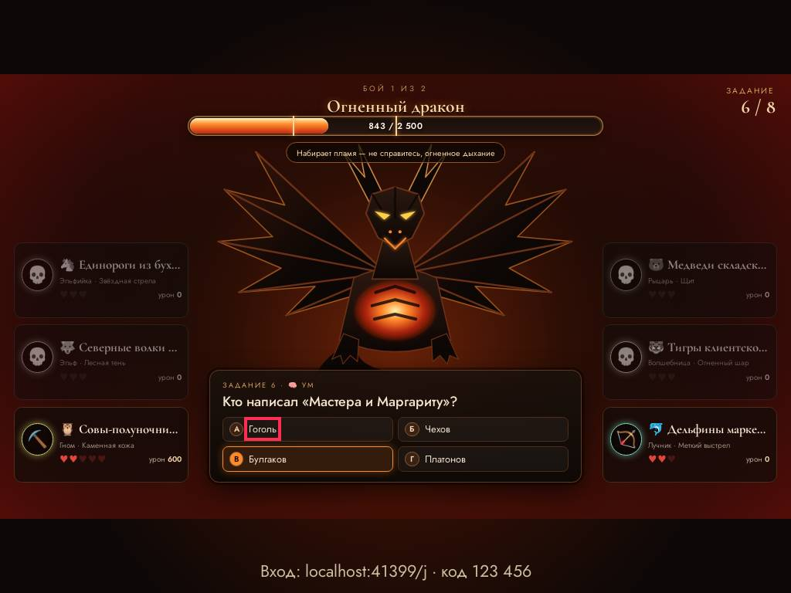

### мелко для зала · экран зала

шрифт 17.3 px — 17 px на Full HD (нужно от 18) — «Бой с драконом»

- где: `div.dg-stage.dg-stage--kid > div.dg-frame > div.dg-q.dg-q--center > div.dg-q__eye`, этап `playing/1/question/`
- игры (1): dragon 2-й шаблон, команды ×4, телевизор full hd; dragon 2-й шаблон, команды ×4, проектор 4:3, маленький телефон, длинные имена
- раз: 4

### мелко для зала · экран зала

шрифт 11.3 px — 16 px на Full HD (нужно от 18) — «У каждого героя своя сила. Капитан раскладывает 5 очков по свойствам: Сила, Ум, »

- где: `div.dg-stage.dg-stage--kid > div.dg-frame > div.dg-q.dg-q--center > p.dg-q__note`, этап `playing/1/question/`
- игры (1): dragon 2-й шаблон, команды ×4, проектор 4:3, маленький телефон, длинные имена
- раз: 4

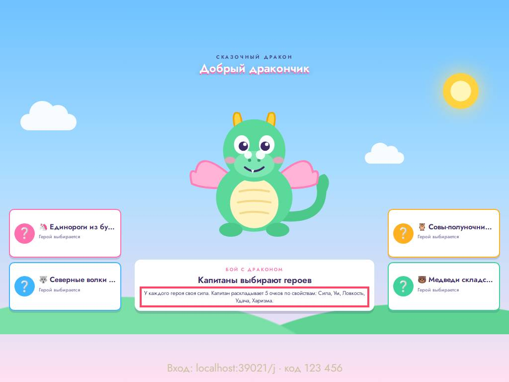

### мелко для зала · экран зала

шрифт 10.2 px — 14 px на Full HD (нужно от 18) — «Бой 1 из 2»

- где: `main.quiz-stage > div.dg-stage.dg-stage--kid > div.dg-frame > div.dg-round`, этап `playing/2/ready/`
- игры (1): dragon 2-й шаблон, команды ×4, проектор 4:3, маленький телефон, длинные имена; dragon 2-й шаблон, команды ×8, ноутбук 16:10, большой зал, длинные имена
- раз: 4

### мелко для зала · экран зала

шрифт 11.3 px — 16 px на Full HD (нужно от 18) — «2 500 / 2 500»

- где: `div.dg-stage.dg-stage--adult > div.dg-frame > div.dg-hp > div.dg-hp__num`, этап `playing/2/ready/`
- игры (1): dragon 1-й шаблон, команды ×4, проектор 4:3, маленький телефон, длинные имена
- раз: 3

### мелко для зала · экран зала

шрифт 11.3 px — 16 px на Full HD (нужно от 18) — «Сила дракона 1 500 из 1 500»

- где: `div.dg-stage.dg-stage--kid > div.dg-frame > div.dg-hp > div.dg-hp__num`, этап `playing/2/ready/`
- игры (1): dragon 2-й шаблон, команды ×4, проектор 4:3, маленький телефон, длинные имена
- раз: 3

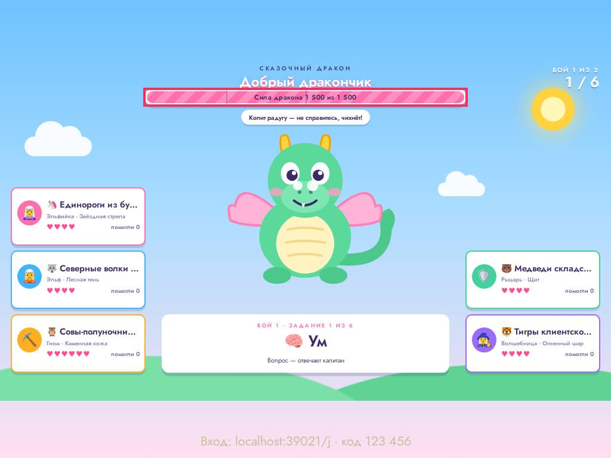

### мелко для зала · экран зала

шрифт 11.3 px — 16 px на Full HD (нужно от 18) — «У каждого героя своя сила. Капитан раскладывает 5 очков по свойствам: Сила, Ум, »

- где: `div.dg-stage.dg-stage--adult > div.dg-frame > div.dg-q.dg-q--center > p.dg-q__note`, этап `playing/1/question/`
- игры (1): dragon 1-й шаблон, команды ×4, проектор 4:3, маленький телефон, длинные имена
- раз: 2

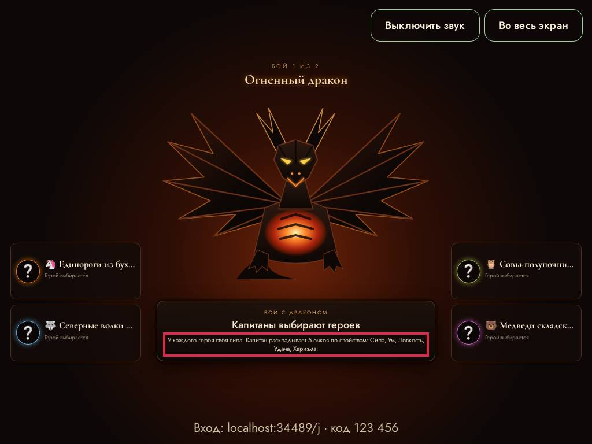

### мелко для зала · экран зала

шрифт 17.3 px — 17 px на Full HD (нужно от 18) — «Задание 2 · 💪 Сила»

- где: `div.dg-stage.dg-stage--kid > div.dg-frame > div.dg-q > div.dg-q__eye`, этап `playing/19/reveal/`
- игры (1): dragon 2-й шаблон, команды ×4, телевизор full hd; dragon 2-й шаблон, команды ×4, проектор 4:3, маленький телефон, длинные имена
- раз: 2

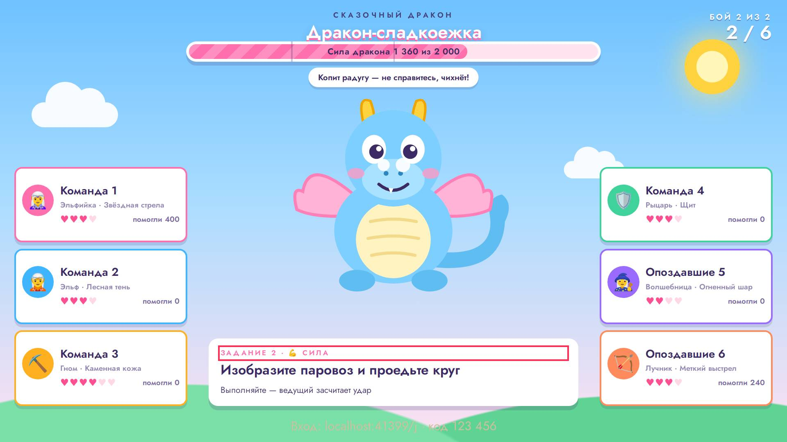

### мелко для зала · экран зала

шрифт 10.8 px — 15 px на Full HD (нужно от 18) — «Копит радугу — не справитесь, чихнёт!»

- где: `main.quiz-stage > div.dg-stage.dg-stage--kid > div.dg-frame > div.dg-intent`, этап `playing/2/ready/`
- игры (1): dragon 2-й шаблон, команды ×4, проектор 4:3, маленький телефон, длинные имена
- раз: 2

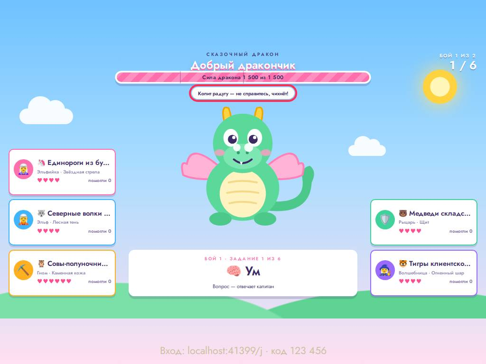

### мелко для зала · экран зала

шрифт 11.3 px — 16 px на Full HD (нужно от 18) — «Медведи складской логистики»

- где: `div.dg-frame > div.dg-q.dg-q--center > p.dg-q__note > span`, этап `playing/15/reveal/`
- игры (1): dragon 2-й шаблон, команды ×4, проектор 4:3, маленький телефон, длинные имена
- раз: 2

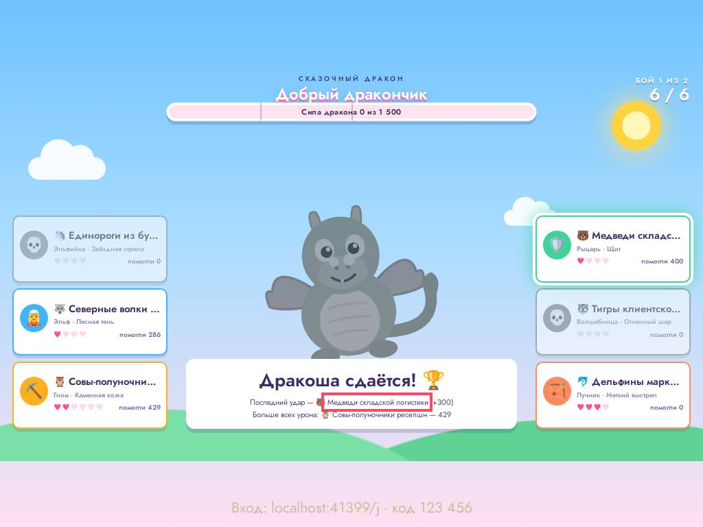

### мелко для зала · экран зала

шрифт 10.8 px — 15 px на Full HD (нужно от 18) — «● ИДЁТ ВЫСТУПЛЕНИЕ»

- где: `main.quiz-stage > div.dance-screen.db-stage > div.db-video.db-video--art > span.db-live`, этап `playing/0/reveal/perform`
- игры (1): dance 1-й шаблон, команды ×4, проектор 4:3, маленький телефон, длинные имена
- раз: 1

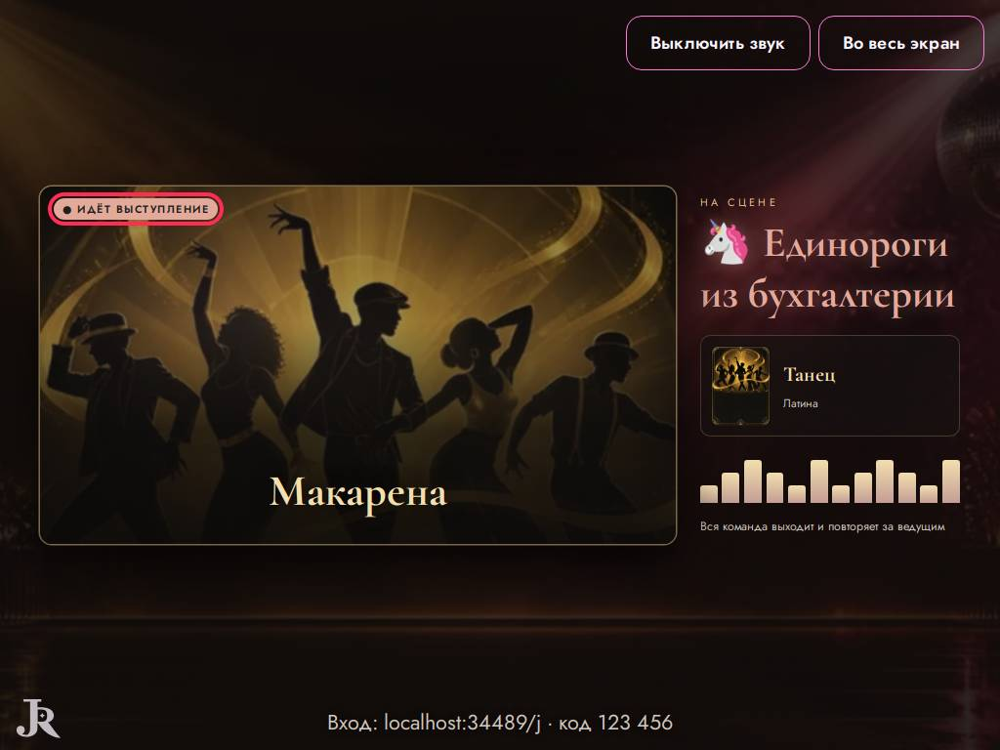

### мелко для зала · экран зала

шрифт 10.8 px — 15 px на Full HD (нужно от 18) — «На сцене»

- где: `div.dance-screen.db-stage > div.db-side > div > span.db-kicker`, этап `playing/0/reveal/perform`
- игры (1): dance 1-й шаблон, команды ×4, проектор 4:3, маленький телефон, длинные имена
- раз: 1

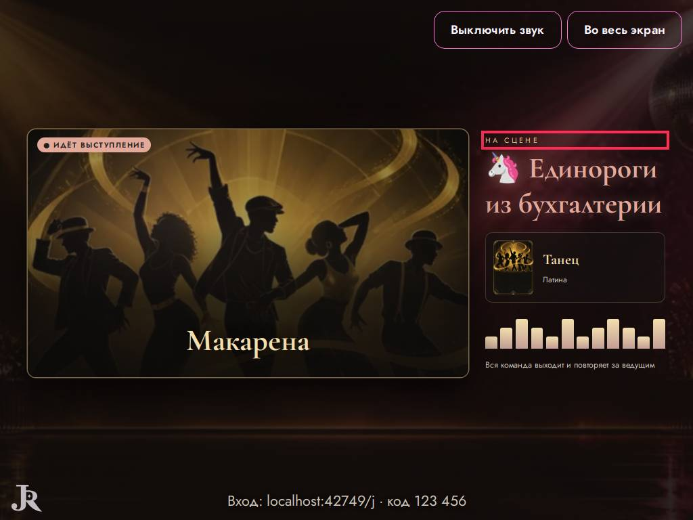

### мелко для зала · экран зала

шрифт 11.8 px — 17 px на Full HD (нужно от 18) — «Латина»

- где: `div.db-side > div.db-mini > div.db-mini__text > span`, этап `playing/0/reveal/perform`
- игры (1): dance 1-й шаблон, команды ×4, проектор 4:3, маленький телефон, длинные имена
- раз: 1

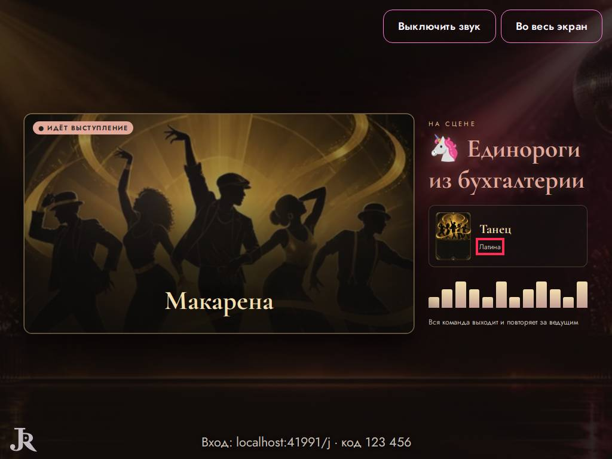

### мелко для зала · экран зала

шрифт 12.3 px — 17 px на Full HD (нужно от 18) — «Вся команда выходит и повторяет за ведущим»

- где: `main.quiz-stage > div.dance-screen.db-stage > div.db-side > p.db-hint`, этап `playing/0/reveal/perform`
- игры (1): dance 1-й шаблон, команды ×4, проектор 4:3, маленький телефон, длинные имена
- раз: 1

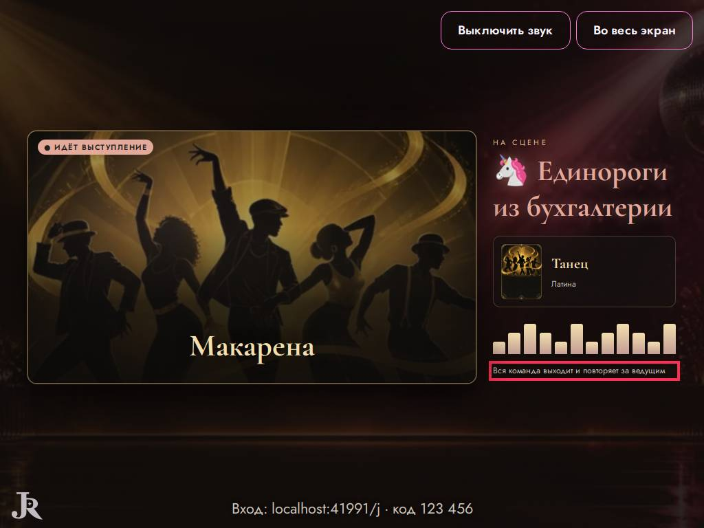

### мелко для зала · экран зала

шрифт 11.3 px — 16 px на Full HD (нужно от 18) — «Выполняйте — ведущий засчитает удар»

- где: `div.dg-stage.dg-stage--adult > div.dg-frame > div.dg-q > p.dg-q__note`, этап `playing/19/reveal/`
- игры (1): dragon 1-й шаблон, команды ×4, проектор 4:3, маленький телефон, длинные имена
- раз: 1

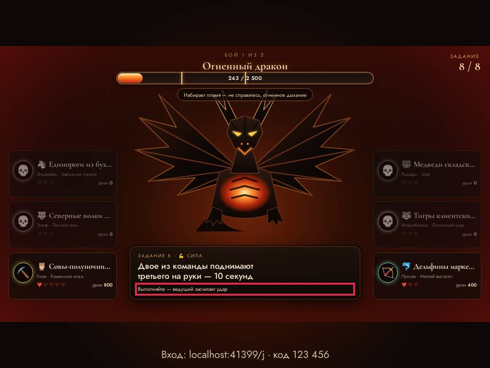

### мелко для зала · экран зала

шрифт 11.3 px — 16 px на Full HD (нужно от 18) — «Выполняйте — ведущий засчитает удар»

- где: `div.dg-stage.dg-stage--kid > div.dg-frame > div.dg-q > p.dg-q__note`, этап `playing/19/reveal/`
- игры (1): dragon 2-й шаблон, команды ×4, проектор 4:3, маленький телефон, длинные имена
- раз: 1

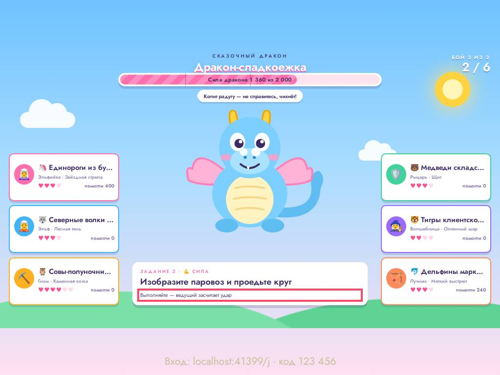

## Мелочи — 17

### мелкий текст · телефон

шрифт 11.0 px (нужно от 12) — «Эльфийка»

- где: `div.stack > div.dr-pick > button.dr-pick__item > span.dr-pick__name`, этап `playing/1/question/`
- игры (1): dragon 1-й шаблон, команды ×4, телевизор full hd; dragon 1-й шаблон, команды ×4, проектор 4:3, маленький телефон, длинные имена; dragon 2-й шаблон, команды ×4, телевизор full hd; dragon 1-й шаблон, команды ×8, ноутбук 16:10, большой зал, длинные имена; dragon 2-й шаблон, команды ×4, проектор 4:3, маленький телефон, длинные имена; dragon 2-й шаблон, команды ×8, ноутбук 16:10, большой зал, длинные имена
- раз: 120

### мелкий текст · пульт

шрифт 9.0 px (нужно от 12) — «🔒 батл»

- где: `div.stage-field.stage-field--compact > div.stage-field__row > button.stage-tile > span.stage-tile__tag`, этап `playing/0/reveal/pick`
- игры (1): stage 1-й шаблон, команды ×4, телевизор full hd; stage 1-й шаблон, команды ×8, ноутбук 16:10, большой зал, длинные имена; stage 1-й шаблон, команды ×4, проектор 4:3, маленький телефон, длинные имена; stage 2-й шаблон, команды ×4, телевизор full hd; stage 2-й шаблон, команды ×8, ноутбук 16:10, большой зал, длинные имена; stage 2-й шаблон, команды ×4, проектор 4:3, маленький телефон, длинные имена
- раз: 106

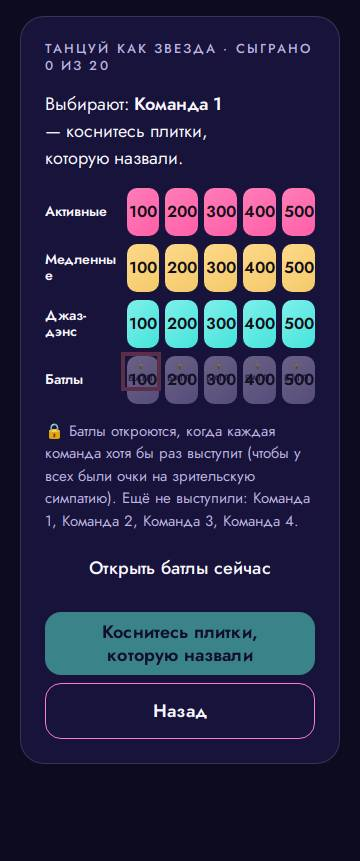

### мелкий текст · пульт

шрифт 11.0 px (нужно от 12) — «2 М»

- где: `div.stage-field.stage-field--compact > div.stage-field__row > div.stage-tile > span.stage-tile__who`, этап `playing/2/reveal/pick`
- игры (1): stage 1-й шаблон, команды ×4, телевизор full hd; stage 1-й шаблон, команды ×8, ноутбук 16:10, большой зал, длинные имена; stage 1-й шаблон, команды ×4, проектор 4:3, маленький телефон, длинные имена; stage 2-й шаблон, команды ×4, телевизор full hd; stage 2-й шаблон, команды ×8, ноутбук 16:10, большой зал, длинные имена; stage 2-й шаблон, команды ×4, проектор 4:3, маленький телефон, длинные имена
- раз: 88

### мелкий текст · пульт

шрифт 11.3 px (нужно от 12) — «№ 3»

- где: `div.stack.host-quiz > div.dance-cards > button.dance-card.dance-card--battle > span.dance-card__n`, этап `playing/0/question/pick`
- игры (1): dance 1-й шаблон, команды ×4, телевизор full hd; dance 1-й шаблон, команды ×4, проектор 4:3, маленький телефон, длинные имена; dance 1-й шаблон, команды ×8, ноутбук 16:10, большой зал, длинные имена
- раз: 21

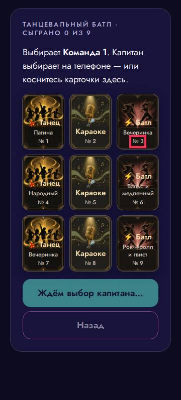

### мелкий текст · пульт

шрифт 11.3 px (нужно от 12) — «№ 1»

- где: `div.stack.host-quiz > div.dance-cards > button.dance-card.dance-card--dance > span.dance-card__n`, этап `playing/0/question/pick`
- игры (1): dance 1-й шаблон, команды ×4, телевизор full hd; dance 1-й шаблон, команды ×4, проектор 4:3, маленький телефон, длинные имена; dance 1-й шаблон, команды ×8, ноутбук 16:10, большой зал, длинные имена
- раз: 17

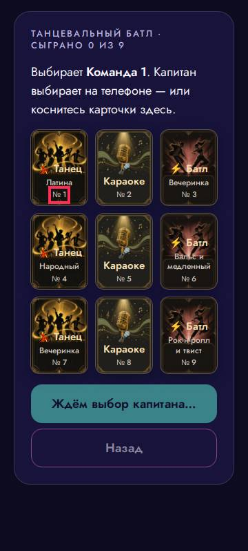

### мелкий текст · пульт

шрифт 11.3 px (нужно от 12) — «№ 2»

- где: `div.stack.host-quiz > div.dance-cards > button.dance-card.dance-card--karaoke > span.dance-card__n`, этап `playing/0/question/pick`
- игры (1): dance 1-й шаблон, команды ×4, телевизор full hd; dance 1-й шаблон, команды ×4, проектор 4:3, маленький телефон, длинные имена; dance 1-й шаблон, команды ×8, ноутбук 16:10, большой зал, длинные имена
- раз: 14

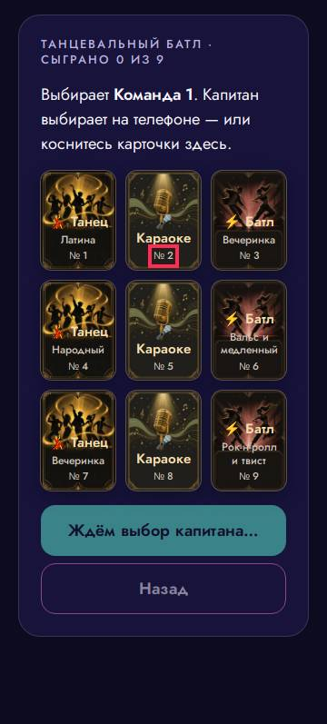

### мелкий текст · пульт

шрифт 11.3 px (нужно от 12) — «№ 2»

- где: `div.stack.host-quiz > div.dance-cards > div.dance-card.dance-card--karaoke > span.dance-card__n`, этап `playing/8/question/pick`
- игры (1): dance 1-й шаблон, команды ×4, телевизор full hd; dance 1-й шаблон, команды ×4, проектор 4:3, маленький телефон, длинные имена; dance 1-й шаблон, команды ×8, ноутбук 16:10, большой зал, длинные имена
- раз: 13

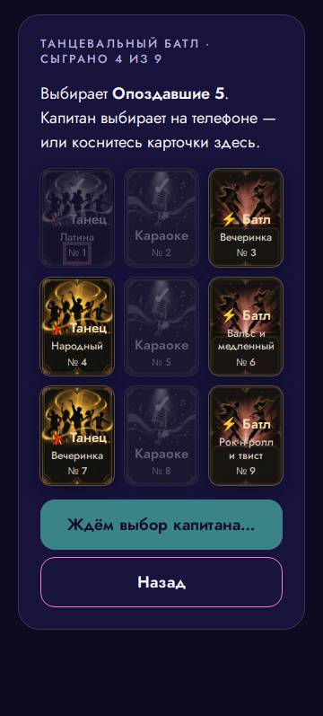

### мелкий текст · пульт

шрифт 11.3 px (нужно от 12) — «№ 1»

- где: `div.stack.host-quiz > div.dance-cards > div.dance-card.dance-card--dance > span.dance-card__n`, этап `playing/8/question/pick`
- игры (1): dance 1-й шаблон, команды ×4, телевизор full hd; dance 1-й шаблон, команды ×4, проектор 4:3, маленький телефон, длинные имена; dance 1-й шаблон, команды ×8, ноутбук 16:10, большой зал, длинные имена
- раз: 10

### мелкий текст · телефон

шрифт 10.1 px (нужно от 12) — «💃 Латина»

- где: `button.db-swipe__item > span.db-card.db-card--dance > span.db-card__label > span.db-card__style`, этап `playing/0/question/pick`
- игры (1): dance 1-й шаблон, команды ×4, телевизор full hd; dance 1-й шаблон, команды ×4, проектор 4:3, маленький телефон, длинные имена; dance 1-й шаблон, команды ×8, ноутбук 16:10, большой зал, длинные имена
- раз: 9

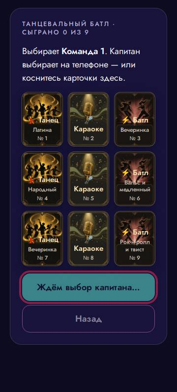

### мелкий текст · телефон

шрифт 8.1 px (нужно от 12) — «№ 1»

- где: `button.db-swipe__item > span.db-card.db-card--dance > span.db-card__label > span.db-card__n`, этап `playing/0/question/pick`
- игры (1): dance 1-й шаблон, команды ×4, телевизор full hd; dance 1-й шаблон, команды ×4, проектор 4:3, маленький телефон, длинные имена; dance 1-й шаблон, команды ×8, ноутбук 16:10, большой зал, длинные имена
- раз: 9

### мелкий текст · телефон

шрифт 8.1 px (нужно от 12) — «№ 2»

- где: `button.db-swipe__item > span.db-card.db-card--karaoke > span.db-card__label > span.db-card__n`, этап `playing/0/question/pick`
- игры (1): dance 1-й шаблон, команды ×4, телевизор full hd; dance 1-й шаблон, команды ×4, проектор 4:3, маленький телефон, длинные имена; dance 1-й шаблон, команды ×8, ноутбук 16:10, большой зал, длинные имена
- раз: 9

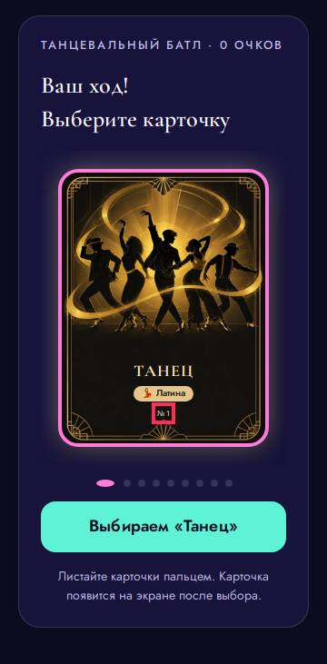

### мелкий текст · телефон

шрифт 10.1 px (нужно от 12) — «🎉 Вечеринка»

- где: `button.db-swipe__item > span.db-card.db-card--battle > span.db-card__label > span.db-card__style`, этап `playing/0/question/pick`
- игры (1): dance 1-й шаблон, команды ×4, телевизор full hd; dance 1-й шаблон, команды ×4, проектор 4:3, маленький телефон, длинные имена; dance 1-й шаблон, команды ×8, ноутбук 16:10, большой зал, длинные имена
- раз: 9

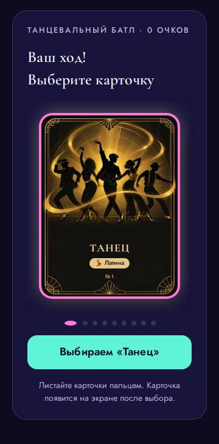

### мелкий текст · телефон

шрифт 8.1 px (нужно от 12) — «№ 3»

- где: `button.db-swipe__item > span.db-card.db-card--battle > span.db-card__label > span.db-card__n`, этап `playing/0/question/pick`
- игры (1): dance 1-й шаблон, команды ×4, телевизор full hd; dance 1-й шаблон, команды ×4, проектор 4:3, маленький телефон, длинные имена; dance 1-й шаблон, команды ×8, ноутбук 16:10, большой зал, длинные имена
- раз: 9

### мелкий текст · пульт

шрифт 11.3 px (нужно от 12) — «№ 3»

- где: `div.stack.host-quiz > div.dance-cards > div.dance-card.dance-card--battle > span.dance-card__n`, этап `playing/16/question/pick`
- игры (1): dance 1-й шаблон, команды ×4, телевизор full hd; dance 1-й шаблон, команды ×4, проектор 4:3, маленький телефон, длинные имена; dance 1-й шаблон, команды ×8, ноутбук 16:10, большой зал, длинные имена
- раз: 6

### мелкая кнопка · пульт

кнопка 33×48 px (пальцу нужно от 40×40) — «100»

- где: `div.stack.host-quiz > div.stage-field.stage-field--compact > div.stage-field__row > button.stage-tile`, этап `playing/0/reveal/pick`
- игры (1): stage 1-й шаблон, команды ×4, телевизор full hd; stage 1-й шаблон, команды ×8, ноутбук 16:10, большой зал, длинные имена; stage 1-й шаблон, команды ×4, проектор 4:3, маленький телефон, длинные имена; stage 2-й шаблон, команды ×4, телевизор full hd; stage 2-й шаблон, команды ×8, ноутбук 16:10, большой зал, длинные имена; stage 2-й шаблон, команды ×4, проектор 4:3, маленький телефон, длинные имена
- раз: 282

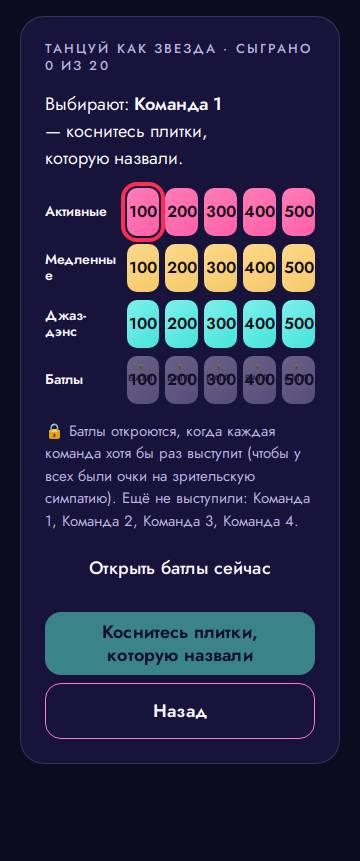

### мелкая кнопка · телефон

кнопка 28×28 px (пальцу нужно от 40×40)

- где: `div.quiz-phone.quiz-phone--center > div.stack.stack--tight > div.checkers.checkers--phone > button.checkers__cell`, этап `playing/1/question/move`
- игры (1): checkers 1-й шаблон, команды ×2, проектор 4:3, маленький телефон, длинные имена; checkers 1-й шаблон, команды ×2, телевизор full hd; checkers 1-й шаблон, команды ×2, ноутбук 16:10, большой зал, длинные имена
- раз: 144

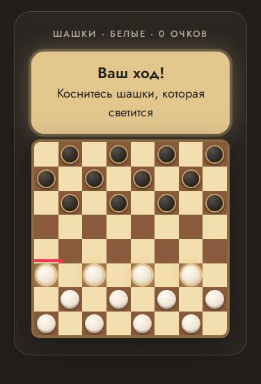

### мелкая кнопка · пульт

кнопка 28×28 px (пальцу нужно от 40×40)

- где: `div.stack.host-quiz > div.stack.stack--tight > div.checkers.checkers--phone > button.checkers__cell`, этап `playing/1/question/move`
- игры (1): checkers 1-й шаблон, команды ×2, проектор 4:3, маленький телефон, длинные имена; checkers 1-й шаблон, команды ×2, телевизор full hd; checkers 1-й шаблон, команды ×2, ноутбук 16:10, большой зал, длинные имена
- раз: 141

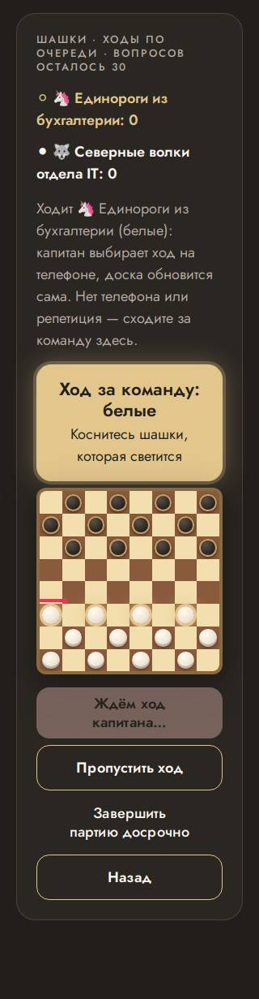

