# Ревизор — что видят ведущий и гости

Прогонов: 141 · видов игры проверено: 6206 · разных находок: 281

Размеры: Телевизор Full HD (1920x1080); Проектор 4:3, маленький телефон, длинные имена (1024x768); Ноутбук 16:10, большой зал, длинные имена (1280x800).

## Мешает игре — 35

### за краем экрана · экран зала

текст выходит за край экрана по высоте на 10 px — «· вопрос 1 — 500 очков»

- где: `main.quiz-stage > div.mil-screen.show-stage > section.mil-screen__main > p.mil-screen__who`, этап `playing/6/question/question`
- игры (1): millionaire 1-й шаблон, команды ×4, проектор 4:3, маленький телефон, длинные имена
- раз: 1

### за краем экрана · экран зала

текст выходит за край экрана по высоте на 10 px — «🐺»

- где: `div.mil-screen.show-stage > section.mil-screen__main > p.mil-screen__who > span.name-emoji`, этап `playing/6/question/question`
- игры (1): millionaire 1-й шаблон, команды ×4, проектор 4:3, маленький телефон, длинные имена
- раз: 1

### за краем экрана · экран зала

текст выходит за край экрана по высоте на 10 px — «Северные волки отдела IT»

- где: `div.mil-screen.show-stage > section.mil-screen__main > p.mil-screen__who > span`, этап `playing/6/question/question`
- игры (1): millionaire 1-й шаблон, команды ×4, проектор 4:3, маленький телефон, длинные имена
- раз: 1

### за краем · телефон

текст выходит за край области вбок на 22 px — «6»

- где: `div.dk-hand__row > button.dk-hand__slot > div.dk-card.dk-d--gothic > span.dk-idx`, этап `playing/117/question/play`
- игры (1): durak 1-й шаблон, каждый сам ×4, телевизор full hd; durak 1-й шаблон, каждый сам ×4, ноутбук 16:10, большой зал, длинные имена
- раз: 4

### за краем · телефон

текст выходит за край области вбок на 16 px — «♠︎»

- где: `button.dk-hand__slot > div.dk-card.dk-d--gothic > span.dk-idx > span`, этап `playing/117/question/play`
- игры (1): durak 1-й шаблон, каждый сам ×4, телевизор full hd; durak 1-й шаблон, каждый сам ×4, ноутбук 16:10, большой зал, длинные имена
- раз: 3

### за краем · телефон

текст выходит за край области вбок на 6 px — «A»

- где: `div.dk-hand__row > button.dk-hand__slot > div.dk-card.dk-d--russia > span.dk-idx`, этап `playing/66/question/play`
- игры (1): durak 1-й шаблон, каждый сам ×4, проектор 4:3, маленький телефон, длинные имена
- раз: 1

### за краем · телефон

текст выходит за край области вбок на 21 px — «Q»

- где: `div.dk-hand__row > button.dk-hand__slot > div.dk-card.dk-d--cyber > span.dk-idx`, этап `playing/118/question/play`
- игры (1): durak 1-й шаблон, каждый сам ×4, ноутбук 16:10, большой зал, длинные имена
- раз: 1

### за краем · телефон

текст выходит за край области вбок на 10 px — «♠︎»

- где: `button.dk-hand__slot > div.dk-card.dk-d--cyber > span.dk-idx > span`, этап `playing/118/question/play`
- игры (1): durak 1-й шаблон, каждый сам ×4, ноутбук 16:10, большой зал, длинные имена
- раз: 1

### закрыт другим элементом · экран зала

«Вход: localhost:35987/j · код 123 456» закрыт элементом div.dk-vote — «Вход: localhost:35987/j · код 123 456»

- где: `div.hall > main.quiz-stage > p.stage-code`, этап `playing/2/question/vote`
- игры (3): durak 1-й шаблон, каждый сам ×4, телевизор full hd; bunker 1-й шаблон, каждый сам ×8, телевизор full hd; bunker 1-й шаблон, каждый сам ×8, проектор 4:3, маленький телефон, длинные имена; durak 1-й шаблон, каждый сам ×4, проектор 4:3, маленький телефон, длинные имена; durak 1-й шаблон, каждый сам ×4, ноутбук 16:10, большой зал, длинные имена; bunker 1-й шаблон, каждый сам ×8, ноутбук 16:10, большой зал, длинные имена …
- раз: 24

### закрыт другим элементом · телефон

«Владимир Преображенский» закрыт элементом strong.mf-tally__n — «Владимир Преображенский»

- где: `ul.mf-tally > li.mf-tally__row > span.mf-tally__name > span`, этап `playing/1/reveal/verdict`
- игры (1): mafia 1-й шаблон, каждый сам ×9, ноутбук 16:10, большой зал, длинные имена; mafia 1-й шаблон, каждый сам ×9, проектор 4:3, маленький телефон, длинные имена
- раз: 68

### закрыт другим элементом · экран зала

«Александра Константинова» закрыт элементом span.name-emoji — «Александра Константинова»

- где: `div.dk-seat__card > span.dk-seat__text > span.dk-seat__name > span`, этап `playing/1/question/deal`
- игры (1): durak 1-й шаблон, каждый сам ×4, проектор 4:3, маленький телефон, длинные имена; durak 1-й шаблон, каждый сам ×4, ноутбук 16:10, большой зал, длинные имена
- раз: 10

### закрыт другим элементом · экран зала

«50% · 0» закрыт элементом img.stage-dancer — «50% · 0»

- где: `div.stage-screen.stage-screen--battle > div.stage-tug > div.stage-tug__bar > span`, этап `playing/36/reveal/result`
- игры (1): stage 1-й шаблон, команды ×8, ноутбук 16:10, большой зал, длинные имена; stage 1-й шаблон, команды ×4, проектор 4:3, маленький телефон, длинные имена; stage 2-й шаблон, команды ×8, ноутбук 16:10, большой зал, длинные имена; stage 2-й шаблон, команды ×4, проектор 4:3, маленький телефон, длинные имена
- раз: 8

### закрыт другим элементом · экран зала

«Единороги из бухгалтерии» закрыт элементом span.name-emoji — «Единороги из бухгалтерии»

- где: `div.stage-teams > div.stage-teams__one > span.stage-teams__name > span`, этап `playing/8/reveal/pick`
- игры (1): stage 1-й шаблон, команды ×8, ноутбук 16:10, большой зал, длинные имена; stage 2-й шаблон, команды ×8, ноутбук 16:10, большой зал, длинные имена
- раз: 6

### закрыт другим элементом · телефон

«0%» закрыт элементом span.mil-option__text — «0%»

- где: `div.mil-question.mil-question--phone > ol.mil-options > li.mil-option > span.mil-option__pct`, этап `playing/4/reveal/reveal`
- игры (1): millionaire 1-й шаблон, команды ×8, ноутбук 16:10, большой зал, длинные имена; millionaire 1-й шаблон, каждый сам ×4, телевизор full hd; millionaire 1-й шаблон, каждый сам ×4, проектор 4:3, маленький телефон, длинные имена; millionaire 1-й шаблон, каждый сам ×16, ноутбук 16:10, большой зал, длинные имена
- раз: 6

### закрыт другим элементом · экран зала

«Г» закрыт элементом div.dk-card.dk-d--rome — «Г»

- где: `div.dk-table > div.dk-seat.dk-seat--wait > div.dk-seat__card > span.dk-seat__avatar`, этап `playing/2/question/vote`
- игры (1): durak 1-й шаблон, каждый сам ×4, телевизор full hd; durak 1-й шаблон, каждый сам ×4, проектор 4:3, маленький телефон, длинные имена; durak 1-й шаблон, каждый сам ×4, ноутбук 16:10, большой зал, длинные имена
- раз: 6

### закрыт другим элементом · экран зала

«Выбираем колоду — голосуйте на телефонах» закрыт элементом h2 — «Выбираем колоду — голосуйте на телефонах»

- где: `div.dk-hall.dk-felt--bordeaux > div.dk-hall__top > div.dk-croupier > p.dk-croupier__line`, этап `playing/2/question/vote`
- игры (1): durak 1-й шаблон, каждый сам ×4, телевизор full hd; durak 1-й шаблон, каждый сам ×4, проектор 4:3, маленький телефон, длинные имена; durak 1-й шаблон, каждый сам ×4, ноутбук 16:10, большой зал, длинные имена
- раз: 3

### закрыт другим элементом · экран зала

«Ответ зафиксирован — C» закрыт элементом p.stage-code — «Ответ зафиксирован — C»

- где: `main.quiz-stage > div.mil-screen.show-stage > section.mil-screen__main > p.mil-screen__note.mil-screen__note--big`, этап `playing/6/question/question`
- игры (1): millionaire 1-й шаблон, команды ×4, проектор 4:3, маленький телефон, длинные имена
- раз: 1

### закрыт другим элементом · экран зала

«партия 1 из 3 · 36 карт · Классика JoyRe» закрыт элементом h2 — «партия 1 из 3 · 36 карт · Классика JoyRest»

- где: `div.dk-hall.dk-felt--bordeaux > div.dk-hall__top > div.dk-hall__title > small`, этап `playing/2/question/vote`
- игры (1): durak 1-й шаблон, каждый сам ×4, телевизор full hd
- раз: 1

### надписи наезжают · пульт

«100» и «🔒 батл» друг на друге — «100 \| 🔒 батл»

- где: `div.stage-field.stage-field--compact > div.stage-field__row > button.stage-tile > span.stage-tile__points`, этап `playing/0/reveal/pick`
- игры (1): stage 1-й шаблон, команды ×4, телевизор full hd; stage 1-й шаблон, команды ×8, ноутбук 16:10, большой зал, длинные имена; stage 1-й шаблон, команды ×4, проектор 4:3, маленький телефон, длинные имена; stage 2-й шаблон, команды ×4, телевизор full hd; stage 2-й шаблон, команды ×8, ноутбук 16:10, большой зал, длинные имена; stage 2-й шаблон, команды ×4, проектор 4:3, маленький телефон, длинные имена
- раз: 70

### надписи наезжают · экран зала

«Гость 3: «Детектор лжи» — все » и «Вход: localhost:35987/j · код » друг на друге — «Гость 3: «Детектор лжи» — все открывают «Факт» \| Вход: localhost:35987/j · код 1»

- где: `div.hall > main.quiz-stage > div.bk-screen > p.bk-screen__log`, этап `playing/3/question/open`
- игры (1): bunker 1-й шаблон, каждый сам ×8, телевизор full hd; bunker 1-й шаблон, каждый сам ×8, проектор 4:3, маленький телефон, длинные имена; bunker 1-й шаблон, каждый сам ×8, ноутбук 16:10, большой зал, длинные имена
- раз: 14

### надписи наезжают · экран зала

«Гость 4: «Допрос» — игрок Гост» и «Вход: localhost:35987/j · код » друг на друге — «Гость 4: «Допрос» — игрок Гость 2 открывает «Багаж» \| Вход: localhost:35987/j · »

- где: `div.hall > main.quiz-stage > div.bk-screen.bk-screen--big > p.bk-screen__log`, этап `playing/22/question/exile`
- игры (1): bunker 1-й шаблон, каждый сам ×8, телевизор full hd; bunker 1-й шаблон, каждый сам ×8, проектор 4:3, маленький телефон, длинные имена; bunker 1-й шаблон, каждый сам ×8, ноутбук 16:10, большой зал, длинные имена
- раз: 5

### надписи наезжают · экран зала

«Выбираем колоду — голосуйте на» и «Какой колодой играем?» друг на друге — «Выбираем колоду — голосуйте на телефонах \| Какой колодой играем?»

- где: `div.dk-hall.dk-felt--bordeaux > div.dk-hall__top > div.dk-croupier > p.dk-croupier__line`, этап `playing/2/question/vote`
- игры (1): durak 1-й шаблон, каждый сам ×4, телевизор full hd; durak 1-й шаблон, каждый сам ×4, проектор 4:3, маленький телефон, длинные имена; durak 1-й шаблон, каждый сам ×4, ноутбук 16:10, большой зал, длинные имена
- раз: 4

### надписи наезжают · экран зала

«Ближе всех» и «Вход: localhost:35987/j · код » друг на друге — «Ближе всех \| Вход: localhost:35987/j · код 123 456»

- где: `div.wager-table__felt > ol.wager-board > li.wager-slot.wager-slot--low > span.wager-slot__flag`, этап `playing/2/reveal/answer`
- игры (1): wager 1-й шаблон, каждый сам ×4, телевизор full hd; wager 1-й шаблон, каждый сам ×4, проектор 4:3, маленький телефон, длинные имена
- раз: 2

### надписи наезжают · экран зала

«🐻» и «Максимилиан Рождественский» друг на друге — «🐻 \| Максимилиан Рождественский»

- где: `div.podium__slot > div.podium__names > p.podium__name > span.name-emoji`, этап `playing/7/podium/`
- игры (1): quiz 1-й шаблон, каждый сам ×4, проектор 4:3, маленький телефон, длинные имена
- раз: 1

### надписи наезжают · экран зала

«Ответ зафиксирован — C» и «Вход: localhost:35987/j · код » друг на друге — «Ответ зафиксирован — C \| Вход: localhost:35987/j · код 123 456»

- где: `main.quiz-stage > div.mil-screen.show-stage > section.mil-screen__main > p.mil-screen__note.mil-screen__note--big`, этап `playing/6/question/question`
- игры (1): millionaire 1-й шаблон, команды ×4, проектор 4:3, маленький телефон, длинные имена
- раз: 1

### надписи наезжают · экран зала

«А» и «Old fashion» друг на друге — «А \| Old fashion»

- где: `div.dk-table > div.dk-seat.dk-seat--wait > div.dk-seat__card > span.dk-seat__avatar`, этап `playing/2/question/vote`
- игры (1): durak 1-й шаблон, каждый сам ×4, проектор 4:3, маленький телефон, длинные имена
- раз: 1

### прокрутка вбок · пульт

страница шире экрана на 4 px (button.btn.btn--secondary) — «Действие»

- где: `div.stack.host-quiz > div.card.stack > div.td-host__pick > button.btn.btn--secondary`, этап `playing/0/question/pick`
- игры (1): truth 1-й шаблон, каждый сам ×4, проектор 4:3, маленький телефон, длинные имена; truth 1-й шаблон, команды ×4, проектор 4:3, маленький телефон, длинные имена; truth 2-й шаблон, каждый сам ×4, проектор 4:3, маленький телефон, длинные имена; truth 2-й шаблон, команды ×4, проектор 4:3, маленький телефон, длинные имена
- раз: 22

### прокрутка вбок · пульт

страница шире экрана на 5 px (button.btn.btn--quiet) — «Играет компьютер»

- где: `div.stack.stack--tight > ul.dk-host__seats > li > button.btn.btn--quiet`, этап `playing/4/question/play`
- игры (1): durak 1-й шаблон, каждый сам ×4, проектор 4:3, маленький телефон, длинные имена
- раз: 9

### прокрутка вбок · пульт

страница шире экрана на 12 px (button.btn.btn--secondary) — «Победил:»

- где: `div.stack.stack--tight > div.stack.stack--tight > div.row > button.btn.btn--secondary`, этап `playing/29/reveal/result`
- игры (1): stage 1-й шаблон, команды ×4, проектор 4:3, маленький телефон, длинные имена; stage 2-й шаблон, команды ×4, проектор 4:3, маленький телефон, длинные имена
- раз: 6

### прокрутка вбок · телефон

страница шире экрана на 17 px (span) — «Максимилиан Рождественский»

- где: `div.dk-phone__opps > span.dk-opp.dk-opp--throw > span.dk-opp__name > span`, этап `playing/66/question/play`
- игры (1): durak 1-й шаблон, каждый сам ×4, проектор 4:3, маленький телефон, длинные имена; durak 1-й шаблон, каждый сам ×4, ноутбук 16:10, большой зал, длинные имена
- раз: 4

### прокрутка вбок · пульт

страница шире экрана на 12 px (span) — «Медведи складской логистики»

- где: `ul.buzz-queue.buzz-queue--plain > li > span.buzz-queue__name > span`, этап `playing/18/reveal/result`
- игры (1): stage 1-й шаблон, команды ×4, проектор 4:3, маленький телефон, длинные имена; stage 2-й шаблон, команды ×4, проектор 4:3, маленький телефон, длинные имена
- раз: 2

### прокрутка вбок · телефон

страница шире экрана на 19 px (span.dk-opp.dk-opp--wait)

- где: `div.card > div.quiz-phone.dk-phone > div.dk-phone__opps > span.dk-opp.dk-opp--wait`, этап `playing/117/question/play`
- игры (1): durak 1-й шаблон, каждый сам ×4, телевизор full hd
- раз: 2

### прокрутка вбок · телефон

страница шире экрана на 10 px (div.dk-card.dk-d--russia)

- где: `div.dk-hand > div.dk-hand__row > button.dk-hand__slot > div.dk-card.dk-d--russia`, этап `playing/69/question/play`
- игры (1): durak 1-й шаблон, каждый сам ×4, телевизор full hd
- раз: 1

### прокрутка вбок · телефон

страница шире экрана на 10 px (div.dk-card.dk-d--classic)

- где: `div.dk-hand > div.dk-hand__row > button.dk-hand__slot > div.dk-card.dk-d--classic`, этап `playing/93/question/play`
- игры (1): durak 1-й шаблон, каждый сам ×4, телевизор full hd
- раз: 1

### прокрутка вбок · телефон

страница шире экрана на 19 px (span.dk-opp.dk-opp--throw)

- где: `div.card > div.quiz-phone.dk-phone > div.dk-phone__opps > span.dk-opp.dk-opp--throw`, этап `playing/120/reveal/over`
- игры (1): durak 1-й шаблон, каждый сам ×4, телевизор full hd
- раз: 1

## Заметно — 175

### обрезан текст · экран зала

текст обрезан по высоте на 4 px (div.podium__names) — «🦊»

- где: `div.podium__slot > div.podium__names > p.podium__name > span.name-emoji`, этап `playing/7/podium/`
- игры (7): quiz 1-й шаблон, каждый сам ×4, проектор 4:3, маленький телефон, длинные имена; quiz 1-й шаблон, каждый сам ×16, ноутбук 16:10, большой зал, длинные имена; quiz 3-й шаблон, каждый сам ×16, ноутбук 16:10, большой зал, длинные имена; quiz 4-й шаблон, каждый сам ×4, проектор 4:3, маленький телефон, длинные имена; quiz 4-й шаблон, каждый сам ×16, ноутбук 16:10, большой зал, длинные имена; lotto 1-й шаблон, каждый сам ×16, ноутбук 16:10, большой зал, длинные имена …
- раз: 27

### обрезан текст · экран зала

текст обрезан по высоте на 4 px (div.podium__names) — «Владимир Преображенский»

- где: `div.podium__slot > div.podium__names > p.podium__name > span`, этап `playing/7/podium/`
- игры (7): quiz 1-й шаблон, каждый сам ×4, проектор 4:3, маленький телефон, длинные имена; quiz 1-й шаблон, каждый сам ×16, ноутбук 16:10, большой зал, длинные имена; quiz 3-й шаблон, каждый сам ×16, ноутбук 16:10, большой зал, длинные имена; quiz 4-й шаблон, каждый сам ×4, проектор 4:3, маленький телефон, длинные имена; quiz 4-й шаблон, каждый сам ×16, ноутбук 16:10, большой зал, длинные имена; lotto 1-й шаблон, каждый сам ×16, ноутбук 16:10, большой зал, длинные имена …
- раз: 25

### обрезан текст · экран зала

текст обрезан по высоте на 6 px (div.podium__names) — «Гость 1»

- где: `div.podium__stage > div.podium__slot > div.podium__names > p.podium__name`, этап `playing/7/podium/`
- игры (5): quiz 1-й шаблон, каждый сам ×4, телевизор full hd; quiz 4-й шаблон, каждый сам ×4, телевизор full hd; hundred 1-й шаблон, каждый сам ×4, телевизор full hd; hundred 2-й шаблон, каждый сам ×4, телевизор full hd; hundred 3-й шаблон, каждый сам ×4, телевизор full hd; mafia 1-й шаблон, каждый сам ×9, телевизор full hd …
- раз: 34

### обрезан текст · экран зала

текст обрезан по высоте на 4 px (span.wine-cell__label) — «Красное»

- где: `div.wine-row > span.wine-row__cells > span.wine-cell > span.wine-cell__label`, этап `playing/1/question/bet`
- игры (1): wine 1-й шаблон, каждый сам ×4, телевизор full hd; wine 1-й шаблон, каждый сам ×4, проектор 4:3, маленький телефон, длинные имена; wine 1-й шаблон, команды ×4, телевизор full hd; wine 1-й шаблон, команды ×4, проектор 4:3, маленький телефон, длинные имена
- раз: 212

### обрезан текст · экран зала

текст обрезан по высоте на 8 px (span.hd-row__text) — «Букет невесты»

- где: `div.hd-row > div.hd-row__inner > div.hd-row__face.hd-row__face--open > span.hd-row__text`, этап `playing/3/reveal/play`
- игры (1): hundred 1-й шаблон, команды ×4, телевизор full hd; hundred 1-й шаблон, команды ×4, проектор 4:3, маленький телефон, длинные имена; hundred 1-й шаблон, каждый сам ×4, телевизор full hd; hundred 1-й шаблон, команды ×8, ноутбук 16:10, большой зал, длинные имена; hundred 1-й шаблон, каждый сам ×4, проектор 4:3, маленький телефон, длинные имена; hundred 1-й шаблон, каждый сам ×16, ноутбук 16:10, большой зал, длинные имена …
- раз: 180

### обрезан текст · телефон

текст обрезан вбок на 23 px (div.dk-card.dk-d--rome) — «10»

- где: `div.dk-hand__row > button.dk-hand__slot > div.dk-card.dk-d--rome > span.dk-idx.dk-idx--b`, этап `playing/17/question/play`
- игры (1): durak 1-й шаблон, каждый сам ×4, телевизор full hd; durak 1-й шаблон, каждый сам ×4, проектор 4:3, маленький телефон, длинные имена; durak 1-й шаблон, каждый сам ×4, ноутбук 16:10, большой зал, длинные имена
- раз: 112

### обрезан текст · телефон

текст обрезан вбок на 28 px (div.dk-card.dk-d--gothic) — «10»

- где: `div.dk-hand__row > button.dk-hand__slot > div.dk-card.dk-d--gothic > span.dk-idx.dk-idx--b`, этап `playing/57/question/play`
- игры (1): durak 1-й шаблон, каждый сам ×4, телевизор full hd; durak 1-й шаблон, каждый сам ×4, проектор 4:3, маленький телефон, длинные имена; durak 1-й шаблон, каждый сам ×4, ноутбук 16:10, большой зал, длинные имена
- раз: 100

### обрезан текст · телефон

текст обрезан вбок на 23 px (div.dk-card.dk-d--russia) — «10»

- где: `div.dk-hand__row > button.dk-hand__slot > div.dk-card.dk-d--russia > span.dk-idx.dk-idx--b`, этап `playing/13/question/play`
- игры (1): durak 1-й шаблон, каждый сам ×4, телевизор full hd; durak 1-й шаблон, каждый сам ×4, проектор 4:3, маленький телефон, длинные имена; durak 1-й шаблон, каждый сам ×4, ноутбук 16:10, большой зал, длинные имена
- раз: 74

### обрезан текст · телефон

текст обрезан вбок на 23 px (div.dk-card.dk-d--greece) — «10»

- где: `div.dk-hand__row > button.dk-hand__slot > div.dk-card.dk-d--greece > span.dk-idx.dk-idx--b`, этап `playing/20/question/play`
- игры (1): durak 1-й шаблон, каждый сам ×4, телевизор full hd; durak 1-й шаблон, каждый сам ×4, проектор 4:3, маленький телефон, длинные имена; durak 1-й шаблон, каждый сам ×4, ноутбук 16:10, большой зал, длинные имена
- раз: 68

### обрезан текст · телефон

текст обрезан вбок на 23 px (div.dk-card.dk-d--classic) — «10»

- где: `div.dk-hand__row > button.dk-hand__slot > div.dk-card.dk-d--classic > span.dk-idx.dk-idx--b`, этап `playing/93/question/play`
- игры (1): durak 1-й шаблон, каждый сам ×4, телевизор full hd; durak 1-й шаблон, каждый сам ×4, проектор 4:3, маленький телефон, длинные имена; durak 1-й шаблон, каждый сам ×4, ноутбук 16:10, большой зал, длинные имена
- раз: 64

### обрезан текст · телефон

текст обрезан вбок на 29 px (div.dk-card.dk-d--wedding) — «10»

- где: `div.dk-hand__row > button.dk-hand__slot > div.dk-card.dk-d--wedding > span.dk-idx.dk-idx--b`, этап `playing/53/question/play`
- игры (1): durak 1-й шаблон, каждый сам ×4, телевизор full hd; durak 1-й шаблон, каждый сам ×4, проектор 4:3, маленький телефон, длинные имена; durak 1-й шаблон, каждый сам ×4, ноутбук 16:10, большой зал, длинные имена
- раз: 60

### обрезан текст · телефон

текст обрезан вбок на 13 px (div.dk-card.dk-d--rome) — «♠︎»

- где: `button.dk-hand__slot > div.dk-card.dk-d--rome > span.dk-idx.dk-idx--b > span`, этап `playing/17/question/play`
- игры (1): durak 1-й шаблон, каждый сам ×4, телевизор full hd; durak 1-й шаблон, каждый сам ×4, проектор 4:3, маленький телефон, длинные имена; durak 1-й шаблон, каждый сам ×4, ноутбук 16:10, большой зал, длинные имена
- раз: 55

### обрезан текст · телефон

текст обрезан вбок на 21 px (div.dk-card.dk-d--gothic) — «♠︎»

- где: `button.dk-hand__slot > div.dk-card.dk-d--gothic > span.dk-idx.dk-idx--b > span`, этап `playing/57/question/play`
- игры (1): durak 1-й шаблон, каждый сам ×4, телевизор full hd; durak 1-й шаблон, каждый сам ×4, проектор 4:3, маленький телефон, длинные имена; durak 1-й шаблон, каждый сам ×4, ноутбук 16:10, большой зал, длинные имена
- раз: 52

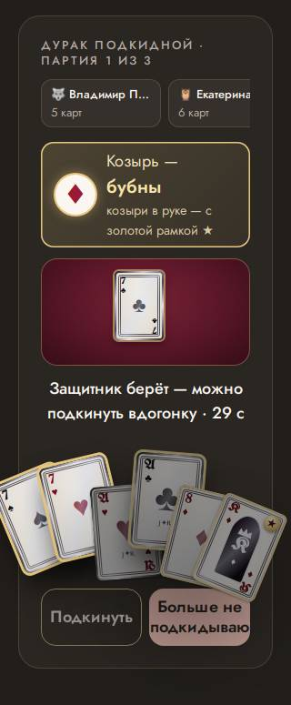

### обрезан текст · телефон

текст обрезан вбок на 29 px (div.dk-card.dk-d--cyber) — «10»

- где: `div.dk-hand__row > button.dk-hand__slot > div.dk-card.dk-d--cyber > span.dk-idx.dk-idx--b`, этап `playing/4/question/play`
- игры (1): durak 1-й шаблон, каждый сам ×4, телевизор full hd; durak 1-й шаблон, каждый сам ×4, проектор 4:3, маленький телефон, длинные имена; durak 1-й шаблон, каждый сам ×4, ноутбук 16:10, большой зал, длинные имена
- раз: 46

### обрезан текст · телефон

текст обрезан вбок на 13 px (div.dk-card.dk-d--russia) — «♠︎»

- где: `button.dk-hand__slot > div.dk-card.dk-d--russia > span.dk-idx.dk-idx--b > span`, этап `playing/13/question/play`
- игры (1): durak 1-й шаблон, каждый сам ×4, телевизор full hd; durak 1-й шаблон, каждый сам ×4, проектор 4:3, маленький телефон, длинные имена; durak 1-й шаблон, каждый сам ×4, ноутбук 16:10, большой зал, длинные имена
- раз: 36

### обрезан текст · телефон

текст обрезан вбок на 13 px (div.dk-card.dk-d--greece) — «♠︎»

- где: `button.dk-hand__slot > div.dk-card.dk-d--greece > span.dk-idx.dk-idx--b > span`, этап `playing/20/question/play`
- игры (1): durak 1-й шаблон, каждый сам ×4, телевизор full hd; durak 1-й шаблон, каждый сам ×4, проектор 4:3, маленький телефон, длинные имена; durak 1-й шаблон, каждый сам ×4, ноутбук 16:10, большой зал, длинные имена
- раз: 34

### обрезан текст · экран зала

текст обрезан по высоте на 5 px (span.line-clamp) — «Кино»

- где: `div.board-grid > div.board-grid__row > div.board-grid__title > span.line-clamp`, этап `playing/8/ready/pick`
- игры (1): board 1-й шаблон, каждый сам ×4, телевизор full hd; board 1-й шаблон, каждый сам ×4, проектор 4:3, маленький телефон, длинные имена; board 1-й шаблон, команды ×4, телевизор full hd; board 1-й шаблон, каждый сам ×16, ноутбук 16:10, большой зал, длинные имена; board 1-й шаблон, команды ×4, проектор 4:3, маленький телефон, длинные имена; board 1-й шаблон, команды ×8, ноутбук 16:10, большой зал, длинные имена
- раз: 32

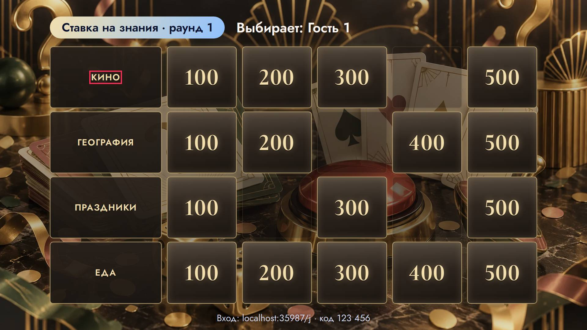

### обрезан текст · телефон

текст обрезан вбок на 15 px (div.dk-card.dk-d--classic) — «♠︎»

- где: `button.dk-hand__slot > div.dk-card.dk-d--classic > span.dk-idx.dk-idx--b > span`, этап `playing/93/question/play`
- игры (1): durak 1-й шаблон, каждый сам ×4, телевизор full hd; durak 1-й шаблон, каждый сам ×4, проектор 4:3, маленький телефон, длинные имена; durak 1-й шаблон, каждый сам ×4, ноутбук 16:10, большой зал, длинные имена
- раз: 32

### обрезан текст · телефон

текст обрезан по высоте на 5 px (span.lotto-card__artist) — «Ирина Аллегрова»

- где: `div.lotto-ticket.lotto-ticket--evening > div.lotto-card > button.lotto-card__cell > span.lotto-card__artist`, этап `playing/0/question/`
- игры (1): lotto 1-й шаблон, каждый сам ×4, проектор 4:3, маленький телефон, длинные имена; lotto 1-й шаблон, команды ×4, проектор 4:3, маленький телефон, длинные имена
- раз: 31

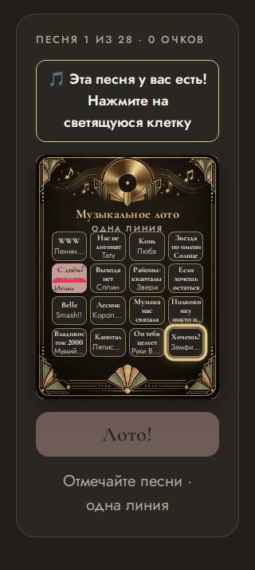

### обрезан текст · пульт

текст обрезан вбок на 3 px (span.wine-cell__label) — «Новый Свет»

- где: `div.wine-row > span.wine-row__cells > span.wine-cell > span.wine-cell__label`, этап `playing/1/reveal/open`
- игры (1): wine 1-й шаблон, каждый сам ×4, телевизор full hd; wine 1-й шаблон, каждый сам ×16, ноутбук 16:10, большой зал, длинные имена; wine 1-й шаблон, каждый сам ×4, проектор 4:3, маленький телефон, длинные имена; wine 1-й шаблон, команды ×4, проектор 4:3, маленький телефон, длинные имена; wine 1-й шаблон, команды ×4, телевизор full hd; wine 1-й шаблон, команды ×8, ноутбук 16:10, большой зал, длинные имена
- раз: 29

### обрезан текст · телефон

текст обрезан вбок на 20 px (div.dk-card.dk-d--wedding) — «♠︎»

- где: `button.dk-hand__slot > div.dk-card.dk-d--wedding > span.dk-idx.dk-idx--b > span`, этап `playing/53/question/play`
- игры (1): durak 1-й шаблон, каждый сам ×4, телевизор full hd; durak 1-й шаблон, каждый сам ×4, проектор 4:3, маленький телефон, длинные имена; durak 1-й шаблон, каждый сам ×4, ноутбук 16:10, большой зал, длинные имена
- раз: 27

### обрезан текст · телефон

текст обрезан вбок на 17 px (div.dk-card.dk-d--cyber) — «♠︎»

- где: `button.dk-hand__slot > div.dk-card.dk-d--cyber > span.dk-idx.dk-idx--b > span`, этап `playing/4/question/play`
- игры (1): durak 1-й шаблон, каждый сам ×4, телевизор full hd; durak 1-й шаблон, каждый сам ×4, проектор 4:3, маленький телефон, длинные имена; durak 1-й шаблон, каждый сам ×4, ноутбук 16:10, большой зал, длинные имена
- раз: 23

### обрезан текст · телефон

текст обрезан по высоте на 4 px (div.dk-card.dk-d--rome) — «K»

- где: `div.dk-mini > span.dk-mini__pair > div.dk-card.dk-d--rome > span.dk-idx.dk-idx--b`, этап `playing/17/question/play`
- игры (1): durak 1-й шаблон, каждый сам ×4, телевизор full hd; durak 1-й шаблон, каждый сам ×4, ноутбук 16:10, большой зал, длинные имена
- раз: 20

### обрезан текст · экран зала

текст обрезан по высоте на 15 px (span.mil-bar__name) — «Единороги из бухгалтерии»

- где: `div.mil-carousel > div.mil-bar > span.mil-bar__name > span`, этап `playing/5/ready/turn`
- игры (1): millionaire 1-й шаблон, команды ×8, ноутбук 16:10, большой зал, длинные имена; millionaire 1-й шаблон, команды ×4, проектор 4:3, маленький телефон, длинные имена; millionaire 1-й шаблон, каждый сам ×4, проектор 4:3, маленький телефон, длинные имена; millionaire 1-й шаблон, каждый сам ×16, ноутбук 16:10, большой зал, длинные имена
- раз: 16

### обрезан текст · экран зала

текст обрезан по высоте на 5 px (span.mil-bar__points) — «0»

- где: `div.mil-bars-window > div.mil-carousel > div.mil-bar > span.mil-bar__points`, этап `playing/0/ready/turn`
- игры (1): millionaire 1-й шаблон, команды ×4, телевизор full hd; millionaire 1-й шаблон, каждый сам ×4, телевизор full hd; millionaire 1-й шаблон, каждый сам ×16, ноутбук 16:10, большой зал, длинные имена
- раз: 13

### обрезан текст · экран зала

текст обрезан по высоте на 18 px (span.mil-bar__name) — «Команда 2»

- где: `div.mil-bars-window > div.mil-carousel > div.mil-bar > span.mil-bar__name`, этап `playing/0/ready/turn`
- игры (1): millionaire 1-й шаблон, команды ×4, телевизор full hd; millionaire 1-й шаблон, каждый сам ×4, телевизор full hd
- раз: 12

### обрезан текст · экран зала

текст обрезан по высоте на 6 px (span.dg-team__nm) — «Команда 1»

- где: `div.dg-frame > ul.dg-teams.dg-teams--l > li.dg-team > span.dg-team__nm`, этап `playing/1/question/`
- игры (1): dragon 2-й шаблон, команды ×4, телевизор full hd
- раз: 12

### обрезан текст · телефон

текст обрезан вбок на 28 px (div.dk-card.dk-d--anime) — «Q»

- где: `div.dk-hand__row > button.dk-hand__slot > div.dk-card.dk-d--anime > span.dk-idx.dk-idx--b`, этап `playing/64/question/play`
- игры (1): durak 1-й шаблон, каждый сам ×4, ноутбук 16:10, большой зал, длинные имена
- раз: 12

### обрезан текст · телефон

текст обрезан вбок на 31 px (div.dk-card.dk-d--kpop) — «6»

- где: `div.dk-hand__row > button.dk-hand__slot > div.dk-card.dk-d--kpop > span.dk-idx.dk-idx--b`, этап `playing/134/reveal/over`
- игры (1): durak 1-й шаблон, каждый сам ×4, ноутбук 16:10, большой зал, длинные имена
- раз: 12

### обрезан текст · экран зала

текст обрезан по высоте на 4 px (span.dg-team__nm) — «🦄»

- где: `ul.dg-teams.dg-teams--l > li.dg-team > span.dg-team__nm > span.name-emoji`, этап `playing/1/question/`
- игры (1): dragon 2-й шаблон, команды ×4, проектор 4:3, маленький телефон, длинные имена
- раз: 11

### обрезан текст · экран зала

текст обрезан по высоте на 4 px (span.dg-team__nm) — «Единороги из бухгалтерии»

- где: `ul.dg-teams.dg-teams--l > li.dg-team > span.dg-team__nm > span`, этап `playing/1/question/`
- игры (1): dragon 2-й шаблон, команды ×4, проектор 4:3, маленький телефон, длинные имена
- раз: 11

### обрезан текст · экран зала

текст обрезан по высоте на 8 px (div.dg-boss__name) — «Добрый дракончик»

- где: `div.dg-stage.dg-stage--kid > div.dg-frame > div.dg-boss > div.dg-boss__name`, этап `playing/1/question/`
- игры (1): dragon 2-й шаблон, команды ×4, телевизор full hd; dragon 2-й шаблон, команды ×8, ноутбук 16:10, большой зал, длинные имена; dragon 2-й шаблон, команды ×4, проектор 4:3, маленький телефон, длинные имена
- раз: 10

### обрезан текст · экран зала

текст обрезан по высоте на 6 px (span.dg-team__nm) — «Команда 3»

- где: `div.dg-frame > ul.dg-teams.dg-teams--r > li.dg-team > span.dg-team__nm`, этап `playing/1/question/`
- игры (1): dragon 2-й шаблон, команды ×4, телевизор full hd
- раз: 10

### обрезан текст · экран зала

текст обрезан по высоте на 4 px (span.dg-team__nm) — «🦉»

- где: `ul.dg-teams.dg-teams--r > li.dg-team > span.dg-team__nm > span.name-emoji`, этап `playing/1/question/`
- игры (1): dragon 2-й шаблон, команды ×4, проектор 4:3, маленький телефон, длинные имена
- раз: 10

### обрезан текст · экран зала

текст обрезан по высоте на 4 px (span.dg-team__nm) — «Совы-полуночники ресепшн»

- где: `ul.dg-teams.dg-teams--r > li.dg-team > span.dg-team__nm > span`, этап `playing/1/question/`
- игры (1): dragon 2-й шаблон, команды ×4, проектор 4:3, маленький телефон, длинные имена
- раз: 10

### обрезан текст · телефон

текст обрезан по высоте на 4 px (div.dk-card.dk-d--greece) — «K»

- где: `div.dk-mini > span.dk-mini__pair > div.dk-card.dk-d--greece > span.dk-idx.dk-idx--b`, этап `playing/20/question/play`
- игры (1): durak 1-й шаблон, каждый сам ×4, телевизор full hd; durak 1-й шаблон, каждый сам ×4, ноутбук 16:10, большой зал, длинные имена
- раз: 9

### обрезан текст · телефон

текст обрезан по высоте на 3 px (div.dk-card.dk-d--classic) — «6»

- где: `div.dk-mini > span.dk-mini__pair > div.dk-card.dk-d--classic > span.dk-idx.dk-idx--b`, этап `playing/93/question/play`
- игры (1): durak 1-й шаблон, каждый сам ×4, телевизор full hd; durak 1-й шаблон, каждый сам ×4, ноутбук 16:10, большой зал, длинные имена
- раз: 9

### обрезан текст · экран зала

текст обрезан по высоте на 16 px (span.mil-bar__name) — «🦄»

- где: `div.mil-carousel > div.mil-bar > span.mil-bar__name > span.name-emoji`, этап `playing/5/ready/turn`
- игры (1): millionaire 1-й шаблон, команды ×8, ноутбук 16:10, большой зал, длинные имена; millionaire 1-й шаблон, команды ×4, проектор 4:3, маленький телефон, длинные имена; millionaire 1-й шаблон, каждый сам ×4, проектор 4:3, маленький телефон, длинные имена; millionaire 1-й шаблон, каждый сам ×16, ноутбук 16:10, большой зал, длинные имена
- раз: 8

### обрезан текст · телефон

текст обрезан вбок на 22 px (div.dk-card.dk-d--kpop) — «♥︎»

- где: `button.dk-hand__slot > div.dk-card.dk-d--kpop > span.dk-idx.dk-idx--b > span`, этап `playing/134/reveal/over`
- игры (1): durak 1-й шаблон, каждый сам ×4, ноутбук 16:10, большой зал, длинные имена
- раз: 6

### обрезан текст · экран зала

текст обрезан по высоте на 59 px (div.podium__names) — «🐺»

- где: `div.podium__slot > div.podium__names > p.podium__name.podium__name--team > span.name-emoji`, этап `playing/20/podium/done`
- игры (1): truth 1-й шаблон, команды ×4, проектор 4:3, маленький телефон, длинные имена; truth 1-й шаблон, команды ×8, ноутбук 16:10, большой зал, длинные имена; truth 2-й шаблон, команды ×4, проектор 4:3, маленький телефон, длинные имена; truth 2-й шаблон, команды ×8, ноутбук 16:10, большой зал, длинные имена
- раз: 6

### обрезан текст · экран зала

текст обрезан по высоте на 59 px (div.podium__names) — «Северные волки отдела IT»

- где: `div.podium__slot > div.podium__names > p.podium__name.podium__name--team > span`, этап `playing/20/podium/done`
- игры (1): truth 1-й шаблон, команды ×4, проектор 4:3, маленький телефон, длинные имена; truth 1-й шаблон, команды ×8, ноутбук 16:10, большой зал, длинные имена; truth 2-й шаблон, команды ×4, проектор 4:3, маленький телефон, длинные имена; truth 2-й шаблон, команды ×8, ноутбук 16:10, большой зал, длинные имена
- раз: 6

### обрезан текст · телефон

текст обрезан вбок на 18 px (div.dk-card.dk-d--anime) — «♠︎»

- где: `button.dk-hand__slot > div.dk-card.dk-d--anime > span.dk-idx.dk-idx--b > span`, этап `playing/64/question/play`
- игры (1): durak 1-й шаблон, каждый сам ×4, ноутбук 16:10, большой зал, длинные имена
- раз: 5

### обрезан текст · телефон

текст обрезан вбок на 9 px (div.dk-card.dk-d--rome) — «♣︎»

- где: `div.dk-hand__row > button.dk-hand__slot > div.dk-card.dk-d--rome > span.dk-pip.dk-pip--ace`, этап `playing/17/question/play`
- игры (1): durak 1-й шаблон, каждый сам ×4, ноутбук 16:10, большой зал, длинные имена
- раз: 4

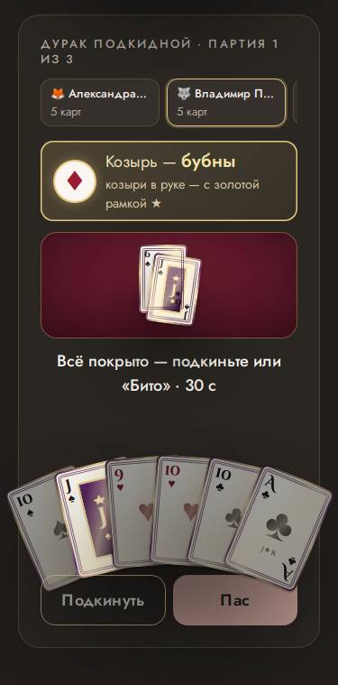

### обрезан текст · телефон

текст обрезан вбок на 5 px (div.dk-card.dk-d--greece) — «♦︎»

- где: `div.dk-hand__row > button.dk-hand__slot > div.dk-card.dk-d--greece > span.dk-pip.dk-pip--ace`, этап `playing/124/question/play`
- игры (1): durak 1-й шаблон, каждый сам ×4, телевизор full hd; durak 1-й шаблон, каждый сам ×4, ноутбук 16:10, большой зал, длинные имена
- раз: 3

### обрезан текст · экран зала

текст обрезан по высоте на 3 px (div.dk-card.dk-d--classic) — «K»

- где: `div.dk-vote__grid > div.dk-vote__tile > div.dk-card.dk-d--classic > span.dk-idx.dk-idx--b`, этап `playing/2/question/vote`
- игры (1): durak 1-й шаблон, каждый сам ×4, телевизор full hd; durak 1-й шаблон, каждый сам ×4, проектор 4:3, маленький телефон, длинные имена; durak 1-й шаблон, каждый сам ×4, ноутбук 16:10, большой зал, длинные имена
- раз: 3

### обрезан текст · экран зала

текст обрезан по высоте на 5 px (div.dk-card.dk-d--gothic) — «K»

- где: `div.dk-vote__grid > div.dk-vote__tile > div.dk-card.dk-d--gothic > span.dk-idx.dk-idx--b`, этап `playing/2/question/vote`
- игры (1): durak 1-й шаблон, каждый сам ×4, телевизор full hd; durak 1-й шаблон, каждый сам ×4, проектор 4:3, маленький телефон, длинные имена; durak 1-й шаблон, каждый сам ×4, ноутбук 16:10, большой зал, длинные имена
- раз: 3

### обрезан текст · экран зала

текст обрезан по высоте на 8 px (div.dk-card.dk-d--greece) — «K»

- где: `div.dk-vote__grid > div.dk-vote__tile > div.dk-card.dk-d--greece > span.dk-idx.dk-idx--b`, этап `playing/2/question/vote`
- игры (1): durak 1-й шаблон, каждый сам ×4, телевизор full hd; durak 1-й шаблон, каждый сам ×4, проектор 4:3, маленький телефон, длинные имена; durak 1-й шаблон, каждый сам ×4, ноутбук 16:10, большой зал, длинные имена
- раз: 3

### обрезан текст · экран зала

текст обрезан по высоте на 8 px (div.dk-card.dk-d--rome) — «K»

- где: `div.dk-vote__grid > div.dk-vote__tile > div.dk-card.dk-d--rome > span.dk-idx.dk-idx--b`, этап `playing/2/question/vote`
- игры (1): durak 1-й шаблон, каждый сам ×4, телевизор full hd; durak 1-й шаблон, каждый сам ×4, проектор 4:3, маленький телефон, длинные имена; durak 1-й шаблон, каждый сам ×4, ноутбук 16:10, большой зал, длинные имена
- раз: 3

### обрезан текст · экран зала

текст обрезан по высоте на 7 px (div.dk-card.dk-d--cyber) — «K»

- где: `div.dk-vote__grid > div.dk-vote__tile > div.dk-card.dk-d--cyber > span.dk-idx.dk-idx--b`, этап `playing/2/question/vote`
- игры (1): durak 1-й шаблон, каждый сам ×4, телевизор full hd; durak 1-й шаблон, каждый сам ×4, проектор 4:3, маленький телефон, длинные имена; durak 1-й шаблон, каждый сам ×4, ноутбук 16:10, большой зал, длинные имена
- раз: 3

### обрезан текст · экран зала

текст обрезан по высоте на 7 px (div.dk-card.dk-d--vintage) — «K»

- где: `div.dk-vote__grid > div.dk-vote__tile > div.dk-card.dk-d--vintage > span.dk-idx.dk-idx--b`, этап `playing/2/question/vote`
- игры (1): durak 1-й шаблон, каждый сам ×4, телевизор full hd; durak 1-й шаблон, каждый сам ×4, проектор 4:3, маленький телефон, длинные имена; durak 1-й шаблон, каждый сам ×4, ноутбук 16:10, большой зал, длинные имена
- раз: 3

### обрезан текст · экран зала

текст обрезан по высоте на 5 px (div.dk-card.dk-d--russia) — «K»

- где: `div.dk-vote__grid > div.dk-vote__tile > div.dk-card.dk-d--russia > span.dk-idx.dk-idx--b`, этап `playing/2/question/vote`
- игры (1): durak 1-й шаблон, каждый сам ×4, телевизор full hd; durak 1-й шаблон, каждый сам ×4, проектор 4:3, маленький телефон, длинные имена; durak 1-й шаблон, каждый сам ×4, ноутбук 16:10, большой зал, длинные имена
- раз: 3

### обрезан текст · экран зала

текст обрезан по высоте на 7 px (div.dk-card.dk-d--kpop) — «K»

- где: `div.dk-vote__grid > div.dk-vote__tile > div.dk-card.dk-d--kpop > span.dk-idx.dk-idx--b`, этап `playing/2/question/vote`
- игры (1): durak 1-й шаблон, каждый сам ×4, телевизор full hd; durak 1-й шаблон, каждый сам ×4, проектор 4:3, маленький телефон, длинные имена; durak 1-й шаблон, каждый сам ×4, ноутбук 16:10, большой зал, длинные имена
- раз: 3

### обрезан текст · экран зала

текст обрезан по высоте на 5 px (div.dk-card.dk-d--anime) — «K»

- где: `div.dk-vote__grid > div.dk-vote__tile > div.dk-card.dk-d--anime > span.dk-idx.dk-idx--b`, этап `playing/2/question/vote`
- игры (1): durak 1-й шаблон, каждый сам ×4, телевизор full hd; durak 1-й шаблон, каждый сам ×4, проектор 4:3, маленький телефон, длинные имена; durak 1-й шаблон, каждый сам ×4, ноутбук 16:10, большой зал, длинные имена
- раз: 3

### обрезан текст · экран зала

текст обрезан по высоте на 3 px (div.dk-card.dk-d--wedding) — «K»

- где: `div.dk-vote__grid > div.dk-vote__tile > div.dk-card.dk-d--wedding > span.dk-idx.dk-idx--b`, этап `playing/2/question/vote`
- игры (1): durak 1-й шаблон, каждый сам ×4, телевизор full hd; durak 1-й шаблон, каждый сам ×4, проектор 4:3, маленький телефон, длинные имена; durak 1-й шаблон, каждый сам ×4, ноутбук 16:10, большой зал, длинные имена
- раз: 3

### обрезан текст · экран зала

текст обрезан вбок на 35 px (div.dk-card.dk-d--rome) — «9»

- где: `div.dk-table__felt > div.dk-stock > div.dk-card.dk-d--rome > span.dk-idx`, этап `playing/16/question/play`
- игры (1): durak 1-й шаблон, каждый сам ×4, телевизор full hd; durak 1-й шаблон, каждый сам ×4, проектор 4:3, маленький телефон, длинные имена; durak 1-й шаблон, каждый сам ×4, ноутбук 16:10, большой зал, длинные имена
- раз: 3

### обрезан текст · экран зала

текст обрезан вбок на 18 px (div.dk-card.dk-d--rome) — «♠︎»

- где: `div.dk-stock > div.dk-card.dk-d--rome > span.dk-idx > span`, этап `playing/16/question/play`
- игры (1): durak 1-й шаблон, каждый сам ×4, телевизор full hd; durak 1-й шаблон, каждый сам ×4, проектор 4:3, маленький телефон, длинные имена; durak 1-й шаблон, каждый сам ×4, ноутбук 16:10, большой зал, длинные имена
- раз: 3

### обрезан текст · экран зала

текст обрезан по высоте на 25 px (span.mil-bar__name) — «· пропуск хода»

- где: `div.mil-carousel > div.mil-bar > span.mil-bar__name > span.mil-bar__tag`, этап `playing/5/ready/turn`
- игры (1): millionaire 1-й шаблон, команды ×8, ноутбук 16:10, большой зал, длинные имена; millionaire 1-й шаблон, команды ×4, проектор 4:3, маленький телефон, длинные имена
- раз: 2

### обрезан текст · телефон

текст обрезан вбок на 5 px (div.dk-card.dk-d--russia) — «♠︎»

- где: `div.dk-hand__row > button.dk-hand__slot > div.dk-card.dk-d--russia > span.dk-pip.dk-pip--ace`, этап `playing/66/question/play`
- игры (1): durak 1-й шаблон, каждый сам ×4, проектор 4:3, маленький телефон, длинные имена; durak 1-й шаблон, каждый сам ×4, ноутбук 16:10, большой зал, длинные имена
- раз: 2

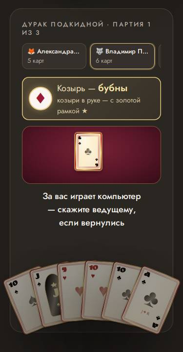

### обрезан текст · телефон

текст обрезан по высоте на 3 px (div.dk-card.dk-d--wedding) — «8»

- где: `div.dk-mini > span.dk-mini__pair > div.dk-card.dk-d--wedding > span.dk-idx.dk-idx--b`, этап `playing/53/question/play`
- игры (1): durak 1-й шаблон, каждый сам ×4, телевизор full hd
- раз: 1

### обрезан текст · экран зала

текст обрезан вбок на 3 px (div.dk-card.dk-d--rome) — «♠︎»

- где: `div.dk-table__felt > div.dk-stock > div.dk-card.dk-d--rome > span.dk-pip`, этап `playing/16/question/play`
- игры (1): durak 1-й шаблон, каждый сам ×4, телевизор full hd
- раз: 1

### обрезан текст · телефон

текст обрезан вбок на 9 px (div.dk-card.dk-d--cyber) — «♣︎»

- где: `div.dk-hand__row > button.dk-hand__slot > div.dk-card.dk-d--cyber > span.dk-pip.dk-pip--ace`, этап `playing/4/question/play`
- игры (1): durak 1-й шаблон, каждый сам ×4, ноутбук 16:10, большой зал, длинные имена
- раз: 1

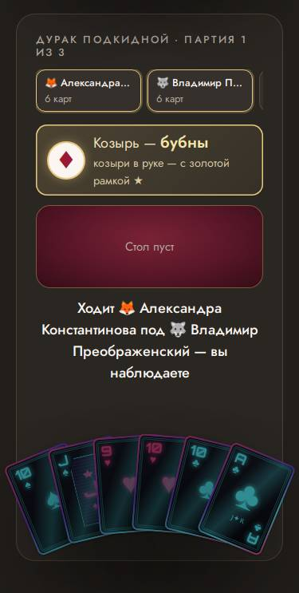

### обрезан текст · телефон

текст обрезан вбок на 9 px (div.dk-card.dk-d--wedding) — «♣︎»

- где: `div.dk-hand__row > button.dk-hand__slot > div.dk-card.dk-d--wedding > span.dk-pip.dk-pip--ace`, этап `playing/56/question/play`
- игры (1): durak 1-й шаблон, каждый сам ×4, ноутбук 16:10, большой зал, длинные имена
- раз: 1

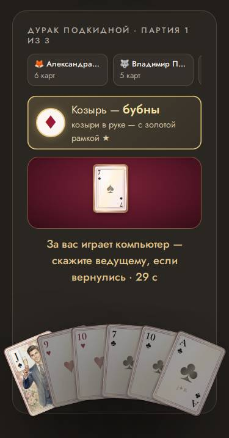

### обрезан текст · телефон

текст обрезан вбок на 9 px (div.dk-card.dk-d--kpop) — «♣︎»

- где: `div.dk-hand__row > button.dk-hand__slot > div.dk-card.dk-d--kpop > span.dk-pip.dk-pip--ace`, этап `playing/134/reveal/over`
- игры (1): durak 1-й шаблон, каждый сам ×4, ноутбук 16:10, большой зал, длинные имена
- раз: 1

### прячется за прокруткой · экран зала

на экране зала текст виден только прокруткой (по высоте на 7 px) — «и ещё 2»

- где: `div.final > div.final__board > div.board-view > p.board-view__more`, этап `finished/7/podium/`
- игры (11): quiz 1-й шаблон, каждый сам ×4, проектор 4:3, маленький телефон, длинные имена; quiz 1-й шаблон, каждый сам ×4, телевизор full hd; quiz 1-й шаблон, каждый сам ×16, ноутбук 16:10, большой зал, длинные имена; quiz 1-й шаблон, команды ×8, ноутбук 16:10, большой зал, длинные имена; quiz 3-й шаблон, каждый сам ×16, ноутбук 16:10, большой зал, длинные имена; quiz 3-й шаблон, команды ×4, телевизор full hd …
- раз: 63

### бледный текст · телефон

контраст 1.00 (нужно от 4.5) — «33%»

- где: `div.mil-question.mil-question--phone > ol.mil-options > li.mil-option > span.mil-option__pct`, этап `playing/4/question/question`
- игры (1): millionaire 1-й шаблон, команды ×8, ноутбук 16:10, большой зал, длинные имена; millionaire 1-й шаблон, команды ×4, телевизор full hd; millionaire 1-й шаблон, команды ×4, проектор 4:3, маленький телефон, длинные имена; millionaire 1-й шаблон, каждый сам ×4, телевизор full hd; millionaire 1-й шаблон, каждый сам ×4, проектор 4:3, маленький телефон, длинные имена; millionaire 1-й шаблон, каждый сам ×16, ноутбук 16:10, большой зал, длинные имена
- раз: 95

### бледный текст · телефон

контраст 1.01 (нужно от 4.5) — «Пять»

- где: `div.mil-question.mil-question--phone > ol.mil-options > li.mil-option > span.mil-option__text`, этап `playing/4/reveal/reveal`
- игры (1): millionaire 1-й шаблон, команды ×8, ноутбук 16:10, большой зал, длинные имена; millionaire 1-й шаблон, команды ×4, телевизор full hd; millionaire 1-й шаблон, команды ×4, проектор 4:3, маленький телефон, длинные имена; millionaire 1-й шаблон, каждый сам ×4, телевизор full hd; millionaire 1-й шаблон, каждый сам ×4, проектор 4:3, маленький телефон, длинные имена; millionaire 1-й шаблон, каждый сам ×16, ноутбук 16:10, большой зал, длинные имена
- раз: 62

### бледный текст · телефон

контраст 1.14 (нужно от 4.5) — «C»

- где: `div.mil-question.mil-question--phone > ol.mil-options > li.mil-option > span.mil-option__letter`, этап `playing/4/reveal/reveal`
- игры (1): millionaire 1-й шаблон, команды ×8, ноутбук 16:10, большой зал, длинные имена; millionaire 1-й шаблон, команды ×4, телевизор full hd; millionaire 1-й шаблон, команды ×4, проектор 4:3, маленький телефон, длинные имена; millionaire 1-й шаблон, каждый сам ×4, телевизор full hd; millionaire 1-й шаблон, каждый сам ×4, проектор 4:3, маленький телефон, длинные имена; millionaire 1-й шаблон, каждый сам ×16, ноутбук 16:10, большой зал, длинные имена
- раз: 55

### бледный текст · пульт

контраст 3.07 (нужно от 4.5) — «Германия»

- где: `div.wine-row > span.wine-row__cells > span.wine-cell > span.wine-cell__label`, этап `playing/1/reveal/open`
- игры (1): wine 1-й шаблон, каждый сам ×4, телевизор full hd; wine 1-й шаблон, каждый сам ×16, ноутбук 16:10, большой зал, длинные имена; wine 1-й шаблон, каждый сам ×4, проектор 4:3, маленький телефон, длинные имена; wine 1-й шаблон, команды ×4, проектор 4:3, маленький телефон, длинные имена; wine 1-й шаблон, команды ×4, телевизор full hd; wine 1-й шаблон, команды ×8, ноутбук 16:10, большой зал, длинные имена
- раз: 38

### бледный текст · экран зала

контраст 3.27 (нужно от 4.5) — «Герой выбирается»

- где: `div.dg-frame > ul.dg-teams.dg-teams--l > li.dg-team > span.dg-team__hero`, этап `playing/1/question/`
- игры (1): dragon 2-й шаблон, команды ×4, телевизор full hd; dragon 2-й шаблон, команды ×8, ноутбук 16:10, большой зал, длинные имена; dragon 2-й шаблон, команды ×4, проектор 4:3, маленький телефон, длинные имена
- раз: 32

### бледный текст · телефон

контраст 2.26 (нужно от 4.5) — «видите только вы»

- где: `section.bk-phone__mine > ul.bk-phone__cards > li > span.bk-phone__state`, этап `playing/2/question/bunker`
- игры (1): bunker 1-й шаблон, каждый сам ×8, проектор 4:3, маленький телефон, длинные имена
- раз: 28

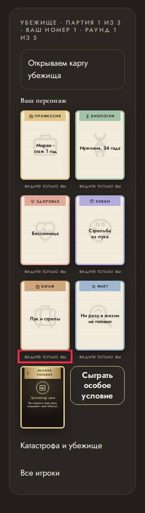

### бледный текст · экран зала

контраст 3.27 (нужно от 4.5) — «Герой выбирается»

- где: `div.dg-frame > ul.dg-teams.dg-teams--r > li.dg-team > span.dg-team__hero`, этап `playing/1/question/`
- игры (1): dragon 2-й шаблон, команды ×4, телевизор full hd; dragon 2-й шаблон, команды ×8, ноутбук 16:10, большой зал, длинные имена; dragon 2-й шаблон, команды ×4, проектор 4:3, маленький телефон, длинные имена
- раз: 27

### бледный текст · экран зала

контраст 2.44 (нужно от 3) — «3»

- где: `section.mf-screen__seats > ol.mf-seats.mf-seats--screen > li.mf-seat > span.mf-seat__num`, этап `playing/5/question/night`
- игры (1): mafia 1-й шаблон, каждый сам ×9, телевизор full hd; mafia 1-й шаблон, каждый сам ×9, ноутбук 16:10, большой зал, длинные имена; mafia 1-й шаблон, каждый сам ×9, проектор 4:3, маленький телефон, длинные имена
- раз: 12

### бледный текст · пульт

контраст 3.55 (нужно от 4.5) — «Восемь»

- где: `div.stack.host-quiz > div.card.stack > ol.mil-host-options > li`, этап `playing/5/reveal/reveal`
- игры (1): millionaire 1-й шаблон, каждый сам ×4, телевизор full hd; millionaire 1-й шаблон, каждый сам ×4, проектор 4:3, маленький телефон, длинные имена; millionaire 1-й шаблон, каждый сам ×16, ноутбук 16:10, большой зал, длинные имена
- раз: 11

### бледный текст · пульт

контраст 3.55 (нужно от 4.5) — «D»

- где: `div.card.stack > ol.mil-host-options > li > strong`, этап `playing/5/reveal/reveal`
- игры (1): millionaire 1-й шаблон, каждый сам ×4, телевизор full hd; millionaire 1-й шаблон, каждый сам ×4, проектор 4:3, маленький телефон, длинные имена; millionaire 1-й шаблон, каждый сам ×16, ноутбук 16:10, большой зал, длинные имена
- раз: 11

### бледный текст · телефон

контраст 1.00 (нужно от 4.5) — «7»

- где: `div.dk-hand__row > button.dk-hand__slot > div.dk-card.dk-d--russia > span.dk-idx.dk-idx--b`, этап `playing/13/question/play`
- игры (1): durak 1-й шаблон, каждый сам ×4, телевизор full hd; durak 1-й шаблон, каждый сам ×4, ноутбук 16:10, большой зал, длинные имена
- раз: 9

### бледный текст · экран зала

контраст 2.58 (нужно от 3) — «А»

- где: `div.dg-q > ol.dg-q__ans > li > b`, этап `playing/15/reveal/`
- игры (1): dragon 2-й шаблон, команды ×4, телевизор full hd; dragon 2-й шаблон, команды ×4, проектор 4:3, маленький телефон, длинные имена
- раз: 8

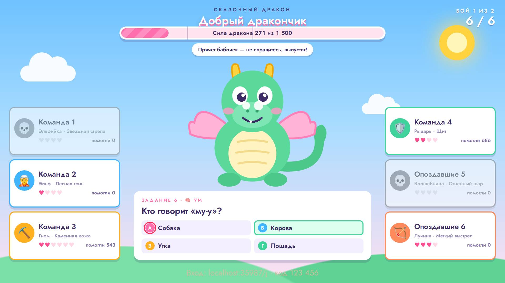

### бледный текст · пульт

контраст 3.42 (нужно от 4.5) — «мимо ✕»

- где: `section.stack.stack--tight > ol.buzz-queue > li > span.buzz-queue__state`, этап `playing/7/question/buzz`
- игры (1): board 1-й шаблон, каждый сам ×4, телевизор full hd; board 1-й шаблон, каждый сам ×4, проектор 4:3, маленький телефон, длинные имена; board 1-й шаблон, каждый сам ×16, ноутбук 16:10, большой зал, длинные имена; board 1-й шаблон, команды ×8, ноутбук 16:10, большой зал, длинные имена
- раз: 7

### бледный текст · экран зала

контраст 1.09 (нужно от 4.5) — «Г»

- где: `div.dk-table > div.dk-seat.dk-seat--wait > div.dk-seat__card > span.dk-seat__avatar`, этап `playing/2/question/vote`
- игры (1): durak 1-й шаблон, каждый сам ×4, телевизор full hd; durak 1-й шаблон, каждый сам ×4, проектор 4:3, маленький телефон, длинные имена; durak 1-й шаблон, каждый сам ×4, ноутбук 16:10, большой зал, длинные имена
- раз: 7

### бледный текст · телефон

контраст 1.18 (нужно от 4.5) — «10»

- где: `div.dk-mini > span.dk-mini__pair > div.dk-card.dk-d--greece > span.dk-idx.dk-idx--b`, этап `playing/20/question/play`
- игры (1): durak 1-й шаблон, каждый сам ×4, телевизор full hd; durak 1-й шаблон, каждый сам ×4, ноутбук 16:10, большой зал, длинные имена
- раз: 6

### бледный текст · экран зала

контраст 2.58 (нужно от 4.5) — «Бой с драконом»

- где: `div.dg-stage.dg-stage--kid > div.dg-frame > div.dg-q.dg-q--center > div.dg-q__eye`, этап `playing/1/question/`
- игры (1): dragon 2-й шаблон, команды ×4, телевизор full hd; dragon 2-й шаблон, команды ×4, проектор 4:3, маленький телефон, длинные имена
- раз: 4

### бледный текст · экран зала

контраст 2.58 (нужно от 4.5) — «Задание 6 · 🧠 Ум»

- где: `div.dg-stage.dg-stage--kid > div.dg-frame > div.dg-q > div.dg-q__eye`, этап `playing/15/reveal/`
- игры (1): dragon 2-й шаблон, команды ×4, телевизор full hd; dragon 2-й шаблон, команды ×4, проектор 4:3, маленький телефон, длинные имена
- раз: 4

### бледный текст · экран зала

контраст 1.05 (нужно от 4.5) — «Вход: localhost:35987/j · код 123 456»

- где: `div.hall > main.quiz-stage > p.stage-code`, этап `playing/1/reveal/done`
- игры (1): hundred 1-й шаблон, команды ×8, ноутбук 16:10, большой зал, длинные имена; hundred 2-й шаблон, команды ×8, ноутбук 16:10, большой зал, длинные имена; hundred 3-й шаблон, команды ×8, ноутбук 16:10, большой зал, длинные имена
- раз: 3

### бледный текст · пульт

контраст 1.07 (нужно от 4.5) — «Начальник»

- где: `li > button.hd-host__row > span.hd-host__text > strong`, этап `playing/3/reveal/play`
- игры (1): hundred 2-й шаблон, команды ×4, телевизор full hd
- раз: 3

### бледный текст · телефон

контраст 2.83 (нужно от 4.5) — «вышел»

- где: `div.quiz-phone.dk-phone > div.dk-phone__opps > span.dk-opp.dk-opp--out > span.dk-opp__n`, этап `playing/90/question/play`
- игры (1): durak 1-й шаблон, каждый сам ×4, проектор 4:3, маленький телефон, длинные имена
- раз: 3

### бледный текст · телефон

контраст 1.00 (нужно от 4.5) — «7»

- где: `div.dk-mini > span.dk-mini__pair > div.dk-card.dk-d--russia > span.dk-idx.dk-idx--b`, этап `playing/70/question/play`
- игры (1): durak 1-й шаблон, каждый сам ×4, ноутбук 16:10, большой зал, длинные имена
- раз: 3

### бледный текст · пульт

контраст 1.85 (нужно от 4.5) — «ещё: столы»

- где: `li > button.hd-host__row > span.hd-host__text > small`, этап `playing/3/reveal/play`
- игры (1): hundred 2-й шаблон, команды ×4, проектор 4:3, маленький телефон, длинные имена
- раз: 2

### бледный текст · телефон

контраст 1.85 (нужно от 4.5) — «Подсказки»

- где: `div.card > div.quiz-phone > section.stack.stack--tight > p.eyebrow`, этап `playing/2/question/question`
- игры (1): millionaire 1-й шаблон, команды ×4, проектор 4:3, маленький телефон, длинные имена
- раз: 1

### бледный текст · телефон

контраст 1.52 (нужно от 4.5) — «Они ответили верно!»

- где: `main.page.page--play > div.card > div.quiz-phone.mil-watch > p.success`, этап `playing/8/reveal/reveal`
- игры (1): millionaire 1-й шаблон, команды ×4, проектор 4:3, маленький телефон, длинные имена
- раз: 1

### бледный текст · телефон

контраст 1.65 (нужно от 4.5) — «№5»

- где: `div.quiz-phone.mf-phone > ul.mf-phone__reveal > li > span.mf-num`, этап `playing/87/reveal/over`
- игры (1): mafia 1-й шаблон, каждый сам ×9, проектор 4:3, маленький телефон, длинные имена
- раз: 1

### бледный текст · пульт

контраст 1.07 (нужно от 4.5) — «Гости выбирают колоду (голосование)»

- где: `section.card > div.stack.host-quiz > div.actions > button.btn.btn--secondary`, этап `playing/64/question/play`
- игры (1): durak 1-й шаблон, каждый сам ×4, ноутбук 16:10, большой зал, длинные имена
- раз: 1

### мелко для зала · экран зала

шрифт 16.2 px — 16 px на Full HD (нужно от 18) — «кл. 0»

- где: `aside.qx-panel > ol.qx-panel__list > li.qx-row > span.qx-row__cell`, этап `playing/0/question/roll`
- игры (1): quest 1-й шаблон, команды ×4, телевизор full hd; quest 1-й шаблон, команды ×4, проектор 4:3, маленький телефон, длинные имена; quest 2-й шаблон, команды ×4, телевизор full hd; quest 2-й шаблон, команды ×4, проектор 4:3, маленький телефон, длинные имена; quest 1-й шаблон, команды ×8, ноутбук 16:10, большой зал, длинные имена; quest 2-й шаблон, команды ×8, ноутбук 16:10, большой зал, длинные имена
- раз: 156

### мелко для зала · экран зала

шрифт 17.3 px — 17 px на Full HD (нужно от 18) — «№1»

- где: `li > article.bk-dossier > header.bk-dossier__head > span.bk-dossier__seat`, этап `playing/3/question/open`
- игры (1): bunker 1-й шаблон, каждый сам ×8, телевизор full hd; bunker 1-й шаблон, каждый сам ×8, проектор 4:3, маленький телефон, длинные имена; bunker 1-й шаблон, каждый сам ×8, ноутбук 16:10, большой зал, длинные имена
- раз: 132

### мелко для зала · экран зала

шрифт 17.3 px — 17 px на Full HD (нужно от 18) — «Профессия»

- где: `article.bk-dossier > ul.bk-dossier__rows > li.bk-row.bk-row--profession > span.bk-row__text`, этап `playing/3/question/open`
- игры (1): bunker 1-й шаблон, каждый сам ×8, телевизор full hd; bunker 1-й шаблон, каждый сам ×8, проектор 4:3, маленький телефон, длинные имена; bunker 1-й шаблон, каждый сам ×8, ноутбук 16:10, большой зал, длинные имена
- раз: 132

### мелко для зала · экран зала

шрифт 17.3 px — 17 px на Full HD (нужно от 18) — «Биология»

- где: `article.bk-dossier > ul.bk-dossier__rows > li.bk-row.bk-row--biology > span.bk-row__text`, этап `playing/3/question/open`
- игры (1): bunker 1-й шаблон, каждый сам ×8, телевизор full hd; bunker 1-й шаблон, каждый сам ×8, проектор 4:3, маленький телефон, длинные имена; bunker 1-й шаблон, каждый сам ×8, ноутбук 16:10, большой зал, длинные имена
- раз: 132

### мелко для зала · экран зала

шрифт 17.3 px — 17 px на Full HD (нужно от 18) — «Здоровье»

- где: `article.bk-dossier > ul.bk-dossier__rows > li.bk-row.bk-row--health > span.bk-row__text`, этап `playing/3/question/open`
- игры (1): bunker 1-й шаблон, каждый сам ×8, телевизор full hd; bunker 1-й шаблон, каждый сам ×8, проектор 4:3, маленький телефон, длинные имена; bunker 1-й шаблон, каждый сам ×8, ноутбук 16:10, большой зал, длинные имена
- раз: 132

### мелко для зала · экран зала

шрифт 17.3 px — 17 px на Full HD (нужно от 18) — «Хобби»

- где: `article.bk-dossier > ul.bk-dossier__rows > li.bk-row.bk-row--hobby > span.bk-row__text`, этап `playing/3/question/open`
- игры (1): bunker 1-й шаблон, каждый сам ×8, телевизор full hd; bunker 1-й шаблон, каждый сам ×8, проектор 4:3, маленький телефон, длинные имена; bunker 1-й шаблон, каждый сам ×8, ноутбук 16:10, большой зал, длинные имена
- раз: 132

### мелко для зала · экран зала

шрифт 17.3 px — 17 px на Full HD (нужно от 18) — «Багаж»

- где: `article.bk-dossier > ul.bk-dossier__rows > li.bk-row.bk-row--baggage > span.bk-row__text`, этап `playing/3/question/open`
- игры (1): bunker 1-й шаблон, каждый сам ×8, телевизор full hd; bunker 1-й шаблон, каждый сам ×8, проектор 4:3, маленький телефон, длинные имена; bunker 1-й шаблон, каждый сам ×8, ноутбук 16:10, большой зал, длинные имена
- раз: 132

### мелко для зала · экран зала

шрифт 17.3 px — 17 px на Full HD (нужно от 18) — «Никогда не врёт»

- где: `article.bk-dossier > ul.bk-dossier__rows > li.bk-row.bk-row--fact > span.bk-row__text`, этап `playing/3/question/open`
- игры (1): bunker 1-й шаблон, каждый сам ×8, телевизор full hd; bunker 1-й шаблон, каждый сам ×8, проектор 4:3, маленький телефон, длинные имена; bunker 1-й шаблон, каждый сам ×8, ноутбук 16:10, большой зал, длинные имена
- раз: 132

### мелко для зала · экран зала

шрифт 16.2 px — 16 px на Full HD (нужно от 18) — «Эпидемия»

- где: `ol.bk-screen__dossiers > li > article.bk-dossier > p.bk-dossier__used`, этап `playing/3/question/open`
- игры (1): bunker 1-й шаблон, каждый сам ×8, телевизор full hd; bunker 1-й шаблон, каждый сам ×8, проектор 4:3, маленький телефон, длинные имена; bunker 1-й шаблон, каждый сам ×8, ноутбук 16:10, большой зал, длинные имена
- раз: 97

### мелко для зала · экран зала

шрифт 7.9 px — 8 px на Full HD (нужно от 18) — «1»

- где: `li > div.bk-card.bk-plan > div.bk-in > span.bk-plan__num`, этап `playing/1/question/catastrophe`
- игры (1): bunker 1-й шаблон, каждый сам ×8, телевизор full hd; bunker 1-й шаблон, каждый сам ×8, проектор 4:3, маленький телефон, длинные имена; bunker 1-й шаблон, каждый сам ×8, ноутбук 16:10, большой зал, длинные имена
- раз: 91

### мелко для зала · экран зала

шрифт 8.9 px — 12 px на Full HD (нужно от 18) — «0»

- где: `li.dg-team > span.dg-team__row > span.dg-team__dm > b`, этап `playing/20/reveal/`
- игры (1): dragon 1-й шаблон, команды ×8, ноутбук 16:10, большой зал, длинные имена; dragon 1-й шаблон, команды ×4, проектор 4:3, маленький телефон, длинные имена; dragon 2-й шаблон, команды ×4, телевизор full hd; dragon 2-й шаблон, команды ×8, ноутбук 16:10, большой зал, длинные имена; dragon 2-й шаблон, команды ×4, проектор 4:3, маленький телефон, длинные имена
- раз: 81

### мелко для зала · экран зала

шрифт 12.7 px — 18 px на Full HD (нужно от 18) — «Александра Константинова»

- где: `article.bk-dossier > header.bk-dossier__head > span.bk-dossier__name > span`, этап `playing/3/question/open`
- игры (1): bunker 1-й шаблон, каждый сам ×8, проектор 4:3, маленький телефон, длинные имена; bunker 1-й шаблон, каждый сам ×8, ноутбук 16:10, большой зал, длинные имена
- раз: 62

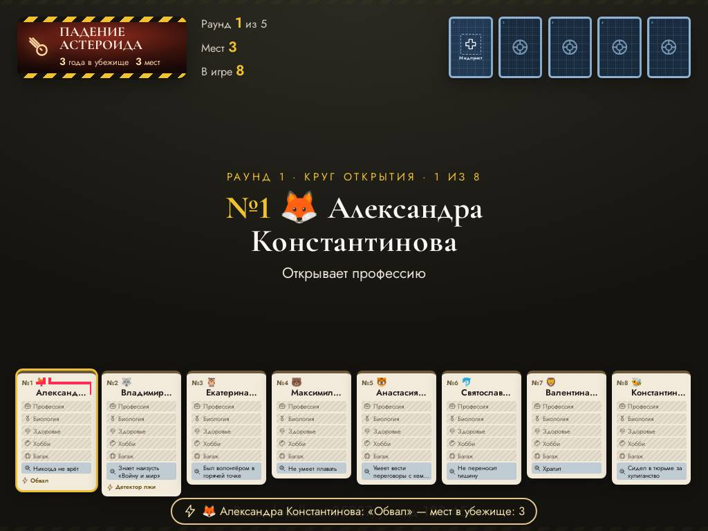

### мелко для зала · экран зала

шрифт 13.6 px — 14 px на Full HD (нужно от 18) — «Детская комната»

- где: `li > div.bk-card.bk-plan > div.bk-in > span.bk-plan__title`, этап `playing/3/question/open`
- игры (1): bunker 1-й шаблон, каждый сам ×8, телевизор full hd; bunker 1-й шаблон, каждый сам ×8, проектор 4:3, маленький телефон, длинные имена; bunker 1-й шаблон, каждый сам ×8, ноутбук 16:10, большой зал, длинные имена
- раз: 57

### мелко для зала · экран зала

шрифт 8.9 px — 12 px на Full HD (нужно от 18) — «Эльфийка · Звёздная стрела»

- где: `div.dg-frame > ul.dg-teams.dg-teams--l > li.dg-team > span.dg-team__hero`, этап `playing/20/reveal/`
- игры (1): dragon 1-й шаблон, команды ×8, ноутбук 16:10, большой зал, длинные имена; dragon 1-й шаблон, команды ×4, проектор 4:3, маленький телефон, длинные имена; dragon 2-й шаблон, команды ×4, телевизор full hd; dragon 2-й шаблон, команды ×8, ноутбук 16:10, большой зал, длинные имена; dragon 2-й шаблон, команды ×4, проектор 4:3, маленький телефон, длинные имена
- раз: 51

### мелко для зала · экран зала

шрифт 8.9 px — 12 px на Full HD (нужно от 18) — «Лучник · Меткий выстрел»

- где: `div.dg-frame > ul.dg-teams.dg-teams--r > li.dg-team > span.dg-team__hero`, этап `playing/20/reveal/`
- игры (1): dragon 1-й шаблон, команды ×8, ноутбук 16:10, большой зал, длинные имена; dragon 1-й шаблон, команды ×4, проектор 4:3, маленький телефон, длинные имена; dragon 2-й шаблон, команды ×4, телевизор full hd; dragon 2-й шаблон, команды ×8, ноутбук 16:10, большой зал, длинные имена; dragon 2-й шаблон, команды ×4, проектор 4:3, маленький телефон, длинные имена
- раз: 48

### мелко для зала · экран зала

шрифт 8.9 px — 12 px на Full HD (нужно от 18) — «урон»

- где: `ul.dg-teams.dg-teams--l > li.dg-team > span.dg-team__row > span.dg-team__dm`, этап `playing/20/reveal/`
- игры (1): dragon 1-й шаблон, команды ×8, ноутбук 16:10, большой зал, длинные имена; dragon 1-й шаблон, команды ×4, проектор 4:3, маленький телефон, длинные имена; dragon 2-й шаблон, команды ×4, телевизор full hd; dragon 2-й шаблон, команды ×8, ноутбук 16:10, большой зал, длинные имена; dragon 2-й шаблон, команды ×4, проектор 4:3, маленький телефон, длинные имена
- раз: 42

### мелко для зала · экран зала

шрифт 8.9 px — 12 px на Full HD (нужно от 18) — «урон»

- где: `ul.dg-teams.dg-teams--r > li.dg-team > span.dg-team__row > span.dg-team__dm`, этап `playing/20/reveal/`
- игры (1): dragon 1-й шаблон, команды ×8, ноутбук 16:10, большой зал, длинные имена; dragon 1-й шаблон, команды ×4, проектор 4:3, маленький телефон, длинные имена; dragon 2-й шаблон, команды ×4, телевизор full hd; dragon 2-й шаблон, команды ×8, ноутбук 16:10, большой зал, длинные имена; dragon 2-й шаблон, команды ×4, проектор 4:3, маленький телефон, длинные имена
- раз: 39

### мелко для зала · экран зала

шрифт 16.2 px — 16 px на Full HD (нужно от 18) — «За столом»

- где: `div.dk-table > div.dk-seat.dk-seat--wait > div.dk-seat__card > span.dk-seat__status`, этап `playing/1/question/deal`
- игры (1): durak 1-й шаблон, каждый сам ×4, телевизор full hd; durak 1-й шаблон, каждый сам ×4, проектор 4:3, маленький телефон, длинные имена; durak 1-й шаблон, каждый сам ×4, ноутбук 16:10, большой зал, длинные имена
- раз: 24

### мелко для зала · экран зала

шрифт 16.0 px — 16 px на Full HD (нужно от 18) — «Гость 1»

- где: `li > article.bk-dossier > header.bk-dossier__head > span.bk-dossier__name`, этап `playing/94/question/open`
- игры (1): bunker 1-й шаблон, каждый сам ×8, телевизор full hd
- раз: 22

### мелко для зала · экран зала

шрифт 15.1 px — 15 px на Full HD (нужно от 18) — «Бросает кубик»

- где: `div.quest-screen.qx--classic > div.qx-turn > div.qx-turn__who > span.qx-turn__label`, этап `playing/0/question/roll`
- игры (1): quest 1-й шаблон, команды ×4, телевизор full hd; quest 1-й шаблон, команды ×4, проектор 4:3, маленький телефон, длинные имена; quest 1-й шаблон, команды ×8, ноутбук 16:10, большой зал, длинные имена
- раз: 21

### мелко для зала · экран зала

шрифт 15.1 px — 15 px на Full HD (нужно от 18) — «Бросает кубик»

- где: `div.quest-screen.qx--adult > div.qx-turn > div.qx-turn__who > span.qx-turn__label`, этап `playing/0/question/roll`
- игры (1): quest 2-й шаблон, команды ×4, телевизор full hd; quest 2-й шаблон, команды ×4, проектор 4:3, маленький телефон, длинные имена; quest 2-й шаблон, команды ×8, ноутбук 16:10, большой зал, длинные имена
- раз: 21

### мелко для зала · экран зала

шрифт 8.9 px — 12 px на Full HD (нужно от 18) — «🎲 5»

- где: `li.dg-team > span.dg-team__row > span.dg-team__dm > span.dg-team__roll`, этап `playing/20/reveal/`
- игры (1): dragon 2-й шаблон, команды ×8, ноутбук 16:10, большой зал, длинные имена
- раз: 20

### мелко для зала · экран зала

шрифт 16.2 px — 16 px на Full HD (нужно от 18) — «Изгнан»

- где: `ol.bk-screen__dossiers > li > article.bk-dossier > span.bk-dossier__stamp`, этап `playing/46/question/vote`
- игры (1): bunker 1-й шаблон, каждый сам ×8, телевизор full hd; bunker 1-й шаблон, каждый сам ×8, проектор 4:3, маленький телефон, длинные имена; bunker 1-й шаблон, каждый сам ×8, ноутбук 16:10, большой зал, длинные имена
- раз: 17

### мелко для зала · экран зала

шрифт 12.3 px — 17 px на Full HD (нужно от 18) — «года в убежище»

- где: `div.bk-card.bk-cata > div.bk-in > span.bk-cata__facts > span`, этап `playing/1/question/catastrophe`
- игры (1): bunker 1-й шаблон, каждый сам ×8, проектор 4:3, маленький телефон, длинные имена
- раз: 16

### мелко для зала · экран зала

шрифт 12.8 px — 17 px на Full HD (нужно от 18) — «А»

- где: `div.dg-q > ol.dg-q__ans > li > b`, этап `playing/22/question/`
- игры (1): dragon 1-й шаблон, команды ×8, ноутбук 16:10, большой зал, длинные имена; dragon 1-й шаблон, команды ×4, проектор 4:3, маленький телефон, длинные имена; dragon 2-й шаблон, команды ×4, проектор 4:3, маленький телефон, длинные имена
- раз: 12

### мелко для зала · экран зала

шрифт 18.2 px — 18 px на Full HD (нужно от 18) — «Бой 1 из 2»

- где: `div.dg-stage.dg-stage--adult > div.dg-frame > div.dg-boss > div.dg-boss__rank`, этап `playing/1/question/`
- игры (1): dragon 1-й шаблон, команды ×4, телевизор full hd; dragon 1-й шаблон, команды ×8, ноутбук 16:10, большой зал, длинные имена; dragon 1-й шаблон, команды ×4, проектор 4:3, маленький телефон, длинные имена
- раз: 11

### мелко для зала · экран зала

шрифт 18.2 px — 18 px на Full HD (нужно от 18) — «Сказочный дракон»

- где: `div.dg-stage.dg-stage--kid > div.dg-frame > div.dg-boss > div.dg-boss__rank`, этап `playing/1/question/`
- игры (1): dragon 2-й шаблон, команды ×4, телевизор full hd; dragon 2-й шаблон, команды ×8, ноутбук 16:10, большой зал, длинные имена; dragon 2-й шаблон, команды ×4, проектор 4:3, маленький телефон, длинные имена
- раз: 10

### мелко для зала · экран зала

шрифт 13.4 px — 18 px на Full HD (нужно от 18) — «Единороги из бухгалтерии»

- где: `ul.dg-teams.dg-teams--l > li.dg-team > span.dg-team__nm > span`, этап `playing/20/reveal/`
- игры (1): dragon 2-й шаблон, команды ×8, ноутбук 16:10, большой зал, длинные имена
- раз: 10

### мелко для зала · экран зала

шрифт 13.4 px — 18 px на Full HD (нужно от 18) — «Дельфины маркетинга и PR»

- где: `ul.dg-teams.dg-teams--r > li.dg-team > span.dg-team__nm > span`, этап `playing/20/reveal/`
- игры (1): dragon 2-й шаблон, команды ×8, ноутбук 16:10, большой зал, длинные имена
- раз: 10

### мелко для зала · экран зала

шрифт 12.8 px — 18 px на Full HD (нужно от 18) — «Гоголь»

- где: `div.dg-q > ol.dg-q__ans > li > span`, этап `playing/15/reveal/`
- игры (1): dragon 1-й шаблон, команды ×4, проектор 4:3, маленький телефон, длинные имена; dragon 2-й шаблон, команды ×4, проектор 4:3, маленький телефон, длинные имена
- раз: 8

### мелко для зала · экран зала

шрифт 14.3 px — 14 px на Full HD (нужно от 18) — «💃 Латина»

- где: `div.db-pick__cards > span.db-card.db-card--dance > span.db-card__label > span.db-card__style`, этап `playing/0/question/pick`
- игры (1): dance 1-й шаблон, команды ×4, телевизор full hd; dance 1-й шаблон, команды ×4, проектор 4:3, маленький телефон, длинные имена
- раз: 6

### мелко для зала · экран зала

шрифт 11.5 px — 11 px на Full HD (нужно от 18) — «№ 1»

- где: `div.db-pick__cards > span.db-card.db-card--dance > span.db-card__label > span.db-card__n`, этап `playing/0/question/pick`
- игры (1): dance 1-й шаблон, команды ×4, телевизор full hd; dance 1-й шаблон, команды ×4, проектор 4:3, маленький телефон, длинные имена
- раз: 6

### мелко для зала · экран зала

шрифт 11.5 px — 11 px на Full HD (нужно от 18) — «№ 2»

- где: `div.db-pick__cards > span.db-card.db-card--karaoke > span.db-card__label > span.db-card__n`, этап `playing/0/question/pick`
- игры (1): dance 1-й шаблон, команды ×4, телевизор full hd; dance 1-й шаблон, команды ×4, проектор 4:3, маленький телефон, длинные имена
- раз: 6

### мелко для зала · экран зала

шрифт 14.3 px — 14 px на Full HD (нужно от 18) — «🎉 Вечеринка»

- где: `div.db-pick__cards > span.db-card.db-card--battle > span.db-card__label > span.db-card__style`, этап `playing/0/question/pick`
- игры (1): dance 1-й шаблон, команды ×4, телевизор full hd; dance 1-й шаблон, команды ×4, проектор 4:3, маленький телефон, длинные имена
- раз: 6

### мелко для зала · экран зала

шрифт 11.5 px — 11 px на Full HD (нужно от 18) — «№ 3»

- где: `div.db-pick__cards > span.db-card.db-card--battle > span.db-card__label > span.db-card__n`, этап `playing/0/question/pick`
- игры (1): dance 1-й шаблон, команды ×4, телевизор full hd; dance 1-й шаблон, команды ×4, проектор 4:3, маленький телефон, длинные имена
- раз: 6

### мелко для зала · экран зала

шрифт 12.8 px — 17 px на Full HD (нужно от 18) — «Задание»

- где: `main.quiz-stage > div.dg-stage.dg-stage--adult > div.dg-frame > div.dg-round`, этап `playing/20/reveal/`
- игры (1): dragon 1-й шаблон, команды ×8, ноутбук 16:10, большой зал, длинные имена; dragon 1-й шаблон, команды ×4, проектор 4:3, маленький телефон, длинные имена
- раз: 6

### мелко для зала · экран зала

шрифт 17.3 px — 17 px на Full HD (нужно от 18) — «Бой с драконом»

- где: `div.dg-stage.dg-stage--adult > div.dg-frame > div.dg-q.dg-q--center > div.dg-q__eye`, этап `playing/1/question/`
- игры (1): dragon 1-й шаблон, команды ×4, телевизор full hd; dragon 1-й шаблон, команды ×8, ноутбук 16:10, большой зал, длинные имена; dragon 1-й шаблон, команды ×4, проектор 4:3, маленький телефон, длинные имена
- раз: 5

### мелко для зала · экран зала

шрифт 13.4 px — 18 px на Full HD (нужно от 18) — «Открывает третий глаз — не справитесь, ударит лучом»

- где: `main.quiz-stage > div.dg-stage.dg-stage--adult > div.dg-frame > div.dg-intent`, этап `playing/20/reveal/`
- игры (1): dragon 1-й шаблон, команды ×8, ноутбук 16:10, большой зал, длинные имена; dragon 1-й шаблон, команды ×4, проектор 4:3, маленький телефон, длинные имена
- раз: 5

### мелко для зала · экран зала

шрифт 12.8 px — 17 px на Full HD (нужно от 18) — «и ещё 1»

- где: `main.quiz-stage > div.quest-screen.qx--classic > aside.qx-panel > p.qx-panel__more`, этап `playing/26/question/roll`
- игры (1): quest 1-й шаблон, команды ×8, ноутбук 16:10, большой зал, длинные имена
- раз: 4

### мелко для зала · экран зала

шрифт 12.8 px — 17 px на Full HD (нужно от 18) — «и ещё 1»

- где: `main.quiz-stage > div.quest-screen.qx--adult > aside.qx-panel > p.qx-panel__more`, этап `playing/25/reveal/done`
- игры (1): quest 2-й шаблон, команды ×8, ноутбук 16:10, большой зал, длинные имена
- раз: 4

### мелко для зала · экран зала

шрифт 17.3 px — 17 px на Full HD (нужно от 18) — «Задание 6 · 🧠 Ум»

- где: `div.dg-stage.dg-stage--adult > div.dg-frame > div.dg-q > div.dg-q__eye`, этап `playing/15/reveal/`
- игры (1): dragon 1-й шаблон, команды ×4, телевизор full hd; dragon 1-й шаблон, команды ×8, ноутбук 16:10, большой зал, длинные имена; dragon 1-й шаблон, команды ×4, проектор 4:3, маленький телефон, длинные имена
- раз: 4

### мелко для зала · экран зала

шрифт 11.3 px — 16 px на Full HD (нужно от 18) — «У каждого героя своя сила. Капитан раскладывает 5 очков по свойствам: Сила, Ум, »

- где: `div.dg-stage.dg-stage--adult > div.dg-frame > div.dg-q.dg-q--center > p.dg-q__note`, этап `playing/1/question/`
- игры (1): dragon 1-й шаблон, команды ×4, проектор 4:3, маленький телефон, длинные имена
- раз: 4

### мелко для зала · экран зала

шрифт 17.3 px — 17 px на Full HD (нужно от 18) — «Бой с драконом»

- где: `div.dg-stage.dg-stage--kid > div.dg-frame > div.dg-q.dg-q--center > div.dg-q__eye`, этап `playing/1/question/`
- игры (1): dragon 2-й шаблон, команды ×4, телевизор full hd; dragon 2-й шаблон, команды ×4, проектор 4:3, маленький телефон, длинные имена
- раз: 4

### мелко для зала · экран зала

шрифт 17.3 px — 17 px на Full HD (нужно от 18) — «Задание 6 · 🧠 Ум»

- где: `div.dg-stage.dg-stage--kid > div.dg-frame > div.dg-q > div.dg-q__eye`, этап `playing/15/reveal/`
- игры (1): dragon 2-й шаблон, команды ×4, телевизор full hd; dragon 2-й шаблон, команды ×4, проектор 4:3, маленький телефон, длинные имена
- раз: 4

### мелко для зала · экран зала

шрифт 12.8 px — 17 px на Full HD (нужно от 18) — «Бой 2 из 2»

- где: `main.quiz-stage > div.dg-stage.dg-stage--kid > div.dg-frame > div.dg-round`, этап `playing/20/reveal/`
- игры (1): dragon 2-й шаблон, команды ×8, ноутбук 16:10, большой зал, длинные имена; dragon 2-й шаблон, команды ×4, проектор 4:3, маленький телефон, длинные имена
- раз: 4

### мелко для зала · экран зала

шрифт 17.3 px — 17 px на Full HD (нужно от 18) — «6 карт»

- где: `div.dk-seat.dk-seat--wait > div.dk-seat__card > span.dk-seat__text > span.dk-seat__meta`, этап `playing/16/question/play`
- игры (1): durak 1-й шаблон, каждый сам ×4, телевизор full hd; durak 1-й шаблон, каждый сам ×4, ноутбук 16:10, большой зал, длинные имена
- раз: 4

### мелко для зала · экран зала

шрифт 11.3 px — 16 px на Full HD (нужно от 18) — «2 500 / 2 500»

- где: `div.dg-stage.dg-stage--adult > div.dg-frame > div.dg-hp > div.dg-hp__num`, этап `playing/2/ready/`
- игры (1): dragon 1-й шаблон, команды ×4, проектор 4:3, маленький телефон, длинные имена
- раз: 3

### мелко для зала · экран зала

шрифт 11.3 px — 16 px на Full HD (нужно от 18) — «Сила дракона 1 500 из 1 500»

- где: `div.dg-stage.dg-stage--kid > div.dg-frame > div.dg-hp > div.dg-hp__num`, этап `playing/2/ready/`
- игры (1): dragon 2-й шаблон, команды ×4, проектор 4:3, маленький телефон, длинные имена
- раз: 3

### мелко для зала · экран зала

шрифт 10.8 px — 15 px на Full HD (нужно от 18) — «Копит радугу — не справитесь, чихнёт!»

- где: `main.quiz-stage > div.dg-stage.dg-stage--kid > div.dg-frame > div.dg-intent`, этап `playing/2/ready/`
- игры (1): dragon 2-й шаблон, команды ×4, проектор 4:3, маленький телефон, длинные имена
- раз: 3

### мелко для зала · экран зала

шрифт 15.1 px — 15 px на Full HD (нужно от 18) — «K»

- где: `div.dk-vote__grid > div.dk-vote__tile > div.dk-card.dk-d--classic > span.dk-idx`, этап `playing/2/question/vote`
- игры (1): durak 1-й шаблон, каждый сам ×4, телевизор full hd; durak 1-й шаблон, каждый сам ×4, проектор 4:3, маленький телефон, длинные имена; durak 1-й шаблон, каждый сам ×4, ноутбук 16:10, большой зал, длинные имена
- раз: 3

### мелко для зала · экран зала

шрифт 15.1 px — 15 px на Full HD (нужно от 18) — «K»

- где: `div.dk-vote__grid > div.dk-vote__tile > div.dk-card.dk-d--classic > span.dk-idx.dk-idx--b`, этап `playing/2/question/vote`
- игры (1): durak 1-й шаблон, каждый сам ×4, телевизор full hd; durak 1-й шаблон, каждый сам ×4, проектор 4:3, маленький телефон, длинные имена; durak 1-й шаблон, каждый сам ×4, ноутбук 16:10, большой зал, длинные имена
- раз: 3

### мелко для зала · экран зала

шрифт 15.1 px — 15 px на Full HD (нужно от 18) — «K»

- где: `div.dk-vote__grid > div.dk-vote__tile > div.dk-card.dk-d--gothic > span.dk-idx`, этап `playing/2/question/vote`
- игры (1): durak 1-й шаблон, каждый сам ×4, телевизор full hd; durak 1-й шаблон, каждый сам ×4, проектор 4:3, маленький телефон, длинные имена; durak 1-й шаблон, каждый сам ×4, ноутбук 16:10, большой зал, длинные имена
- раз: 3

### мелко для зала · экран зала

шрифт 15.1 px — 15 px на Full HD (нужно от 18) — «K»

- где: `div.dk-vote__grid > div.dk-vote__tile > div.dk-card.dk-d--gothic > span.dk-idx.dk-idx--b`, этап `playing/2/question/vote`
- игры (1): durak 1-й шаблон, каждый сам ×4, телевизор full hd; durak 1-й шаблон, каждый сам ×4, проектор 4:3, маленький телефон, длинные имена; durak 1-й шаблон, каждый сам ×4, ноутбук 16:10, большой зал, длинные имена
- раз: 3

### мелко для зала · экран зала

шрифт 15.1 px — 15 px на Full HD (нужно от 18) — «K»

- где: `div.dk-vote__grid > div.dk-vote__tile > div.dk-card.dk-d--greece > span.dk-idx`, этап `playing/2/question/vote`
- игры (1): durak 1-й шаблон, каждый сам ×4, телевизор full hd; durak 1-й шаблон, каждый сам ×4, проектор 4:3, маленький телефон, длинные имена; durak 1-й шаблон, каждый сам ×4, ноутбук 16:10, большой зал, длинные имена
- раз: 3

### мелко для зала · экран зала

шрифт 15.1 px — 15 px на Full HD (нужно от 18) — «K»

- где: `div.dk-vote__grid > div.dk-vote__tile > div.dk-card.dk-d--greece > span.dk-idx.dk-idx--b`, этап `playing/2/question/vote`
- игры (1): durak 1-й шаблон, каждый сам ×4, телевизор full hd; durak 1-й шаблон, каждый сам ×4, проектор 4:3, маленький телефон, длинные имена; durak 1-й шаблон, каждый сам ×4, ноутбук 16:10, большой зал, длинные имена
- раз: 3

### мелко для зала · экран зала

шрифт 15.1 px — 15 px на Full HD (нужно от 18) — «K»

- где: `div.dk-vote__grid > div.dk-vote__tile > div.dk-card.dk-d--rome > span.dk-idx`, этап `playing/2/question/vote`
- игры (1): durak 1-й шаблон, каждый сам ×4, телевизор full hd; durak 1-й шаблон, каждый сам ×4, проектор 4:3, маленький телефон, длинные имена; durak 1-й шаблон, каждый сам ×4, ноутбук 16:10, большой зал, длинные имена
- раз: 3

### мелко для зала · экран зала

шрифт 15.1 px — 15 px на Full HD (нужно от 18) — «K»

- где: `div.dk-vote__grid > div.dk-vote__tile > div.dk-card.dk-d--rome > span.dk-idx.dk-idx--b`, этап `playing/2/question/vote`
- игры (1): durak 1-й шаблон, каждый сам ×4, телевизор full hd; durak 1-й шаблон, каждый сам ×4, проектор 4:3, маленький телефон, длинные имена; durak 1-й шаблон, каждый сам ×4, ноутбук 16:10, большой зал, длинные имена
- раз: 3

### мелко для зала · экран зала

шрифт 15.1 px — 15 px на Full HD (нужно от 18) — «K»

- где: `div.dk-vote__grid > div.dk-vote__tile > div.dk-card.dk-d--cyber > span.dk-idx`, этап `playing/2/question/vote`
- игры (1): durak 1-й шаблон, каждый сам ×4, телевизор full hd; durak 1-й шаблон, каждый сам ×4, проектор 4:3, маленький телефон, длинные имена; durak 1-й шаблон, каждый сам ×4, ноутбук 16:10, большой зал, длинные имена
- раз: 3

### мелко для зала · экран зала

шрифт 15.1 px — 15 px на Full HD (нужно от 18) — «K»

- где: `div.dk-vote__grid > div.dk-vote__tile > div.dk-card.dk-d--cyber > span.dk-idx.dk-idx--b`, этап `playing/2/question/vote`
- игры (1): durak 1-й шаблон, каждый сам ×4, телевизор full hd; durak 1-й шаблон, каждый сам ×4, проектор 4:3, маленький телефон, длинные имена; durak 1-й шаблон, каждый сам ×4, ноутбук 16:10, большой зал, длинные имена
- раз: 3

### мелко для зала · экран зала

шрифт 15.1 px — 15 px на Full HD (нужно от 18) — «K»

- где: `div.dk-vote__grid > div.dk-vote__tile > div.dk-card.dk-d--vintage > span.dk-idx`, этап `playing/2/question/vote`
- игры (1): durak 1-й шаблон, каждый сам ×4, телевизор full hd; durak 1-й шаблон, каждый сам ×4, проектор 4:3, маленький телефон, длинные имена; durak 1-й шаблон, каждый сам ×4, ноутбук 16:10, большой зал, длинные имена
- раз: 3

### мелко для зала · экран зала

шрифт 15.1 px — 15 px на Full HD (нужно от 18) — «K»

- где: `div.dk-vote__grid > div.dk-vote__tile > div.dk-card.dk-d--vintage > span.dk-idx.dk-idx--b`, этап `playing/2/question/vote`
- игры (1): durak 1-й шаблон, каждый сам ×4, телевизор full hd; durak 1-й шаблон, каждый сам ×4, проектор 4:3, маленький телефон, длинные имена; durak 1-й шаблон, каждый сам ×4, ноутбук 16:10, большой зал, длинные имена
- раз: 3

### мелко для зала · экран зала

шрифт 15.1 px — 15 px на Full HD (нужно от 18) — «K»

- где: `div.dk-vote__grid > div.dk-vote__tile > div.dk-card.dk-d--russia > span.dk-idx`, этап `playing/2/question/vote`
- игры (1): durak 1-й шаблон, каждый сам ×4, телевизор full hd; durak 1-й шаблон, каждый сам ×4, проектор 4:3, маленький телефон, длинные имена; durak 1-й шаблон, каждый сам ×4, ноутбук 16:10, большой зал, длинные имена
- раз: 3

### мелко для зала · экран зала

шрифт 15.1 px — 15 px на Full HD (нужно от 18) — «K»

- где: `div.dk-vote__grid > div.dk-vote__tile > div.dk-card.dk-d--russia > span.dk-idx.dk-idx--b`, этап `playing/2/question/vote`
- игры (1): durak 1-й шаблон, каждый сам ×4, телевизор full hd; durak 1-й шаблон, каждый сам ×4, проектор 4:3, маленький телефон, длинные имена; durak 1-й шаблон, каждый сам ×4, ноутбук 16:10, большой зал, длинные имена
- раз: 3

### мелко для зала · экран зала

шрифт 15.1 px — 15 px на Full HD (нужно от 18) — «K»

- где: `div.dk-vote__grid > div.dk-vote__tile > div.dk-card.dk-d--kpop > span.dk-idx`, этап `playing/2/question/vote`
- игры (1): durak 1-й шаблон, каждый сам ×4, телевизор full hd; durak 1-й шаблон, каждый сам ×4, проектор 4:3, маленький телефон, длинные имена; durak 1-й шаблон, каждый сам ×4, ноутбук 16:10, большой зал, длинные имена
- раз: 3

### мелко для зала · экран зала

шрифт 15.1 px — 15 px на Full HD (нужно от 18) — «K»

- где: `div.dk-vote__grid > div.dk-vote__tile > div.dk-card.dk-d--kpop > span.dk-idx.dk-idx--b`, этап `playing/2/question/vote`
- игры (1): durak 1-й шаблон, каждый сам ×4, телевизор full hd; durak 1-й шаблон, каждый сам ×4, проектор 4:3, маленький телефон, длинные имена; durak 1-й шаблон, каждый сам ×4, ноутбук 16:10, большой зал, длинные имена
- раз: 3

### мелко для зала · экран зала

шрифт 15.1 px — 15 px на Full HD (нужно от 18) — «K»

- где: `div.dk-vote__grid > div.dk-vote__tile > div.dk-card.dk-d--anime > span.dk-idx`, этап `playing/2/question/vote`
- игры (1): durak 1-й шаблон, каждый сам ×4, телевизор full hd; durak 1-й шаблон, каждый сам ×4, проектор 4:3, маленький телефон, длинные имена; durak 1-й шаблон, каждый сам ×4, ноутбук 16:10, большой зал, длинные имена
- раз: 3

### мелко для зала · экран зала

шрифт 15.1 px — 15 px на Full HD (нужно от 18) — «K»

- где: `div.dk-vote__grid > div.dk-vote__tile > div.dk-card.dk-d--anime > span.dk-idx.dk-idx--b`, этап `playing/2/question/vote`
- игры (1): durak 1-й шаблон, каждый сам ×4, телевизор full hd; durak 1-й шаблон, каждый сам ×4, проектор 4:3, маленький телефон, длинные имена; durak 1-й шаблон, каждый сам ×4, ноутбук 16:10, большой зал, длинные имена
- раз: 3

### мелко для зала · экран зала

шрифт 15.1 px — 15 px на Full HD (нужно от 18) — «K»

- где: `div.dk-vote__grid > div.dk-vote__tile > div.dk-card.dk-d--wedding > span.dk-idx`, этап `playing/2/question/vote`
- игры (1): durak 1-й шаблон, каждый сам ×4, телевизор full hd; durak 1-й шаблон, каждый сам ×4, проектор 4:3, маленький телефон, длинные имена; durak 1-й шаблон, каждый сам ×4, ноутбук 16:10, большой зал, длинные имена
- раз: 3

### мелко для зала · экран зала

шрифт 15.1 px — 15 px на Full HD (нужно от 18) — «K»

- где: `div.dk-vote__grid > div.dk-vote__tile > div.dk-card.dk-d--wedding > span.dk-idx.dk-idx--b`, этап `playing/2/question/vote`
- игры (1): durak 1-й шаблон, каждый сам ×4, телевизор full hd; durak 1-й шаблон, каждый сам ×4, проектор 4:3, маленький телефон, длинные имена; durak 1-й шаблон, каждый сам ×4, ноутбук 16:10, большой зал, длинные имена
- раз: 3

### мелко для зала · экран зала

шрифт 17.3 px — 17 px на Full HD (нужно от 18) — «6 карт»

- где: `div.dk-seat.dk-seat--defend > div.dk-seat__card > span.dk-seat__text > span.dk-seat__meta`, этап `playing/16/question/play`
- игры (1): durak 1-й шаблон, каждый сам ×4, телевизор full hd; durak 1-й шаблон, каждый сам ×4, проектор 4:3, маленький телефон, длинные имена; durak 1-й шаблон, каждый сам ×4, ноутбук 16:10, большой зал, длинные имена
- раз: 3

### мелко для зала · экран зала

шрифт 16.2 px — 16 px на Full HD (нужно от 18) — «Отбивается»

- где: `div.dk-table > div.dk-seat.dk-seat--defend > div.dk-seat__card > span.dk-seat__status`, этап `playing/16/question/play`
- игры (1): durak 1-й шаблон, каждый сам ×4, телевизор full hd; durak 1-й шаблон, каждый сам ×4, проектор 4:3, маленький телефон, длинные имена; durak 1-й шаблон, каждый сам ×4, ноутбук 16:10, большой зал, длинные имена
- раз: 3

### мелко для зала · экран зала

шрифт 16.9 px — 17 px на Full HD (нужно от 18) — «Здоровье»

- где: `div.bk-card.bk-trait > div.bk-in > span.bk-trait__band > span`, этап `playing/94/question/open`
- игры (1): bunker 1-й шаблон, каждый сам ×8, телевизор full hd; bunker 1-й шаблон, каждый сам ×8, проектор 4:3, маленький телефон, длинные имена; bunker 1-й шаблон, каждый сам ×8, ноутбук 16:10, большой зал, длинные имена
- раз: 3

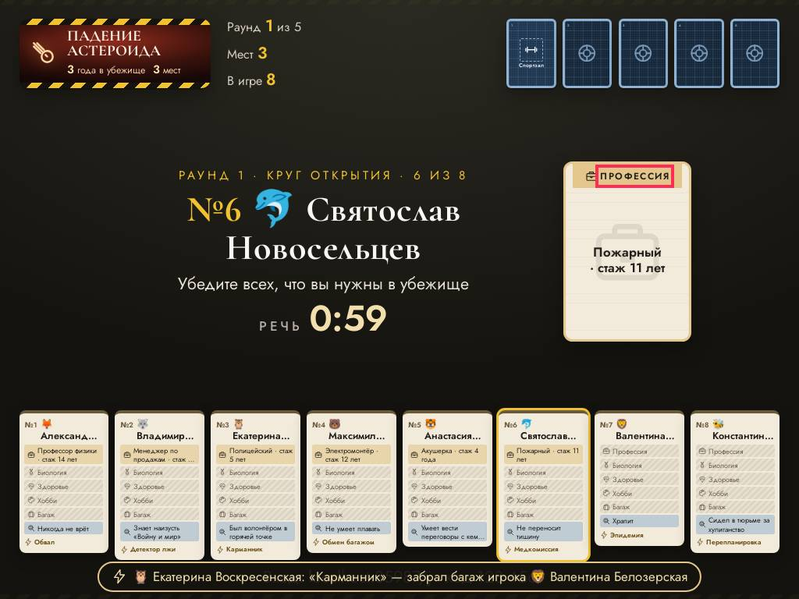

### мелко для зала · экран зала

шрифт 12.3 px — 17 px на Full HD (нужно от 18) — «6 карт»

- где: `div.dk-seat.dk-seat--throw > div.dk-seat__card > span.dk-seat__text > span.dk-seat__meta`, этап `playing/17/question/play`
- игры (1): durak 1-й шаблон, каждый сам ×4, проектор 4:3, маленький телефон, длинные имена
- раз: 3

### мелко для зала · экран зала

шрифт 11.5 px — 16 px на Full HD (нужно от 18) — «Может подкинуть»

- где: `div.dk-table > div.dk-seat.dk-seat--throw > div.dk-seat__card > span.dk-seat__status`, этап `playing/17/question/play`
- игры (1): durak 1-й шаблон, каждый сам ×4, проектор 4:3, маленький телефон, длинные имена
- раз: 3

### мелко для зала · экран зала

шрифт 11.3 px — 16 px на Full HD (нужно от 18) — «Дельфины маркетинга и PR»

- где: `div.dg-frame > div.dg-q.dg-q--center > p.dg-q__note > span`, этап `playing/19/reveal/`
- игры (1): dragon 1-й шаблон, команды ×4, проектор 4:3, маленький телефон, длинные имена
- раз: 2

### мелко для зала · экран зала

шрифт 11.3 px — 16 px на Full HD (нужно от 18) — «У каждого героя своя сила. Капитан раскладывает 5 очков по свойствам: Сила, Ум, »

- где: `div.dg-stage.dg-stage--kid > div.dg-frame > div.dg-q.dg-q--center > p.dg-q__note`, этап `playing/1/question/`
- игры (1): dragon 2-й шаблон, команды ×4, проектор 4:3, маленький телефон, длинные имена
- раз: 2

### мелко для зала · экран зала

шрифт 17.3 px — 17 px на Full HD (нужно от 18) — «6 карт»

- где: `div.dk-seat.dk-seat--turn > div.dk-seat__card > span.dk-seat__text > span.dk-seat__meta`, этап `playing/16/question/play`
- игры (1): durak 1-й шаблон, каждый сам ×4, телевизор full hd; durak 1-й шаблон, каждый сам ×4, ноутбук 16:10, большой зал, длинные имена
- раз: 2

### мелко для зала · экран зала

шрифт 16.2 px — 16 px на Full HD (нужно от 18) — «Ходит»

- где: `div.dk-table > div.dk-seat.dk-seat--turn > div.dk-seat__card > span.dk-seat__status`, этап `playing/16/question/play`
- игры (1): durak 1-й шаблон, каждый сам ×4, телевизор full hd; durak 1-й шаблон, каждый сам ×4, ноутбук 16:10, большой зал, длинные имена
- раз: 2

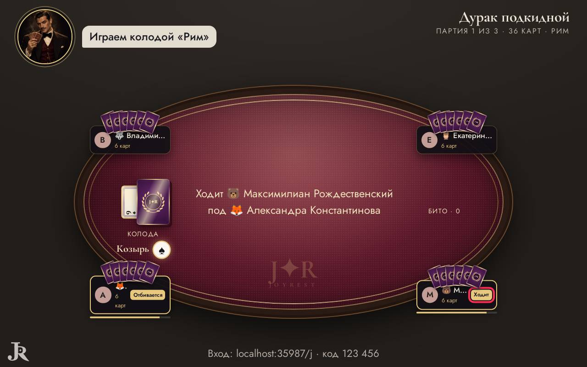

### мелко для зала · экран зала

шрифт 10.8 px — 15 px на Full HD (нужно от 18) — «● ИДЁТ ВЫСТУПЛЕНИЕ»

- где: `main.quiz-stage > div.dance-screen.db-stage > div.db-video.db-video--art > span.db-live`, этап `playing/0/reveal/perform`
- игры (1): dance 1-й шаблон, команды ×4, проектор 4:3, маленький телефон, длинные имена
- раз: 1

### мелко для зала · экран зала

шрифт 10.8 px — 15 px на Full HD (нужно от 18) — «На сцене»

- где: `div.dance-screen.db-stage > div.db-side > div > span.db-kicker`, этап `playing/0/reveal/perform`
- игры (1): dance 1-й шаблон, команды ×4, проектор 4:3, маленький телефон, длинные имена
- раз: 1

### мелко для зала · экран зала

шрифт 11.8 px — 17 px на Full HD (нужно от 18) — «Латина»

- где: `div.db-side > div.db-mini > div.db-mini__text > span`, этап `playing/0/reveal/perform`
- игры (1): dance 1-й шаблон, команды ×4, проектор 4:3, маленький телефон, длинные имена
- раз: 1

### мелко для зала · экран зала

шрифт 12.3 px — 17 px на Full HD (нужно от 18) — «Вся команда выходит и повторяет за ведущим»

- где: `main.quiz-stage > div.dance-screen.db-stage > div.db-side > p.db-hint`, этап `playing/0/reveal/perform`
- игры (1): dance 1-й шаблон, команды ×4, проектор 4:3, маленький телефон, длинные имена
- раз: 1

### мелко для зала · экран зала

шрифт 11.3 px — 16 px на Full HD (нужно от 18) — «Выполняйте — ведущий засчитает удар»

- где: `div.dg-stage.dg-stage--kid > div.dg-frame > div.dg-q > p.dg-q__note`, этап `playing/15/reveal/`
- игры (1): dragon 2-й шаблон, команды ×4, проектор 4:3, маленький телефон, длинные имена
- раз: 1

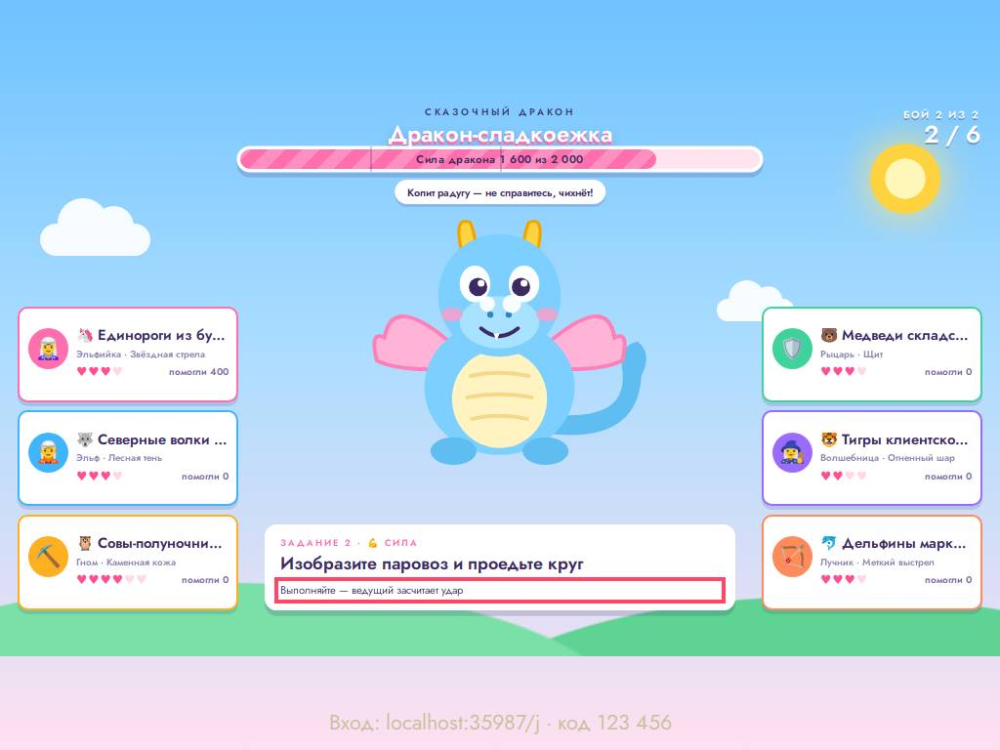

### мелко для зала · экран зала

шрифт 13.1 px — 18 px на Full HD (нужно от 18) — «Детектор лжи»

- где: `div.bk-stage.bk-stage--exile > div.bk-stage__dossier > article.bk-dossier.bk-dossier--big > p.bk-dossier__used`, этап `playing/34/question/exile`
- игры (1): bunker 1-й шаблон, каждый сам ×8, проектор 4:3, маленький телефон, длинные имена
- раз: 1

### мелко для зала · экран зала

шрифт 13.1 px — 18 px на Full HD (нужно от 18) — «Изгнан»

- где: `div.bk-stage.bk-stage--exile > div.bk-stage__dossier > article.bk-dossier.bk-dossier--big > span.bk-dossier__stamp`, этап `playing/34/question/exile`
- игры (1): bunker 1-й шаблон, каждый сам ×8, проектор 4:3, маленький телефон, длинные имена
- раз: 1

## Мелочи — 71

### мелкий текст · телефон

шрифт 10.0 px (нужно от 12) — «Серебро»

- где: `div.lotto-ticket.lotto-ticket--evening > div.lotto-card > button.lotto-card__cell > span.lotto-card__artist`, этап `playing/0/question/`
- игры (1): lotto 1-й шаблон, каждый сам ×4, проектор 4:3, маленький телефон, длинные имена; lotto 1-й шаблон, каждый сам ×4, телевизор full hd; lotto 1-й шаблон, команды ×4, телевизор full hd; lotto 1-й шаблон, каждый сам ×16, ноутбук 16:10, большой зал, длинные имена; lotto 1-й шаблон, команды ×4, проектор 4:3, маленький телефон, длинные имена; lotto 1-й шаблон, команды ×8, ноутбук 16:10, большой зал, длинные имена
- раз: 2505

### мелкий текст · телефон

шрифт 10.0 px (нужно от 12) — «Звезда по имени Солнце»

- где: `div.lotto-ticket.lotto-ticket--evening > div.lotto-card > button.lotto-card__cell > span.lotto-card__title`, этап `playing/0/question/`
- игры (1): lotto 1-й шаблон, каждый сам ×4, проектор 4:3, маленький телефон, длинные имена; lotto 1-й шаблон, каждый сам ×4, телевизор full hd; lotto 1-й шаблон, команды ×4, телевизор full hd; lotto 1-й шаблон, каждый сам ×16, ноутбук 16:10, большой зал, длинные имена; lotto 1-й шаблон, команды ×4, проектор 4:3, маленький телефон, длинные имена; lotto 1-й шаблон, команды ×8, ноутбук 16:10, большой зал, длинные имена
- раз: 2283

### мелкий текст · телефон

шрифт 9.2 px (нужно от 12) — «Профессия»

- где: `div.bk-card.bk-trait > div.bk-in > span.bk-trait__band > span`, этап `playing/1/question/catastrophe`
- игры (1): bunker 1-й шаблон, каждый сам ×8, телевизор full hd; bunker 1-й шаблон, каждый сам ×8, проектор 4:3, маленький телефон, длинные имена; bunker 1-й шаблон, каждый сам ×8, ноутбук 16:10, большой зал, длинные имена
- раз: 2016

### мелкий текст · пульт

шрифт 10.0 px (нужно от 12) — «Красное»

- где: `div.wine-row > span.wine-row__cells > span.wine-cell > span.wine-cell__label`, этап `playing/1/question/bet`
- игры (1): wine 1-й шаблон, каждый сам ×4, телевизор full hd; wine 1-й шаблон, каждый сам ×16, ноутбук 16:10, большой зал, длинные имена; wine 1-й шаблон, каждый сам ×4, проектор 4:3, маленький телефон, длинные имена; wine 1-й шаблон, команды ×4, проектор 4:3, маленький телефон, длинные имена; wine 1-й шаблон, команды ×4, телевизор full hd; wine 1-й шаблон, команды ×8, ноутбук 16:10, большой зал, длинные имена
- раз: 1200

### мелкий текст · телефон

шрифт 10.8 px (нужно от 12) — «Системный администратор · стаж 10 лет»

- где: `li > div.bk-card.bk-trait > div.bk-in > span.bk-trait__text`, этап `playing/1/question/catastrophe`
- игры (1): bunker 1-й шаблон, каждый сам ×8, проектор 4:3, маленький телефон, длинные имена
- раз: 666

### мелкий текст · телефон

шрифт 7.2 px (нужно от 12) — «Особое условие»

- где: `div.bk-card.bk-special > div.bk-in > span.bk-special__band > span`, этап `playing/1/question/catastrophe`
- игры (1): bunker 1-й шаблон, каждый сам ×8, телевизор full hd; bunker 1-й шаблон, каждый сам ×8, проектор 4:3, маленький телефон, длинные имена; bunker 1-й шаблон, каждый сам ×8, ноутбук 16:10, большой зал, длинные имена
- раз: 336

### мелкий текст · телефон

шрифт 11.0 px (нужно от 12) — «Неприкосновенность»

- где: `div.bk-phone__specialcard > div.bk-card.bk-special > div.bk-in > span.bk-special__title`, этап `playing/1/question/catastrophe`
- игры (1): bunker 1-й шаблон, каждый сам ×8, телевизор full hd; bunker 1-й шаблон, каждый сам ×8, проектор 4:3, маленький телефон, длинные имена; bunker 1-й шаблон, каждый сам ×8, ноутбук 16:10, большой зал, длинные имена
- раз: 336

### мелкий текст · телефон

шрифт 7.3 px (нужно от 12) — «Голоса против вас в этом голосовании не считаются.»

- где: `div.bk-phone__specialcard > div.bk-card.bk-special > div.bk-in > span.bk-special__text`, этап `playing/1/question/catastrophe`
- игры (1): bunker 1-й шаблон, каждый сам ×8, телевизор full hd; bunker 1-й шаблон, каждый сам ×8, проектор 4:3, маленький телефон, длинные имена; bunker 1-й шаблон, каждый сам ×8, ноутбук 16:10, большой зал, длинные имена
- раз: 336

### мелкий текст · телефон

шрифт 9.9 px (нужно от 12) — «сыграно»

- где: `div.bk-phone__specialcard > div.bk-card.bk-special > div.bk-in > span.bk-special__stamp`, этап `playing/3/question/open`
- игры (1): bunker 1-й шаблон, каждый сам ×8, телевизор full hd; bunker 1-й шаблон, каждый сам ×8, проектор 4:3, маленький телефон, длинные имена; bunker 1-й шаблон, каждый сам ×8, ноутбук 16:10, большой зал, длинные имена
- раз: 254

### мелкий текст · телефон

шрифт 10.0 px (нужно от 12) — «Одна линия»

- где: `div.quiz-phone.lotto-phone > div.lotto-ticket.lotto-ticket--evening > div.lotto-ticket__head > p.lotto-ticket__rule`, этап `playing/0/question/`
- игры (1): lotto 1-й шаблон, каждый сам ×4, проектор 4:3, маленький телефон, длинные имена; lotto 1-й шаблон, каждый сам ×4, телевизор full hd; lotto 1-й шаблон, команды ×4, телевизор full hd; lotto 1-й шаблон, каждый сам ×16, ноутбук 16:10, большой зал, длинные имена; lotto 1-й шаблон, команды ×4, проектор 4:3, маленький телефон, длинные имена; lotto 1-й шаблон, команды ×8, ноутбук 16:10, большой зал, длинные имена
- раз: 186

### мелкий текст · пульт

шрифт 11.0 px (нужно от 12) — «Цвет»

- где: `div.wine-table.wine-table--compact > div.wine-row > span.wine-row__head > span.wine-row__title`, этап `playing/1/question/bet`
- игры (1): wine 1-й шаблон, каждый сам ×4, телевизор full hd; wine 1-й шаблон, каждый сам ×16, ноутбук 16:10, большой зал, длинные имена; wine 1-й шаблон, каждый сам ×4, проектор 4:3, маленький телефон, длинные имена; wine 1-й шаблон, команды ×4, проектор 4:3, маленький телефон, длинные имена; wine 1-й шаблон, команды ×4, телевизор full hd; wine 1-й шаблон, команды ×8, ноутбук 16:10, большой зал, длинные имена
- раз: 144

### мелкий текст · телефон

шрифт 11.0 px (нужно от 12) — «Эльфийка»

- где: `div.stack > div.dr-pick > button.dr-pick__item > span.dr-pick__name`, этап `playing/1/question/`
- игры (1): dragon 1-й шаблон, команды ×4, телевизор full hd; dragon 1-й шаблон, команды ×4, проектор 4:3, маленький телефон, длинные имена; dragon 1-й шаблон, команды ×8, ноутбук 16:10, большой зал, длинные имена; dragon 2-й шаблон, команды ×4, телевизор full hd; dragon 2-й шаблон, команды ×4, проектор 4:3, маленький телефон, длинные имена; dragon 2-й шаблон, команды ×8, ноутбук 16:10, большой зал, длинные имена
- раз: 120

### мелкий текст · пульт

шрифт 9.0 px (нужно от 12) — «🔒 батл»

- где: `div.stage-field.stage-field--compact > div.stage-field__row > button.stage-tile > span.stage-tile__tag`, этап `playing/0/reveal/pick`
- игры (1): stage 1-й шаблон, команды ×4, телевизор full hd; stage 1-й шаблон, команды ×8, ноутбук 16:10, большой зал, длинные имена; stage 1-й шаблон, команды ×4, проектор 4:3, маленький телефон, длинные имена; stage 2-й шаблон, команды ×4, телевизор full hd; stage 2-й шаблон, команды ×8, ноутбук 16:10, большой зал, длинные имена; stage 2-й шаблон, команды ×4, проектор 4:3, маленький телефон, длинные имена
- раз: 106

### мелкий текст · пульт

шрифт 11.0 px (нужно от 12) — «кот»

- где: `div.board-host__grid > div.board-host__row > button.board-host__cell > small`, этап `playing/0/ready/`
- игры (1): board 1-й шаблон, каждый сам ×4, телевизор full hd; board 1-й шаблон, каждый сам ×4, проектор 4:3, маленький телефон, длинные имена; board 1-й шаблон, команды ×4, телевизор full hd; board 1-й шаблон, каждый сам ×16, ноутбук 16:10, большой зал, длинные имена; board 1-й шаблон, команды ×4, проектор 4:3, маленький телефон, длинные имена; board 1-й шаблон, команды ×8, ноутбук 16:10, большой зал, длинные имена
- раз: 91

### мелкий текст · пульт

шрифт 11.0 px (нужно от 12) — «2 М»

- где: `div.stage-field.stage-field--compact > div.stage-field__row > div.stage-tile > span.stage-tile__who`, этап `playing/2/reveal/pick`
- игры (1): stage 1-й шаблон, команды ×4, телевизор full hd; stage 1-й шаблон, команды ×8, ноутбук 16:10, большой зал, длинные имена; stage 1-й шаблон, команды ×4, проектор 4:3, маленький телефон, длинные имена; stage 2-й шаблон, команды ×4, телевизор full hd; stage 2-й шаблон, команды ×8, ноутбук 16:10, большой зал, длинные имена; stage 2-й шаблон, команды ×4, проектор 4:3, маленький телефон, длинные имена
- раз: 88

### мелкий текст · телефон

шрифт 6.1 px (нужно от 12) — «во время голосования»

- где: `div.bk-phone__specialcard > div.bk-card.bk-special > div.bk-in > span.bk-special__when`, этап `playing/1/question/catastrophe`
- игры (1): bunker 1-й шаблон, каждый сам ×8, телевизор full hd; bunker 1-й шаблон, каждый сам ×8, проектор 4:3, маленький телефон, длинные имена; bunker 1-й шаблон, каждый сам ×8, ноутбук 16:10, большой зал, длинные имена
- раз: 45

### мелкий текст · телефон

шрифт 10.8 px (нужно от 12) — «10»

- где: `div.dk-mini > span.dk-mini__pair > div.dk-card.dk-d--rome > span.dk-idx`, этап `playing/17/question/play`
- игры (1): durak 1-й шаблон, каждый сам ×4, телевизор full hd; durak 1-й шаблон, каждый сам ×4, ноутбук 16:10, большой зал, длинные имена
- раз: 44

### мелкий текст · телефон

шрифт 10.8 px (нужно от 12) — «10»

- где: `div.dk-mini > span.dk-mini__pair > div.dk-card.dk-d--rome > span.dk-idx.dk-idx--b`, этап `playing/17/question/play`
- игры (1): durak 1-й шаблон, каждый сам ×4, телевизор full hd; durak 1-й шаблон, каждый сам ×4, ноутбук 16:10, большой зал, длинные имена
- раз: 44

### мелкий текст · телефон

шрифт 11.4 px (нужно от 12) — «№ 1»

- где: `button.mf-card > span.mf-card__inner > div.mf-card__face.mf-card__front > span.mf-card__seat`, этап `playing/0/reveal/roles`
- игры (1): mafia 1-й шаблон, каждый сам ×9, ноутбук 16:10, большой зал, длинные имена; mafia 1-й шаблон, каждый сам ×9, телевизор full hd; mafia 1-й шаблон, каждый сам ×9, проектор 4:3, маленький телефон, длинные имена
- раз: 39

### мелкий текст · телефон

шрифт 11.4 px (нужно от 12) — «Мафия»

- где: `button.mf-card > span.mf-card__inner > div.mf-card__face.mf-card__front > span.mf-card__side`, этап `playing/0/reveal/roles`
- игры (1): mafia 1-й шаблон, каждый сам ×9, ноутбук 16:10, большой зал, длинные имена; mafia 1-й шаблон, каждый сам ×9, телевизор full hd; mafia 1-й шаблон, каждый сам ×9, проектор 4:3, маленький телефон, длинные имена
- раз: 39

### мелкий текст · телефон

шрифт 11.9 px (нужно от 12) — «от гостя: Игрок»

- где: `div.quiz-phone.td-phone > div.td-flip.td-flip--phone > div.td-face.td-face--dare > span.td-face__from`, этап `playing/2/reveal/done`
- игры (1): truth 1-й шаблон, команды ×4, телевизор full hd; truth 1-й шаблон, команды ×4, проектор 4:3, маленький телефон, длинные имена; truth 2-й шаблон, команды ×4, телевизор full hd; truth 2-й шаблон, команды ×4, проектор 4:3, маленький телефон, длинные имена
- раз: 36

### мелкий текст · телефон

шрифт 10.8 px (нужно от 12) — «9»

- где: `div.dk-mini > span.dk-mini__pair > div.dk-card.dk-d--gothic > span.dk-idx`, этап `playing/57/question/play`
- игры (1): durak 1-й шаблон, каждый сам ×4, телевизор full hd; durak 1-й шаблон, каждый сам ×4, проектор 4:3, маленький телефон, длинные имена; durak 1-й шаблон, каждый сам ×4, ноутбук 16:10, большой зал, длинные имена
- раз: 33

### мелкий текст · телефон

шрифт 10.8 px (нужно от 12) — «9»

- где: `div.dk-mini > span.dk-mini__pair > div.dk-card.dk-d--gothic > span.dk-idx.dk-idx--b`, этап `playing/57/question/play`
- игры (1): durak 1-й шаблон, каждый сам ×4, телевизор full hd; durak 1-й шаблон, каждый сам ×4, проектор 4:3, маленький телефон, длинные имена; durak 1-й шаблон, каждый сам ×4, ноутбук 16:10, большой зал, длинные имена
- раз: 33

### мелкий текст · пульт

шрифт 11.0 px (нужно от 12) — «Меньше всех»

- где: `div.stack.stack--tight > ol.wager-board.wager-board--compact > li.wager-slot.wager-slot--low > span.wager-slot__value`, этап `playing/2/question/bet`
- игры (1): wager 1-й шаблон, команды ×4, телевизор full hd; wager 1-й шаблон, команды ×4, проектор 4:3, маленький телефон, длинные имена; wager 1-й шаблон, команды ×8, ноутбук 16:10, большой зал, длинные имена; wager 1-й шаблон, каждый сам ×4, телевизор full hd; wager 1-й шаблон, каждый сам ×16, ноутбук 16:10, большой зал, длинные имена; wager 1-й шаблон, каждый сам ×4, проектор 4:3, маленький телефон, длинные имена
- раз: 29

### мелкий текст · телефон

шрифт 11.6 px (нужно от 12) — «Ночью спите. Днём — ваш голос решает, кто покинет город.»

- где: `button.mf-card > span.mf-card__inner > div.mf-card__face.mf-card__front > p.mf-card__power`, этап `playing/0/reveal/roles`
- игры (1): mafia 1-й шаблон, каждый сам ×9, телевизор full hd; mafia 1-й шаблон, каждый сам ×9, проектор 4:3, маленький телефон, длинные имена
- раз: 27

### мелкий текст · телефон

шрифт 10.8 px (нужно от 12) — «10»

- где: `div.dk-mini > span.dk-mini__pair > div.dk-card.dk-d--greece > span.dk-idx`, этап `playing/20/question/play`
- игры (1): durak 1-й шаблон, каждый сам ×4, телевизор full hd; durak 1-й шаблон, каждый сам ×4, ноутбук 16:10, большой зал, длинные имена
- раз: 24

### мелкий текст · телефон

шрифт 10.8 px (нужно от 12) — «10»

- где: `div.dk-mini > span.dk-mini__pair > div.dk-card.dk-d--greece > span.dk-idx.dk-idx--b`, этап `playing/20/question/play`
- игры (1): durak 1-й шаблон, каждый сам ×4, телевизор full hd; durak 1-й шаблон, каждый сам ×4, ноутбук 16:10, большой зал, длинные имена
- раз: 24

### мелкий текст · телефон

шрифт 10.6 px (нужно от 12) — «Убежище»

- где: `div.bk-phone__back > div.bk-card.bk-back > div.bk-in > span.bk-back__word`, этап `playing/0/question/deal`
- игры (1): bunker 1-й шаблон, каждый сам ×8, телевизор full hd; bunker 1-й шаблон, каждый сам ×8, проектор 4:3, маленький телефон, длинные имена; bunker 1-й шаблон, каждый сам ×8, ноутбук 16:10, большой зал, длинные имена
- раз: 24

### мелкий текст · пульт

шрифт 11.3 px (нужно от 12) — «№ 3»

- где: `div.stack.host-quiz > div.dance-cards > button.dance-card.dance-card--battle > span.dance-card__n`, этап `playing/0/question/pick`
- игры (1): dance 1-й шаблон, команды ×4, телевизор full hd; dance 1-й шаблон, команды ×4, проектор 4:3, маленький телефон, длинные имена; dance 1-й шаблон, команды ×8, ноутбук 16:10, большой зал, длинные имена
- раз: 21

### мелкий текст · телефон

шрифт 10.8 px (нужно от 12) — «10»

- где: `div.dk-mini > span.dk-mini__pair > div.dk-card.dk-d--russia > span.dk-idx`, этап `playing/13/question/play`
- игры (1): durak 1-й шаблон, каждый сам ×4, телевизор full hd; durak 1-й шаблон, каждый сам ×4, проектор 4:3, маленький телефон, длинные имена; durak 1-й шаблон, каждый сам ×4, ноутбук 16:10, большой зал, длинные имена
- раз: 21

### мелкий текст · телефон

шрифт 10.8 px (нужно от 12) — «10»

- где: `div.dk-mini > span.dk-mini__pair > div.dk-card.dk-d--russia > span.dk-idx.dk-idx--b`, этап `playing/13/question/play`
- игры (1): durak 1-й шаблон, каждый сам ×4, телевизор full hd; durak 1-й шаблон, каждый сам ×4, проектор 4:3, маленький телефон, длинные имена; durak 1-й шаблон, каждый сам ×4, ноутбук 16:10, большой зал, длинные имена
- раз: 21

### мелкий текст · телефон

шрифт 10.8 px (нужно от 12) — «9»

- где: `div.dk-mini > span.dk-mini__pair > div.dk-card.dk-d--classic > span.dk-idx`, этап `playing/93/question/play`
- игры (1): durak 1-й шаблон, каждый сам ×4, телевизор full hd; durak 1-й шаблон, каждый сам ×4, проектор 4:3, маленький телефон, длинные имена; durak 1-й шаблон, каждый сам ×4, ноутбук 16:10, большой зал, длинные имена
- раз: 19

### мелкий текст · телефон

шрифт 10.8 px (нужно от 12) — «9»

- где: `div.dk-mini > span.dk-mini__pair > div.dk-card.dk-d--classic > span.dk-idx.dk-idx--b`, этап `playing/93/question/play`
- игры (1): durak 1-й шаблон, каждый сам ×4, телевизор full hd; durak 1-й шаблон, каждый сам ×4, проектор 4:3, маленький телефон, длинные имена; durak 1-й шаблон, каждый сам ×4, ноутбук 16:10, большой зал, длинные имена
- раз: 19

### мелкий текст · телефон

шрифт 11.4 px (нужно от 12) — «№ 1»

- где: `div.mf-card.mf-card--still > span.mf-card__inner > div.mf-card__face.mf-card__front > span.mf-card__seat`, этап `playing/45/reveal/over`
- игры (1): mafia 1-й шаблон, каждый сам ×9, ноутбук 16:10, большой зал, длинные имена; mafia 1-й шаблон, каждый сам ×9, телевизор full hd; mafia 1-й шаблон, каждый сам ×9, проектор 4:3, маленький телефон, длинные имена
- раз: 18

### мелкий текст · телефон

шрифт 11.4 px (нужно от 12) — «Мафия»

- где: `div.mf-card.mf-card--still > span.mf-card__inner > div.mf-card__face.mf-card__front > span.mf-card__side`, этап `playing/45/reveal/over`
- игры (1): mafia 1-й шаблон, каждый сам ×9, ноутбук 16:10, большой зал, длинные имена; mafia 1-й шаблон, каждый сам ×9, телевизор full hd; mafia 1-й шаблон, каждый сам ×9, проектор 4:3, маленький телефон, длинные имена
- раз: 18

### мелкий текст · пульт

шрифт 11.3 px (нужно от 12) — «№ 1»

- где: `div.stack.host-quiz > div.dance-cards > button.dance-card.dance-card--dance > span.dance-card__n`, этап `playing/0/question/pick`
- игры (1): dance 1-й шаблон, команды ×4, телевизор full hd; dance 1-й шаблон, команды ×4, проектор 4:3, маленький телефон, длинные имена; dance 1-й шаблон, команды ×8, ноутбук 16:10, большой зал, длинные имена
- раз: 17

### мелкий текст · телефон

шрифт 11.6 px (нужно от 12) — «Ночью спите. Днём — ваш голос решает, кто покинет город.»

- где: `div.mf-card.mf-card--still > span.mf-card__inner > div.mf-card__face.mf-card__front > p.mf-card__power`, этап `playing/39/reveal/over`
- игры (1): mafia 1-й шаблон, каждый сам ×9, телевизор full hd; mafia 1-й шаблон, каждый сам ×9, проектор 4:3, маленький телефон, длинные имена
- раз: 15

### мелкий текст · пульт

шрифт 11.3 px (нужно от 12) — «№ 2»

- где: `div.stack.host-quiz > div.dance-cards > button.dance-card.dance-card--karaoke > span.dance-card__n`, этап `playing/0/question/pick`
- игры (1): dance 1-й шаблон, команды ×4, телевизор full hd; dance 1-й шаблон, команды ×4, проектор 4:3, маленький телефон, длинные имена; dance 1-й шаблон, команды ×8, ноутбук 16:10, большой зал, длинные имена
- раз: 14

### мелкий текст · телефон

шрифт 10.8 px (нужно от 12) — «7»

- где: `div.dk-mini > span.dk-mini__pair > div.dk-card.dk-d--wedding > span.dk-idx`, этап `playing/53/question/play`
- игры (1): durak 1-й шаблон, каждый сам ×4, телевизор full hd; durak 1-й шаблон, каждый сам ×4, проектор 4:3, маленький телефон, длинные имена; durak 1-й шаблон, каждый сам ×4, ноутбук 16:10, большой зал, длинные имена
- раз: 14

### мелкий текст · телефон

шрифт 10.8 px (нужно от 12) — «7»

- где: `div.dk-mini > span.dk-mini__pair > div.dk-card.dk-d--wedding > span.dk-idx.dk-idx--b`, этап `playing/53/question/play`
- игры (1): durak 1-й шаблон, каждый сам ×4, телевизор full hd; durak 1-й шаблон, каждый сам ×4, проектор 4:3, маленький телефон, длинные имена; durak 1-й шаблон, каждый сам ×4, ноутбук 16:10, большой зал, длинные имена
- раз: 14

### мелкий текст · пульт

шрифт 11.3 px (нужно от 12) — «№ 2»

- где: `div.stack.host-quiz > div.dance-cards > div.dance-card.dance-card--karaoke > span.dance-card__n`, этап `playing/8/question/pick`
- игры (1): dance 1-й шаблон, команды ×4, телевизор full hd; dance 1-й шаблон, команды ×4, проектор 4:3, маленький телефон, длинные имена; dance 1-й шаблон, команды ×8, ноутбук 16:10, большой зал, длинные имена
- раз: 13

### мелкий текст · телефон

шрифт 8.3 px (нужно от 12) — «J✦R»

- где: `div.dk-hand__row > button.dk-hand__slot > div.dk-card.dk-d--gothic > span.dk-brand`, этап `playing/57/question/play`
- игры (1): durak 1-й шаблон, каждый сам ×4, телевизор full hd; durak 1-й шаблон, каждый сам ×4, проектор 4:3, маленький телефон, длинные имена; durak 1-й шаблон, каждый сам ×4, ноутбук 16:10, большой зал, длинные имена
- раз: 13

### мелкий текст · телефон

шрифт 11.4 px (нужно от 12) — «Ваша семья: 🐻 Максимилиан Рождественский (Дон)»

- где: `button.mf-card > span.mf-card__inner > div.mf-card__face.mf-card__front > p.mf-card__family`, этап `playing/0/reveal/roles`
- игры (1): mafia 1-й шаблон, каждый сам ×9, ноутбук 16:10, большой зал, длинные имена; mafia 1-й шаблон, каждый сам ×9, телевизор full hd; mafia 1-й шаблон, каждый сам ×9, проектор 4:3, маленький телефон, длинные имена
- раз: 12

### мелкий текст · телефон

шрифт 7.4 px (нужно от 12) — «J✦R»

- где: `div.dk-hand__row > button.dk-hand__slot > div.dk-card.dk-d--rome > span.dk-brand`, этап `playing/16/question/play`
- игры (1): durak 1-й шаблон, каждый сам ×4, проектор 4:3, маленький телефон, длинные имена; durak 1-й шаблон, каждый сам ×4, ноутбук 16:10, большой зал, длинные имена
- раз: 12

### мелкий текст · телефон

шрифт 8.3 px (нужно от 12) — «J✦R»

- где: `div.dk-hand__row > button.dk-hand__slot > div.dk-card.dk-d--wedding > span.dk-brand`, этап `playing/53/question/play`
- игры (1): durak 1-й шаблон, каждый сам ×4, телевизор full hd; durak 1-й шаблон, каждый сам ×4, проектор 4:3, маленький телефон, длинные имена; durak 1-й шаблон, каждый сам ×4, ноутбук 16:10, большой зал, длинные имена
- раз: 11

### мелкий текст · пульт

шрифт 11.3 px (нужно от 12) — «№ 1»

- где: `div.stack.host-quiz > div.dance-cards > div.dance-card.dance-card--dance > span.dance-card__n`, этап `playing/8/question/pick`
- игры (1): dance 1-й шаблон, команды ×4, телевизор full hd; dance 1-й шаблон, команды ×4, проектор 4:3, маленький телефон, длинные имена; dance 1-й шаблон, команды ×8, ноутбук 16:10, большой зал, длинные имена
- раз: 10

### мелкий текст · телефон

шрифт 10.1 px (нужно от 12) — «💃 Латина»

- где: `button.db-swipe__item > span.db-card.db-card--dance > span.db-card__label > span.db-card__style`, этап `playing/0/question/pick`
- игры (1): dance 1-й шаблон, команды ×4, телевизор full hd; dance 1-й шаблон, команды ×4, проектор 4:3, маленький телефон, длинные имена; dance 1-й шаблон, команды ×8, ноутбук 16:10, большой зал, длинные имена
- раз: 9

### мелкий текст · телефон

шрифт 8.1 px (нужно от 12) — «№ 1»

- где: `button.db-swipe__item > span.db-card.db-card--dance > span.db-card__label > span.db-card__n`, этап `playing/0/question/pick`
- игры (1): dance 1-й шаблон, команды ×4, телевизор full hd; dance 1-й шаблон, команды ×4, проектор 4:3, маленький телефон, длинные имена; dance 1-й шаблон, команды ×8, ноутбук 16:10, большой зал, длинные имена
- раз: 9

### мелкий текст · телефон

шрифт 8.1 px (нужно от 12) — «№ 2»

- где: `button.db-swipe__item > span.db-card.db-card--karaoke > span.db-card__label > span.db-card__n`, этап `playing/0/question/pick`
- игры (1): dance 1-й шаблон, команды ×4, телевизор full hd; dance 1-й шаблон, команды ×4, проектор 4:3, маленький телефон, длинные имена; dance 1-й шаблон, команды ×8, ноутбук 16:10, большой зал, длинные имена
- раз: 9

### мелкий текст · телефон

шрифт 10.1 px (нужно от 12) — «🎉 Вечеринка»

- где: `button.db-swipe__item > span.db-card.db-card--battle > span.db-card__label > span.db-card__style`, этап `playing/0/question/pick`
- игры (1): dance 1-й шаблон, команды ×4, телевизор full hd; dance 1-й шаблон, команды ×4, проектор 4:3, маленький телефон, длинные имена; dance 1-й шаблон, команды ×8, ноутбук 16:10, большой зал, длинные имена
- раз: 9

### мелкий текст · телефон

шрифт 8.1 px (нужно от 12) — «№ 3»

- где: `button.db-swipe__item > span.db-card.db-card--battle > span.db-card__label > span.db-card__n`, этап `playing/0/question/pick`
- игры (1): dance 1-й шаблон, команды ×4, телевизор full hd; dance 1-й шаблон, команды ×4, проектор 4:3, маленький телефон, длинные имена; dance 1-й шаблон, команды ×8, ноутбук 16:10, большой зал, длинные имена
- раз: 9

### мелкий текст · телефон

шрифт 8.3 px (нужно от 12) — «J✦R»

- где: `div.dk-hand__row > button.dk-hand__slot > div.dk-card.dk-d--russia > span.dk-brand`, этап `playing/69/question/play`
- игры (1): durak 1-й шаблон, каждый сам ×4, телевизор full hd; durak 1-й шаблон, каждый сам ×4, проектор 4:3, маленький телефон, длинные имена; durak 1-й шаблон, каждый сам ×4, ноутбук 16:10, большой зал, длинные имена
- раз: 9

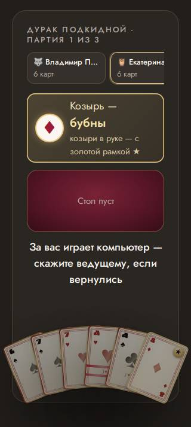

### мелкий текст · телефон

шрифт 8.3 px (нужно от 12) — «J✦R»

- где: `div.dk-hand__row > button.dk-hand__slot > div.dk-card.dk-d--classic > span.dk-brand`, этап `playing/93/question/play`
- игры (1): durak 1-й шаблон, каждый сам ×4, телевизор full hd; durak 1-й шаблон, каждый сам ×4, проектор 4:3, маленький телефон, длинные имена; durak 1-й шаблон, каждый сам ×4, ноутбук 16:10, большой зал, длинные имена
- раз: 9

### мелкий текст · телефон

шрифт 8.3 px (нужно от 12) — «J✦R»

- где: `div.dk-hand__row > button.dk-hand__slot > div.dk-card.dk-d--greece > span.dk-brand`, этап `playing/124/question/play`
- игры (1): durak 1-й шаблон, каждый сам ×4, телевизор full hd; durak 1-й шаблон, каждый сам ×4, проектор 4:3, маленький телефон, длинные имена; durak 1-й шаблон, каждый сам ×4, ноутбук 16:10, большой зал, длинные имена
- раз: 9

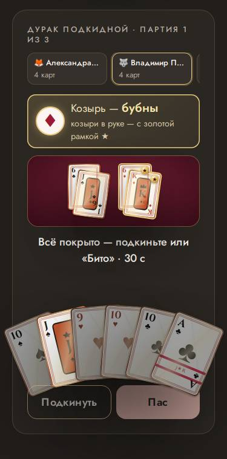

### мелкий текст · пульт

шрифт 11.3 px (нужно от 12) — «№ 3»

- где: `div.stack.host-quiz > div.dance-cards > div.dance-card.dance-card--battle > span.dance-card__n`, этап `playing/16/question/pick`
- игры (1): dance 1-й шаблон, команды ×4, телевизор full hd; dance 1-й шаблон, команды ×4, проектор 4:3, маленький телефон, длинные имена; dance 1-й шаблон, команды ×8, ноутбук 16:10, большой зал, длинные имена
- раз: 6

### мелкий текст · телефон

шрифт 7.4 px (нужно от 12) — «J✦R»

- где: `div.dk-hand__row > button.dk-hand__slot > div.dk-card.dk-d--cyber > span.dk-brand`, этап `playing/4/question/play`
- игры (1): durak 1-й шаблон, каждый сам ×4, проектор 4:3, маленький телефон, длинные имена; durak 1-й шаблон, каждый сам ×4, ноутбук 16:10, большой зал, длинные имена
- раз: 6

### мелкий текст · телефон

шрифт 10.8 px (нужно от 12) — «7»

- где: `div.dk-mini > span.dk-mini__pair > div.dk-card.dk-d--anime > span.dk-idx`, этап `playing/64/question/play`
- игры (1): durak 1-й шаблон, каждый сам ×4, ноутбук 16:10, большой зал, длинные имена
- раз: 6

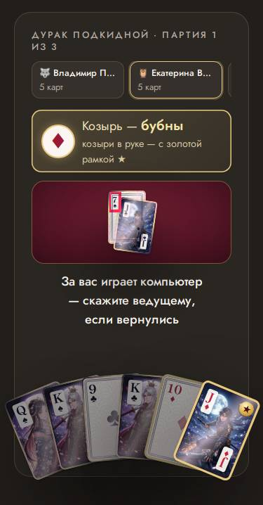

### мелкий текст · телефон

шрифт 10.8 px (нужно от 12) — «7»

- где: `div.dk-mini > span.dk-mini__pair > div.dk-card.dk-d--anime > span.dk-idx.dk-idx--b`, этап `playing/64/question/play`
- игры (1): durak 1-й шаблон, каждый сам ×4, ноутбук 16:10, большой зал, длинные имена
- раз: 6

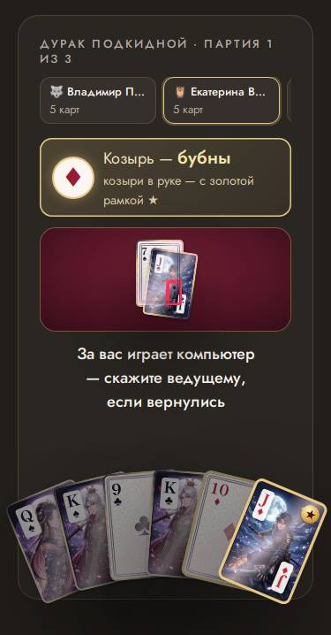

### мелкий текст · телефон

шрифт 11.0 px (нужно от 12) — «Меньше всех»

- где: `div.quiz-phone > ol.wager-board.wager-board--compact > li.wager-slot.wager-slot--low > span.wager-slot__value`, этап `playing/2/question/bet`
- игры (1): wager 1-й шаблон, команды ×4, телевизор full hd; wager 1-й шаблон, команды ×4, проектор 4:3, маленький телефон, длинные имена; wager 1-й шаблон, команды ×8, ноутбук 16:10, большой зал, длинные имена
- раз: 5

### мелкий текст · телефон

шрифт 11.5 px (нужно от 12) — «Локация»

- где: `button.sp-card > span.sp-card__inner > span.sp-card__face.sp-card__face--place > span.sp-card__label`, этап `playing/0/reveal/cards`
- игры (1): spy 1-й шаблон, каждый сам ×11, проектор 4:3, маленький телефон, длинные имена
- раз: 4

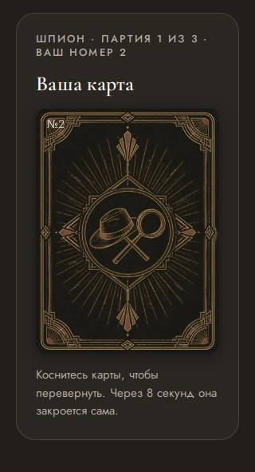

### мелкий текст · телефон

шрифт 10.8 px (нужно от 12) — «8»

- где: `div.dk-mini > span.dk-mini__pair > div.dk-card.dk-d--cyber > span.dk-idx`, этап `playing/118/question/play`
- игры (1): durak 1-й шаблон, каждый сам ×4, ноутбук 16:10, большой зал, длинные имена
- раз: 3

### мелкий текст · телефон

шрифт 10.8 px (нужно от 12) — «8»

- где: `div.dk-mini > span.dk-mini__pair > div.dk-card.dk-d--cyber > span.dk-idx.dk-idx--b`, этап `playing/118/question/play`
- игры (1): durak 1-й шаблон, каждый сам ×4, ноутбук 16:10, большой зал, длинные имена
- раз: 3

### мелкий текст · телефон

шрифт 11.1 px (нужно от 12) — «Вы не знаете, где все. Слушайте и угадайте локацию — или не выдайте себя.»

- где: `button.sp-card > span.sp-card__inner > span.sp-card__face.sp-card__face--spy > span.sp-card__hint`, этап `playing/0/reveal/cards`
- игры (1): spy 1-й шаблон, каждый сам ×11, телевизор full hd; spy 1-й шаблон, каждый сам ×11, проектор 4:3, маленький телефон, длинные имена
- раз: 2

### мелкий текст · телефон

шрифт 8.6 px (нужно от 12) — «J✦R»

- где: `div.dk-hand__row > button.dk-hand__slot > div.dk-card.dk-d--kpop > span.dk-brand`, этап `playing/134/reveal/over`
- игры (1): durak 1-й шаблон, каждый сам ×4, ноутбук 16:10, большой зал, длинные имена
- раз: 2

### мелкий текст · телефон

шрифт 8.6 px (нужно от 12) — «J✦R»

- где: `div.dk-hand__row > button.dk-hand__slot > div.dk-card.dk-d--anime > span.dk-brand`, этап `playing/64/question/play`
- игры (1): durak 1-й шаблон, каждый сам ×4, ноутбук 16:10, большой зал, длинные имена
- раз: 1

### мелкая кнопка · телефон

кнопка 45×36 px (пальцу нужно от 40×40) — «Звезда по имени Солнце»

- где: `div.quiz-phone.lotto-phone > div.lotto-ticket.lotto-ticket--evening > div.lotto-card > button.lotto-card__cell`, этап `playing/0/question/`
- игры (1): lotto 1-й шаблон, каждый сам ×4, проектор 4:3, маленький телефон, длинные имена; lotto 1-й шаблон, команды ×4, проектор 4:3, маленький телефон, длинные имена
- раз: 960

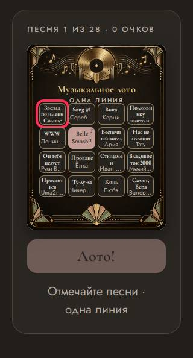

### мелкая кнопка · пульт

кнопка 32×56 px (пальцу нужно от 40×40)

- где: `div.stack.host-quiz > section.card.stack > div.pr-faces > button.pr-face`, этап `playing/1/question/bid`
- игры (1): perudo 1-й шаблон, каждый сам ×4, телевизор full hd; perudo 1-й шаблон, каждый сам ×4, проектор 4:3, маленький телефон, длинные имена; perudo 1-й шаблон, каждый сам ×4, ноутбук 16:10, большой зал, длинные имена; perudo 1-й шаблон, команды ×4, телевизор full hd; perudo 1-й шаблон, команды ×4, проектор 4:3, маленький телефон, длинные имена; perudo 1-й шаблон, команды ×4, ноутбук 16:10, большой зал, длинные имена
- раз: 309

### мелкая кнопка · пульт

кнопка 33×48 px (пальцу нужно от 40×40) — «100»

- где: `div.stack.host-quiz > div.stage-field.stage-field--compact > div.stage-field__row > button.stage-tile`, этап `playing/0/reveal/pick`
- игры (1): stage 1-й шаблон, команды ×4, телевизор full hd; stage 1-й шаблон, команды ×8, ноутбук 16:10, большой зал, длинные имена; stage 1-й шаблон, команды ×4, проектор 4:3, маленький телефон, длинные имена; stage 2-й шаблон, команды ×4, телевизор full hd; stage 2-й шаблон, команды ×8, ноутбук 16:10, большой зал, длинные имена; stage 2-й шаблон, команды ×4, проектор 4:3, маленький телефон, длинные имена
- раз: 282

### мелкая кнопка · телефон

кнопка 33×33 px (пальцу нужно от 40×40)

- где: `div.quiz-phone.quiz-phone--center > div.stack.stack--tight > div.checkers.checkers--phone > button.checkers__cell`, этап `playing/1/question/move`
- игры (1): checkers 1-й шаблон, команды ×2, телевизор full hd; checkers 1-й шаблон, команды ×2, проектор 4:3, маленький телефон, длинные имена; checkers 1-й шаблон, команды ×2, ноутбук 16:10, большой зал, длинные имена
- раз: 144

### мелкая кнопка · пульт

кнопка 33×33 px (пальцу нужно от 40×40)

- где: `div.stack.host-quiz > div.stack.stack--tight > div.checkers.checkers--phone > button.checkers__cell`, этап `playing/1/question/move`
- игры (1): checkers 1-й шаблон, команды ×2, телевизор full hd; checkers 1-й шаблон, команды ×2, проектор 4:3, маленький телефон, длинные имена; checkers 1-й шаблон, команды ×2, ноутбук 16:10, большой зал, длинные имена
- раз: 141

### мелкая кнопка · телефон

кнопка 33×56 px (пальцу нужно от 40×40)

- где: `div.stack > div.stack.stack--tight > div.pr-faces > button.pr-face`, этап `playing/1/question/bid`
- игры (1): perudo 1-й шаблон, каждый сам ×4, проектор 4:3, маленький телефон, длинные имена; perudo 1-й шаблон, команды ×4, проектор 4:3, маленький телефон, длинные имена
- раз: 68

