# Ревизор — что видят ведущий и гости

Прогонов: 36 · видов игры проверено: 2010 · разных находок: 28

Размеры: Телевизор Full HD (1920x1080); Проектор 4:3, маленький телефон, длинные имена (1024x768); Ноутбук 16:10, большой зал, длинные имена (1280x800).

## Мешает игре — 6

### за краем экрана · экран зала

текст выходит за край экрана по высоте на 10 px — «· вопрос 1 — 500 очков»

- где: `main.quiz-stage > div.mil-screen.show-stage > section.mil-screen__main > p.mil-screen__who`, этап `playing/6/question/question`
- игры (1): millionaire 1-й шаблон, команды ×4, проектор 4:3, маленький телефон, длинные имена
- раз: 1

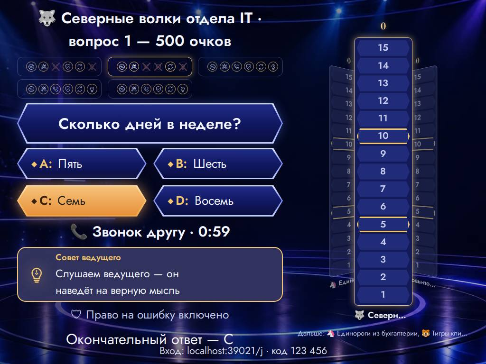

### за краем экрана · экран зала

текст выходит за край экрана по высоте на 10 px — «🐺»

- где: `div.mil-screen.show-stage > section.mil-screen__main > p.mil-screen__who > span.name-emoji`, этап `playing/6/question/question`
- игры (1): millionaire 1-й шаблон, команды ×4, проектор 4:3, маленький телефон, длинные имена
- раз: 1

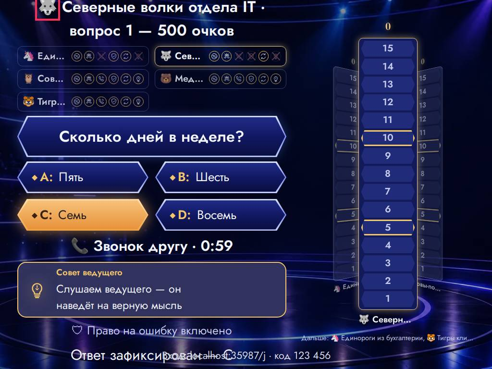

### за краем экрана · экран зала

текст выходит за край экрана по высоте на 10 px — «Северные волки отдела IT»

- где: `div.mil-screen.show-stage > section.mil-screen__main > p.mil-screen__who > span`, этап `playing/6/question/question`
- игры (1): millionaire 1-й шаблон, команды ×4, проектор 4:3, маленький телефон, длинные имена
- раз: 1

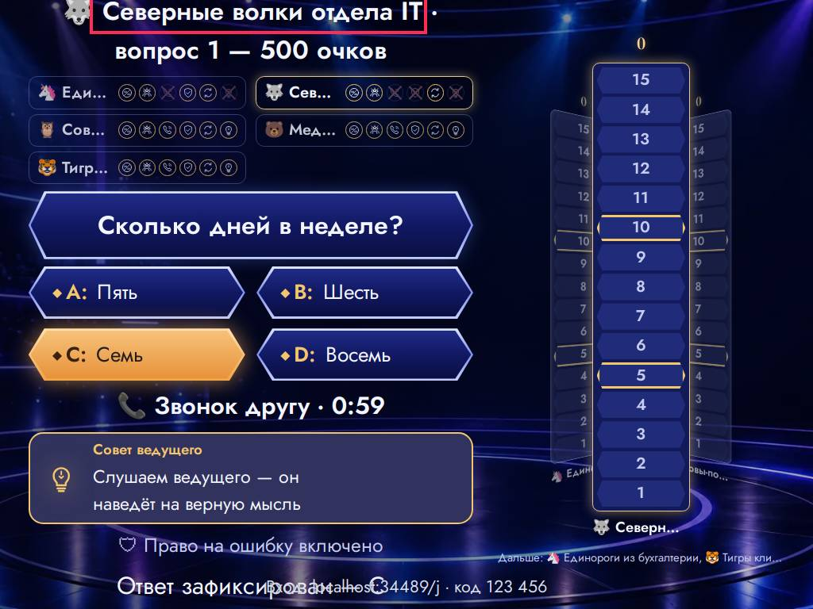

### закрыт другим элементом · телефон

«0%» закрыт элементом span.mil-option__text — «0%»

- где: `div.mil-question.mil-question--phone > ol.mil-options > li.mil-option > span.mil-option__pct`, этап `playing/4/reveal/reveal`
- игры (1): millionaire 1-й шаблон, команды ×8, ноутбук 16:10, большой зал, длинные имена; millionaire 1-й шаблон, каждый сам ×4, проектор 4:3, маленький телефон, длинные имена; millionaire 1-й шаблон, каждый сам ×4, телевизор full hd; millionaire 1-й шаблон, каждый сам ×16, ноутбук 16:10, большой зал, длинные имена
- раз: 6

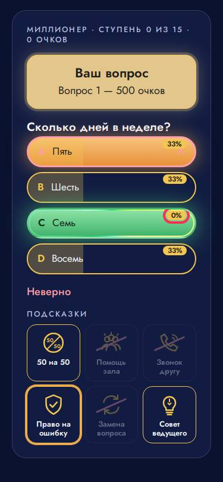

### закрыт другим элементом · экран зала

«Ответ зафиксирован — C» закрыт элементом p.stage-code — «Ответ зафиксирован — C»

- где: `main.quiz-stage > div.mil-screen.show-stage > section.mil-screen__main > p.mil-screen__note.mil-screen__note--big`, этап `playing/6/question/question`
- игры (1): millionaire 1-й шаблон, команды ×4, проектор 4:3, маленький телефон, длинные имена
- раз: 1

### надписи наезжают · экран зала

«Ответ зафиксирован — C» и «Вход: localhost:38905/j · код » друг на друге — «Ответ зафиксирован — C \| Вход: localhost:38905/j · код 123 456»

- где: `main.quiz-stage > div.mil-screen.show-stage > section.mil-screen__main > p.mil-screen__note.mil-screen__note--big`, этап `playing/6/question/question`
- игры (1): millionaire 1-й шаблон, команды ×4, проектор 4:3, маленький телефон, длинные имена
- раз: 1

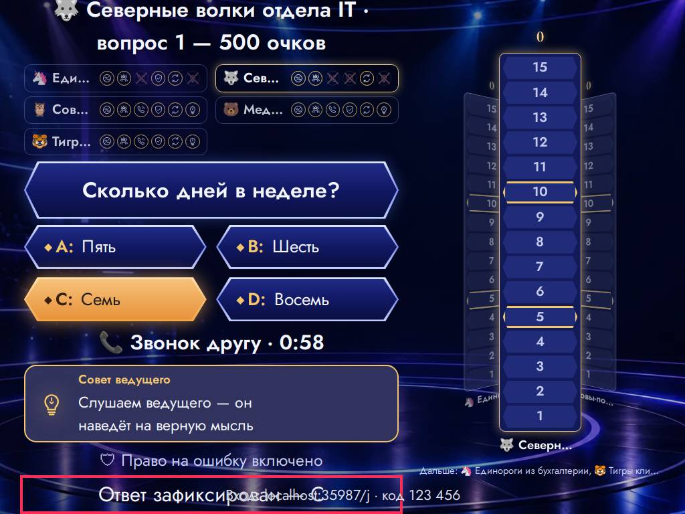

## Заметно — 21

### обрезан текст · экран зала

текст обрезан по высоте на 8 px (span.hd-row__text) — «Букет невесты»

- где: `div.hd-row > div.hd-row__inner > div.hd-row__face.hd-row__face--open > span.hd-row__text`, этап `playing/3/reveal/play`
- игры (1): hundred 1-й шаблон, команды ×4, телевизор full hd; hundred 1-й шаблон, команды ×4, проектор 4:3, маленький телефон, длинные имена; hundred 1-й шаблон, команды ×8, ноутбук 16:10, большой зал, длинные имена; hundred 1-й шаблон, каждый сам ×4, телевизор full hd; hundred 1-й шаблон, каждый сам ×4, проектор 4:3, маленький телефон, длинные имена; hundred 1-й шаблон, каждый сам ×16, ноутбук 16:10, большой зал, длинные имена …
- раз: 180

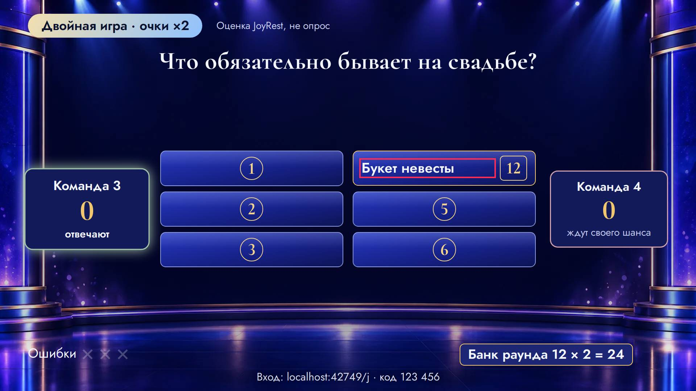

### обрезан текст · экран зала

текст обрезан по высоте на 39 px (span.mil-bar__name) — «Северные волки отдела IT»

- где: `div.mil-carousel > div.mil-bar > span.mil-bar__name > span`, этап `playing/0/ready/turn`
- игры (1): millionaire 1-й шаблон, команды ×4, проектор 4:3, маленький телефон, длинные имена; millionaire 1-й шаблон, команды ×8, ноутбук 16:10, большой зал, длинные имена; millionaire 1-й шаблон, каждый сам ×4, проектор 4:3, маленький телефон, длинные имена; millionaire 1-й шаблон, каждый сам ×16, ноутбук 16:10, большой зал, длинные имена
- раз: 16

### обрезан текст · экран зала

текст обрезан по высоте на 5 px (span.mil-bar__points) — «0»

- где: `div.mil-bars-window > div.mil-carousel > div.mil-bar > span.mil-bar__points`, этап `playing/0/ready/turn`
- игры (1): millionaire 1-й шаблон, команды ×4, телевизор full hd; millionaire 1-й шаблон, каждый сам ×4, телевизор full hd; millionaire 1-й шаблон, каждый сам ×16, ноутбук 16:10, большой зал, длинные имена
- раз: 13

### обрезан текст · экран зала

текст обрезан по высоте на 18 px (span.mil-bar__name) — «Команда 2»

- где: `div.mil-bars-window > div.mil-carousel > div.mil-bar > span.mil-bar__name`, этап `playing/0/ready/turn`
- игры (1): millionaire 1-й шаблон, команды ×4, телевизор full hd; millionaire 1-й шаблон, каждый сам ×4, телевизор full hd
- раз: 12

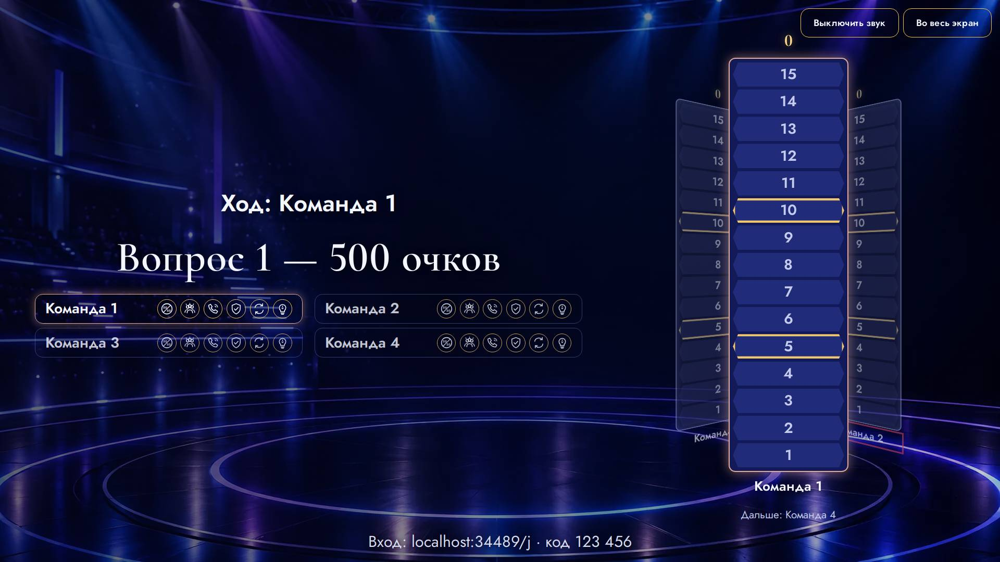

### обрезан текст · экран зала

текст обрезан по высоте на 4 px (p.podium__name) — «Опоздал 6»

- где: `div.podium__stage > div.podium__slot > div.podium__names > p.podium__name`, этап `finished/10/podium/bigDone`
- игры (1): hundred 1-й шаблон, каждый сам ×4, телевизор full hd; hundred 2-й шаблон, каждый сам ×4, телевизор full hd; hundred 3-й шаблон, каждый сам ×4, телевизор full hd
- раз: 9

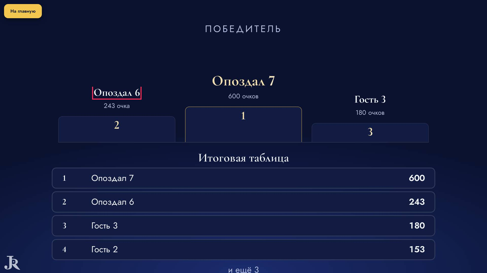

### обрезан текст · экран зала

текст обрезан по высоте на 12 px (span.mil-bar__name) — «🐻»

- где: `div.mil-carousel > div.mil-bar > span.mil-bar__name > span.name-emoji`, этап `playing/0/ready/turn`
- игры (1): millionaire 1-й шаблон, команды ×4, проектор 4:3, маленький телефон, длинные имена; millionaire 1-й шаблон, команды ×8, ноутбук 16:10, большой зал, длинные имена; millionaire 1-й шаблон, каждый сам ×4, проектор 4:3, маленький телефон, длинные имена; millionaire 1-й шаблон, каждый сам ×16, ноутбук 16:10, большой зал, длинные имена
- раз: 8

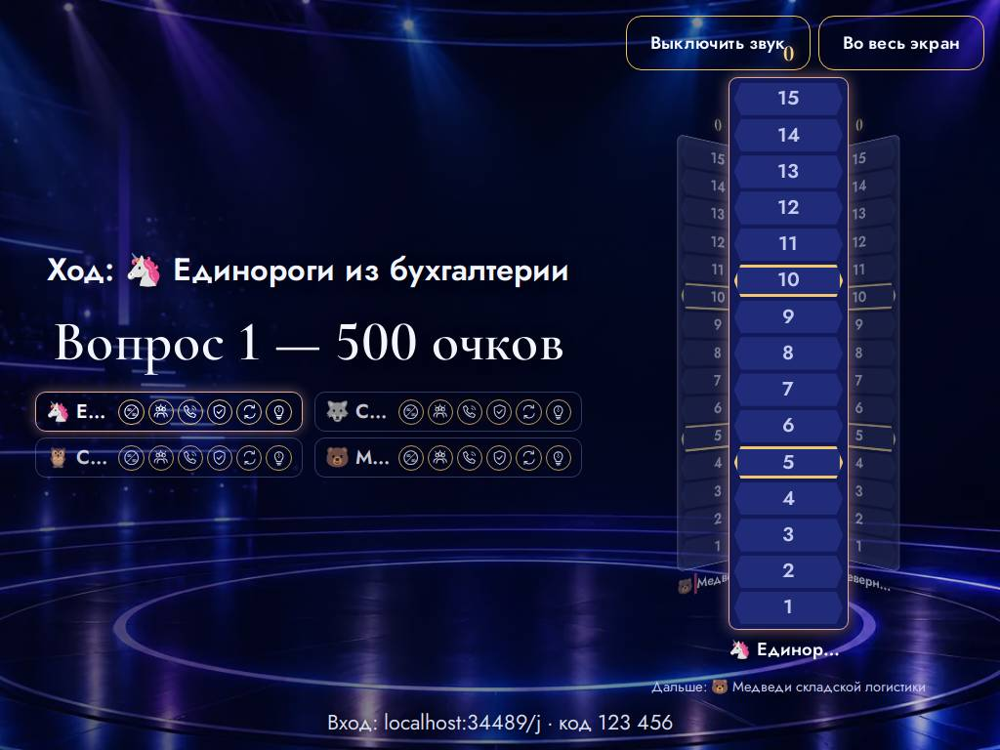

### обрезан текст · экран зала

текст обрезан по высоте на 4 px (p.podium__name) — «🦁»

- где: `div.podium__slot > div.podium__names > p.podium__name > span.name-emoji`, этап `finished/10/podium/bigDone`
- игры (1): hundred 1-й шаблон, каждый сам ×4, проектор 4:3, маленький телефон, длинные имена; hundred 1-й шаблон, каждый сам ×16, ноутбук 16:10, большой зал, длинные имена; hundred 2-й шаблон, каждый сам ×4, проектор 4:3, маленький телефон, длинные имена; hundred 2-й шаблон, каждый сам ×16, ноутбук 16:10, большой зал, длинные имена; hundred 3-й шаблон, каждый сам ×4, проектор 4:3, маленький телефон, длинные имена; hundred 3-й шаблон, каждый сам ×16, ноутбук 16:10, большой зал, длинные имена
- раз: 6

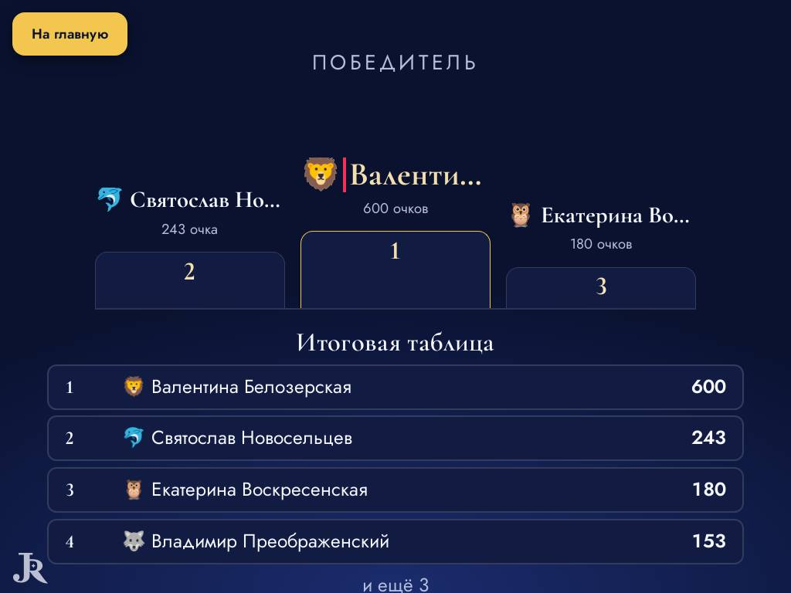

### обрезан текст · экран зала

текст обрезан по высоте на 4 px (p.podium__name) — «Валентина Белозерская»

- где: `div.podium__slot > div.podium__names > p.podium__name > span`, этап `finished/10/podium/bigDone`
- игры (1): hundred 1-й шаблон, каждый сам ×4, проектор 4:3, маленький телефон, длинные имена; hundred 1-й шаблон, каждый сам ×16, ноутбук 16:10, большой зал, длинные имена; hundred 2-й шаблон, каждый сам ×4, проектор 4:3, маленький телефон, длинные имена; hundred 2-й шаблон, каждый сам ×16, ноутбук 16:10, большой зал, длинные имена; hundred 3-й шаблон, каждый сам ×4, проектор 4:3, маленький телефон, длинные имена; hundred 3-й шаблон, каждый сам ×16, ноутбук 16:10, большой зал, длинные имена
- раз: 6

### обрезан текст · экран зала

текст обрезан по высоте на 27 px (span.mil-bar__name) — «· пропуск хода»

- где: `div.mil-carousel > div.mil-bar > span.mil-bar__name > span.mil-bar__tag`, этап `playing/6/question/question`
- игры (1): millionaire 1-й шаблон, команды ×4, проектор 4:3, маленький телефон, длинные имена; millionaire 1-й шаблон, команды ×8, ноутбук 16:10, большой зал, длинные имена
- раз: 2

### прячется за прокруткой · экран зала

на экране зала текст виден только прокруткой (по высоте на 12 px) — «и ещё 3»

- где: `div.final > div.final__board > div.board-view > p.board-view__more`, этап `finished/10/podium/bigDone`
- игры (1): hundred 1-й шаблон, команды ×4, телевизор full hd; hundred 1-й шаблон, команды ×4, проектор 4:3, маленький телефон, длинные имена; hundred 1-й шаблон, команды ×8, ноутбук 16:10, большой зал, длинные имена; hundred 1-й шаблон, каждый сам ×4, телевизор full hd; hundred 1-й шаблон, каждый сам ×4, проектор 4:3, маленький телефон, длинные имена; hundred 1-й шаблон, каждый сам ×16, ноутбук 16:10, большой зал, длинные имена …
- раз: 18

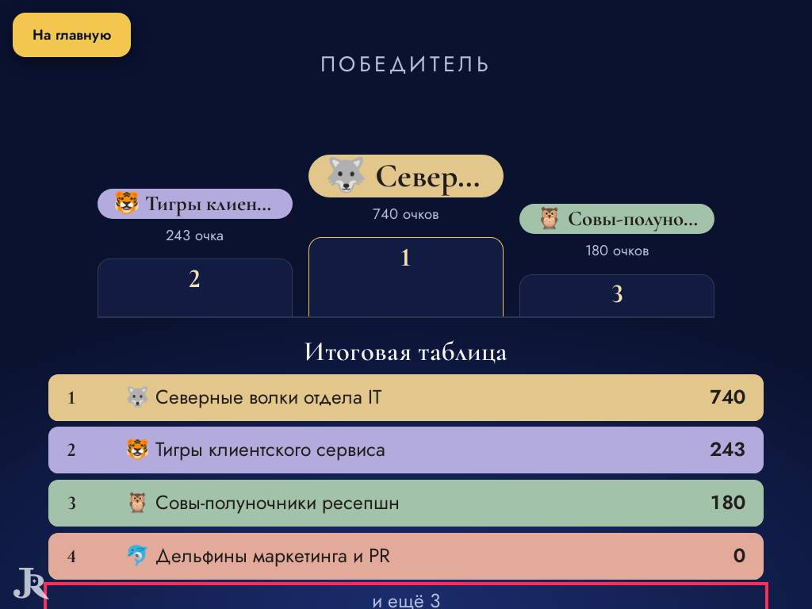

### бледный текст · телефон

контраст 1.01 (нужно от 4.5) — «33%»

- где: `div.mil-question.mil-question--phone > ol.mil-options > li.mil-option > span.mil-option__pct`, этап `playing/13/question/question`
- игры (1): millionaire 1-й шаблон, команды ×4, телевизор full hd; millionaire 1-й шаблон, команды ×4, проектор 4:3, маленький телефон, длинные имена; millionaire 1-й шаблон, команды ×8, ноутбук 16:10, большой зал, длинные имена; millionaire 1-й шаблон, каждый сам ×4, проектор 4:3, маленький телефон, длинные имена; millionaire 1-й шаблон, каждый сам ×4, телевизор full hd; millionaire 1-й шаблон, каждый сам ×16, ноутбук 16:10, большой зал, длинные имена
- раз: 95

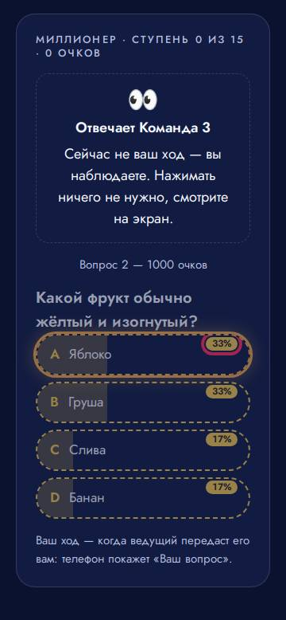

### бледный текст · телефон

контраст 1.01 (нужно от 4.5) — «Зелёного»

- где: `div.mil-question.mil-question--phone > ol.mil-options > li.mil-option > span.mil-option__text`, этап `playing/2/question/question`
- игры (1): millionaire 1-й шаблон, команды ×4, телевизор full hd; millionaire 1-й шаблон, команды ×4, проектор 4:3, маленький телефон, длинные имена; millionaire 1-й шаблон, команды ×8, ноутбук 16:10, большой зал, длинные имена; millionaire 1-й шаблон, каждый сам ×4, проектор 4:3, маленький телефон, длинные имена; millionaire 1-й шаблон, каждый сам ×4, телевизор full hd; millionaire 1-й шаблон, каждый сам ×16, ноутбук 16:10, большой зал, длинные имена
- раз: 62

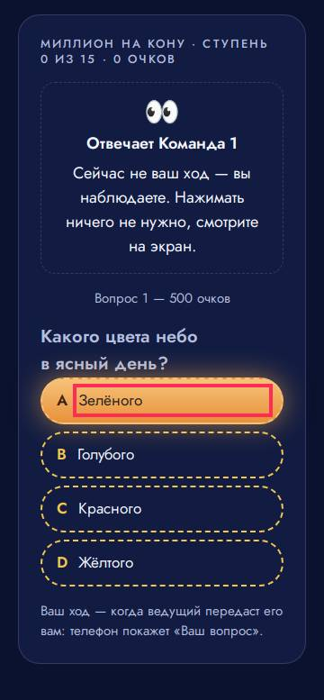

### бледный текст · телефон

контраст 1.04 (нужно от 4.5) — «A»

- где: `div.mil-question.mil-question--phone > ol.mil-options > li.mil-option > span.mil-option__letter`, этап `playing/2/question/question`
- игры (1): millionaire 1-й шаблон, команды ×4, телевизор full hd; millionaire 1-й шаблон, команды ×4, проектор 4:3, маленький телефон, длинные имена; millionaire 1-й шаблон, команды ×8, ноутбук 16:10, большой зал, длинные имена; millionaire 1-й шаблон, каждый сам ×4, проектор 4:3, маленький телефон, длинные имена; millionaire 1-й шаблон, каждый сам ×4, телевизор full hd; millionaire 1-й шаблон, каждый сам ×16, ноутбук 16:10, большой зал, длинные имена
- раз: 55

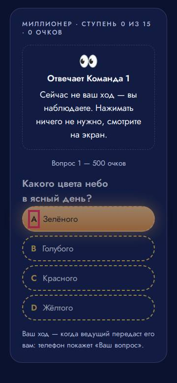

### бледный текст · пульт

контраст 3.55 (нужно от 4.5) — «Восемь»

- где: `div.stack.host-quiz > div.card.stack > ol.mil-host-options > li`, этап `playing/5/reveal/reveal`
- игры (1): millionaire 1-й шаблон, каждый сам ×4, проектор 4:3, маленький телефон, длинные имена; millionaire 1-й шаблон, каждый сам ×4, телевизор full hd; millionaire 1-й шаблон, каждый сам ×16, ноутбук 16:10, большой зал, длинные имена
- раз: 11

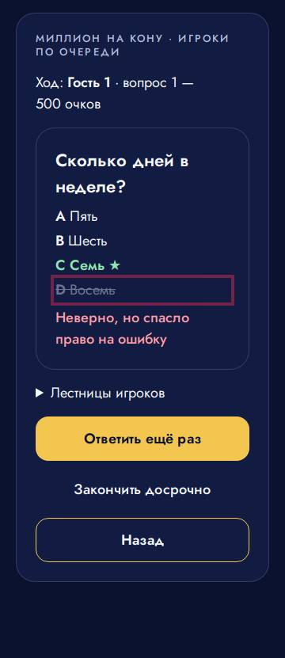

### бледный текст · пульт

контраст 3.55 (нужно от 4.5) — «D»

- где: `div.card.stack > ol.mil-host-options > li > strong`, этап `playing/5/reveal/reveal`
- игры (1): millionaire 1-й шаблон, каждый сам ×4, проектор 4:3, маленький телефон, длинные имена; millionaire 1-й шаблон, каждый сам ×4, телевизор full hd; millionaire 1-й шаблон, каждый сам ×16, ноутбук 16:10, большой зал, длинные имена
- раз: 11

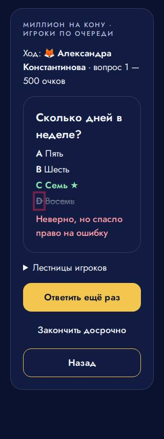

### бледный текст · пульт

контраст 3.42 (нужно от 4.5) — «мимо ✕»

- где: `section.stack.stack--tight > ol.buzz-queue > li > span.buzz-queue__state`, этап `playing/7/question/buzz`
- игры (1): board 1-й шаблон, каждый сам ×4, телевизор full hd; board 1-й шаблон, каждый сам ×4, проектор 4:3, маленький телефон, длинные имена; board 1-й шаблон, каждый сам ×16, ноутбук 16:10, большой зал, длинные имена; board 1-й шаблон, команды ×8, ноутбук 16:10, большой зал, длинные имена
- раз: 7

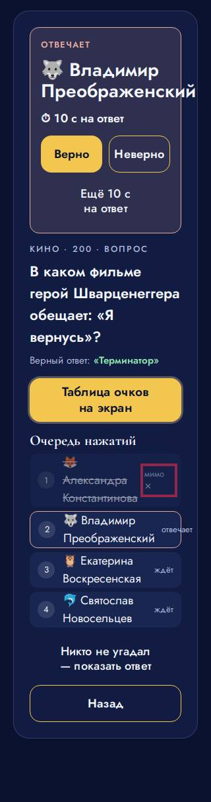

### бледный текст · экран зала

контраст 1.05 (нужно от 4.5) — «Вход: localhost:38905/j · код 123 456»

- где: `div.hall > main.quiz-stage > p.stage-code`, этап `playing/1/reveal/done`
- игры (1): hundred 1-й шаблон, команды ×8, ноутбук 16:10, большой зал, длинные имена; hundred 2-й шаблон, команды ×8, ноутбук 16:10, большой зал, длинные имена; hundred 3-й шаблон, команды ×8, ноутбук 16:10, большой зал, длинные имена
- раз: 3

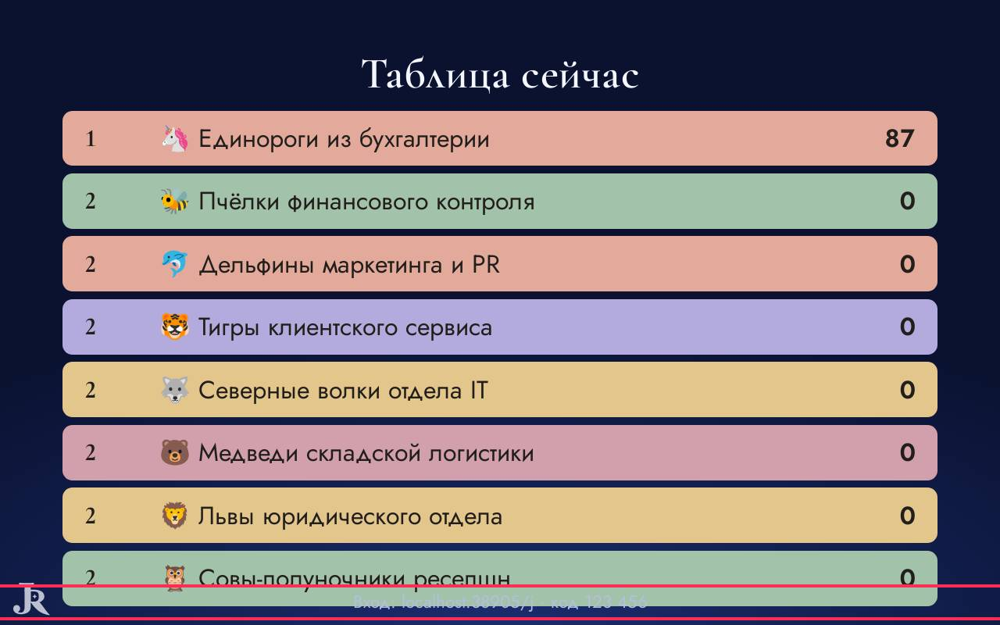

### бледный текст · пульт

контраст 1.07 (нужно от 4.5) — «Начальник»

- где: `li > button.hd-host__row > span.hd-host__text > strong`, этап `playing/3/reveal/play`
- игры (1): hundred 2-й шаблон, команды ×4, телевизор full hd
- раз: 3

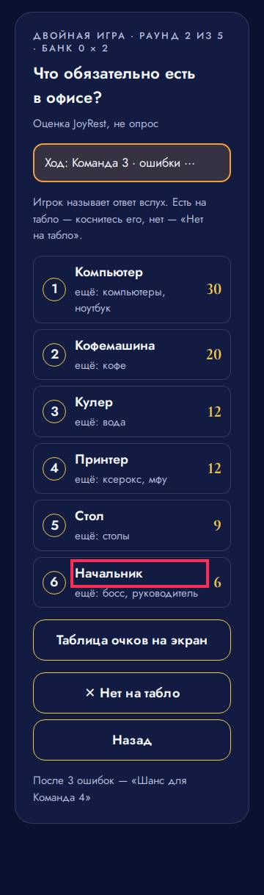

### бледный текст · пульт

контраст 1.85 (нужно от 4.5) — «ещё: столы»

- где: `li > button.hd-host__row > span.hd-host__text > small`, этап `playing/3/reveal/play`
- игры (1): hundred 2-й шаблон, команды ×4, проектор 4:3, маленький телефон, длинные имена
- раз: 2

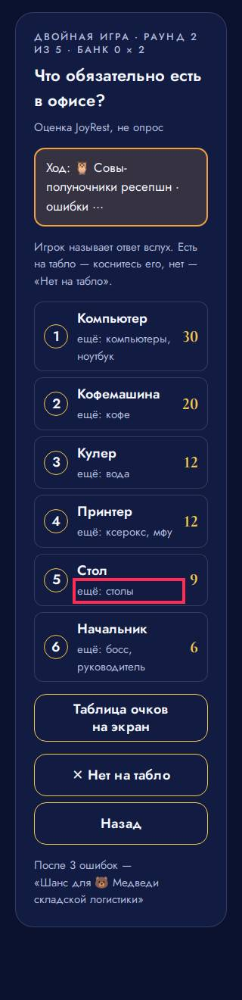

### бледный текст · телефон

контраст 1.85 (нужно от 4.5) — «Подсказки»

- где: `div.card > div.quiz-phone > section.stack.stack--tight > p.eyebrow`, этап `playing/2/question/question`
- игры (1): millionaire 1-й шаблон, команды ×4, проектор 4:3, маленький телефон, длинные имена
- раз: 1

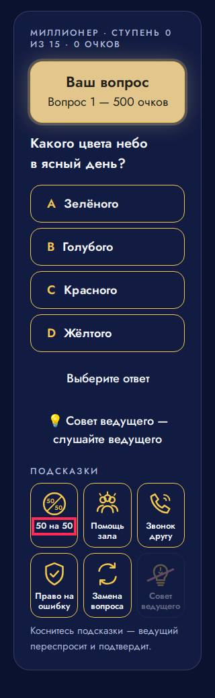

### бледный текст · телефон

контраст 1.52 (нужно от 4.5) — «Они ответили верно!»

- где: `main.page.page--play > div.card > div.quiz-phone.mil-watch > p.success`, этап `playing/8/reveal/reveal`
- игры (1): millionaire 1-й шаблон, команды ×4, проектор 4:3, маленький телефон, длинные имена
- раз: 1

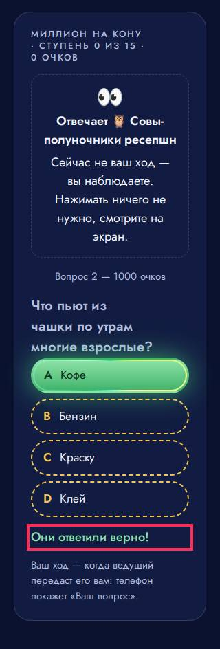

## Мелочи — 1

### мелкий текст · пульт

шрифт 11.0 px (нужно от 12) — «кот»

- где: `div.board-host__grid > div.board-host__row > button.board-host__cell > small`, этап `playing/0/ready/`
- игры (1): board 1-й шаблон, каждый сам ×4, телевизор full hd; board 1-й шаблон, каждый сам ×4, проектор 4:3, маленький телефон, длинные имена; board 1-й шаблон, команды ×4, телевизор full hd; board 1-й шаблон, каждый сам ×16, ноутбук 16:10, большой зал, длинные имена; board 1-й шаблон, команды ×4, проектор 4:3, маленький телефон, длинные имена; board 1-й шаблон, команды ×8, ноутбук 16:10, большой зал, длинные имена
- раз: 91

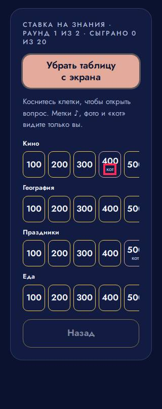

