# Ревизор — что видят ведущий и гости

Прогонов: 129 · видов игры проверено: 2880 · разных находок: 939

Размеры: Телевизор Full HD (1920x1080); Проектор 4:3, маленький телефон, длинные имена (1024x768); Ноутбук 16:10, большой зал, длинные имена (1280x800).

## Мешает игре — 532

### за краем экрана · экран зала

текст выходит за край экрана по высоте на 93 px — «Присоединяйтесь к игре»

- где: `div.hall > main.quiz-stage > div.slide.slide--join > h2.slide__title`, этап `playing/0/board/`
- игры (20): quiz 1-й шаблон, команды ×4, проектор 4:3, маленький телефон, длинные имена; quiz 1-й шаблон, каждый сам ×4, проектор 4:3, маленький телефон, длинные имена; quiz 2-й шаблон, каждый сам ×4, проектор 4:3, маленький телефон, длинные имена; quiz 2-й шаблон, команды ×4, проектор 4:3, маленький телефон, длинные имена; lotto 1-й шаблон, каждый сам ×4, проектор 4:3, маленький телефон, длинные имена; lotto 1-й шаблон, команды ×4, проектор 4:3, маленький телефон, длинные имена …
- раз: 311

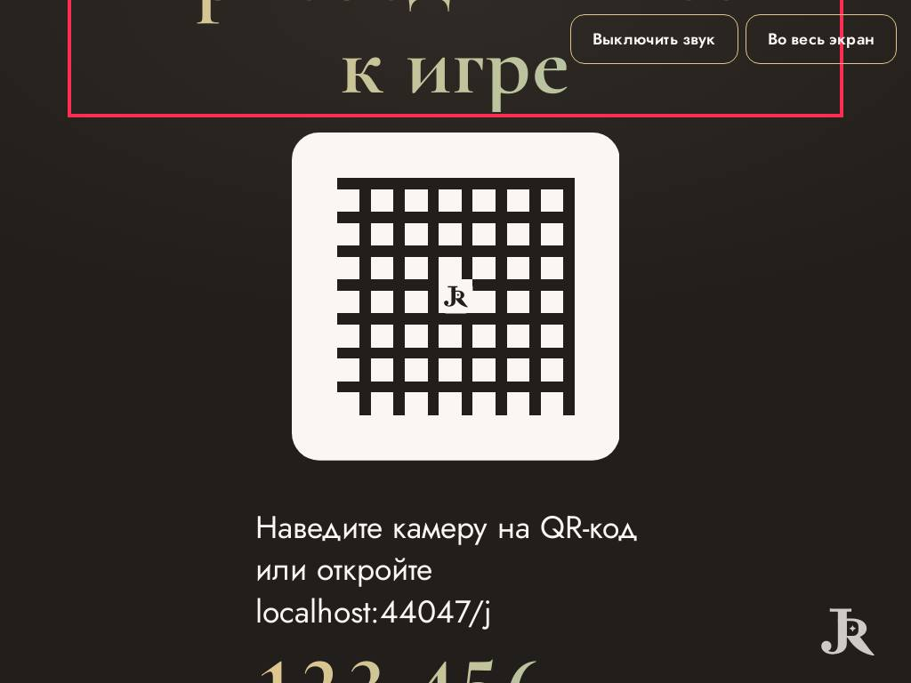

### за краем экрана · экран зала

текст выходит за край экрана по высоте на 60 px — «123 456»

- где: `div.slide.slide--join > div.slide__join > div.slide__join-text > div.big-code`, этап `playing/0/board/`
- игры (20): quiz 1-й шаблон, команды ×4, проектор 4:3, маленький телефон, длинные имена; quiz 1-й шаблон, каждый сам ×4, проектор 4:3, маленький телефон, длинные имена; quiz 2-й шаблон, каждый сам ×4, проектор 4:3, маленький телефон, длинные имена; quiz 2-й шаблон, команды ×4, проектор 4:3, маленький телефон, длинные имена; lotto 1-й шаблон, каждый сам ×4, проектор 4:3, маленький телефон, длинные имена; lotto 1-й шаблон, команды ×4, проектор 4:3, маленький телефон, длинные имена …
- раз: 311

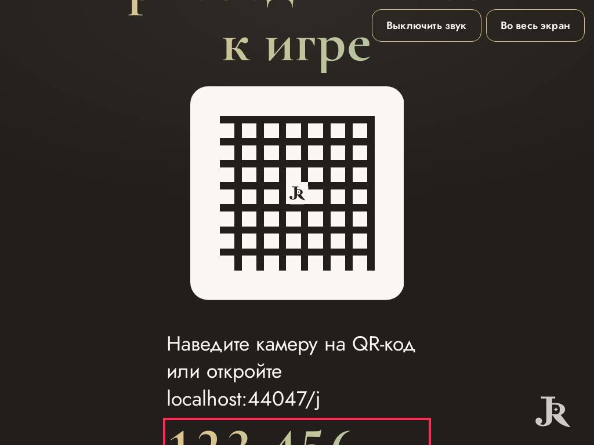

### за краем экрана · экран зала

текст выходит за край экрана по высоте на 84 px — «Особая просьба: выключите VPN — с ним игра может работать хуже.»

- где: `div.slide.slide--join > div.slide__join > div.slide__join-text > p.slide__text.slide__text--small`, этап `playing/0/board/`
- игры (20): quiz 1-й шаблон, команды ×4, проектор 4:3, маленький телефон, длинные имена; quiz 1-й шаблон, каждый сам ×4, проектор 4:3, маленький телефон, длинные имена; quiz 2-й шаблон, каждый сам ×4, проектор 4:3, маленький телефон, длинные имена; quiz 2-й шаблон, команды ×4, проектор 4:3, маленький телефон, длинные имена; lotto 1-й шаблон, каждый сам ×4, проектор 4:3, маленький телефон, длинные имена; lotto 1-й шаблон, команды ×4, проектор 4:3, маленький телефон, длинные имена …
- раз: 311

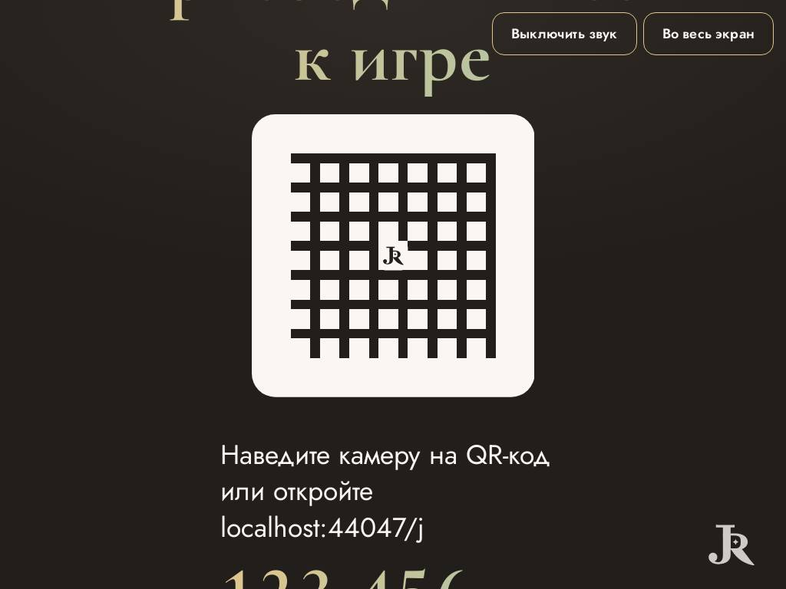

### за краем экрана · экран зала

текст выходит за край экрана вбок на 199 px — «Дельфины маркетинга и PR»

- где: `div.mil-bars-window > p.mil-bars-window__more > span > span`, этап `playing/5/ready/turn`
- игры (1): millionaire 1-й шаблон, команды ×8, ноутбук 16:10, большой зал, длинные имена; millionaire 1-й шаблон, команды ×4, проектор 4:3, маленький телефон, длинные имена; millionaire 1-й шаблон, каждый сам ×16, ноутбук 16:10, большой зал, длинные имена
- раз: 16

### за краем экрана · экран зала

текст выходит за край экрана вбок на 10 px — «🐬»

- где: `div.mil-bars-window > p.mil-bars-window__more > span > span.name-emoji`, этап `playing/5/ready/turn`
- игры (1): millionaire 1-й шаблон, команды ×8, ноутбук 16:10, большой зал, длинные имена; millionaire 1-й шаблон, команды ×4, проектор 4:3, маленький телефон, длинные имена; millionaire 1-й шаблон, каждый сам ×16, ноутбук 16:10, большой зал, длинные имена
- раз: 15

### за краем экрана · экран зала

текст выходит за край экрана вбок на 209 px — «,»

- где: `section.mil-screen__bars > div.mil-bars-window > p.mil-bars-window__more > span`, этап `playing/5/ready/turn`
- игры (1): millionaire 1-й шаблон, команды ×8, ноутбук 16:10, большой зал, длинные имена; millionaire 1-й шаблон, команды ×4, телевизор full hd; millionaire 1-й шаблон, команды ×4, проектор 4:3, маленький телефон, длинные имена; millionaire 1-й шаблон, каждый сам ×16, ноутбук 16:10, большой зал, длинные имена
- раз: 15

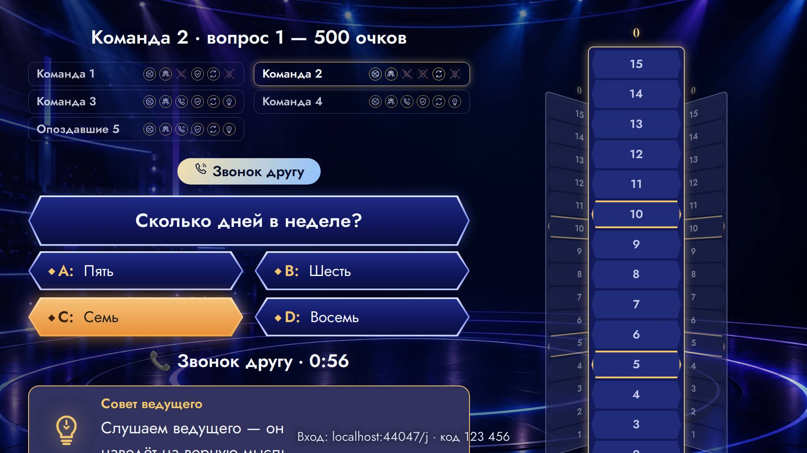

### за краем экрана · экран зала

текст выходит за край экрана вбок на 325 px — «Северные волки отдела IT»

- где: `div.checkers-screen__side > div.checkers-side.checkers-side--b > span.checkers-side__name > span`, этап `playing/1/question/move`
- игры (1): checkers 1-й шаблон, команды ×2, проектор 4:3, маленький телефон, длинные имена; checkers 1-й шаблон, команды ×2, ноутбук 16:10, большой зал, длинные имена
- раз: 14

### за краем экрана · экран зала

текст выходит за край экрана вбок на 322 px — «Единороги из бухгалтерии»

- где: `div.checkers-screen__side > div.checkers-side.checkers-side--w > span.checkers-side__name > span`, этап `playing/1/question/move`
- игры (1): checkers 1-й шаблон, команды ×2, проектор 4:3, маленький телефон, длинные имена; checkers 1-й шаблон, команды ×2, ноутбук 16:10, большой зал, длинные имена
- раз: 14

### за краем экрана · экран зала

текст выходит за край экрана по высоте на 104 px — «364»

- где: `div.checkers-screen__side > div.checkers-screen__question > ol.checkers-screen__options > li`, этап `playing/7/question/task`
- игры (1): checkers 1-й шаблон, команды ×2, проектор 4:3, маленький телефон, длинные имена
- раз: 9

### за краем экрана · экран зала

текст выходит за край экрана по высоте на 104 px — «A»

- где: `div.checkers-screen__question > ol.checkers-screen__options > li > span`, этап `playing/7/question/task`
- игры (1): checkers 1-й шаблон, команды ×2, проектор 4:3, маленький телефон, длинные имена
- раз: 9

### за краем экрана · экран зала

текст выходит за край экрана по высоте на 10 px — «1»

- где: `div.st-reveal > ul.st-votes > li > strong`, этап `playing/39/reveal/guess`
- игры (1): story 1-й шаблон, каждый сам ×6, телевизор full hd; story 1-й шаблон, каждый сам ×6, ноутбук 16:10, большой зал, длинные имена
- раз: 8

### за краем экрана · экран зала

текст выходит за край экрана по высоте на 351 px — «🦄»

- где: `div.checkers-screen__side > div.checkers-side.checkers-side--w > span.checkers-side__name > span.name-emoji`, этап `playing/7/question/task`
- игры (1): checkers 1-й шаблон, команды ×2, проектор 4:3, маленький телефон, длинные имена; checkers 1-й шаблон, команды ×2, ноутбук 16:10, большой зал, длинные имена
- раз: 6

### за краем экрана · экран зала

текст выходит за край экрана по высоте на 416 px — «шашек: 11»

- где: `div.checkers-screen > div.checkers-screen__side > div.checkers-side.checkers-side--w > span.checkers-side__left`, этап `playing/7/question/task`
- игры (1): checkers 1-й шаблон, команды ×2, проектор 4:3, маленький телефон, длинные имена; checkers 1-й шаблон, команды ×2, ноутбук 16:10, большой зал, длинные имена
- раз: 6

### за краем экрана · экран зала

текст выходит за край экрана по высоте на 14 px — «🐺»

- где: `section.td-screen__main > p.td-who > span.td-who__name > span.name-emoji`, этап `playing/7/question/pick`
- игры (1): truth 1-й шаблон, команды ×4, проектор 4:3, маленький телефон, длинные имена; truth 1-й шаблон, каждый сам ×16, ноутбук 16:10, большой зал, длинные имена; truth 2-й шаблон, команды ×4, проектор 4:3, маленький телефон, длинные имена; truth 2-й шаблон, каждый сам ×16, ноутбук 16:10, большой зал, длинные имена
- раз: 6

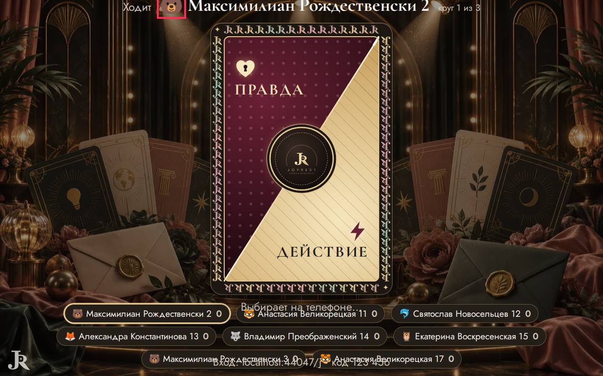

### за краем экрана · экран зала

текст выходит за край экрана по высоте на 14 px — «Северные волки отдела IT»

- где: `section.td-screen__main > p.td-who > span.td-who__name > span`, этап `playing/7/question/pick`
- игры (1): truth 1-й шаблон, команды ×4, проектор 4:3, маленький телефон, длинные имена; truth 1-й шаблон, каждый сам ×16, ноутбук 16:10, большой зал, длинные имена; truth 2-й шаблон, команды ×4, проектор 4:3, маленький телефон, длинные имена; truth 2-й шаблон, каждый сам ×16, ноутбук 16:10, большой зал, длинные имена
- раз: 6

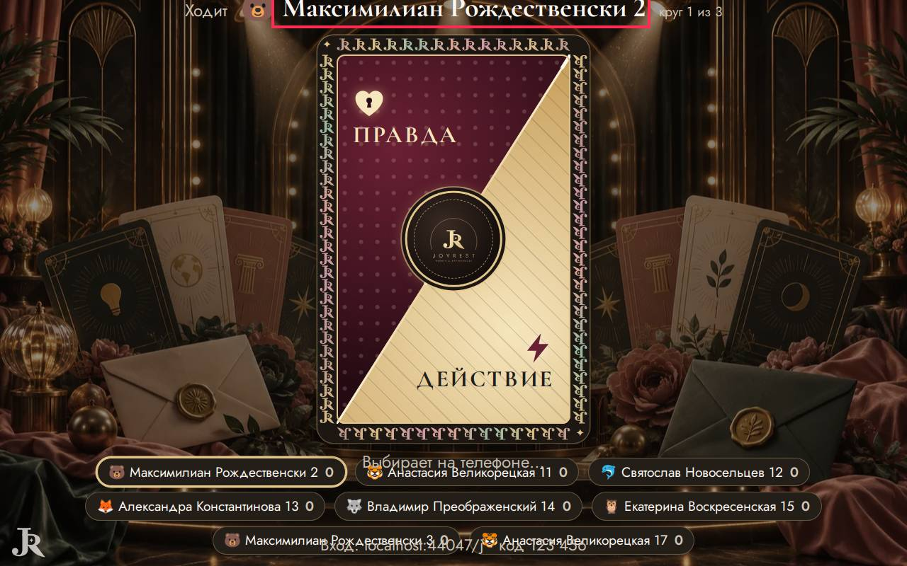

### за краем экрана · экран зала

текст выходит за край экрана по высоте на 10 px — «Гость 4»

- где: `section.st-screen__main > div.st-reveal > ul.st-votes > li`, этап `playing/39/reveal/guess`
- игры (1): story 1-й шаблон, каждый сам ×6, телевизор full hd
- раз: 6

### за краем экрана · экран зала

текст выходит за край экрана по высоте на 379 px — «0 очков»

- где: `div.checkers-screen > div.checkers-screen__side > div.checkers-side.checkers-side--w > span.checkers-side__score`, этап `playing/7/question/task`
- игры (1): checkers 1-й шаблон, команды ×2, проектор 4:3, маленький телефон, длинные имена; checkers 1-й шаблон, команды ×2, ноутбук 16:10, большой зал, длинные имена
- раз: 5

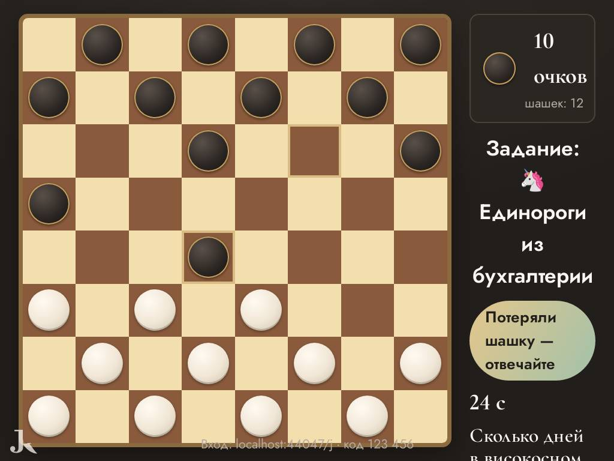

### за краем экрана · экран зала

текст выходит за край экрана по высоте на 9 px — «Ответ 3 из 5»

- где: `main.quiz-stage > div.st-screen > section.st-screen__main > span.quiz-screen__badge`, этап `playing/39/reveal/guess`
- игры (1): story 1-й шаблон, каждый сам ×6, телевизор full hd; story 1-й шаблон, каждый сам ×6, проектор 4:3, маленький телефон, длинные имена; story 1-й шаблон, каждый сам ×6, ноутбук 16:10, большой зал, длинные имена
- раз: 3

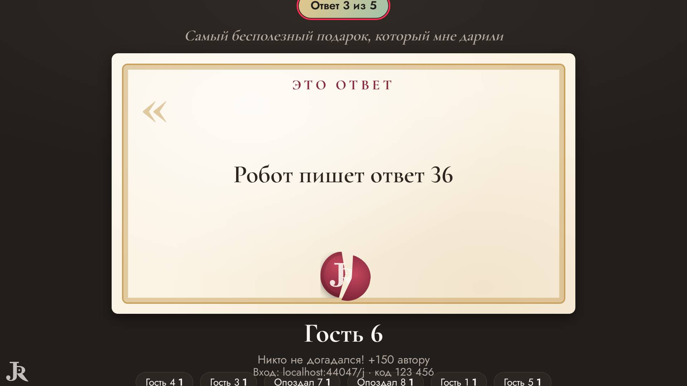

### за краем экрана · экран зала

текст выходит за край экрана по высоте на 53 px — «Сколько дней в високосном году?»

- где: `div.checkers-screen > div.checkers-screen__side > div.checkers-screen__question > h2`, этап `playing/7/question/task`
- игры (1): checkers 1-й шаблон, команды ×2, проектор 4:3, маленький телефон, длинные имена
- раз: 2

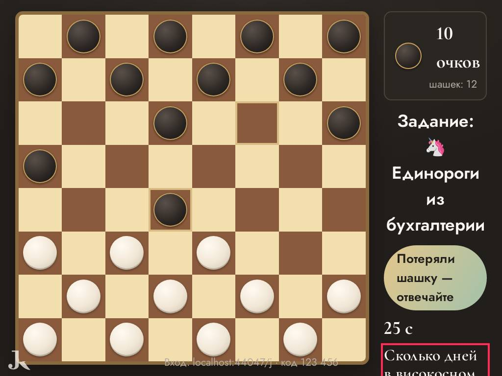

### за краем экрана · экран зала

текст выходит за край экрана по высоте на 26 px — «Слушаем ведущего — он наведёт на верную мысль»

- где: `section.mil-screen__main > div.mil-tip > div > p.mil-tip__text`, этап `playing/6/question/question`
- игры (1): millionaire 1-й шаблон, команды ×4, телевизор full hd; millionaire 1-й шаблон, команды ×4, проектор 4:3, маленький телефон, длинные имена
- раз: 2

### за краем экрана · экран зала

текст выходит за край экрана по высоте на 123 px — «🛡 Право на ошибку включено»

- где: `main.quiz-stage > div.mil-screen.show-stage > section.mil-screen__main > p.mil-screen__note`, этап `playing/6/question/question`
- игры (1): millionaire 1-й шаблон, команды ×4, телевизор full hd; millionaire 1-й шаблон, команды ×4, проектор 4:3, маленький телефон, длинные имена
- раз: 2

### за краем экрана · экран зала

текст выходит за край экрана по высоте на 213 px — «Окончательный ответ — C»

- где: `main.quiz-stage > div.mil-screen.show-stage > section.mil-screen__main > p.mil-screen__note.mil-screen__note--big`, этап `playing/6/question/question`
- игры (1): millionaire 1-й шаблон, команды ×4, телевизор full hd; millionaire 1-й шаблон, команды ×4, проектор 4:3, маленький телефон, длинные имена
- раз: 2

### за краем экрана · экран зала

текст выходит за край экрана по высоте на 214 px — «Дальше:»

- где: `div.mil-screen.show-stage > section.mil-screen__bars > div.mil-bars-window > p.mil-bars-window__more`, этап `playing/6/question/question`
- игры (1): millionaire 1-й шаблон, команды ×4, телевизор full hd; millionaire 1-й шаблон, команды ×4, проектор 4:3, маленький телефон, длинные имена
- раз: 2

### за краем экрана · экран зала

текст выходит за край экрана по высоте на 168 px — «🐺»

- где: `div.mil-carousel > div.mil-bar > span.mil-bar__name > span.name-emoji`, этап `playing/6/question/question`
- игры (1): millionaire 1-й шаблон, команды ×4, проектор 4:3, маленький телефон, длинные имена
- раз: 2

### за краем экрана · экран зала

текст выходит за край экрана по высоте на 4 px — «Ходит»

- где: `div.td-screen > section.td-screen__main > p.td-who > span.td-who__label`, этап `playing/7/question/pick`
- игры (1): truth 1-й шаблон, команды ×4, проектор 4:3, маленький телефон, длинные имена; truth 2-й шаблон, команды ×4, проектор 4:3, маленький телефон, длинные имена
- раз: 2

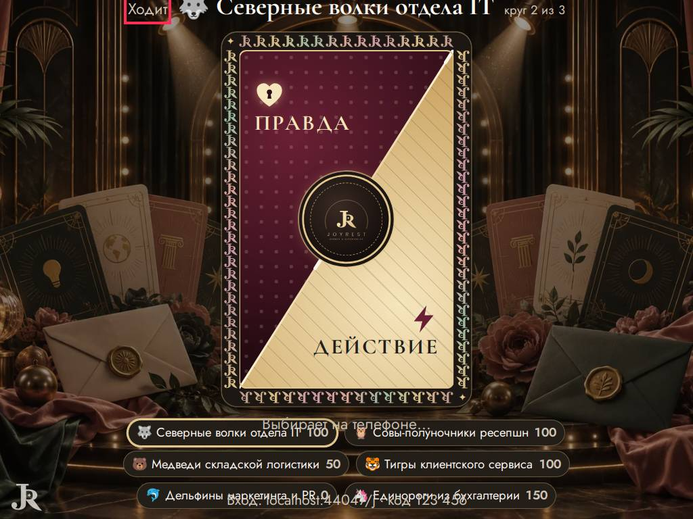

### за краем экрана · экран зала

текст выходит за край экрана по высоте на 21 px — «🦊»

- где: `div.st-reveal > ul.st-votes > li > span.name-emoji`, этап `playing/39/reveal/guess`
- игры (1): story 1-й шаблон, каждый сам ×6, ноутбук 16:10, большой зал, длинные имена
- раз: 2

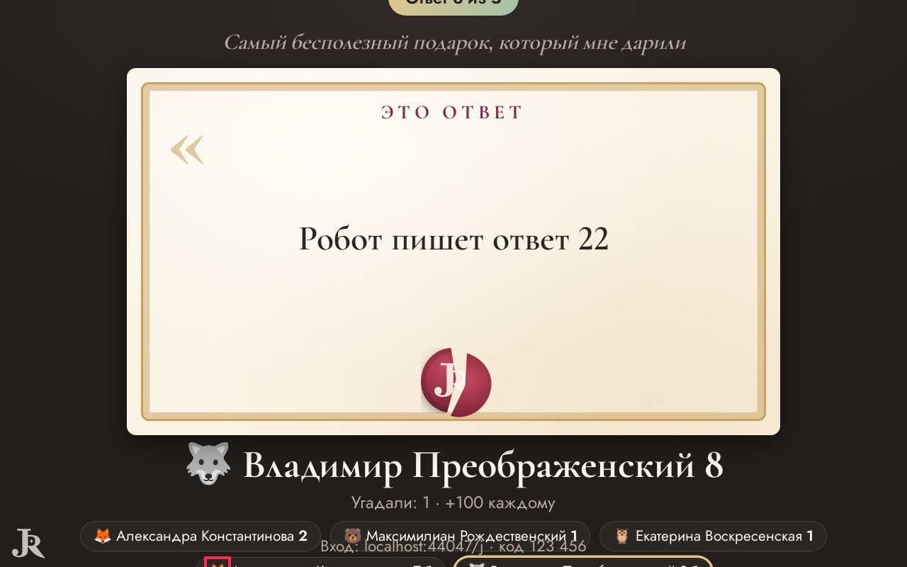

### за краем экрана · экран зала

текст выходит за край экрана по высоте на 21 px — «Александра Константинова 7»

- где: `div.st-reveal > ul.st-votes > li > span`, этап `playing/39/reveal/guess`
- игры (1): story 1-й шаблон, каждый сам ×6, ноутбук 16:10, большой зал, длинные имена
- раз: 2

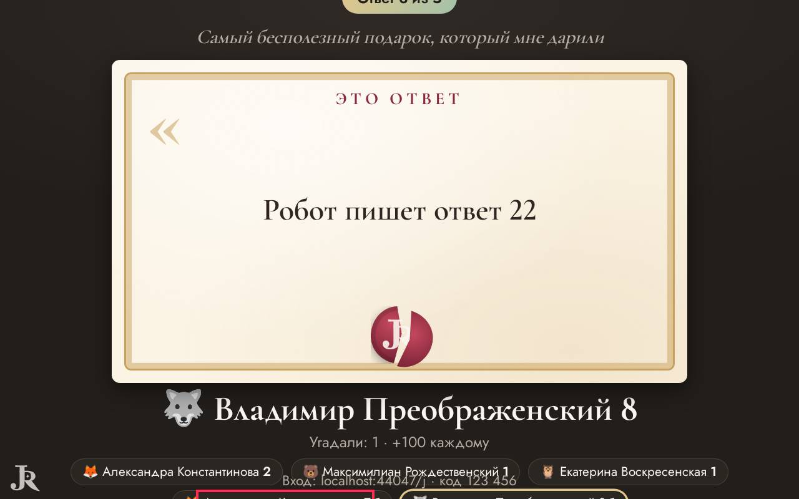

### за краем экрана · экран зала

текст выходит за край экрана по высоте на 210 px — «Не справились»

- где: `div.checkers-screen > div.checkers-screen__side > div.checkers-screen__question > p.checkers-screen__verdict`, этап `playing/23/reveal/task`
- игры (1): checkers 1-й шаблон, команды ×2, проектор 4:3, маленький телефон, длинные имена
- раз: 1

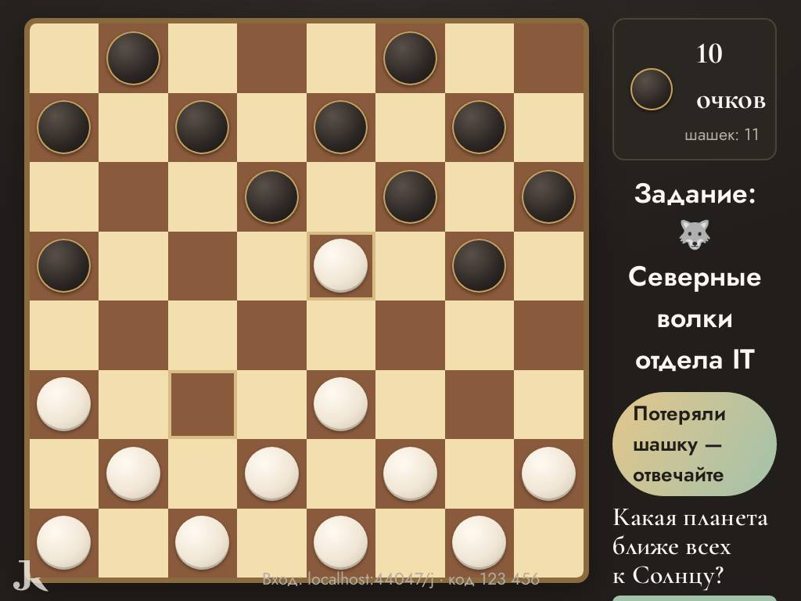

### за краем экрана · экран зала

текст выходит за край экрана по высоте на 164 px — «Команда 2»

- где: `div.mil-bars-window > div.mil-carousel > div.mil-bar > span.mil-bar__name`, этап `playing/6/question/question`
- игры (1): millionaire 1-й шаблон, команды ×4, телевизор full hd
- раз: 1

### за краем экрана · экран зала

текст выходит за край экрана по высоте на 168 px — «Северные волки отдела IT»

- где: `div.mil-carousel > div.mil-bar > span.mil-bar__name > span`, этап `playing/6/question/question`
- игры (1): millionaire 1-й шаблон, команды ×4, проектор 4:3, маленький телефон, длинные имена
- раз: 1

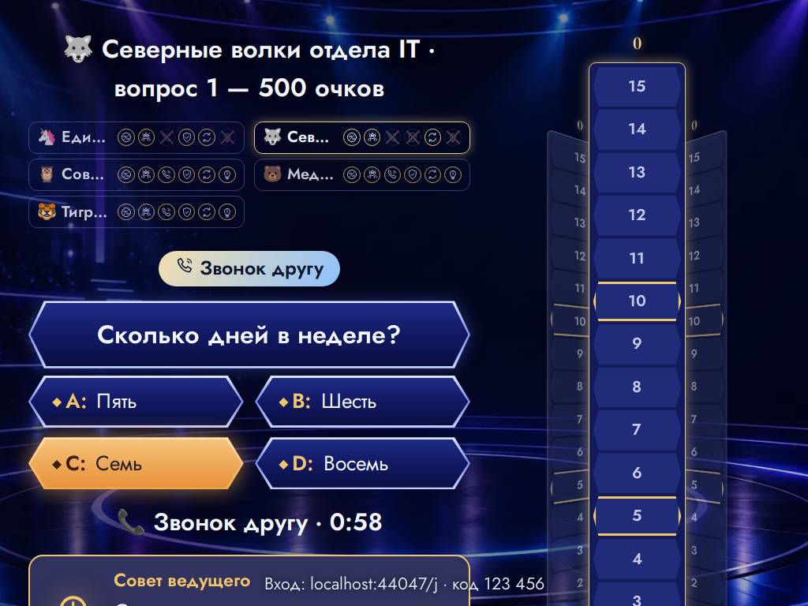

### за краем · пульт

текст выходит за край области по высоте на 37 px — «— клетка 7»

- где: `div.stack.host-quiz > details.quest-host__places > ol > li`, этап `playing/16/reveal/done`
- игры (4): quest 1-й шаблон, команды ×4, проектор 4:3, маленький телефон, длинные имена; quest 2-й шаблон, команды ×4, проектор 4:3, маленький телефон, длинные имена; quest 1-й шаблон, команды ×8, ноутбук 16:10, большой зал, длинные имена; millionaire 1-й шаблон, каждый сам ×4, телевизор full hd; millionaire 1-й шаблон, команды ×8, ноутбук 16:10, большой зал, длинные имена; millionaire 1-й шаблон, каждый сам ×4, проектор 4:3, маленький телефон, длинные имена …
- раз: 750

### за краем · пульт

текст выходит за край области по высоте на 10 px — «Дельфины маркетинга и PR»

- где: `details.quest-host__places > ol > li > span`, этап `playing/16/reveal/done`
- игры (4): quest 1-й шаблон, команды ×4, проектор 4:3, маленький телефон, длинные имена; quest 2-й шаблон, команды ×4, проектор 4:3, маленький телефон, длинные имена; quest 1-й шаблон, команды ×8, ноутбук 16:10, большой зал, длинные имена; millionaire 1-й шаблон, команды ×8, ноутбук 16:10, большой зал, длинные имена; millionaire 1-й шаблон, каждый сам ×4, проектор 4:3, маленький телефон, длинные имена; millionaire 1-й шаблон, команды ×4, проектор 4:3, маленький телефон, длинные имена …
- раз: 591

### за краем · пульт

текст выходит за край области по высоте на 10 px — «🐬»

- где: `details.quest-host__places > ol > li > span.name-emoji`, этап `playing/16/reveal/done`
- игры (4): quest 1-й шаблон, команды ×4, проектор 4:3, маленький телефон, длинные имена; quest 2-й шаблон, команды ×4, проектор 4:3, маленький телефон, длинные имена; quest 1-й шаблон, команды ×8, ноутбук 16:10, большой зал, длинные имена; millionaire 1-й шаблон, команды ×8, ноутбук 16:10, большой зал, длинные имена; millionaire 1-й шаблон, каждый сам ×4, проектор 4:3, маленький телефон, длинные имена; millionaire 1-й шаблон, команды ×4, проектор 4:3, маленький телефон, длинные имена …
- раз: 587

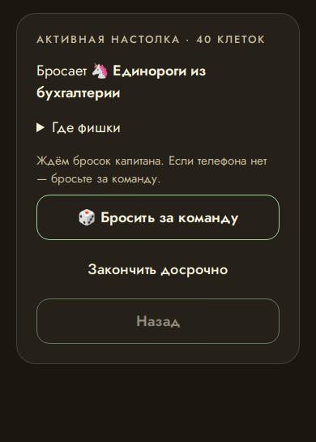

### за краем · пульт

текст выходит за край области по высоте на 21 px — «Багаж: Курица-несушка»

- где: `ol.bk-host__chars > li > span > span`, этап `playing/1/question/catastrophe`
- игры (1): bunker 1-й шаблон, каждый сам ×8, проектор 4:3, маленький телефон, длинные имена; bunker 1-й шаблон, каждый сам ×8, телевизор full hd; bunker 1-й шаблон, каждый сам ×8, ноутбук 16:10, большой зал, длинные имена
- раз: 5152

### за краем · телефон

текст выходит за край области по высоте на 59 px — «карты закрыты»

- где: `details.bk-phone__all > ul.bk-phone__list > li > span`, этап `playing/1/question/catastrophe`
- игры (1): bunker 1-й шаблон, каждый сам ×8, проектор 4:3, маленький телефон, длинные имена; bunker 1-й шаблон, каждый сам ×8, телевизор full hd; bunker 1-й шаблон, каждый сам ×8, ноутбук 16:10, большой зал, длинные имена
- раз: 2598

### за краем · телефон

текст выходит за край области по высоте на 15 px — «№2»

- где: `ul.bk-phone__list > li > b > span.bk-num`, этап `playing/1/question/catastrophe`
- игры (1): bunker 1-й шаблон, каждый сам ×8, проектор 4:3, маленький телефон, длинные имена; bunker 1-й шаблон, каждый сам ×8, телевизор full hd; bunker 1-й шаблон, каждый сам ×8, ноутбук 16:10, большой зал, длинные имена
- раз: 2355

### за краем · телефон

текст выходит за край области по высоте на 15 px — «🐺»

- где: `ul.bk-phone__list > li > b > span.name-emoji`, этап `playing/1/question/catastrophe`
- игры (1): bunker 1-й шаблон, каждый сам ×8, проектор 4:3, маленький телефон, длинные имена; bunker 1-й шаблон, каждый сам ×8, ноутбук 16:10, большой зал, длинные имена
- раз: 1608

### за краем · телефон

текст выходит за край области по высоте на 36 px — «Владимир Преображенский»

- где: `ul.bk-phone__list > li > b > span`, этап `playing/1/question/catastrophe`
- игры (1): bunker 1-й шаблон, каждый сам ×8, проектор 4:3, маленький телефон, длинные имена; bunker 1-й шаблон, каждый сам ×8, ноутбук 16:10, большой зал, длинные имена
- раз: 1608

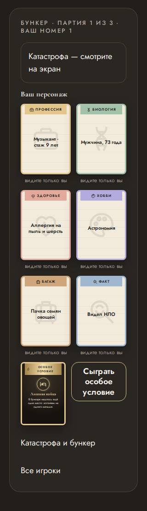

### за краем · телефон

текст выходит за край области по высоте на 423 px — «· изгнан»

- где: `details.bk-phone__all > ul.bk-phone__list > li > b`, этап `playing/35/question/bunker`
- игры (1): bunker 1-й шаблон, каждый сам ×8, проектор 4:3, маленький телефон, длинные имена; bunker 1-й шаблон, каждый сам ×8, телевизор full hd; bunker 1-й шаблон, каждый сам ×8, ноутбук 16:10, большой зал, длинные имена
- раз: 999

### за краем · телефон

текст выходит за край области по высоте на 51 px — «Курятник»

- где: `li > div.bk-card.bk-plan > div.bk-in > span.bk-plan__title`, этап `playing/2/question/bunker`
- игры (1): bunker 1-й шаблон, каждый сам ×8, проектор 4:3, маленький телефон, длинные имена; bunker 1-й шаблон, каждый сам ×8, телевизор full hd; bunker 1-й шаблон, каждый сам ×8, ноутбук 16:10, большой зал, длинные имена
- раз: 858

### за краем · пульт

текст выходит за край области по высоте на 96 px — «№3»

- где: `details.quest-host__places > ol.bk-host__chars > li > b`, этап `playing/1/question/catastrophe`
- игры (1): bunker 1-й шаблон, каждый сам ×8, проектор 4:3, маленький телефон, длинные имена; bunker 1-й шаблон, каждый сам ×8, телевизор full hd; bunker 1-й шаблон, каждый сам ×8, ноутбук 16:10, большой зал, длинные имена
- раз: 681

### за краем · телефон

текст выходит за край области по высоте на 98 px — «4»

- где: `li > div.bk-card.bk-plan > div.bk-in > span.bk-plan__num`, этап `playing/35/question/bunker`
- игры (1): bunker 1-й шаблон, каждый сам ×8, проектор 4:3, маленький телефон, длинные имена; bunker 1-й шаблон, каждый сам ×8, телевизор full hd; bunker 1-й шаблон, каждый сам ×8, ноутбук 16:10, большой зал, длинные имена
- раз: 600

### за краем · телефон

текст выходит за край области по высоте на 43 px — «Банк»

- где: `details.sp-phone__mine > ul.sp-places.sp-places--phone > li.sp-place > span.sp-place__name`, этап `playing/1/question/talk`
- игры (1): spy 1-й шаблон, каждый сам ×11, телевизор full hd; spy 1-й шаблон, каждый сам ×11, проектор 4:3, маленький телефон, длинные имена; spy 1-й шаблон, каждый сам ×11, ноутбук 16:10, большой зал, длинные имена
- раз: 558

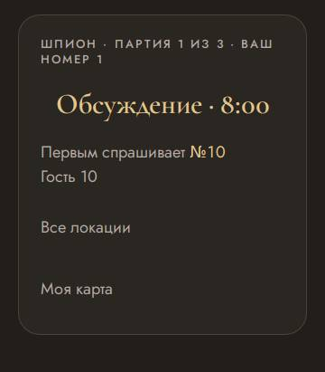

### за краем · пульт

текст выходит за край области по высоте на 96 px — «🦉»

- где: `ol.bk-host__chars > li > b > span.name-emoji`, этап `playing/1/question/catastrophe`
- игры (1): bunker 1-й шаблон, каждый сам ×8, проектор 4:3, маленький телефон, длинные имена; bunker 1-й шаблон, каждый сам ×8, ноутбук 16:10, большой зал, длинные имена
- раз: 465

### за краем · пульт

текст выходит за край области по высоте на 96 px — «Екатерина Воскресенская»

- где: `ol.bk-host__chars > li > b > span`, этап `playing/1/question/catastrophe`
- игры (1): bunker 1-й шаблон, каждый сам ×8, проектор 4:3, маленький телефон, длинные имена; bunker 1-й шаблон, каждый сам ×8, ноутбук 16:10, большой зал, длинные имена
- раз: 465

### за краем · пульт

текст выходит за край области по высоте на 10 px — «№9 Гость 9 — 🏠 Мирный житель · выбыл(а)»

- где: `div.stack.host-quiz > details.quest-host__places > ol.mf-host__roles > li`, этап `playing/12/question/vote`
- игры (1): mafia 1-й шаблон, каждый сам ×9, телевизор full hd; mafia 1-й шаблон, каждый сам ×9, ноутбук 16:10, большой зал, длинные имена; mafia 1-й шаблон, каждый сам ×9, проектор 4:3, маленький телефон, длинные имена
- раз: 401

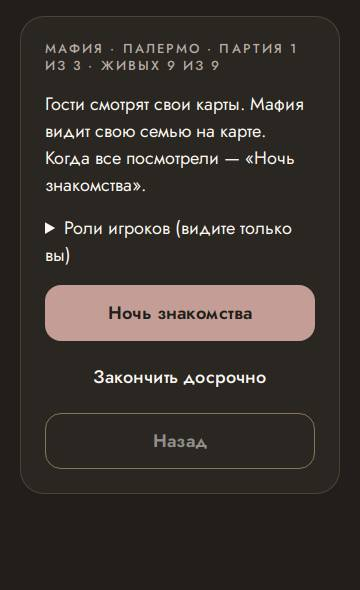

### за краем · пульт

текст выходит за край области по высоте на 14 px — «№10 Гость 10 — Радист»

- где: `div.stack.host-quiz > details.quest-host__places > ol.sp-host__cards > li`, этап `playing/0/reveal/cards`
- игры (1): spy 1-й шаблон, каждый сам ×11, телевизор full hd; spy 1-й шаблон, каждый сам ×11, проектор 4:3, маленький телефон, длинные имена; spy 1-й шаблон, каждый сам ×11, ноутбук 16:10, большой зал, длинные имена
- раз: 358

### за краем · пульт

текст выходит за край области по высоте на 37 px — «Святослав Новосельцев»

- где: `details.quest-host__places > ol.mf-host__roles > li > span`, этап `playing/0/reveal/roles`
- игры (1): mafia 1-й шаблон, каждый сам ×9, ноутбук 16:10, большой зал, длинные имена; mafia 1-й шаблон, каждый сам ×9, проектор 4:3, маленький телефон, длинные имена
- раз: 351

### за краем · пульт

текст выходит за край области по высоте на 37 px — «🐬»

- где: `details.quest-host__places > ol.mf-host__roles > li > span.name-emoji`, этап `playing/0/reveal/roles`
- игры (1): mafia 1-й шаблон, каждый сам ×9, ноутбук 16:10, большой зал, длинные имена; mafia 1-й шаблон, каждый сам ×9, проектор 4:3, маленький телефон, длинные имена
- раз: 340

### за краем · телефон

текст выходит за край области по высоте на 156 px — «Отправить ведущему»

- где: `div.quiz-phone.td-phone > details.td-suggest > div.stack.stack--tight > button.btn.btn--secondary`, этап `playing/0/question/pick`
- игры (1): truth 1-й шаблон, каждый сам ×4, телевизор full hd; truth 1-й шаблон, каждый сам ×4, проектор 4:3, маленький телефон, длинные имена; truth 1-й шаблон, команды ×4, телевизор full hd; truth 1-й шаблон, команды ×4, проектор 4:3, маленький телефон, длинные имена; truth 2-й шаблон, каждый сам ×4, телевизор full hd; truth 2-й шаблон, каждый сам ×4, проектор 4:3, маленький телефон, длинные имена …
- раз: 318

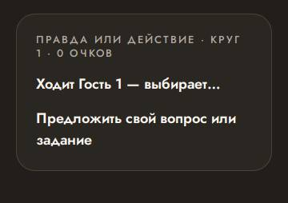

### за краем · телефон

текст выходит за край области по высоте на 223 px — «Ведущий сам решит, брать ли ваше задание. Имя автора увидят на экране.»

- где: `div.quiz-phone.td-phone > details.td-suggest > div.stack.stack--tight > p.muted.small`, этап `playing/0/question/pick`
- игры (1): truth 1-й шаблон, каждый сам ×4, телевизор full hd; truth 1-й шаблон, каждый сам ×4, проектор 4:3, маленький телефон, длинные имена; truth 1-й шаблон, команды ×4, телевизор full hd; truth 1-й шаблон, команды ×4, проектор 4:3, маленький телефон, длинные имена; truth 2-й шаблон, каждый сам ×4, телевизор full hd; truth 2-й шаблон, каждый сам ×4, проектор 4:3, маленький телефон, длинные имена …
- раз: 318

### за краем · телефон

текст выходит за край области по высоте на 22 px — «Локация»

- где: `button.sp-card > span.sp-card__inner > span.sp-card__face.sp-card__face--place > span.sp-card__label`, этап `playing/1/question/talk`
- игры (1): spy 1-й шаблон, каждый сам ×11, телевизор full hd; spy 1-й шаблон, каждый сам ×11, проектор 4:3, маленький телефон, длинные имена; spy 1-й шаблон, каждый сам ×11, ноутбук 16:10, большой зал, длинные имена
- раз: 298

### за краем · пульт

текст выходит за край области по высоте на 53 px — «Святослав Новосельцев»

- где: `details.quest-host__places > ol.sp-host__cards > li > span`, этап `playing/1/question/talk`
- игры (1): spy 1-й шаблон, каждый сам ×11, проектор 4:3, маленький телефон, длинные имена; spy 1-й шаблон, каждый сам ×11, ноутбук 16:10, большой зал, длинные имена
- раз: 291

### за краем · пульт

текст выходит за край области по высоте на 26 px — «🐬»

- где: `details.quest-host__places > ol.sp-host__cards > li > span.name-emoji`, этап `playing/1/question/talk`
- игры (1): spy 1-й шаблон, каждый сам ×11, проектор 4:3, маленький телефон, длинные имена; spy 1-й шаблон, каждый сам ×11, ноутбук 16:10, большой зал, длинные имена
- раз: 286

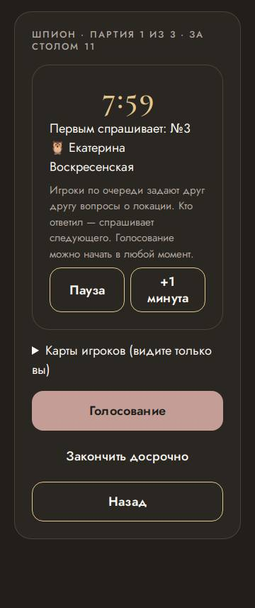

### за краем · телефон

текст выходит за край области по высоте на 264 px — «Комиссар»

- где: `button.mf-card > span.mf-card__inner > div.mf-card__face.mf-card__front > h3.mf-card__title`, этап `playing/0/reveal/day`
- игры (1): mafia 1-й шаблон, каждый сам ×9, телевизор full hd; mafia 1-й шаблон, каждый сам ×9, ноутбук 16:10, большой зал, длинные имена; mafia 1-й шаблон, каждый сам ×9, проектор 4:3, маленький телефон, длинные имена
- раз: 264

### за краем · телефон

текст выходит за край области по высоте на 293 px — «Каждую ночь проверяете одного игрока: мафия он или нет.»

- где: `button.mf-card > span.mf-card__inner > div.mf-card__face.mf-card__front > p.mf-card__power`, этап `playing/0/reveal/day`
- игры (1): mafia 1-й шаблон, каждый сам ×9, телевизор full hd; mafia 1-й шаблон, каждый сам ×9, ноутбук 16:10, большой зал, длинные имена; mafia 1-й шаблон, каждый сам ×9, проектор 4:3, маленький телефон, длинные имена
- раз: 264

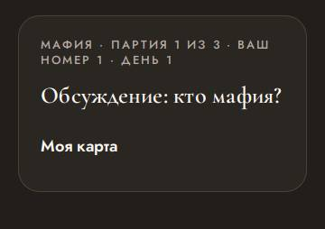

### за краем · телефон

текст выходит за край области вбок на 101 px — «Владимир Преображенский»

- где: `div.mf-targets > button.mf-target > span.mf-target__name > span`, этап `playing/1/question/vote`
- игры (1): mafia 1-й шаблон, каждый сам ×9, ноутбук 16:10, большой зал, длинные имена; mafia 1-й шаблон, каждый сам ×9, проектор 4:3, маленький телефон, длинные имена
- раз: 195

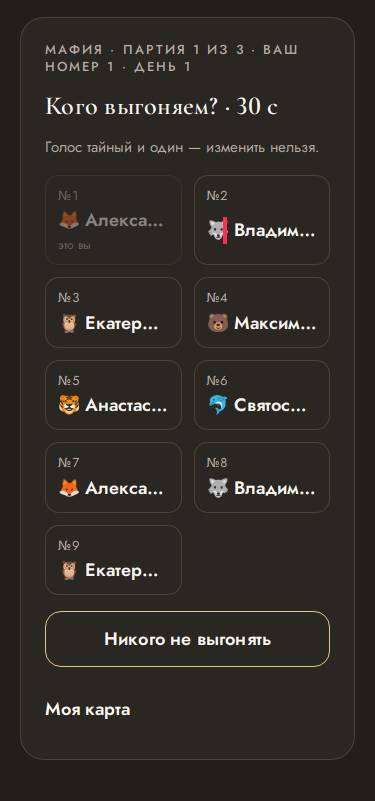

### за краем · телефон

текст выходит за край области по высоте на 80 px — «Подводная лодка»

- где: `button.sp-card > span.sp-card__inner > span.sp-card__face.sp-card__face--place > strong.sp-card__title`, этап `playing/1/question/talk`
- игры (1): spy 1-й шаблон, каждый сам ×11, телевизор full hd; spy 1-й шаблон, каждый сам ×11, проектор 4:3, маленький телефон, длинные имена; spy 1-й шаблон, каждый сам ×11, ноутбук 16:10, большой зал, длинные имена
- раз: 149

### за краем · телефон

текст выходит за край области по высоте на 144 px — «Механик»

- где: `button.sp-card > span.sp-card__inner > span.sp-card__face.sp-card__face--place > strong.sp-card__role`, этап `playing/1/question/talk`
- игры (1): spy 1-й шаблон, каждый сам ×11, телевизор full hd; spy 1-й шаблон, каждый сам ×11, проектор 4:3, маленький телефон, длинные имена; spy 1-й шаблон, каждый сам ×11, ноутбук 16:10, большой зал, длинные имена
- раз: 149

### за краем · телефон

текст выходит за край области вбок на 106 px — «Владимир Преображенский»

- где: `ul.mf-tally > li.mf-tally__row > span.mf-tally__name > span`, этап `playing/1/reveal/verdict`
- игры (1): mafia 1-й шаблон, каждый сам ×9, ноутбук 16:10, большой зал, длинные имена; mafia 1-й шаблон, каждый сам ×9, проектор 4:3, маленький телефон, длинные имена
- раз: 128

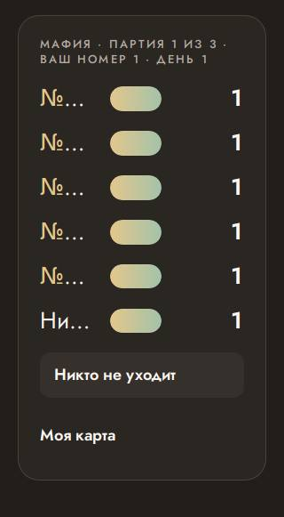

### за краем · телефон

текст выходит за край области вбок на 7 px — «Владимир Преображенский»

- где: `div.st-targets > button.mf-target > span.mf-target__name > span`, этап `playing/14/question/guess`
- игры (1): story 1-й шаблон, каждый сам ×6, проектор 4:3, маленький телефон, длинные имена; story 1-й шаблон, каждый сам ×6, ноутбук 16:10, большой зал, длинные имена
- раз: 88

### за краем · пульт

текст выходит за край области вбок на 10 px — «Опоздавшие 5 — «Робот пишет ответ 60»»

- где: `div.sv-marks > div.sv-mark-row > button.column-opt > span.line-clamp`, этап `playing/5/reveal/`
- игры (1): survival 1-й шаблон, команды ×4, телевизор full hd; survival 1-й шаблон, команды ×4, проектор 4:3, маленький телефон, длинные имена; survival 1-й шаблон, команды ×8, ноутбук 16:10, большой зал, длинные имена
- раз: 87

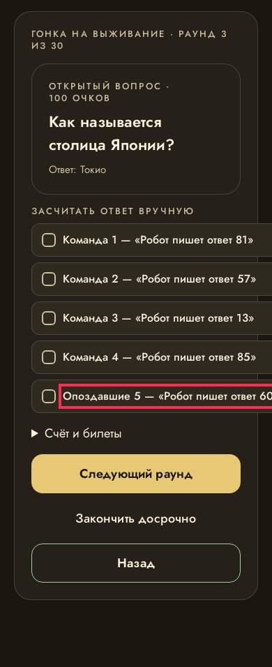

### за краем · телефон

текст выходит за край области вбок на 33 px — «Максимилиан Рождественский»

- где: `ul.sp-tally > li.sp-tally__row > span.sp-tally__name > span`, этап `playing/2/reveal/verdict`
- игры (1): spy 1-й шаблон, каждый сам ×11, проектор 4:3, маленький телефон, длинные имена
- раз: 81

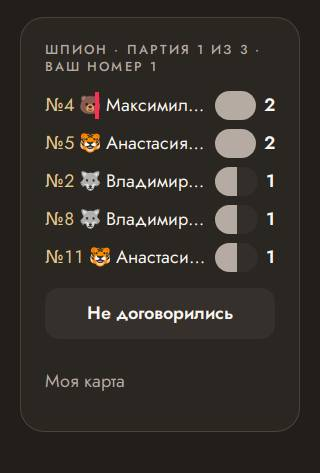

### за краем · телефон

текст выходит за край области по высоте на 290 px — «Ваша семья: Гость 6»

- где: `button.mf-card > span.mf-card__inner > div.mf-card__face.mf-card__front > p.mf-card__family`, этап `playing/0/reveal/day`
- игры (1): mafia 1-й шаблон, каждый сам ×9, телевизор full hd; mafia 1-й шаблон, каждый сам ×9, ноутбук 16:10, большой зал, длинные имена; mafia 1-й шаблон, каждый сам ×9, проектор 4:3, маленький телефон, длинные имена
- раз: 63

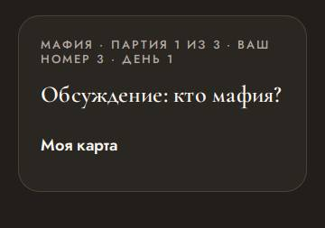

### за краем · пульт

текст выходит за край области по высоте на 50 px — «🐻 Максимилиан Рождественский: «Второй шанс» — 🐯 Анастасия Великорецкая возвращ»

- где: `div.stack.host-quiz > details.quest-host__places > ul.bk-host__log > li`, этап `playing/45/question/vote`
- игры (1): bunker 1-й шаблон, каждый сам ×8, проектор 4:3, маленький телефон, длинные имена; bunker 1-й шаблон, каждый сам ×8, телевизор full hd; bunker 1-й шаблон, каждый сам ×8, ноутбук 16:10, большой зал, длинные имена
- раз: 62

### за краем · телефон

текст выходит за край области по высоте на 6 px — «В детстве я три года подряд ходил в кружок балета»

- где: `div.quiz-phone.st-phone > details.st-phone__ideas > ul > li`, этап `playing/0/question/write`
- игры (1): story 1-й шаблон, команды ×6, телевизор full hd; story 1-й шаблон, команды ×6, проектор 4:3, маленький телефон, длинные имена; story 1-й шаблон, команды ×6, ноутбук 16:10, большой зал, длинные имена; story 1-й шаблон, каждый сам ×6, телевизор full hd; story 1-й шаблон, каждый сам ×6, проектор 4:3, маленький телефон, длинные имена; story 1-й шаблон, каждый сам ×6, ноутбук 16:10, большой зал, длинные имена
- раз: 54

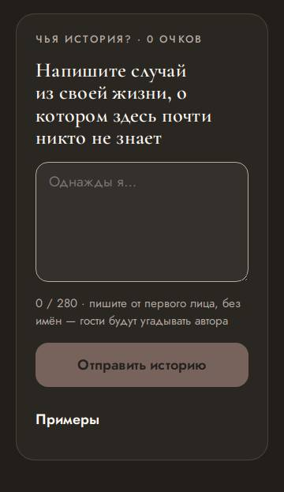

### за краем · телефон

текст выходит за край области по высоте на 269 px — «Угроза»

- где: `li > div.bk-card.bk-threat > div.bk-in > span.bk-threat__kicker`, этап `playing/65/question/final`
- игры (1): bunker 1-й шаблон, каждый сам ×8, проектор 4:3, маленький телефон, длинные имена; bunker 1-й шаблон, каждый сам ×8, телевизор full hd; bunker 1-й шаблон, каждый сам ×8, ноутбук 16:10, большой зал, длинные имена
- раз: 51

### за краем · телефон

текст выходит за край области по высоте на 284 px — «Чужаки у входа»

- где: `li > div.bk-card.bk-threat > div.bk-in > span.bk-threat__title`, этап `playing/65/question/final`
- игры (1): bunker 1-й шаблон, каждый сам ×8, проектор 4:3, маленький телефон, длинные имена; bunker 1-й шаблон, каждый сам ×8, телевизор full hd; bunker 1-й шаблон, каждый сам ×8, ноутбук 16:10, большой зал, длинные имена
- раз: 51

### за краем · телефон

текст выходит за край области по высоте на 302 px — «Вооружённая группа требует открыть дверь.»

- где: `li > div.bk-card.bk-threat > div.bk-in > span.bk-threat__text`, этап `playing/65/question/final`
- игры (1): bunker 1-й шаблон, каждый сам ×8, проектор 4:3, маленький телефон, длинные имена; bunker 1-й шаблон, каждый сам ×8, телевизор full hd; bunker 1-й шаблон, каждый сам ×8, ноутбук 16:10, большой зал, длинные имена
- раз: 51

### за краем · телефон

текст выходит за край области по высоте на 327 px — «Поможет: военный, полицейский, переговорщик, оружие»

- где: `li > div.bk-card.bk-threat > div.bk-in > span.bk-threat__helps`, этап `playing/65/question/final`
- игры (1): bunker 1-й шаблон, каждый сам ×8, проектор 4:3, маленький телефон, длинные имена; bunker 1-й шаблон, каждый сам ×8, телевизор full hd; bunker 1-й шаблон, каждый сам ×8, ноутбук 16:10, большой зал, длинные имена
- раз: 51

### за краем · телефон

текст выходит за край области по высоте на 237 px — «Справились»

- где: `li > div.bk-card.bk-threat > div.bk-in > span.bk-threat__stamp`, этап `playing/65/question/final`
- игры (1): bunker 1-й шаблон, каждый сам ×8, проектор 4:3, маленький телефон, длинные имена; bunker 1-й шаблон, каждый сам ×8, телевизор full hd; bunker 1-й шаблон, каждый сам ×8, ноутбук 16:10, большой зал, длинные имена
- раз: 42

### за краем · пульт

текст выходит за край области вбок на 136 px — «Шанс для : один ответ. Есть на табло — банк их, нет — банк .»

- где: `main.page.page--pult > section.card > div.stack.host-quiz > p.mil-host-live`, этап `playing/1/reveal/steal`
- игры (1): hundred 1-й шаблон, каждый сам ×4, проектор 4:3, маленький телефон, длинные имена; hundred 1-й шаблон, команды ×4, проектор 4:3, маленький телефон, длинные имена; hundred 1-й шаблон, команды ×8, ноутбук 16:10, большой зал, длинные имена; hundred 1-й шаблон, каждый сам ×16, ноутбук 16:10, большой зал, длинные имена; hundred 2-й шаблон, команды ×4, проектор 4:3, маленький телефон, длинные имена; hundred 2-й шаблон, каждый сам ×4, проектор 4:3, маленький телефон, длинные имена …
- раз: 33

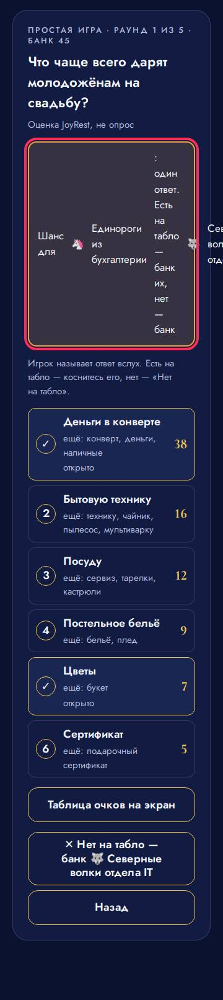

### за краем · пульт

текст выходит за край области вбок на 119 px — «Александра Константинова»

- где: `section.card > div.stack.host-quiz > p.mil-host-live > span`, этап `playing/1/reveal/steal`
- игры (1): hundred 1-й шаблон, каждый сам ×4, проектор 4:3, маленький телефон, длинные имена; hundred 1-й шаблон, команды ×4, проектор 4:3, маленький телефон, длинные имена; hundred 1-й шаблон, команды ×8, ноутбук 16:10, большой зал, длинные имена; hundred 1-й шаблон, каждый сам ×16, ноутбук 16:10, большой зал, длинные имена; hundred 2-й шаблон, команды ×4, проектор 4:3, маленький телефон, длинные имена; hundred 2-й шаблон, каждый сам ×4, проектор 4:3, маленький телефон, длинные имена …
- раз: 33

### за краем · телефон

текст выходит за край области вбок на 32 px — «6»

- где: `div.dk-hand__row > button.dk-hand__slot > div.dk-card.dk-d--classic > span.dk-idx`, этап `playing/86/question/play`
- игры (1): durak 1-й шаблон, каждый сам ×4, проектор 4:3, маленький телефон, длинные имена; durak 1-й шаблон, каждый сам ×4, телевизор full hd; durak 1-й шаблон, каждый сам ×4, ноутбук 16:10, большой зал, длинные имена
- раз: 24

### за краем · телефон

текст выходит за край области вбок на 24 px — «♠︎»

- где: `button.dk-hand__slot > div.dk-card.dk-d--classic > span.dk-idx > span`, этап `playing/86/question/play`
- игры (1): durak 1-й шаблон, каждый сам ×4, проектор 4:3, маленький телефон, длинные имена; durak 1-й шаблон, каждый сам ×4, телевизор full hd; durak 1-й шаблон, каждый сам ×4, ноутбук 16:10, большой зал, длинные имена
- раз: 24

### за краем · телефон

текст выходит за край области по высоте на 153 px — «Вы — шпион»

- где: `button.sp-card > span.sp-card__inner > span.sp-card__face.sp-card__face--spy > strong.sp-card__title`, этап `playing/110/question/talk`
- игры (1): spy 1-й шаблон, каждый сам ×11, телевизор full hd; spy 1-й шаблон, каждый сам ×11, проектор 4:3, маленький телефон, длинные имена; spy 1-й шаблон, каждый сам ×11, ноутбук 16:10, большой зал, длинные имена
- раз: 22

### за краем · телефон

текст выходит за край области по высоте на 186 px — «Вы не знаете, где все. Слушайте и угадайте локацию — или не выдайте себя.»

- где: `button.sp-card > span.sp-card__inner > span.sp-card__face.sp-card__face--spy > span.sp-card__hint`, этап `playing/110/question/talk`
- игры (1): spy 1-й шаблон, каждый сам ×11, телевизор full hd; spy 1-й шаблон, каждый сам ×11, проектор 4:3, маленький телефон, длинные имена; spy 1-й шаблон, каждый сам ×11, ноутбук 16:10, большой зал, длинные имена
- раз: 22

### за краем · телефон

текст выходит за край области вбок на 21 px — «6»

- где: `div.dk-hand__row > button.dk-hand__slot > div.dk-card.dk-d--russia > span.dk-idx`, этап `playing/12/question/play`
- игры (1): durak 1-й шаблон, каждый сам ×4, проектор 4:3, маленький телефон, длинные имена; durak 1-й шаблон, каждый сам ×4, телевизор full hd; durak 1-й шаблон, каждый сам ×4, ноутбук 16:10, большой зал, длинные имена
- раз: 16

### за краем · телефон

текст выходит за край области вбок на 14 px — «♠︎»

- где: `button.dk-hand__slot > div.dk-card.dk-d--russia > span.dk-idx > span`, этап `playing/12/question/play`
- игры (1): durak 1-й шаблон, каждый сам ×4, проектор 4:3, маленький телефон, длинные имена; durak 1-й шаблон, каждый сам ×4, телевизор full hd; durak 1-й шаблон, каждый сам ×4, ноутбук 16:10, большой зал, длинные имена
- раз: 16

### за краем · телефон

текст выходит за край области вбок на 22 px — «6»

- где: `div.dk-hand__row > button.dk-hand__slot > div.dk-card.dk-d--cyber > span.dk-idx`, этап `playing/4/question/play`
- игры (1): durak 1-й шаблон, каждый сам ×4, проектор 4:3, маленький телефон, длинные имена; durak 1-й шаблон, каждый сам ×4, телевизор full hd; durak 1-й шаблон, каждый сам ×4, ноутбук 16:10, большой зал, длинные имена
- раз: 15

### за краем · телефон

текст выходит за край области вбок на 11 px — «♠︎»

- где: `button.dk-hand__slot > div.dk-card.dk-d--cyber > span.dk-idx > span`, этап `playing/4/question/play`
- игры (1): durak 1-й шаблон, каждый сам ×4, проектор 4:3, маленький телефон, длинные имена; durak 1-й шаблон, каждый сам ×4, телевизор full hd; durak 1-й шаблон, каждый сам ×4, ноутбук 16:10, большой зал, длинные имена
- раз: 15

### за краем · телефон

текст выходит за край области вбок на 22 px — «6»

- где: `div.dk-hand__row > button.dk-hand__slot > div.dk-card.dk-d--rome > span.dk-idx`, этап `playing/16/question/play`
- игры (1): durak 1-й шаблон, каждый сам ×4, проектор 4:3, маленький телефон, длинные имена; durak 1-й шаблон, каждый сам ×4, телевизор full hd; durak 1-й шаблон, каждый сам ×4, ноутбук 16:10, большой зал, длинные имена
- раз: 15

### за краем · телефон

текст выходит за край области вбок на 22 px — «6»

- где: `div.dk-hand__row > button.dk-hand__slot > div.dk-card.dk-d--wedding > span.dk-idx`, этап `playing/48/question/play`
- игры (1): durak 1-й шаблон, каждый сам ×4, проектор 4:3, маленький телефон, длинные имена; durak 1-й шаблон, каждый сам ×4, телевизор full hd; durak 1-й шаблон, каждый сам ×4, ноутбук 16:10, большой зал, длинные имена
- раз: 15

### за краем · телефон

текст выходит за край области вбок на 14 px — «♠︎»

- где: `button.dk-hand__slot > div.dk-card.dk-d--wedding > span.dk-idx > span`, этап `playing/48/question/play`
- игры (1): durak 1-й шаблон, каждый сам ×4, проектор 4:3, маленький телефон, длинные имена; durak 1-й шаблон, каждый сам ×4, телевизор full hd; durak 1-й шаблон, каждый сам ×4, ноутбук 16:10, большой зал, длинные имена
- раз: 15

### за краем · телефон

текст выходит за край области вбок на 13 px — «♠︎»

- где: `button.dk-hand__slot > div.dk-card.dk-d--rome > span.dk-idx > span`, этап `playing/16/question/play`
- игры (1): durak 1-й шаблон, каждый сам ×4, проектор 4:3, маленький телефон, длинные имена; durak 1-й шаблон, каждый сам ×4, телевизор full hd; durak 1-й шаблон, каждый сам ×4, ноутбук 16:10, большой зал, длинные имена
- раз: 14

### за краем · телефон

текст выходит за край области вбок на 21 px — «6»

- где: `div.dk-hand__row > button.dk-hand__slot > div.dk-card.dk-d--gothic > span.dk-idx`, этап `playing/50/question/play`
- игры (1): durak 1-й шаблон, каждый сам ×4, проектор 4:3, маленький телефон, длинные имена; durak 1-й шаблон, каждый сам ×4, телевизор full hd; durak 1-й шаблон, каждый сам ×4, ноутбук 16:10, большой зал, длинные имена
- раз: 9

### за краем · телефон

текст выходит за край области вбок на 14 px — «♠︎»

- где: `button.dk-hand__slot > div.dk-card.dk-d--gothic > span.dk-idx > span`, этап `playing/50/question/play`
- игры (1): durak 1-й шаблон, каждый сам ×4, проектор 4:3, маленький телефон, длинные имена; durak 1-й шаблон, каждый сам ×4, телевизор full hd; durak 1-й шаблон, каждый сам ×4, ноутбук 16:10, большой зал, длинные имена
- раз: 9

### за краем · пульт

текст выходит за край области по высоте на 10 px — «Робот пишет ответ 90»

- где: `details.quest-host__places > ul.st-host__list > li > span`, этап `playing/36/question/write`
- игры (1): story 1-й шаблон, каждый сам ×6, телевизор full hd; story 1-й шаблон, каждый сам ×6, проектор 4:3, маленький телефон, длинные имена; story 1-й шаблон, каждый сам ×6, ноутбук 16:10, большой зал, длинные имена
- раз: 9

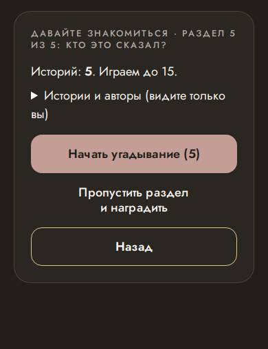

### за краем · пульт

текст выходит за край области по высоте на 54 px — «Убрать»

- где: `details.quest-host__places > ul.st-host__list > li > button.btn.btn--quiet`, этап `playing/36/question/write`
- игры (1): story 1-й шаблон, каждый сам ×6, телевизор full hd; story 1-й шаблон, каждый сам ×6, проектор 4:3, маленький телефон, длинные имена; story 1-й шаблон, каждый сам ×6, ноутбук 16:10, большой зал, длинные имена
- раз: 9

### за краем · телефон

текст выходит за край области вбок на 10 px — «Владимир Преображенский»

- где: `div.sp-targets > button.sp-target > span.sp-target__name > span`, этап `playing/2/question/vote`
- игры (1): spy 1-й шаблон, каждый сам ×11, проектор 4:3, маленький телефон, длинные имена
- раз: 8

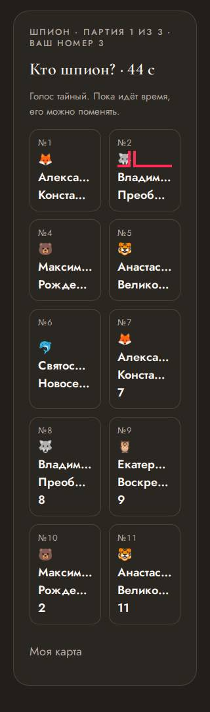

### за краем · пульт

текст выходит за край области вбок на 65 px — «Анастасия Великорецкая»

- где: `div.stack.host-quiz > p.mil-host-live > strong > span`, этап `playing/42/question/bet`
- игры (1): board 1-й шаблон, каждый сам ×4, проектор 4:3, маленький телефон, длинные имена; board 1-й шаблон, команды ×4, проектор 4:3, маленький телефон, длинные имена; board 1-й шаблон, каждый сам ×16, ноутбук 16:10, большой зал, длинные имена
- раз: 5

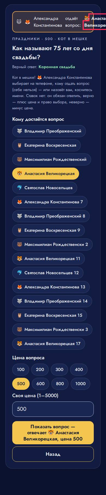

### за краем · пульт

текст выходит за край области вбок на 8 px — «: 50 очков»

- где: `div.stack.host-quiz > div.card.stack > ul.meta > li`, этап `playing/10/reveal/`
- игры (1): survival 1-й шаблон, команды ×4, проектор 4:3, маленький телефон, длинные имена
- раз: 4

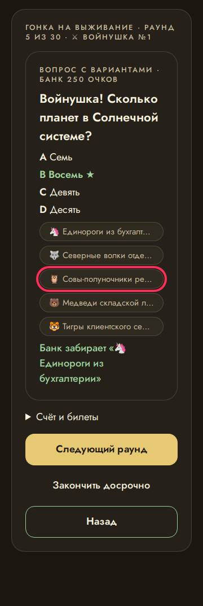

### за краем · пульт

текст выходит за край области по высоте на 117 px — «🦊»

- где: `ul.st-host__list > li > span.small > span.name-emoji`, этап `playing/36/question/write`
- игры (1): story 1-й шаблон, каждый сам ×6, проектор 4:3, маленький телефон, длинные имена; story 1-й шаблон, каждый сам ×6, ноутбук 16:10, большой зал, длинные имена
- раз: 4

### за краем · пульт

текст выходит за край области по высоте на 117 px — «Александра Константинова 7»

- где: `ul.st-host__list > li > span.small > span`, этап `playing/36/question/write`
- игры (1): story 1-й шаблон, каждый сам ×6, проектор 4:3, маленький телефон, длинные имена; story 1-й шаблон, каждый сам ×6, ноутбук 16:10, большой зал, длинные имена
- раз: 4

### за краем · телефон

текст выходит за край области вбок на 18 px — «K»

- где: `div.dk-hand__row > button.dk-hand__slot > div.dk-card.dk-d--anime > span.dk-idx`, этап `playing/59/question/play`
- игры (1): durak 1-й шаблон, каждый сам ×4, ноутбук 16:10, большой зал, длинные имена
- раз: 2

### за краем · телефон

текст выходит за край области вбок на 6 px — «♠︎»

- где: `button.dk-hand__slot > div.dk-card.dk-d--anime > span.dk-idx > span`, этап `playing/59/question/play`
- игры (1): durak 1-й шаблон, каждый сам ×4, ноутбук 16:10, большой зал, длинные имена
- раз: 2

### за краем · пульт

текст выходит за край области по высоте на 117 px — «Опоздал 7»

- где: `details.quest-host__places > ul.st-host__list > li > span.small`, этап `playing/36/question/write`
- игры (1): story 1-й шаблон, каждый сам ×6, телевизор full hd
- раз: 2

### закрыт другим элементом · экран зала

«3» закрыт элементом h2.board-view__title — «3»

- где: `div.podium__stage > div.podium__slot > div.podium__step > span.podium__num`, этап `finished/7/podium/`
- игры (8): quiz 1-й шаблон, каждый сам ×16, ноутбук 16:10, большой зал, длинные имена; checkers 1-й шаблон, команды ×2, проектор 4:3, маленький телефон, длинные имена; dance 1-й шаблон, команды ×4, проектор 4:3, маленький телефон, длинные имена; stage 1-й шаблон, команды ×4, проектор 4:3, маленький телефон, длинные имена; stage 2-й шаблон, команды ×4, проектор 4:3, маленький телефон, длинные имена; mafia 1-й шаблон, каждый сам ×9, ноутбук 16:10, большой зал, длинные имена …
- раз: 24

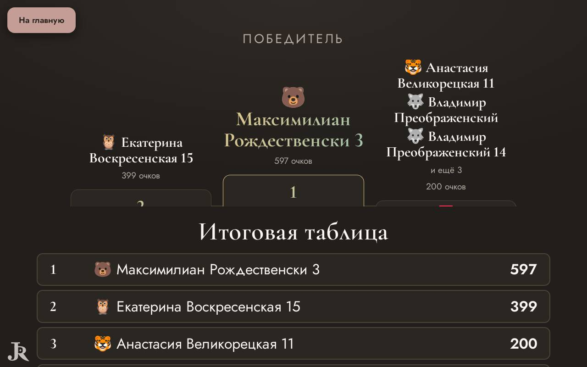

### закрыт другим элементом · телефон

«Екатерина Воскресенская» закрыт элементом span.name-emoji — «Екатерина Воскресенская»

- где: `ul.podium-phone > li > span > span`, этап `playing/7/podium/`
- игры (5): quiz 1-й шаблон, каждый сам ×16, ноутбук 16:10, большой зал, длинные имена; dance 1-й шаблон, команды ×8, ноутбук 16:10, большой зал, длинные имена; quest 2-й шаблон, команды ×8, ноутбук 16:10, большой зал, длинные имена; truth 1-й шаблон, команды ×4, проектор 4:3, маленький телефон, длинные имена; truth 1-й шаблон, каждый сам ×16, ноутбук 16:10, большой зал, длинные имена; truth 1-й шаблон, команды ×8, ноутбук 16:10, большой зал, длинные имена …
- раз: 144

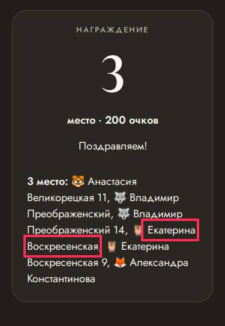

### закрыт другим элементом · пульт

«Команда 1 — клетка 0» закрыт элементом p.muted.small — «Команда 1 — клетка 0»

- где: `div.stack.host-quiz > details.quest-host__places > ol > li`, этап `playing/0/question/roll`
- игры (4): quest 1-й шаблон, команды ×4, телевизор full hd; quest 1-й шаблон, команды ×4, проектор 4:3, маленький телефон, длинные имена; quest 2-й шаблон, команды ×4, проектор 4:3, маленький телефон, длинные имена; quest 2-й шаблон, команды ×4, телевизор full hd; quest 1-й шаблон, команды ×8, ноутбук 16:10, большой зал, длинные имена; millionaire 1-й шаблон, каждый сам ×4, телевизор full hd …
- раз: 724

### закрыт другим элементом · пульт

«🦄» закрыт элементом p.muted.small — «🦄»

- где: `details.quest-host__places > ol > li > span.name-emoji`, этап `playing/0/question/roll`
- игры (4): quest 1-й шаблон, команды ×4, проектор 4:3, маленький телефон, длинные имена; quest 2-й шаблон, команды ×4, проектор 4:3, маленький телефон, длинные имена; quest 1-й шаблон, команды ×8, ноутбук 16:10, большой зал, длинные имена; millionaire 1-й шаблон, команды ×8, ноутбук 16:10, большой зал, длинные имена; millionaire 1-й шаблон, каждый сам ×4, проектор 4:3, маленький телефон, длинные имена; millionaire 1-й шаблон, команды ×4, проектор 4:3, маленький телефон, длинные имена …
- раз: 464

### закрыт другим элементом · пульт

«Единороги из бухгалтерии» закрыт элементом p.muted.small — «Единороги из бухгалтерии»

- где: `details.quest-host__places > ol > li > span`, этап `playing/0/question/roll`
- игры (4): quest 1-й шаблон, команды ×4, проектор 4:3, маленький телефон, длинные имена; quest 2-й шаблон, команды ×4, проектор 4:3, маленький телефон, длинные имена; quest 1-й шаблон, команды ×8, ноутбук 16:10, большой зал, длинные имена; millionaire 1-й шаблон, команды ×8, ноутбук 16:10, большой зал, длинные имена; millionaire 1-й шаблон, каждый сам ×4, проектор 4:3, маленький телефон, длинные имена; millionaire 1-й шаблон, команды ×4, проектор 4:3, маленький телефон, длинные имена …
- раз: 431

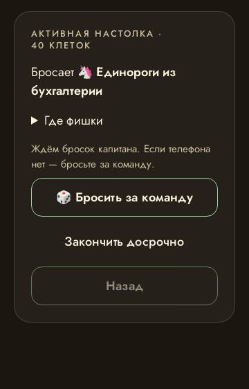

### закрыт другим элементом · пульт

«Тигры клиентского сервиса» закрыт элементом span.name-emoji — «Тигры клиентского сервиса»

- где: `li.podium-list__item > span.podium-list__names > span > span`, этап `playing/17/podium/result`
- игры (4): dance 1-й шаблон, команды ×8, ноутбук 16:10, большой зал, длинные имена; quest 2-й шаблон, команды ×8, ноутбук 16:10, большой зал, длинные имена; truth 1-й шаблон, команды ×8, ноутбук 16:10, большой зал, длинные имена; truth 2-й шаблон, команды ×8, ноутбук 16:10, большой зал, длинные имена; story 1-й шаблон, команды ×6, ноутбук 16:10, большой зал, длинные имена
- раз: 10

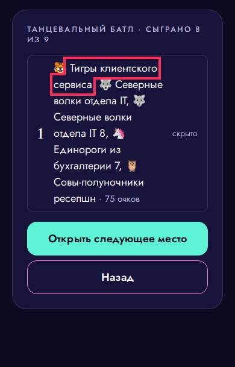

### закрыт другим элементом · экран зала

«Вход: localhost:44047/j · код 123 456» закрыт элементом div.dk-vote — «Вход: localhost:44047/j · код 123 456»

- где: `div.hall > main.quiz-stage > p.stage-code`, этап `playing/2/question/vote`
- игры (3): durak 1-й шаблон, каждый сам ×4, проектор 4:3, маленький телефон, длинные имена; durak 1-й шаблон, каждый сам ×4, телевизор full hd; durak 1-й шаблон, каждый сам ×4, ноутбук 16:10, большой зал, длинные имена; bunker 1-й шаблон, каждый сам ×8, проектор 4:3, маленький телефон, длинные имена; bunker 1-й шаблон, каждый сам ×8, телевизор full hd; bunker 1-й шаблон, каждый сам ×8, ноутбук 16:10, большой зал, длинные имена …
- раз: 24

### закрыт другим элементом · пульт

«, Команда 2» закрыт элементом span — «, Команда 2»

- где: `ol.podium-list > li.podium-list__item > span.podium-list__names > span`, этап `playing/7/podium/`
- игры (3): quiz 1-й шаблон, команды ×4, телевизор full hd; mafia 1-й шаблон, каждый сам ×9, телевизор full hd; truth 1-й шаблон, команды ×4, телевизор full hd; truth 2-й шаблон, команды ×4, телевизор full hd
- раз: 8

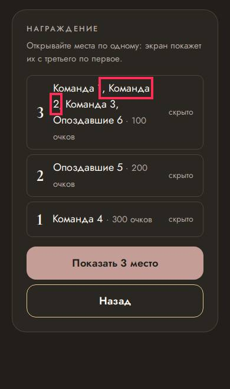

### закрыт другим элементом · телефон

«, Команда 3» закрыт элементом span — «, Команда 3»

- где: `div.quiz-phone.quiz-phone--center > ul.podium-phone > li > span`, этап `playing/7/podium/`
- игры (2): quiz 1-й шаблон, команды ×4, телевизор full hd; truth 1-й шаблон, команды ×4, телевизор full hd; truth 2-й шаблон, команды ×4, телевизор full hd
- раз: 21

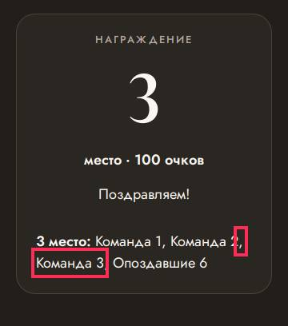

### закрыт другим элементом · экран зала

«Максимилиан Рождественский» закрыт элементом h2.board-view__title — «Максимилиан Рождественский»

- где: `div.podium__slot > div.podium__names > p.podium__name > span`, этап `finished/78/podium/over`
- игры (2): mafia 1-й шаблон, каждый сам ×9, ноутбук 16:10, большой зал, длинные имена; bunker 1-й шаблон, каждый сам ×8, проектор 4:3, маленький телефон, длинные имена
- раз: 2

### закрыт другим элементом · пульт

«Профессия: Музыкант · стаж 9 лет» закрыт элементом summary — «Профессия: Музыкант · стаж 9 лет»

- где: `ol.bk-host__chars > li > span > span`, этап `playing/1/question/catastrophe`
- игры (1): bunker 1-й шаблон, каждый сам ×8, проектор 4:3, маленький телефон, длинные имена; bunker 1-й шаблон, каждый сам ×8, телевизор full hd; bunker 1-й шаблон, каждый сам ×8, ноутбук 16:10, большой зал, длинные имена
- раз: 524

### закрыт другим элементом · пульт

«🐺 Владимир Преображенский: «Эпидемия»» закрыт элементом summary — «🐺 Владимир Преображенский: «Эпидемия»»

- где: `div.stack.host-quiz > details.quest-host__places > ul.bk-host__log > li`, этап `playing/2/question/bunker`
- игры (1): bunker 1-й шаблон, каждый сам ×8, проектор 4:3, маленький телефон, длинные имена; bunker 1-й шаблон, каждый сам ×8, телевизор full hd; bunker 1-й шаблон, каждый сам ×8, ноутбук 16:10, большой зал, длинные имена
- раз: 344

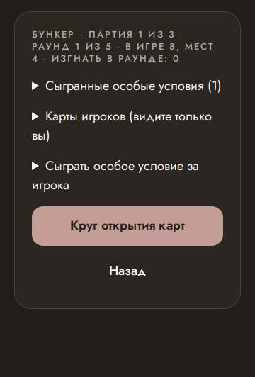

### закрыт другим элементом · пульт

«№1 Гость 1 — 🔦 Комиссар» закрыт элементом button.btn.btn--block — «№1 Гость 1 — 🔦 Комиссар»

- где: `div.stack.host-quiz > details.quest-host__places > ol.mf-host__roles > li`, этап `playing/0/reveal/roles`
- игры (1): mafia 1-й шаблон, каждый сам ×9, телевизор full hd; mafia 1-й шаблон, каждый сам ×9, ноутбук 16:10, большой зал, длинные имена; mafia 1-й шаблон, каждый сам ×9, проектор 4:3, маленький телефон, длинные имена
- раз: 249

### закрыт другим элементом · пульт

«Владимир Преображенский» закрыт элементом section.card.stack — «Владимир Преображенский»

- где: `ul.pr-host__dice > li > span.line-clamp > span`, этап `playing/1/question/bid`
- игры (1): perudo 1-й шаблон, каждый сам ×4, проектор 4:3, маленький телефон, длинные имена; perudo 1-й шаблон, каждый сам ×4, ноутбук 16:10, большой зал, длинные имена; perudo 1-й шаблон, команды ×4, проектор 4:3, маленький телефон, длинные имена; perudo 1-й шаблон, команды ×4, ноутбук 16:10, большой зал, длинные имена
- раз: 183

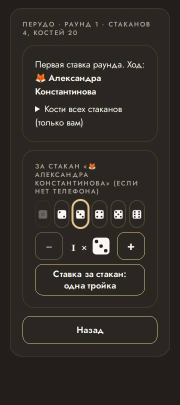

### закрыт другим элементом · пульт

«🐺» закрыт элементом section.card.stack — «🐺»

- где: `ul.pr-host__dice > li > span.line-clamp > span.name-emoji`, этап `playing/1/question/bid`
- игры (1): perudo 1-й шаблон, каждый сам ×4, проектор 4:3, маленький телефон, длинные имена; perudo 1-й шаблон, каждый сам ×4, ноутбук 16:10, большой зал, длинные имена; perudo 1-й шаблон, команды ×4, проектор 4:3, маленький телефон, длинные имена; perudo 1-й шаблон, команды ×4, ноутбук 16:10, большой зал, длинные имена
- раз: 180

### закрыт другим элементом · пульт

«№1 Гость 1 — Механик» закрыт элементом button.btn.btn--block — «№1 Гость 1 — Механик»

- где: `div.stack.host-quiz > details.quest-host__places > ol.sp-host__cards > li`, этап `playing/0/reveal/cards`
- игры (1): spy 1-й шаблон, каждый сам ×11, телевизор full hd; spy 1-й шаблон, каждый сам ×11, проектор 4:3, маленький телефон, длинные имена; spy 1-й шаблон, каждый сам ×11, ноутбук 16:10, большой зал, длинные имена
- раз: 170

### закрыт другим элементом · телефон

«Максимилиан Рождественский» закрыт элементом span.sp-tally__fill — «Максимилиан Рождественский»

- где: `ul.sp-tally > li.sp-tally__row > span.sp-tally__name > span`, этап `playing/2/reveal/verdict`
- игры (1): spy 1-й шаблон, каждый сам ×11, проектор 4:3, маленький телефон, длинные имена; spy 1-й шаблон, каждый сам ×11, ноутбук 16:10, большой зал, длинные имена
- раз: 141

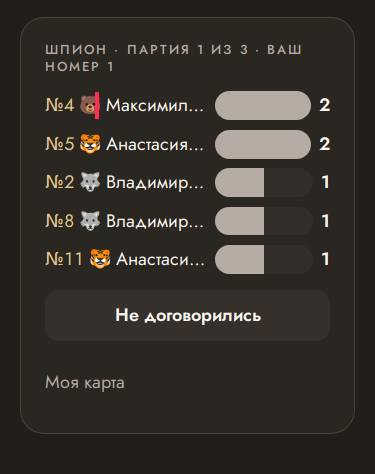

### закрыт другим элементом · телефон

«♠︎» закрыт элементом span.dk-pip — «♠︎»

- где: `button.dk-hand__slot > div.dk-card.dk-d--classic > span.dk-idx.dk-idx--b > span`, этап `playing/86/question/play`
- игры (1): durak 1-й шаблон, каждый сам ×4, проектор 4:3, маленький телефон, длинные имена; durak 1-й шаблон, каждый сам ×4, телевизор full hd; durak 1-й шаблон, каждый сам ×4, ноутбук 16:10, большой зал, длинные имена
- раз: 135

### закрыт другим элементом · телефон

«6» закрыт элементом span.dk-pip — «6»

- где: `div.dk-hand__row > button.dk-hand__slot > div.dk-card.dk-d--classic > span.dk-idx.dk-idx--b`, этап `playing/86/question/play`
- игры (1): durak 1-й шаблон, каждый сам ×4, проектор 4:3, маленький телефон, длинные имена; durak 1-й шаблон, каждый сам ×4, телевизор full hd; durak 1-й шаблон, каждый сам ×4, ноутбук 16:10, большой зал, длинные имена
- раз: 124

### закрыт другим элементом · телефон

«Александра Константинова» закрыт элементом button.mf-target — «Александра Константинова»

- где: `div.mf-targets > button.mf-target > span.mf-target__name > span`, этап `playing/1/question/vote`
- игры (1): mafia 1-й шаблон, каждый сам ×9, ноутбук 16:10, большой зал, длинные имена; mafia 1-й шаблон, каждый сам ×9, проектор 4:3, маленький телефон, длинные имена
- раз: 116

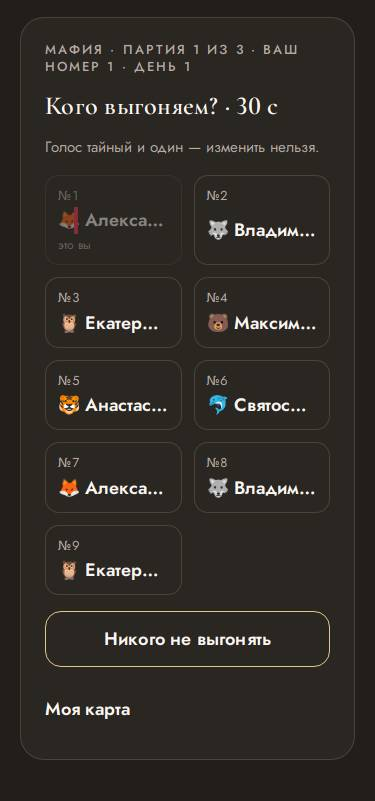

### закрыт другим элементом · пульт

«Александра Константинова» закрыт элементом button.btn.btn--block — «Александра Константинова»

- где: `details.quest-host__places > ol.mf-host__roles > li > span`, этап `playing/0/reveal/roles`
- игры (1): mafia 1-й шаблон, каждый сам ×9, ноутбук 16:10, большой зал, длинные имена; mafia 1-й шаблон, каждый сам ×9, проектор 4:3, маленький телефон, длинные имена
- раз: 115

### закрыт другим элементом · пульт

«№1» закрыт элементом summary — «№1»

- где: `details.quest-host__places > ol.bk-host__chars > li > b`, этап `playing/1/question/catastrophe`
- игры (1): bunker 1-й шаблон, каждый сам ×8, проектор 4:3, маленький телефон, длинные имена; bunker 1-й шаблон, каждый сам ×8, телевизор full hd; bunker 1-й шаблон, каждый сам ×8, ноутбук 16:10, большой зал, длинные имена
- раз: 113

### закрыт другим элементом · экран зала

«0» закрыт элементом p.stage-code — «0»

- где: `div.td-screen > ol.td-queue > li > span.td-queue__score`, этап `playing/0/question/pick`
- игры (1): truth 1-й шаблон, каждый сам ×4, телевизор full hd; truth 1-й шаблон, каждый сам ×4, проектор 4:3, маленький телефон, длинные имена; truth 1-й шаблон, команды ×4, телевизор full hd; truth 1-й шаблон, команды ×4, проектор 4:3, маленький телефон, длинные имена; truth 2-й шаблон, каждый сам ×4, телевизор full hd; truth 2-й шаблон, каждый сам ×4, проектор 4:3, маленький телефон, длинные имена …
- раз: 102

### закрыт другим элементом · пульт

«🦊» закрыт элементом button.btn.btn--block — «🦊»

- где: `details.quest-host__places > ol.sp-host__cards > li > span.name-emoji`, этап `playing/1/question/talk`
- игры (1): spy 1-й шаблон, каждый сам ×11, проектор 4:3, маленький телефон, длинные имена; spy 1-й шаблон, каждый сам ×11, ноутбук 16:10, большой зал, длинные имена
- раз: 98

### закрыт другим элементом · пульт

«Александра Константинова» закрыт элементом button.btn.btn--block — «Александра Константинова»

- где: `details.quest-host__places > ol.sp-host__cards > li > span`, этап `playing/1/question/talk`
- игры (1): spy 1-й шаблон, каждый сам ×11, проектор 4:3, маленький телефон, длинные имена; spy 1-й шаблон, каждый сам ×11, ноутбук 16:10, большой зал, длинные имена
- раз: 98

### закрыт другим элементом · пульт

«🦊» закрыт элементом button.btn.btn--block — «🦊»

- где: `details.quest-host__places > ol.mf-host__roles > li > span.name-emoji`, этап `playing/0/reveal/roles`
- игры (1): mafia 1-й шаблон, каждый сам ×9, ноутбук 16:10, большой зал, длинные имена; mafia 1-й шаблон, каждый сам ×9, проектор 4:3, маленький телефон, длинные имена
- раз: 94

### закрыт другим элементом · пульт

«Гость 2» закрыт элементом section.card.stack — «Гость 2»

- где: `details.quest-host__places > ul.pr-host__dice > li > span.line-clamp`, этап `playing/1/question/bid`
- игры (1): perudo 1-й шаблон, каждый сам ×4, телевизор full hd; perudo 1-й шаблон, команды ×4, телевизор full hd
- раз: 90

### закрыт другим элементом · телефон

«♠︎» закрыт элементом span.dk-pip — «♠︎»

- где: `button.dk-hand__slot > div.dk-card.dk-d--russia > span.dk-idx.dk-idx--b > span`, этап `playing/12/question/play`
- игры (1): durak 1-й шаблон, каждый сам ×4, проектор 4:3, маленький телефон, длинные имена; durak 1-й шаблон, каждый сам ×4, телевизор full hd; durak 1-й шаблон, каждый сам ×4, ноутбук 16:10, большой зал, длинные имена
- раз: 87

### закрыт другим элементом · телефон

«6» закрыт элементом span.dk-pip — «6»

- где: `div.dk-hand__row > button.dk-hand__slot > div.dk-card.dk-d--russia > span.dk-idx.dk-idx--b`, этап `playing/12/question/play`
- игры (1): durak 1-й шаблон, каждый сам ×4, проектор 4:3, маленький телефон, длинные имена; durak 1-й шаблон, каждый сам ×4, телевизор full hd; durak 1-й шаблон, каждый сам ×4, ноутбук 16:10, большой зал, длинные имена
- раз: 85

### закрыт другим элементом · телефон

«♠︎» закрыт элементом span.dk-pip — «♠︎»

- где: `button.dk-hand__slot > div.dk-card.dk-d--rome > span.dk-idx.dk-idx--b > span`, этап `playing/16/question/play`
- игры (1): durak 1-й шаблон, каждый сам ×4, проектор 4:3, маленький телефон, длинные имена; durak 1-й шаблон, каждый сам ×4, телевизор full hd; durak 1-й шаблон, каждый сам ×4, ноутбук 16:10, большой зал, длинные имена
- раз: 85

### закрыт другим элементом · экран зала

«Северные волки отдела IT» закрыт элементом span.qx-row__score — «Северные волки отдела IT»

- где: `ol.qx-panel__list > li.qx-row > span.qx-row__name > span`, этап `playing/0/question/roll`
- игры (1): quest 1-й шаблон, команды ×4, проектор 4:3, маленький телефон, длинные имена; quest 2-й шаблон, команды ×4, проектор 4:3, маленький телефон, длинные имена; quest 1-й шаблон, команды ×8, ноутбук 16:10, большой зал, длинные имена; quest 2-й шаблон, команды ×8, ноутбук 16:10, большой зал, длинные имена
- раз: 83

### закрыт другим элементом · пульт

«🦊» закрыт элементом summary — «🦊»

- где: `ol.bk-host__chars > li > b > span.name-emoji`, этап `playing/1/question/catastrophe`
- игры (1): bunker 1-й шаблон, каждый сам ×8, проектор 4:3, маленький телефон, длинные имена; bunker 1-й шаблон, каждый сам ×8, ноутбук 16:10, большой зал, длинные имена
- раз: 80

### закрыт другим элементом · пульт

«Александра Константинова» закрыт элементом summary — «Александра Константинова»

- где: `ol.bk-host__chars > li > b > span`, этап `playing/1/question/catastrophe`
- игры (1): bunker 1-й шаблон, каждый сам ×8, проектор 4:3, маленький телефон, длинные имена; bunker 1-й шаблон, каждый сам ×8, ноутбук 16:10, большой зал, длинные имена
- раз: 80

### закрыт другим элементом · пульт

«Для игроков без телефона или если телефо» закрыт элементом button.btn.btn--block — «Для игроков без телефона или если телефон не работает. Игрок называет условие вс»

- где: `div.stack.host-quiz > details.quest-host__places > div.stack.stack--tight > p.muted.small`, этап `playing/1/question/catastrophe`
- игры (1): bunker 1-й шаблон, каждый сам ×8, проектор 4:3, маленький телефон, длинные имена; bunker 1-й шаблон, каждый сам ×8, телевизор full hd; bunker 1-й шаблон, каждый сам ×8, ноутбук 16:10, большой зал, длинные имена
- раз: 78

### закрыт другим элементом · пульт

«Игрок» закрыт элементом button.btn.btn--quiet — «Игрок»

- где: `div.stack.host-quiz > details.quest-host__places > div.stack.stack--tight > label.field`, этап `playing/1/question/catastrophe`
- игры (1): bunker 1-й шаблон, каждый сам ×8, проектор 4:3, маленький телефон, длинные имена; bunker 1-й шаблон, каждый сам ×8, телевизор full hd; bunker 1-й шаблон, каждый сам ×8, ноутбук 16:10, большой зал, длинные имена
- раз: 77

### закрыт другим элементом · телефон

«♠︎» закрыт элементом span.dk-pip — «♠︎»

- где: `button.dk-hand__slot > div.dk-card.dk-d--cyber > span.dk-idx.dk-idx--b > span`, этап `playing/4/question/play`
- игры (1): durak 1-й шаблон, каждый сам ×4, проектор 4:3, маленький телефон, длинные имена; durak 1-й шаблон, каждый сам ×4, телевизор full hd; durak 1-й шаблон, каждый сам ×4, ноутбук 16:10, большой зал, длинные имена
- раз: 75

### закрыт другим элементом · экран зала

«Единороги из бухгалтерии» закрыт элементом span.sv-lane__track — «Единороги из бухгалтерии»

- где: `li.sv-lane > span.sv-lane__who > span.sv-lane__name > span`, этап `playing/0/ready/`
- игры (1): survival 1-й шаблон, команды ×4, проектор 4:3, маленький телефон, длинные имена; survival 1-й шаблон, команды ×8, ноутбук 16:10, большой зал, длинные имена
- раз: 74

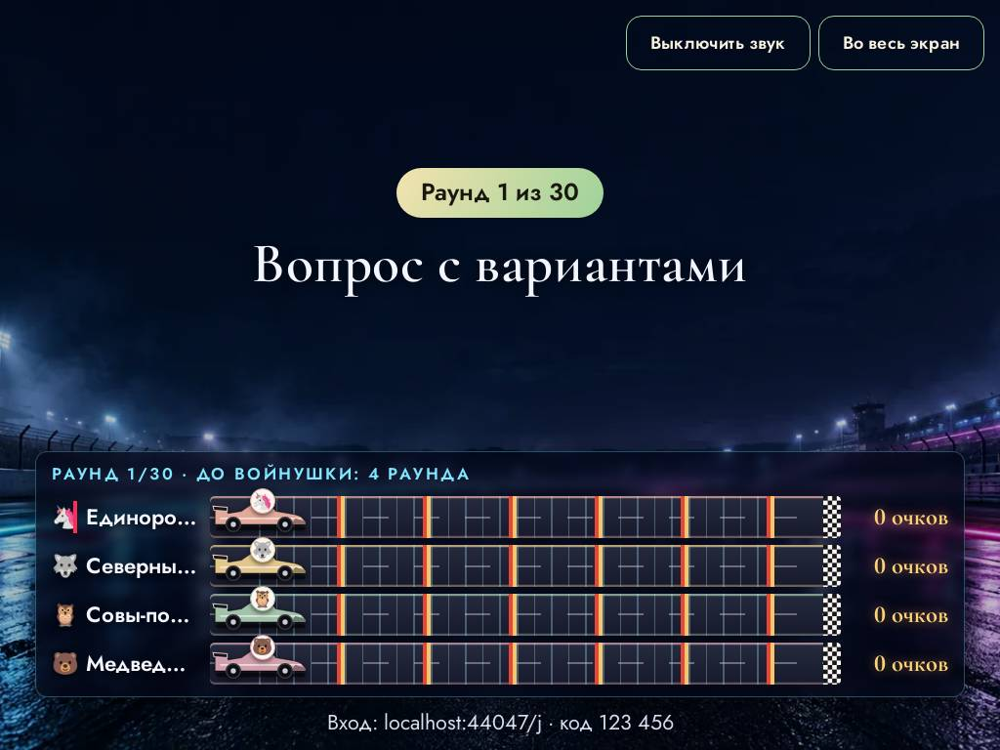

### закрыт другим элементом · телефон

«♠︎» закрыт элементом span.dk-pip — «♠︎»

- где: `button.dk-hand__slot > div.dk-card.dk-d--wedding > span.dk-idx.dk-idx--b > span`, этап `playing/48/question/play`
- игры (1): durak 1-й шаблон, каждый сам ×4, проектор 4:3, маленький телефон, длинные имена; durak 1-й шаблон, каждый сам ×4, телевизор full hd; durak 1-й шаблон, каждый сам ×4, ноутбук 16:10, большой зал, длинные имена
- раз: 74

### закрыт другим элементом · телефон

«6» закрыт элементом div.dk-card.dk-d--cyber — «6»

- где: `div.dk-hand__row > button.dk-hand__slot > div.dk-card.dk-d--cyber > span.dk-idx.dk-idx--b`, этап `playing/4/question/play`
- игры (1): durak 1-й шаблон, каждый сам ×4, проектор 4:3, маленький телефон, длинные имена; durak 1-й шаблон, каждый сам ×4, телевизор full hd; durak 1-й шаблон, каждый сам ×4, ноутбук 16:10, большой зал, длинные имена
- раз: 71

### закрыт другим элементом · телефон

«6» закрыт элементом span.dk-pip — «6»

- где: `div.dk-hand__row > button.dk-hand__slot > div.dk-card.dk-d--rome > span.dk-idx.dk-idx--b`, этап `playing/16/question/play`
- игры (1): durak 1-й шаблон, каждый сам ×4, проектор 4:3, маленький телефон, длинные имена; durak 1-й шаблон, каждый сам ×4, телевизор full hd; durak 1-й шаблон, каждый сам ×4, ноутбук 16:10, большой зал, длинные имена
- раз: 71

### закрыт другим элементом · телефон

«6» закрыт элементом span.dk-pip — «6»

- где: `div.dk-hand__row > button.dk-hand__slot > div.dk-card.dk-d--wedding > span.dk-idx.dk-idx--b`, этап `playing/48/question/play`
- игры (1): durak 1-й шаблон, каждый сам ×4, проектор 4:3, маленький телефон, длинные имена; durak 1-й шаблон, каждый сам ×4, телевизор full hd; durak 1-й шаблон, каждый сам ×4, ноутбук 16:10, большой зал, длинные имена
- раз: 68

### закрыт другим элементом · экран зала

«Александра Константинова» закрыт элементом span.bk-row__text — «Александра Константинова»

- где: `article.bk-dossier > header.bk-dossier__head > span.bk-dossier__name > span`, этап `playing/4/question/open`
- игры (1): bunker 1-й шаблон, каждый сам ×8, проектор 4:3, маленький телефон, длинные имена; bunker 1-й шаблон, каждый сам ×8, ноутбук 16:10, большой зал, длинные имена
- раз: 67

### закрыт другим элементом · экран зала

«Гость 1» закрыт элементом p.stage-code — «Гость 1»

- где: `div.td-screen > ol.td-queue > li > span.td-queue__name`, этап `playing/0/question/pick`
- игры (1): truth 1-й шаблон, каждый сам ×4, телевизор full hd; truth 1-й шаблон, команды ×4, телевизор full hd; truth 2-й шаблон, каждый сам ×4, телевизор full hd; truth 2-й шаблон, команды ×4, телевизор full hd
- раз: 64

### закрыт другим элементом · телефон

«Ресторан» закрыт элементом summary — «Ресторан»

- где: `details.sp-phone__mine > ul.sp-places.sp-places--phone > li.sp-place > span.sp-place__name`, этап `playing/1/question/talk`
- игры (1): spy 1-й шаблон, каждый сам ×11, телевизор full hd; spy 1-й шаблон, каждый сам ×11, проектор 4:3, маленький телефон, длинные имена; spy 1-й шаблон, каждый сам ×11, ноутбук 16:10, большой зал, длинные имена
- раз: 62

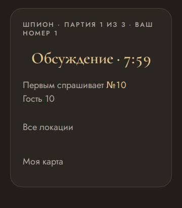

### закрыт другим элементом · телефон

«Владимир Преображенский» закрыт элементом span — «Владимир Преображенский»

- где: `div.st-targets > button.mf-target > span.mf-target__name > span`, этап `playing/14/question/guess`
- игры (1): story 1-й шаблон, каждый сам ×6, проектор 4:3, маленький телефон, длинные имена; story 1-й шаблон, каждый сам ×6, ноутбук 16:10, большой зал, длинные имена
- раз: 57

### закрыт другим элементом · телефон

«Владимир Преображенский» закрыт элементом strong.mf-tally__n — «Владимир Преображенский»

- где: `ul.mf-tally > li.mf-tally__row > span.mf-tally__name > span`, этап `playing/1/reveal/verdict`
- игры (1): mafia 1-й шаблон, каждый сам ×9, ноутбук 16:10, большой зал, длинные имена
- раз: 52

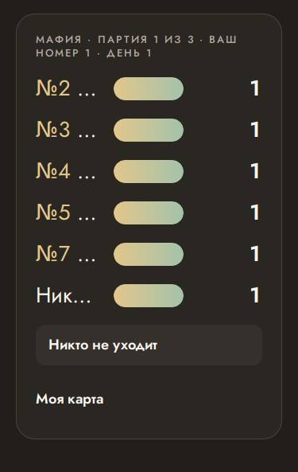

### закрыт другим элементом · экран зала

«Александра Константинова» закрыт элементом span.mf-seat__num — «Александра Константинова»

- где: `ol.mf-seats.mf-seats--screen > li.mf-seat > span.mf-seat__name > span`, этап `playing/2/question/vote`
- игры (1): mafia 1-й шаблон, каждый сам ×9, ноутбук 16:10, большой зал, длинные имена; mafia 1-й шаблон, каждый сам ×9, проектор 4:3, маленький телефон, длинные имена
- раз: 52

### закрыт другим элементом · телефон

«♠︎» закрыт элементом span.dk-pip — «♠︎»

- где: `div.dk-hand__row > button.dk-hand__slot > div.dk-card.dk-d--classic > span.dk-pip`, этап `playing/86/question/play`
- игры (1): durak 1-й шаблон, каждый сам ×4, проектор 4:3, маленький телефон, длинные имена; durak 1-й шаблон, каждый сам ×4, телевизор full hd; durak 1-й шаблон, каждый сам ×4, ноутбук 16:10, большой зал, длинные имена
- раз: 47

### закрыт другим элементом · телефон

«Гость 2» закрыт элементом span.mf-tally__fill — «Гость 2»

- где: `div.stack > ul.mf-tally > li.mf-tally__row > span.mf-tally__name`, этап `playing/1/reveal/verdict`
- игры (1): mafia 1-й шаблон, каждый сам ×9, телевизор full hd
- раз: 46

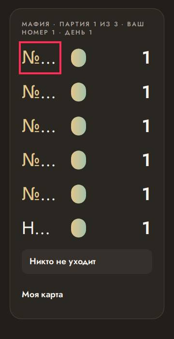

### закрыт другим элементом · телефон

«♠︎» закрыт элементом span.dk-pip — «♠︎»

- где: `button.dk-hand__slot > div.dk-card.dk-d--gothic > span.dk-idx.dk-idx--b > span`, этап `playing/50/question/play`
- игры (1): durak 1-й шаблон, каждый сам ×4, проектор 4:3, маленький телефон, длинные имена; durak 1-й шаблон, каждый сам ×4, телевизор full hd; durak 1-й шаблон, каждый сам ×4, ноутбук 16:10, большой зал, длинные имена
- раз: 44

### закрыт другим элементом · экран зала

«🐻» закрыт элементом p.stage-code — «🐻»

- где: `ol.td-queue > li > span.td-queue__name > span.name-emoji`, этап `playing/0/question/pick`
- игры (1): truth 1-й шаблон, каждый сам ×4, проектор 4:3, маленький телефон, длинные имена; truth 1-й шаблон, команды ×4, проектор 4:3, маленький телефон, длинные имена; truth 2-й шаблон, каждый сам ×4, проектор 4:3, маленький телефон, длинные имена; truth 1-й шаблон, каждый сам ×16, ноутбук 16:10, большой зал, длинные имена; truth 2-й шаблон, команды ×4, проектор 4:3, маленький телефон, длинные имена; truth 2-й шаблон, каждый сам ×16, ноутбук 16:10, большой зал, длинные имена
- раз: 42

### закрыт другим элементом · пульт

«Капитан 4» закрыт элементом p.small — «Капитан 4»

- где: `div.stack.host-quiz > div.card.stack > details > p`, этап `playing/1/question/guess`
- игры (1): story 1-й шаблон, команды ×6, телевизор full hd; story 1-й шаблон, команды ×6, проектор 4:3, маленький телефон, длинные имена; story 1-й шаблон, команды ×6, ноутбук 16:10, большой зал, длинные имена; story 1-й шаблон, каждый сам ×6, телевизор full hd; story 1-й шаблон, каждый сам ×6, проектор 4:3, маленький телефон, длинные имена; story 1-й шаблон, каждый сам ×6, ноутбук 16:10, большой зал, длинные имена
- раз: 41

### закрыт другим элементом · экран зала

«Максимилиан Рождественский» закрыт элементом p.stage-code — «Максимилиан Рождественский»

- где: `ol.td-queue > li > span.td-queue__name > span`, этап `playing/0/question/pick`
- игры (1): truth 1-й шаблон, каждый сам ×4, проектор 4:3, маленький телефон, длинные имена; truth 1-й шаблон, команды ×4, проектор 4:3, маленький телефон, длинные имена; truth 2-й шаблон, каждый сам ×4, проектор 4:3, маленький телефон, длинные имена; truth 1-й шаблон, каждый сам ×16, ноутбук 16:10, большой зал, длинные имена; truth 2-й шаблон, команды ×4, проектор 4:3, маленький телефон, длинные имена; truth 2-й шаблон, каждый сам ×16, ноутбук 16:10, большой зал, длинные имена
- раз: 40

### закрыт другим элементом · телефон

«№ 1» закрыт элементом div.mf-card__pattern — «№ 1»

- где: `button.mf-card > span.mf-card__inner > div.mf-card__face.mf-card__front > span.mf-card__seat`, этап `playing/0/reveal/roles`
- игры (1): mafia 1-й шаблон, каждый сам ×9, телевизор full hd; mafia 1-й шаблон, каждый сам ×9, ноутбук 16:10, большой зал, длинные имена; mafia 1-й шаблон, каждый сам ×9, проектор 4:3, маленький телефон, длинные имена
- раз: 39

### закрыт другим элементом · телефон

«Город» закрыт элементом div.mf-card__pattern — «Город»

- где: `button.mf-card > span.mf-card__inner > div.mf-card__face.mf-card__front > span.mf-card__side`, этап `playing/0/reveal/roles`
- игры (1): mafia 1-й шаблон, каждый сам ×9, телевизор full hd; mafia 1-й шаблон, каждый сам ×9, ноутбук 16:10, большой зал, длинные имена; mafia 1-й шаблон, каждый сам ×9, проектор 4:3, маленький телефон, длинные имена
- раз: 39

### закрыт другим элементом · телефон

«Каждую ночь проверяете одного игрока: ма» закрыт элементом div.mf-card__pattern — «Каждую ночь проверяете одного игрока: мафия он или нет.»

- где: `button.mf-card > span.mf-card__inner > div.mf-card__face.mf-card__front > p.mf-card__power`, этап `playing/0/reveal/roles`
- игры (1): mafia 1-й шаблон, каждый сам ×9, телевизор full hd; mafia 1-й шаблон, каждый сам ×9, ноутбук 16:10, большой зал, длинные имена; mafia 1-й шаблон, каждый сам ×9, проектор 4:3, маленький телефон, длинные имена
- раз: 38

### закрыт другим элементом · телефон

«6» закрыт элементом span.dk-pip — «6»

- где: `div.dk-hand__row > button.dk-hand__slot > div.dk-card.dk-d--gothic > span.dk-idx.dk-idx--b`, этап `playing/50/question/play`
- игры (1): durak 1-й шаблон, каждый сам ×4, проектор 4:3, маленький телефон, длинные имена; durak 1-й шаблон, каждый сам ×4, телевизор full hd; durak 1-й шаблон, каждый сам ×4, ноутбук 16:10, большой зал, длинные имена
- раз: 36

### закрыт другим элементом · телефон

«Комиссар» закрыт элементом div.mf-card__pattern — «Комиссар»

- где: `button.mf-card > span.mf-card__inner > div.mf-card__face.mf-card__front > h3.mf-card__title`, этап `playing/0/reveal/roles`
- игры (1): mafia 1-й шаблон, каждый сам ×9, телевизор full hd; mafia 1-й шаблон, каждый сам ×9, ноутбук 16:10, большой зал, длинные имена; mafia 1-й шаблон, каждый сам ×9, проектор 4:3, маленький телефон, длинные имена
- раз: 35

### закрыт другим элементом · телефон

«Шпион» закрыт элементом span.bk-special__stamp — «Шпион»

- где: `div.bk-phone__specialcard > div.bk-card.bk-special > div.bk-in > span.bk-special__title`, этап `playing/4/question/open`
- игры (1): bunker 1-й шаблон, каждый сам ×8, телевизор full hd
- раз: 33

### закрыт другим элементом · телефон

«♥︎» закрыт элементом div.dk-card.dk-d--classic — «♥︎»

- где: `button.dk-hand__slot > div.dk-card.dk-d--classic > span.dk-face > i`, этап `playing/86/question/play`
- игры (1): durak 1-й шаблон, каждый сам ×4, проектор 4:3, маленький телефон, длинные имена; durak 1-й шаблон, каждый сам ×4, телевизор full hd; durak 1-й шаблон, каждый сам ×4, ноутбук 16:10, большой зал, длинные имена
- раз: 25

### закрыт другим элементом · телефон

«♠︎» закрыт элементом span.dk-pip — «♠︎»

- где: `div.dk-hand__row > button.dk-hand__slot > div.dk-card.dk-d--russia > span.dk-pip`, этап `playing/12/question/play`
- игры (1): durak 1-й шаблон, каждый сам ×4, проектор 4:3, маленький телефон, длинные имена
- раз: 20

### закрыт другим элементом · пульт

«🦉» закрыт элементом p.small — «🦉»

- где: `div.card.stack > details > p > span.name-emoji`, этап `playing/14/question/guess`
- игры (1): story 1-й шаблон, каждый сам ×6, проектор 4:3, маленький телефон, длинные имена; story 1-й шаблон, каждый сам ×6, ноутбук 16:10, большой зал, длинные имена
- раз: 20

### закрыт другим элементом · пульт

«Екатерина Воскресенская» закрыт элементом p.small — «Екатерина Воскресенская»

- где: `div.card.stack > details > p > span`, этап `playing/14/question/guess`
- игры (1): story 1-й шаблон, каждый сам ×6, проектор 4:3, маленький телефон, длинные имена; story 1-й шаблон, каждый сам ×6, ноутбук 16:10, большой зал, длинные имена
- раз: 20

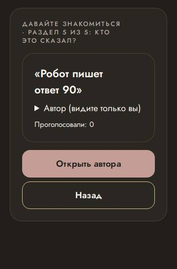

### закрыт другим элементом · телефон

«♠︎» закрыт элементом span.dk-pip — «♠︎»

- где: `div.dk-hand__row > button.dk-hand__slot > div.dk-card.dk-d--cyber > span.dk-pip`, этап `playing/4/question/play`
- игры (1): durak 1-й шаблон, каждый сам ×4, проектор 4:3, маленький телефон, длинные имена
- раз: 19

### закрыт другим элементом · телефон

«♠︎» закрыт элементом span.dk-pip — «♠︎»

- где: `div.dk-hand__row > button.dk-hand__slot > div.dk-card.dk-d--wedding > span.dk-pip`, этап `playing/48/question/play`
- игры (1): durak 1-й шаблон, каждый сам ×4, проектор 4:3, маленький телефон, длинные имена
- раз: 19

### закрыт другим элементом · экран зала

«Александра Константинова» закрыт элементом div.dk-table__felt — «Александра Константинова»

- где: `div.dk-seat__card > span.dk-seat__text > span.dk-seat__name > span`, этап `playing/1/question/deal`
- игры (1): durak 1-й шаблон, каждый сам ×4, проектор 4:3, маленький телефон, длинные имена; durak 1-й шаблон, каждый сам ×4, ноутбук 16:10, большой зал, длинные имена
- раз: 18

### закрыт другим элементом · телефон

«от гостя:» закрыт элементом span.td-stamp.td-stamp--done — «от гостя:»

- где: `div.quiz-phone.td-phone > div.td-flip.td-flip--phone > div.td-face.td-face--dare > span.td-face__from`, этап `playing/7/reveal/done`
- игры (1): truth 1-й шаблон, каждый сам ×16, ноутбук 16:10, большой зал, длинные имена; truth 2-й шаблон, каждый сам ×16, ноутбук 16:10, большой зал, длинные имена
- раз: 18

### закрыт другим элементом · телефон

«🦊» закрыт элементом span.td-stamp.td-stamp--done — «🦊»

- где: `div.td-flip.td-flip--phone > div.td-face.td-face--dare > span.td-face__from > span.name-emoji`, этап `playing/7/reveal/done`
- игры (1): truth 1-й шаблон, каждый сам ×16, ноутбук 16:10, большой зал, длинные имена; truth 2-й шаблон, каждый сам ×16, ноутбук 16:10, большой зал, длинные имена
- раз: 18

### закрыт другим элементом · телефон

«J» закрыт элементом div.dk-card.dk-d--classic — «J»

- где: `button.dk-hand__slot > div.dk-card.dk-d--classic > span.dk-face > b`, этап `playing/86/question/play`
- игры (1): durak 1-й шаблон, каждый сам ×4, проектор 4:3, маленький телефон, длинные имена; durak 1-й шаблон, каждый сам ×4, телевизор full hd; durak 1-й шаблон, каждый сам ×4, ноутбук 16:10, большой зал, длинные имена
- раз: 17

### закрыт другим элементом · телефон

«♥︎» закрыт элементом div.dk-card.dk-d--russia — «♥︎»

- где: `button.dk-hand__slot > div.dk-card.dk-d--russia > span.dk-face > i`, этап `playing/12/question/play`
- игры (1): durak 1-й шаблон, каждый сам ×4, проектор 4:3, маленький телефон, длинные имена; durak 1-й шаблон, каждый сам ×4, телевизор full hd
- раз: 15

### закрыт другим элементом · экран зала

«Единороги из бухгалтерии» закрыт элементом span.name-emoji — «Единороги из бухгалтерии»

- где: `div.stage-teams > div.stage-teams__one > span.stage-teams__name > span`, этап `playing/8/reveal/pick`
- игры (1): stage 1-й шаблон, команды ×8, ноутбук 16:10, большой зал, длинные имена; stage 2-й шаблон, команды ×8, ноутбук 16:10, большой зал, длинные имена
- раз: 14

### закрыт другим элементом · телефон

«♠︎» закрыт элементом span.dk-pip.dk-pip--ace — «♠︎»

- где: `button.dk-hand__slot > div.dk-card.dk-d--anime > span.dk-idx.dk-idx--b > span`, этап `playing/59/question/play`
- игры (1): durak 1-й шаблон, каждый сам ×4, ноутбук 16:10, большой зал, длинные имена
- раз: 13

### закрыт другим элементом · пульт

«Совы-полуночники ресепшн» закрыт элементом span — «Совы-полуночники ресепшн»

- где: `div.stack.host-quiz > p > span > span`, этап `playing/2/ready/intro`
- игры (1): hundred 1-й шаблон, команды ×4, проектор 4:3, маленький телефон, длинные имена; hundred 1-й шаблон, команды ×8, ноутбук 16:10, большой зал, длинные имена; hundred 2-й шаблон, команды ×4, проектор 4:3, маленький телефон, длинные имена; hundred 2-й шаблон, команды ×8, ноутбук 16:10, большой зал, длинные имена; hundred 3-й шаблон, команды ×4, проектор 4:3, маленький телефон, длинные имена; hundred 3-й шаблон, команды ×8, ноутбук 16:10, большой зал, длинные имена
- раз: 12

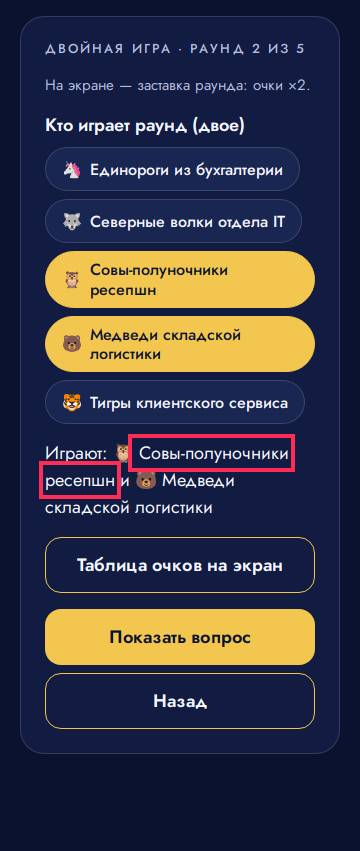

### закрыт другим элементом · телефон

«♥︎» закрыт элементом div.dk-card.dk-d--cyber — «♥︎»

- где: `button.dk-hand__slot > div.dk-card.dk-d--cyber > span.dk-face > i`, этап `playing/4/question/play`
- игры (1): durak 1-й шаблон, каждый сам ×4, проектор 4:3, маленький телефон, длинные имена; durak 1-й шаблон, каждый сам ×4, телевизор full hd
- раз: 12

### закрыт другим элементом · телефон

«♦︎» закрыт элементом div.dk-card.dk-d--classic — «♦︎»

- где: `div.dk-mini > span.dk-mini__pair > div.dk-card.dk-d--classic > span.dk-pip`, этап `playing/90/question/play`
- игры (1): durak 1-й шаблон, каждый сам ×4, ноутбук 16:10, большой зал, длинные имена
- раз: 12

### закрыт другим элементом · экран зала

«Пишите до трёх ответов на телефоне · отв» закрыт элементом p.stage-code — «Пишите до трёх ответов на телефоне · ответили: 0»

- где: `main.quiz-stage > div.hd-screen.hd-screen--hall > div.hd-screen__bottom > span`, этап `playing/1/question/hall`
- игры (1): hundred 4-й шаблон, команды ×4, телевизор full hd; hundred 4-й шаблон, команды ×4, проектор 4:3, маленький телефон, длинные имена; hundred 4-й шаблон, каждый сам ×4, телевизор full hd; hundred 4-й шаблон, каждый сам ×4, проектор 4:3, маленький телефон, длинные имена; hundred 4-й шаблон, команды ×8, ноутбук 16:10, большой зал, длинные имена; hundred 4-й шаблон, каждый сам ×16, ноутбук 16:10, большой зал, длинные имена
- раз: 11

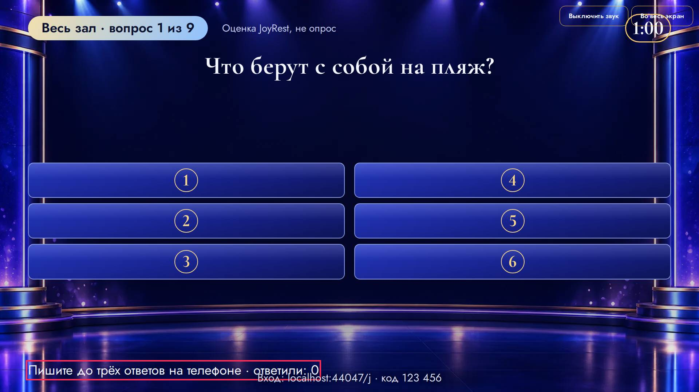

### закрыт другим элементом · телефон

«K» закрыт элементом span.dk-pip.dk-pip--ace — «K»

- где: `div.dk-hand__row > button.dk-hand__slot > div.dk-card.dk-d--anime > span.dk-idx.dk-idx--b`, этап `playing/59/question/play`
- игры (1): durak 1-й шаблон, каждый сам ×4, ноутбук 16:10, большой зал, длинные имена
- раз: 11

### закрыт другим элементом · телефон

«♥︎» закрыт элементом div.dk-card.dk-d--rome — «♥︎»

- где: `button.dk-hand__slot > div.dk-card.dk-d--rome > span.dk-face > i`, этап `playing/16/question/play`
- игры (1): durak 1-й шаблон, каждый сам ×4, проектор 4:3, маленький телефон, длинные имена; durak 1-й шаблон, каждый сам ×4, телевизор full hd
- раз: 10

### закрыт другим элементом · телефон

«Ваша семья: Гость 6» закрыт элементом div.mf-card__pattern — «Ваша семья: Гость 6»

- где: `button.mf-card > span.mf-card__inner > div.mf-card__face.mf-card__front > p.mf-card__family`, этап `playing/0/reveal/roles`
- игры (1): mafia 1-й шаблон, каждый сам ×9, телевизор full hd; mafia 1-й шаблон, каждый сам ×9, ноутбук 16:10, большой зал, длинные имена; mafia 1-й шаблон, каждый сам ×9, проектор 4:3, маленький телефон, длинные имена
- раз: 9

### закрыт другим элементом · телефон

«♣︎» закрыт элементом span.dk-pip.dk-pip--ace — «♣︎»

- где: `div.dk-mini > span.dk-mini__pair > div.dk-card.dk-d--russia > span.dk-pip`, этап `playing/63/question/play`
- игры (1): durak 1-й шаблон, каждый сам ×4, телевизор full hd; durak 1-й шаблон, каждый сам ×4, ноутбук 16:10, большой зал, длинные имена
- раз: 9

### закрыт другим элементом · экран зала

«50% · 0» закрыт элементом img.stage-dancer — «50% · 0»

- где: `div.stage-screen.stage-screen--battle > div.stage-tug > div.stage-tug__bar > span`, этап `playing/36/reveal/result`
- игры (1): stage 1-й шаблон, команды ×8, ноутбук 16:10, большой зал, длинные имена; stage 1-й шаблон, команды ×4, проектор 4:3, маленький телефон, длинные имена; stage 2-й шаблон, команды ×8, ноутбук 16:10, большой зал, длинные имена; stage 2-й шаблон, команды ×4, проектор 4:3, маленький телефон, длинные имена
- раз: 8

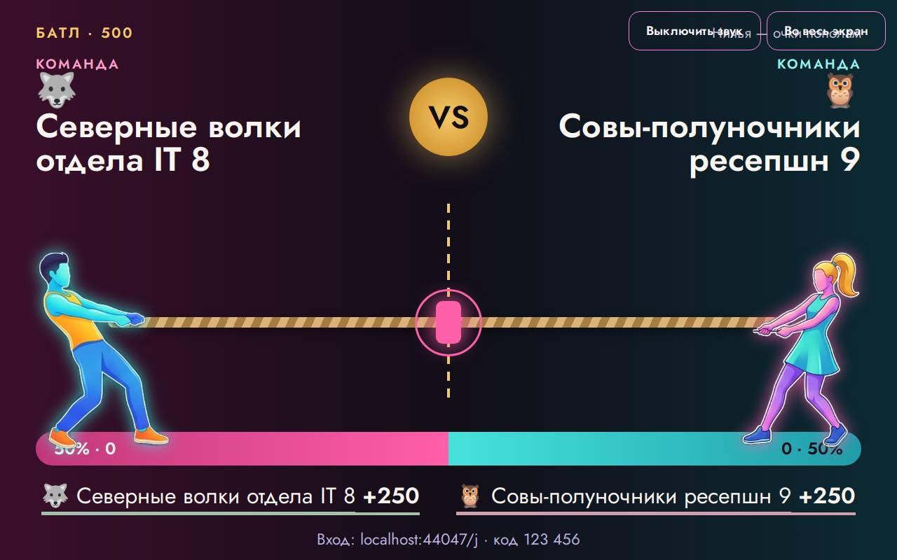

### закрыт другим элементом · телефон

«J» закрыт элементом div.dk-card.dk-d--russia — «J»

- где: `button.dk-hand__slot > div.dk-card.dk-d--russia > span.dk-face > b`, этап `playing/12/question/play`
- игры (1): durak 1-й шаблон, каждый сам ×4, проектор 4:3, маленький телефон, длинные имена
- раз: 8

### закрыт другим элементом · телефон

«♠︎» закрыт элементом span.dk-pip — «♠︎»

- где: `div.dk-hand__row > button.dk-hand__slot > div.dk-card.dk-d--rome > span.dk-pip`, этап `playing/16/question/play`
- игры (1): durak 1-й шаблон, каждый сам ×4, проектор 4:3, маленький телефон, длинные имена
- раз: 8

### закрыт другим элементом · экран зала

«🐺» закрыт элементом span.checkers-side__score — «🐺»

- где: `div.checkers-screen__side > div.checkers-side.checkers-side--b > span.checkers-side__name > span.name-emoji`, этап `playing/1/question/move`
- игры (1): checkers 1-й шаблон, команды ×2, проектор 4:3, маленький телефон, длинные имена
- раз: 7

### закрыт другим элементом · экран зала

«Совы-полуночники ресепшн» закрыт элементом text — «Совы-полуночники ресепшн»

- где: `ul.mil-lifeboard > li.mil-lifeboard__team > span.mil-lifeboard__name > span`, этап `playing/5/ready/turn`
- игры (1): millionaire 1-й шаблон, команды ×8, ноутбук 16:10, большой зал, длинные имена; millionaire 1-й шаблон, каждый сам ×16, ноутбук 16:10, большой зал, длинные имена
- раз: 7

### закрыт другим элементом · пульт

«ещё не выбрал(а)» закрыт элементом span — «ещё не выбрал(а)»

- где: `div.card.stack > p > span > span.muted`, этап `playing/3/question/night`
- игры (1): mafia 1-й шаблон, каждый сам ×9, телевизор full hd; mafia 1-й шаблон, каждый сам ×9, ноутбук 16:10, большой зал, длинные имена
- раз: 7

### закрыт другим элементом · телефон

«J» закрыт элементом div.dk-card.dk-d--cyber — «J»

- где: `button.dk-hand__slot > div.dk-card.dk-d--cyber > span.dk-face > b`, этап `playing/4/question/play`
- игры (1): durak 1-й шаблон, каждый сам ×4, проектор 4:3, маленький телефон, длинные имена
- раз: 7

### закрыт другим элементом · телефон

«♠︎» закрыт элементом span.dk-pip — «♠︎»

- где: `div.dk-hand__row > button.dk-hand__slot > div.dk-card.dk-d--gothic > span.dk-pip`, этап `playing/50/question/play`
- игры (1): durak 1-й шаблон, каждый сам ×4, проектор 4:3, маленький телефон, длинные имена
- раз: 7

### закрыт другим элементом · экран зала

«3» закрыт элементом p.stage-code — «3»

- где: `div.st-reveal > ul.st-votes > li > strong`, этап `playing/3/reveal/guess`
- игры (1): story 1-й шаблон, команды ×6, телевизор full hd; story 1-й шаблон, каждый сам ×6, ноутбук 16:10, большой зал, длинные имена
- раз: 7

### закрыт другим элементом · телефон

«50%» закрыт элементом span.mil-option__text — «50%»

- где: `div.mil-question.mil-question--phone > ol.mil-options > li.mil-option > span.mil-option__pct`, этап `playing/8/reveal/reveal`
- игры (1): millionaire 1-й шаблон, каждый сам ×4, телевизор full hd; millionaire 1-й шаблон, команды ×8, ноутбук 16:10, большой зал, длинные имена; millionaire 1-й шаблон, каждый сам ×4, проектор 4:3, маленький телефон, длинные имена; millionaire 1-й шаблон, каждый сам ×16, ноутбук 16:10, большой зал, длинные имена
- раз: 6

### закрыт другим элементом · телефон

«Локация» закрыт элементом span.sp-card__face.sp-card__face--back — «Локация»

- где: `button.sp-card > span.sp-card__inner > span.sp-card__face.sp-card__face--place > span.sp-card__label`, этап `playing/0/reveal/cards`
- игры (1): spy 1-й шаблон, каждый сам ×11, телевизор full hd
- раз: 6

### закрыт другим элементом · экран зала

«А» закрыт элементом span.dk-vote__name — «А»

- где: `div.dk-table > div.dk-seat.dk-seat--wait > div.dk-seat__card > span.dk-seat__avatar`, этап `playing/2/question/vote`
- игры (1): durak 1-й шаблон, каждый сам ×4, проектор 4:3, маленький телефон, длинные имена; durak 1-й шаблон, каждый сам ×4, телевизор full hd; durak 1-й шаблон, каждый сам ×4, ноутбук 16:10, большой зал, длинные имена
- раз: 6

### закрыт другим элементом · телефон

«♥︎» закрыт элементом div.dk-card.dk-d--gothic — «♥︎»

- где: `button.dk-hand__slot > div.dk-card.dk-d--gothic > span.dk-face > i`, этап `playing/50/question/play`
- игры (1): durak 1-й шаблон, каждый сам ×4, проектор 4:3, маленький телефон, длинные имена; durak 1-й шаблон, каждый сам ×4, телевизор full hd
- раз: 6

### закрыт другим элементом · телефон

«J✦R» закрыт элементом span.dk-pip — «J✦R»

- где: `div.dk-hand__row > button.dk-hand__slot > div.dk-card.dk-d--classic > span.dk-brand`, этап `playing/86/question/play`
- игры (1): durak 1-й шаблон, каждый сам ×4, проектор 4:3, маленький телефон, длинные имена; durak 1-й шаблон, каждый сам ×4, телевизор full hd; durak 1-й шаблон, каждый сам ×4, ноутбук 16:10, большой зал, длинные имена
- раз: 6

### закрыт другим элементом · телефон

«♣︎» закрыт элементом div.dk-card.dk-d--rome — «♣︎»

- где: `div.dk-mini > span.dk-mini__pair > div.dk-card.dk-d--rome > span.dk-pip`, этап `playing/17/question/play`
- игры (1): durak 1-й шаблон, каждый сам ×4, ноутбук 16:10, большой зал, длинные имена
- раз: 6

### закрыт другим элементом · телефон

«♦︎» закрыт элементом span — «♦︎»

- где: `div.dk-mini > span.dk-mini__pair > div.dk-card.dk-d--anime > span.dk-pip`, этап `playing/59/question/play`
- игры (1): durak 1-й шаблон, каждый сам ×4, ноутбук 16:10, большой зал, длинные имена
- раз: 6

### закрыт другим элементом · телефон

«от гостя:» закрыт элементом span.td-stamp.td-stamp--done — «от гостя:»

- где: `div.quiz-phone.td-phone > div.td-flip.td-flip--phone > div.td-face.td-face--truth > span.td-face__from`, этап `playing/1/reveal/done`
- игры (1): truth 1-й шаблон, каждый сам ×16, ноутбук 16:10, большой зал, длинные имена; truth 2-й шаблон, каждый сам ×16, ноутбук 16:10, большой зал, длинные имена
- раз: 6

### закрыт другим элементом · телефон

«🐺» закрыт элементом span.td-stamp.td-stamp--done — «🐺»

- где: `div.td-flip.td-flip--phone > div.td-face.td-face--truth > span.td-face__from > span.name-emoji`, этап `playing/1/reveal/done`
- игры (1): truth 1-й шаблон, каждый сам ×16, ноутбук 16:10, большой зал, длинные имена; truth 2-й шаблон, каждый сам ×16, ноутбук 16:10, большой зал, длинные имена
- раз: 6

### закрыт другим элементом · пульт

«Робот пишет ответ 40» закрыт элементом button.btn.btn--block — «Робот пишет ответ 40»

- где: `details.quest-host__places > ul.st-host__list > li > span`, этап `playing/36/question/write`
- игры (1): story 1-й шаблон, каждый сам ×6, телевизор full hd; story 1-й шаблон, каждый сам ×6, проектор 4:3, маленький телефон, длинные имена; story 1-й шаблон, каждый сам ×6, ноутбук 16:10, большой зал, длинные имена
- раз: 6

### закрыт другим элементом · экран зала

«🦄» закрыт элементом span.checkers-side__score — «🦄»

- где: `div.checkers-screen__side > div.checkers-side.checkers-side--w > span.checkers-side__name > span.name-emoji`, этап `playing/1/question/move`
- игры (1): checkers 1-й шаблон, команды ×2, проектор 4:3, маленький телефон, длинные имена; checkers 1-й шаблон, команды ×2, ноутбук 16:10, большой зал, длинные имена
- раз: 5

### закрыт другим элементом · экран зала

«Единороги из бухгалтерии» закрыт элементом span.checkers-side__score — «Единороги из бухгалтерии»

- где: `div.checkers-screen__side > div.checkers-side.checkers-side--w > span.checkers-side__name > span`, этап `playing/1/question/move`
- игры (1): checkers 1-й шаблон, команды ×2, ноутбук 16:10, большой зал, длинные имена
- раз: 5

### закрыт другим элементом · телефон

«J✦R» закрыт элементом span.dk-pip — «J✦R»

- где: `div.dk-hand__row > button.dk-hand__slot > div.dk-card.dk-d--russia > span.dk-brand`, этап `playing/12/question/play`
- игры (1): durak 1-й шаблон, каждый сам ×4, проектор 4:3, маленький телефон, длинные имена; durak 1-й шаблон, каждый сам ×4, телевизор full hd
- раз: 5

### закрыт другим элементом · телефон

«J✦R» закрыт элементом div.dk-card.dk-d--rome — «J✦R»

- где: `div.dk-hand__row > button.dk-hand__slot > div.dk-card.dk-d--rome > span.dk-brand`, этап `playing/16/question/play`
- игры (1): durak 1-й шаблон, каждый сам ×4, проектор 4:3, маленький телефон, длинные имена; durak 1-й шаблон, каждый сам ×4, телевизор full hd
- раз: 5

### закрыт другим элементом · экран зала

«Северные волки отдела IT» закрыт элементом span.checkers-side__score — «Северные волки отдела IT»

- где: `div.checkers-screen__side > div.checkers-side.checkers-side--b > span.checkers-side__name > span`, этап `playing/7/question/task`
- игры (1): checkers 1-й шаблон, команды ×2, ноутбук 16:10, большой зал, длинные имена
- раз: 4

### закрыт другим элементом · пульт

«Дельфины маркетинга и PR» закрыт элементом span — «Дельфины маркетинга и PR»

- где: `div.stack.stack--tight > div.host-quiz__live > span > span`, этап `playing/30/question/vote`
- игры (1): stage 1-й шаблон, команды ×8, ноутбук 16:10, большой зал, длинные имена; stage 2-й шаблон, команды ×8, ноутбук 16:10, большой зал, длинные имена
- раз: 4

### закрыт другим элементом · пульт

«Александра Константинова 7» закрыт элементом span.muted — «Александра Константинова 7»

- где: `div.card.stack > p > span > span`, этап `playing/3/question/night`
- игры (1): mafia 1-й шаблон, каждый сам ×9, проектор 4:3, маленький телефон, длинные имена
- раз: 4

### закрыт другим элементом · телефон

«J✦R» закрыт элементом span.dk-pip — «J✦R»

- где: `div.dk-hand__row > button.dk-hand__slot > div.dk-card.dk-d--cyber > span.dk-brand`, этап `playing/4/question/play`
- игры (1): durak 1-й шаблон, каждый сам ×4, проектор 4:3, маленький телефон, длинные имена; durak 1-й шаблон, каждый сам ×4, телевизор full hd
- раз: 4

### закрыт другим элементом · телефон

«J» закрыт элементом div.dk-card.dk-d--rome — «J»

- где: `button.dk-hand__slot > div.dk-card.dk-d--rome > span.dk-face > b`, этап `playing/16/question/play`
- игры (1): durak 1-й шаблон, каждый сам ×4, проектор 4:3, маленький телефон, длинные имена
- раз: 4

### закрыт другим элементом · телефон

«J✦R» закрыт элементом span.dk-pip — «J✦R»

- где: `div.dk-hand__row > button.dk-hand__slot > div.dk-card.dk-d--wedding > span.dk-brand`, этап `playing/48/question/play`
- игры (1): durak 1-й шаблон, каждый сам ×4, проектор 4:3, маленький телефон, длинные имена; durak 1-й шаблон, каждый сам ×4, телевизор full hd
- раз: 4

### закрыт другим элементом · телефон

«J» закрыт элементом div.dk-card.dk-d--gothic — «J»

- где: `button.dk-hand__slot > div.dk-card.dk-d--gothic > span.dk-face > b`, этап `playing/50/question/play`
- игры (1): durak 1-й шаблон, каждый сам ×4, проектор 4:3, маленький телефон, длинные имена
- раз: 4

### закрыт другим элементом · телефон

«♦︎» закрыт элементом span.dk-pip — «♦︎»

- где: `div.dk-hand__row > button.dk-hand__slot > div.dk-card.dk-d--classic > span.dk-pip.dk-pip--ace`, этап `playing/86/question/play`
- игры (1): durak 1-й шаблон, каждый сам ×4, проектор 4:3, маленький телефон, длинные имена
- раз: 4

### закрыт другим элементом · экран зала

«Игрок 5» закрыт элементом p.stage-code — «Игрок 5»

- где: `section.st-screen__main > div.st-reveal > ul.st-votes > li`, этап `playing/3/reveal/guess`
- игры (1): story 1-й шаблон, команды ×6, телевизор full hd
- раз: 4

### закрыт другим элементом · пульт

«🦊» закрыт элементом button.btn.btn--block — «🦊»

- где: `ul.st-host__list > li > span.small > span.name-emoji`, этап `playing/36/question/write`
- игры (1): story 1-й шаблон, каждый сам ×6, проектор 4:3, маленький телефон, длинные имена; story 1-й шаблон, каждый сам ×6, ноутбук 16:10, большой зал, длинные имена
- раз: 4

### закрыт другим элементом · пульт

«Александра Константинова» закрыт элементом button.btn.btn--block — «Александра Константинова»

- где: `ul.st-host__list > li > span.small > span`, этап `playing/36/question/write`
- игры (1): story 1-й шаблон, каждый сам ×6, проектор 4:3, маленький телефон, длинные имена; story 1-й шаблон, каждый сам ×6, ноутбук 16:10, большой зал, длинные имена
- раз: 4

### закрыт другим элементом · телефон

«Подводная лодка» закрыт элементом span.sp-card__face.sp-card__face--back — «Подводная лодка»

- где: `button.sp-card > span.sp-card__inner > span.sp-card__face.sp-card__face--place > strong.sp-card__title`, этап `playing/0/reveal/cards`
- игры (1): spy 1-й шаблон, каждый сам ×11, телевизор full hd
- раз: 3

### закрыт другим элементом · телефон

«Механик» закрыт элементом span.sp-card__face.sp-card__face--back — «Механик»

- где: `button.sp-card > span.sp-card__inner > span.sp-card__face.sp-card__face--place > strong.sp-card__role`, этап `playing/0/reveal/cards`
- игры (1): spy 1-й шаблон, каждый сам ×11, телевизор full hd
- раз: 3

### закрыт другим элементом · телефон

«№1» закрыт элементом span.sp-card__face.sp-card__face--back — «№1»

- где: `div.quiz-phone.sp-phone > div.sp-phone__card > button.sp-card > span.sp-card__seat`, этап `playing/0/reveal/cards`
- игры (1): spy 1-й шаблон, каждый сам ×11, телевизор full hd
- раз: 3

### закрыт другим элементом · пульт

«№3 Гость 3 → №11 Опоздал 11» закрыт элементом span — «№3 Гость 3 → №11 Опоздал 11»

- где: `section.stack.stack--tight > div.card.stack > p > span`, этап `playing/62/question/night`
- игры (1): mafia 1-й шаблон, каждый сам ×9, телевизор full hd; mafia 1-й шаблон, каждый сам ×9, ноутбук 16:10, большой зал, длинные имена
- раз: 3

### закрыт другим элементом · экран зала

«Александра Константинова» закрыт элементом li.mf-reveal__item.mf-role--mafia — «Александра Константинова»

- где: `ul.mf-reveal > li.mf-reveal__item.mf-role--civilian > span.mf-reveal__name > span`, этап `playing/25/reveal/over`
- игры (1): mafia 1-й шаблон, каждый сам ×9, проектор 4:3, маленький телефон, длинные имена
- раз: 3

### закрыт другим элементом · экран зала

«Выбираем колоду — голосуйте на телефонах» закрыт элементом h2 — «Выбираем колоду — голосуйте на телефонах»

- где: `div.dk-hall.dk-felt--bordeaux > div.dk-hall__top > div.dk-croupier > p.dk-croupier__line`, этап `playing/2/question/vote`
- игры (1): durak 1-й шаблон, каждый сам ×4, проектор 4:3, маленький телефон, длинные имена; durak 1-й шаблон, каждый сам ×4, телевизор full hd; durak 1-й шаблон, каждый сам ×4, ноутбук 16:10, большой зал, длинные имена
- раз: 3

### закрыт другим элементом · пульт

«Убрать» закрыт элементом button.btn.btn--quiet — «Убрать»

- где: `details.quest-host__places > ul.st-host__list > li > button.btn.btn--quiet`, этап `playing/36/question/write`
- игры (1): story 1-й шаблон, каждый сам ×6, телевизор full hd; story 1-й шаблон, каждый сам ×6, проектор 4:3, маленький телефон, длинные имена; story 1-й шаблон, каждый сам ×6, ноутбук 16:10, большой зал, длинные имена
- раз: 3

### закрыт другим элементом · экран зала

«🦊» закрыт элементом p.stage-code — «🦊»

- где: `div.st-reveal > ul.st-votes > li > span.name-emoji`, этап `playing/39/reveal/guess`
- игры (1): story 1-й шаблон, каждый сам ×6, ноутбук 16:10, большой зал, длинные имена
- раз: 3

### закрыт другим элементом · экран зала

«Александра Константинова» закрыт элементом p.stage-code — «Александра Константинова»

- где: `div.st-reveal > ul.st-votes > li > span`, этап `playing/39/reveal/guess`
- игры (1): story 1-й шаблон, каждый сам ×6, ноутбук 16:10, большой зал, длинные имена
- раз: 3

### закрыт другим элементом · экран зала

«365» закрыт элементом p.stage-code — «365»

- где: `div.checkers-screen__side > div.checkers-screen__question > ol.checkers-screen__options > li`, этап `playing/7/question/task`
- игры (1): checkers 1-й шаблон, команды ×2, ноутбук 16:10, большой зал, длинные имена
- раз: 2

### закрыт другим элементом · экран зала

«C» закрыт элементом p.stage-code — «C»

- где: `div.checkers-screen__question > ol.checkers-screen__options > li > span`, этап `playing/7/question/task`
- игры (1): checkers 1-й шаблон, команды ×2, ноутбук 16:10, большой зал, длинные имена
- раз: 2

### закрыт другим элементом · пульт

«Две девушки против двух мужчин» закрыт элементом span — «Две девушки против двух мужчин»

- где: `div.stack.host-quiz > div.stack.stack--tight > p > strong`, этап `playing/18/question/vote`
- игры (1): stage 1-й шаблон, команды ×4, проектор 4:3, маленький телефон, длинные имена
- раз: 2

### закрыт другим элементом · пульт

«Тигры клиентского сервиса» закрыт элементом span — «Тигры клиентского сервиса»

- где: `div.stack.stack--tight > p.muted.small > span > span`, этап `playing/1/question/`
- игры (1): dragon 1-й шаблон, команды ×8, ноутбук 16:10, большой зал, длинные имена; dragon 2-й шаблон, команды ×8, ноутбук 16:10, большой зал, длинные имена
- раз: 2

### закрыт другим элементом · экран зала

«Дурак подкидной» закрыт элементом h2 — «Дурак подкидной»

- где: `div.dk-hall.dk-felt--bordeaux > div.dk-hall__top > div.dk-hall__title > span`, этап `playing/2/question/vote`
- игры (1): durak 1-й шаблон, каждый сам ×4, проектор 4:3, маленький телефон, длинные имена; durak 1-й шаблон, каждый сам ×4, телевизор full hd
- раз: 2

### закрыт другим элементом · экран зала

«партия 1 из 3 · 36 карт · Классика JoyRe» закрыт элементом h2 — «партия 1 из 3 · 36 карт · Классика JoyRest»

- где: `div.dk-hall.dk-felt--bordeaux > div.dk-hall__top > div.dk-hall__title > small`, этап `playing/2/question/vote`
- игры (1): durak 1-й шаблон, каждый сам ×4, проектор 4:3, маленький телефон, длинные имена; durak 1-й шаблон, каждый сам ×4, телевизор full hd
- раз: 2

### закрыт другим элементом · экран зала

«A» закрыт элементом div.dk-card.dk-back — «A»

- где: `div.dk-table__felt > div.dk-stock > div.dk-card.dk-d--cyber > span.dk-idx`, этап `playing/4/question/play`
- игры (1): durak 1-й шаблон, каждый сам ×4, проектор 4:3, маленький телефон, длинные имена; durak 1-й шаблон, каждый сам ×4, ноутбук 16:10, большой зал, длинные имена
- раз: 2

### закрыт другим элементом · экран зала

«♥︎» закрыт элементом div.dk-card.dk-back — «♥︎»

- где: `div.dk-stock > div.dk-card.dk-d--cyber > span.dk-idx > span`, этап `playing/4/question/play`
- игры (1): durak 1-й шаблон, каждый сам ×4, проектор 4:3, маленький телефон, длинные имена; durak 1-й шаблон, каждый сам ×4, ноутбук 16:10, большой зал, длинные имена
- раз: 2

### закрыт другим элементом · экран зала

«♥︎» закрыт элементом span.dk-medal — «♥︎»

- где: `div.dk-table__felt > div.dk-stock > div.dk-card.dk-d--cyber > span.dk-pip.dk-pip--ace`, этап `playing/4/question/play`
- игры (1): durak 1-й шаблон, каждый сам ×4, проектор 4:3, маленький телефон, длинные имена; durak 1-й шаблон, каждый сам ×4, ноутбук 16:10, большой зал, длинные имена
- раз: 2

### закрыт другим элементом · телефон

«♦︎» закрыт элементом span.dk-pip — «♦︎»

- где: `div.dk-hand__row > button.dk-hand__slot > div.dk-card.dk-d--russia > span.dk-pip.dk-pip--ace`, этап `playing/12/question/play`
- игры (1): durak 1-й шаблон, каждый сам ×4, проектор 4:3, маленький телефон, длинные имена
- раз: 2

### закрыт другим элементом · телефон

«♦︎» закрыт элементом span.dk-pip — «♦︎»

- где: `div.dk-hand__row > button.dk-hand__slot > div.dk-card.dk-d--wedding > span.dk-pip.dk-pip--ace`, этап `playing/48/question/play`
- игры (1): durak 1-й шаблон, каждый сам ×4, проектор 4:3, маленький телефон, длинные имена
- раз: 2

### закрыт другим элементом · пульт

«Гость 1» закрыт элементом button.btn.btn--block — «Гость 1»

- где: `details.quest-host__places > ul.st-host__list > li > span.small`, этап `playing/36/question/write`
- игры (1): story 1-й шаблон, каждый сам ×6, телевизор full hd
- раз: 2

### закрыт другим элементом · экран зала

«30 очков» закрыт элементом p.stage-code — «30 очков»

- где: `div.checkers-screen > div.checkers-screen__side > div.checkers-side.checkers-side--w > span.checkers-side__score`, этап `playing/23/reveal/task`
- игры (1): checkers 1-й шаблон, команды ×2, ноутбук 16:10, большой зал, длинные имена
- раз: 1

### закрыт другим элементом · экран зала

«Слушаем ведущего — он наведёт на верную » закрыт элементом p.stage-code — «Слушаем ведущего — он наведёт на верную мысль»

- где: `section.mil-screen__main > div.mil-tip > div > p.mil-tip__text`, этап `playing/6/question/question`
- игры (1): millionaire 1-й шаблон, команды ×4, телевизор full hd
- раз: 1

### закрыт другим элементом · экран зала

«Совет ведущего» закрыт элементом p.stage-code — «Совет ведущего»

- где: `section.mil-screen__main > div.mil-tip > div > p.mil-tip__title`, этап `playing/6/question/question`
- игры (1): millionaire 1-й шаблон, команды ×4, проектор 4:3, маленький телефон, длинные имена
- раз: 1

### закрыт другим элементом · экран зала

«и ещё 1» закрыт элементом h2.board-view__title — «и ещё 1»

- где: `div.podium__stage > div.podium__slot > div.podium__names > p.podium__more`, этап `finished/78/podium/over`
- игры (1): mafia 1-й шаблон, каждый сам ×9, ноутбук 16:10, большой зал, длинные имена
- раз: 1

### закрыт другим элементом · экран зала

«Владимир Преображенский» закрыт элементом span.mf-tally__fill — «Владимир Преображенский»

- где: `ul.mf-tally > li.mf-tally__row > span.mf-tally__name > span`, этап `playing/11/reveal/verdict`
- игры (1): mafia 1-й шаблон, каждый сам ×9, проектор 4:3, маленький телефон, длинные имена
- раз: 1

### закрыт другим элементом · экран зала

«Владимир Преображенский» закрыт элементом li.mf-reveal__item.mf-role--civilian — «Владимир Преображенский»

- где: `ul.mf-reveal > li.mf-reveal__item.mf-role--mafia > span.mf-reveal__name > span`, этап `playing/25/reveal/over`
- игры (1): mafia 1-й шаблон, каждый сам ×9, проектор 4:3, маленький телефон, длинные имена
- раз: 1

### закрыт другим элементом · экран зала

«Александра Константинова 7» закрыт элементом span.mf-num — «Александра Константинова 7»

- где: `ul.mf-reveal > li.mf-reveal__item.mf-role--don > span.mf-reveal__name > span`, этап `playing/25/reveal/over`
- игры (1): mafia 1-й шаблон, каждый сам ×9, проектор 4:3, маленький телефон, длинные имена
- раз: 1

### закрыт другим элементом · телефон

«♦︎» закрыт элементом span.dk-pip — «♦︎»

- где: `div.dk-hand__row > button.dk-hand__slot > div.dk-card.dk-d--cyber > span.dk-pip.dk-pip--ace`, этап `playing/4/question/play`
- игры (1): durak 1-й шаблон, каждый сам ×4, проектор 4:3, маленький телефон, длинные имена
- раз: 1

### закрыт другим элементом · телефон

«♦︎» закрыт элементом span.dk-pip — «♦︎»

- где: `div.dk-hand__row > button.dk-hand__slot > div.dk-card.dk-d--rome > span.dk-pip.dk-pip--ace`, этап `playing/16/question/play`
- игры (1): durak 1-й шаблон, каждый сам ×4, проектор 4:3, маленький телефон, длинные имена
- раз: 1

### закрыт другим элементом · телефон

«♦︎» закрыт элементом span.dk-pip — «♦︎»

- где: `div.dk-hand__row > button.dk-hand__slot > div.dk-card.dk-d--gothic > span.dk-pip.dk-pip--ace`, этап `playing/50/question/play`
- игры (1): durak 1-й шаблон, каждый сам ×4, проектор 4:3, маленький телефон, длинные имена
- раз: 1

### закрыт другим элементом · телефон

«J✦R» закрыт элементом div.dk-card.dk-d--gothic — «J✦R»

- где: `div.dk-hand__row > button.dk-hand__slot > div.dk-card.dk-d--gothic > span.dk-brand`, этап `playing/50/question/play`
- игры (1): durak 1-й шаблон, каждый сам ×4, проектор 4:3, маленький телефон, длинные имена
- раз: 1

### закрыт другим элементом · экран зала

«♥︎» закрыт элементом span.dk-medal — «♥︎»

- где: `div.dk-table__felt > div.dk-stock > div.dk-card.dk-d--rome > span.dk-pip.dk-pip--ace`, этап `playing/17/question/play`
- игры (1): durak 1-й шаблон, каждый сам ×4, ноутбук 16:10, большой зал, длинные имена
- раз: 1

### закрыт другим элементом · экран зала

«♣︎» закрыт элементом span — «♣︎»

- где: `div.dk-battle > div.dk-pair > div.dk-card.dk-d--rome > span.dk-pip`, этап `playing/17/question/play`
- игры (1): durak 1-й шаблон, каждый сам ×4, ноутбук 16:10, большой зал, длинные имена
- раз: 1

### закрыт другим элементом · экран зала

«200 очков» закрыт элементом span — «200 очков»

- где: `div.podium__stage > div.podium__slot > div.podium__names > p.podium__score`, этап `finished/145/podium/final`
- игры (1): bunker 1-й шаблон, каждый сам ×8, проектор 4:3, маленький телефон, длинные имена
- раз: 1

### закрыт другим элементом · экран зала

«Детектор лжи» закрыт элементом p.stage-code — «Детектор лжи»

- где: `ol.bk-screen__dossiers.bk-final__survivors > li > article.bk-dossier > p.bk-dossier__used`, этап `playing/154/reveal/final`
- игры (1): bunker 1-й шаблон, каждый сам ×8, ноутбук 16:10, большой зал, длинные имена
- раз: 1

### надписи наезжают · экран зала

«Выключить звук» и «Присоединяйтесь к игре» друг на друге — «Выключить звук \| Присоединяйтесь к игре»

- где: `div.hall > div.screen-controls > button.btn.btn--secondary`, этап `playing/0/board/`
- игры (15): quiz 1-й шаблон, команды ×4, проектор 4:3, маленький телефон, длинные имена; quiz 2-й шаблон, команды ×4, проектор 4:3, маленький телефон, длинные имена; board 1-й шаблон, команды ×4, проектор 4:3, маленький телефон, длинные имена; board 1-й шаблон, каждый сам ×16, ноутбук 16:10, большой зал, длинные имена; checkers 1-й шаблон, команды ×2, проектор 4:3, маленький телефон, длинные имена; dance 1-й шаблон, команды ×4, проектор 4:3, маленький телефон, длинные имена …
- раз: 116

### надписи наезжают · телефон

«🐬» и «Дельфины маркетинга и PR» друг на друге — «🐬 \| Дельфины маркетинга и PR»

- где: `ul.podium-phone > li > span > span.name-emoji`, этап `playing/7/podium/`
- игры (14): quiz 1-й шаблон, команды ×4, проектор 4:3, маленький телефон, длинные имена; quiz 1-й шаблон, каждый сам ×4, проектор 4:3, маленький телефон, длинные имена; quiz 1-й шаблон, каждый сам ×16, ноутбук 16:10, большой зал, длинные имена; quiz 1-й шаблон, команды ×8, ноутбук 16:10, большой зал, длинные имена; lotto 1-й шаблон, каждый сам ×4, проектор 4:3, маленький телефон, длинные имена; lotto 1-й шаблон, каждый сам ×16, ноутбук 16:10, большой зал, длинные имена …
- раз: 1122

### надписи наезжают · телефон

«3 место:» и «, Команда 3» друг на друге — «3 место: \| , Команда 3»

- где: `div.quiz-phone.quiz-phone--center > ul.podium-phone > li > strong`, этап `playing/7/podium/`
- игры (14): quiz 1-й шаблон, команды ×4, телевизор full hd; quiz 1-й шаблон, команды ×4, проектор 4:3, маленький телефон, длинные имена; quiz 1-й шаблон, каждый сам ×4, проектор 4:3, маленький телефон, длинные имена; quiz 1-й шаблон, каждый сам ×16, ноутбук 16:10, большой зал, длинные имена; quiz 1-й шаблон, команды ×8, ноутбук 16:10, большой зал, длинные имена; lotto 1-й шаблон, каждый сам ×4, проектор 4:3, маленький телефон, длинные имена …
- раз: 882

### надписи наезжают · пульт

«Единороги из бухгалтерии» и «,» друг на друге — «Единороги из бухгалтерии \| ,»

- где: `li.podium-list__item > span.podium-list__names > span > span`, этап `playing/7/podium/`
- игры (14): quiz 1-й шаблон, команды ×4, проектор 4:3, маленький телефон, длинные имена; quiz 1-й шаблон, каждый сам ×4, проектор 4:3, маленький телефон, длинные имена; quiz 1-й шаблон, каждый сам ×16, ноутбук 16:10, большой зал, длинные имена; quiz 1-й шаблон, команды ×8, ноутбук 16:10, большой зал, длинные имена; lotto 1-й шаблон, каждый сам ×4, проектор 4:3, маленький телефон, длинные имена; lotto 1-й шаблон, каждый сам ×16, ноутбук 16:10, большой зал, длинные имена …
- раз: 763

### надписи наезжают · пульт

«🐬» и «Дельфины маркетинга и PR» друг на друге — «🐬 \| Дельфины маркетинга и PR»

- где: `li.podium-list__item > span.podium-list__names > span > span.name-emoji`, этап `playing/7/podium/`
- игры (14): quiz 1-й шаблон, команды ×4, проектор 4:3, маленький телефон, длинные имена; quiz 1-й шаблон, каждый сам ×4, проектор 4:3, маленький телефон, длинные имена; quiz 1-й шаблон, каждый сам ×16, ноутбук 16:10, большой зал, длинные имена; quiz 1-й шаблон, команды ×8, ноутбук 16:10, большой зал, длинные имена; lotto 1-й шаблон, каждый сам ×4, проектор 4:3, маленький телефон, длинные имена; lotto 1-й шаблон, каждый сам ×16, ноутбук 16:10, большой зал, длинные имена …
- раз: 675

### надписи наезжают · пульт

«Команда 1» и «, Команда 2» друг на друге — «Команда 1 \| , Команда 2»

- где: `ol.podium-list > li.podium-list__item > span.podium-list__names > span`, этап `playing/7/podium/`
- игры (12): quiz 1-й шаблон, команды ×4, телевизор full hd; quiz 1-й шаблон, каждый сам ×4, телевизор full hd; lotto 1-й шаблон, каждый сам ×4, телевизор full hd; dance 1-й шаблон, команды ×4, телевизор full hd; stage 1-й шаблон, команды ×4, телевизор full hd; stage 2-й шаблон, команды ×4, телевизор full hd …
- раз: 195

### надписи наезжают · экран зала

«🐺» и «Северные волки отдела IT» друг на друге — «🐺 \| Северные волки отдела IT»

- где: `div.podium__slot > div.podium__names > p.podium__name.podium__name--team > span.name-emoji`, этап `playing/7/podium/`
- игры (9): quiz 1-й шаблон, команды ×8, ноутбук 16:10, большой зал, длинные имена; checkers 1-й шаблон, команды ×2, проектор 4:3, маленький телефон, длинные имена; dance 1-й шаблон, команды ×4, проектор 4:3, маленький телефон, длинные имена; checkers 1-й шаблон, команды ×2, ноутбук 16:10, большой зал, длинные имена; stage 1-й шаблон, команды ×8, ноутбук 16:10, большой зал, длинные имена; stage 1-й шаблон, команды ×4, проектор 4:3, маленький телефон, длинные имена …
- раз: 119

### надписи наезжают · экран зала

«🐺» и «Владимир Преображенский» друг на друге — «🐺 \| Владимир Преображенский»

- где: `div.podium__slot > div.podium__names > p.podium__name > span.name-emoji`, этап `playing/7/podium/`
- игры (8): quiz 1-й шаблон, каждый сам ×4, проектор 4:3, маленький телефон, длинные имена; quiz 1-й шаблон, каждый сам ×16, ноутбук 16:10, большой зал, длинные имена; lotto 1-й шаблон, каждый сам ×16, ноутбук 16:10, большой зал, длинные имена; hundred 1-й шаблон, каждый сам ×4, проектор 4:3, маленький телефон, длинные имена; hundred 1-й шаблон, каждый сам ×16, ноутбук 16:10, большой зал, длинные имена; hundred 2-й шаблон, каждый сам ×4, проектор 4:3, маленький телефон, длинные имена …
- раз: 57

### надписи наезжают · телефон

«Дельфины маркетинга и PR» и «,» друг на друге — «Дельфины маркетинга и PR \| ,»

- где: `ul.podium-phone > li > span > span`, этап `playing/7/podium/`
- игры (7): quiz 1-й шаблон, команды ×4, проектор 4:3, маленький телефон, длинные имена; quiz 1-й шаблон, каждый сам ×4, проектор 4:3, маленький телефон, длинные имена; quiz 1-й шаблон, каждый сам ×16, ноутбук 16:10, большой зал, длинные имена; dance 1-й шаблон, команды ×4, проектор 4:3, маленький телефон, длинные имена; dance 1-й шаблон, команды ×8, ноутбук 16:10, большой зал, длинные имена; quest 2-й шаблон, команды ×4, проектор 4:3, маленький телефон, длинные имена …
- раз: 909

### надписи наезжают · экран зала

«1» и «Итоговая таблица» друг на друге — «1 \| Итоговая таблица»

- где: `div.podium__stage > div.podium__slot > div.podium__step > span.podium__num`, этап `finished/52/podium/over`
- игры (7): checkers 1-й шаблон, команды ×2, проектор 4:3, маленький телефон, длинные имена; dance 1-й шаблон, команды ×4, проектор 4:3, маленький телефон, длинные имена; stage 1-й шаблон, команды ×4, проектор 4:3, маленький телефон, длинные имена; stage 2-й шаблон, команды ×4, проектор 4:3, маленький телефон, длинные имена; mafia 1-й шаблон, каждый сам ×9, ноутбук 16:10, большой зал, длинные имена; truth 1-й шаблон, команды ×4, проектор 4:3, маленький телефон, длинные имена …
- раз: 11

### надписи наезжают · телефон

«🦊» и «Александра Константинова» друг на друге — «🦊 \| Александра Константинова»

- где: `div.quiz-phone.quiz-phone--center > div.buzz__plate > strong > span.name-emoji`, этап `playing/30/question/bet`
- игры (5): board 1-й шаблон, каждый сам ×4, проектор 4:3, маленький телефон, длинные имена; board 1-й шаблон, команды ×4, проектор 4:3, маленький телефон, длинные имена; board 1-й шаблон, каждый сам ×16, ноутбук 16:10, большой зал, длинные имена; board 1-й шаблон, команды ×8, ноутбук 16:10, большой зал, длинные имена; checkers 1-й шаблон, команды ×2, ноутбук 16:10, большой зал, длинные имена; dance 1-й шаблон, команды ×8, ноутбук 16:10, большой зал, длинные имена …
- раз: 295

### надписи наезжают · телефон

«🦊» и «Александра Константинова» друг на друге — «🦊 \| Александра Константинова»

- где: `div.card > div.quiz-phone.quiz-phone--center > h2 > span.name-emoji`, этап `playing/2/ready/pick`
- игры (5): board 1-й шаблон, каждый сам ×16, ноутбук 16:10, большой зал, длинные имена; board 1-й шаблон, команды ×8, ноутбук 16:10, большой зал, длинные имена; dance 1-й шаблон, команды ×4, проектор 4:3, маленький телефон, длинные имена; dance 1-й шаблон, команды ×8, ноутбук 16:10, большой зал, длинные имена; stage 1-й шаблон, команды ×8, ноутбук 16:10, большой зал, длинные имена; stage 1-й шаблон, команды ×4, проектор 4:3, маленький телефон, длинные имена …
- раз: 156

### надписи наезжают · пульт

«Команда 1 — клетка 0» и «Ждём бросок капитана. Если тел» друг на друге — «Команда 1 — клетка 0 \| Ждём бросок капитана. Если телефона нет — бросьте за кома»

- где: `div.stack.host-quiz > details.quest-host__places > ol > li`, этап `playing/0/question/roll`
- игры (4): quest 1-й шаблон, команды ×4, телевизор full hd; quest 1-й шаблон, команды ×4, проектор 4:3, маленький телефон, длинные имена; quest 2-й шаблон, команды ×4, проектор 4:3, маленький телефон, длинные имена; quest 2-й шаблон, команды ×4, телевизор full hd; quest 1-й шаблон, команды ×8, ноутбук 16:10, большой зал, длинные имена; millionaire 1-й шаблон, каждый сам ×4, телевизор full hd …
- раз: 1047

### надписи наезжают · пульт

«🦄» и «Ждём бросок капитана. Если тел» друг на друге — «🦄 \| Ждём бросок капитана. Если телефона нет — бросьте за команду.»

- где: `details.quest-host__places > ol > li > span.name-emoji`, этап `playing/0/question/roll`
- игры (4): quest 1-й шаблон, команды ×4, проектор 4:3, маленький телефон, длинные имена; quest 2-й шаблон, команды ×4, проектор 4:3, маленький телефон, длинные имена; quest 1-й шаблон, команды ×8, ноутбук 16:10, большой зал, длинные имена; millionaire 1-й шаблон, команды ×8, ноутбук 16:10, большой зал, длинные имена; millionaire 1-й шаблон, каждый сам ×4, проектор 4:3, маленький телефон, длинные имена; millionaire 1-й шаблон, команды ×4, проектор 4:3, маленький телефон, длинные имена …
- раз: 438

### надписи наезжают · пульт

«Единороги из бухгалтерии» и «Ждём бросок капитана. Если тел» друг на друге — «Единороги из бухгалтерии \| Ждём бросок капитана. Если телефона нет — бросьте за »

- где: `details.quest-host__places > ol > li > span`, этап `playing/0/question/roll`
- игры (4): quest 1-й шаблон, команды ×4, проектор 4:3, маленький телефон, длинные имена; quest 2-й шаблон, команды ×4, проектор 4:3, маленький телефон, длинные имена; quest 1-й шаблон, команды ×8, ноутбук 16:10, большой зал, длинные имена; millionaire 1-й шаблон, команды ×8, ноутбук 16:10, большой зал, длинные имена; millionaire 1-й шаблон, каждый сам ×4, проектор 4:3, маленький телефон, длинные имена; millionaire 1-й шаблон, команды ×4, проектор 4:3, маленький телефон, длинные имена …
- раз: 425

### надписи наезжают · пульт

«🦄» и «Единороги из бухгалтерии» друг на друге — «🦄 \| Единороги из бухгалтерии»

- где: `div.stack.host-quiz > p > strong > span.name-emoji`, этап `playing/0/question/pick`
- игры (4): dance 1-й шаблон, команды ×4, проектор 4:3, маленький телефон, длинные имена; dance 1-й шаблон, команды ×8, ноутбук 16:10, большой зал, длинные имена; stage 1-й шаблон, команды ×8, ноутбук 16:10, большой зал, длинные имена; stage 1-й шаблон, команды ×4, проектор 4:3, маленький телефон, длинные имена; stage 2-й шаблон, команды ×8, ноутбук 16:10, большой зал, длинные имена; stage 2-й шаблон, команды ×4, проектор 4:3, маленький телефон, длинные имена …
- раз: 113

### надписи наезжают · пульт

«🦊» и «Александра Константинова» друг на друге — «🦊 \| Александра Константинова»

- где: `div.card.stack > p > strong > span.name-emoji`, этап `playing/0/question/pick`
- игры (3): truth 1-й шаблон, каждый сам ×4, проектор 4:3, маленький телефон, длинные имена; truth 1-й шаблон, команды ×4, проектор 4:3, маленький телефон, длинные имена; truth 2-й шаблон, каждый сам ×4, проектор 4:3, маленький телефон, длинные имена; truth 1-й шаблон, каждый сам ×16, ноутбук 16:10, большой зал, длинные имена; truth 1-й шаблон, команды ×8, ноутбук 16:10, большой зал, длинные имена; truth 2-й шаблон, команды ×4, проектор 4:3, маленький телефон, длинные имена …
- раз: 176

### надписи наезжают · телефон

«Команда 1» и «, Команда 3» друг на друге — «Команда 1 \| , Команда 3»

- где: `div.quiz-phone.quiz-phone--center > ul.podium-phone > li > span`, этап `playing/7/podium/`
- игры (3): quiz 1-й шаблон, команды ×4, телевизор full hd; mafia 1-й шаблон, каждый сам ×9, телевизор full hd; truth 1-й шаблон, команды ×4, телевизор full hd; truth 2-й шаблон, команды ×4, телевизор full hd
- раз: 90

### надписи наезжают · пульт

«🐺» и «Владимир Преображенский» друг на друге — «🐺 \| Владимир Преображенский»

- где: `section.card > div.stack.host-quiz > p.success > span.name-emoji`, этап `playing/1/reveal/buzz`
- игры (2): board 1-й шаблон, каждый сам ×4, проектор 4:3, маленький телефон, длинные имена; board 1-й шаблон, команды ×4, проектор 4:3, маленький телефон, длинные имена; board 1-й шаблон, каждый сам ×16, ноутбук 16:10, большой зал, длинные имена; board 1-й шаблон, команды ×8, ноутбук 16:10, большой зал, длинные имена; hundred 1-й шаблон, каждый сам ×4, проектор 4:3, маленький телефон, длинные имена; hundred 1-й шаблон, команды ×4, проектор 4:3, маленький телефон, длинные имена …
- раз: 85

### надписи наезжают · пульт

«🦄» и «Единороги из бухгалтерии» друг на друге — «🦄 \| Единороги из бухгалтерии»

- где: `div.stack.host-quiz > div.stack.stack--tight > p > span.name-emoji`, этап `playing/0/reveal/perform`
- игры (2): dance 1-й шаблон, команды ×4, проектор 4:3, маленький телефон, длинные имена; dance 1-й шаблон, команды ×8, ноутбук 16:10, большой зал, длинные имена; stage 1-й шаблон, команды ×8, ноутбук 16:10, большой зал, длинные имена; stage 1-й шаблон, команды ×4, проектор 4:3, маленький телефон, длинные имена; stage 2-й шаблон, команды ×8, ноутбук 16:10, большой зал, длинные имена; stage 2-й шаблон, команды ×4, проектор 4:3, маленький телефон, длинные имена
- раз: 74

### надписи наезжают · пульт

«Единороги из бухгалтерии» и «+75» друг на друге — «Единороги из бухгалтерии \| +75»

- где: `ul.buzz-queue.buzz-queue--plain > li > span.buzz-queue__name > span`, этап `playing/1/reveal/result`
- игры (2): dance 1-й шаблон, команды ×4, проектор 4:3, маленький телефон, длинные имена; stage 1-й шаблон, команды ×8, ноутбук 16:10, большой зал, длинные имена; stage 1-й шаблон, команды ×4, проектор 4:3, маленький телефон, длинные имена; stage 2-й шаблон, команды ×8, ноутбук 16:10, большой зал, длинные имена; stage 2-й шаблон, команды ×4, проектор 4:3, маленький телефон, длинные имена
- раз: 60

### надписи наезжают · пульт

«🦊» и «Александра Константинова» друг на друге — «🦊 \| Александра Константинова»

- где: `div.stack.host-quiz > div.card.stack > p > span.name-emoji`, этап `playing/3/question/open`
- игры (2): bunker 1-й шаблон, каждый сам ×8, проектор 4:3, маленький телефон, длинные имена; perudo 1-й шаблон, каждый сам ×4, проектор 4:3, маленький телефон, длинные имена; perudo 1-й шаблон, каждый сам ×4, ноутбук 16:10, большой зал, длинные имена; bunker 1-й шаблон, каждый сам ×8, ноутбук 16:10, большой зал, длинные имена; perudo 1-й шаблон, команды ×4, проектор 4:3, маленький телефон, длинные имена; perudo 1-й шаблон, команды ×4, ноутбук 16:10, большой зал, длинные имена
- раз: 55

### надписи наезжают · пульт

«🐺» и «Владимир Преображенский» друг на друге — «🐺 \| Владимир Преображенский»

- где: `div.stack.host-quiz > div.host-buzz > span.host-buzz__name > span.name-emoji`, этап `playing/1/question/buzz`
- игры (2): board 1-й шаблон, каждый сам ×4, проектор 4:3, маленький телефон, длинные имена; board 1-й шаблон, команды ×4, проектор 4:3, маленький телефон, длинные имена; board 1-й шаблон, каждый сам ×16, ноутбук 16:10, большой зал, длинные имена; board 1-й шаблон, команды ×8, ноутбук 16:10, большой зал, длинные имена; hundred 1-й шаблон, каждый сам ×4, проектор 4:3, маленький телефон, длинные имена; hundred 1-й шаблон, команды ×8, ноутбук 16:10, большой зал, длинные имена …
- раз: 36

### надписи наезжают · пульт

«Владимир Преображенский» и «· речь 1:00» друг на друге — «Владимир Преображенский \| · речь 1:00»

- где: `div.stack.host-quiz > div.card.stack > p > span`, этап `playing/4/question/open`
- игры (2): bunker 1-й шаблон, каждый сам ×8, проектор 4:3, маленький телефон, длинные имена; bunker 1-й шаблон, каждый сам ×8, ноутбук 16:10, большой зал, длинные имена; perudo 1-й шаблон, команды ×4, проектор 4:3, маленький телефон, длинные имена; perudo 1-й шаблон, команды ×4, ноутбук 16:10, большой зал, длинные имена
- раз: 25

### надписи наезжают · пульт

«🦊» и «Александра Константинова» друг на друге — «🦊 \| Александра Константинова»

- где: `section.card > div.stack.host-quiz > p.muted.small > span.name-emoji`, этап `playing/4/ready/pick`
- игры (2): board 1-й шаблон, каждый сам ×4, проектор 4:3, маленький телефон, длинные имена; board 1-й шаблон, команды ×4, проектор 4:3, маленький телефон, длинные имена; hundred 1-й шаблон, команды ×8, ноутбук 16:10, большой зал, длинные имена; hundred 2-й шаблон, команды ×8, ноутбук 16:10, большой зал, длинные имена; hundred 3-й шаблон, команды ×8, ноутбук 16:10, большой зал, длинные имена
- раз: 24

### надписи наезжают · экран зала

«Максимилиан Рождественский» и «Итоговая таблица» друг на друге — «Максимилиан Рождественский \| Итоговая таблица»

- где: `div.podium__slot > div.podium__names > p.podium__name > span`, этап `finished/78/podium/over`
- игры (2): mafia 1-й шаблон, каждый сам ×9, ноутбук 16:10, большой зал, длинные имена; bunker 1-й шаблон, каждый сам ×8, проектор 4:3, маленький телефон, длинные имена
- раз: 2

### надписи наезжают · пульт

«🐺 Владимир Преображенский: «Э» и «Карты игроков (видите только в» друг на друге — «🐺 Владимир Преображенский: «Эпидемия» \| Карты игроков (видите только вы)»

- где: `div.stack.host-quiz > details.quest-host__places > ul.bk-host__log > li`, этап `playing/2/question/bunker`
- игры (1): bunker 1-й шаблон, каждый сам ×8, проектор 4:3, маленький телефон, длинные имена; bunker 1-й шаблон, каждый сам ×8, телевизор full hd; bunker 1-й шаблон, каждый сам ×8, ноутбук 16:10, большой зал, длинные имена
- раз: 1994

### надписи наезжают · телефон

«Курятник» и «карты закрыты» друг на друге — «Курятник \| карты закрыты»

- где: `li > div.bk-card.bk-plan > div.bk-in > span.bk-plan__title`, этап `playing/2/question/bunker`
- игры (1): bunker 1-й шаблон, каждый сам ×8, проектор 4:3, маленький телефон, длинные имена; bunker 1-й шаблон, каждый сам ×8, телевизор full hd; bunker 1-й шаблон, каждый сам ×8, ноутбук 16:10, большой зал, длинные имена
- раз: 981

### надписи наезжают · пульт

«Профессия: Музыкант · стаж 9 л» и «Сыграть особое условие за игро» друг на друге — «Профессия: Музыкант · стаж 9 лет \| Сыграть особое условие за игрока»

- где: `ol.bk-host__chars > li > span > span`, этап `playing/1/question/catastrophe`
- игры (1): bunker 1-й шаблон, каждый сам ×8, проектор 4:3, маленький телефон, длинные имена; bunker 1-й шаблон, каждый сам ×8, телевизор full hd; bunker 1-й шаблон, каждый сам ×8, ноутбук 16:10, большой зал, длинные имена
- раз: 719

### надписи наезжают · телефон

«2» и «Профессия: Механик · стаж 16 л» друг на друге — «2 \| Профессия: Механик · стаж 16 лет»

- где: `li > div.bk-card.bk-plan > div.bk-in > span.bk-plan__num`, этап `playing/12/question/bunker`
- игры (1): bunker 1-й шаблон, каждый сам ×8, проектор 4:3, маленький телефон, длинные имена; bunker 1-й шаблон, каждый сам ×8, телевизор full hd; bunker 1-й шаблон, каждый сам ×8, ноутбук 16:10, большой зал, длинные имена
- раз: 711

### надписи наезжают · пульт

«🐺» и «Владимир Преображенский» друг на друге — «🐺 \| Владимир Преображенский»

- где: `details.quest-host__places > ol.mf-host__roles > li > span.name-emoji`, этап `playing/0/reveal/roles`
- игры (1): mafia 1-й шаблон, каждый сам ×9, ноутбук 16:10, большой зал, длинные имена; mafia 1-й шаблон, каждый сам ×9, проектор 4:3, маленький телефон, длинные имена
- раз: 575

### надписи наезжают · телефон

«5» и «Александра Константинова» друг на друге — «5 \| Александра Константинова»

- где: `div.bk-in > span.bk-cata__facts > span > b`, этап `playing/1/question/catastrophe`
- игры (1): bunker 1-й шаблон, каждый сам ×8, проектор 4:3, маленький телефон, длинные имена; bunker 1-й шаблон, каждый сам ×8, телевизор full hd; bunker 1-й шаблон, каждый сам ×8, ноутбук 16:10, большой зал, длинные имена
- раз: 498

### надписи наезжают · телефон

«№2» и «Владимир Преображенский» друг на друге — «№2 \| Владимир Преображенский»

- где: `ul.bk-phone__list > li > b > span.bk-num`, этап `playing/1/question/catastrophe`
- игры (1): bunker 1-й шаблон, каждый сам ×8, проектор 4:3, маленький телефон, длинные имена
- раз: 495

### надписи наезжают · телефон

«🐺» и «Владимир Преображенский» друг на друге — «🐺 \| Владимир Преображенский»

- где: `ul.bk-phone__list > li > b > span.name-emoji`, этап `playing/1/question/catastrophe`
- игры (1): bunker 1-й шаблон, каждый сам ×8, проектор 4:3, маленький телефон, длинные имена
- раз: 495

### надписи наезжают · пульт

«🦊» и «Александра Константинова» друг на друге — «🦊 \| Александра Константинова»

- где: `details.quest-host__places > ol.sp-host__cards > li > span.name-emoji`, этап `playing/1/question/talk`
- игры (1): spy 1-й шаблон, каждый сам ×11, проектор 4:3, маленький телефон, длинные имена; spy 1-й шаблон, каждый сам ×11, ноутбук 16:10, большой зал, длинные имена
- раз: 485

### надписи наезжают · телефон

«🦊» и «Александра Константинова» друг на друге — «🦊 \| Александра Константинова»

- где: `div.card > div.quiz-phone.quiz-phone--center > p.eyebrow > span.name-emoji`, этап `playing/0/question/face`
- игры (1): hundred 1-й шаблон, каждый сам ×4, проектор 4:3, маленький телефон, длинные имена; hundred 1-й шаблон, команды ×4, проектор 4:3, маленький телефон, длинные имена; hundred 2-й шаблон, команды ×4, проектор 4:3, маленький телефон, длинные имена; hundred 2-й шаблон, каждый сам ×4, проектор 4:3, маленький телефон, длинные имена; hundred 3-й шаблон, команды ×4, проектор 4:3, маленький телефон, длинные имена; hundred 3-й шаблон, каждый сам ×4, проектор 4:3, маленький телефон, длинные имена …
- раз: 436

### надписи наезжают · телефон

«лет в бункере» и «Александра Константинова» друг на друге — «лет в бункере \| Александра Константинова»

- где: `div.bk-card.bk-cata > div.bk-in > span.bk-cata__facts > span`, этап `playing/1/question/catastrophe`
- игры (1): bunker 1-й шаблон, каждый сам ×8, проектор 4:3, маленький телефон, длинные имена; bunker 1-й шаблон, каждый сам ×8, ноутбук 16:10, большой зал, длинные имена
- раз: 408

### надписи наезжают · пульт

«№2 Гость 2 — 🏠 Мирный житель» и «Ночь знакомства» друг на друге — «№2 Гость 2 — 🏠 Мирный житель \| Ночь знакомства»

- где: `div.stack.host-quiz > details.quest-host__places > ol.mf-host__roles > li`, этап `playing/0/reveal/roles`
- игры (1): mafia 1-й шаблон, каждый сам ×9, телевизор full hd; mafia 1-й шаблон, каждый сам ×9, ноутбук 16:10, большой зал, длинные имена; mafia 1-й шаблон, каждый сам ×9, проектор 4:3, маленький телефон, длинные имена
- раз: 389

### надписи наезжают · пульт

«🐺» и «Владимир Преображенский» друг на друге — «🐺 \| Владимир Преображенский»

- где: `ol.buzz-queue > li > span.buzz-queue__name > span.name-emoji`, этап `playing/1/reveal/buzz`
- игры (1): board 1-й шаблон, каждый сам ×4, проектор 4:3, маленький телефон, длинные имена; board 1-й шаблон, команды ×4, проектор 4:3, маленький телефон, длинные имена; board 1-й шаблон, каждый сам ×16, ноутбук 16:10, большой зал, длинные имена; board 1-й шаблон, команды ×8, ноутбук 16:10, большой зал, длинные имена
- раз: 382

### надписи наезжают · телефон

«🦊» и «Александра Константинова» друг на друге — «🦊 \| Александра Константинова»

- где: `div.card > div.quiz-phone.td-phone > p.td-phone-who > span.name-emoji`, этап `playing/0/question/pick`
- игры (1): truth 1-й шаблон, каждый сам ×4, проектор 4:3, маленький телефон, длинные имена; truth 1-й шаблон, команды ×4, проектор 4:3, маленький телефон, длинные имена; truth 2-й шаблон, каждый сам ×4, проектор 4:3, маленький телефон, длинные имена; truth 1-й шаблон, каждый сам ×16, ноутбук 16:10, большой зал, длинные имена; truth 1-й шаблон, команды ×8, ноутбук 16:10, большой зал, длинные имена; truth 2-й шаблон, команды ×4, проектор 4:3, маленький телефон, длинные имена …
- раз: 356

### надписи наезжают · телефон

«Александра Константинова» и «🐺» друг на друге — «Александра Константинова \| 🐺»

- где: `div.mf-targets > button.mf-target > span.mf-target__name > span`, этап `playing/1/question/vote`
- игры (1): mafia 1-й шаблон, каждый сам ×9, ноутбук 16:10, большой зал, длинные имена; mafia 1-й шаблон, каждый сам ×9, проектор 4:3, маленький телефон, длинные имена
- раз: 299

### надписи наезжают · экран зала

«Александра Константинова» и «2» друг на друге — «Александра Константинова \| 2»

- где: `ol.mf-seats.mf-seats--screen > li.mf-seat > span.mf-seat__name > span`, этап `playing/2/question/vote`
- игры (1): mafia 1-й шаблон, каждый сам ×9, ноутбук 16:10, большой зал, длинные имена; mafia 1-й шаблон, каждый сам ×9, проектор 4:3, маленький телефон, длинные имена
- раз: 285

### надписи наезжают · экран зала

«Северные волки отдела IT» и «кл. 0» друг на друге — «Северные волки отдела IT \| кл. 0»

- где: `ol.qx-panel__list > li.qx-row > span.qx-row__name > span`, этап `playing/0/question/roll`
- игры (1): quest 1-й шаблон, команды ×4, проектор 4:3, маленький телефон, длинные имена; quest 2-й шаблон, команды ×4, проектор 4:3, маленький телефон, длинные имена; quest 1-й шаблон, команды ×8, ноутбук 16:10, большой зал, длинные имена; quest 2-й шаблон, команды ×8, ноутбук 16:10, большой зал, длинные имена
- раз: 236

### надписи наезжают · пульт

«🐺» и «Владимир Преображенский» друг на друге — «🐺 \| Владимир Преображенский»

- где: `ul.td-host__inbox > li.td-host__suggest > span.small > span.name-emoji`, этап `playing/0/reveal/done`
- игры (1): truth 1-й шаблон, каждый сам ×4, проектор 4:3, маленький телефон, длинные имена; truth 2-й шаблон, каждый сам ×4, проектор 4:3, маленький телефон, длинные имена; truth 1-й шаблон, каждый сам ×16, ноутбук 16:10, большой зал, длинные имена; truth 2-й шаблон, каждый сам ×16, ноутбук 16:10, большой зал, длинные имена
- раз: 224

### надписи наезжают · телефон

«Максимилиан Рождественский» и «2» друг на друге — «Максимилиан Рождественский \| 2»

- где: `ul.sp-tally > li.sp-tally__row > span.sp-tally__name > span`, этап `playing/2/reveal/verdict`
- игры (1): spy 1-й шаблон, каждый сам ×11, проектор 4:3, маленький телефон, длинные имена; spy 1-й шаблон, каждый сам ×11, ноутбук 16:10, большой зал, длинные имена
- раз: 207

### надписи наезжают · телефон

«Эпидемия» и «сыграно» друг на друге — «Эпидемия \| сыграно»

- где: `div.bk-phone__specialcard > div.bk-card.bk-special > div.bk-in > span.bk-special__title`, этап `playing/2/question/bunker`
- игры (1): bunker 1-й шаблон, каждый сам ×8, проектор 4:3, маленький телефон, длинные имена; bunker 1-й шаблон, каждый сам ×8, телевизор full hd; bunker 1-й шаблон, каждый сам ×8, ноутбук 16:10, большой зал, длинные имена
- раз: 203

### надписи наезжают · пульт

«Владимир Преображенский» и «Закончить досрочно» друг на друге — «Владимир Преображенский \| Закончить досрочно»

- где: `details.quest-host__places > ol.mf-host__roles > li > span`, этап `playing/0/reveal/roles`
- игры (1): mafia 1-й шаблон, каждый сам ×9, ноутбук 16:10, большой зал, длинные имена; mafia 1-й шаблон, каждый сам ×9, проектор 4:3, маленький телефон, длинные имена
- раз: 197

### надписи наезжают · телефон

«Извержение супервулкана» и «Все игроки» друг на друге — «Извержение супервулкана \| Все игроки»

- где: `div.bk-phone__world > div.bk-card.bk-cata > div.bk-in > span.bk-cata__title`, этап `playing/1/question/catastrophe`
- игры (1): bunker 1-й шаблон, каждый сам ×8, проектор 4:3, маленький телефон, длинные имена; bunker 1-й шаблон, каждый сам ×8, ноутбук 16:10, большой зал, длинные имена
- раз: 195

### надписи наезжают · пульт

«№1 Гость 1 — Механик» и «Начать обсуждение · 8 мин» друг на друге — «№1 Гость 1 — Механик \| Начать обсуждение · 8 мин»

- где: `div.stack.host-quiz > details.quest-host__places > ol.sp-host__cards > li`, этап `playing/0/reveal/cards`
- игры (1): spy 1-й шаблон, каждый сам ×11, телевизор full hd; spy 1-й шаблон, каждый сам ×11, проектор 4:3, маленький телефон, длинные имена; spy 1-й шаблон, каждый сам ×11, ноутбук 16:10, большой зал, длинные имена
- раз: 193

### надписи наезжают · телефон

«Ирина Аллегрова» и «Сплин» друг на друге — «Ирина Аллегрова \| Сплин»

- где: `div.lotto-ticket.lotto-ticket--evening > div.lotto-card > button.lotto-card__cell > span.lotto-card__artist`, этап `playing/0/question/`
- игры (1): lotto 1-й шаблон, каждый сам ×4, телевизор full hd; lotto 1-й шаблон, каждый сам ×4, проектор 4:3, маленький телефон, длинные имена; lotto 1-й шаблон, команды ×4, телевизор full hd; lotto 1-й шаблон, команды ×4, проектор 4:3, маленький телефон, длинные имена; lotto 1-й шаблон, каждый сам ×16, ноутбук 16:10, большой зал, длинные имена; lotto 1-й шаблон, команды ×8, ноутбук 16:10, большой зал, длинные имена
- раз: 189

### надписи наезжают · телефон

«№1» и «Александра Константинова» друг на друге — «№1 \| Александра Константинова»

- где: `div.quiz-phone.sp-phone > ul.sp-phone__reveal > li > span.sp-num`, этап `playing/108/reveal/over`
- игры (1): spy 1-й шаблон, каждый сам ×11, проектор 4:3, маленький телефон, длинные имена; spy 1-й шаблон, каждый сам ×11, ноутбук 16:10, большой зал, длинные имена
- раз: 138

### надписи наезжают · телефон

«🦊» и «Александра Константинова» друг на друге — «🦊 \| Александра Константинова»

- где: `div.quiz-phone.sp-phone > ul.sp-phone__reveal > li > span.name-emoji`, этап `playing/108/reveal/over`
- игры (1): spy 1-й шаблон, каждый сам ×11, проектор 4:3, маленький телефон, длинные имена; spy 1-й шаблон, каждый сам ×11, ноутбук 16:10, большой зал, длинные имена
- раз: 138

### надписи наезжают · телефон

«Владимир Преображенский» и «🦉» друг на друге — «Владимир Преображенский \| 🦉»

- где: `div.st-targets > button.mf-target > span.mf-target__name > span`, этап `playing/14/question/guess`
- игры (1): story 1-й шаблон, каждый сам ×6, проектор 4:3, маленький телефон, длинные имена; story 1-й шаблон, каждый сам ×6, ноутбук 16:10, большой зал, длинные имена
- раз: 132

### надписи наезжают · телефон

«Владимир Преображенский» и «1» друг на друге — «Владимир Преображенский \| 1»

- где: `ul.mf-tally > li.mf-tally__row > span.mf-tally__name > span`, этап `playing/1/reveal/verdict`
- игры (1): mafia 1-й шаблон, каждый сам ×9, ноутбук 16:10, большой зал, длинные имена; mafia 1-й шаблон, каждый сам ×9, проектор 4:3, маленький телефон, длинные имена
- раз: 128

### надписи наезжают · пульт

«Александра Константинова» и «Голосование» друг на друге — «Александра Константинова \| Голосование»

- где: `details.quest-host__places > ol.sp-host__cards > li > span`, этап `playing/1/question/talk`
- игры (1): spy 1-й шаблон, каждый сам ×11, проектор 4:3, маленький телефон, длинные имена; spy 1-й шаблон, каждый сам ×11, ноутбук 16:10, большой зал, длинные имена
- раз: 124

### надписи наезжают · экран зала

«Александра Константинова» и «Механик · стаж 16 лет» друг на друге — «Александра Константинова \| Механик · стаж 16 лет»

- где: `article.bk-dossier > header.bk-dossier__head > span.bk-dossier__name > span`, этап `playing/4/question/open`
- игры (1): bunker 1-й шаблон, каждый сам ×8, проектор 4:3, маленький телефон, длинные имена; bunker 1-й шаблон, каждый сам ×8, ноутбук 16:10, большой зал, длинные имена
- раз: 123

### надписи наезжают · телефон

«№1» и «Александра Константинова» друг на друге — «№1 \| Александра Константинова»

- где: `div.quiz-phone.mf-phone > ul.mf-phone__reveal > li > span.mf-num`, этап `playing/33/reveal/over`
- игры (1): mafia 1-й шаблон, каждый сам ×9, ноутбук 16:10, большой зал, длинные имена; mafia 1-й шаблон, каждый сам ×9, проектор 4:3, маленький телефон, длинные имена
- раз: 120

### надписи наезжают · телефон

«🦊» и «Александра Константинова» друг на друге — «🦊 \| Александра Константинова»

- где: `div.quiz-phone.mf-phone > ul.mf-phone__reveal > li > span.name-emoji`, этап `playing/33/reveal/over`
- игры (1): mafia 1-й шаблон, каждый сам ×9, ноутбук 16:10, большой зал, длинные имена; mafia 1-й шаблон, каждый сам ×9, проектор 4:3, маленький телефон, длинные имена
- раз: 120

### надписи наезжают · пульт

«🦊» и «Александра Константинова» друг на друге — «🦊 \| Александра Константинова»

- где: `ol.mf-host__seats > li.mf-host__seat > span.mf-host__who > span.name-emoji`, этап `playing/0/reveal/day`
- игры (1): mafia 1-й шаблон, каждый сам ×9, ноутбук 16:10, большой зал, длинные имена; mafia 1-й шаблон, каждый сам ×9, проектор 4:3, маленький телефон, длинные имена
- раз: 114

### надписи наезжают · телефон

«№2» и «Владимир Преображенский» друг на друге — «№2 \| Владимир Преображенский»

- где: `div.bk-phone__targets > button.bk-target > span.bk-target__name > span.bk-num`, этап `playing/33/question/vote`
- игры (1): bunker 1-й шаблон, каждый сам ×8, проектор 4:3, маленький телефон, длинные имена; bunker 1-й шаблон, каждый сам ×8, ноутбук 16:10, большой зал, длинные имена
- раз: 113

### надписи наезжают · телефон

«🐺» и «Владимир Преображенский» друг на друге — «🐺 \| Владимир Преображенский»

- где: `div.bk-phone__targets > button.bk-target > span.bk-target__name > span.name-emoji`, этап `playing/33/question/vote`
- игры (1): bunker 1-й шаблон, каждый сам ×8, проектор 4:3, маленький телефон, длинные имена; bunker 1-й шаблон, каждый сам ×8, ноутбук 16:10, большой зал, длинные имена
- раз: 113

### надписи наезжают · телефон

«Чужаки у входа» и «· изгнан» друг на друге — «Чужаки у входа \| · изгнан»

- где: `li > div.bk-card.bk-threat > div.bk-in > span.bk-threat__title`, этап `playing/65/question/final`
- игры (1): bunker 1-й шаблон, каждый сам ×8, проектор 4:3, маленький телефон, длинные имена; bunker 1-й шаблон, каждый сам ×8, телевизор full hd; bunker 1-й шаблон, каждый сам ×8, ноутбук 16:10, большой зал, длинные имена
- раз: 111

### надписи наезжают · пульт

«🦊» и «Сыграть особое условие за игро» друг на друге — «🦊 \| Сыграть особое условие за игрока»

- где: `ol.bk-host__chars > li > b > span.name-emoji`, этап `playing/1/question/catastrophe`
- игры (1): bunker 1-й шаблон, каждый сам ×8, проектор 4:3, маленький телефон, длинные имена; bunker 1-й шаблон, каждый сам ×8, ноутбук 16:10, большой зал, длинные имена
- раз: 105

### надписи наезжают · пульт

«Екатерина Воскресенская» и «За стакан «🦊 Александра Конст» друг на друге — «Екатерина Воскресенская \| За стакан «🦊 Александра Константинова» (если нет теле»

- где: `ul.pr-host__dice > li > span.line-clamp > span`, этап `playing/1/question/bid`
- игры (1): perudo 1-й шаблон, каждый сам ×4, проектор 4:3, маленький телефон, длинные имена; perudo 1-й шаблон, каждый сам ×4, ноутбук 16:10, большой зал, длинные имена; perudo 1-й шаблон, команды ×4, проектор 4:3, маленький телефон, длинные имена; perudo 1-й шаблон, команды ×4, ноутбук 16:10, большой зал, длинные имена
- раз: 105

### надписи наезжают · пульт

«№1» и «Сыграть особое условие за игро» друг на друге — «№1 \| Сыграть особое условие за игрока»

- где: `details.quest-host__places > ol.bk-host__chars > li > b`, этап `playing/1/question/catastrophe`
- игры (1): bunker 1-й шаблон, каждый сам ×8, проектор 4:3, маленький телефон, длинные имена; bunker 1-й шаблон, каждый сам ×8, телевизор full hd; bunker 1-й шаблон, каждый сам ×8, ноутбук 16:10, большой зал, длинные имена
- раз: 101

### надписи наезжают · пульт

«Для игроков без телефона или е» и «Раунд 1: карта бункера» друг на друге — «Для игроков без телефона или если телефон не работает. Игрок называет условие вс»

- где: `div.stack.host-quiz > details.quest-host__places > div.stack.stack--tight > p.muted.small`, этап `playing/1/question/catastrophe`
- игры (1): bunker 1-й шаблон, каждый сам ×8, проектор 4:3, маленький телефон, длинные имена; bunker 1-й шаблон, каждый сам ×8, телевизор full hd; bunker 1-й шаблон, каждый сам ×8, ноутбук 16:10, большой зал, длинные имена
- раз: 92

### надписи наезжают · пульт

«400» и «кот» друг на друге — «400 \| кот»

- где: `div.board-host__grid > div.board-host__row > button.board-host__cell > span`, этап `playing/0/ready/`
- игры (1): board 1-й шаблон, каждый сам ×4, телевизор full hd; board 1-й шаблон, каждый сам ×4, проектор 4:3, маленький телефон, длинные имена; board 1-й шаблон, команды ×4, телевизор full hd; board 1-й шаблон, команды ×4, проектор 4:3, маленький телефон, длинные имена; board 1-й шаблон, каждый сам ×16, ноутбук 16:10, большой зал, длинные имена; board 1-й шаблон, команды ×8, ноутбук 16:10, большой зал, длинные имена
- раз: 91

### надписи наезжают · телефон

«Вооружённая группа требует отк» и «· изгнан» друг на друге — «Вооружённая группа требует открыть дверь. \| · изгнан»

- где: `li > div.bk-card.bk-threat > div.bk-in > span.bk-threat__text`, этап `playing/65/question/final`
- игры (1): bunker 1-й шаблон, каждый сам ×8, проектор 4:3, маленький телефон, длинные имена; bunker 1-й шаблон, каждый сам ×8, телевизор full hd; bunker 1-й шаблон, каждый сам ×8, ноутбук 16:10, большой зал, длинные имена
- раз: 87

### надписи наезжают · телефон

«Владимир Преображенский» и «🦉» друг на друге — «Владимир Преображенский \| 🦉»

- где: `div.dk-phone__opps > span.dk-opp.dk-opp--wait > span.dk-opp__name > span`, этап `playing/4/question/play`
- игры (1): durak 1-й шаблон, каждый сам ×4, проектор 4:3, маленький телефон, длинные имена; durak 1-й шаблон, каждый сам ×4, ноутбук 16:10, большой зал, длинные имена
- раз: 84

### надписи наезжают · пульт

«🐻» и «Максимилиан Рождественский» друг на друге — «🐻 \| Максимилиан Рождественский»

- где: `section.card.stack > ul.sp-host__tally > li > span.name-emoji`, этап `playing/2/reveal/verdict`
- игры (1): spy 1-й шаблон, каждый сам ×11, проектор 4:3, маленький телефон, длинные имена; spy 1-й шаблон, каждый сам ×11, ноутбук 16:10, большой зал, длинные имена
- раз: 80

### надписи наезжают · пульт

«🐺» и «Владимир Преображенский» друг на друге — «🐺 \| Владимир Преображенский»

- где: `ul.dk-host__seats > li > span > span.name-emoji`, этап `playing/4/question/play`
- игры (1): durak 1-й шаблон, каждый сам ×4, проектор 4:3, маленький телефон, длинные имена; durak 1-й шаблон, каждый сам ×4, ноутбук 16:10, большой зал, длинные имена
- раз: 80

### надписи наезжают · пульт

«Александра Константинова» и «💉» друг на друге — «Александра Константинова \| 💉»

- где: `ol.mf-host__seats > li.mf-host__seat > span.mf-host__who > span`, этап `playing/0/reveal/day`
- игры (1): mafia 1-й шаблон, каждый сам ×9, ноутбук 16:10, большой зал, длинные имена; mafia 1-й шаблон, каждый сам ×9, проектор 4:3, маленький телефон, длинные имена
- раз: 79

### надписи наезжают · телефон

«Угроза» и «Профессия: Биолог · стаж 21 го» друг на друге — «Угроза \| Профессия: Биолог · стаж 21 год · Биология: Женщина, 62 года · Здоровье»

- где: `li > div.bk-card.bk-threat > div.bk-in > span.bk-threat__kicker`, этап `playing/65/question/final`
- игры (1): bunker 1-й шаблон, каждый сам ×8, проектор 4:3, маленький телефон, длинные имена; bunker 1-й шаблон, каждый сам ×8, телевизор full hd; bunker 1-й шаблон, каждый сам ×8, ноутбук 16:10, большой зал, длинные имена
- раз: 78

### надписи наезжают · экран зала

«Единороги из бухгалтерии» и «750» друг на друге — «Единороги из бухгалтерии \| 750»

- где: `div.stage-teams > div.stage-teams__one > span.stage-teams__name > span`, этап `playing/8/reveal/pick`
- игры (1): stage 1-й шаблон, команды ×8, ноутбук 16:10, большой зал, длинные имена; stage 1-й шаблон, команды ×4, проектор 4:3, маленький телефон, длинные имена; stage 2-й шаблон, команды ×8, ноутбук 16:10, большой зал, длинные имена; stage 2-й шаблон, команды ×4, проектор 4:3, маленький телефон, длинные имена
- раз: 74

### надписи наезжают · телефон

«🦄» и «Единороги из бухгалтерии» друг на друге — «🦄 \| Единороги из бухгалтерии»

- где: `div.card > div.quiz-phone > p.eyebrow > span.name-emoji`, этап `playing/1/question/hall`
- игры (1): hundred 4-й шаблон, команды ×4, проектор 4:3, маленький телефон, длинные имена; hundred 4-й шаблон, каждый сам ×4, проектор 4:3, маленький телефон, длинные имена
- раз: 72

### надписи наезжают · пульт

«100» и «🔒 батл» друг на друге — «100 \| 🔒 батл»

- где: `div.stage-field.stage-field--compact > div.stage-field__row > button.stage-tile > span.stage-tile__points`, этап `playing/0/reveal/pick`
- игры (1): stage 1-й шаблон, команды ×8, ноутбук 16:10, большой зал, длинные имена; stage 1-й шаблон, команды ×4, телевизор full hd; stage 1-й шаблон, команды ×4, проектор 4:3, маленький телефон, длинные имена; stage 2-й шаблон, команды ×8, ноутбук 16:10, большой зал, длинные имена; stage 2-й шаблон, команды ×4, телевизор full hd; stage 2-й шаблон, команды ×4, проектор 4:3, маленький телефон, длинные имена
- раз: 70

### надписи наезжают · пульт

«Екатерина Воскресенская» и «и» друг на друге — «Екатерина Воскресенская \| и»

- где: `div.stack.host-quiz > p > span > span`, этап `playing/2/ready/intro`
- игры (1): hundred 1-й шаблон, каждый сам ×4, проектор 4:3, маленький телефон, длинные имена; hundred 1-й шаблон, команды ×4, проектор 4:3, маленький телефон, длинные имена; hundred 1-й шаблон, команды ×8, ноутбук 16:10, большой зал, длинные имена; hundred 2-й шаблон, команды ×4, проектор 4:3, маленький телефон, длинные имена; hundred 2-й шаблон, каждый сам ×4, проектор 4:3, маленький телефон, длинные имена; hundred 2-й шаблон, команды ×8, ноутбук 16:10, большой зал, длинные имена …
- раз: 69

### надписи наезжают · пульт

«Александра Константинова» и «Сыграть особое условие за игро» друг на друге — «Александра Константинова \| Сыграть особое условие за игрока»

- где: `ol.bk-host__chars > li > b > span`, этап `playing/1/question/catastrophe`
- игры (1): bunker 1-й шаблон, каждый сам ×8, проектор 4:3, маленький телефон, длинные имена; bunker 1-й шаблон, каждый сам ×8, ноутбук 16:10, большой зал, длинные имена
- раз: 69

### надписи наезжают · пульт

«🐺» и «Владимир Преображенский» друг на друге — «🐺 \| Владимир Преображенский»

- где: `section.card > div.stack.host-quiz > p.eyebrow > span.name-emoji`, этап `playing/9/question/big`
- игры (1): hundred 1-й шаблон, каждый сам ×4, проектор 4:3, маленький телефон, длинные имена; hundred 1-й шаблон, команды ×4, проектор 4:3, маленький телефон, длинные имена; hundred 1-й шаблон, команды ×8, ноутбук 16:10, большой зал, длинные имена; hundred 1-й шаблон, каждый сам ×16, ноутбук 16:10, большой зал, длинные имена; hundred 2-й шаблон, команды ×4, проектор 4:3, маленький телефон, длинные имена; hundred 2-й шаблон, каждый сам ×4, проектор 4:3, маленький телефон, длинные имена …
- раз: 57

### надписи наезжают · экран зала

«🦉» и «Совы-полуночники ресепшн» друг на друге — «🦉 \| Совы-полуночники ресепшн»

- где: `div.hd-screen__mid > div.hd-plate > span.hd-plate__name > span.name-emoji`, этап `playing/3/reveal/play`
- игры (1): hundred 1-й шаблон, команды ×4, проектор 4:3, маленький телефон, длинные имена; hundred 1-й шаблон, команды ×8, ноутбук 16:10, большой зал, длинные имена; hundred 1-й шаблон, каждый сам ×16, ноутбук 16:10, большой зал, длинные имена; hundred 2-й шаблон, команды ×4, проектор 4:3, маленький телефон, длинные имена; hundred 2-й шаблон, команды ×8, ноутбук 16:10, большой зал, длинные имена; hundred 2-й шаблон, каждый сам ×16, ноутбук 16:10, большой зал, длинные имена …
- раз: 54

### надписи наезжают · экран зала

«0» и «Вход: localhost:44047/j · код » друг на друге — «0 \| Вход: localhost:44047/j · код 123 456»

- где: `div.td-screen > ol.td-queue > li > span.td-queue__score`, этап `playing/0/question/pick`
- игры (1): truth 1-й шаблон, каждый сам ×4, телевизор full hd; truth 1-й шаблон, каждый сам ×4, проектор 4:3, маленький телефон, длинные имена; truth 1-й шаблон, команды ×4, телевизор full hd; truth 1-й шаблон, команды ×4, проектор 4:3, маленький телефон, длинные имена; truth 2-й шаблон, каждый сам ×4, телевизор full hd; truth 2-й шаблон, каждый сам ×4, проектор 4:3, маленький телефон, длинные имена …
- раз: 54

### надписи наезжают · пульт

«🦉» и «За стакан «🦊 Александра Конст» друг на друге — «🦉 \| За стакан «🦊 Александра Константинова» (если нет телефона)»

- где: `ul.pr-host__dice > li > span.line-clamp > span.name-emoji`, этап `playing/1/question/bid`
- игры (1): perudo 1-й шаблон, каждый сам ×4, проектор 4:3, маленький телефон, длинные имена; perudo 1-й шаблон, каждый сам ×4, ноутбук 16:10, большой зал, длинные имена; perudo 1-й шаблон, команды ×4, проектор 4:3, маленький телефон, длинные имена; perudo 1-й шаблон, команды ×4, ноутбук 16:10, большой зал, длинные имена
- раз: 53

### надписи наезжают · пульт

«🐺» и «Владимир Преображенский» друг на друге — «🐺 \| Владимир Преображенский»

- где: `div.card.stack > ul.mf-host__tally > li > span.name-emoji`, этап `playing/1/reveal/verdict`
- игры (1): mafia 1-й шаблон, каждый сам ×9, ноутбук 16:10, большой зал, длинные имена; mafia 1-й шаблон, каждый сам ×9, проектор 4:3, маленький телефон, длинные имена
- раз: 52

### надписи наезжают · телефон

«Поможет: военный, полицейский,» и «· изгнан» друг на друге — «Поможет: военный, полицейский, переговорщик, оружие \| · изгнан»

- где: `li > div.bk-card.bk-threat > div.bk-in > span.bk-threat__helps`, этап `playing/65/question/final`
- игры (1): bunker 1-й шаблон, каждый сам ×8, проектор 4:3, маленький телефон, длинные имена; bunker 1-й шаблон, каждый сам ×8, телевизор full hd; bunker 1-й шаблон, каждый сам ×8, ноутбук 16:10, большой зал, длинные имена
- раз: 51

### надписи наезжают · пульт

«🦄» и «Единороги из бухгалтерии» друг на друге — «🦄 \| Единороги из бухгалтерии»

- где: `div.stack.host-quiz > div.row.checkers-host__sides > span > span.name-emoji`, этап `playing/1/question/move`
- игры (1): checkers 1-й шаблон, команды ×2, проектор 4:3, маленький телефон, длинные имена
- раз: 50

### надписи наезжают · телефон

«♠︎» и «♠︎» друг на друге — «♠︎ \| ♠︎»

- где: `button.dk-hand__slot > div.dk-card.dk-d--classic > span.dk-idx.dk-idx--b > span`, этап `playing/86/question/play`
- игры (1): durak 1-й шаблон, каждый сам ×4, проектор 4:3, маленький телефон, длинные имена; durak 1-й шаблон, каждый сам ×4, телевизор full hd; durak 1-й шаблон, каждый сам ×4, ноутбук 16:10, большой зал, длинные имена
- раз: 50

### надписи наезжают · телефон

«🦊» и «Александра Константинова» друг на друге — «🦊 \| Александра Константинова»

- где: `div.quiz-phone.pr-phone > div.buzz__plate > strong > span.name-emoji`, этап `playing/1/question/bid`
- игры (1): perudo 1-й шаблон, каждый сам ×4, ноутбук 16:10, большой зал, длинные имена; perudo 1-й шаблон, команды ×4, проектор 4:3, маленький телефон, длинные имена; perudo 1-й шаблон, команды ×4, ноутбук 16:10, большой зал, длинные имена
- раз: 49

### надписи наезжают · телефон

«от гостя: Игрок» и «Выполнено!» друг на друге — «от гостя: Игрок \| Выполнено!»

- где: `div.quiz-phone.td-phone > div.td-flip.td-flip--phone > div.td-face.td-face--dare > span.td-face__from`, этап `playing/2/reveal/done`
- игры (1): truth 1-й шаблон, команды ×4, телевизор full hd; truth 1-й шаблон, команды ×4, проектор 4:3, маленький телефон, длинные имена; truth 1-й шаблон, каждый сам ×16, ноутбук 16:10, большой зал, длинные имена; truth 1-й шаблон, команды ×8, ноутбук 16:10, большой зал, длинные имена; truth 2-й шаблон, команды ×4, телевизор full hd; truth 2-й шаблон, команды ×4, проектор 4:3, маленький телефон, длинные имена …
- раз: 48

### надписи наезжают · пульт

«🦉» и «Екатерина Воскресенская» друг на друге — «🦉 \| Екатерина Воскресенская»

- где: `div.stack.host-quiz > p > span > span.name-emoji`, этап `playing/2/ready/intro`
- игры (1): hundred 1-й шаблон, каждый сам ×4, проектор 4:3, маленький телефон, длинные имена; hundred 1-й шаблон, команды ×4, проектор 4:3, маленький телефон, длинные имена; hundred 1-й шаблон, команды ×8, ноутбук 16:10, большой зал, длинные имена; hundred 2-й шаблон, команды ×4, проектор 4:3, маленький телефон, длинные имена; hundred 2-й шаблон, каждый сам ×4, проектор 4:3, маленький телефон, длинные имена; hundred 2-й шаблон, команды ×8, ноутбук 16:10, большой зал, длинные имена …
- раз: 45

### надписи наезжают · телефон

«Справились» и «Профессия: Биолог · стаж 21 го» друг на друге — «Справились \| Профессия: Биолог · стаж 21 год · Биология: Женщина, 62 года · Здор»

- где: `li > div.bk-card.bk-threat > div.bk-in > span.bk-threat__stamp`, этап `playing/65/question/final`
- игры (1): bunker 1-й шаблон, каждый сам ×8, проектор 4:3, маленький телефон, длинные имена; bunker 1-й шаблон, каждый сам ×8, телевизор full hd; bunker 1-й шаблон, каждый сам ×8, ноутбук 16:10, большой зал, длинные имена
- раз: 42

### надписи наезжают · пульт

«Капитан 4» и «Проголосовали: 0» друг на друге — «Капитан 4 \| Проголосовали: 0»

- где: `div.stack.host-quiz > div.card.stack > details > p`, этап `playing/1/question/guess`
- игры (1): story 1-й шаблон, команды ×6, телевизор full hd; story 1-й шаблон, команды ×6, проектор 4:3, маленький телефон, длинные имена; story 1-й шаблон, команды ×6, ноутбук 16:10, большой зал, длинные имена; story 1-й шаблон, каждый сам ×6, телевизор full hd; story 1-й шаблон, каждый сам ×6, проектор 4:3, маленький телефон, длинные имена; story 1-й шаблон, каждый сам ×6, ноутбук 16:10, большой зал, длинные имена
- раз: 41

### надписи наезжают · пульт

«Вся команда» и «Единороги из бухгалтерии» друг на друге — «Вся команда \| Единороги из бухгалтерии»

- где: `div.stack.host-quiz > div.stack.stack--tight > p > strong`, этап `playing/1/question/perform`
- игры (1): stage 1-й шаблон, команды ×8, ноутбук 16:10, большой зал, длинные имена; stage 1-й шаблон, команды ×4, проектор 4:3, маленький телефон, длинные имена; stage 2-й шаблон, команды ×8, ноутбук 16:10, большой зал, длинные имена; stage 2-й шаблон, команды ×4, проектор 4:3, маленький телефон, длинные имена
- раз: 38

### надписи наезжают · телефон

«Александра Константинова» и «🦉» друг на друге — «Александра Константинова \| 🦉»

- где: `div.dk-phone__opps > span.dk-opp.dk-opp--defend > span.dk-opp__name > span`, этап `playing/4/question/play`
- игры (1): durak 1-й шаблон, каждый сам ×4, проектор 4:3, маленький телефон, длинные имена; durak 1-й шаблон, каждый сам ×4, ноутбук 16:10, большой зал, длинные имена
- раз: 38

### надписи наезжают · телефон

«🦄» и «Единороги из бухгалтерии» друг на друге — «🦄 \| Единороги из бухгалтерии»

- где: `div.quiz-phone.mil-watch > div.mil-watch__plate > strong > span.name-emoji`, этап `playing/0/question/question`
- игры (1): millionaire 1-й шаблон, команды ×8, ноутбук 16:10, большой зал, длинные имена; millionaire 1-й шаблон, команды ×4, проектор 4:3, маленький телефон, длинные имена; millionaire 1-й шаблон, каждый сам ×16, ноутбук 16:10, большой зал, длинные имена
- раз: 36

### надписи наезжают · телефон

«J» и «♥︎» друг на друге — «J \| ♥︎»

- где: `button.dk-hand__slot > div.dk-card.dk-d--rome > span.dk-face > b`, этап `playing/16/question/play`
- игры (1): durak 1-й шаблон, каждый сам ×4, проектор 4:3, маленький телефон, длинные имена; durak 1-й шаблон, каждый сам ×4, телевизор full hd; durak 1-й шаблон, каждый сам ×4, ноутбук 16:10, большой зал, длинные имена
- раз: 36

### надписи наезжают · телефон

«🦉» и «Екатерина Воскресенская» друг на друге — «🦉 \| Екатерина Воскресенская»

- где: `div.card > div.quiz-phone.st-phone > p.st-phone__author > span.name-emoji`, этап `playing/14/reveal/guess`
- игры (1): story 1-й шаблон, каждый сам ×6, проектор 4:3, маленький телефон, длинные имена; story 1-й шаблон, каждый сам ×6, ноутбук 16:10, большой зал, длинные имена
- раз: 36

### надписи наезжают · экран зала

«Александра Константинова» и «За столом» друг на друге — «Александра Константинова \| За столом»

- где: `div.dk-seat__card > span.dk-seat__text > span.dk-seat__name > span`, этап `playing/1/question/deal`
- игры (1): durak 1-й шаблон, каждый сам ×4, проектор 4:3, маленький телефон, длинные имена; durak 1-й шаблон, каждый сам ×4, ноутбук 16:10, большой зал, длинные имена
- раз: 35

### надписи наезжают · пульт

«🦉» и «Екатерина Воскресенская» друг на друге — «🦉 \| Екатерина Воскресенская»

- где: `div.card.stack > details > p > span.name-emoji`, этап `playing/14/question/guess`
- игры (1): story 1-й шаблон, каждый сам ×6, проектор 4:3, маленький телефон, длинные имена; story 1-й шаблон, каждый сам ×6, ноутбук 16:10, большой зал, длинные имена
- раз: 34

### надписи наезжают · телефон

«♠︎» и «♦︎» друг на друге — «♠︎ \| ♦︎»

- где: `button.dk-hand__slot > div.dk-card.dk-d--russia > span.dk-idx.dk-idx--b > span`, этап `playing/12/question/play`
- игры (1): durak 1-й шаблон, каждый сам ×4, проектор 4:3, маленький телефон, длинные имена; durak 1-й шаблон, каждый сам ×4, телевизор full hd; durak 1-й шаблон, каждый сам ×4, ноутбук 16:10, большой зал, длинные имена
- раз: 33

### надписи наезжают · телефон

«🦉» и «Совы-полуночники ресепшн» друг на друге — «🦉 \| Совы-полуночники ресепшн»

- где: `span.db-mini-perf > span.db-mini-perf__text > b > span.name-emoji`, этап `playing/5/question/vote`
- игры (1): dance 1-й шаблон, команды ×4, проектор 4:3, маленький телефон, длинные имена; dance 1-й шаблон, команды ×8, ноутбук 16:10, большой зал, длинные имена
- раз: 32

### надписи наезжают · экран зала

«Гость 2» и «Вход: localhost:44047/j · код » друг на друге — «Гость 2 \| Вход: localhost:44047/j · код 123 456»

- где: `div.td-screen > ol.td-queue > li > span.td-queue__name`, этап `playing/0/question/pick`
- игры (1): truth 1-й шаблон, каждый сам ×4, телевизор full hd; truth 1-й шаблон, команды ×4, телевизор full hd; truth 2-й шаблон, каждый сам ×4, телевизор full hd; truth 2-й шаблон, команды ×4, телевизор full hd
- раз: 32

### надписи наезжают · экран зала

«Максимилиан Рождественский» и «Вход: localhost:44047/j · код » друг на друге — «Максимилиан Рождественский \| Вход: localhost:44047/j · код 123 456»

- где: `ol.td-queue > li > span.td-queue__name > span`, этап `playing/0/question/pick`
- игры (1): truth 1-й шаблон, каждый сам ×4, проектор 4:3, маленький телефон, длинные имена; truth 1-й шаблон, команды ×4, проектор 4:3, маленький телефон, длинные имена; truth 2-й шаблон, каждый сам ×4, проектор 4:3, маленький телефон, длинные имена; truth 1-й шаблон, каждый сам ×16, ноутбук 16:10, большой зал, длинные имена; truth 2-й шаблон, команды ×4, проектор 4:3, маленький телефон, длинные имена; truth 2-й шаблон, каждый сам ×16, ноутбук 16:10, большой зал, длинные имена
- раз: 32

### надписи наезжают · телефон

«С днём рождения» и «Ирина Аллегрова» друг на друге — «С днём рождения \| Ирина Аллегрова»

- где: `div.lotto-ticket.lotto-ticket--evening > div.lotto-card > button.lotto-card__cell > span.lotto-card__title`, этап `playing/0/question/`
- игры (1): lotto 1-й шаблон, каждый сам ×4, проектор 4:3, маленький телефон, длинные имена; lotto 1-й шаблон, команды ×4, проектор 4:3, маленький телефон, длинные имена
- раз: 31

### надписи наезжают · телефон

«J» и «♥︎» друг на друге — «J \| ♥︎»

- где: `button.dk-hand__slot > div.dk-card.dk-d--cyber > span.dk-face > b`, этап `playing/4/question/play`
- игры (1): durak 1-й шаблон, каждый сам ×4, проектор 4:3, маленький телефон, длинные имена; durak 1-й шаблон, каждый сам ×4, телевизор full hd; durak 1-й шаблон, каждый сам ×4, ноутбук 16:10, большой зал, длинные имена
- раз: 31

### надписи наезжают · телефон

«Q» и «♦︎» друг на друге — «Q \| ♦︎»

- где: `button.dk-hand__slot > div.dk-card.dk-d--classic > span.dk-face > b`, этап `playing/86/question/play`
- игры (1): durak 1-й шаблон, каждый сам ×4, проектор 4:3, маленький телефон, длинные имена; durak 1-й шаблон, каждый сам ×4, телевизор full hd; durak 1-й шаблон, каждый сам ×4, ноутбук 16:10, большой зал, длинные имена
- раз: 30

### надписи наезжают · экран зала

«Александра Константинова» и «🐺» друг на друге — «Александра Константинова \| 🐺»

- где: `ul.pr-cups > li.pr-cup > span.pr-cup__name > span`, этап `playing/0/question/deal`
- игры (1): perudo 1-й шаблон, каждый сам ×4, проектор 4:3, маленький телефон, длинные имена; perudo 1-й шаблон, команды ×4, проектор 4:3, маленький телефон, длинные имена
- раз: 30

### надписи наезжают · пульт

«ещё не выбрал(а)» и «; №6 Гость 6 →» друг на друге — «ещё не выбрал(а) \| ; №6 Гость 6 →»

- где: `div.card.stack > p > span > span.muted`, этап `playing/3/question/night`
- игры (1): mafia 1-й шаблон, каждый сам ×9, телевизор full hd; mafia 1-й шаблон, каждый сам ×9, ноутбук 16:10, большой зал, длинные имена; mafia 1-й шаблон, каждый сам ×9, проектор 4:3, маленький телефон, длинные имена
- раз: 28

### надписи наезжают · пульт

«Владимир Преображенский 8» и «ещё не выбрал(а)» друг на друге — «Владимир Преображенский 8 \| ещё не выбрал(а)»

- где: `div.card.stack > p > span > span`, этап `playing/3/question/night`
- игры (1): mafia 1-й шаблон, каждый сам ×9, ноутбук 16:10, большой зал, длинные имена; mafia 1-й шаблон, каждый сам ×9, проектор 4:3, маленький телефон, длинные имена
- раз: 27

### надписи наезжают · телефон

«♠︎» и «♠︎» друг на друге — «♠︎ \| ♠︎»

- где: `div.dk-hand__row > button.dk-hand__slot > div.dk-card.dk-d--classic > span.dk-pip`, этап `playing/86/question/play`
- игры (1): durak 1-й шаблон, каждый сам ×4, проектор 4:3, маленький телефон, длинные имена; durak 1-й шаблон, каждый сам ×4, телевизор full hd; durak 1-й шаблон, каждый сам ×4, ноутбук 16:10, большой зал, длинные имена
- раз: 27

### надписи наезжают · пульт

«Северные волки отдела IT» и «Совы-полуночники ресепшн» друг на друге — «Северные волки отдела IT \| Совы-полуночники ресепшн»

- где: `div.stack.stack--tight > p.muted.small > span > span`, этап `playing/1/question/`
- игры (1): dragon 1-й шаблон, команды ×8, ноутбук 16:10, большой зал, длинные имена; dragon 2-й шаблон, команды ×8, ноутбук 16:10, большой зал, длинные имена
- раз: 26

### надписи наезжают · телефон

«♦︎» и «J✦R» друг на друге — «♦︎ \| J✦R»

- где: `div.dk-hand__row > button.dk-hand__slot > div.dk-card.dk-d--classic > span.dk-pip.dk-pip--ace`, этап `playing/86/question/play`
- игры (1): durak 1-й шаблон, каждый сам ×4, проектор 4:3, маленький телефон, длинные имена; durak 1-й шаблон, каждый сам ×4, телевизор full hd; durak 1-й шаблон, каждый сам ×4, ноутбук 16:10, большой зал, длинные имена
- раз: 26

### надписи наезжают · телефон

«♦︎» и «J✦R» друг на друге — «♦︎ \| J✦R»

- где: `div.dk-hand__row > button.dk-hand__slot > div.dk-card.dk-d--rome > span.dk-pip.dk-pip--ace`, этап `playing/16/question/play`
- игры (1): durak 1-й шаблон, каждый сам ×4, проектор 4:3, маленький телефон, длинные имена; durak 1-й шаблон, каждый сам ×4, телевизор full hd; durak 1-й шаблон, каждый сам ×4, ноутбук 16:10, большой зал, длинные имена
- раз: 25

### надписи наезжают · телефон

«♠︎» и «♦︎» друг на друге — «♠︎ \| ♦︎»

- где: `button.dk-hand__slot > div.dk-card.dk-d--wedding > span.dk-idx.dk-idx--b > span`, этап `playing/48/question/play`
- игры (1): durak 1-й шаблон, каждый сам ×4, проектор 4:3, маленький телефон, длинные имена; durak 1-й шаблон, каждый сам ×4, телевизор full hd; durak 1-й шаблон, каждый сам ×4, ноутбук 16:10, большой зал, длинные имена
- раз: 25

### надписи наезжают · экран зала

«🐺» и «Владимир Преображенский» друг на друге — «🐺 \| Владимир Преображенский»

- где: `article.bk-dossier > header.bk-dossier__head > span.bk-dossier__name > span.name-emoji`, этап `playing/63/question/final`
- игры (1): bunker 1-й шаблон, каждый сам ×8, проектор 4:3, маленький телефон, длинные имена; bunker 1-й шаблон, каждый сам ×8, ноутбук 16:10, большой зал, длинные имена
- раз: 25

### надписи наезжают · пульт

«Совы-полуночники ресепшн» и «🐻» друг на друге — «Совы-полуночники ресепшн \| 🐻»

- где: `div.stack.host-quiz > div.stack.stack--tight > p > span`, этап `playing/5/question/perform`
- игры (1): stage 1-й шаблон, команды ×4, проектор 4:3, маленький телефон, длинные имена; stage 2-й шаблон, команды ×8, ноутбук 16:10, большой зал, длинные имена; stage 2-й шаблон, команды ×4, проектор 4:3, маленький телефон, длинные имена
- раз: 24

### надписи наезжают · телефон

«🦉» и «Совы-полуночники ресепшн» друг на друге — «🦉 \| Совы-полуночники ресепшн»

- где: `div.quiz-phone.quiz-phone--center > div.quest-task.quest-task--task > p.quest-task__outcome > span.name-emoji`, этап `playing/2/reveal/done`
- игры (1): quest 1-й шаблон, команды ×8, ноутбук 16:10, большой зал, длинные имена; quest 2-й шаблон, команды ×8, ноутбук 16:10, большой зал, длинные имена
- раз: 24

### надписи наезжают · телефон

«♦︎» и «Q» друг на друге — «♦︎ \| Q»

- где: `div.dk-mini > span.dk-mini__pair > div.dk-card.dk-d--classic > span.dk-pip`, этап `playing/90/question/play`
- игры (1): durak 1-й шаблон, каждый сам ×4, ноутбук 16:10, большой зал, длинные имена
- раз: 24

### надписи наезжают · экран зала

«🐻» и «Вход: localhost:44047/j · код » друг на друге — «🐻 \| Вход: localhost:44047/j · код 123 456»

- где: `ol.td-queue > li > span.td-queue__name > span.name-emoji`, этап `playing/0/question/pick`
- игры (1): truth 1-й шаблон, каждый сам ×4, проектор 4:3, маленький телефон, длинные имена; truth 1-й шаблон, команды ×4, проектор 4:3, маленький телефон, длинные имена; truth 2-й шаблон, каждый сам ×4, проектор 4:3, маленький телефон, длинные имена; truth 1-й шаблон, каждый сам ×16, ноутбук 16:10, большой зал, длинные имена; truth 2-й шаблон, команды ×4, проектор 4:3, маленький телефон, длинные имена; truth 2-й шаблон, каждый сам ×16, ноутбук 16:10, большой зал, длинные имена
- раз: 24

### надписи наезжают · телефон

«♠︎» и «♦︎» друг на друге — «♠︎ \| ♦︎»

- где: `button.dk-hand__slot > div.dk-card.dk-d--cyber > span.dk-idx.dk-idx--b > span`, этап `playing/4/question/play`
- игры (1): durak 1-й шаблон, каждый сам ×4, проектор 4:3, маленький телефон, длинные имена; durak 1-й шаблон, каждый сам ×4, телевизор full hd; durak 1-й шаблон, каждый сам ×4, ноутбук 16:10, большой зал, длинные имена
- раз: 23

### надписи наезжают · пульт

«Гость 3» и «За стакан «Гость 1» (если нет » друг на друге — «Гость 3 \| За стакан «Гость 1» (если нет телефона)»

- где: `details.quest-host__places > ul.pr-host__dice > li > span.line-clamp`, этап `playing/1/question/bid`
- игры (1): perudo 1-й шаблон, каждый сам ×4, телевизор full hd; perudo 1-й шаблон, команды ×4, телевизор full hd
- раз: 23

### надписи наезжают · пульт

«🐬» и «Дельфины маркетинга и PR» друг на друге — «🐬 \| Дельфины маркетинга и PR»

- где: `div.stack.stack--tight > div.host-quiz__live > span > span.name-emoji`, этап `playing/30/question/vote`
- игры (1): stage 1-й шаблон, команды ×8, ноутбук 16:10, большой зал, длинные имена; stage 1-й шаблон, команды ×4, проектор 4:3, маленький телефон, длинные имена; stage 2-й шаблон, команды ×8, ноутбук 16:10, большой зал, длинные имена; stage 2-й шаблон, команды ×4, проектор 4:3, маленький телефон, длинные имена
- раз: 22

### надписи наезжают · пульт

«Дельфины маркетинга и PR» и «🐺» друг на друге — «Дельфины маркетинга и PR \| 🐺»

- где: `div.stack.stack--tight > div.host-quiz__live > span > span`, этап `playing/30/question/vote`
- игры (1): stage 1-й шаблон, команды ×8, ноутбук 16:10, большой зал, длинные имена; stage 1-й шаблон, команды ×4, проектор 4:3, маленький телефон, длинные имена; stage 2-й шаблон, команды ×8, ноутбук 16:10, большой зал, длинные имена; stage 2-й шаблон, команды ×4, проектор 4:3, маленький телефон, длинные имена
- раз: 22

### надписи наезжают · пульт

«Мафия» и «ещё не выбрал(а)» друг на друге — «Мафия \| ещё не выбрал(а)»

- где: `section.stack.stack--tight > div.card.stack > p > strong`, этап `playing/3/question/night`
- игры (1): mafia 1-й шаблон, каждый сам ×9, телевизор full hd; mafia 1-й шаблон, каждый сам ×9, ноутбук 16:10, большой зал, длинные имена
- раз: 21

### надписи наезжают · телефон

«♣︎» и «A» друг на друге — «♣︎ \| A»

- где: `div.dk-mini > span.dk-mini__pair > div.dk-card.dk-d--russia > span.dk-pip`, этап `playing/63/question/play`
- игры (1): durak 1-й шаблон, каждый сам ×4, телевизор full hd; durak 1-й шаблон, каждый сам ×4, ноутбук 16:10, большой зал, длинные имена
- раз: 21

### надписи наезжают · телефон

«♦︎» и «J✦R» друг на друге — «♦︎ \| J✦R»

- где: `div.dk-hand__row > button.dk-hand__slot > div.dk-card.dk-d--russia > span.dk-pip.dk-pip--ace`, этап `playing/12/question/play`
- игры (1): durak 1-й шаблон, каждый сам ×4, проектор 4:3, маленький телефон, длинные имена; durak 1-й шаблон, каждый сам ×4, телевизор full hd; durak 1-й шаблон, каждый сам ×4, ноутбук 16:10, большой зал, длинные имена
- раз: 20

### надписи наезжают · телефон

«♠︎» и «♦︎» друг на друге — «♠︎ \| ♦︎»

- где: `button.dk-hand__slot > div.dk-card.dk-d--rome > span.dk-idx.dk-idx--b > span`, этап `playing/16/question/play`
- игры (1): durak 1-й шаблон, каждый сам ×4, проектор 4:3, маленький телефон, длинные имена; durak 1-й шаблон, каждый сам ×4, телевизор full hd; durak 1-й шаблон, каждый сам ×4, ноутбук 16:10, большой зал, длинные имена
- раз: 20

### надписи наезжают · пульт

«Екатерина Воскресенская» и «Проголосовали: 0» друг на друге — «Екатерина Воскресенская \| Проголосовали: 0»

- где: `div.card.stack > details > p > span`, этап `playing/14/question/guess`
- игры (1): story 1-й шаблон, каждый сам ×6, проектор 4:3, маленький телефон, длинные имена; story 1-й шаблон, каждый сам ×6, ноутбук 16:10, большой зал, длинные имена
- раз: 20

### надписи наезжают · телефон

«K» и «♥︎» друг на друге — «K \| ♥︎»

- где: `button.dk-hand__slot > div.dk-card.dk-d--russia > span.dk-face > b`, этап `playing/12/question/play`
- игры (1): durak 1-й шаблон, каждый сам ×4, проектор 4:3, маленький телефон, длинные имена; durak 1-й шаблон, каждый сам ×4, телевизор full hd; durak 1-й шаблон, каждый сам ×4, ноутбук 16:10, большой зал, длинные имена
- раз: 19

### надписи наезжают · телефон

«♦︎» и «J✦R» друг на друге — «♦︎ \| J✦R»

- где: `div.dk-hand__row > button.dk-hand__slot > div.dk-card.dk-d--cyber > span.dk-pip.dk-pip--ace`, этап `playing/4/question/play`
- игры (1): durak 1-й шаблон, каждый сам ×4, проектор 4:3, маленький телефон, длинные имена; durak 1-й шаблон, каждый сам ×4, телевизор full hd; durak 1-й шаблон, каждый сам ×4, ноутбук 16:10, большой зал, длинные имена
- раз: 18

### надписи наезжают · телефон

«Владимир Преображенский» и «🦉» друг на друге — «Владимир Преображенский \| 🦉»

- где: `div.dk-phone__opps > span.dk-opp.dk-opp--turn > span.dk-opp__name > span`, этап `playing/62/question/play`
- игры (1): durak 1-й шаблон, каждый сам ×4, проектор 4:3, маленький телефон, длинные имена; durak 1-й шаблон, каждый сам ×4, ноутбук 16:10, большой зал, длинные имена
- раз: 18

### надписи наезжают · телефон

«🦊» и «Выполнено!» друг на друге — «🦊 \| Выполнено!»

- где: `div.td-flip.td-flip--phone > div.td-face.td-face--dare > span.td-face__from > span.name-emoji`, этап `playing/7/reveal/done`
- игры (1): truth 1-й шаблон, каждый сам ×16, ноутбук 16:10, большой зал, длинные имена; truth 2-й шаблон, каждый сам ×16, ноутбук 16:10, большой зал, длинные имена
- раз: 18

### надписи наезжают · телефон

«Александра Константинова» и «Выполнено!» друг на друге — «Александра Константинова \| Выполнено!»

- где: `div.td-flip.td-flip--phone > div.td-face.td-face--dare > span.td-face__from > span`, этап `playing/7/reveal/done`
- игры (1): truth 1-й шаблон, каждый сам ×16, ноутбук 16:10, большой зал, длинные имена; truth 2-й шаблон, каждый сам ×16, ноутбук 16:10, большой зал, длинные имена
- раз: 18

### надписи наезжают · пульт

«🐺» и «Владимир Преображенский 8» друг на друге — «🐺 \| Владимир Преображенский 8»

- где: `div.card.stack > p > span > span.name-emoji`, этап `playing/3/question/night`
- игры (1): mafia 1-й шаблон, каждый сам ×9, ноутбук 16:10, большой зал, длинные имена; mafia 1-й шаблон, каждый сам ×9, проектор 4:3, маленький телефон, длинные имена
- раз: 17

### надписи наезжают · телефон

«♦︎» и «J✦R» друг на друге — «♦︎ \| J✦R»

- где: `div.dk-hand__row > button.dk-hand__slot > div.dk-card.dk-d--wedding > span.dk-pip.dk-pip--ace`, этап `playing/48/question/play`
- игры (1): durak 1-й шаблон, каждый сам ×4, проектор 4:3, маленький телефон, длинные имена; durak 1-й шаблон, каждый сам ×4, телевизор full hd; durak 1-й шаблон, каждый сам ×4, ноутбук 16:10, большой зал, длинные имена
- раз: 16

### надписи наезжают · телефон

«Екатерина Воскресенская» и «🐻» друг на друге — «Екатерина Воскресенская \| 🐻»

- где: `div.dk-phone__opps > span.dk-opp.dk-opp--throw > span.dk-opp__name > span`, этап `playing/17/question/play`
- игры (1): durak 1-й шаблон, каждый сам ×4, ноутбук 16:10, большой зал, длинные имена
- раз: 16

### надписи наезжают · телефон

«🦄» и «Единороги из бухгалтерии» друг на друге — «🦄 \| Единороги из бухгалтерии»

- где: `div.quiz-phone.quiz-phone--center > div.buzz__plate.buzz__plate--glow > strong > span.name-emoji`, этап `playing/1/reveal/done`
- игры (1): hundred 1-й шаблон, команды ×8, ноутбук 16:10, большой зал, длинные имена; hundred 1-й шаблон, каждый сам ×16, ноутбук 16:10, большой зал, длинные имена; hundred 2-й шаблон, команды ×8, ноутбук 16:10, большой зал, длинные имена; hundred 2-й шаблон, каждый сам ×16, ноутбук 16:10, большой зал, длинные имена; hundred 3-й шаблон, команды ×8, ноутбук 16:10, большой зал, длинные имена; hundred 3-й шаблон, каждый сам ×16, ноутбук 16:10, большой зал, длинные имена
- раз: 15

### надписи наезжают · экран зала

«Голосуйте тайно на телефоне · » и «Владимир Преображенский» друг на друге — «Голосуйте тайно на телефоне · проголосовали 0 из 9 \| Владимир Преображенский»

- где: `main.quiz-stage > div.mf-screen > section.mf-screen__main > p.mf-note`, этап `playing/2/question/vote`
- игры (1): mafia 1-й шаблон, каждый сам ×9, ноутбук 16:10, большой зал, длинные имена; mafia 1-й шаблон, каждый сам ×9, проектор 4:3, маленький телефон, длинные имена
- раз: 15

### надписи наезжают · телефон

«♠︎» и «♦︎» друг на друге — «♠︎ \| ♦︎»

- где: `div.dk-hand__row > button.dk-hand__slot > div.dk-card.dk-d--russia > span.dk-pip`, этап `playing/12/question/play`
- игры (1): durak 1-й шаблон, каждый сам ×4, проектор 4:3, маленький телефон, длинные имена; durak 1-й шаблон, каждый сам ×4, телевизор full hd; durak 1-й шаблон, каждый сам ×4, ноутбук 16:10, большой зал, длинные имена
- раз: 15

### надписи наезжают · экран зала

«Северные волки отдела IT» и «0 очков» друг на друге — «Северные волки отдела IT \| 0 очков»

- где: `div.checkers-screen__side > div.checkers-side.checkers-side--b > span.checkers-side__name > span`, этап `playing/1/question/move`
- игры (1): checkers 1-й шаблон, команды ×2, проектор 4:3, маленький телефон, длинные имена; checkers 1-й шаблон, команды ×2, ноутбук 16:10, большой зал, длинные имена
- раз: 14

### надписи наезжают · экран зала

«Единороги из бухгалтерии» и «0 очков» друг на друге — «Единороги из бухгалтерии \| 0 очков»

- где: `div.checkers-screen__side > div.checkers-side.checkers-side--w > span.checkers-side__name > span`, этап `playing/1/question/move`
- игры (1): checkers 1-й шаблон, команды ×2, проектор 4:3, маленький телефон, длинные имена; checkers 1-й шаблон, команды ×2, ноутбук 16:10, большой зал, длинные имена
- раз: 14

### надписи наезжают · телефон

«♠︎» и «♦︎» друг на друге — «♠︎ \| ♦︎»

- где: `div.dk-hand__row > button.dk-hand__slot > div.dk-card.dk-d--wedding > span.dk-pip`, этап `playing/48/question/play`
- игры (1): durak 1-й шаблон, каждый сам ×4, проектор 4:3, маленький телефон, длинные имена; durak 1-й шаблон, каждый сам ×4, телевизор full hd; durak 1-й шаблон, каждый сам ×4, ноутбук 16:10, большой зал, длинные имена
- раз: 14

### надписи наезжают · телефон

«♠︎» и «♦︎» друг на друге — «♠︎ \| ♦︎»

- где: `button.dk-hand__slot > div.dk-card.dk-d--gothic > span.dk-idx.dk-idx--b > span`, этап `playing/50/question/play`
- игры (1): durak 1-й шаблон, каждый сам ×4, проектор 4:3, маленький телефон, длинные имена; durak 1-й шаблон, каждый сам ×4, телевизор full hd; durak 1-й шаблон, каждый сам ×4, ноутбук 16:10, большой зал, длинные имена
- раз: 14

### надписи наезжают · экран зала

«Выбирает на телефоне…» и «100» друг на друге — «Выбирает на телефоне… \| 100»

- где: `main.quiz-stage.show-stage > div.td-screen > section.td-screen__main > p.td-note`, этап `playing/7/question/pick`
- игры (1): truth 1-й шаблон, команды ×4, проектор 4:3, маленький телефон, длинные имена; truth 1-й шаблон, каждый сам ×16, ноутбук 16:10, большой зал, длинные имена; truth 2-й шаблон, команды ×4, проектор 4:3, маленький телефон, длинные имена; truth 2-й шаблон, каждый сам ×16, ноутбук 16:10, большой зал, длинные имена
- раз: 14

### надписи наезжают · экран зала

«🦊 Александра Константинова: «» и «Вход: localhost:44047/j · код » друг на друге — «🦊 Александра Константинова: «Чудесное исцеление» \| Вход: localhost:44047/j · ко»

- где: `div.hall > main.quiz-stage > div.bk-screen > p.bk-screen__log`, этап `playing/4/question/open`
- игры (1): bunker 1-й шаблон, каждый сам ×8, проектор 4:3, маленький телефон, длинные имена; bunker 1-й шаблон, каждый сам ×8, телевизор full hd; bunker 1-й шаблон, каждый сам ×8, ноутбук 16:10, большой зал, длинные имена
- раз: 14

### надписи наезжают · экран зала

«Слушаем вопрос — кнопки включа» и «Вход: localhost:44047/j · код » друг на друге — «Слушаем вопрос — кнопки включатся по отсчёту ведущего \| Вход: localhost:44047/j »

- где: `main.quiz-stage > div.hd-screen.show-stage > div.hd-screen__bottom > span`, этап `playing/0/question/face`
- игры (1): hundred 1-й шаблон, команды ×4, телевизор full hd; hundred 1-й шаблон, каждый сам ×4, телевизор full hd; hundred 1-й шаблон, команды ×8, ноутбук 16:10, большой зал, длинные имена; hundred 1-й шаблон, каждый сам ×16, ноутбук 16:10, большой зал, длинные имена; hundred 2-й шаблон, команды ×4, телевизор full hd; hundred 2-й шаблон, каждый сам ×4, телевизор full hd …
- раз: 12

### надписи наезжают · экран зала

«Александра Константинова» и «№2» друг на друге — «Александра Константинова \| №2»

- где: `ul.mf-reveal > li.mf-reveal__item.mf-role--civilian > span.mf-reveal__name > span`, этап `playing/25/reveal/over`
- игры (1): mafia 1-й шаблон, каждый сам ×9, проектор 4:3, маленький телефон, длинные имена
- раз: 12

### надписи наезжают · телефон

«♣︎» и «K» друг на друге — «♣︎ \| K»

- где: `div.dk-mini > span.dk-mini__pair > div.dk-card.dk-d--rome > span.dk-pip`, этап `playing/17/question/play`
- игры (1): durak 1-й шаблон, каждый сам ×4, ноутбук 16:10, большой зал, длинные имена
- раз: 12

### надписи наезжают · телефон

«♦︎» и «Q» друг на друге — «♦︎ \| Q»

- где: `div.dk-mini > span.dk-mini__pair > div.dk-card.dk-d--anime > span.dk-pip`, этап `playing/59/question/play`
- игры (1): durak 1-й шаблон, каждый сам ×4, ноутбук 16:10, большой зал, длинные имена
- раз: 12

### надписи наезжают · телефон

«♦︎» и «Q» друг на друге — «♦︎ \| Q»

- где: `span.dk-mini__pair > div.dk-card.dk-d--classic > span.dk-idx.dk-idx--b > span`, этап `playing/90/question/play`
- игры (1): durak 1-й шаблон, каждый сам ×4, ноутбук 16:10, большой зал, длинные имена
- раз: 12

### надписи наезжают · телефон

«от гостя:» и «Выполнено!» друг на друге — «от гостя: \| Выполнено!»

- где: `div.quiz-phone.td-phone > div.td-flip.td-flip--phone > div.td-face.td-face--truth > span.td-face__from`, этап `playing/1/reveal/done`
- игры (1): truth 1-й шаблон, каждый сам ×16, ноутбук 16:10, большой зал, длинные имена; truth 1-й шаблон, команды ×8, ноутбук 16:10, большой зал, длинные имена; truth 2-й шаблон, каждый сам ×16, ноутбук 16:10, большой зал, длинные имена; truth 2-й шаблон, команды ×8, ноутбук 16:10, большой зал, длинные имена
- раз: 12

### надписи наезжают · телефон

«🐺» и «Владимир Преображенский» друг на друге — «🐺 \| Владимир Преображенский»

- где: `div.card > div.quiz-phone.pr-phone > p.pr-phone__bid > span.name-emoji`, этап `playing/10/question/bid`
- игры (1): perudo 1-й шаблон, каждый сам ×4, проектор 4:3, маленький телефон, длинные имена; perudo 1-й шаблон, каждый сам ×4, ноутбук 16:10, большой зал, длинные имена; perudo 1-й шаблон, команды ×4, ноутбук 16:10, большой зал, длинные имена
- раз: 12

### надписи наезжают · телефон

«♦︎» и «J✦R» друг на друге — «♦︎ \| J✦R»

- где: `div.dk-hand__row > button.dk-hand__slot > div.dk-card.dk-d--gothic > span.dk-pip.dk-pip--ace`, этап `playing/50/question/play`
- игры (1): durak 1-й шаблон, каждый сам ×4, проектор 4:3, маленький телефон, длинные имена; durak 1-й шаблон, каждый сам ×4, телевизор full hd; durak 1-й шаблон, каждый сам ×4, ноутбук 16:10, большой зал, длинные имена
- раз: 11

### надписи наезжают · телефон

«K» и «♥︎» друг на друге — «K \| ♥︎»

- где: `button.dk-hand__slot > div.dk-card.dk-d--gothic > span.dk-face > b`, этап `playing/50/question/play`
- игры (1): durak 1-й шаблон, каждый сам ×4, проектор 4:3, маленький телефон, длинные имена; durak 1-й шаблон, каждый сам ×4, телевизор full hd; durak 1-й шаблон, каждый сам ×4, ноутбук 16:10, большой зал, длинные имена
- раз: 10

### надписи наезжают · экран зала

«Верит в гороскопы и принимает » и «Чудесное исцеление» друг на друге — «Верит в гороскопы и принимает решения по ним \| Чудесное исцеление»

- где: `article.bk-dossier > ul.bk-dossier__rows > li.bk-row.bk-row--fact > span.bk-row__text`, этап `playing/12/question/vote`
- игры (1): bunker 1-й шаблон, каждый сам ×8, ноутбук 16:10, большой зал, длинные имена
- раз: 10

### надписи наезжают · пульт

«🦄» и «Единороги из бухгалтерии» друг на друге — «🦄 \| Единороги из бухгалтерии»

- где: `ul.st-host__list > li > span.small > span.name-emoji`, этап `playing/12/question/write`
- игры (1): story 1-й шаблон, команды ×6, проектор 4:3, маленький телефон, длинные имена; story 1-й шаблон, команды ×6, ноутбук 16:10, большой зал, длинные имена
- раз: 10

### надписи наезжают · экран зала

«Отвечает» и «Гость 1» друг на друге — «Отвечает \| Гость 1»

- где: `main.quiz-stage > div.board-screen.board-screen--question > div.board-screen__speaker > span`, этап `playing/41/question/buzz`
- игры (1): board 1-й шаблон, каждый сам ×4, телевизор full hd; board 1-й шаблон, каждый сам ×4, проектор 4:3, маленький телефон, длинные имена; board 1-й шаблон, команды ×4, телевизор full hd; board 1-й шаблон, команды ×4, проектор 4:3, маленький телефон, длинные имена; board 1-й шаблон, каждый сам ×16, ноутбук 16:10, большой зал, длинные имена; board 1-й шаблон, команды ×8, ноутбук 16:10, большой зал, длинные имена
- раз: 9

### надписи наезжают · пульт

«№3 Гость 3 → №11 Опоздал 11» и «; №4 Гость 4 →» друг на друге — «№3 Гость 3 → №11 Опоздал 11 \| ; №4 Гость 4 →»

- где: `section.stack.stack--tight > div.card.stack > p > span`, этап `playing/62/question/night`
- игры (1): mafia 1-й шаблон, каждый сам ×9, телевизор full hd; mafia 1-й шаблон, каждый сам ×9, ноутбук 16:10, большой зал, длинные имена; mafia 1-й шаблон, каждый сам ×9, проектор 4:3, маленький телефон, длинные имена
- раз: 9

### надписи наезжают · телефон

«Поезд» и «Пиратский корабль» друг на друге — «Поезд \| Пиратский корабль»

- где: `details.sp-phone__mine > ul.sp-places.sp-places--phone > li.sp-place > span.sp-place__name`, этап `playing/1/question/talk`
- игры (1): spy 1-й шаблон, каждый сам ×11, проектор 4:3, маленький телефон, длинные имена
- раз: 9

### надписи наезжают · телефон

«♠︎» и «♦︎» друг на друге — «♠︎ \| ♦︎»

- где: `div.dk-hand__row > button.dk-hand__slot > div.dk-card.dk-d--rome > span.dk-pip`, этап `playing/16/question/play`
- игры (1): durak 1-й шаблон, каждый сам ×4, проектор 4:3, маленький телефон, длинные имена; durak 1-й шаблон, каждый сам ×4, телевизор full hd
- раз: 9

### надписи наезжают · телефон

«♣︎» и «♣︎» друг на друге — «♣︎ \| ♣︎»

- где: `span.dk-mini__pair > div.dk-card.dk-d--russia > span.dk-idx.dk-idx--b > span`, этап `playing/63/question/play`
- игры (1): durak 1-й шаблон, каждый сам ×4, телевизор full hd; durak 1-й шаблон, каждый сам ×4, ноутбук 16:10, большой зал, длинные имена
- раз: 9

### надписи наезжают · экран зала

«Кандидат в мастера спорта, отл» и «Хобби» друг на друге — «Кандидат в мастера спорта, отличная форма \| Хобби»

- где: `article.bk-dossier > ul.bk-dossier__rows > li.bk-row.bk-row--health > span.bk-row__text`, этап `playing/45/question/vote`
- игры (1): bunker 1-й шаблон, каждый сам ×8, проектор 4:3, маленький телефон, длинные имена; bunker 1-й шаблон, каждый сам ×8, ноутбук 16:10, большой зал, длинные имена
- раз: 9

### надписи наезжают · экран зала

«−1 кость» и «Вход: localhost:44047/j · код » друг на друге — «−1 кость \| Вход: localhost:44047/j · код 123 456»

- где: `section.pr-screen__table > ul.pr-cups > li.pr-cup > span.pr-cup__mark`, этап `playing/10/reveal/reveal`
- игры (1): perudo 1-й шаблон, каждый сам ×4, телевизор full hd; perudo 1-й шаблон, каждый сам ×4, проектор 4:3, маленький телефон, длинные имена; perudo 1-й шаблон, каждый сам ×4, ноутбук 16:10, большой зал, длинные имена; perudo 1-й шаблон, команды ×4, телевизор full hd; perudo 1-й шаблон, команды ×4, проектор 4:3, маленький телефон, длинные имена; perudo 1-й шаблон, команды ×4, ноутбук 16:10, большой зал, длинные имена
- раз: 9

### надписи наезжают · телефон

«3 тройки» и «Владимир Преображенский» друг на друге — «3 тройки \| Владимир Преображенский»

- где: `div.card > div.quiz-phone.pr-phone > p.pr-phone__bid > b`, этап `playing/14/question/bid`
- игры (1): perudo 1-й шаблон, каждый сам ×4, ноутбук 16:10, большой зал, длинные имена; perudo 1-й шаблон, команды ×4, ноутбук 16:10, большой зал, длинные имена
- раз: 9

### надписи наезжают · экран зала

«🐺» и «Северные волки отдела IT 8» друг на друге — «🐺 \| Северные волки отдела IT 8»

- где: `div.stage-tug > div.stage-tug__names > span > span.name-emoji`, этап `playing/36/reveal/result`
- игры (1): stage 1-й шаблон, команды ×8, ноутбук 16:10, большой зал, длинные имена; stage 1-й шаблон, команды ×4, проектор 4:3, маленький телефон, длинные имена; stage 2-й шаблон, команды ×8, ноутбук 16:10, большой зал, длинные имена; stage 2-й шаблон, команды ×4, проектор 4:3, маленький телефон, длинные имена
- раз: 8

### надписи наезжают · пульт

«🦉» и «Совы-полуночники ресепшн» друг на друге — «🦉 \| Совы-полуночники ресепшн»

- где: `div.stack.stack--tight > p.muted.small > span > span.name-emoji`, этап `playing/1/question/`
- игры (1): dragon 1-й шаблон, команды ×8, ноутбук 16:10, большой зал, длинные имена; dragon 2-й шаблон, команды ×8, ноутбук 16:10, большой зал, длинные имена
- раз: 8

### надписи наезжают · экран зала

«А» и «Old fashion» друг на друге — «А \| Old fashion»

- где: `div.dk-table > div.dk-seat.dk-seat--wait > div.dk-seat__card > span.dk-seat__avatar`, этап `playing/2/question/vote`
- игры (1): durak 1-й шаблон, каждый сам ×4, проектор 4:3, маленький телефон, длинные имена; durak 1-й шаблон, каждый сам ×4, телевизор full hd; durak 1-й шаблон, каждый сам ×4, ноутбук 16:10, большой зал, длинные имена
- раз: 8

### надписи наезжают · телефон

«♠︎» и «♦︎» друг на друге — «♠︎ \| ♦︎»

- где: `div.dk-hand__row > button.dk-hand__slot > div.dk-card.dk-d--gothic > span.dk-pip`, этап `playing/50/question/play`
- игры (1): durak 1-й шаблон, каждый сам ×4, проектор 4:3, маленький телефон, длинные имена; durak 1-й шаблон, каждый сам ×4, телевизор full hd; durak 1-й шаблон, каждый сам ×4, ноутбук 16:10, большой зал, длинные имена
- раз: 8

### надписи наезжают · экран зала

«2» и «Вход: localhost:44047/j · код » друг на друге — «2 \| Вход: localhost:44047/j · код 123 456»

- где: `div.st-reveal > ul.st-votes > li > strong`, этап `playing/3/reveal/guess`
- игры (1): story 1-й шаблон, команды ×6, телевизор full hd; story 1-й шаблон, команды ×6, ноутбук 16:10, большой зал, длинные имена; story 1-й шаблон, каждый сам ×6, телевизор full hd; story 1-й шаблон, каждый сам ×6, проектор 4:3, маленький телефон, длинные имена; story 1-й шаблон, каждый сам ×6, ноутбук 16:10, большой зал, длинные имена
- раз: 8

### надписи наезжают · экран зала

«🐺» и «0 очков» друг на друге — «🐺 \| 0 очков»

- где: `div.checkers-screen__side > div.checkers-side.checkers-side--b > span.checkers-side__name > span.name-emoji`, этап `playing/1/question/move`
- игры (1): checkers 1-й шаблон, команды ×2, проектор 4:3, маленький телефон, длинные имена
- раз: 7

### надписи наезжают · экран зала

«🦄» и «0 очков» друг на друге — «🦄 \| 0 очков»

- где: `div.checkers-screen__side > div.checkers-side.checkers-side--w > span.checkers-side__name > span.name-emoji`, этап `playing/1/question/move`
- игры (1): checkers 1-й шаблон, команды ×2, проектор 4:3, маленький телефон, длинные имена
- раз: 7

### надписи наезжают · пульт

«🦄» и «Единороги из бухгалтерии» друг на друге — «🦄 \| Единороги из бухгалтерии»

- где: `section.card > div.stack.host-quiz > p.muted > span.name-emoji`, этап `playing/1/question/move`
- игры (1): checkers 1-й шаблон, команды ×2, проектор 4:3, маленький телефон, длинные имена
- раз: 7

### надписи наезжают · телефон

«🦊» и «Александра Константинова 7» друг на друге — «🦊 \| Александра Константинова 7»

- где: `div.stack > ul.mf-phone__reveal > li > span.name-emoji`, этап `playing/34/reveal/meet`
- игры (1): mafia 1-й шаблон, каждый сам ×9, ноутбук 16:10, большой зал, длинные имена; mafia 1-й шаблон, каждый сам ×9, проектор 4:3, маленький телефон, длинные имена
- раз: 7

### надписи наезжают · телефон

«6» и «Q» друг на друге — «6 \| Q»

- где: `div.dk-hand__row > button.dk-hand__slot > div.dk-card.dk-d--rome > span.dk-idx.dk-idx--b`, этап `playing/16/question/play`
- игры (1): durak 1-й шаблон, каждый сам ×4, проектор 4:3, маленький телефон, длинные имена; durak 1-й шаблон, каждый сам ×4, телевизор full hd; durak 1-й шаблон, каждый сам ×4, ноутбук 16:10, большой зал, длинные имена
- раз: 7

### надписи наезжают · телефон

«♦︎» и «♦︎» друг на друге — «♦︎ \| ♦︎»

- где: `button.dk-hand__slot > div.dk-card.dk-d--classic > span.dk-idx > span`, этап `playing/94/question/play`
- игры (1): durak 1-й шаблон, каждый сам ×4, проектор 4:3, маленький телефон, длинные имена; durak 1-й шаблон, каждый сам ×4, телевизор full hd; durak 1-й шаблон, каждый сам ×4, ноутбук 16:10, большой зал, длинные имена
- раз: 7

### надписи наезжают · телефон

«♣︎» и «♣︎» друг на друге — «♣︎ \| ♣︎»

- где: `button.dk-hand__slot > div.dk-card.dk-d--rome > span.dk-idx > span`, этап `playing/16/question/play`
- игры (1): durak 1-й шаблон, каждый сам ×4, телевизор full hd; durak 1-й шаблон, каждый сам ×4, ноутбук 16:10, большой зал, длинные имена
- раз: 7

### надписи наезжают · телефон

«🐺» и «Владимир Преображенский» друг на друге — «🐺 \| Владимир Преображенский»

- где: `section.bk-phone__task.bk-phone__task--quiet > div.buzz__plate > strong > span.name-emoji`, этап `playing/4/question/open`
- игры (1): bunker 1-й шаблон, каждый сам ×8, проектор 4:3, маленький телефон, длинные имена
- раз: 7

### надписи наезжают · экран зала

«🦊» и «Александра Константинова» друг на друге — «🦊 \| Александра Константинова»

- где: `div.board-screen.board-screen--question > div.board-screen__speaker > strong > span.name-emoji`, этап `playing/41/question/buzz`
- игры (1): board 1-й шаблон, каждый сам ×4, проектор 4:3, маленький телефон, длинные имена; board 1-й шаблон, команды ×4, проектор 4:3, маленький телефон, длинные имена; board 1-й шаблон, каждый сам ×16, ноутбук 16:10, большой зал, длинные имена; board 1-й шаблон, команды ×8, ноутбук 16:10, большой зал, длинные имена
- раз: 6

### надписи наезжают · телефон

«🐯» и «Анастасия Великорецкая» друг на друге — «🐯 \| Анастасия Великорецкая»

- где: `div.buzz > div.buzz__plate > strong > span.name-emoji`, этап `playing/5/question/buzz`
- игры (1): board 1-й шаблон, каждый сам ×16, ноутбук 16:10, большой зал, длинные имена; board 1-й шаблон, команды ×8, ноутбук 16:10, большой зал, длинные имена
- раз: 6

### надписи наезжают · экран зала

«🐯» и «Тигры клиентского сервиса» друг на друге — «🐯 \| Тигры клиентского сервиса»

- где: `div.stage-screen.stage-screen--perform > div.stage-perform__side > span.stage-perform__on > span.name-emoji`, этап `playing/9/question/perform`
- игры (1): stage 1-й шаблон, команды ×8, ноутбук 16:10, большой зал, длинные имена; stage 1-й шаблон, команды ×4, проектор 4:3, маленький телефон, длинные имена; stage 2-й шаблон, команды ×8, ноутбук 16:10, большой зал, длинные имена; stage 2-й шаблон, команды ×4, проектор 4:3, маленький телефон, длинные имена
- раз: 6

### надписи наезжают · экран зала

«Александра Константинова» и «🐺» друг на друге — «Александра Константинова \| 🐺»

- где: `ul.mil-lifeboard > li.mil-lifeboard__team > span.mil-lifeboard__name > span`, этап `playing/0/ready/turn`
- игры (1): millionaire 1-й шаблон, каждый сам ×4, проектор 4:3, маленький телефон, длинные имена; millionaire 1-й шаблон, команды ×4, проектор 4:3, маленький телефон, длинные имена
- раз: 6

### надписи наезжают · телефон

«🦉» и «Совы-полуночники ресепшн 9» друг на друге — «🦉 \| Совы-полуночники ресепшн 9»

- где: `div.quiz-phone.quiz-phone--center > div.quest-task.quest-task--question > p.quest-task__outcome > span.name-emoji`, этап `playing/8/reveal/done`
- игры (1): quest 2-й шаблон, команды ×8, ноутбук 16:10, большой зал, длинные имена
- раз: 6

### надписи наезжают · пульт

«Команда 1» и «, Команда 4» друг на друге — «Команда 1 \| , Команда 4»

- где: `div.stack.host-quiz > div.stack.stack--tight > p.muted.small > span`, этап `playing/1/question/`
- игры (1): dragon 1-й шаблон, команды ×4, телевизор full hd; dragon 2-й шаблон, команды ×4, телевизор full hd
- раз: 6

### надписи наезжают · телефон

«№11» и «Анастасия Великорецкая 11» друг на друге — «№11 \| Анастасия Великорецкая 11»

- где: `div.quiz-phone.mf-phone > div.stack > p.mf-phone__news > span.mf-num`, этап `playing/36/reveal/day`
- игры (1): mafia 1-й шаблон, каждый сам ×9, ноутбук 16:10, большой зал, длинные имена; mafia 1-й шаблон, каждый сам ×9, проектор 4:3, маленький телефон, длинные имена
- раз: 6

### надписи наезжают · телефон

«🐯» и «Анастасия Великорецкая 11» друг на друге — «🐯 \| Анастасия Великорецкая 11»

- где: `div.quiz-phone.mf-phone > div.stack > p.mf-phone__news > span.name-emoji`, этап `playing/36/reveal/day`
- игры (1): mafia 1-й шаблон, каждый сам ×9, ноутбук 16:10, большой зал, длинные имена; mafia 1-й шаблон, каждый сам ×9, проектор 4:3, маленький телефон, длинные имена
- раз: 6

### надписи наезжают · телефон

«6» и «Q» друг на друге — «6 \| Q»

- где: `div.dk-hand__row > button.dk-hand__slot > div.dk-card.dk-d--gothic > span.dk-idx.dk-idx--b`, этап `playing/50/question/play`
- игры (1): durak 1-й шаблон, каждый сам ×4, проектор 4:3, маленький телефон, длинные имена; durak 1-й шаблон, каждый сам ×4, телевизор full hd; durak 1-й шаблон, каждый сам ×4, ноутбук 16:10, большой зал, длинные имена
- раз: 6

### надписи наезжают · телефон

«7» и «♣︎» друг на друге — «7 \| ♣︎»

- где: `div.dk-mini > span.dk-mini__pair > div.dk-card.dk-d--russia > span.dk-idx.dk-idx--b`, этап `playing/63/question/play`
- игры (1): durak 1-й шаблон, каждый сам ×4, телевизор full hd; durak 1-й шаблон, каждый сам ×4, ноутбук 16:10, большой зал, длинные имена
- раз: 6

### надписи наезжают · телефон

«♣︎» и «K» друг на друге — «♣︎ \| K»

- где: `span.dk-mini__pair > div.dk-card.dk-d--rome > span.dk-idx.dk-idx--b > span`, этап `playing/17/question/play`
- игры (1): durak 1-й шаблон, каждый сам ×4, ноутбук 16:10, большой зал, длинные имена
- раз: 6

### надписи наезжают · телефон

«K» и «♣︎» друг на друге — «K \| ♣︎»

- где: `span.dk-mini__pair > div.dk-card.dk-d--rome > span.dk-face > b`, этап `playing/17/question/play`
- игры (1): durak 1-й шаблон, каждый сам ×4, ноутбук 16:10, большой зал, длинные имена
- раз: 6

### надписи наезжают · телефон

«Q» и «♦︎» друг на друге — «Q \| ♦︎»

- где: `span.dk-mini__pair > div.dk-card.dk-d--classic > span.dk-face > b`, этап `playing/90/question/play`
- игры (1): durak 1-й шаблон, каждый сам ×4, ноутбук 16:10, большой зал, длинные имена
- раз: 6

### надписи наезжают · телефон

«6» и «♠︎» друг на друге — «6 \| ♠︎»

- где: `div.dk-mini > span.dk-mini__pair > div.dk-card.dk-d--classic > span.dk-idx.dk-idx--b`, этап `playing/90/question/play`
- игры (1): durak 1-й шаблон, каждый сам ×4, ноутбук 16:10, большой зал, длинные имена
- раз: 6

### надписи наезжают · телефон

«🐺» и «Выполнено!» друг на друге — «🐺 \| Выполнено!»

- где: `div.td-flip.td-flip--phone > div.td-face.td-face--truth > span.td-face__from > span.name-emoji`, этап `playing/1/reveal/done`
- игры (1): truth 1-й шаблон, каждый сам ×16, ноутбук 16:10, большой зал, длинные имена; truth 2-й шаблон, каждый сам ×16, ноутбук 16:10, большой зал, длинные имена
- раз: 6

### надписи наезжают · телефон

«Владимир Преображенский 8» и «Выполнено!» друг на друге — «Владимир Преображенский 8 \| Выполнено!»

- где: `div.td-flip.td-flip--phone > div.td-face.td-face--truth > span.td-face__from > span`, этап `playing/1/reveal/done`
- игры (1): truth 1-й шаблон, каждый сам ×16, ноутбук 16:10, большой зал, длинные имена; truth 2-й шаблон, каждый сам ×16, ноутбук 16:10, большой зал, длинные имена
- раз: 6

### надписи наезжают · экран зала

«Игрок 6» и «Вход: localhost:44047/j · код » друг на друге — «Игрок 6 \| Вход: localhost:44047/j · код 123 456»

- где: `section.st-screen__main > div.st-reveal > ul.st-votes > li`, этап `playing/3/reveal/guess`
- игры (1): story 1-й шаблон, команды ×6, телевизор full hd; story 1-й шаблон, команды ×6, ноутбук 16:10, большой зал, длинные имена; story 1-й шаблон, каждый сам ×6, телевизор full hd
- раз: 6

### надписи наезжают · пульт

«Робот пишет ответ 40» и «Начать угадывание (5)» друг на друге — «Робот пишет ответ 40 \| Начать угадывание (5)»

- где: `details.quest-host__places > ul.st-host__list > li > span`, этап `playing/36/question/write`
- игры (1): story 1-й шаблон, каждый сам ×6, телевизор full hd; story 1-й шаблон, каждый сам ×6, проектор 4:3, маленький телефон, длинные имена; story 1-й шаблон, каждый сам ×6, ноутбук 16:10, большой зал, длинные имена
- раз: 6

### надписи наезжают · экран зала

«— Сплин» и «Вход: localhost:44047/j · код » друг на друге — «— Сплин \| Вход: localhost:44047/j · код 123 456»

- где: `div.quiz-screen.lotto-screen > ol.lotto-screen__history > li > span.muted`, этап `playing/7/reveal/`
- игры (1): lotto 1-й шаблон, каждый сам ×16, ноутбук 16:10, большой зал, длинные имена; lotto 1-й шаблон, команды ×8, ноутбук 16:10, большой зал, длинные имена
- раз: 5

### надписи наезжают · экран зала

«🐺» и «Максимилиан Рождественский» друг на друге — «🐺 \| Максимилиан Рождественский»

- где: `div.mil-carousel > div.mil-bar > span.mil-bar__name > span.name-emoji`, этап `playing/0/ready/turn`
- игры (1): millionaire 1-й шаблон, каждый сам ×4, проектор 4:3, маленький телефон, длинные имена; millionaire 1-й шаблон, команды ×4, проектор 4:3, маленький телефон, длинные имена
- раз: 5

### надписи наезжают · пульт

«🦉» и «Екатерина Воскресенская 9» друг на друге — «🦉 \| Екатерина Воскресенская 9»

- где: `section.stack.stack--tight > div.card.stack > p > span.name-emoji`, этап `playing/21/question/night`
- игры (1): mafia 1-й шаблон, каждый сам ×9, ноутбук 16:10, большой зал, длинные имена; mafia 1-й шаблон, каждый сам ×9, проектор 4:3, маленький телефон, длинные имена
- раз: 5

### надписи наезжают · телефон

«♣︎» и «♣︎» друг на друге — «♣︎ \| ♣︎»

- где: `button.dk-hand__slot > div.dk-card.dk-d--russia > span.dk-idx > span`, этап `playing/12/question/play`
- игры (1): durak 1-й шаблон, каждый сам ×4, телевизор full hd; durak 1-й шаблон, каждый сам ×4, ноутбук 16:10, большой зал, длинные имена
- раз: 5

### надписи наезжают · экран зала

«🐺 Владимир Преображенский 8: » и «Вход: localhost:44047/j · код » друг на друге — «🐺 Владимир Преображенский 8: «Неприкосновенность» — голоса против него не счита»

- где: `div.hall > main.quiz-stage > div.bk-screen.bk-screen--big > p.bk-screen__log`, этап `playing/46/question/exile`
- игры (1): bunker 1-й шаблон, каждый сам ×8, проектор 4:3, маленький телефон, длинные имена; bunker 1-й шаблон, каждый сам ×8, телевизор full hd; bunker 1-й шаблон, каждый сам ×8, ноутбук 16:10, большой зал, длинные имена
- раз: 5

### надписи наезжают · экран зала

«Он тебя целует» и «Вход: localhost:44047/j · код » друг на друге — «Он тебя целует \| Вход: localhost:44047/j · код 123 456»

- где: `main.quiz-stage.show-stage > div.quiz-screen.lotto-screen > ol.lotto-screen__history > li`, этап `playing/7/reveal/`
- игры (1): lotto 1-й шаблон, каждый сам ×16, ноутбук 16:10, большой зал, длинные имена; lotto 1-й шаблон, команды ×8, ноутбук 16:10, большой зал, длинные имена
- раз: 4

### надписи наезжают · пульт

«🐯» и «Анастасия Великорецкая» друг на друге — «🐯 \| Анастасия Великорецкая»

- где: `div.stack.host-quiz > p.mil-host-live > strong > span.name-emoji`, этап `playing/42/question/bet`
- игры (1): board 1-й шаблон, каждый сам ×4, проектор 4:3, маленький телефон, длинные имена; board 1-й шаблон, команды ×4, проектор 4:3, маленький телефон, длинные имена; board 1-й шаблон, каждый сам ×16, ноутбук 16:10, большой зал, длинные имена
- раз: 4

### надписи наезжают · экран зала

«выбыл(а)» и «Вход: localhost:44047/j · код » друг на друге — «выбыл(а) \| Вход: localhost:44047/j · код 123 456»

- где: `section.mf-screen__seats > ol.mf-seats.mf-seats--screen > li.mf-seat > span.mf-seat__role`, этап `playing/11/reveal/day`
- игры (1): mafia 1-й шаблон, каждый сам ×9, телевизор full hd
- раз: 4

### надписи наезжают · пульт

«🦉» и «Екатерина Воскресенская» друг на друге — «🦉 \| Екатерина Воскресенская»

- где: `div.stack.host-quiz > section.card.stack > p > span.name-emoji`, этап `playing/1/question/talk`
- игры (1): spy 1-й шаблон, каждый сам ×11, проектор 4:3, маленький телефон, длинные имена
- раз: 4

### надписи наезжают · экран зала

«Выбираем колоду — голосуйте на» и «Какой колодой играем?» друг на друге — «Выбираем колоду — голосуйте на телефонах \| Какой колодой играем?»

- где: `div.dk-hall.dk-felt--bordeaux > div.dk-hall__top > div.dk-croupier > p.dk-croupier__line`, этап `playing/2/question/vote`
- игры (1): durak 1-й шаблон, каждый сам ×4, проектор 4:3, маленький телефон, длинные имена; durak 1-й шаблон, каждый сам ×4, телевизор full hd; durak 1-й шаблон, каждый сам ×4, ноутбук 16:10, большой зал, длинные имена
- раз: 4

### надписи наезжают · телефон

«♠︎» и «♦︎» друг на друге — «♠︎ \| ♦︎»

- где: `div.dk-hand__row > button.dk-hand__slot > div.dk-card.dk-d--cyber > span.dk-pip`, этап `playing/4/question/play`
- игры (1): durak 1-й шаблон, каждый сам ×4, проектор 4:3, маленький телефон, длинные имена; durak 1-й шаблон, каждый сам ×4, телевизор full hd
- раз: 4

### надписи наезжают · телефон

«Q» и «♦︎» друг на друге — «Q \| ♦︎»

- где: `div.dk-hand__row > button.dk-hand__slot > div.dk-card.dk-d--classic > span.dk-idx.dk-idx--b`, этап `playing/86/question/play`
- игры (1): durak 1-й шаблон, каждый сам ×4, проектор 4:3, маленький телефон, длинные имена; durak 1-й шаблон, каждый сам ×4, ноутбук 16:10, большой зал, длинные имена
- раз: 4

### надписи наезжают · телефон

«♣︎» и «♣︎» друг на друге — «♣︎ \| ♣︎»

- где: `button.dk-hand__slot > div.dk-card.dk-d--cyber > span.dk-idx > span`, этап `playing/4/question/play`
- игры (1): durak 1-й шаблон, каждый сам ×4, телевизор full hd; durak 1-й шаблон, каждый сам ×4, ноутбук 16:10, большой зал, длинные имена
- раз: 4

### надписи наезжают · телефон

«♣︎» и «♣︎» друг на друге — «♣︎ \| ♣︎»

- где: `button.dk-hand__slot > div.dk-card.dk-d--wedding > span.dk-idx > span`, этап `playing/48/question/play`
- игры (1): durak 1-й шаблон, каждый сам ×4, телевизор full hd; durak 1-й шаблон, каждый сам ×4, ноутбук 16:10, большой зал, длинные имена
- раз: 4

### надписи наезжают · телефон

«♠︎» и «J✦R» друг на друге — «♠︎ \| J✦R»

- где: `div.dk-hand__row > button.dk-hand__slot > div.dk-card.dk-d--anime > span.dk-pip.dk-pip--ace`, этап `playing/59/question/play`
- игры (1): durak 1-й шаблон, каждый сам ×4, ноутбук 16:10, большой зал, длинные имена
- раз: 4

### надписи наезжают · экран зала

«№2» и «Владимир Преображенский» друг на друге — «№2 \| Владимир Преображенский»

- где: `div.bk-stage.bk-stage--turn > div.bk-stage__text > h2.bk-title > span.bk-num`, этап `playing/4/question/open`
- игры (1): bunker 1-й шаблон, каждый сам ×8, проектор 4:3, маленький телефон, длинные имена; bunker 1-й шаблон, каждый сам ×8, ноутбук 16:10, большой зал, длинные имена
- раз: 4

### надписи наезжают · экран зала

«🐺» и «Владимир Преображенский» друг на друге — «🐺 \| Владимир Преображенский»

- где: `div.bk-stage.bk-stage--turn > div.bk-stage__text > h2.bk-title > span.name-emoji`, этап `playing/4/question/open`
- игры (1): bunker 1-й шаблон, каждый сам ×8, проектор 4:3, маленький телефон, длинные имена; bunker 1-й шаблон, каждый сам ×8, ноутбук 16:10, большой зал, длинные имена
- раз: 4

### надписи наезжают · экран зала

«Александра Константинова» и «,» друг на друге — «Александра Константинова \| ,»

- где: `div.bk-stage__text > h2.bk-title > span > span`, этап `playing/48/question/justify`
- игры (1): bunker 1-й шаблон, каждый сам ×8, проектор 4:3, маленький телефон, длинные имена
- раз: 4

### надписи наезжают · пульт

«Игрок» и «Следующий: 🐺 Владимир Преобра» друг на друге — «Игрок \| Следующий: 🐺 Владимир Преображенский»

- где: `div.stack.host-quiz > details.quest-host__places > div.stack.stack--tight > label.field`, этап `playing/3/question/open`
- игры (1): bunker 1-й шаблон, каждый сам ×8, ноутбук 16:10, большой зал, длинные имена
- раз: 4

### надписи наезжают · телефон

«3.» и «— ваша» друг на друге — «3. \| — ваша»

- где: `div.quiz-phone.st-phone > div.se-phone-options > button.se-phone-option > strong`, этап `playing/5/question/write`
- игры (1): story 1-й шаблон, каждый сам ×6, телевизор full hd
- раз: 4

### надписи наезжают · пульт

«Александра Константинова» и «Начать угадывание (5)» друг на друге — «Александра Константинова \| Начать угадывание (5)»

- где: `ul.st-host__list > li > span.small > span`, этап `playing/36/question/write`
- игры (1): story 1-й шаблон, каждый сам ×6, проектор 4:3, маленький телефон, длинные имена; story 1-й шаблон, каждый сам ×6, ноутбук 16:10, большой зал, длинные имена
- раз: 4

### надписи наезжают · телефон

«🦉» и «Совы-полуночники ресепшн» друг на друге — «🦉 \| Совы-полуночники ресепшн»

- где: `div.quiz-phone.quiz-phone--center > div.quest-task.quest-task--karaoke > p.quest-task__outcome > span.name-emoji`, этап `playing/53/reveal/done`
- игры (1): quest 1-й шаблон, команды ×8, ноутбук 16:10, большой зал, длинные имена
- раз: 3

### надписи наезжают · телефон

«🐻» и «Медведи складской логистики» друг на друге — «🐻 \| Медведи складской логистики»

- где: `div.quiz-phone.quiz-phone--center > div.quest-task.quest-task--dance > p.quest-task__outcome > span.name-emoji`, этап `playing/34/reveal/done`
- игры (1): quest 2-й шаблон, команды ×8, ноутбук 16:10, большой зал, длинные имена
- раз: 3

### надписи наезжают · экран зала

«Отвечайте быстро — пять вопрос» и «Вход: localhost:44047/j · код » друг на друге — «Отвечайте быстро — пять вопросов подряд \| Вход: localhost:44047/j · код 123 456»

- где: `main.quiz-stage > div.hd-screen.hd-screen--big > div.hd-screen__bottom > span`, этап `playing/9/question/big`
- игры (1): hundred 1-й шаблон, команды ×4, проектор 4:3, маленький телефон, длинные имена; hundred 2-й шаблон, команды ×4, проектор 4:3, маленький телефон, длинные имена; hundred 3-й шаблон, команды ×4, проектор 4:3, маленький телефон, длинные имена
- раз: 3

### надписи наезжают · экран зала

«Пишите до трёх ответов на теле» и «Вход: localhost:44047/j · код » друг на друге — «Пишите до трёх ответов на телефоне · ответили: 0 \| Вход: localhost:44047/j · код»

- где: `main.quiz-stage > div.hd-screen.hd-screen--hall > div.hd-screen__bottom > span`, этап `playing/1/question/hall`
- игры (1): hundred 4-й шаблон, команды ×4, проектор 4:3, маленький телефон, длинные имена; hundred 4-й шаблон, каждый сам ×4, проектор 4:3, маленький телефон, длинные имена; hundred 4-й шаблон, команды ×8, ноутбук 16:10, большой зал, длинные имена
- раз: 3

### надписи наезжают · экран зала

«Обсуждение» и «8:00» друг на друге — «Обсуждение \| 8:00»

- где: `div.sp-screen > section.sp-screen__main > div.sp-timer > span.sp-timer__label`, этап `playing/1/question/talk`
- игры (1): spy 1-й шаблон, каждый сам ×11, телевизор full hd; spy 1-й шаблон, каждый сам ×11, проектор 4:3, маленький телефон, длинные имена; spy 1-й шаблон, каждый сам ×11, ноутбук 16:10, большой зал, длинные имена
- раз: 3

### надписи наезжают · телефон

«№12» и «Святослав Новосельцев 12» друг на друге — «№12 \| Святослав Новосельцев 12»

- где: `div.quiz-phone.sp-phone > div.stack > p.muted > span.sp-num`, этап `playing/110/question/talk`
- игры (1): spy 1-й шаблон, каждый сам ×11, проектор 4:3, маленький телефон, длинные имена
- раз: 3

### надписи наезжают · телефон

«🐬» и «Святослав Новосельцев 12» друг на друге — «🐬 \| Святослав Новосельцев 12»

- где: `div.quiz-phone.sp-phone > div.stack > p.muted > span.name-emoji`, этап `playing/110/question/talk`
- игры (1): spy 1-й шаблон, каждый сам ×11, проектор 4:3, маленький телефон, длинные имена
- раз: 3

### надписи наезжают · экран зала

«Екатерина Воскресенская 9» и «выбыл(а)» друг на друге — «Екатерина Воскресенская 9 \| выбыл(а)»

- где: `section.mf-screen__main > ul.mf-nominees > li > span`, этап `playing/12/question/vote`
- игры (1): mafia 1-й шаблон, каждый сам ×9, ноутбук 16:10, большой зал, длинные имена
- раз: 3

### надписи наезжают · экран зала

«Владимир Преображенский» и «№3» друг на друге — «Владимир Преображенский \| №3»

- где: `ul.mf-reveal > li.mf-reveal__item.mf-role--mafia > span.mf-reveal__name > span`, этап `playing/25/reveal/over`
- игры (1): mafia 1-й шаблон, каждый сам ×9, проектор 4:3, маленький телефон, длинные имена
- раз: 3

### надписи наезжают · экран зала

«Александра Константинова 7» и «№8» друг на друге — «Александра Константинова 7 \| №8»

- где: `ul.mf-reveal > li.mf-reveal__item.mf-role--don > span.mf-reveal__name > span`, этап `playing/25/reveal/over`
- игры (1): mafia 1-й шаблон, каждый сам ×9, проектор 4:3, маленький телефон, длинные имена
- раз: 3

### надписи наезжают · экран зала

«K» и «♥︎» друг на друге — «K \| ♥︎»

- где: `div.dk-vote__tile > div.dk-card.dk-d--greece > span.dk-face > b`, этап `playing/2/question/vote`
- игры (1): durak 1-й шаблон, каждый сам ×4, проектор 4:3, маленький телефон, длинные имена; durak 1-й шаблон, каждый сам ×4, телевизор full hd; durak 1-й шаблон, каждый сам ×4, ноутбук 16:10, большой зал, длинные имена
- раз: 3

### надписи наезжают · экран зала

«K» и «♥︎» друг на друге — «K \| ♥︎»

- где: `div.dk-vote__tile > div.dk-card.dk-d--rome > span.dk-face > b`, этап `playing/2/question/vote`
- игры (1): durak 1-й шаблон, каждый сам ×4, проектор 4:3, маленький телефон, длинные имена; durak 1-й шаблон, каждый сам ×4, телевизор full hd; durak 1-й шаблон, каждый сам ×4, ноутбук 16:10, большой зал, длинные имена
- раз: 3

### надписи наезжают · экран зала

«K» и «♥︎» друг на друге — «K \| ♥︎»

- где: `div.dk-vote__tile > div.dk-card.dk-d--cyber > span.dk-face > b`, этап `playing/2/question/vote`
- игры (1): durak 1-й шаблон, каждый сам ×4, проектор 4:3, маленький телефон, длинные имена; durak 1-й шаблон, каждый сам ×4, телевизор full hd; durak 1-й шаблон, каждый сам ×4, ноутбук 16:10, большой зал, длинные имена
- раз: 3

### надписи наезжают · экран зала

«K» и «♥︎» друг на друге — «K \| ♥︎»

- где: `div.dk-vote__tile > div.dk-card.dk-d--vintage > span.dk-face > b`, этап `playing/2/question/vote`
- игры (1): durak 1-й шаблон, каждый сам ×4, проектор 4:3, маленький телефон, длинные имена; durak 1-й шаблон, каждый сам ×4, телевизор full hd; durak 1-й шаблон, каждый сам ×4, ноутбук 16:10, большой зал, длинные имена
- раз: 3

### надписи наезжают · экран зала

«K» и «♥︎» друг на друге — «K \| ♥︎»

- где: `div.dk-vote__tile > div.dk-card.dk-d--kpop > span.dk-face > b`, этап `playing/2/question/vote`
- игры (1): durak 1-й шаблон, каждый сам ×4, проектор 4:3, маленький телефон, длинные имена; durak 1-й шаблон, каждый сам ×4, телевизор full hd; durak 1-й шаблон, каждый сам ×4, ноутбук 16:10, большой зал, длинные имена
- раз: 3

### надписи наезжают · телефон

«♣︎» и «♣︎» друг на друге — «♣︎ \| ♣︎»

- где: `button.dk-hand__slot > div.dk-card.dk-d--gothic > span.dk-idx > span`, этап `playing/51/question/play`
- игры (1): durak 1-й шаблон, каждый сам ×4, телевизор full hd; durak 1-й шаблон, каждый сам ×4, ноутбук 16:10, большой зал, длинные имена
- раз: 3

### надписи наезжают · телефон

«♣︎» и «♣︎» друг на друге — «♣︎ \| ♣︎»

- где: `span.dk-mini__pair > div.dk-card.dk-d--russia > span.dk-idx > span`, этап `playing/63/question/play`
- игры (1): durak 1-й шаблон, каждый сам ×4, телевизор full hd
- раз: 3

### надписи наезжают · телефон

«♣︎» и «J✦R» друг на друге — «♣︎ \| J✦R»

- где: `div.dk-mini > span.dk-mini__pair > div.dk-card.dk-d--russia > span.dk-pip.dk-pip--ace`, этап `playing/63/question/play`
- игры (1): durak 1-й шаблон, каждый сам ×4, телевизор full hd
- раз: 3

### надписи наезжают · телефон

«6» и «♠︎» друг на друге — «6 \| ♠︎»

- где: `div.dk-mini > span.dk-mini__pair > div.dk-card.dk-d--anime > span.dk-idx.dk-idx--b`, этап `playing/59/question/play`
- игры (1): durak 1-й шаблон, каждый сам ×4, ноутбук 16:10, большой зал, длинные имена
- раз: 3

### надписи наезжают · телефон

«♠︎» и «♠︎» друг на друге — «♠︎ \| ♠︎»

- где: `span.dk-mini__pair > div.dk-card.dk-d--anime > span.dk-idx.dk-idx--b > span`, этап `playing/59/question/play`
- игры (1): durak 1-й шаблон, каждый сам ×4, ноутбук 16:10, большой зал, длинные имена
- раз: 3

### надписи наезжают · пульт

«🦉» и «Екатерина Воскресенская» друг на друге — «🦉 \| Екатерина Воскресенская»

- где: `section.card > div.stack.host-quiz > p.bk-host__news > span.name-emoji`, этап `playing/15/question/exile`
- игры (1): bunker 1-й шаблон, каждый сам ×8, ноутбук 16:10, большой зал, длинные имена
- раз: 3

### надписи наезжают · пульт

«Убрать» и «Пропустить раздел и наградить» друг на друге — «Убрать \| Пропустить раздел и наградить»

- где: `details.quest-host__places > ul.st-host__list > li > button.btn.btn--quiet`, этап `playing/36/question/write`
- игры (1): story 1-й шаблон, каждый сам ×6, телевизор full hd; story 1-й шаблон, каждый сам ×6, проектор 4:3, маленький телефон, длинные имена; story 1-й шаблон, каждый сам ×6, ноутбук 16:10, большой зал, длинные имена
- раз: 3

### надписи наезжают · экран зала

«🦄» и «Единороги из бухгалтерии» друг на друге — «🦄 \| Единороги из бухгалтерии»

- где: `div.checkers-screen > div.checkers-screen__side > p.checkers-screen__banner > span.name-emoji`, этап `playing/1/question/move`
- игры (1): checkers 1-й шаблон, команды ×2, ноутбук 16:10, большой зал, длинные имена
- раз: 2

### надписи наезжают · пульт

«🐺» и «Северные волки отдела IT» друг на друге — «🐺 \| Северные волки отдела IT»

- где: `div.stack.stack--tight > p > strong > span.name-emoji`, этап `playing/27/reveal/pick`
- игры (1): stage 1-й шаблон, команды ×4, проектор 4:3, маленький телефон, длинные имена; stage 2-й шаблон, команды ×4, проектор 4:3, маленький телефон, длинные имена
- раз: 2

### надписи наезжают · экран зала

«Пара» и «🐯» друг на друге — «Пара \| 🐯»

- где: `div.stage-tug > div.stage-tug__names > span > small`, этап `playing/38/reveal/result`
- игры (1): stage 1-й шаблон, команды ×4, проектор 4:3, маленький телефон, длинные имена
- раз: 2

### надписи наезжают · экран зала

«🦄» и «Единороги из бухгалтерии» друг на друге — «🦄 \| Единороги из бухгалтерии»

- где: `div.qx-card > div.quest-task.quest-task--task > p.quest-task__outcome > span.name-emoji`, этап `playing/0/reveal/done`
- игры (1): quest 1-й шаблон, команды ×4, проектор 4:3, маленький телефон, длинные имена; quest 2-й шаблон, команды ×4, проектор 4:3, маленький телефон, длинные имена
- раз: 2

### надписи наезжают · телефон

«Опоздал 10» и «0» друг на друге — «Опоздал 10 \| 0»

- где: `div.stack > ul.mf-tally > li.mf-tally__row > span.mf-tally__name`, этап `playing/75/reveal/verdict`
- игры (1): mafia 1-й шаблон, каждый сам ×9, телевизор full hd
- раз: 2

### надписи наезжают · экран зала

«♥︎» и «J✦R» друг на друге — «♥︎ \| J✦R»

- где: `div.dk-table__felt > div.dk-stock > div.dk-card.dk-d--cyber > span.dk-pip.dk-pip--ace`, этап `playing/4/question/play`
- игры (1): durak 1-й шаблон, каждый сам ×4, проектор 4:3, маленький телефон, длинные имена; durak 1-й шаблон, каждый сам ×4, ноутбук 16:10, большой зал, длинные имена
- раз: 2

### надписи наезжают · телефон

«A» и «♣︎» друг на друге — «A \| ♣︎»

- где: `div.dk-hand__row > button.dk-hand__slot > div.dk-card.dk-d--cyber > span.dk-idx.dk-idx--b`, этап `playing/4/question/play`
- игры (1): durak 1-й шаблон, каждый сам ×4, проектор 4:3, маленький телефон, длинные имена
- раз: 2

### надписи наезжают · телефон

«6» и «Q» друг на друге — «6 \| Q»

- где: `div.dk-hand__row > button.dk-hand__slot > div.dk-card.dk-d--russia > span.dk-idx.dk-idx--b`, этап `playing/62/question/play`
- игры (1): durak 1-й шаблон, каждый сам ×4, проектор 4:3, маленький телефон, длинные имена
- раз: 2

### надписи наезжают · экран зала

«♣︎» и «K» друг на друге — «♣︎ \| K»

- где: `div.dk-battle > div.dk-pair > div.dk-card.dk-d--rome > span.dk-pip`, этап `playing/17/question/play`
- игры (1): durak 1-й шаблон, каждый сам ×4, ноутбук 16:10, большой зал, длинные имена
- раз: 2

### надписи наезжают · экран зала

«№4» и «Максимилиан Рождественский» друг на друге — «№4 \| Максимилиан Рождественский»

- где: `div.bk-stage.bk-stage--exile > div.bk-stage__text > h2.bk-title > span.bk-num`, этап `playing/46/question/exile`
- игры (1): bunker 1-й шаблон, каждый сам ×8, проектор 4:3, маленький телефон, длинные имена; bunker 1-й шаблон, каждый сам ×8, ноутбук 16:10, большой зал, длинные имена
- раз: 2

### надписи наезжают · экран зала

«🐻» и «Максимилиан Рождественский» друг на друге — «🐻 \| Максимилиан Рождественский»

- где: `div.bk-stage.bk-stage--exile > div.bk-stage__text > h2.bk-title > span.name-emoji`, этап `playing/46/question/exile`
- игры (1): bunker 1-й шаблон, каждый сам ×8, проектор 4:3, маленький телефон, длинные имена; bunker 1-й шаблон, каждый сам ×8, ноутбук 16:10, большой зал, длинные имена
- раз: 2

### надписи наезжают · экран зала

«🦊» и «Александра Константинова» друг на друге — «🦊 \| Александра Константинова»

- где: `div.bk-stage__text > h2.bk-title > span > span.name-emoji`, этап `playing/48/question/justify`
- игры (1): bunker 1-й шаблон, каждый сам ×8, проектор 4:3, маленький телефон, длинные имена
- раз: 2

### надписи наезжают · телефон

«🐬» и «Святослав Новосельцев» друг на друге — «🐬 \| Святослав Новосельцев»

- где: `div.quiz-phone.bk-phone > section.bk-phone__task > p.success > span.name-emoji`, этап `playing/146/question/vote`
- игры (1): bunker 1-й шаблон, каждый сам ×8, ноутбук 16:10, большой зал, длинные имена
- раз: 2

### надписи наезжают · экран зала

«🦉» и «Совы-полуночники ресепшн» друг на друге — «🦉 \| Совы-полуночники ресепшн»

- где: `section.pr-screen__main > div.pr-bid > p.pr-verdict > span.name-emoji`, этап `playing/2/reveal/reveal`
- игры (1): perudo 1-й шаблон, команды ×4, проектор 4:3, маленький телефон, длинные имена
- раз: 2

### надписи наезжают · экран зала

«Ближе всех» и «Вход: localhost:44047/j · код » друг на друге — «Ближе всех \| Вход: localhost:44047/j · код 123 456»

- где: `div.wager-table__felt > ol.wager-board > li.wager-slot.wager-slot--low > span.wager-slot__flag`, этап `playing/2/reveal/answer`
- игры (1): wager 1-й шаблон, каждый сам ×4, телевизор full hd; wager 1-й шаблон, каждый сам ×4, проектор 4:3, маленький телефон, длинные имена
- раз: 2

### надписи наезжают · экран зала

«🐯» и «Вход: localhost:44047/j · код » друг на друге — «🐯 \| Вход: localhost:44047/j · код 123 456»

- где: `div.st-reveal > ul.st-votes > li > span.name-emoji`, этап `playing/39/reveal/guess`
- игры (1): story 1-й шаблон, каждый сам ×6, проектор 4:3, маленький телефон, длинные имена; story 1-й шаблон, каждый сам ×6, ноутбук 16:10, большой зал, длинные имена
- раз: 2

### надписи наезжают · экран зала

«Анастасия Великорецкая» и «Вход: localhost:44047/j · код » друг на друге — «Анастасия Великорецкая \| Вход: localhost:44047/j · код 123 456»

- где: `div.st-reveal > ul.st-votes > li > span`, этап `playing/39/reveal/guess`
- игры (1): story 1-й шаблон, каждый сам ×6, проектор 4:3, маленький телефон, длинные имена; story 1-й шаблон, каждый сам ×6, ноутбук 16:10, большой зал, длинные имена
- раз: 2

### надписи наезжают · экран зала

«🦄» и «Единороги из бухгалтерии» друг на друге — «🦄 \| Единороги из бухгалтерии»

- где: `div.db-side > div > div.db-who > span.name-emoji`, этап `playing/0/reveal/perform`
- игры (1): dance 1-й шаблон, команды ×4, проектор 4:3, маленький телефон, длинные имена
- раз: 1

### надписи наезжают · экран зала

«+650» и «из них симпатия зала: +250» друг на друге — «+650 \| из них симпатия зала: +250»

- где: `main.quiz-stage > div.stage-screen.stage-screen--result > div.stage-result > strong.stage-result__points`, этап `playing/3/reveal/result`
- игры (1): stage 1-й шаблон, команды ×8, ноутбук 16:10, большой зал, длинные имена
- раз: 1

### надписи наезжают · экран зала

«+650» и «из них симпатия зала: +250» друг на друге — «+650 \| из них симпатия зала: +250»

- где: `main.quiz-stage.show-stage > div.stage-screen.stage-screen--result > div.stage-result > strong.stage-result__points`, этап `playing/3/reveal/result`
- игры (1): stage 2-й шаблон, команды ×8, ноутбук 16:10, большой зал, длинные имена
- раз: 1

### надписи наезжают · экран зала

«Единороги из бухгалтерии» и «🦉» друг на друге — «Единороги из бухгалтерии \| 🦉»

- где: `div.mil-carousel > div.mil-bar > span.mil-bar__name > span`, этап `playing/6/question/question`
- игры (1): millionaire 1-й шаблон, команды ×4, проектор 4:3, маленький телефон, длинные имена
- раз: 1

### надписи наезжают · пульт

«🦉» и «Совы-полуночники ресепшн» друг на друге — «🦉 \| Совы-полуночники ресепшн»

- где: `section.card.stack > p.mil-ask__title > span > span.name-emoji`, этап `playing/13/question/question`
- игры (1): millionaire 1-й шаблон, команды ×4, проектор 4:3, маленький телефон, длинные имена
- раз: 1

### надписи наезжают · экран зала

«🦄» и «Единороги из бухгалтерии 7» друг на друге — «🦄 \| Единороги из бухгалтерии 7»

- где: `div.quest-screen.qx--adult > div.qx-center > h2.qx-center__title > span.name-emoji`, этап `playing/79/reveal/finish`
- игры (1): quest 2-й шаблон, команды ×8, ноутбук 16:10, большой зал, длинные имена
- раз: 1

### надписи наезжают · экран зала

«За пунктуальность» и «16» друг на друге — «За пунктуальность \| 16»

- где: `div.hd-row > div.hd-row__inner > div.hd-row__face.hd-row__face--open > span.hd-row__text`, этап `playing/5/reveal/done`
- игры (1): hundred 2-й шаблон, команды ×4, проектор 4:3, маленький телефон, длинные имена
- раз: 1

### надписи наезжают · экран зала

«и ещё 1» и «Итоговая таблица» друг на друге — «и ещё 1 \| Итоговая таблица»

- где: `div.podium__stage > div.podium__slot > div.podium__names > p.podium__more`, этап `finished/78/podium/over`
- игры (1): mafia 1-й шаблон, каждый сам ×9, ноутбук 16:10, большой зал, длинные имена
- раз: 1

### надписи наезжают · пульт

«🦉» и «Екатерина Воскресенская 9» друг на друге — «🦉 \| Екатерина Воскресенская 9»

- где: `section.stack.stack--tight > div.card.stack > p.success > span.name-emoji`, этап `playing/20/question/night`
- игры (1): mafia 1-й шаблон, каждый сам ×9, проектор 4:3, маленький телефон, длинные имена
- раз: 1

### надписи наезжают · пульт

«🦉» и «Екатерина Воскресенская 9» друг на друге — «🦉 \| Екатерина Воскресенская 9»

- где: `section.stack.stack--tight > div.card.stack > p.mf-host__news > span.name-emoji`, этап `playing/20/question/night`
- игры (1): mafia 1-й шаблон, каждый сам ×9, проектор 4:3, маленький телефон, длинные имена
- раз: 1

### надписи наезжают · пульт

«🔫» и «· 1:00» друг на друге — «🔫 \| · 1:00»

- где: `ol.mf-host__seats > li.mf-host__seat > span.mf-host__who > span.mf-host__role`, этап `playing/69/reveal/day`
- игры (1): mafia 1-й шаблон, каждый сам ×9, проектор 4:3, маленький телефон, длинные имена
- раз: 1

### надписи наезжают · экран зала

«🐻» и «Максимилиан Рождественский» друг на друге — «🐻 \| Максимилиан Рождественский»

- где: `div.dk-table__felt > div.dk-battle > p.dk-battle__hint > span.name-emoji`, этап `playing/4/question/play`
- игры (1): durak 1-й шаблон, каждый сам ×4, проектор 4:3, маленький телефон, длинные имена
- раз: 1

### надписи наезжают · экран зала

«Максимилиан Рождественский» и «🦊» друг на друге — «Максимилиан Рождественский \| 🦊»

- где: `div.dk-table__felt > div.dk-battle > p.dk-battle__hint > span`, этап `playing/4/question/play`
- игры (1): durak 1-й шаблон, каждый сам ×4, проектор 4:3, маленький телефон, длинные имена
- раз: 1

### надписи наезжают · телефон

«Q» и «♦︎» друг на друге — «Q \| ♦︎»

- где: `div.dk-hand__row > button.dk-hand__slot > div.dk-card.dk-d--wedding > span.dk-idx.dk-idx--b`, этап `playing/48/question/play`
- игры (1): durak 1-й шаблон, каждый сам ×4, проектор 4:3, маленький телефон, длинные имена
- раз: 1

### надписи наезжают · экран зала

«K» и «♥︎» друг на друге — «K \| ♥︎»

- где: `div.dk-vote__tile > div.dk-card.dk-d--gothic > span.dk-face > b`, этап `playing/2/question/vote`
- игры (1): durak 1-й шаблон, каждый сам ×4, телевизор full hd
- раз: 1

### надписи наезжают · экран зала

«♥︎» и «J✦R» друг на друге — «♥︎ \| J✦R»

- где: `div.dk-table__felt > div.dk-stock > div.dk-card.dk-d--rome > span.dk-pip.dk-pip--ace`, этап `playing/17/question/play`
- игры (1): durak 1-й шаблон, каждый сам ×4, ноутбук 16:10, большой зал, длинные имена
- раз: 1

### надписи наезжают · экран зала

«6» и «K» друг на друге — «6 \| K»

- где: `div.dk-battle > div.dk-pair > div.dk-card.dk-d--rome > span.dk-idx.dk-idx--b`, этап `playing/17/question/play`
- игры (1): durak 1-й шаблон, каждый сам ×4, ноутбук 16:10, большой зал, длинные имена
- раз: 1

### надписи наезжают · экран зала

«♣︎» и «K» друг на друге — «♣︎ \| K»

- где: `div.dk-pair > div.dk-card.dk-d--rome > span.dk-idx.dk-idx--b > span`, этап `playing/17/question/play`
- игры (1): durak 1-й шаблон, каждый сам ×4, ноутбук 16:10, большой зал, длинные имена
- раз: 1

### надписи наезжают · экран зала

«K» и «♣︎» друг на друге — «K \| ♣︎»

- где: `div.dk-pair > div.dk-card.dk-d--rome > span.dk-face > b`, этап `playing/17/question/play`
- игры (1): durak 1-й шаблон, каждый сам ×4, ноутбук 16:10, большой зал, длинные имена
- раз: 1

### надписи наезжают · телефон

«♠︎» и «♠︎» друг на друге — «♠︎ \| ♠︎»

- где: `button.dk-hand__slot > div.dk-card.dk-d--anime > span.dk-idx.dk-idx--b > span`, этап `playing/59/question/play`
- игры (1): durak 1-й шаблон, каждый сам ×4, ноутбук 16:10, большой зал, длинные имена
- раз: 1

### надписи наезжают · телефон

«♣︎» и «♣︎» друг на друге — «♣︎ \| ♣︎»

- где: `button.dk-hand__slot > div.dk-card.dk-d--anime > span.dk-idx > span`, этап `playing/59/question/play`
- игры (1): durak 1-й шаблон, каждый сам ×4, ноутбук 16:10, большой зал, длинные имена
- раз: 1

### надписи наезжают · экран зала

«№3» и «Екатерина Воскресенская» друг на друге — «№3 \| Екатерина Воскресенская»

- где: `div.bk-stage__text > h2.bk-title > span > span.bk-num`, этап `playing/48/question/justify`
- игры (1): bunker 1-й шаблон, каждый сам ×8, проектор 4:3, маленький телефон, длинные имена
- раз: 1

### надписи наезжают · экран зала

«200 очков» и «Святослав Новосельцев» друг на друге — «200 очков \| Святослав Новосельцев»

- где: `div.podium__stage > div.podium__slot > div.podium__names > p.podium__score`, этап `finished/145/podium/final`
- игры (1): bunker 1-й шаблон, каждый сам ×8, проектор 4:3, маленький телефон, длинные имена
- раз: 1

### прокрутка вбок · пульт

страница шире экрана на 136 px (span) — «Александра Константинова»

- где: `section.card > div.stack.host-quiz > p.mil-host-live > span`, этап `playing/1/reveal/steal`
- игры (1): hundred 1-й шаблон, каждый сам ×4, проектор 4:3, маленький телефон, длинные имена; hundred 1-й шаблон, команды ×4, проектор 4:3, маленький телефон, длинные имена; hundred 1-й шаблон, команды ×8, ноутбук 16:10, большой зал, длинные имена; hundred 1-й шаблон, каждый сам ×16, ноутбук 16:10, большой зал, длинные имена; hundred 2-й шаблон, команды ×4, проектор 4:3, маленький телефон, длинные имена; hundred 2-й шаблон, каждый сам ×4, проектор 4:3, маленький телефон, длинные имена …
- раз: 33

### прокрутка вбок · телефон

страница шире экрана на 36 px (span) — «Максимилиан Рождественский»

- где: `div.dk-phone__opps > span.dk-opp.dk-opp--turn > span.dk-opp__name > span`, этап `playing/4/question/play`
- игры (1): durak 1-й шаблон, каждый сам ×4, проектор 4:3, маленький телефон, длинные имена; durak 1-й шаблон, каждый сам ×4, ноутбук 16:10, большой зал, длинные имена
- раз: 33

### прокрутка вбок · телефон

страница шире экрана на 36 px (button.dk-hand__slot)

- где: `div.quiz-phone.dk-phone > div.dk-hand > div.dk-hand__row > button.dk-hand__slot`, этап `playing/4/question/play`
- игры (1): durak 1-й шаблон, каждый сам ×4, телевизор full hd
- раз: 26

### прокрутка вбок · телефон

страница шире экрана на 47 px (span) — «Максимилиан Рождественский»

- где: `div.dk-phone__opps > span.dk-opp.dk-opp--wait > span.dk-opp__name > span`, этап `playing/62/question/play`
- игры (1): durak 1-й шаблон, каждый сам ×4, проектор 4:3, маленький телефон, длинные имена; durak 1-й шаблон, каждый сам ×4, ноутбук 16:10, большой зал, длинные имена
- раз: 24

### прокрутка вбок · телефон

страница шире экрана на 36 px (span) — «Максимилиан Рождественский»

- где: `div.dk-phone__opps > span.dk-opp.dk-opp--defend > span.dk-opp__name > span`, этап `playing/52/question/play`
- игры (1): durak 1-й шаблон, каждый сам ×4, ноутбук 16:10, большой зал, длинные имена
- раз: 17

### прокрутка вбок · пульт

страница шире экрана на 25 px (div.sv-mark-row)

- где: `div.stack.host-quiz > section.stack.stack--tight > div.sv-marks > div.sv-mark-row`, этап `playing/5/reveal/`
- игры (1): survival 1-й шаблон, команды ×4, телевизор full hd; survival 1-й шаблон, команды ×4, проектор 4:3, маленький телефон, длинные имена; survival 1-й шаблон, команды ×8, ноутбук 16:10, большой зал, длинные имена
- раз: 13

### прокрутка вбок · пульт

страница шире экрана на 65 px (strong)

- где: `section.card > div.stack.host-quiz > p.mil-host-live > strong`, этап `playing/42/question/bet`
- игры (1): board 1-й шаблон, каждый сам ×4, проектор 4:3, маленький телефон, длинные имена; board 1-й шаблон, команды ×4, проектор 4:3, маленький телефон, длинные имена; board 1-й шаблон, каждый сам ×16, ноутбук 16:10, большой зал, длинные имена
- раз: 5

### прокрутка вбок · телефон

страница шире экрана на 49 px (div.dk-card.dk-d--russia)

- где: `div.dk-hand > div.dk-hand__row > button.dk-hand__slot > div.dk-card.dk-d--russia`, этап `playing/63/question/play`
- игры (1): durak 1-й шаблон, каждый сам ×4, телевизор full hd
- раз: 1

## Заметно — 321

### обрезан текст · экран зала

текст обрезан по высоте на 26 px (div.podium.podium--final) — «3»

- где: `div.podium__stage > div.podium__slot > div.podium__step > span.podium__num`, этап `finished/7/podium/`
- игры (13): quiz 1-й шаблон, каждый сам ×4, телевизор full hd; quiz 1-й шаблон, каждый сам ×4, проектор 4:3, маленький телефон, длинные имена; quiz 1-й шаблон, каждый сам ×16, ноутбук 16:10, большой зал, длинные имена; quiz 1-й шаблон, команды ×8, ноутбук 16:10, большой зал, длинные имена; lotto 1-й шаблон, каждый сам ×16, ноутбук 16:10, большой зал, длинные имена; lotto 1-й шаблон, команды ×8, ноутбук 16:10, большой зал, длинные имена …
- раз: 94

### обрезан текст · экран зала

текст обрезан по высоте на 4 px (div.podium.podium--final) — «🐻»

- где: `div.podium__slot > div.podium__names > p.podium__name > span.name-emoji`, этап `finished/7/podium/`
- игры (6): quiz 1-й шаблон, каждый сам ×4, проектор 4:3, маленький телефон, длинные имена; hundred 1-й шаблон, каждый сам ×4, проектор 4:3, маленький телефон, длинные имена; hundred 2-й шаблон, каждый сам ×4, проектор 4:3, маленький телефон, длинные имена; hundred 3-й шаблон, каждый сам ×4, проектор 4:3, маленький телефон, длинные имена; mafia 1-й шаблон, каждый сам ×9, ноутбук 16:10, большой зал, длинные имена; truth 1-й шаблон, каждый сам ×4, проектор 4:3, маленький телефон, длинные имена …
- раз: 9

### обрезан текст · экран зала

текст обрезан по высоте на 4 px (span.board-view__name) — «Команда 1»

- где: `div.board-view > ol.board-view__list > li.board-view__row.board-view__row--team > span.board-view__name`, этап `playing/1/board/`
- игры (5): quiz 2-й шаблон, команды ×4, телевизор full hd; board 1-й шаблон, команды ×4, телевизор full hd; stage 1-й шаблон, команды ×4, телевизор full hd; stage 2-й шаблон, команды ×4, телевизор full hd; hundred 1-й шаблон, команды ×4, телевизор full hd; hundred 2-й шаблон, команды ×4, телевизор full hd …
- раз: 97

### обрезан текст · экран зала

текст обрезан по высоте на 4 px (span.board-view__name) — «🐯»

- где: `ol.board-view__list > li.board-view__row.board-view__row--team > span.board-view__name > span.name-emoji`, этап `playing/1/board/`
- игры (5): quiz 2-й шаблон, команды ×4, проектор 4:3, маленький телефон, длинные имена; board 1-й шаблон, команды ×4, проектор 4:3, маленький телефон, длинные имена; stage 1-й шаблон, команды ×4, проектор 4:3, маленький телефон, длинные имена; stage 2-й шаблон, команды ×4, проектор 4:3, маленький телефон, длинные имена; hundred 1-й шаблон, команды ×4, проектор 4:3, маленький телефон, длинные имена; hundred 2-й шаблон, команды ×4, проектор 4:3, маленький телефон, длинные имена …
- раз: 97

### обрезан текст · экран зала

текст обрезан по высоте на 4 px (span.board-view__name) — «Тигры клиентского сервиса»

- где: `ol.board-view__list > li.board-view__row.board-view__row--team > span.board-view__name > span`, этап `playing/1/board/`
- игры (5): quiz 2-й шаблон, команды ×4, проектор 4:3, маленький телефон, длинные имена; board 1-й шаблон, команды ×4, проектор 4:3, маленький телефон, длинные имена; stage 1-й шаблон, команды ×4, проектор 4:3, маленький телефон, длинные имена; stage 2-й шаблон, команды ×4, проектор 4:3, маленький телефон, длинные имена; hundred 1-й шаблон, команды ×4, проектор 4:3, маленький телефон, длинные имена; hundred 2-й шаблон, команды ×4, проектор 4:3, маленький телефон, длинные имена …
- раз: 97

### обрезан текст · экран зала

текст обрезан по высоте на 4 px (span.board-view__name) — «Гость 1»

- где: `div.board-view > ol.board-view__list > li.board-view__row > span.board-view__name`, этап `playing/0/board/`
- игры (5): quiz 1-й шаблон, каждый сам ×4, телевизор full hd; quiz 2-й шаблон, каждый сам ×4, телевизор full hd; board 1-й шаблон, каждый сам ×4, телевизор full hd; hundred 1-й шаблон, каждый сам ×4, телевизор full hd; hundred 2-й шаблон, каждый сам ×4, телевизор full hd; hundred 3-й шаблон, каждый сам ×4, телевизор full hd …
- раз: 81

### обрезан текст · экран зала

текст обрезан по высоте на 12 px (div.podium.podium--final) — «1150 очков»

- где: `div.podium__stage > div.podium__slot > div.podium__names > p.podium__score`, этап `finished/44/podium/result`
- игры (5): stage 1-й шаблон, команды ×4, проектор 4:3, маленький телефон, длинные имена; stage 2-й шаблон, команды ×4, проектор 4:3, маленький телефон, длинные имена; mafia 1-й шаблон, каждый сам ×9, ноутбук 16:10, большой зал, длинные имена; truth 1-й шаблон, команды ×4, проектор 4:3, маленький телефон, длинные имена; bunker 1-й шаблон, каждый сам ×8, проектор 4:3, маленький телефон, длинные имена; truth 2-й шаблон, команды ×4, проектор 4:3, маленький телефон, длинные имена …
- раз: 7

### обрезан текст · экран зала

текст обрезан по высоте на 4 px (span.board-view__name) — «🦊»

- где: `ol.board-view__list > li.board-view__row > span.board-view__name > span.name-emoji`, этап `playing/0/board/`
- игры (4): quiz 1-й шаблон, каждый сам ×4, проектор 4:3, маленький телефон, длинные имена; quiz 2-й шаблон, каждый сам ×4, проектор 4:3, маленький телефон, длинные имена; board 1-й шаблон, каждый сам ×4, проектор 4:3, маленький телефон, длинные имена; hundred 1-й шаблон, каждый сам ×4, проектор 4:3, маленький телефон, длинные имена; hundred 2-й шаблон, каждый сам ×4, проектор 4:3, маленький телефон, длинные имена; hundred 3-й шаблон, каждый сам ×4, проектор 4:3, маленький телефон, длинные имена …
- раз: 74

### обрезан текст · экран зала

текст обрезан по высоте на 4 px (span.board-view__name) — «Александра Константинова»

- где: `ol.board-view__list > li.board-view__row > span.board-view__name > span`, этап `playing/0/board/`
- игры (4): quiz 1-й шаблон, каждый сам ×4, проектор 4:3, маленький телефон, длинные имена; quiz 2-й шаблон, каждый сам ×4, проектор 4:3, маленький телефон, длинные имена; board 1-й шаблон, каждый сам ×4, проектор 4:3, маленький телефон, длинные имена; hundred 1-й шаблон, каждый сам ×4, проектор 4:3, маленький телефон, длинные имена; hundred 2-й шаблон, каждый сам ×4, проектор 4:3, маленький телефон, длинные имена; hundred 3-й шаблон, каждый сам ×4, проектор 4:3, маленький телефон, длинные имена …
- раз: 74

### обрезан текст · экран зала

текст обрезан по высоте на 4 px (span.board-view__name) — «Гость 6»

- где: `div.board-view.board-view--paged > ol.board-view__list > li.board-view__row > span.board-view__name`, этап `playing/26/reveal/day`
- игры (2): mafia 1-й шаблон, каждый сам ×9, телевизор full hd; bunker 1-й шаблон, каждый сам ×8, телевизор full hd
- раз: 24

### обрезан текст · экран зала

текст обрезан по высоте на 4 px (div.podium.podium--final) — «Анастасия Великорецкая»

- где: `div.podium__slot > div.podium__names > p.podium__name > span`, этап `finished/78/podium/over`
- игры (2): mafia 1-й шаблон, каждый сам ×9, ноутбук 16:10, большой зал, длинные имена; bunker 1-й шаблон, каждый сам ×8, проектор 4:3, маленький телефон, длинные имена
- раз: 4

### обрезан текст · телефон

текст обрезан вбок на 3 px (button.lotto-card__cell) — «Иван Дорн»

- где: `div.lotto-ticket.lotto-ticket--evening > div.lotto-card > button.lotto-card__cell > span.lotto-card__artist`, этап `playing/0/question/`
- игры (1): lotto 1-й шаблон, каждый сам ×4, телевизор full hd; lotto 1-й шаблон, каждый сам ×4, проектор 4:3, маленький телефон, длинные имена; lotto 1-й шаблон, команды ×4, телевизор full hd; lotto 1-й шаблон, команды ×4, проектор 4:3, маленький телефон, длинные имена; lotto 1-й шаблон, каждый сам ×16, ноутбук 16:10, большой зал, длинные имена; lotto 1-й шаблон, команды ×8, ноутбук 16:10, большой зал, длинные имена
- раз: 860

### обрезан текст · экран зала

текст обрезан по высоте на 4 px (span.wine-cell__label) — «Красное»

- где: `div.wine-row > span.wine-row__cells > span.wine-cell > span.wine-cell__label`, этап `playing/1/question/bet`
- игры (1): wine 1-й шаблон, каждый сам ×4, телевизор full hd; wine 1-й шаблон, каждый сам ×4, проектор 4:3, маленький телефон, длинные имена; wine 1-й шаблон, команды ×4, телевизор full hd; wine 1-й шаблон, команды ×4, проектор 4:3, маленький телефон, длинные имена
- раз: 212

### обрезан текст · экран зала

текст обрезан по высоте на 8 px (span.hd-row__text) — «Букет невесты»

- где: `div.hd-row > div.hd-row__inner > div.hd-row__face.hd-row__face--open > span.hd-row__text`, этап `playing/3/reveal/play`
- игры (1): hundred 1-й шаблон, команды ×4, телевизор full hd; hundred 1-й шаблон, каждый сам ×4, телевизор full hd; hundred 1-й шаблон, каждый сам ×4, проектор 4:3, маленький телефон, длинные имена; hundred 1-й шаблон, команды ×4, проектор 4:3, маленький телефон, длинные имена; hundred 1-й шаблон, команды ×8, ноутбук 16:10, большой зал, длинные имена; hundred 1-й шаблон, каждый сам ×16, ноутбук 16:10, большой зал, длинные имена …
- раз: 180

### обрезан текст · экран зала

текст обрезан вбок на 66 px (aside.qx-panel) — «Северные волки отдела IT»

- где: `ol.qx-panel__list > li.qx-row > span.qx-row__name > span`, этап `playing/0/question/roll`
- игры (1): quest 1-й шаблон, команды ×4, проектор 4:3, маленький телефон, длинные имена; quest 2-й шаблон, команды ×4, проектор 4:3, маленький телефон, длинные имена; quest 1-й шаблон, команды ×8, ноутбук 16:10, большой зал, длинные имена; quest 2-й шаблон, команды ×8, ноутбук 16:10, большой зал, длинные имена
- раз: 118

### обрезан текст · телефон

текст обрезан вбок на 41 px (div.dk-card.dk-d--classic) — «6»

- где: `div.dk-hand__row > button.dk-hand__slot > div.dk-card.dk-d--classic > span.dk-idx.dk-idx--b`, этап `playing/86/question/play`
- игры (1): durak 1-й шаблон, каждый сам ×4, проектор 4:3, маленький телефон, длинные имена; durak 1-й шаблон, каждый сам ×4, телевизор full hd; durak 1-й шаблон, каждый сам ×4, ноутбук 16:10, большой зал, длинные имена
- раз: 116

### обрезан текст · телефон

текст обрезан вбок на 37 px (div.dk-card.dk-d--rome) — «6»

- где: `div.dk-hand__row > button.dk-hand__slot > div.dk-card.dk-d--rome > span.dk-idx.dk-idx--b`, этап `playing/16/question/play`
- игры (1): durak 1-й шаблон, каждый сам ×4, проектор 4:3, маленький телефон, длинные имена; durak 1-й шаблон, каждый сам ×4, телевизор full hd; durak 1-й шаблон, каждый сам ×4, ноутбук 16:10, большой зал, длинные имена
- раз: 84

### обрезан текст · телефон

текст обрезан вбок на 36 px (div.dk-card.dk-d--russia) — «6»

- где: `div.dk-hand__row > button.dk-hand__slot > div.dk-card.dk-d--russia > span.dk-idx.dk-idx--b`, этап `playing/12/question/play`
- игры (1): durak 1-й шаблон, каждый сам ×4, проектор 4:3, маленький телефон, длинные имена; durak 1-й шаблон, каждый сам ×4, телевизор full hd; durak 1-й шаблон, каждый сам ×4, ноутбук 16:10, большой зал, длинные имена
- раз: 72

### обрезан текст · телефон

текст обрезан по высоте на 11 px (button.lotto-card__cell) — «Полковнику никто не пишет»

- где: `div.lotto-ticket.lotto-ticket--evening > div.lotto-card > button.lotto-card__cell > span.lotto-card__title`, этап `playing/0/question/`
- игры (1): lotto 1-й шаблон, каждый сам ×4, проектор 4:3, маленький телефон, длинные имена; lotto 1-й шаблон, команды ×4, проектор 4:3, маленький телефон, длинные имена
- раз: 60

### обрезан текст · телефон

текст обрезан вбок на 37 px (div.dk-card.dk-d--cyber) — «6»

- где: `div.dk-hand__row > button.dk-hand__slot > div.dk-card.dk-d--cyber > span.dk-idx.dk-idx--b`, этап `playing/4/question/play`
- игры (1): durak 1-й шаблон, каждый сам ×4, проектор 4:3, маленький телефон, длинные имена; durak 1-й шаблон, каждый сам ×4, телевизор full hd; durak 1-й шаблон, каждый сам ×4, ноутбук 16:10, большой зал, длинные имена
- раз: 60

### обрезан текст · телефон

текст обрезан вбок на 36 px (div.dk-card.dk-d--wedding) — «6»

- где: `div.dk-hand__row > button.dk-hand__slot > div.dk-card.dk-d--wedding > span.dk-idx.dk-idx--b`, этап `playing/48/question/play`
- игры (1): durak 1-й шаблон, каждый сам ×4, проектор 4:3, маленький телефон, длинные имена; durak 1-й шаблон, каждый сам ×4, телевизор full hd; durak 1-й шаблон, каждый сам ×4, ноутбук 16:10, большой зал, длинные имена
- раз: 60

### обрезан текст · телефон

текст обрезан вбок на 33 px (div.dk-card.dk-d--classic) — «♠︎»

- где: `button.dk-hand__slot > div.dk-card.dk-d--classic > span.dk-idx.dk-idx--b > span`, этап `playing/86/question/play`
- игры (1): durak 1-й шаблон, каждый сам ×4, проектор 4:3, маленький телефон, длинные имена; durak 1-й шаблон, каждый сам ×4, телевизор full hd; durak 1-й шаблон, каждый сам ×4, ноутбук 16:10, большой зал, длинные имена
- раз: 59

### обрезан текст · экран зала

текст обрезан вбок на 39 px (li.dg-team) — «Единороги из бухгалтерии»

- где: `ul.dg-teams.dg-teams--l > li.dg-team > span.dg-team__nm > span`, этап `playing/1/question/`
- игры (1): dragon 1-й шаблон, команды ×4, проектор 4:3, маленький телефон, длинные имена; dragon 2-й шаблон, команды ×4, проектор 4:3, маленький телефон, длинные имена; dragon 1-й шаблон, команды ×8, ноутбук 16:10, большой зал, длинные имена
- раз: 47

### обрезан текст · экран зала

текст обрезан вбок на 58 px (li.dg-team) — «Совы-полуночники ресепшн»

- где: `ul.dg-teams.dg-teams--r > li.dg-team > span.dg-team__nm > span`, этап `playing/1/question/`
- игры (1): dragon 1-й шаблон, команды ×4, проектор 4:3, маленький телефон, длинные имена; dragon 2-й шаблон, команды ×4, проектор 4:3, маленький телефон, длинные имена; dragon 1-й шаблон, команды ×8, ноутбук 16:10, большой зал, длинные имена
- раз: 40

### обрезан текст · телефон

текст обрезан вбок на 28 px (div.dk-card.dk-d--russia) — «♠︎»

- где: `button.dk-hand__slot > div.dk-card.dk-d--russia > span.dk-idx.dk-idx--b > span`, этап `playing/12/question/play`
- игры (1): durak 1-й шаблон, каждый сам ×4, проектор 4:3, маленький телефон, длинные имена; durak 1-й шаблон, каждый сам ×4, телевизор full hd; durak 1-й шаблон, каждый сам ×4, ноутбук 16:10, большой зал, длинные имена
- раз: 37

### обрезан текст · телефон

текст обрезан вбок на 35 px (div.dk-card.dk-d--gothic) — «6»

- где: `div.dk-hand__row > button.dk-hand__slot > div.dk-card.dk-d--gothic > span.dk-idx.dk-idx--b`, этап `playing/50/question/play`
- игры (1): durak 1-й шаблон, каждый сам ×4, проектор 4:3, маленький телефон, длинные имена; durak 1-й шаблон, каждый сам ×4, телевизор full hd; durak 1-й шаблон, каждый сам ×4, ноутбук 16:10, большой зал, длинные имена
- раз: 36

### обрезан текст · телефон

текст обрезан вбок на 27 px (div.dk-card.dk-d--rome) — «♠︎»

- где: `button.dk-hand__slot > div.dk-card.dk-d--rome > span.dk-idx.dk-idx--b > span`, этап `playing/16/question/play`
- игры (1): durak 1-й шаблон, каждый сам ×4, проектор 4:3, маленький телефон, длинные имена; durak 1-й шаблон, каждый сам ×4, телевизор full hd; durak 1-й шаблон, каждый сам ×4, ноутбук 16:10, большой зал, длинные имена
- раз: 34

### обрезан текст · экран зала

текст обрезан по высоте на 5 px (span.line-clamp) — «Кино»

- где: `div.board-grid > div.board-grid__row > div.board-grid__title > span.line-clamp`, этап `playing/8/ready/pick`
- игры (1): board 1-й шаблон, каждый сам ×4, телевизор full hd; board 1-й шаблон, каждый сам ×4, проектор 4:3, маленький телефон, длинные имена; board 1-й шаблон, команды ×4, телевизор full hd; board 1-й шаблон, команды ×4, проектор 4:3, маленький телефон, длинные имена; board 1-й шаблон, каждый сам ×16, ноутбук 16:10, большой зал, длинные имена; board 1-й шаблон, команды ×8, ноутбук 16:10, большой зал, длинные имена
- раз: 32

### обрезан текст · пульт

текст обрезан вбок на 3 px (span.wine-cell__label) — «Новый Свет»

- где: `div.wine-row > span.wine-row__cells > span.wine-cell > span.wine-cell__label`, этап `playing/1/reveal/open`
- игры (1): wine 1-й шаблон, каждый сам ×4, телевизор full hd; wine 1-й шаблон, каждый сам ×16, ноутбук 16:10, большой зал, длинные имена; wine 1-й шаблон, каждый сам ×4, проектор 4:3, маленький телефон, длинные имена; wine 1-й шаблон, команды ×4, телевизор full hd; wine 1-й шаблон, команды ×4, проектор 4:3, маленький телефон, длинные имена; wine 1-й шаблон, команды ×8, ноутбук 16:10, большой зал, длинные имена
- раз: 31

### обрезан текст · телефон

текст обрезан вбок на 26 px (div.dk-card.dk-d--cyber) — «♠︎»

- где: `button.dk-hand__slot > div.dk-card.dk-d--cyber > span.dk-idx.dk-idx--b > span`, этап `playing/4/question/play`
- игры (1): durak 1-й шаблон, каждый сам ×4, проектор 4:3, маленький телефон, длинные имена; durak 1-й шаблон, каждый сам ×4, телевизор full hd; durak 1-й шаблон, каждый сам ×4, ноутбук 16:10, большой зал, длинные имена
- раз: 30

### обрезан текст · телефон

текст обрезан вбок на 29 px (div.dk-card.dk-d--wedding) — «♠︎»

- где: `button.dk-hand__slot > div.dk-card.dk-d--wedding > span.dk-idx.dk-idx--b > span`, этап `playing/48/question/play`
- игры (1): durak 1-й шаблон, каждый сам ×4, проектор 4:3, маленький телефон, длинные имена; durak 1-й шаблон, каждый сам ×4, телевизор full hd; durak 1-й шаблон, каждый сам ×4, ноутбук 16:10, большой зал, длинные имена
- раз: 30

### обрезан текст · телефон

текст обрезан вбок на 29 px (div.dk-card.dk-d--gothic) — «♠︎»

- где: `button.dk-hand__slot > div.dk-card.dk-d--gothic > span.dk-idx.dk-idx--b > span`, этап `playing/50/question/play`
- игры (1): durak 1-й шаблон, каждый сам ×4, проектор 4:3, маленький телефон, длинные имена; durak 1-й шаблон, каждый сам ×4, телевизор full hd; durak 1-й шаблон, каждый сам ×4, ноутбук 16:10, большой зал, длинные имена
- раз: 18

### обрезан текст · экран зала

текст обрезан по высоте на 15 px (span.mil-bar__name) — «Единороги из бухгалтерии»

- где: `div.mil-carousel > div.mil-bar > span.mil-bar__name > span`, этап `playing/5/ready/turn`
- игры (1): millionaire 1-й шаблон, команды ×8, ноутбук 16:10, большой зал, длинные имена; millionaire 1-й шаблон, каждый сам ×4, проектор 4:3, маленький телефон, длинные имена; millionaire 1-й шаблон, команды ×4, проектор 4:3, маленький телефон, длинные имена; millionaire 1-й шаблон, каждый сам ×16, ноутбук 16:10, большой зал, длинные имена
- раз: 16

### обрезан текст · экран зала

текст обрезан по высоте на 5 px (span.mil-bar__points) — «0»

- где: `div.mil-bars-window > div.mil-carousel > div.mil-bar > span.mil-bar__points`, этап `playing/0/ready/turn`
- игры (1): millionaire 1-й шаблон, каждый сам ×4, телевизор full hd; millionaire 1-й шаблон, команды ×4, телевизор full hd; millionaire 1-й шаблон, команды ×4, проектор 4:3, маленький телефон, длинные имена; millionaire 1-й шаблон, каждый сам ×16, ноутбук 16:10, большой зал, длинные имена
- раз: 15

### обрезан текст · экран зала

текст обрезан вбок на 57 px (div.pr-screen) — «Максимилиан Рождественский»

- где: `ul.pr-cups > li.pr-cup > span.pr-cup__name > span`, этап `playing/0/question/deal`
- игры (1): perudo 1-й шаблон, каждый сам ×4, проектор 4:3, маленький телефон, длинные имена; perudo 1-й шаблон, каждый сам ×4, ноутбук 16:10, большой зал, длинные имена; perudo 1-й шаблон, команды ×4, проектор 4:3, маленький телефон, длинные имена
- раз: 15

### обрезан текст · экран зала

текст обрезан вбок на 99 px (div.mf-screen) — «Святослав Новосельцев»

- где: `ol.mf-seats.mf-seats--screen > li.mf-seat > span.mf-seat__name > span`, этап `playing/2/question/vote`
- игры (1): mafia 1-й шаблон, каждый сам ×9, ноутбук 16:10, большой зал, длинные имена; mafia 1-й шаблон, каждый сам ×9, проектор 4:3, маленький телефон, длинные имена
- раз: 14

### обрезан текст · экран зала

текст обрезан по высоте на 13 px (span.mil-bar__name) — «Гость 2»

- где: `div.mil-bars-window > div.mil-carousel > div.mil-bar > span.mil-bar__name`, этап `playing/0/ready/turn`
- игры (1): millionaire 1-й шаблон, каждый сам ×4, телевизор full hd; millionaire 1-й шаблон, команды ×4, телевизор full hd
- раз: 12

### обрезан текст · телефон

текст обрезан вбок на 33 px (div.dk-card.dk-d--anime) — «K»

- где: `div.dk-hand__row > button.dk-hand__slot > div.dk-card.dk-d--anime > span.dk-idx.dk-idx--b`, этап `playing/59/question/play`
- игры (1): durak 1-й шаблон, каждый сам ×4, ноутбук 16:10, большой зал, длинные имена
- раз: 12

### обрезан текст · телефон

текст обрезан по высоте на 3 px (div.dk-card.dk-d--classic) — «Q»

- где: `div.dk-mini > span.dk-mini__pair > div.dk-card.dk-d--classic > span.dk-idx.dk-idx--b`, этап `playing/90/question/play`
- игры (1): durak 1-й шаблон, каждый сам ×4, ноутбук 16:10, большой зал, длинные имена
- раз: 12

### обрезан текст · экран зала

текст обрезан по высоте на 6 px (span.dg-team__nm) — «Команда 1»

- где: `div.dg-frame > ul.dg-teams.dg-teams--l > li.dg-team > span.dg-team__nm`, этап `playing/1/question/`
- игры (1): dragon 2-й шаблон, команды ×4, телевизор full hd
- раз: 11

### обрезан текст · экран зала

текст обрезан по высоте на 8 px (div.dg-boss__name) — «Добрый дракончик»

- где: `div.dg-stage.dg-stage--kid > div.dg-frame > div.dg-boss > div.dg-boss__name`, этап `playing/1/question/`
- игры (1): dragon 2-й шаблон, команды ×4, телевизор full hd; dragon 2-й шаблон, команды ×4, проектор 4:3, маленький телефон, длинные имена; dragon 2-й шаблон, команды ×8, ноутбук 16:10, большой зал, длинные имена
- раз: 10

### обрезан текст · экран зала

текст обрезан по высоте на 6 px (span.dg-team__nm) — «Команда 3»

- где: `div.dg-frame > ul.dg-teams.dg-teams--r > li.dg-team > span.dg-team__nm`, этап `playing/1/question/`
- игры (1): dragon 2-й шаблон, команды ×4, телевизор full hd
- раз: 10

### обрезан текст · экран зала

текст обрезан по высоте на 16 px (span.mil-bar__name) — «🦄»

- где: `div.mil-carousel > div.mil-bar > span.mil-bar__name > span.name-emoji`, этап `playing/5/ready/turn`
- игры (1): millionaire 1-й шаблон, команды ×8, ноутбук 16:10, большой зал, длинные имена; millionaire 1-й шаблон, каждый сам ×4, проектор 4:3, маленький телефон, длинные имена; millionaire 1-й шаблон, команды ×4, проектор 4:3, маленький телефон, длинные имена; millionaire 1-й шаблон, каждый сам ×16, ноутбук 16:10, большой зал, длинные имена
- раз: 8

### обрезан текст · экран зала

текст обрезан по высоте на 4 px (span.dg-team__nm) — «🦄»

- где: `ul.dg-teams.dg-teams--l > li.dg-team > span.dg-team__nm > span.name-emoji`, этап `playing/1/question/`
- игры (1): dragon 2-й шаблон, команды ×4, проектор 4:3, маленький телефон, длинные имена
- раз: 8

### обрезан текст · экран зала

текст обрезан по высоте на 4 px (span.dg-team__nm) — «🦉»

- где: `ul.dg-teams.dg-teams--r > li.dg-team > span.dg-team__nm > span.name-emoji`, этап `playing/1/question/`
- игры (1): dragon 2-й шаблон, команды ×4, проектор 4:3, маленький телефон, длинные имена
- раз: 7

### обрезан текст · телефон

текст обрезан по высоте на 4 px (div.dk-card.dk-d--rome) — «K»

- где: `div.dk-mini > span.dk-mini__pair > div.dk-card.dk-d--rome > span.dk-idx.dk-idx--b`, этап `playing/17/question/play`
- игры (1): durak 1-й шаблон, каждый сам ×4, ноутбук 16:10, большой зал, длинные имена
- раз: 6

### обрезан текст · телефон

текст обрезан вбок на 21 px (div.dk-card.dk-d--anime) — «♠︎»

- где: `button.dk-hand__slot > div.dk-card.dk-d--anime > span.dk-idx.dk-idx--b > span`, этап `playing/59/question/play`
- игры (1): durak 1-й шаблон, каждый сам ×4, ноутбук 16:10, большой зал, длинные имена
- раз: 5

### обрезан текст · экран зала

текст обрезан по высоте на 175 px (article.bk-dossier) — «Максимилиан Рождественский»

- где: `article.bk-dossier > header.bk-dossier__head > span.bk-dossier__name > span`, этап `playing/48/question/justify`
- игры (1): bunker 1-й шаблон, каждый сам ×8, проектор 4:3, маленький телефон, длинные имена; bunker 1-й шаблон, каждый сам ×8, ноутбук 16:10, большой зал, длинные имена
- раз: 5

### обрезан текст · экран зала

текст обрезан вбок на 129 px (div.stage-screen) — «Северные волки отдела IT 8»

- где: `div.stage-teams > div.stage-teams__one > span.stage-teams__name > span`, этап `playing/8/reveal/pick`
- игры (1): stage 1-й шаблон, команды ×8, ноутбук 16:10, большой зал, длинные имена; stage 1-й шаблон, команды ×4, проектор 4:3, маленький телефон, длинные имена; stage 2-й шаблон, команды ×8, ноутбук 16:10, большой зал, длинные имена; stage 2-й шаблон, команды ×4, проектор 4:3, маленький телефон, длинные имена
- раз: 4

### обрезан текст · экран зала

текст обрезан по высоте на 25 px (span.mil-bar__name) — «· пропуск хода»

- где: `div.mil-carousel > div.mil-bar > span.mil-bar__name > span.mil-bar__tag`, этап `playing/5/ready/turn`
- игры (1): millionaire 1-й шаблон, команды ×8, ноутбук 16:10, большой зал, длинные имена; millionaire 1-й шаблон, команды ×4, телевизор full hd; millionaire 1-й шаблон, команды ×4, проектор 4:3, маленький телефон, длинные имена
- раз: 3

### обрезан текст · экран зала

текст обрезан по высоте на 11 px (div.mf-screen) — «Переголосование · 30 с»

- где: `main.quiz-stage > div.mf-screen > section.mf-screen__main > span.quiz-screen__badge`, этап `playing/2/question/vote`
- игры (1): mafia 1-й шаблон, каждый сам ×9, ноутбук 16:10, большой зал, длинные имена; mafia 1-й шаблон, каждый сам ×9, проектор 4:3, маленький телефон, длинные имена
- раз: 3

### обрезан текст · экран зала

текст обрезан по высоте на 3 px (div.dk-card.dk-d--classic) — «K»

- где: `div.dk-vote__grid > div.dk-vote__tile > div.dk-card.dk-d--classic > span.dk-idx.dk-idx--b`, этап `playing/2/question/vote`
- игры (1): durak 1-й шаблон, каждый сам ×4, проектор 4:3, маленький телефон, длинные имена; durak 1-й шаблон, каждый сам ×4, телевизор full hd; durak 1-й шаблон, каждый сам ×4, ноутбук 16:10, большой зал, длинные имена
- раз: 3

### обрезан текст · экран зала

текст обрезан по высоте на 4 px (div.dk-card.dk-d--gothic) — «K»

- где: `div.dk-vote__grid > div.dk-vote__tile > div.dk-card.dk-d--gothic > span.dk-idx.dk-idx--b`, этап `playing/2/question/vote`
- игры (1): durak 1-й шаблон, каждый сам ×4, проектор 4:3, маленький телефон, длинные имена; durak 1-й шаблон, каждый сам ×4, телевизор full hd; durak 1-й шаблон, каждый сам ×4, ноутбук 16:10, большой зал, длинные имена
- раз: 3

### обрезан текст · экран зала

текст обрезан по высоте на 5 px (div.dk-card.dk-d--greece) — «K»

- где: `div.dk-vote__grid > div.dk-vote__tile > div.dk-card.dk-d--greece > span.dk-idx.dk-idx--b`, этап `playing/2/question/vote`
- игры (1): durak 1-й шаблон, каждый сам ×4, проектор 4:3, маленький телефон, длинные имена; durak 1-й шаблон, каждый сам ×4, телевизор full hd; durak 1-й шаблон, каждый сам ×4, ноутбук 16:10, большой зал, длинные имена
- раз: 3

### обрезан текст · экран зала

текст обрезан по высоте на 5 px (div.dk-card.dk-d--rome) — «K»

- где: `div.dk-vote__grid > div.dk-vote__tile > div.dk-card.dk-d--rome > span.dk-idx.dk-idx--b`, этап `playing/2/question/vote`
- игры (1): durak 1-й шаблон, каждый сам ×4, проектор 4:3, маленький телефон, длинные имена; durak 1-й шаблон, каждый сам ×4, телевизор full hd; durak 1-й шаблон, каждый сам ×4, ноутбук 16:10, большой зал, длинные имена
- раз: 3

### обрезан текст · экран зала

текст обрезан по высоте на 5 px (div.dk-card.dk-d--cyber) — «K»

- где: `div.dk-vote__grid > div.dk-vote__tile > div.dk-card.dk-d--cyber > span.dk-idx.dk-idx--b`, этап `playing/2/question/vote`
- игры (1): durak 1-й шаблон, каждый сам ×4, проектор 4:3, маленький телефон, длинные имена; durak 1-й шаблон, каждый сам ×4, телевизор full hd; durak 1-й шаблон, каждый сам ×4, ноутбук 16:10, большой зал, длинные имена
- раз: 3

### обрезан текст · экран зала

текст обрезан по высоте на 6 px (div.dk-card.dk-d--vintage) — «K»

- где: `div.dk-vote__grid > div.dk-vote__tile > div.dk-card.dk-d--vintage > span.dk-idx.dk-idx--b`, этап `playing/2/question/vote`
- игры (1): durak 1-й шаблон, каждый сам ×4, проектор 4:3, маленький телефон, длинные имена; durak 1-й шаблон, каждый сам ×4, телевизор full hd; durak 1-й шаблон, каждый сам ×4, ноутбук 16:10, большой зал, длинные имена
- раз: 3

### обрезан текст · экран зала

текст обрезан по высоте на 4 px (div.dk-card.dk-d--russia) — «K»

- где: `div.dk-vote__grid > div.dk-vote__tile > div.dk-card.dk-d--russia > span.dk-idx.dk-idx--b`, этап `playing/2/question/vote`
- игры (1): durak 1-й шаблон, каждый сам ×4, проектор 4:3, маленький телефон, длинные имена; durak 1-й шаблон, каждый сам ×4, телевизор full hd; durak 1-й шаблон, каждый сам ×4, ноутбук 16:10, большой зал, длинные имена
- раз: 3

### обрезан текст · экран зала

текст обрезан по высоте на 5 px (div.dk-card.dk-d--kpop) — «K»

- где: `div.dk-vote__grid > div.dk-vote__tile > div.dk-card.dk-d--kpop > span.dk-idx.dk-idx--b`, этап `playing/2/question/vote`
- игры (1): durak 1-й шаблон, каждый сам ×4, проектор 4:3, маленький телефон, длинные имена; durak 1-й шаблон, каждый сам ×4, телевизор full hd; durak 1-й шаблон, каждый сам ×4, ноутбук 16:10, большой зал, длинные имена
- раз: 3

### обрезан текст · экран зала

текст обрезан по высоте на 4 px (div.dk-card.dk-d--anime) — «K»

- где: `div.dk-vote__grid > div.dk-vote__tile > div.dk-card.dk-d--anime > span.dk-idx.dk-idx--b`, этап `playing/2/question/vote`
- игры (1): durak 1-й шаблон, каждый сам ×4, проектор 4:3, маленький телефон, длинные имена; durak 1-й шаблон, каждый сам ×4, телевизор full hd; durak 1-й шаблон, каждый сам ×4, ноутбук 16:10, большой зал, длинные имена
- раз: 3

### обрезан текст · экран зала

текст обрезан по высоте на 3 px (div.dk-card.dk-d--wedding) — «K»

- где: `div.dk-vote__grid > div.dk-vote__tile > div.dk-card.dk-d--wedding > span.dk-idx.dk-idx--b`, этап `playing/2/question/vote`
- игры (1): durak 1-й шаблон, каждый сам ×4, проектор 4:3, маленький телефон, длинные имена; durak 1-й шаблон, каждый сам ×4, телевизор full hd; durak 1-й шаблон, каждый сам ×4, ноутбук 16:10, большой зал, длинные имена
- раз: 3

### обрезан текст · телефон

текст обрезан вбок на 7 px (div.dk-card.dk-d--cyber) — «♦︎»

- где: `div.dk-hand__row > button.dk-hand__slot > div.dk-card.dk-d--cyber > span.dk-pip.dk-pip--ace`, этап `playing/4/question/play`
- игры (1): durak 1-й шаблон, каждый сам ×4, телевизор full hd; durak 1-й шаблон, каждый сам ×4, ноутбук 16:10, большой зал, длинные имена
- раз: 3

### обрезан текст · телефон

текст обрезан вбок на 7 px (div.dk-card.dk-d--rome) — «♦︎»

- где: `div.dk-hand__row > button.dk-hand__slot > div.dk-card.dk-d--rome > span.dk-pip.dk-pip--ace`, этап `playing/16/question/play`
- игры (1): durak 1-й шаблон, каждый сам ×4, телевизор full hd; durak 1-й шаблон, каждый сам ×4, ноутбук 16:10, большой зал, длинные имена
- раз: 3

### обрезан текст · телефон

текст обрезан вбок на 7 px (div.dk-card.dk-d--wedding) — «♦︎»

- где: `div.dk-hand__row > button.dk-hand__slot > div.dk-card.dk-d--wedding > span.dk-pip.dk-pip--ace`, этап `playing/48/question/play`
- игры (1): durak 1-й шаблон, каждый сам ×4, телевизор full hd; durak 1-й шаблон, каждый сам ×4, ноутбук 16:10, большой зал, длинные имена
- раз: 3

### обрезан текст · телефон

текст обрезан по высоте на 4 px (div.dk-card.dk-d--anime) — «7»

- где: `div.dk-mini > span.dk-mini__pair > div.dk-card.dk-d--anime > span.dk-idx.dk-idx--b`, этап `playing/59/question/play`
- игры (1): durak 1-й шаблон, каждый сам ×4, ноутбук 16:10, большой зал, длинные имена
- раз: 3

### обрезан текст · экран зала

текст обрезан вбок на 24 px (div.dk-card.dk-d--cyber) — «A»

- где: `div.dk-table__felt > div.dk-stock > div.dk-card.dk-d--cyber > span.dk-idx`, этап `playing/4/question/play`
- игры (1): durak 1-й шаблон, каждый сам ×4, проектор 4:3, маленький телефон, длинные имена; durak 1-й шаблон, каждый сам ×4, ноутбук 16:10, большой зал, длинные имена
- раз: 2

### обрезан текст · экран зала

текст обрезан вбок на 12 px (div.dk-card.dk-d--cyber) — «♥︎»

- где: `div.dk-stock > div.dk-card.dk-d--cyber > span.dk-idx > span`, этап `playing/4/question/play`
- игры (1): durak 1-й шаблон, каждый сам ×4, проектор 4:3, маленький телефон, длинные имена; durak 1-й шаблон, каждый сам ×4, ноутбук 16:10, большой зал, длинные имена
- раз: 2

### обрезан текст · экран зала

текст обрезан вбок на 13 px (div.dk-card.dk-d--cyber) — «♥︎»

- где: `div.dk-table__felt > div.dk-stock > div.dk-card.dk-d--cyber > span.dk-pip.dk-pip--ace`, этап `playing/4/question/play`
- игры (1): durak 1-й шаблон, каждый сам ×4, проектор 4:3, маленький телефон, длинные имена; durak 1-й шаблон, каждый сам ×4, ноутбук 16:10, большой зал, длинные имена
- раз: 2

### обрезан текст · телефон

текст обрезан вбок на 7 px (div.dk-card.dk-d--russia) — «♦︎»

- где: `div.dk-hand__row > button.dk-hand__slot > div.dk-card.dk-d--russia > span.dk-pip.dk-pip--ace`, этап `playing/12/question/play`
- игры (1): durak 1-й шаблон, каждый сам ×4, телевизор full hd; durak 1-й шаблон, каждый сам ×4, ноутбук 16:10, большой зал, длинные имена
- раз: 2

### обрезан текст · экран зала

текст обрезан вбок на 35 px (div.dk-card.dk-d--rome) — «8»

- где: `div.dk-table__felt > div.dk-stock > div.dk-card.dk-d--rome > span.dk-idx`, этап `playing/16/question/play`
- игры (1): durak 1-й шаблон, каждый сам ×4, телевизор full hd; durak 1-й шаблон, каждый сам ×4, ноутбук 16:10, большой зал, длинные имена
- раз: 2

### обрезан текст · экран зала

текст обрезан вбок на 18 px (div.dk-card.dk-d--rome) — «♦︎»

- где: `div.dk-stock > div.dk-card.dk-d--rome > span.dk-idx > span`, этап `playing/16/question/play`
- игры (1): durak 1-й шаблон, каждый сам ×4, телевизор full hd; durak 1-й шаблон, каждый сам ×4, ноутбук 16:10, большой зал, длинные имена
- раз: 2

### обрезан текст · телефон

текст обрезан вбок на 7 px (div.dk-card.dk-d--gothic) — «♦︎»

- где: `div.dk-hand__row > button.dk-hand__slot > div.dk-card.dk-d--gothic > span.dk-pip.dk-pip--ace`, этап `playing/51/question/play`
- игры (1): durak 1-й шаблон, каждый сам ×4, телевизор full hd; durak 1-й шаблон, каждый сам ×4, ноутбук 16:10, большой зал, длинные имена
- раз: 2

### обрезан текст · экран зала

текст обрезан по высоте на 104 px (div.mf-screen) — «Кого город выгоняет?»

- где: `main.quiz-stage > div.mf-screen > section.mf-screen__main > h2.mf-title`, этап `playing/12/question/vote`
- игры (1): mafia 1-й шаблон, каждый сам ×9, ноутбук 16:10, большой зал, длинные имена
- раз: 1

### обрезан текст · экран зала

текст обрезан по высоте на 102 px (div.podium.podium--final) — «и ещё 1»

- где: `div.podium__stage > div.podium__slot > div.podium__names > p.podium__more`, этап `finished/78/podium/over`
- игры (1): mafia 1-й шаблон, каждый сам ×9, ноутбук 16:10, большой зал, длинные имена
- раз: 1

### обрезан текст · экран зала

текст обрезан вбок на 86 px (div.mf-screen) — «Анастасия Великорецкая»

- где: `ul.mf-reveal > li.mf-reveal__item.mf-role--doctor > span.mf-reveal__name > span`, этап `playing/25/reveal/over`
- игры (1): mafia 1-й шаблон, каждый сам ×9, проектор 4:3, маленький телефон, длинные имена
- раз: 1

### обрезан текст · экран зала

текст обрезан вбок на 3 px (div.dk-card.dk-d--rome) — «♦︎»

- где: `div.dk-table__felt > div.dk-stock > div.dk-card.dk-d--rome > span.dk-pip`, этап `playing/16/question/play`
- игры (1): durak 1-й шаблон, каждый сам ×4, телевизор full hd
- раз: 1

### обрезан текст · телефон

текст обрезан вбок на 7 px (div.dk-card.dk-d--classic) — «♦︎»

- где: `div.dk-hand__row > button.dk-hand__slot > div.dk-card.dk-d--classic > span.dk-pip.dk-pip--ace`, этап `playing/94/reveal/over`
- игры (1): durak 1-й шаблон, каждый сам ×4, телевизор full hd
- раз: 1

### обрезан текст · экран зала

текст обрезан вбок на 13 px (div.dk-card.dk-d--rome) — «♥︎»

- где: `div.dk-table__felt > div.dk-stock > div.dk-card.dk-d--rome > span.dk-pip.dk-pip--ace`, этап `playing/17/question/play`
- игры (1): durak 1-й шаблон, каждый сам ×4, ноутбук 16:10, большой зал, длинные имена
- раз: 1

### обрезан текст · экран зала

текст обрезан по высоте на 8 px (div.dk-card.dk-d--rome) — «K»

- где: `div.dk-battle > div.dk-pair > div.dk-card.dk-d--rome > span.dk-idx.dk-idx--b`, этап `playing/17/question/play`
- игры (1): durak 1-й шаблон, каждый сам ×4, ноутбук 16:10, большой зал, длинные имена
- раз: 1

### прячется за прокруткой · экран зала

на экране зала текст виден только прокруткой (по высоте на 175 px) — «и ещё 2»

- где: `div.final > div.final__board > div.board-view > p.board-view__more`, этап `finished/7/podium/`
- игры (15): quiz 1-й шаблон, каждый сам ×4, телевизор full hd; quiz 1-й шаблон, каждый сам ×4, проектор 4:3, маленький телефон, длинные имена; quiz 1-й шаблон, каждый сам ×16, ноутбук 16:10, большой зал, длинные имена; quiz 1-й шаблон, команды ×8, ноутбук 16:10, большой зал, длинные имена; quiz 2-й шаблон, каждый сам ×16, ноутбук 16:10, большой зал, длинные имена; quiz 2-й шаблон, команды ×8, ноутбук 16:10, большой зал, длинные имена …
- раз: 66

### прячется за прокруткой · экран зала

на экране зала текст виден только прокруткой (по высоте на 49 px) — «4»

- где: `div.board-view > ol.board-view__list > li.board-view__row.board-view__row--team > span.board-view__place`, этап `finished/7/podium/`
- игры (10): quiz 1-й шаблон, команды ×8, ноутбук 16:10, большой зал, длинные имена; lotto 1-й шаблон, команды ×8, ноутбук 16:10, большой зал, длинные имена; dance 1-й шаблон, команды ×4, телевизор full hd; checkers 1-й шаблон, команды ×2, телевизор full hd; checkers 1-й шаблон, команды ×2, проектор 4:3, маленький телефон, длинные имена; dance 1-й шаблон, команды ×4, проектор 4:3, маленький телефон, длинные имена …
- раз: 34

### прячется за прокруткой · экран зала

на экране зала текст виден только прокруткой (по высоте на 53 px) — «200»

- где: `div.board-view > ol.board-view__list > li.board-view__row.board-view__row--team > span.board-view__score`, этап `finished/7/podium/`
- игры (10): quiz 1-й шаблон, команды ×8, ноутбук 16:10, большой зал, длинные имена; lotto 1-й шаблон, команды ×8, ноутбук 16:10, большой зал, длинные имена; dance 1-й шаблон, команды ×4, телевизор full hd; checkers 1-й шаблон, команды ×2, телевизор full hd; checkers 1-й шаблон, команды ×2, проектор 4:3, маленький телефон, длинные имена; dance 1-й шаблон, команды ×4, проектор 4:3, маленький телефон, длинные имена …
- раз: 34

### прячется за прокруткой · экран зала

на экране зала текст виден только прокруткой (по высоте на 53 px) — «🦄»

- где: `ol.board-view__list > li.board-view__row.board-view__row--team > span.board-view__name > span.name-emoji`, этап `finished/7/podium/`
- игры (10): quiz 1-й шаблон, команды ×8, ноутбук 16:10, большой зал, длинные имена; lotto 1-й шаблон, команды ×8, ноутбук 16:10, большой зал, длинные имена; checkers 1-й шаблон, команды ×2, проектор 4:3, маленький телефон, длинные имена; dance 1-й шаблон, команды ×4, проектор 4:3, маленький телефон, длинные имена; checkers 1-й шаблон, команды ×2, ноутбук 16:10, большой зал, длинные имена; stage 1-й шаблон, команды ×8, ноутбук 16:10, большой зал, длинные имена …
- раз: 22

### прячется за прокруткой · экран зала

на экране зала текст виден только прокруткой (по высоте на 53 px) — «Единороги из бухгалтерии»

- где: `ol.board-view__list > li.board-view__row.board-view__row--team > span.board-view__name > span`, этап `finished/7/podium/`
- игры (10): quiz 1-й шаблон, команды ×8, ноутбук 16:10, большой зал, длинные имена; lotto 1-й шаблон, команды ×8, ноутбук 16:10, большой зал, длинные имена; checkers 1-й шаблон, команды ×2, проектор 4:3, маленький телефон, длинные имена; dance 1-й шаблон, команды ×4, проектор 4:3, маленький телефон, длинные имена; checkers 1-й шаблон, команды ×2, ноутбук 16:10, большой зал, длинные имена; stage 1-й шаблон, команды ×8, ноутбук 16:10, большой зал, длинные имена …
- раз: 22

### прячется за прокруткой · экран зала

на экране зала текст виден только прокруткой (по высоте на 68 px) — «3»

- где: `div.board-view > ol.board-view__list > li.board-view__row > span.board-view__place`, этап `finished/7/podium/`
- игры (8): quiz 1-й шаблон, каждый сам ×4, телевизор full hd; quiz 1-й шаблон, каждый сам ×4, проектор 4:3, маленький телефон, длинные имена; quiz 1-й шаблон, каждый сам ×16, ноутбук 16:10, большой зал, длинные имена; lotto 1-й шаблон, каждый сам ×16, ноутбук 16:10, большой зал, длинные имена; hundred 1-й шаблон, каждый сам ×4, телевизор full hd; hundred 1-й шаблон, каждый сам ×4, проектор 4:3, маленький телефон, длинные имена …
- раз: 27

### прячется за прокруткой · экран зала

на экране зала текст виден только прокруткой (по высоте на 73 px) — «200»

- где: `div.board-view > ol.board-view__list > li.board-view__row > span.board-view__score`, этап `finished/7/podium/`
- игры (8): quiz 1-й шаблон, каждый сам ×4, телевизор full hd; quiz 1-й шаблон, каждый сам ×4, проектор 4:3, маленький телефон, длинные имена; quiz 1-й шаблон, каждый сам ×16, ноутбук 16:10, большой зал, длинные имена; lotto 1-й шаблон, каждый сам ×16, ноутбук 16:10, большой зал, длинные имена; hundred 1-й шаблон, каждый сам ×4, телевизор full hd; hundred 1-й шаблон, каждый сам ×4, проектор 4:3, маленький телефон, длинные имена …
- раз: 27

### прячется за прокруткой · экран зала

на экране зала текст виден только прокруткой (по высоте на 51 px) — «🦉»

- где: `ol.board-view__list > li.board-view__row > span.board-view__name > span.name-emoji`, этап `finished/7/podium/`
- игры (8): quiz 1-й шаблон, каждый сам ×4, проектор 4:3, маленький телефон, длинные имена; quiz 1-й шаблон, каждый сам ×16, ноутбук 16:10, большой зал, длинные имена; lotto 1-й шаблон, каждый сам ×16, ноутбук 16:10, большой зал, длинные имена; hundred 1-й шаблон, каждый сам ×4, проектор 4:3, маленький телефон, длинные имена; hundred 1-й шаблон, каждый сам ×16, ноутбук 16:10, большой зал, длинные имена; hundred 2-й шаблон, каждый сам ×4, проектор 4:3, маленький телефон, длинные имена …
- раз: 18

### прячется за прокруткой · экран зала

на экране зала текст виден только прокруткой (по высоте на 51 px) — «Екатерина Воскресенская»

- где: `ol.board-view__list > li.board-view__row > span.board-view__name > span`, этап `finished/7/podium/`
- игры (8): quiz 1-й шаблон, каждый сам ×4, проектор 4:3, маленький телефон, длинные имена; quiz 1-й шаблон, каждый сам ×16, ноутбук 16:10, большой зал, длинные имена; lotto 1-й шаблон, каждый сам ×16, ноутбук 16:10, большой зал, длинные имена; hundred 1-й шаблон, каждый сам ×4, проектор 4:3, маленький телефон, длинные имена; hundred 1-й шаблон, каждый сам ×16, ноутбук 16:10, большой зал, длинные имена; hundred 2-й шаблон, каждый сам ×4, проектор 4:3, маленький телефон, длинные имена …
- раз: 18

### прячется за прокруткой · экран зала

на экране зала текст виден только прокруткой (по высоте на 73 px) — «Команда 2»

- где: `div.board-view > ol.board-view__list > li.board-view__row.board-view__row--team > span.board-view__name`, этап `finished/17/podium/result`
- игры (8): dance 1-й шаблон, команды ×4, телевизор full hd; checkers 1-й шаблон, команды ×2, телевизор full hd; stage 1-й шаблон, команды ×4, телевизор full hd; stage 2-й шаблон, команды ×4, телевизор full hd; quest 2-й шаблон, команды ×4, телевизор full hd; hundred 1-й шаблон, команды ×4, телевизор full hd …
- раз: 12

### прячется за прокруткой · экран зала

на экране зала текст виден только прокруткой (по высоте на 73 px) — «Гость 3»

- где: `div.board-view > ol.board-view__list > li.board-view__row > span.board-view__name`, этап `finished/7/podium/`
- игры (6): quiz 1-й шаблон, каждый сам ×4, телевизор full hd; hundred 1-й шаблон, каждый сам ×4, телевизор full hd; hundred 2-й шаблон, каждый сам ×4, телевизор full hd; hundred 3-й шаблон, каждый сам ×4, телевизор full hd; mafia 1-й шаблон, каждый сам ×9, телевизор full hd; truth 1-й шаблон, каждый сам ×4, телевизор full hd …
- раз: 9

### прячется за прокруткой · экран зала

на экране зала текст виден только прокруткой (по высоте на 4 px) — «Никогда не врёт»

- где: `article.bk-dossier > ul.bk-dossier__rows > li.bk-row.bk-row--fact > span.bk-row__text`, этап `playing/154/reveal/final`
- игры (1): bunker 1-й шаблон, каждый сам ×8, ноутбук 16:10, большой зал, длинные имена
- раз: 1

### прячется за прокруткой · экран зала

на экране зала текст виден только прокруткой (по высоте на 33 px) — «Детектор лжи»

- где: `ol.bk-screen__dossiers.bk-final__survivors > li > article.bk-dossier > p.bk-dossier__used`, этап `playing/154/reveal/final`
- игры (1): bunker 1-й шаблон, каждый сам ×8, ноутбук 16:10, большой зал, длинные имена
- раз: 1

### бледный текст · пульт

контраст 1.10 (нужно от 4.5) — «Показать ответ»

- где: `section.card > div.stack.host-quiz > div.actions > button.btn.btn--block`, этап `playing/0/question/`
- игры (20): quiz 1-й шаблон, команды ×4, телевизор full hd; quiz 1-й шаблон, каждый сам ×4, телевизор full hd; quiz 1-й шаблон, команды ×4, проектор 4:3, маленький телефон, длинные имена; quiz 1-й шаблон, каждый сам ×4, проектор 4:3, маленький телефон, длинные имена; quiz 1-й шаблон, каждый сам ×16, ноутбук 16:10, большой зал, длинные имена; quiz 1-й шаблон, команды ×8, ноутбук 16:10, большой зал, длинные имена …
- раз: 1718

### бледный текст · экран зала

контраст 1.80 (нужно от 3) — «🐺»

- где: `ol.board-view__list > li.board-view__row.board-view__row--team > span.board-view__name > span.name-emoji`, этап `playing/3/board/`
- игры (13): quiz 1-й шаблон, команды ×8, ноутбук 16:10, большой зал, длинные имена; quiz 2-й шаблон, команды ×4, проектор 4:3, маленький телефон, длинные имена; quiz 2-й шаблон, команды ×8, ноутбук 16:10, большой зал, длинные имена; lotto 1-й шаблон, команды ×4, проектор 4:3, маленький телефон, длинные имена; lotto 1-й шаблон, команды ×8, ноутбук 16:10, большой зал, длинные имена; board 1-й шаблон, команды ×4, проектор 4:3, маленький телефон, длинные имена …
- раз: 360

### бледный текст · экран зала

контраст 1.54 (нужно от 3) — «🐺»

- где: `div.podium__slot > div.podium__names > p.podium__name.podium__name--team > span.name-emoji`, этап `playing/7/podium/`
- игры (10): quiz 1-й шаблон, команды ×8, ноутбук 16:10, большой зал, длинные имена; lotto 1-й шаблон, команды ×8, ноутбук 16:10, большой зал, длинные имена; checkers 1-й шаблон, команды ×2, проектор 4:3, маленький телефон, длинные имена; dance 1-й шаблон, команды ×4, проектор 4:3, маленький телефон, длинные имена; checkers 1-й шаблон, команды ×2, ноутбук 16:10, большой зал, длинные имена; stage 1-й шаблон, команды ×8, ноутбук 16:10, большой зал, длинные имена …
- раз: 146

### бледный текст · пульт

контраст 1.44 (нужно от 4.5) — «Команда 1 — клетка 2»

- где: `div.stack.host-quiz > details.quest-host__places > ol > li`, этап `playing/0/reveal/cell`
- игры (4): quest 1-й шаблон, команды ×4, телевизор full hd; quest 1-й шаблон, команды ×4, проектор 4:3, маленький телефон, длинные имена; quest 2-й шаблон, команды ×4, проектор 4:3, маленький телефон, длинные имена; quest 2-й шаблон, команды ×4, телевизор full hd; quest 1-й шаблон, команды ×8, ноутбук 16:10, большой зал, длинные имена; millionaire 1-й шаблон, каждый сам ×4, телевизор full hd …
- раз: 291

### бледный текст · пульт

контраст 1.44 (нужно от 4.5) — «🦄»

- где: `details.quest-host__places > ol > li > span.name-emoji`, этап `playing/0/reveal/cell`
- игры (4): quest 1-й шаблон, команды ×4, проектор 4:3, маленький телефон, длинные имена; quest 2-й шаблон, команды ×4, проектор 4:3, маленький телефон, длинные имена; quest 1-й шаблон, команды ×8, ноутбук 16:10, большой зал, длинные имена; millionaire 1-й шаблон, команды ×8, ноутбук 16:10, большой зал, длинные имена; millionaire 1-й шаблон, каждый сам ×4, проектор 4:3, маленький телефон, длинные имена; millionaire 1-й шаблон, команды ×4, проектор 4:3, маленький телефон, длинные имена …
- раз: 167

### бледный текст · пульт

контраст 1.44 (нужно от 4.5) — «Единороги из бухгалтерии»

- где: `details.quest-host__places > ol > li > span`, этап `playing/0/reveal/cell`
- игры (4): quest 1-й шаблон, команды ×4, проектор 4:3, маленький телефон, длинные имена; quest 2-й шаблон, команды ×4, проектор 4:3, маленький телефон, длинные имена; quest 1-й шаблон, команды ×8, ноутбук 16:10, большой зал, длинные имена; millionaire 1-й шаблон, команды ×8, ноутбук 16:10, большой зал, длинные имена; millionaire 1-й шаблон, каждый сам ×4, проектор 4:3, маленький телефон, длинные имена; millionaire 1-й шаблон, команды ×4, проектор 4:3, маленький телефон, длинные имена …
- раз: 165

### бледный текст · телефон

контраст 1.12 (нужно от 4.5) — «В бой с героем «Эльфийка»»

- где: `div.card > div.quiz-phone > div.stack > button.btn.btn--block`, этап `playing/1/question/`
- игры (3): dragon 1-й шаблон, команды ×4, телевизор full hd; dragon 2-й шаблон, команды ×4, телевизор full hd; wager 1-й шаблон, команды ×4, телевизор full hd; wager 1-й шаблон, команды ×4, проектор 4:3, маленький телефон, длинные имена; wager 1-й шаблон, команды ×8, ноутбук 16:10, большой зал, длинные имена; wager 1-й шаблон, каждый сам ×4, телевизор full hd …
- раз: 67

### бледный текст · телефон

контраст 1.05 (нужно от 4.5) — «Отправить ответ»

- где: `div.card > div.quiz-phone > form.stack > button.btn.btn--block`, этап `playing/5/question/`
- игры (2): quiz 1-й шаблон, команды ×4, телевизор full hd; quiz 1-й шаблон, каждый сам ×4, телевизор full hd; quiz 1-й шаблон, команды ×4, проектор 4:3, маленький телефон, длинные имена; quiz 1-й шаблон, каждый сам ×4, проектор 4:3, маленький телефон, длинные имена; quiz 1-й шаблон, каждый сам ×16, ноутбук 16:10, большой зал, длинные имена; quiz 1-й шаблон, команды ×8, ноутбук 16:10, большой зал, длинные имена …
- раз: 86

### бледный текст · пульт

контраст 1.11 (нужно от 4.5) — «Запустить отсчёт · 15 с»

- где: `section.card > div.stack.host-quiz > div.board-host__arm > button.btn.btn--block`, этап `playing/0/question/buzz`
- игры (2): board 1-й шаблон, каждый сам ×4, телевизор full hd; board 1-й шаблон, каждый сам ×4, проектор 4:3, маленький телефон, длинные имена; board 1-й шаблон, команды ×4, телевизор full hd; board 1-й шаблон, команды ×4, проектор 4:3, маленький телефон, длинные имена; board 1-й шаблон, каждый сам ×16, ноутбук 16:10, большой зал, длинные имена; board 1-й шаблон, команды ×8, ноутбук 16:10, большой зал, длинные имена …
- раз: 86

### бледный текст · пульт

контраст 1.11 (нужно от 4.5) — «400»

- где: `div.stack.host-quiz > fieldset.stack.stack--tight > div.row > button.pick-chip`, этап `playing/2/question/bet`
- игры (2): board 1-й шаблон, каждый сам ×4, телевизор full hd; board 1-й шаблон, команды ×4, телевизор full hd; board 1-й шаблон, команды ×4, проектор 4:3, маленький телефон, длинные имена; hundred 1-й шаблон, команды ×4, телевизор full hd; hundred 1-й шаблон, каждый сам ×4, телевизор full hd; hundred 1-й шаблон, команды ×4, проектор 4:3, маленький телефон, длинные имена …
- раз: 47

### бледный текст · пульт

контраст 1.07 (нужно от 4.5) — «Хобби: Астрономия»

- где: `ol.bk-host__chars > li > span > span`, этап `playing/1/question/catastrophe`
- игры (1): bunker 1-й шаблон, каждый сам ×8, проектор 4:3, маленький телефон, длинные имена; bunker 1-й шаблон, каждый сам ×8, телевизор full hd; bunker 1-й шаблон, каждый сам ×8, ноутбук 16:10, большой зал, длинные имена
- раз: 301

### бледный текст · телефон

контраст 1.27 (нужно от 4.5) — «A»

- где: `div.quiz-phone > div.quiz-phone__options > button.quiz-phone__option > span.quiz-screen__letter`, этап `playing/0/question/`
- игры (1): quiz 1-й шаблон, команды ×4, телевизор full hd; quiz 1-й шаблон, каждый сам ×4, телевизор full hd; quiz 1-й шаблон, команды ×4, проектор 4:3, маленький телефон, длинные имена; quiz 1-й шаблон, каждый сам ×4, проектор 4:3, маленький телефон, длинные имена; quiz 1-й шаблон, каждый сам ×16, ноутбук 16:10, большой зал, длинные имена; quiz 1-й шаблон, команды ×8, ноутбук 16:10, большой зал, длинные имена
- раз: 267

### бледный текст · пульт

контраст 1.11 (нужно от 4.5) — «Убрать таблицу с экрана»

- где: `main.page.page--pult > section.card > div.stack.host-quiz > button.btn.btn--block`, этап `playing/0/ready/`
- игры (1): board 1-й шаблон, каждый сам ×4, телевизор full hd; board 1-й шаблон, каждый сам ×4, проектор 4:3, маленький телефон, длинные имена; board 1-й шаблон, команды ×4, телевизор full hd; board 1-й шаблон, команды ×4, проектор 4:3, маленький телефон, длинные имена; board 1-й шаблон, каждый сам ×16, ноутбук 16:10, большой зал, длинные имена; board 1-й шаблон, команды ×8, ноутбук 16:10, большой зал, длинные имена
- раз: 192

### бледный текст · пульт

контраст 3.03 (нужно от 4.5) — «—»

- где: `div.board-host__grid > div.board-host__row > button.board-host__cell > span`, этап `playing/2/ready/pick`
- игры (1): board 1-й шаблон, каждый сам ×4, телевизор full hd; board 1-й шаблон, каждый сам ×4, проектор 4:3, маленький телефон, длинные имена; board 1-й шаблон, команды ×4, телевизор full hd; board 1-й шаблон, команды ×4, проектор 4:3, маленький телефон, длинные имена; board 1-й шаблон, каждый сам ×16, ноутбук 16:10, большой зал, длинные имена; board 1-й шаблон, команды ×8, ноутбук 16:10, большой зал, длинные имена
- раз: 164

### бледный текст · телефон

контраст 1.05 (нужно от 3) — «Лото!»

- где: `main.page.page--play > div.card > div.quiz-phone.lotto-phone > button.btn.btn--block`, этап `playing/0/question/`
- игры (1): lotto 1-й шаблон, каждый сам ×4, телевизор full hd; lotto 1-й шаблон, каждый сам ×4, проектор 4:3, маленький телефон, длинные имена; lotto 1-й шаблон, команды ×4, телевизор full hd; lotto 1-й шаблон, команды ×4, проектор 4:3, маленький телефон, длинные имена; lotto 1-й шаблон, каждый сам ×16, ноутбук 16:10, большой зал, длинные имена; lotto 1-й шаблон, команды ×8, ноутбук 16:10, большой зал, длинные имена
- раз: 155

### бледный текст · телефон

контраст 1.01 (нужно от 4.5) — «25%»

- где: `div.mil-question.mil-question--phone > ol.mil-options > li.mil-option > span.mil-option__pct`, этап `playing/8/question/question`
- игры (1): millionaire 1-й шаблон, каждый сам ×4, телевизор full hd; millionaire 1-й шаблон, команды ×8, ноутбук 16:10, большой зал, длинные имена; millionaire 1-й шаблон, каждый сам ×4, проектор 4:3, маленький телефон, длинные имена; millionaire 1-й шаблон, команды ×4, телевизор full hd; millionaire 1-й шаблон, команды ×4, проектор 4:3, маленький телефон, длинные имена; millionaire 1-й шаблон, каждый сам ×16, ноутбук 16:10, большой зал, длинные имена
- раз: 95

### бледный текст · экран зала

контраст 1.11 (нужно от 4.5) — «🦊»

- где: `article.bk-dossier > header.bk-dossier__head > span.bk-dossier__name > span.name-emoji`, этап `playing/4/question/open`
- игры (1): bunker 1-й шаблон, каждый сам ×8, проектор 4:3, маленький телефон, длинные имена; bunker 1-й шаблон, каждый сам ×8, ноутбук 16:10, большой зал, длинные имена
- раз: 95

### бледный текст · пульт

контраст 2.25 (нужно от 4.5) — «№1 Гость 1 — 🔦 Комиссар»

- где: `div.stack.host-quiz > details.quest-host__places > ol.mf-host__roles > li`, этап `playing/0/reveal/roles`
- игры (1): mafia 1-й шаблон, каждый сам ×9, телевизор full hd; mafia 1-й шаблон, каждый сам ×9, ноутбук 16:10, большой зал, длинные имена; mafia 1-й шаблон, каждый сам ×9, проектор 4:3, маленький телефон, длинные имена
- раз: 93

### бледный текст · пульт

контраст 2.25 (нужно от 4.5) — «🐯 Анастасия Великорецкая: «Карманник» — забрал багаж игрока 🐺 Владимир Преобра»

- где: `div.stack.host-quiz > details.quest-host__places > ul.bk-host__log > li`, этап `playing/9/question/open`
- игры (1): bunker 1-й шаблон, каждый сам ×8, проектор 4:3, маленький телефон, длинные имена; bunker 1-й шаблон, каждый сам ×8, телевизор full hd; bunker 1-й шаблон, каждый сам ×8, ноутбук 16:10, большой зал, длинные имена
- раз: 90

### бледный текст · пульт

контраст 1.07 (нужно от 4.5) — «Для игроков без телефона или если телефон не работает. Игрок называет условие вс»

- где: `div.stack.host-quiz > details.quest-host__places > div.stack.stack--tight > p.muted.small`, этап `playing/1/question/catastrophe`
- игры (1): bunker 1-й шаблон, каждый сам ×8, проектор 4:3, маленький телефон, длинные имена; bunker 1-й шаблон, каждый сам ×8, телевизор full hd; bunker 1-й шаблон, каждый сам ×8, ноутбук 16:10, большой зал, длинные имена
- раз: 88

### бледный текст · пульт

контраст 1.51 (нужно от 4.5) — «🦉»

- где: `fieldset.stack.stack--tight > div.row > button.pick-chip > span.name-emoji`, этап `playing/2/ready/intro`
- игры (1): hundred 1-й шаблон, каждый сам ×4, проектор 4:3, маленький телефон, длинные имена; hundred 1-й шаблон, команды ×4, проектор 4:3, маленький телефон, длинные имена; hundred 1-й шаблон, команды ×8, ноутбук 16:10, большой зал, длинные имена; hundred 1-й шаблон, каждый сам ×16, ноутбук 16:10, большой зал, длинные имена; hundred 2-й шаблон, команды ×4, проектор 4:3, маленький телефон, длинные имена; hundred 2-й шаблон, каждый сам ×4, проектор 4:3, маленький телефон, длинные имена …
- раз: 66

### бледный текст · пульт

контраст 2.25 (нужно от 4.5) — «Игрок»

- где: `div.stack.host-quiz > details.quest-host__places > div.stack.stack--tight > label.field`, этап `playing/3/question/open`
- игры (1): bunker 1-й шаблон, каждый сам ×8, проектор 4:3, маленький телефон, длинные имена; bunker 1-й шаблон, каждый сам ×8, телевизор full hd; bunker 1-й шаблон, каждый сам ×8, ноутбук 16:10, большой зал, длинные имена
- раз: 65

### бледный текст · пульт

контраст 2.25 (нужно от 4.5) — «№1 Гость 1 — Механик»

- где: `div.stack.host-quiz > details.quest-host__places > ol.sp-host__cards > li`, этап `playing/0/reveal/cards`
- игры (1): spy 1-й шаблон, каждый сам ×11, телевизор full hd; spy 1-й шаблон, каждый сам ×11, проектор 4:3, маленький телефон, длинные имена; spy 1-й шаблон, каждый сам ×11, ноутбук 16:10, большой зал, длинные имена
- раз: 63

### бледный текст · телефон

контраст 1.01 (нужно от 4.5) — «Восемь»

- где: `div.mil-question.mil-question--phone > ol.mil-options > li.mil-option > span.mil-option__text`, этап `playing/5/question/question`
- игры (1): millionaire 1-й шаблон, каждый сам ×4, телевизор full hd; millionaire 1-й шаблон, команды ×8, ноутбук 16:10, большой зал, длинные имена; millionaire 1-й шаблон, каждый сам ×4, проектор 4:3, маленький телефон, длинные имена; millionaire 1-й шаблон, команды ×4, телевизор full hd; millionaire 1-й шаблон, команды ×4, проектор 4:3, маленький телефон, длинные имена; millionaire 1-й шаблон, каждый сам ×16, ноутбук 16:10, большой зал, длинные имена
- раз: 62

### бледный текст · телефон

контраст 1.04 (нужно от 4.5) — «D»

- где: `div.mil-question.mil-question--phone > ol.mil-options > li.mil-option > span.mil-option__letter`, этап `playing/5/question/question`
- игры (1): millionaire 1-й шаблон, каждый сам ×4, телевизор full hd; millionaire 1-й шаблон, команды ×8, ноутбук 16:10, большой зал, длинные имена; millionaire 1-й шаблон, каждый сам ×4, проектор 4:3, маленький телефон, длинные имена; millionaire 1-й шаблон, команды ×4, телевизор full hd; millionaire 1-й шаблон, команды ×4, проектор 4:3, маленький телефон, длинные имена; millionaire 1-й шаблон, каждый сам ×16, ноутбук 16:10, большой зал, длинные имена
- раз: 55

### бледный текст · телефон

контраст 1.06 (нужно от 4.5) — «Отправить ответы»

- где: `div.card > div.quiz-phone > form.stack.hd-hall-form > button.btn.btn--block`, этап `playing/1/question/hall`
- игры (1): hundred 4-й шаблон, команды ×4, телевизор full hd; hundred 4-й шаблон, команды ×4, проектор 4:3, маленький телефон, длинные имена; hundred 4-й шаблон, каждый сам ×4, телевизор full hd; hundred 4-й шаблон, каждый сам ×4, проектор 4:3, маленький телефон, длинные имена; hundred 4-й шаблон, команды ×8, ноутбук 16:10, большой зал, длинные имена; hundred 4-й шаблон, каждый сам ×16, ноутбук 16:10, большой зал, длинные имена
- раз: 54

### бледный текст · пульт

контраст 2.25 (нужно от 4.5) — «🦊»

- где: `details.quest-host__places > ol.mf-host__roles > li > span.name-emoji`, этап `playing/0/reveal/roles`
- игры (1): mafia 1-й шаблон, каждый сам ×9, ноутбук 16:10, большой зал, длинные имена; mafia 1-й шаблон, каждый сам ×9, проектор 4:3, маленький телефон, длинные имена
- раз: 50

### бледный текст · пульт

контраст 2.25 (нужно от 4.5) — «🐺»

- где: `ul.pr-host__dice > li > span.line-clamp > span.name-emoji`, этап `playing/1/reveal/reveal`
- игры (1): perudo 1-й шаблон, каждый сам ×4, проектор 4:3, маленький телефон, длинные имена; perudo 1-й шаблон, каждый сам ×4, ноутбук 16:10, большой зал, длинные имена; perudo 1-й шаблон, команды ×4, проектор 4:3, маленький телефон, длинные имена; perudo 1-й шаблон, команды ×4, ноутбук 16:10, большой зал, длинные имена
- раз: 50

### бледный текст · пульт

контраст 2.25 (нужно от 4.5) — «Владимир Преображенский»

- где: `ul.pr-host__dice > li > span.line-clamp > span`, этап `playing/1/reveal/reveal`
- игры (1): perudo 1-й шаблон, каждый сам ×4, проектор 4:3, маленький телефон, длинные имена; perudo 1-й шаблон, каждый сам ×4, ноутбук 16:10, большой зал, длинные имена; perudo 1-й шаблон, команды ×4, проектор 4:3, маленький телефон, длинные имена; perudo 1-й шаблон, команды ×4, ноутбук 16:10, большой зал, длинные имена
- раз: 50

### бледный текст · пульт

контраст 2.25 (нужно от 4.5) — «Александра Константинова»

- где: `details.quest-host__places > ol.mf-host__roles > li > span`, этап `playing/0/reveal/roles`
- игры (1): mafia 1-й шаблон, каждый сам ×9, ноутбук 16:10, большой зал, длинные имена; mafia 1-й шаблон, каждый сам ×9, проектор 4:3, маленький телефон, длинные имена
- раз: 48

### бледный текст · телефон

контраст 1.00 (нужно от 3) — «Верно!»

- где: `div.quiz-phone.quiz-phone--center > div.buzz.buzz--won > div.buzz__ring > button.buzz__button`, этап `playing/1/reveal/buzz`
- игры (1): board 1-й шаблон, каждый сам ×4, телевизор full hd; board 1-й шаблон, каждый сам ×4, проектор 4:3, маленький телефон, длинные имена; board 1-й шаблон, команды ×4, телевизор full hd; board 1-й шаблон, команды ×4, проектор 4:3, маленький телефон, длинные имена; board 1-й шаблон, каждый сам ×16, ноутбук 16:10, большой зал, длинные имена; board 1-й шаблон, команды ×8, ноутбук 16:10, большой зал, длинные имена
- раз: 45

### бледный текст · телефон

контраст 1.10 (нужно от 4.5) — «Ставлю: одна двойка»

- где: `div.quiz-phone.pr-phone > div.stack > div.stack.stack--tight > button.btn.btn--block`, этап `playing/1/question/bid`
- игры (1): perudo 1-й шаблон, каждый сам ×4, телевизор full hd; perudo 1-й шаблон, каждый сам ×4, проектор 4:3, маленький телефон, длинные имена; perudo 1-й шаблон, каждый сам ×4, ноутбук 16:10, большой зал, длинные имена; perudo 1-й шаблон, команды ×4, телевизор full hd; perudo 1-й шаблон, команды ×4, проектор 4:3, маленький телефон, длинные имена; perudo 1-й шаблон, команды ×4, ноутбук 16:10, большой зал, длинные имена
- раз: 44

### бледный текст · пульт

контраст 3.07 (нужно от 4.5) — «Полусухое»

- где: `div.wine-row > span.wine-row__cells > span.wine-cell > span.wine-cell__label`, этап `playing/1/reveal/open`
- игры (1): wine 1-й шаблон, каждый сам ×4, телевизор full hd; wine 1-й шаблон, каждый сам ×16, ноутбук 16:10, большой зал, длинные имена; wine 1-й шаблон, каждый сам ×4, проектор 4:3, маленький телефон, длинные имена; wine 1-й шаблон, команды ×4, телевизор full hd; wine 1-й шаблон, команды ×4, проектор 4:3, маленький телефон, длинные имена; wine 1-й шаблон, команды ×8, ноутбук 16:10, большой зал, длинные имена
- раз: 44

### бледный текст · пульт

контраст 1.11 (нужно от 4.5) — «✕ Нет на табло»

- где: `div.stack.host-quiz > section.stack.stack--tight > div.row > button.pick-chip`, этап `playing/10/question/big`
- игры (1): hundred 1-й шаблон, команды ×4, телевизор full hd; hundred 1-й шаблон, каждый сам ×4, телевизор full hd; hundred 1-й шаблон, каждый сам ×4, проектор 4:3, маленький телефон, длинные имена; hundred 1-й шаблон, команды ×8, ноутбук 16:10, большой зал, длинные имена; hundred 1-й шаблон, каждый сам ×16, ноутбук 16:10, большой зал, длинные имена; hundred 2-й шаблон, команды ×4, телевизор full hd …
- раз: 41

### бледный текст · экран зала

контраст 1.00 (нужно от 3) — «A»

- где: `div.quiz-screen > ol.quiz-screen__options > li.quiz-screen__option > span.quiz-screen__letter`, этап `playing/0/question/`
- игры (1): quiz 1-й шаблон, команды ×4, телевизор full hd; quiz 1-й шаблон, каждый сам ×4, телевизор full hd; quiz 1-й шаблон, команды ×4, проектор 4:3, маленький телефон, длинные имена; quiz 1-й шаблон, каждый сам ×4, проектор 4:3, маленький телефон, длинные имена; quiz 1-й шаблон, команды ×8, ноутбук 16:10, большой зал, длинные имена
- раз: 40

### бледный текст · пульт

контраст 2.25 (нужно от 4.5) — «🦊»

- где: `details.quest-host__places > ol.sp-host__cards > li > span.name-emoji`, этап `playing/1/question/talk`
- игры (1): spy 1-й шаблон, каждый сам ×11, проектор 4:3, маленький телефон, длинные имена; spy 1-й шаблон, каждый сам ×11, ноутбук 16:10, большой зал, длинные имена
- раз: 40

### бледный текст · пульт

контраст 2.25 (нужно от 4.5) — «Александра Константинова»

- где: `details.quest-host__places > ol.sp-host__cards > li > span`, этап `playing/1/question/talk`
- игры (1): spy 1-й шаблон, каждый сам ×11, проектор 4:3, маленький телефон, длинные имена; spy 1-й шаблон, каждый сам ×11, ноутбук 16:10, большой зал, длинные имена
- раз: 40

### бледный текст · телефон

контраст 2.49 (нужно от 4.5) — «№1»

- где: `div.stack > div.mf-targets > button.mf-target > span.mf-target__num`, этап `playing/1/question/vote`
- игры (1): mafia 1-й шаблон, каждый сам ×9, телевизор full hd; mafia 1-й шаблон, каждый сам ×9, ноутбук 16:10, большой зал, длинные имена; mafia 1-й шаблон, каждый сам ×9, проектор 4:3, маленький телефон, длинные имена
- раз: 39

### бледный текст · телефон

контраст 2.49 (нужно от 4.5) — «это вы»

- где: `div.stack > div.mf-targets > button.mf-target > span.mf-target__tag`, этап `playing/1/question/vote`
- игры (1): mafia 1-й шаблон, каждый сам ×9, телевизор full hd; mafia 1-й шаблон, каждый сам ×9, ноутбук 16:10, большой зал, длинные имена; mafia 1-й шаблон, каждый сам ×9, проектор 4:3, маленький телефон, длинные имена
- раз: 39

### бледный текст · телефон

контраст 1.54 (нужно от 3) — «🐺»

- где: `div.quiz-phone.quiz-phone--center > div.buzz__plate.buzz__plate--glow > strong > span.name-emoji`, этап `playing/1/reveal/done`
- игры (1): hundred 1-й шаблон, каждый сам ×4, проектор 4:3, маленький телефон, длинные имена; hundred 1-й шаблон, команды ×4, проектор 4:3, маленький телефон, длинные имена; hundred 1-й шаблон, команды ×8, ноутбук 16:10, большой зал, длинные имена; hundred 1-й шаблон, каждый сам ×16, ноутбук 16:10, большой зал, длинные имена; hundred 2-й шаблон, команды ×4, проектор 4:3, маленький телефон, длинные имена; hundred 2-й шаблон, каждый сам ×4, проектор 4:3, маленький телефон, длинные имена …
- раз: 33

### бледный текст · телефон

контраст 3.34 (нужно от 4.5) — «♥︎»

- где: `button.dk-hand__slot > div.dk-card.dk-d--russia > span.dk-idx.dk-idx--b > span`, этап `playing/12/question/play`
- игры (1): durak 1-й шаблон, каждый сам ×4, проектор 4:3, маленький телефон, длинные имена; durak 1-й шаблон, каждый сам ×4, телевизор full hd; durak 1-й шаблон, каждый сам ×4, ноутбук 16:10, большой зал, длинные имена
- раз: 31

### бледный текст · экран зала

контраст 3.27 (нужно от 4.5) — «Герой выбирается»

- где: `div.dg-frame > ul.dg-teams.dg-teams--l > li.dg-team > span.dg-team__hero`, этап `playing/1/question/`
- игры (1): dragon 2-й шаблон, команды ×4, телевизор full hd; dragon 2-й шаблон, команды ×4, проектор 4:3, маленький телефон, длинные имена; dragon 2-й шаблон, команды ×8, ноутбук 16:10, большой зал, длинные имена
- раз: 29

### бледный текст · телефон

контраст 1.05 (нужно от 4.5) — «Отправить историю»

- где: `main.page.page--play > div.card > div.quiz-phone.st-phone > button.btn.btn--block`, этап `playing/0/question/write`
- игры (1): story 1-й шаблон, команды ×6, телевизор full hd; story 1-й шаблон, команды ×6, проектор 4:3, маленький телефон, длинные имена; story 1-й шаблон, команды ×6, ноутбук 16:10, большой зал, длинные имена; story 1-й шаблон, каждый сам ×6, телевизор full hd; story 1-й шаблон, каждый сам ×6, проектор 4:3, маленький телефон, длинные имена; story 1-й шаблон, каждый сам ×6, ноутбук 16:10, большой зал, длинные имена
- раз: 27

### бледный текст · телефон

контраст 1.00 (нужно от 3) — «Ваше слово!»

- где: `div.quiz-phone.quiz-phone--center > div.buzz.buzz--turn > div.buzz__ring > button.buzz__button`, этап `playing/1/question/buzz`
- игры (1): board 1-й шаблон, каждый сам ×4, телевизор full hd; board 1-й шаблон, каждый сам ×4, проектор 4:3, маленький телефон, длинные имена; board 1-й шаблон, команды ×4, телевизор full hd; board 1-й шаблон, команды ×4, проектор 4:3, маленький телефон, длинные имена; board 1-й шаблон, каждый сам ×16, ноутбук 16:10, большой зал, длинные имена; board 1-й шаблон, команды ×8, ноутбук 16:10, большой зал, длинные имена
- раз: 26

### бледный текст · экран зала

контраст 3.27 (нужно от 4.5) — «Герой выбирается»

- где: `div.dg-frame > ul.dg-teams.dg-teams--r > li.dg-team > span.dg-team__hero`, этап `playing/1/question/`
- игры (1): dragon 2-й шаблон, команды ×4, телевизор full hd; dragon 2-й шаблон, команды ×4, проектор 4:3, маленький телефон, длинные имена; dragon 2-й шаблон, команды ×8, ноутбук 16:10, большой зал, длинные имена
- раз: 26

### бледный текст · телефон

контраст 1.05 (нужно от 4.5) — «Отправить (осталось 4)»

- где: `div.quiz-phone > div.stack.stack--tight > div.actions > button.btn.btn--block`, этап `playing/0/question/`
- игры (1): quiz 2-й шаблон, каждый сам ×4, телевизор full hd; quiz 2-й шаблон, команды ×4, телевизор full hd; quiz 2-й шаблон, каждый сам ×4, проектор 4:3, маленький телефон, длинные имена; quiz 2-й шаблон, команды ×4, проектор 4:3, маленький телефон, длинные имена; quiz 2-й шаблон, каждый сам ×16, ноутбук 16:10, большой зал, длинные имена; quiz 2-й шаблон, команды ×8, ноутбук 16:10, большой зал, длинные имена
- раз: 24

### бледный текст · пульт

контраст 1.10 (нужно от 4.5) — «Ничья»

- где: `div.stack.stack--tight > div.stack.stack--tight > div.row > button.btn`, этап `playing/30/reveal/result`
- игры (1): stage 1-й шаблон, команды ×8, ноутбук 16:10, большой зал, длинные имена; stage 1-й шаблон, команды ×4, телевизор full hd; stage 1-й шаблон, команды ×4, проектор 4:3, маленький телефон, длинные имена; stage 2-й шаблон, команды ×8, ноутбук 16:10, большой зал, длинные имена; stage 2-й шаблон, команды ×4, телевизор full hd; stage 2-й шаблон, команды ×4, проектор 4:3, маленький телефон, длинные имена
- раз: 22

### бледный текст · пульт

контраст 2.25 (нужно от 4.5) — «Гость 2»

- где: `details.quest-host__places > ul.pr-host__dice > li > span.line-clamp`, этап `playing/1/reveal/reveal`
- игры (1): perudo 1-й шаблон, каждый сам ×4, телевизор full hd; perudo 1-й шаблон, команды ×4, телевизор full hd
- раз: 22

### бледный текст · пульт

контраст 1.12 (нужно от 4.5) — «Выполнено»

- где: `div.stack.host-quiz > div.actions > div.host-buzz__verdict > button.btn`, этап `playing/0/reveal/cell`
- игры (1): quest 1-й шаблон, команды ×4, телевизор full hd; quest 1-й шаблон, команды ×4, проектор 4:3, маленький телефон, длинные имена; quest 2-й шаблон, команды ×4, проектор 4:3, маленький телефон, длинные имена; quest 2-й шаблон, команды ×4, телевизор full hd; quest 1-й шаблон, команды ×8, ноутбук 16:10, большой зал, длинные имена; quest 2-й шаблон, команды ×8, ноутбук 16:10, большой зал, длинные имена
- раз: 21

### бледный текст · телефон

контраст 1.10 (нужно от 4.5) — «Ходить»

- где: `div.card > div.quiz-phone.dk-phone > div.dk-phone__actions > button.btn`, этап `playing/62/question/play`
- игры (1): durak 1-й шаблон, каждый сам ×4, проектор 4:3, маленький телефон, длинные имена; durak 1-й шаблон, каждый сам ×4, телевизор full hd; durak 1-й шаблон, каждый сам ×4, ноутбук 16:10, большой зал, длинные имена
- раз: 17

### бледный текст · экран зала

контраст 1.00 (нужно от 3) — «А»

- где: `div.quiz-screen > ol.quiz-screen__order > li.quiz-screen__order-card > span.quiz-screen__letter`, этап `playing/0/question/`
- игры (1): quiz 2-й шаблон, каждый сам ×4, телевизор full hd; quiz 2-й шаблон, команды ×4, телевизор full hd; quiz 2-й шаблон, каждый сам ×4, проектор 4:3, маленький телефон, длинные имена; quiz 2-й шаблон, команды ×4, проектор 4:3, маленький телефон, длинные имена
- раз: 16

### бледный текст · экран зала

контраст 1.00 (нужно от 3) — «Г»

- где: `div.quiz-screen > ol.quiz-screen__order-answer > li.quiz-screen__order-row > span.quiz-screen__letter`, этап `playing/0/reveal/`
- игры (1): quiz 2-й шаблон, каждый сам ×4, телевизор full hd; quiz 2-й шаблон, команды ×4, телевизор full hd; quiz 2-й шаблон, каждый сам ×4, проектор 4:3, маленький телефон, длинные имена; quiz 2-й шаблон, команды ×4, проектор 4:3, маленький телефон, длинные имена
- раз: 16

### бледный текст · пульт

контраст 1.67 (нужно от 4.5) — «№1 · изгнан(а)»

- где: `details.quest-host__places > ol.bk-host__chars > li > b`, этап `playing/63/question/final`
- игры (1): bunker 1-й шаблон, каждый сам ×8, проектор 4:3, маленький телефон, длинные имена; bunker 1-й шаблон, каждый сам ×8, телевизор full hd; bunker 1-й шаблон, каждый сам ×8, ноутбук 16:10, большой зал, длинные имена
- раз: 13

### бледный текст · телефон

контраст 1.10 (нужно от 4.5) — «Отправить оценку»

- где: `div.card > div.quiz-phone.db-phone > div.db-rate > button.btn.btn--block`, этап `playing/1/question/vote`
- игры (1): dance 1-й шаблон, команды ×4, телевизор full hd; dance 1-й шаблон, команды ×4, проектор 4:3, маленький телефон, длинные имена; dance 1-й шаблон, команды ×8, ноутбук 16:10, большой зал, длинные имена
- раз: 12

### бледный текст · пульт

контраст 3.55 (нужно от 4.5) — «Восемь»

- где: `div.stack.host-quiz > div.card.stack > ol.mil-host-options > li`, этап `playing/5/reveal/reveal`
- игры (1): millionaire 1-й шаблон, каждый сам ×4, телевизор full hd; millionaire 1-й шаблон, каждый сам ×4, проектор 4:3, маленький телефон, длинные имена; millionaire 1-й шаблон, каждый сам ×16, ноутбук 16:10, большой зал, длинные имена
- раз: 11

### бледный текст · пульт

контраст 3.55 (нужно от 4.5) — «D»

- где: `div.card.stack > ol.mil-host-options > li > strong`, этап `playing/5/reveal/reveal`
- игры (1): millionaire 1-й шаблон, каждый сам ×4, телевизор full hd; millionaire 1-й шаблон, каждый сам ×4, проектор 4:3, маленький телефон, длинные имена; millionaire 1-й шаблон, каждый сам ×16, ноутбук 16:10, большой зал, длинные имена
- раз: 11

### бледный текст · пульт

контраст 1.67 (нужно от 4.5) — «🦊»

- где: `ol.bk-host__chars > li > b > span.name-emoji`, этап `playing/63/question/final`
- игры (1): bunker 1-й шаблон, каждый сам ×8, проектор 4:3, маленький телефон, длинные имена; bunker 1-й шаблон, каждый сам ×8, ноутбук 16:10, большой зал, длинные имена
- раз: 10

### бледный текст · пульт

контраст 1.67 (нужно от 4.5) — «Александра Константинова»

- где: `ol.bk-host__chars > li > b > span`, этап `playing/63/question/final`
- игры (1): bunker 1-й шаблон, каждый сам ×8, проектор 4:3, маленький телефон, длинные имена; bunker 1-й шаблон, каждый сам ×8, ноутбук 16:10, большой зал, длинные имена
- раз: 10

### бледный текст · пульт

контраст 1.00 (нужно от 3) — «D»

- где: `section.card > div.stack.host-quiz > p.mil-host-live > span.mil-host-live__letter`, этап `playing/5/question/question`
- игры (1): millionaire 1-й шаблон, каждый сам ×4, телевизор full hd; millionaire 1-й шаблон, каждый сам ×4, проектор 4:3, маленький телефон, длинные имена; millionaire 1-й шаблон, команды ×4, телевизор full hd; millionaire 1-й шаблон, команды ×4, проектор 4:3, маленький телефон, длинные имена; millionaire 1-й шаблон, каждый сам ×16, ноутбук 16:10, большой зал, длинные имена
- раз: 9

### бледный текст · пульт

контраст 1.00 (нужно от 4.5) — «Окончательный ответ — D. «Назад» снимет фиксацию.»

- где: `section.card > div.stack.host-quiz > div.card.stack > p.mil-host-locked`, этап `playing/5/question/question`
- игры (1): millionaire 1-й шаблон, каждый сам ×4, телевизор full hd; millionaire 1-й шаблон, каждый сам ×4, проектор 4:3, маленький телефон, длинные имена; millionaire 1-й шаблон, команды ×4, телевизор full hd; millionaire 1-й шаблон, команды ×4, проектор 4:3, маленький телефон, длинные имена; millionaire 1-й шаблон, каждый сам ×16, ноутбук 16:10, большой зал, длинные имена
- раз: 9

### бледный текст · телефон

контраст 1.00 (нужно от 4.5) — «Окончательный ответ — D. Ждём!»

- где: `main.page.page--play > div.card > div.quiz-phone > p.mil-phone-status`, этап `playing/5/question/question`
- игры (1): millionaire 1-й шаблон, каждый сам ×4, телевизор full hd; millionaire 1-й шаблон, каждый сам ×4, проектор 4:3, маленький телефон, длинные имена; millionaire 1-й шаблон, команды ×4, телевизор full hd; millionaire 1-й шаблон, команды ×4, проектор 4:3, маленький телефон, длинные имена; millionaire 1-й шаблон, каждый сам ×16, ноутбук 16:10, большой зал, длинные имена
- раз: 9

### бледный текст · пульт

контраст 3.42 (нужно от 4.5) — «мимо ✕»

- где: `section.stack.stack--tight > ol.buzz-queue > li > span.buzz-queue__state`, этап `playing/7/question/buzz`
- игры (1): board 1-й шаблон, каждый сам ×4, телевизор full hd; board 1-й шаблон, каждый сам ×4, проектор 4:3, маленький телефон, длинные имена; board 1-й шаблон, каждый сам ×16, ноутбук 16:10, большой зал, длинные имена; board 1-й шаблон, команды ×8, ноутбук 16:10, большой зал, длинные имена
- раз: 7

### бледный текст · телефон

контраст 1.06 (нужно от 4.5) — «Ответить»

- где: `div.card > div.quiz-phone > form.stack.stack--tight > button.btn.btn--block`, этап `playing/3/question/`
- игры (1): survival 1-й шаблон, команды ×4, телевизор full hd; survival 1-й шаблон, команды ×4, проектор 4:3, маленький телефон, длинные имена; survival 1-й шаблон, команды ×8, ноутбук 16:10, большой зал, длинные имена
- раз: 7

### бледный текст · экран зала

контраст 1.86 (нужно от 3) — «🦊»

- где: `div.board-screen.board-screen--question > div.board-screen__speaker > strong > span.name-emoji`, этап `playing/41/question/buzz`
- игры (1): board 1-й шаблон, каждый сам ×4, проектор 4:3, маленький телефон, длинные имена; board 1-й шаблон, команды ×4, проектор 4:3, маленький телефон, длинные имена; board 1-й шаблон, каждый сам ×16, ноутбук 16:10, большой зал, длинные имена; board 1-й шаблон, команды ×8, ноутбук 16:10, большой зал, длинные имена
- раз: 6

### бледный текст · пульт

контраст 1.10 (нужно от 4.5) — «Команда 3»

- где: `section.card > div.stack.host-quiz > div.stack.stack--tight > button.btn.btn--block`, этап `playing/27/reveal/pick`
- игры (1): stage 1-й шаблон, команды ×4, телевизор full hd; stage 1-й шаблон, команды ×4, проектор 4:3, маленький телефон, длинные имена; stage 2-й шаблон, команды ×4, телевизор full hd; stage 2-й шаблон, команды ×4, проектор 4:3, маленький телефон, длинные имена
- раз: 6

### бледный текст · пульт

контраст 1.11 (нужно от 4.5) — «Дальше со следующего вопроса, пропустив ход»

- где: `div.stack.host-quiz > div.actions > section.stack.stack--tight > button.btn.btn--block`, этап `playing/8/reveal/reveal`
- игры (1): millionaire 1-й шаблон, каждый сам ×4, телевизор full hd; millionaire 1-й шаблон, команды ×8, ноутбук 16:10, большой зал, длинные имена; millionaire 1-й шаблон, команды ×4, телевизор full hd; millionaire 1-й шаблон, команды ×4, проектор 4:3, маленький телефон, длинные имена
- раз: 6

### бледный текст · экран зала

контраст 1.13 (нужно от 4.5) — «М»

- где: `div.dk-table > div.dk-seat.dk-seat--wait > div.dk-seat__card > span.dk-seat__avatar`, этап `playing/1/question/deal`
- игры (1): durak 1-й шаблон, каждый сам ×4, проектор 4:3, маленький телефон, длинные имена; durak 1-й шаблон, каждый сам ×4, телевизор full hd; durak 1-й шаблон, каждый сам ×4, ноутбук 16:10, большой зал, длинные имена
- раз: 6

### бледный текст · пульт

контраст 1.51 (нужно от 4.5) — «🐯»

- где: `fieldset.stack.stack--tight > div.board-cat__who > button.pick-chip > span.name-emoji`, этап `playing/42/question/bet`
- игры (1): board 1-й шаблон, каждый сам ×4, проектор 4:3, маленький телефон, длинные имена; board 1-й шаблон, команды ×4, проектор 4:3, маленький телефон, длинные имена; board 1-й шаблон, каждый сам ×16, ноутбук 16:10, большой зал, длинные имена
- раз: 4

### бледный текст · телефон

контраст 1.00 (нужно от 4.5) — «Пять»

- где: `div.card > div.quiz-phone > div.mil-phone-options > button.btn.btn--secondary`, этап `playing/6/question/question`
- игры (1): millionaire 1-й шаблон, каждый сам ×4, телевизор full hd; millionaire 1-й шаблон, команды ×8, ноутбук 16:10, большой зал, длинные имена; millionaire 1-й шаблон, каждый сам ×4, проектор 4:3, маленький телефон, длинные имена; millionaire 1-й шаблон, каждый сам ×16, ноутбук 16:10, большой зал, длинные имена
- раз: 4

### бледный текст · телефон

контраст 1.12 (нужно от 4.5) — «Поставить 0 очков»

- где: `div.card > div.quiz-phone > div.stack.stack--tight > button.btn.btn--block`, этап `playing/9/question/`
- игры (1): survival 1-й шаблон, команды ×4, телевизор full hd; survival 1-й шаблон, команды ×4, проектор 4:3, маленький телефон, длинные имена
- раз: 4

### бледный текст · экран зала

контраст 2.58 (нужно от 4.5) — «Бой с драконом»

- где: `div.dg-stage.dg-stage--kid > div.dg-frame > div.dg-q.dg-q--center > div.dg-q__eye`, этап `playing/1/question/`
- игры (1): dragon 2-й шаблон, команды ×4, телевизор full hd; dragon 2-й шаблон, команды ×4, проектор 4:3, маленький телефон, длинные имена
- раз: 4

### бледный текст · экран зала

контраст 1.13 (нужно от 4.5) — «А»

- где: `div.dg-q > ol.dg-q__ans > li > b`, этап `playing/15/reveal/`
- игры (1): dragon 2-й шаблон, команды ×4, проектор 4:3, маленький телефон, длинные имена
- раз: 4

### бледный текст · телефон

контраст 1.10 (нужно от 4.5) — «Выбираем «Танец»»

- где: `main.page.page--play > div.card > div.quiz-phone.db-phone > button.btn.btn--block`, этап `playing/0/question/pick`
- игры (1): dance 1-й шаблон, команды ×4, телевизор full hd; dance 1-й шаблон, команды ×4, проектор 4:3, маленький телефон, длинные имена; dance 1-й шаблон, команды ×8, ноутбук 16:10, большой зал, длинные имена
- раз: 3

### бледный текст · пульт

контраст 1.11 (нужно от 4.5) — «C»

- где: `div.stack.host-quiz > div.card.stack > div.mil-host-pick > button.btn.btn--secondary`, этап `playing/4/question/question`
- игры (1): millionaire 1-й шаблон, команды ×8, ноутбук 16:10, большой зал, длинные имена; millionaire 1-й шаблон, команды ×4, телевизор full hd; millionaire 1-й шаблон, каждый сам ×16, ноутбук 16:10, большой зал, длинные имена
- раз: 3

### бледный текст · пульт

контраст 1.85 (нужно от 4.5) — «ещё: ежедневник»

- где: `li > button.hd-host__row > span.hd-host__text > small`, этап `playing/7/reveal/done`
- игры (1): hundred 2-й шаблон, каждый сам ×16, ноутбук 16:10, большой зал, длинные имена; hundred 3-й шаблон, команды ×4, проектор 4:3, маленький телефон, длинные имена; hundred 3-й шаблон, каждый сам ×4, проектор 4:3, маленький телефон, длинные имена
- раз: 3

### бледный текст · экран зала

контраст 2.58 (нужно от 4.5) — «Задание 2 · 💪 Сила»

- где: `div.dg-stage.dg-stage--kid > div.dg-frame > div.dg-q > div.dg-q__eye`, этап `playing/19/reveal/`
- игры (1): dragon 2-й шаблон, команды ×4, телевизор full hd; dragon 2-й шаблон, команды ×4, проектор 4:3, маленький телефон, длинные имена
- раз: 3

### бледный текст · телефон

контраст 3.34 (нужно от 4.5) — «6»

- где: `div.dk-mini > span.dk-mini__pair > div.dk-card.dk-d--russia > span.dk-idx.dk-idx--b`, этап `playing/66/question/play`
- игры (1): durak 1-й шаблон, каждый сам ×4, ноутбук 16:10, большой зал, длинные имена
- раз: 3

### бледный текст · телефон

контраст 3.34 (нужно от 4.5) — «♦︎»

- где: `span.dk-mini__pair > div.dk-card.dk-d--russia > span.dk-idx.dk-idx--b > span`, этап `playing/66/question/play`
- игры (1): durak 1-й шаблон, каждый сам ×4, ноутбук 16:10, большой зал, длинные имена
- раз: 3

### бледный текст · пульт

контраст 2.25 (нужно от 4.5) — «Робот пишет ответ 40»

- где: `details.quest-host__places > ul.st-host__list > li > span`, этап `playing/36/question/write`
- игры (1): story 1-й шаблон, каждый сам ×6, телевизор full hd; story 1-й шаблон, каждый сам ×6, проектор 4:3, маленький телефон, длинные имена; story 1-й шаблон, каждый сам ×6, ноутбук 16:10, большой зал, длинные имена
- раз: 3

### бледный текст · пульт

контраст 1.11 (нужно от 4.5) — «Опоздал 5»

- где: `div.stack.host-quiz > fieldset.stack.stack--tight > div.board-cat__who > button.pick-chip`, этап `playing/42/question/bet`
- игры (1): board 1-й шаблон, каждый сам ×4, телевизор full hd; board 1-й шаблон, команды ×4, телевизор full hd
- раз: 2

### бледный текст · телефон

контраст 1.11 (нужно от 4.5) — «800»

- где: `div.quiz-phone.quiz-phone--center > form.stack.bet-form > div.row.bet-form__quick > button.pick-chip`, этап `playing/60/question/auction`
- игры (1): board 1-й шаблон, команды ×8, ноутбук 16:10, большой зал, длинные имена
- раз: 2

### бледный текст · телефон

контраст 1.11 (нужно от 4.5) — «Поставить 800»

- где: `div.card > div.quiz-phone.quiz-phone--center > form.stack.bet-form > button.btn.btn--block`, этап `playing/60/question/auction`
- игры (1): board 1-й шаблон, команды ×8, ноутбук 16:10, большой зал, длинные имена
- раз: 2

### бледный текст · пульт

контраст 1.30 (нужно от 4.5) — «🦉»

- где: `div.stack.host-quiz > div.stack.stack--tight > button.btn.btn--block > span.name-emoji`, этап `playing/27/reveal/pick`
- игры (1): stage 1-й шаблон, команды ×4, проектор 4:3, маленький телефон, длинные имена; stage 2-й шаблон, команды ×4, проектор 4:3, маленький телефон, длинные имена
- раз: 2

### бледный текст · пульт

контраст 1.11 (нужно от 4.5) — «Да, включить подсказку»

- где: `div.stack.host-quiz > section.card.stack > div.actions > button.btn`, этап `playing/13/question/question`
- игры (1): millionaire 1-й шаблон, команды ×4, телевизор full hd; millionaire 1-й шаблон, команды ×4, проектор 4:3, маленький телефон, длинные имена
- раз: 2

### бледный текст · пульт

контраст 1.07 (нужно от 4.5) — «Постельное бельё»

- где: `li > button.hd-host__row > span.hd-host__text > strong`, этап `playing/0/question/face`
- игры (1): hundred 1-й шаблон, команды ×8, ноутбук 16:10, большой зал, длинные имена; hundred 1-й шаблон, каждый сам ×16, ноутбук 16:10, большой зал, длинные имена
- раз: 2

### бледный текст · пульт

контраст 1.07 (нужно от 4.5) — «3»

- где: `ol.hd-host__list > li > button.hd-host__row > span.hd-host__n`, этап `playing/1/reveal/hallCheck`
- игры (1): hundred 4-й шаблон, каждый сам ×4, телевизор full hd
- раз: 2

### бледный текст · пульт

контраст 1.62 (нужно от 3) — «13»

- где: `ol.hd-host__list > li > button.hd-host__row > span.hd-host__points`, этап `playing/1/reveal/hallCheck`
- игры (1): hundred 4-й шаблон, каждый сам ×4, телевизор full hd
- раз: 2

### бледный текст · телефон

контраст 1.65 (нужно от 4.5) — «открыта всем»

- где: `section.bk-phone__mine > ul.bk-phone__cards > li > span.bk-phone__state`, этап `playing/14/question/vote`
- игры (1): bunker 1-й шаблон, каждый сам ×8, телевизор full hd
- раз: 2

### бледный текст · экран зала

контраст 2.49 (нужно от 4.5) — «выбыл»

- где: `ul.pr-cups > li.pr-cup > span.pr-cup__dice > span.pr-cup__out`, этап `playing/19/reveal/over`
- игры (1): perudo 1-й шаблон, каждый сам ×4, телевизор full hd
- раз: 2

### бледный текст · пульт

контраст 2.25 (нужно от 4.5) — «🦊»

- где: `ul.st-host__list > li > span.small > span.name-emoji`, этап `playing/36/question/write`
- игры (1): story 1-й шаблон, каждый сам ×6, проектор 4:3, маленький телефон, длинные имена; story 1-й шаблон, каждый сам ×6, ноутбук 16:10, большой зал, длинные имена
- раз: 2

### бледный текст · пульт

контраст 2.25 (нужно от 4.5) — «Александра Константинова»

- где: `ul.st-host__list > li > span.small > span`, этап `playing/36/question/write`
- игры (1): story 1-й шаблон, каждый сам ×6, проектор 4:3, маленький телефон, длинные имена; story 1-й шаблон, каждый сам ×6, ноутбук 16:10, большой зал, длинные имена
- раз: 2

### бледный текст · телефон

контраст 1.27 (нужно от 4.5) — «1»

- где: `div.stack.stack--tight > div.quiz-phone__options > button.quiz-phone__option > span.quiz-phone__order-num`, этап `playing/2/question/`
- игры (1): quiz 2-й шаблон, команды ×8, ноутбук 16:10, большой зал, длинные имена
- раз: 1

### бледный текст · экран зала

контраст 1.88 (нужно от 4.5) — «Выключить звук»

- где: `div.hall > div.screen-controls > button.btn.btn--secondary`, этап `playing/0/question/pick`
- игры (1): dance 1-й шаблон, команды ×4, проектор 4:3, маленький телефон, длинные имена
- раз: 1

### бледный текст · экран зала

контраст 1.13 (нужно от 4.5) — «М»

- где: `div.dk-table > div.dk-seat.dk-seat--turn > div.dk-seat__card > span.dk-seat__avatar`, этап `playing/4/question/play`
- игры (1): durak 1-й шаблон, каждый сам ×4, проектор 4:3, маленький телефон, длинные имена
- раз: 1

### бледный текст · телефон

контраст 1.00 (нужно от 3) — «6»

- где: `div.dk-hand__row > button.dk-hand__slot > div.dk-card.dk-d--russia > span.dk-idx.dk-idx--b`, этап `playing/62/question/play`
- игры (1): durak 1-й шаблон, каждый сам ×4, проектор 4:3, маленький телефон, длинные имена
- раз: 1

### бледный текст · телефон

контраст 1.10 (нужно от 4.5) — «Сыграть»

- где: `section.bk-phone__mine > div.bk-phone__special > div.stack.stack--tight > button.btn.btn--block`, этап `playing/72/question/open`
- игры (1): bunker 1-й шаблон, каждый сам ×8, телевизор full hd
- раз: 1

### бледный текст · экран зала

контраст 2.72 (нужно от 4.5) — «−1 кость»

- где: `section.pr-screen__table > ul.pr-cups > li.pr-cup > span.pr-cup__mark`, этап `playing/19/reveal/over`
- игры (1): perudo 1-й шаблон, каждый сам ×4, телевизор full hd
- раз: 1

### бледный текст · пульт

контраст 2.25 (нужно от 4.5) — «Гость 1»

- где: `details.quest-host__places > ul.st-host__list > li > span.small`, этап `playing/36/question/write`
- игры (1): story 1-й шаблон, каждый сам ×6, телевизор full hd
- раз: 1

### мелко для зала · экран зала

шрифт 12.6 px — 13 px на Full HD (нужно от 18) — «Особая просьба: выключите VPN — с ним игра может работать хуже.»

- где: `div.slide.slide--join > div.slide__join > div.slide__join-text > p.slide__text.slide__text--small`, этап `playing/0/board/`
- игры (20): quiz 1-й шаблон, команды ×4, телевизор full hd; quiz 1-й шаблон, каждый сам ×4, телевизор full hd; quiz 1-й шаблон, команды ×4, проектор 4:3, маленький телефон, длинные имена; quiz 1-й шаблон, каждый сам ×4, проектор 4:3, маленький телефон, длинные имена; quiz 1-й шаблон, каждый сам ×16, ноутбук 16:10, большой зал, длинные имена; quiz 1-й шаблон, команды ×8, ноутбук 16:10, большой зал, длинные имена …
- раз: 905

### мелко для зала · экран зала

шрифт 18.0 px — 18 px на Full HD (нужно от 18) — «Выключить звук»

- где: `div.hall > div.screen-controls > button.btn.btn--secondary`, этап `playing/0/question/`
- игры (20): quiz 1-й шаблон, команды ×4, телевизор full hd; quiz 1-й шаблон, каждый сам ×4, телевизор full hd; quiz 2-й шаблон, каждый сам ×4, телевизор full hd; quiz 2-й шаблон, команды ×4, телевизор full hd; lotto 1-й шаблон, каждый сам ×4, телевизор full hd; lotto 1-й шаблон, команды ×4, телевизор full hd …
- раз: 420

### мелко для зала · экран зала

шрифт 18.0 px — 18 px на Full HD (нужно от 18) — «На главную»

- где: `div.hall > a.btn.screen-exit`, этап `finished/7/podium/`
- игры (18): quiz 1-й шаблон, команды ×4, телевизор full hd; quiz 1-й шаблон, каждый сам ×4, телевизор full hd; quiz 2-й шаблон, каждый сам ×4, телевизор full hd; quiz 2-й шаблон, команды ×4, телевизор full hd; lotto 1-й шаблон, каждый сам ×4, телевизор full hd; lotto 1-й шаблон, команды ×4, телевизор full hd …
- раз: 40

### мелко для зала · экран зала

шрифт 16.2 px — 16 px на Full HD (нужно от 18) — «кл. 0»

- где: `aside.qx-panel > ol.qx-panel__list > li.qx-row > span.qx-row__cell`, этап `playing/0/question/roll`
- игры (1): quest 1-й шаблон, команды ×4, телевизор full hd; quest 1-й шаблон, команды ×4, проектор 4:3, маленький телефон, длинные имена; quest 2-й шаблон, команды ×4, проектор 4:3, маленький телефон, длинные имена; quest 2-й шаблон, команды ×4, телевизор full hd; quest 1-й шаблон, команды ×8, ноутбук 16:10, большой зал, длинные имена; quest 2-й шаблон, команды ×8, ноутбук 16:10, большой зал, длинные имена
- раз: 156

### мелко для зала · экран зала

шрифт 9.2 px — 13 px на Full HD (нужно от 18) — «№1»

- где: `li > article.bk-dossier > header.bk-dossier__head > span.bk-dossier__seat`, этап `playing/4/question/open`
- игры (1): bunker 1-й шаблон, каждый сам ×8, проектор 4:3, маленький телефон, длинные имена; bunker 1-й шаблон, каждый сам ×8, телевизор full hd; bunker 1-й шаблон, каждый сам ×8, ноутбук 16:10, большой зал, длинные имена
- раз: 122

### мелко для зала · экран зала

шрифт 9.2 px — 13 px на Full HD (нужно от 18) — «Механик · стаж 16 лет»

- где: `article.bk-dossier > ul.bk-dossier__rows > li.bk-row.bk-row--profession > span.bk-row__text`, этап `playing/4/question/open`
- игры (1): bunker 1-й шаблон, каждый сам ×8, проектор 4:3, маленький телефон, длинные имена; bunker 1-й шаблон, каждый сам ×8, телевизор full hd; bunker 1-й шаблон, каждый сам ×8, ноутбук 16:10, большой зал, длинные имена
- раз: 122

### мелко для зала · экран зала

шрифт 9.2 px — 13 px на Full HD (нужно от 18) — «Биология»

- где: `article.bk-dossier > ul.bk-dossier__rows > li.bk-row.bk-row--biology > span.bk-row__text`, этап `playing/4/question/open`
- игры (1): bunker 1-й шаблон, каждый сам ×8, проектор 4:3, маленький телефон, длинные имена; bunker 1-й шаблон, каждый сам ×8, телевизор full hd; bunker 1-й шаблон, каждый сам ×8, ноутбук 16:10, большой зал, длинные имена
- раз: 122

### мелко для зала · экран зала

шрифт 9.2 px — 13 px на Full HD (нужно от 18) — «Здоровье»

- где: `article.bk-dossier > ul.bk-dossier__rows > li.bk-row.bk-row--health > span.bk-row__text`, этап `playing/4/question/open`
- игры (1): bunker 1-й шаблон, каждый сам ×8, проектор 4:3, маленький телефон, длинные имена; bunker 1-й шаблон, каждый сам ×8, телевизор full hd; bunker 1-й шаблон, каждый сам ×8, ноутбук 16:10, большой зал, длинные имена
- раз: 122

### мелко для зала · экран зала

шрифт 9.2 px — 13 px на Full HD (нужно от 18) — «Хобби»

- где: `article.bk-dossier > ul.bk-dossier__rows > li.bk-row.bk-row--hobby > span.bk-row__text`, этап `playing/4/question/open`
- игры (1): bunker 1-й шаблон, каждый сам ×8, проектор 4:3, маленький телефон, длинные имена; bunker 1-й шаблон, каждый сам ×8, телевизор full hd; bunker 1-й шаблон, каждый сам ×8, ноутбук 16:10, большой зал, длинные имена
- раз: 122

### мелко для зала · экран зала

шрифт 9.2 px — 13 px на Full HD (нужно от 18) — «Багаж»

- где: `article.bk-dossier > ul.bk-dossier__rows > li.bk-row.bk-row--baggage > span.bk-row__text`, этап `playing/4/question/open`
- игры (1): bunker 1-й шаблон, каждый сам ×8, проектор 4:3, маленький телефон, длинные имена; bunker 1-й шаблон, каждый сам ×8, телевизор full hd; bunker 1-й шаблон, каждый сам ×8, ноутбук 16:10, большой зал, длинные имена
- раз: 122

### мелко для зала · экран зала

шрифт 9.2 px — 13 px на Full HD (нужно от 18) — «Факт»

- где: `article.bk-dossier > ul.bk-dossier__rows > li.bk-row.bk-row--fact > span.bk-row__text`, этап `playing/4/question/open`
- игры (1): bunker 1-й шаблон, каждый сам ×8, проектор 4:3, маленький телефон, длинные имена; bunker 1-й шаблон, каждый сам ×8, телевизор full hd; bunker 1-й шаблон, каждый сам ×8, ноутбук 16:10, большой зал, длинные имена
- раз: 122

### мелко для зала · экран зала

шрифт 9.8 px — 14 px на Full HD (нужно от 18) — «0»

- где: `li.dg-team > span.dg-team__row > span.dg-team__dm > b`, этап `playing/2/ready/`
- игры (1): dragon 1-й шаблон, команды ×4, проектор 4:3, маленький телефон, длинные имена; dragon 2-й шаблон, команды ×4, проектор 4:3, маленький телефон, длинные имена; dragon 1-й шаблон, команды ×8, ноутбук 16:10, большой зал, длинные имена; dragon 2-й шаблон, команды ×8, ноутбук 16:10, большой зал, длинные имена
- раз: 99

### мелко для зала · экран зала

шрифт 4.0 px — 6 px на Full HD (нужно от 18) — «2»

- где: `li > div.bk-card.bk-plan > div.bk-in > span.bk-plan__num`, этап `playing/1/question/catastrophe`
- игры (1): bunker 1-й шаблон, каждый сам ×8, проектор 4:3, маленький телефон, длинные имена; bunker 1-й шаблон, каждый сам ×8, телевизор full hd; bunker 1-й шаблон, каждый сам ×8, ноутбук 16:10, большой зал, длинные имена
- раз: 99

### мелко для зала · экран зала

шрифт 6.9 px — 10 px на Full HD (нужно от 18) — «Курятник»

- где: `li > div.bk-card.bk-plan > div.bk-in > span.bk-plan__title`, этап `playing/4/question/open`
- игры (1): bunker 1-й шаблон, каждый сам ×8, проектор 4:3, маленький телефон, длинные имена; bunker 1-й шаблон, каждый сам ×8, телевизор full hd; bunker 1-й шаблон, каждый сам ×8, ноутбук 16:10, большой зал, длинные имена
- раз: 71

### мелко для зала · экран зала

шрифт 8.6 px — 12 px на Full HD (нужно от 18) — «Чудесное исцеление»

- где: `ol.bk-screen__dossiers > li > article.bk-dossier > p.bk-dossier__used`, этап `playing/4/question/open`
- игры (1): bunker 1-й шаблон, каждый сам ×8, проектор 4:3, маленький телефон, длинные имена; bunker 1-й шаблон, каждый сам ×8, телевизор full hd; bunker 1-й шаблон, каждый сам ×8, ноутбук 16:10, большой зал, длинные имена
- раз: 68

### мелко для зала · экран зала

шрифт 9.8 px — 14 px на Full HD (нужно от 18) — «урон»

- где: `ul.dg-teams.dg-teams--l > li.dg-team > span.dg-team__row > span.dg-team__dm`, этап `playing/2/ready/`
- игры (1): dragon 1-й шаблон, команды ×4, проектор 4:3, маленький телефон, длинные имена; dragon 2-й шаблон, команды ×4, проектор 4:3, маленький телефон, длинные имена; dragon 1-й шаблон, команды ×8, ноутбук 16:10, большой зал, длинные имена; dragon 2-й шаблон, команды ×8, ноутбук 16:10, большой зал, длинные имена
- раз: 53

### мелко для зала · экран зала

шрифт 9.8 px — 14 px на Full HD (нужно от 18) — «урон»

- где: `ul.dg-teams.dg-teams--r > li.dg-team > span.dg-team__row > span.dg-team__dm`, этап `playing/2/ready/`
- игры (1): dragon 1-й шаблон, команды ×4, проектор 4:3, маленький телефон, длинные имена; dragon 2-й шаблон, команды ×4, проектор 4:3, маленький телефон, длинные имена; dragon 1-й шаблон, команды ×8, ноутбук 16:10, большой зал, длинные имена; dragon 2-й шаблон, команды ×8, ноутбук 16:10, большой зал, длинные имена
- раз: 46

### мелко для зала · экран зала

шрифт 12.7 px — 18 px на Full HD (нужно от 18) — «🦊»

- где: `article.bk-dossier > header.bk-dossier__head > span.bk-dossier__name > span.name-emoji`, этап `playing/4/question/open`
- игры (1): bunker 1-й шаблон, каждый сам ×8, проектор 4:3, маленький телефон, длинные имена
- раз: 40

### мелко для зала · экран зала

шрифт 12.7 px — 18 px на Full HD (нужно от 18) — «Александра Константинова»

- где: `article.bk-dossier > header.bk-dossier__head > span.bk-dossier__name > span`, этап `playing/4/question/open`
- игры (1): bunker 1-й шаблон, каждый сам ×8, проектор 4:3, маленький телефон, длинные имена
- раз: 40

### мелко для зала · экран зала

шрифт 9.8 px — 14 px на Full HD (нужно от 18) — «Герой выбирается»

- где: `div.dg-frame > ul.dg-teams.dg-teams--l > li.dg-team > span.dg-team__hero`, этап `playing/1/question/`
- игры (1): dragon 1-й шаблон, команды ×4, проектор 4:3, маленький телефон, длинные имена; dragon 2-й шаблон, команды ×4, проектор 4:3, маленький телефон, длинные имена; dragon 1-й шаблон, команды ×8, ноутбук 16:10, большой зал, длинные имена; dragon 2-й шаблон, команды ×8, ноутбук 16:10, большой зал, длинные имена
- раз: 38

### мелко для зала · экран зала

шрифт 9.8 px — 14 px на Full HD (нужно от 18) — «Герой выбирается»

- где: `div.dg-frame > ul.dg-teams.dg-teams--r > li.dg-team > span.dg-team__hero`, этап `playing/1/question/`
- игры (1): dragon 1-й шаблон, команды ×4, проектор 4:3, маленький телефон, длинные имена; dragon 2-й шаблон, команды ×4, проектор 4:3, маленький телефон, длинные имена; dragon 1-й шаблон, команды ×8, ноутбук 16:10, большой зал, длинные имена; dragon 2-й шаблон, команды ×8, ноутбук 16:10, большой зал, длинные имена
- раз: 35

### мелко для зала · экран зала

шрифт 11.5 px — 16 px на Full HD (нужно от 18) — «За столом»

- где: `div.dk-table > div.dk-seat.dk-seat--wait > div.dk-seat__card > span.dk-seat__status`, этап `playing/1/question/deal`
- игры (1): durak 1-й шаблон, каждый сам ×4, проектор 4:3, маленький телефон, длинные имена; durak 1-й шаблон, каждый сам ×4, телевизор full hd; durak 1-й шаблон, каждый сам ×4, ноутбук 16:10, большой зал, длинные имена
- раз: 24

### мелко для зала · экран зала

шрифт 16.0 px — 16 px на Full HD (нужно от 18) — «Гость 1»

- где: `li > article.bk-dossier > header.bk-dossier__head > span.bk-dossier__name`, этап `playing/76/question/open`
- игры (1): bunker 1-й шаблон, каждый сам ×8, телевизор full hd
- раз: 22

### мелко для зала · экран зала

шрифт 10.8 px — 15 px на Full HD (нужно от 18) — «Бросает кубик»

- где: `div.quest-screen.qx--adult > div.qx-turn > div.qx-turn__who > span.qx-turn__label`, этап `playing/0/question/roll`
- игры (1): quest 2-й шаблон, команды ×4, проектор 4:3, маленький телефон, длинные имена; quest 2-й шаблон, команды ×4, телевизор full hd; quest 2-й шаблон, команды ×8, ноутбук 16:10, большой зал, длинные имена
- раз: 21

### мелко для зала · экран зала

шрифт 10.2 px — 14 px на Full HD (нужно от 18) — «А»

- где: `div.dg-q > ol.dg-q__ans > li > b`, этап `playing/15/reveal/`
- игры (1): dragon 1-й шаблон, команды ×4, проектор 4:3, маленький телефон, длинные имена; dragon 2-й шаблон, команды ×4, проектор 4:3, маленький телефон, длинные имена; dragon 1-й шаблон, команды ×8, ноутбук 16:10, большой зал, длинные имена
- раз: 20

### мелко для зала · экран зала

шрифт 8.9 px — 12 px на Full HD (нужно от 18) — «🎲 2»

- где: `li.dg-team > span.dg-team__row > span.dg-team__dm > span.dg-team__roll`, этап `playing/20/reveal/`
- игры (1): dragon 2-й шаблон, команды ×8, ноутбук 16:10, большой зал, длинные имена
- раз: 20

### мелко для зала · экран зала

шрифт 15.1 px — 15 px на Full HD (нужно от 18) — «Бросает кубик»

- где: `div.quest-screen.qx--classic > div.qx-turn > div.qx-turn__who > span.qx-turn__label`, этап `playing/0/question/roll`
- игры (1): quest 1-й шаблон, команды ×4, телевизор full hd; quest 1-й шаблон, команды ×4, проектор 4:3, маленький телефон, длинные имена; quest 1-й шаблон, команды ×8, ноутбук 16:10, большой зал, длинные имена
- раз: 19

### мелко для зала · экран зала

шрифт 12.3 px — 17 px на Full HD (нужно от 18) — «лет в бункере»

- где: `div.bk-card.bk-cata > div.bk-in > span.bk-cata__facts > span`, этап `playing/1/question/catastrophe`
- игры (1): bunker 1-й шаблон, каждый сам ×8, проектор 4:3, маленький телефон, длинные имена
- раз: 16

### мелко для зала · экран зала

шрифт 18.2 px — 18 px на Full HD (нужно от 18) — «Бой 1 из 2»

- где: `div.dg-stage.dg-stage--adult > div.dg-frame > div.dg-boss > div.dg-boss__rank`, этап `playing/1/question/`
- игры (1): dragon 1-й шаблон, команды ×4, телевизор full hd; dragon 1-й шаблон, команды ×4, проектор 4:3, маленький телефон, длинные имена; dragon 1-й шаблон, команды ×8, ноутбук 16:10, большой зал, длинные имена
- раз: 13

### мелко для зала · экран зала

шрифт 18.2 px — 18 px на Full HD (нужно от 18) — «Сказочный дракон»

- где: `div.dg-stage.dg-stage--kid > div.dg-frame > div.dg-boss > div.dg-boss__rank`, этап `playing/1/question/`
- игры (1): dragon 2-й шаблон, команды ×4, телевизор full hd; dragon 2-й шаблон, команды ×4, проектор 4:3, маленький телефон, длинные имена; dragon 2-й шаблон, команды ×8, ноутбук 16:10, большой зал, длинные имена
- раз: 10

### мелко для зала · экран зала

шрифт 13.4 px — 18 px на Full HD (нужно от 18) — «🦄»

- где: `ul.dg-teams.dg-teams--l > li.dg-team > span.dg-team__nm > span.name-emoji`, этап `playing/20/reveal/`
- игры (1): dragon 2-й шаблон, команды ×8, ноутбук 16:10, большой зал, длинные имена
- раз: 10

### мелко для зала · экран зала

шрифт 13.4 px — 18 px на Full HD (нужно от 18) — «Единороги из бухгалтерии»

- где: `ul.dg-teams.dg-teams--l > li.dg-team > span.dg-team__nm > span`, этап `playing/20/reveal/`
- игры (1): dragon 2-й шаблон, команды ×8, ноутбук 16:10, большой зал, длинные имена
- раз: 10

### мелко для зала · экран зала

шрифт 13.4 px — 18 px на Full HD (нужно от 18) — «🐬»

- где: `ul.dg-teams.dg-teams--r > li.dg-team > span.dg-team__nm > span.name-emoji`, этап `playing/20/reveal/`
- игры (1): dragon 2-й шаблон, команды ×8, ноутбук 16:10, большой зал, длинные имена
- раз: 10

### мелко для зала · экран зала

шрифт 13.4 px — 18 px на Full HD (нужно от 18) — «Дельфины маркетинга и PR»

- где: `ul.dg-teams.dg-teams--r > li.dg-team > span.dg-team__nm > span`, этап `playing/20/reveal/`
- игры (1): dragon 2-й шаблон, команды ×8, ноутбук 16:10, большой зал, длинные имена
- раз: 10

### мелко для зала · экран зала

шрифт 10.2 px — 14 px на Full HD (нужно от 18) — «Задание»

- где: `main.quiz-stage > div.dg-stage.dg-stage--adult > div.dg-frame > div.dg-round`, этап `playing/2/ready/`
- игры (1): dragon 1-й шаблон, команды ×4, проектор 4:3, маленький телефон, длинные имена; dragon 1-й шаблон, команды ×8, ноутбук 16:10, большой зал, длинные имена
- раз: 8

### мелко для зала · экран зала

шрифт 12.8 px — 18 px на Full HD (нужно от 18) — «Гоголь»

- где: `div.dg-q > ol.dg-q__ans > li > span`, этап `playing/15/reveal/`
- игры (1): dragon 1-й шаблон, команды ×4, проектор 4:3, маленький телефон, длинные имена; dragon 2-й шаблон, команды ×4, проектор 4:3, маленький телефон, длинные имена
- раз: 8

### мелко для зала · экран зала

шрифт 12.3 px — 17 px на Full HD (нужно от 18) — «6 карт»

- где: `div.dk-seat.dk-seat--wait > div.dk-seat__card > span.dk-seat__text > span.dk-seat__meta`, этап `playing/4/question/play`
- игры (1): durak 1-й шаблон, каждый сам ×4, проектор 4:3, маленький телефон, длинные имена; durak 1-й шаблон, каждый сам ×4, телевизор full hd; durak 1-й шаблон, каждый сам ×4, ноутбук 16:10, большой зал, длинные имена
- раз: 8

### мелко для зала · экран зала

шрифт 14.3 px — 14 px на Full HD (нужно от 18) — «💃 Латина»

- где: `div.db-pick__cards > span.db-card.db-card--dance > span.db-card__label > span.db-card__style`, этап `playing/0/question/pick`
- игры (1): dance 1-й шаблон, команды ×4, телевизор full hd; dance 1-й шаблон, команды ×4, проектор 4:3, маленький телефон, длинные имена
- раз: 6

### мелко для зала · экран зала

шрифт 11.5 px — 11 px на Full HD (нужно от 18) — «№ 1»

- где: `div.db-pick__cards > span.db-card.db-card--dance > span.db-card__label > span.db-card__n`, этап `playing/0/question/pick`
- игры (1): dance 1-й шаблон, команды ×4, телевизор full hd; dance 1-й шаблон, команды ×4, проектор 4:3, маленький телефон, длинные имена
- раз: 6

### мелко для зала · экран зала

шрифт 11.5 px — 11 px на Full HD (нужно от 18) — «№ 2»

- где: `div.db-pick__cards > span.db-card.db-card--karaoke > span.db-card__label > span.db-card__n`, этап `playing/0/question/pick`
- игры (1): dance 1-й шаблон, команды ×4, телевизор full hd; dance 1-й шаблон, команды ×4, проектор 4:3, маленький телефон, длинные имена
- раз: 6

### мелко для зала · экран зала

шрифт 14.3 px — 14 px на Full HD (нужно от 18) — «🎉 Вечеринка»

- где: `div.db-pick__cards > span.db-card.db-card--battle > span.db-card__label > span.db-card__style`, этап `playing/0/question/pick`
- игры (1): dance 1-й шаблон, команды ×4, телевизор full hd; dance 1-й шаблон, команды ×4, проектор 4:3, маленький телефон, длинные имена
- раз: 6

### мелко для зала · экран зала

шрифт 11.5 px — 11 px на Full HD (нужно от 18) — «№ 3»

- где: `div.db-pick__cards > span.db-card.db-card--battle > span.db-card__label > span.db-card__n`, этап `playing/0/question/pick`
- игры (1): dance 1-й шаблон, команды ×4, телевизор full hd; dance 1-й шаблон, команды ×4, проектор 4:3, маленький телефон, длинные имена
- раз: 6

### мелко для зала · экран зала

шрифт 17.3 px — 17 px на Full HD (нужно от 18) — «Задание 6 · 🧠 Ум»

- где: `div.dg-stage.dg-stage--adult > div.dg-frame > div.dg-q > div.dg-q__eye`, этап `playing/15/reveal/`
- игры (1): dragon 1-й шаблон, команды ×4, телевизор full hd; dragon 1-й шаблон, команды ×4, проектор 4:3, маленький телефон, длинные имена; dragon 1-й шаблон, команды ×8, ноутбук 16:10, большой зал, длинные имена
- раз: 6

### мелко для зала · экран зала

шрифт 10.8 px — 15 px на Full HD (нужно от 18) — «Открывает третий глаз — не справитесь, ударит лучом»

- где: `main.quiz-stage > div.dg-stage.dg-stage--adult > div.dg-frame > div.dg-intent`, этап `playing/2/ready/`
- игры (1): dragon 1-й шаблон, команды ×4, проектор 4:3, маленький телефон, длинные имена; dragon 1-й шаблон, команды ×8, ноутбук 16:10, большой зал, длинные имена
- раз: 6

### мелко для зала · экран зала

шрифт 8.6 px — 12 px на Full HD (нужно от 18) — «Изгнан»

- где: `ol.bk-screen__dossiers > li > article.bk-dossier > span.bk-dossier__stamp`, этап `playing/48/question/justify`
- игры (1): bunker 1-й шаблон, каждый сам ×8, проектор 4:3, маленький телефон, длинные имена; bunker 1-й шаблон, каждый сам ×8, телевизор full hd; bunker 1-й шаблон, каждый сам ×8, ноутбук 16:10, большой зал, длинные имена
- раз: 6

### мелко для зала · экран зала

шрифт 12.8 px — 17 px на Full HD (нужно от 18) — «и ещё 1»

- где: `main.quiz-stage > div.quest-screen.qx--adult > aside.qx-panel > p.qx-panel__more`, этап `playing/34/reveal/done`
- игры (1): quest 2-й шаблон, команды ×8, ноутбук 16:10, большой зал, длинные имена
- раз: 5

### мелко для зала · экран зала

шрифт 17.3 px — 17 px на Full HD (нужно от 18) — «Бой с драконом»

- где: `div.dg-stage.dg-stage--adult > div.dg-frame > div.dg-q.dg-q--center > div.dg-q__eye`, этап `playing/1/question/`
- игры (1): dragon 1-й шаблон, команды ×4, телевизор full hd; dragon 1-й шаблон, команды ×4, проектор 4:3, маленький телефон, длинные имена; dragon 1-й шаблон, команды ×8, ноутбук 16:10, большой зал, длинные имена
- раз: 5

### мелко для зала · экран зала

шрифт 13.0 px — 13 px на Full HD (нужно от 18) — «Угроза»

- где: `li > div.bk-card.bk-threat > div.bk-in > span.bk-threat__kicker`, этап `playing/66/reveal/final`
- игры (1): bunker 1-й шаблон, каждый сам ×8, телевизор full hd; bunker 1-й шаблон, каждый сам ×8, ноутбук 16:10, большой зал, длинные имена
- раз: 5

### мелко для зала · экран зала

шрифт 14.3 px — 14 px на Full HD (нужно от 18) — «Нужно найти других выживших, но рация молчит.»

- где: `li > div.bk-card.bk-threat > div.bk-in > span.bk-threat__text`, этап `playing/66/reveal/final`
- игры (1): bunker 1-й шаблон, каждый сам ×8, телевизор full hd; bunker 1-й шаблон, каждый сам ×8, ноутбук 16:10, большой зал, длинные имена
- раз: 5

### мелко для зала · экран зала

шрифт 12.6 px — 13 px на Full HD (нужно от 18) — «Поможет: радиоинженер, рация, программист»

- где: `li > div.bk-card.bk-threat > div.bk-in > span.bk-threat__helps`, этап `playing/66/reveal/final`
- игры (1): bunker 1-й шаблон, каждый сам ×8, телевизор full hd; bunker 1-й шаблон, каждый сам ×8, ноутбук 16:10, большой зал, длинные имена
- раз: 5

### мелко для зала · экран зала

шрифт 11.3 px — 16 px на Full HD (нужно от 18) — «У каждого героя своя сила. Капитан раскладывает 5 очков по свойствам: Сила, Ум, »

- где: `div.dg-stage.dg-stage--adult > div.dg-frame > div.dg-q.dg-q--center > p.dg-q__note`, этап `playing/1/question/`
- игры (1): dragon 1-й шаблон, команды ×4, проектор 4:3, маленький телефон, длинные имена
- раз: 4

### мелко для зала · экран зала

шрифт 17.3 px — 17 px на Full HD (нужно от 18) — «Бой с драконом»

- где: `div.dg-stage.dg-stage--kid > div.dg-frame > div.dg-q.dg-q--center > div.dg-q__eye`, этап `playing/1/question/`
- игры (1): dragon 2-й шаблон, команды ×4, телевизор full hd; dragon 2-й шаблон, команды ×4, проектор 4:3, маленький телефон, длинные имена
- раз: 4

### мелко для зала · экран зала

шрифт 10.2 px — 14 px на Full HD (нужно от 18) — «Бой 1 из 2»

- где: `main.quiz-stage > div.dg-stage.dg-stage--kid > div.dg-frame > div.dg-round`, этап `playing/2/ready/`
- игры (1): dragon 2-й шаблон, команды ×4, проектор 4:3, маленький телефон, длинные имена; dragon 2-й шаблон, команды ×8, ноутбук 16:10, большой зал, длинные имена
- раз: 4

### мелко для зала · экран зала

шрифт 12.3 px — 17 px на Full HD (нужно от 18) — «6 карт»

- где: `div.dk-seat.dk-seat--defend > div.dk-seat__card > span.dk-seat__text > span.dk-seat__meta`, этап `playing/4/question/play`
- игры (1): durak 1-й шаблон, каждый сам ×4, проектор 4:3, маленький телефон, длинные имена; durak 1-й шаблон, каждый сам ×4, телевизор full hd; durak 1-й шаблон, каждый сам ×4, ноутбук 16:10, большой зал, длинные имена
- раз: 4

### мелко для зала · экран зала

шрифт 11.5 px — 16 px на Full HD (нужно от 18) — «Отбивается»

- где: `div.dk-table > div.dk-seat.dk-seat--defend > div.dk-seat__card > span.dk-seat__status`, этап `playing/4/question/play`
- игры (1): durak 1-й шаблон, каждый сам ×4, проектор 4:3, маленький телефон, длинные имена; durak 1-й шаблон, каждый сам ×4, телевизор full hd; durak 1-й шаблон, каждый сам ×4, ноутбук 16:10, большой зал, длинные имена
- раз: 4

### мелко для зала · экран зала

шрифт 17.3 px — 17 px на Full HD (нужно от 18) — «Не справились»

- где: `li > div.bk-card.bk-threat > div.bk-in > span.bk-threat__stamp`, этап `playing/66/reveal/final`
- игры (1): bunker 1-й шаблон, каждый сам ×8, телевизор full hd; bunker 1-й шаблон, каждый сам ×8, ноутбук 16:10, большой зал, длинные имена
- раз: 4

### мелко для зала · экран зала

шрифт 12.8 px — 17 px на Full HD (нужно от 18) — «и ещё 1»

- где: `main.quiz-stage > div.quest-screen.qx--classic > aside.qx-panel > p.qx-panel__more`, этап `playing/30/reveal/done`
- игры (1): quest 1-й шаблон, команды ×8, ноутбук 16:10, большой зал, длинные имена
- раз: 3

### мелко для зала · экран зала

шрифт 11.3 px — 16 px на Full HD (нужно от 18) — «2 500 / 2 500»

- где: `div.dg-stage.dg-stage--adult > div.dg-frame > div.dg-hp > div.dg-hp__num`, этап `playing/2/ready/`
- игры (1): dragon 1-й шаблон, команды ×4, проектор 4:3, маленький телефон, длинные имена
- раз: 3

### мелко для зала · экран зала

шрифт 17.3 px — 17 px на Full HD (нужно от 18) — «Задание 2 · 💪 Сила»

- где: `div.dg-stage.dg-stage--kid > div.dg-frame > div.dg-q > div.dg-q__eye`, этап `playing/19/reveal/`
- игры (1): dragon 2-й шаблон, команды ×4, телевизор full hd; dragon 2-й шаблон, команды ×4, проектор 4:3, маленький телефон, длинные имена
- раз: 3

### мелко для зала · экран зала

шрифт 11.3 px — 16 px на Full HD (нужно от 18) — «Сила дракона 1 500 из 1 500»

- где: `div.dg-stage.dg-stage--kid > div.dg-frame > div.dg-hp > div.dg-hp__num`, этап `playing/2/ready/`
- игры (1): dragon 2-й шаблон, команды ×4, проектор 4:3, маленький телефон, длинные имена
- раз: 3

### мелко для зала · экран зала

шрифт 10.8 px — 15 px на Full HD (нужно от 18) — «Копит радугу — не справитесь, чихнёт!»

- где: `main.quiz-stage > div.dg-stage.dg-stage--kid > div.dg-frame > div.dg-intent`, этап `playing/2/ready/`
- игры (1): dragon 2-й шаблон, команды ×4, проектор 4:3, маленький телефон, длинные имена
- раз: 3

### мелко для зала · экран зала

шрифт 10.8 px — 15 px на Full HD (нужно от 18) — «K»

- где: `div.dk-vote__grid > div.dk-vote__tile > div.dk-card.dk-d--classic > span.dk-idx`, этап `playing/2/question/vote`
- игры (1): durak 1-й шаблон, каждый сам ×4, проектор 4:3, маленький телефон, длинные имена; durak 1-й шаблон, каждый сам ×4, телевизор full hd; durak 1-й шаблон, каждый сам ×4, ноутбук 16:10, большой зал, длинные имена
- раз: 3

### мелко для зала · экран зала

шрифт 8.6 px — 12 px на Full HD (нужно от 18) — «♥︎»

- где: `div.dk-vote__tile > div.dk-card.dk-d--classic > span.dk-idx > span`, этап `playing/2/question/vote`
- игры (1): durak 1-й шаблон, каждый сам ×4, проектор 4:3, маленький телефон, длинные имена; durak 1-й шаблон, каждый сам ×4, телевизор full hd; durak 1-й шаблон, каждый сам ×4, ноутбук 16:10, большой зал, длинные имена
- раз: 3

### мелко для зала · экран зала

шрифт 10.8 px — 15 px на Full HD (нужно от 18) — «K»

- где: `div.dk-vote__grid > div.dk-vote__tile > div.dk-card.dk-d--classic > span.dk-idx.dk-idx--b`, этап `playing/2/question/vote`
- игры (1): durak 1-й шаблон, каждый сам ×4, проектор 4:3, маленький телефон, длинные имена; durak 1-й шаблон, каждый сам ×4, телевизор full hd; durak 1-й шаблон, каждый сам ×4, ноутбук 16:10, большой зал, длинные имена
- раз: 3

### мелко для зала · экран зала

шрифт 8.6 px — 12 px на Full HD (нужно от 18) — «♥︎»

- где: `div.dk-vote__tile > div.dk-card.dk-d--classic > span.dk-idx.dk-idx--b > span`, этап `playing/2/question/vote`
- игры (1): durak 1-й шаблон, каждый сам ×4, проектор 4:3, маленький телефон, длинные имена; durak 1-й шаблон, каждый сам ×4, телевизор full hd; durak 1-й шаблон, каждый сам ×4, ноутбук 16:10, большой зал, длинные имена
- раз: 3

### мелко для зала · экран зала

шрифт 10.8 px — 15 px на Full HD (нужно от 18) — «K»

- где: `div.dk-vote__grid > div.dk-vote__tile > div.dk-card.dk-d--gothic > span.dk-idx`, этап `playing/2/question/vote`
- игры (1): durak 1-й шаблон, каждый сам ×4, проектор 4:3, маленький телефон, длинные имена; durak 1-й шаблон, каждый сам ×4, телевизор full hd; durak 1-й шаблон, каждый сам ×4, ноутбук 16:10, большой зал, длинные имена
- раз: 3

### мелко для зала · экран зала

шрифт 8.6 px — 12 px на Full HD (нужно от 18) — «♥︎»

- где: `div.dk-vote__tile > div.dk-card.dk-d--gothic > span.dk-idx > span`, этап `playing/2/question/vote`
- игры (1): durak 1-й шаблон, каждый сам ×4, проектор 4:3, маленький телефон, длинные имена; durak 1-й шаблон, каждый сам ×4, телевизор full hd; durak 1-й шаблон, каждый сам ×4, ноутбук 16:10, большой зал, длинные имена
- раз: 3

### мелко для зала · экран зала

шрифт 7.5 px — 11 px на Full HD (нужно от 18) — «♥︎»

- где: `div.dk-vote__tile > div.dk-card.dk-d--gothic > span.dk-face > i`, этап `playing/2/question/vote`
- игры (1): durak 1-й шаблон, каждый сам ×4, проектор 4:3, маленький телефон, длинные имена; durak 1-й шаблон, каждый сам ×4, телевизор full hd; durak 1-й шаблон, каждый сам ×4, ноутбук 16:10, большой зал, длинные имена
- раз: 3

### мелко для зала · экран зала

шрифт 10.8 px — 15 px на Full HD (нужно от 18) — «K»

- где: `div.dk-vote__grid > div.dk-vote__tile > div.dk-card.dk-d--gothic > span.dk-idx.dk-idx--b`, этап `playing/2/question/vote`
- игры (1): durak 1-й шаблон, каждый сам ×4, проектор 4:3, маленький телефон, длинные имена; durak 1-й шаблон, каждый сам ×4, телевизор full hd; durak 1-й шаблон, каждый сам ×4, ноутбук 16:10, большой зал, длинные имена
- раз: 3

### мелко для зала · экран зала

шрифт 8.6 px — 12 px на Full HD (нужно от 18) — «♥︎»

- где: `div.dk-vote__tile > div.dk-card.dk-d--gothic > span.dk-idx.dk-idx--b > span`, этап `playing/2/question/vote`
- игры (1): durak 1-й шаблон, каждый сам ×4, проектор 4:3, маленький телефон, длинные имена; durak 1-й шаблон, каждый сам ×4, телевизор full hd; durak 1-й шаблон, каждый сам ×4, ноутбук 16:10, большой зал, длинные имена
- раз: 3

### мелко для зала · экран зала

шрифт 10.8 px — 15 px на Full HD (нужно от 18) — «K»

- где: `div.dk-vote__grid > div.dk-vote__tile > div.dk-card.dk-d--greece > span.dk-idx`, этап `playing/2/question/vote`
- игры (1): durak 1-й шаблон, каждый сам ×4, проектор 4:3, маленький телефон, длинные имена; durak 1-й шаблон, каждый сам ×4, телевизор full hd; durak 1-й шаблон, каждый сам ×4, ноутбук 16:10, большой зал, длинные имена
- раз: 3

### мелко для зала · экран зала

шрифт 8.6 px — 12 px на Full HD (нужно от 18) — «♥︎»

- где: `div.dk-vote__tile > div.dk-card.dk-d--greece > span.dk-idx > span`, этап `playing/2/question/vote`
- игры (1): durak 1-й шаблон, каждый сам ×4, проектор 4:3, маленький телефон, длинные имена; durak 1-й шаблон, каждый сам ×4, телевизор full hd; durak 1-й шаблон, каждый сам ×4, ноутбук 16:10, большой зал, длинные имена
- раз: 3

### мелко для зала · экран зала

шрифт 7.5 px — 11 px на Full HD (нужно от 18) — «♥︎»

- где: `div.dk-vote__tile > div.dk-card.dk-d--greece > span.dk-face > i`, этап `playing/2/question/vote`
- игры (1): durak 1-й шаблон, каждый сам ×4, проектор 4:3, маленький телефон, длинные имена; durak 1-й шаблон, каждый сам ×4, телевизор full hd; durak 1-й шаблон, каждый сам ×4, ноутбук 16:10, большой зал, длинные имена
- раз: 3

### мелко для зала · экран зала

шрифт 10.8 px — 15 px на Full HD (нужно от 18) — «K»

- где: `div.dk-vote__grid > div.dk-vote__tile > div.dk-card.dk-d--greece > span.dk-idx.dk-idx--b`, этап `playing/2/question/vote`
- игры (1): durak 1-й шаблон, каждый сам ×4, проектор 4:3, маленький телефон, длинные имена; durak 1-й шаблон, каждый сам ×4, телевизор full hd; durak 1-й шаблон, каждый сам ×4, ноутбук 16:10, большой зал, длинные имена
- раз: 3

### мелко для зала · экран зала

шрифт 8.6 px — 12 px на Full HD (нужно от 18) — «♥︎»

- где: `div.dk-vote__tile > div.dk-card.dk-d--greece > span.dk-idx.dk-idx--b > span`, этап `playing/2/question/vote`
- игры (1): durak 1-й шаблон, каждый сам ×4, проектор 4:3, маленький телефон, длинные имена; durak 1-й шаблон, каждый сам ×4, телевизор full hd; durak 1-й шаблон, каждый сам ×4, ноутбук 16:10, большой зал, длинные имена
- раз: 3

### мелко для зала · экран зала

шрифт 10.8 px — 15 px на Full HD (нужно от 18) — «K»

- где: `div.dk-vote__grid > div.dk-vote__tile > div.dk-card.dk-d--rome > span.dk-idx`, этап `playing/2/question/vote`
- игры (1): durak 1-й шаблон, каждый сам ×4, проектор 4:3, маленький телефон, длинные имена; durak 1-й шаблон, каждый сам ×4, телевизор full hd; durak 1-й шаблон, каждый сам ×4, ноутбук 16:10, большой зал, длинные имена
- раз: 3

### мелко для зала · экран зала

шрифт 8.6 px — 12 px на Full HD (нужно от 18) — «♥︎»

- где: `div.dk-vote__tile > div.dk-card.dk-d--rome > span.dk-idx > span`, этап `playing/2/question/vote`
- игры (1): durak 1-й шаблон, каждый сам ×4, проектор 4:3, маленький телефон, длинные имена; durak 1-й шаблон, каждый сам ×4, телевизор full hd; durak 1-й шаблон, каждый сам ×4, ноутбук 16:10, большой зал, длинные имена
- раз: 3

### мелко для зала · экран зала

шрифт 7.5 px — 11 px на Full HD (нужно от 18) — «♥︎»

- где: `div.dk-vote__tile > div.dk-card.dk-d--rome > span.dk-face > i`, этап `playing/2/question/vote`
- игры (1): durak 1-й шаблон, каждый сам ×4, проектор 4:3, маленький телефон, длинные имена; durak 1-й шаблон, каждый сам ×4, телевизор full hd; durak 1-й шаблон, каждый сам ×4, ноутбук 16:10, большой зал, длинные имена
- раз: 3

### мелко для зала · экран зала

шрифт 10.8 px — 15 px на Full HD (нужно от 18) — «K»

- где: `div.dk-vote__grid > div.dk-vote__tile > div.dk-card.dk-d--rome > span.dk-idx.dk-idx--b`, этап `playing/2/question/vote`
- игры (1): durak 1-й шаблон, каждый сам ×4, проектор 4:3, маленький телефон, длинные имена; durak 1-й шаблон, каждый сам ×4, телевизор full hd; durak 1-й шаблон, каждый сам ×4, ноутбук 16:10, большой зал, длинные имена
- раз: 3

### мелко для зала · экран зала

шрифт 8.6 px — 12 px на Full HD (нужно от 18) — «♥︎»

- где: `div.dk-vote__tile > div.dk-card.dk-d--rome > span.dk-idx.dk-idx--b > span`, этап `playing/2/question/vote`
- игры (1): durak 1-й шаблон, каждый сам ×4, проектор 4:3, маленький телефон, длинные имена; durak 1-й шаблон, каждый сам ×4, телевизор full hd; durak 1-й шаблон, каждый сам ×4, ноутбук 16:10, большой зал, длинные имена
- раз: 3

### мелко для зала · экран зала

шрифт 10.8 px — 15 px на Full HD (нужно от 18) — «K»

- где: `div.dk-vote__grid > div.dk-vote__tile > div.dk-card.dk-d--cyber > span.dk-idx`, этап `playing/2/question/vote`
- игры (1): durak 1-й шаблон, каждый сам ×4, проектор 4:3, маленький телефон, длинные имена; durak 1-й шаблон, каждый сам ×4, телевизор full hd; durak 1-й шаблон, каждый сам ×4, ноутбук 16:10, большой зал, длинные имена
- раз: 3

### мелко для зала · экран зала

шрифт 8.6 px — 12 px на Full HD (нужно от 18) — «♥︎»

- где: `div.dk-vote__tile > div.dk-card.dk-d--cyber > span.dk-idx > span`, этап `playing/2/question/vote`
- игры (1): durak 1-й шаблон, каждый сам ×4, проектор 4:3, маленький телефон, длинные имена; durak 1-й шаблон, каждый сам ×4, телевизор full hd; durak 1-й шаблон, каждый сам ×4, ноутбук 16:10, большой зал, длинные имена
- раз: 3

### мелко для зала · экран зала

шрифт 7.5 px — 11 px на Full HD (нужно от 18) — «♥︎»

- где: `div.dk-vote__tile > div.dk-card.dk-d--cyber > span.dk-face > i`, этап `playing/2/question/vote`
- игры (1): durak 1-й шаблон, каждый сам ×4, проектор 4:3, маленький телефон, длинные имена; durak 1-й шаблон, каждый сам ×4, телевизор full hd; durak 1-й шаблон, каждый сам ×4, ноутбук 16:10, большой зал, длинные имена
- раз: 3

### мелко для зала · экран зала

шрифт 10.8 px — 15 px на Full HD (нужно от 18) — «K»

- где: `div.dk-vote__grid > div.dk-vote__tile > div.dk-card.dk-d--cyber > span.dk-idx.dk-idx--b`, этап `playing/2/question/vote`
- игры (1): durak 1-й шаблон, каждый сам ×4, проектор 4:3, маленький телефон, длинные имена; durak 1-й шаблон, каждый сам ×4, телевизор full hd; durak 1-й шаблон, каждый сам ×4, ноутбук 16:10, большой зал, длинные имена
- раз: 3

### мелко для зала · экран зала

шрифт 8.6 px — 12 px на Full HD (нужно от 18) — «♥︎»

- где: `div.dk-vote__tile > div.dk-card.dk-d--cyber > span.dk-idx.dk-idx--b > span`, этап `playing/2/question/vote`
- игры (1): durak 1-й шаблон, каждый сам ×4, проектор 4:3, маленький телефон, длинные имена; durak 1-й шаблон, каждый сам ×4, телевизор full hd; durak 1-й шаблон, каждый сам ×4, ноутбук 16:10, большой зал, длинные имена
- раз: 3

### мелко для зала · экран зала

шрифт 10.8 px — 15 px на Full HD (нужно от 18) — «K»

- где: `div.dk-vote__grid > div.dk-vote__tile > div.dk-card.dk-d--vintage > span.dk-idx`, этап `playing/2/question/vote`
- игры (1): durak 1-й шаблон, каждый сам ×4, проектор 4:3, маленький телефон, длинные имена; durak 1-й шаблон, каждый сам ×4, телевизор full hd; durak 1-й шаблон, каждый сам ×4, ноутбук 16:10, большой зал, длинные имена
- раз: 3

### мелко для зала · экран зала

шрифт 8.6 px — 12 px на Full HD (нужно от 18) — «♥︎»

- где: `div.dk-vote__tile > div.dk-card.dk-d--vintage > span.dk-idx > span`, этап `playing/2/question/vote`
- игры (1): durak 1-й шаблон, каждый сам ×4, проектор 4:3, маленький телефон, длинные имена; durak 1-й шаблон, каждый сам ×4, телевизор full hd; durak 1-й шаблон, каждый сам ×4, ноутбук 16:10, большой зал, длинные имена
- раз: 3

### мелко для зала · экран зала

шрифт 7.5 px — 11 px на Full HD (нужно от 18) — «♥︎»

- где: `div.dk-vote__tile > div.dk-card.dk-d--vintage > span.dk-face > i`, этап `playing/2/question/vote`
- игры (1): durak 1-й шаблон, каждый сам ×4, проектор 4:3, маленький телефон, длинные имена; durak 1-й шаблон, каждый сам ×4, телевизор full hd; durak 1-й шаблон, каждый сам ×4, ноутбук 16:10, большой зал, длинные имена
- раз: 3

### мелко для зала · экран зала

шрифт 10.8 px — 15 px на Full HD (нужно от 18) — «K»

- где: `div.dk-vote__grid > div.dk-vote__tile > div.dk-card.dk-d--vintage > span.dk-idx.dk-idx--b`, этап `playing/2/question/vote`
- игры (1): durak 1-й шаблон, каждый сам ×4, проектор 4:3, маленький телефон, длинные имена; durak 1-й шаблон, каждый сам ×4, телевизор full hd; durak 1-й шаблон, каждый сам ×4, ноутбук 16:10, большой зал, длинные имена
- раз: 3

### мелко для зала · экран зала

шрифт 8.6 px — 12 px на Full HD (нужно от 18) — «♥︎»

- где: `div.dk-vote__tile > div.dk-card.dk-d--vintage > span.dk-idx.dk-idx--b > span`, этап `playing/2/question/vote`
- игры (1): durak 1-й шаблон, каждый сам ×4, проектор 4:3, маленький телефон, длинные имена; durak 1-й шаблон, каждый сам ×4, телевизор full hd; durak 1-й шаблон, каждый сам ×4, ноутбук 16:10, большой зал, длинные имена
- раз: 3

### мелко для зала · экран зала

шрифт 10.8 px — 15 px на Full HD (нужно от 18) — «K»

- где: `div.dk-vote__grid > div.dk-vote__tile > div.dk-card.dk-d--russia > span.dk-idx`, этап `playing/2/question/vote`
- игры (1): durak 1-й шаблон, каждый сам ×4, проектор 4:3, маленький телефон, длинные имена; durak 1-й шаблон, каждый сам ×4, телевизор full hd; durak 1-й шаблон, каждый сам ×4, ноутбук 16:10, большой зал, длинные имена
- раз: 3

### мелко для зала · экран зала

шрифт 8.6 px — 12 px на Full HD (нужно от 18) — «♥︎»

- где: `div.dk-vote__tile > div.dk-card.dk-d--russia > span.dk-idx > span`, этап `playing/2/question/vote`
- игры (1): durak 1-й шаблон, каждый сам ×4, проектор 4:3, маленький телефон, длинные имена; durak 1-й шаблон, каждый сам ×4, телевизор full hd; durak 1-й шаблон, каждый сам ×4, ноутбук 16:10, большой зал, длинные имена
- раз: 3

### мелко для зала · экран зала

шрифт 7.5 px — 11 px на Full HD (нужно от 18) — «♥︎»

- где: `div.dk-vote__tile > div.dk-card.dk-d--russia > span.dk-face > i`, этап `playing/2/question/vote`
- игры (1): durak 1-й шаблон, каждый сам ×4, проектор 4:3, маленький телефон, длинные имена; durak 1-й шаблон, каждый сам ×4, телевизор full hd; durak 1-й шаблон, каждый сам ×4, ноутбук 16:10, большой зал, длинные имена
- раз: 3

### мелко для зала · экран зала

шрифт 10.8 px — 15 px на Full HD (нужно от 18) — «K»

- где: `div.dk-vote__grid > div.dk-vote__tile > div.dk-card.dk-d--russia > span.dk-idx.dk-idx--b`, этап `playing/2/question/vote`
- игры (1): durak 1-й шаблон, каждый сам ×4, проектор 4:3, маленький телефон, длинные имена; durak 1-й шаблон, каждый сам ×4, телевизор full hd; durak 1-й шаблон, каждый сам ×4, ноутбук 16:10, большой зал, длинные имена
- раз: 3

### мелко для зала · экран зала

шрифт 8.6 px — 12 px на Full HD (нужно от 18) — «♥︎»

- где: `div.dk-vote__tile > div.dk-card.dk-d--russia > span.dk-idx.dk-idx--b > span`, этап `playing/2/question/vote`
- игры (1): durak 1-й шаблон, каждый сам ×4, проектор 4:3, маленький телефон, длинные имена; durak 1-й шаблон, каждый сам ×4, телевизор full hd; durak 1-й шаблон, каждый сам ×4, ноутбук 16:10, большой зал, длинные имена
- раз: 3

### мелко для зала · экран зала

шрифт 10.8 px — 15 px на Full HD (нужно от 18) — «K»

- где: `div.dk-vote__grid > div.dk-vote__tile > div.dk-card.dk-d--kpop > span.dk-idx`, этап `playing/2/question/vote`
- игры (1): durak 1-й шаблон, каждый сам ×4, проектор 4:3, маленький телефон, длинные имена; durak 1-й шаблон, каждый сам ×4, телевизор full hd; durak 1-й шаблон, каждый сам ×4, ноутбук 16:10, большой зал, длинные имена
- раз: 3

### мелко для зала · экран зала

шрифт 8.6 px — 12 px на Full HD (нужно от 18) — «♥︎»

- где: `div.dk-vote__tile > div.dk-card.dk-d--kpop > span.dk-idx > span`, этап `playing/2/question/vote`
- игры (1): durak 1-й шаблон, каждый сам ×4, проектор 4:3, маленький телефон, длинные имена; durak 1-й шаблон, каждый сам ×4, телевизор full hd; durak 1-й шаблон, каждый сам ×4, ноутбук 16:10, большой зал, длинные имена
- раз: 3

### мелко для зала · экран зала

шрифт 7.5 px — 11 px на Full HD (нужно от 18) — «♥︎»

- где: `div.dk-vote__tile > div.dk-card.dk-d--kpop > span.dk-face > i`, этап `playing/2/question/vote`
- игры (1): durak 1-й шаблон, каждый сам ×4, проектор 4:3, маленький телефон, длинные имена; durak 1-й шаблон, каждый сам ×4, телевизор full hd; durak 1-й шаблон, каждый сам ×4, ноутбук 16:10, большой зал, длинные имена
- раз: 3

### мелко для зала · экран зала

шрифт 10.8 px — 15 px на Full HD (нужно от 18) — «K»

- где: `div.dk-vote__grid > div.dk-vote__tile > div.dk-card.dk-d--kpop > span.dk-idx.dk-idx--b`, этап `playing/2/question/vote`
- игры (1): durak 1-й шаблон, каждый сам ×4, проектор 4:3, маленький телефон, длинные имена; durak 1-й шаблон, каждый сам ×4, телевизор full hd; durak 1-й шаблон, каждый сам ×4, ноутбук 16:10, большой зал, длинные имена
- раз: 3

### мелко для зала · экран зала

шрифт 8.6 px — 12 px на Full HD (нужно от 18) — «♥︎»

- где: `div.dk-vote__tile > div.dk-card.dk-d--kpop > span.dk-idx.dk-idx--b > span`, этап `playing/2/question/vote`
- игры (1): durak 1-й шаблон, каждый сам ×4, проектор 4:3, маленький телефон, длинные имена; durak 1-й шаблон, каждый сам ×4, телевизор full hd; durak 1-й шаблон, каждый сам ×4, ноутбук 16:10, большой зал, длинные имена
- раз: 3

### мелко для зала · экран зала

шрифт 10.8 px — 15 px на Full HD (нужно от 18) — «K»

- где: `div.dk-vote__grid > div.dk-vote__tile > div.dk-card.dk-d--anime > span.dk-idx`, этап `playing/2/question/vote`
- игры (1): durak 1-й шаблон, каждый сам ×4, проектор 4:3, маленький телефон, длинные имена; durak 1-й шаблон, каждый сам ×4, телевизор full hd; durak 1-й шаблон, каждый сам ×4, ноутбук 16:10, большой зал, длинные имена
- раз: 3

### мелко для зала · экран зала

шрифт 8.6 px — 12 px на Full HD (нужно от 18) — «♥︎»

- где: `div.dk-vote__tile > div.dk-card.dk-d--anime > span.dk-idx > span`, этап `playing/2/question/vote`
- игры (1): durak 1-й шаблон, каждый сам ×4, проектор 4:3, маленький телефон, длинные имена; durak 1-й шаблон, каждый сам ×4, телевизор full hd; durak 1-й шаблон, каждый сам ×4, ноутбук 16:10, большой зал, длинные имена
- раз: 3

### мелко для зала · экран зала

шрифт 10.8 px — 15 px на Full HD (нужно от 18) — «K»

- где: `div.dk-vote__grid > div.dk-vote__tile > div.dk-card.dk-d--anime > span.dk-idx.dk-idx--b`, этап `playing/2/question/vote`
- игры (1): durak 1-й шаблон, каждый сам ×4, проектор 4:3, маленький телефон, длинные имена; durak 1-й шаблон, каждый сам ×4, телевизор full hd; durak 1-й шаблон, каждый сам ×4, ноутбук 16:10, большой зал, длинные имена
- раз: 3

### мелко для зала · экран зала

шрифт 8.6 px — 12 px на Full HD (нужно от 18) — «♥︎»

- где: `div.dk-vote__tile > div.dk-card.dk-d--anime > span.dk-idx.dk-idx--b > span`, этап `playing/2/question/vote`
- игры (1): durak 1-й шаблон, каждый сам ×4, проектор 4:3, маленький телефон, длинные имена; durak 1-й шаблон, каждый сам ×4, телевизор full hd; durak 1-й шаблон, каждый сам ×4, ноутбук 16:10, большой зал, длинные имена
- раз: 3

### мелко для зала · экран зала

шрифт 10.8 px — 15 px на Full HD (нужно от 18) — «K»

- где: `div.dk-vote__grid > div.dk-vote__tile > div.dk-card.dk-d--wedding > span.dk-idx`, этап `playing/2/question/vote`
- игры (1): durak 1-й шаблон, каждый сам ×4, проектор 4:3, маленький телефон, длинные имена; durak 1-й шаблон, каждый сам ×4, телевизор full hd; durak 1-й шаблон, каждый сам ×4, ноутбук 16:10, большой зал, длинные имена
- раз: 3

### мелко для зала · экран зала

шрифт 8.6 px — 12 px на Full HD (нужно от 18) — «♥︎»

- где: `div.dk-vote__tile > div.dk-card.dk-d--wedding > span.dk-idx > span`, этап `playing/2/question/vote`
- игры (1): durak 1-й шаблон, каждый сам ×4, проектор 4:3, маленький телефон, длинные имена; durak 1-й шаблон, каждый сам ×4, телевизор full hd; durak 1-й шаблон, каждый сам ×4, ноутбук 16:10, большой зал, длинные имена
- раз: 3

### мелко для зала · экран зала

шрифт 10.8 px — 15 px на Full HD (нужно от 18) — «K»

- где: `div.dk-vote__grid > div.dk-vote__tile > div.dk-card.dk-d--wedding > span.dk-idx.dk-idx--b`, этап `playing/2/question/vote`
- игры (1): durak 1-й шаблон, каждый сам ×4, проектор 4:3, маленький телефон, длинные имена; durak 1-й шаблон, каждый сам ×4, телевизор full hd; durak 1-й шаблон, каждый сам ×4, ноутбук 16:10, большой зал, длинные имена
- раз: 3

### мелко для зала · экран зала

шрифт 8.6 px — 12 px на Full HD (нужно от 18) — «♥︎»

- где: `div.dk-vote__tile > div.dk-card.dk-d--wedding > span.dk-idx.dk-idx--b > span`, этап `playing/2/question/vote`
- игры (1): durak 1-й шаблон, каждый сам ×4, проектор 4:3, маленький телефон, длинные имена; durak 1-й шаблон, каждый сам ×4, телевизор full hd; durak 1-й шаблон, каждый сам ×4, ноутбук 16:10, большой зал, длинные имена
- раз: 3

### мелко для зала · экран зала

шрифт 12.3 px — 17 px на Full HD (нужно от 18) — «6 карт»

- где: `div.dk-seat.dk-seat--turn > div.dk-seat__card > span.dk-seat__text > span.dk-seat__meta`, этап `playing/4/question/play`
- игры (1): durak 1-й шаблон, каждый сам ×4, проектор 4:3, маленький телефон, длинные имена; durak 1-й шаблон, каждый сам ×4, телевизор full hd; durak 1-й шаблон, каждый сам ×4, ноутбук 16:10, большой зал, длинные имена
- раз: 3

### мелко для зала · экран зала

шрифт 11.5 px — 16 px на Full HD (нужно от 18) — «Ходит»

- где: `div.dk-table > div.dk-seat.dk-seat--turn > div.dk-seat__card > span.dk-seat__status`, этап `playing/4/question/play`
- игры (1): durak 1-й шаблон, каждый сам ×4, проектор 4:3, маленький телефон, длинные имена; durak 1-й шаблон, каждый сам ×4, телевизор full hd; durak 1-й шаблон, каждый сам ×4, ноутбук 16:10, большой зал, длинные имена
- раз: 3

### мелко для зала · экран зала

шрифт 11.9 px — 17 px на Full HD (нужно от 18) — «Профессия»

- где: `div.bk-card.bk-trait > div.bk-in > span.bk-trait__band > span`, этап `playing/4/question/open`
- игры (1): bunker 1-й шаблон, каждый сам ×8, проектор 4:3, маленький телефон, длинные имена; bunker 1-й шаблон, каждый сам ×8, телевизор full hd; bunker 1-й шаблон, каждый сам ×8, ноутбук 16:10, большой зал, длинные имена
- раз: 3

### мелко для зала · экран зала

шрифт 11.5 px — 16 px на Full HD (нужно от 18) — «Эпидемия»

- где: `ol.bk-screen__dossiers.bk-final__survivors > li > article.bk-dossier > p.bk-dossier__used`, этап `playing/63/question/final`
- игры (1): bunker 1-й шаблон, каждый сам ×8, проектор 4:3, маленький телефон, длинные имена
- раз: 3

### мелко для зала · экран зала

шрифт 11.3 px — 16 px на Full HD (нужно от 18) — «🐬»

- где: `div.dg-frame > div.dg-q.dg-q--center > p.dg-q__note > span.name-emoji`, этап `playing/19/reveal/`
- игры (1): dragon 1-й шаблон, команды ×4, проектор 4:3, маленький телефон, длинные имена
- раз: 2

### мелко для зала · экран зала

шрифт 11.3 px — 16 px на Full HD (нужно от 18) — «Дельфины маркетинга и PR»

- где: `div.dg-frame > div.dg-q.dg-q--center > p.dg-q__note > span`, этап `playing/19/reveal/`
- игры (1): dragon 1-й шаблон, команды ×4, проектор 4:3, маленький телефон, длинные имена
- раз: 2

### мелко для зала · экран зала

шрифт 11.3 px — 16 px на Full HD (нужно от 18) — «У каждого героя своя сила. Капитан раскладывает 5 очков по свойствам: Сила, Ум, »

- где: `div.dg-stage.dg-stage--kid > div.dg-frame > div.dg-q.dg-q--center > p.dg-q__note`, этап `playing/1/question/`
- игры (1): dragon 2-й шаблон, команды ×4, проектор 4:3, маленький телефон, длинные имена
- раз: 2

### мелко для зала · экран зала

шрифт 11.1 px — 16 px на Full HD (нужно от 18) — «♥︎»

- где: `div.dk-stock > div.dk-card.dk-d--cyber > span.dk-idx > span`, этап `playing/4/question/play`
- игры (1): durak 1-й шаблон, каждый сам ×4, проектор 4:3, маленький телефон, длинные имена; durak 1-й шаблон, каждый сам ×4, ноутбук 16:10, большой зал, длинные имена
- раз: 2

### мелко для зала · экран зала

шрифт 6.9 px — 10 px на Full HD (нужно от 18) — «J✦R»

- где: `div.dk-table__felt > div.dk-stock > div.dk-card.dk-d--cyber > span.dk-brand`, этап `playing/4/question/play`
- игры (1): durak 1-й шаблон, каждый сам ×4, проектор 4:3, маленький телефон, длинные имена; durak 1-й шаблон, каждый сам ×4, ноутбук 16:10, большой зал, длинные имена
- раз: 2

### мелко для зала · экран зала

шрифт 11.1 px — 16 px на Full HD (нужно от 18) — «♥︎»

- где: `div.dk-stock > div.dk-card.dk-d--cyber > span.dk-idx.dk-idx--b > span`, этап `playing/4/question/play`
- игры (1): durak 1-й шаблон, каждый сам ×4, проектор 4:3, маленький телефон, длинные имена; durak 1-й шаблон, каждый сам ×4, ноутбук 16:10, большой зал, длинные имена
- раз: 2

### мелко для зала · экран зала

шрифт 15.6 px — 16 px на Full HD (нужно от 18) — «♦︎»

- где: `div.dk-stock > div.dk-card.dk-d--rome > span.dk-idx > span`, этап `playing/16/question/play`
- игры (1): durak 1-й шаблон, каждый сам ×4, телевизор full hd; durak 1-й шаблон, каждый сам ×4, ноутбук 16:10, большой зал, длинные имена
- раз: 2

### мелко для зала · экран зала

шрифт 15.6 px — 16 px на Full HD (нужно от 18) — «♦︎»

- где: `div.dk-stock > div.dk-card.dk-d--rome > span.dk-idx.dk-idx--b > span`, этап `playing/16/question/play`
- игры (1): durak 1-й шаблон, каждый сам ×4, телевизор full hd; durak 1-й шаблон, каждый сам ×4, ноутбук 16:10, большой зал, длинные имена
- раз: 2

### мелко для зала · экран зала

шрифт 10.8 px — 15 px на Full HD (нужно от 18) — «● ИДЁТ ВЫСТУПЛЕНИЕ»

- где: `main.quiz-stage > div.dance-screen.db-stage > div.db-video.db-video--art > span.db-live`, этап `playing/0/reveal/perform`
- игры (1): dance 1-й шаблон, команды ×4, проектор 4:3, маленький телефон, длинные имена
- раз: 1

### мелко для зала · экран зала

шрифт 10.8 px — 15 px на Full HD (нужно от 18) — «На сцене»

- где: `div.dance-screen.db-stage > div.db-side > div > span.db-kicker`, этап `playing/0/reveal/perform`
- игры (1): dance 1-й шаблон, команды ×4, проектор 4:3, маленький телефон, длинные имена
- раз: 1

### мелко для зала · экран зала

шрифт 11.8 px — 17 px на Full HD (нужно от 18) — «Латина»

- где: `div.db-side > div.db-mini > div.db-mini__text > span`, этап `playing/0/reveal/perform`
- игры (1): dance 1-й шаблон, команды ×4, проектор 4:3, маленький телефон, длинные имена
- раз: 1

### мелко для зала · экран зала

шрифт 12.3 px — 17 px на Full HD (нужно от 18) — «Вся команда выходит и повторяет за ведущим»

- где: `main.quiz-stage > div.dance-screen.db-stage > div.db-side > p.db-hint`, этап `playing/0/reveal/perform`
- игры (1): dance 1-й шаблон, команды ×4, проектор 4:3, маленький телефон, длинные имена
- раз: 1

### мелко для зала · экран зала

шрифт 11.3 px — 16 px на Full HD (нужно от 18) — «Выполняйте — ведущий засчитает удар»

- где: `div.dg-stage.dg-stage--kid > div.dg-frame > div.dg-q > p.dg-q__note`, этап `playing/20/reveal/`
- игры (1): dragon 2-й шаблон, команды ×4, проектор 4:3, маленький телефон, длинные имена
- раз: 1

### мелко для зала · экран зала

шрифт 7.2 px — 10 px на Full HD (нужно от 18) — «J✦R»

- где: `div.dk-table__felt > div.dk-stock > div.dk-card.dk-d--rome > span.dk-brand`, этап `playing/17/question/play`
- игры (1): durak 1-й шаблон, каждый сам ×4, ноутбук 16:10, большой зал, длинные имена
- раз: 1

### мелко для зала · экран зала

шрифт 12.3 px — 17 px на Full HD (нужно от 18) — «♣︎»

- где: `div.dk-pair > div.dk-card.dk-d--rome > span.dk-face > i`, этап `playing/17/question/play`
- игры (1): durak 1-й шаблон, каждый сам ×4, ноутбук 16:10, большой зал, длинные имена
- раз: 1

### мелко для зала · экран зала

шрифт 12.8 px — 17 px на Full HD (нужно от 18) — «6 карт»

- где: `div.dk-seat.dk-seat--throw > div.dk-seat__card > span.dk-seat__text > span.dk-seat__meta`, этап `playing/17/question/play`
- игры (1): durak 1-й шаблон, каждый сам ×4, ноутбук 16:10, большой зал, длинные имена
- раз: 1

### мелко для зала · экран зала

шрифт 12.0 px — 16 px на Full HD (нужно от 18) — «Может подкинуть»

- где: `div.dk-table > div.dk-seat.dk-seat--throw > div.dk-seat__card > span.dk-seat__status`, этап `playing/17/question/play`
- игры (1): durak 1-й шаблон, каждый сам ×4, ноутбук 16:10, большой зал, длинные имена
- раз: 1

### мелко для зала · экран зала

шрифт 13.1 px — 18 px на Full HD (нужно от 18) — «Второй шанс»

- где: `div.bk-stage.bk-stage--exile > div.bk-stage__dossier > article.bk-dossier.bk-dossier--big > p.bk-dossier__used`, этап `playing/46/question/exile`
- игры (1): bunker 1-й шаблон, каждый сам ×8, проектор 4:3, маленький телефон, длинные имена
- раз: 1

### мелко для зала · экран зала

шрифт 13.1 px — 18 px на Full HD (нужно от 18) — «Изгнан»

- где: `div.bk-stage.bk-stage--exile > div.bk-stage__dossier > article.bk-dossier.bk-dossier--big > span.bk-dossier__stamp`, этап `playing/46/question/exile`
- игры (1): bunker 1-й шаблон, каждый сам ×8, проектор 4:3, маленький телефон, длинные имена
- раз: 1

## Мелочи — 86

### мелкий текст · телефон

шрифт 10.0 px (нужно от 12) — «Серебро»

- где: `div.lotto-ticket.lotto-ticket--evening > div.lotto-card > button.lotto-card__cell > span.lotto-card__artist`, этап `playing/0/question/`
- игры (1): lotto 1-й шаблон, каждый сам ×4, телевизор full hd; lotto 1-й шаблон, каждый сам ×4, проектор 4:3, маленький телефон, длинные имена; lotto 1-й шаблон, команды ×4, телевизор full hd; lotto 1-й шаблон, команды ×4, проектор 4:3, маленький телефон, длинные имена; lotto 1-й шаблон, каждый сам ×16, ноутбук 16:10, большой зал, длинные имена; lotto 1-й шаблон, команды ×8, ноутбук 16:10, большой зал, длинные имена
- раз: 2505

### мелкий текст · телефон

шрифт 10.0 px (нужно от 12) — «Звезда по имени Солнце»

- где: `div.lotto-ticket.lotto-ticket--evening > div.lotto-card > button.lotto-card__cell > span.lotto-card__title`, этап `playing/0/question/`
- игры (1): lotto 1-й шаблон, каждый сам ×4, телевизор full hd; lotto 1-й шаблон, каждый сам ×4, проектор 4:3, маленький телефон, длинные имена; lotto 1-й шаблон, команды ×4, телевизор full hd; lotto 1-й шаблон, команды ×4, проектор 4:3, маленький телефон, длинные имена; lotto 1-й шаблон, каждый сам ×16, ноутбук 16:10, большой зал, длинные имена; lotto 1-й шаблон, команды ×8, ноутбук 16:10, большой зал, длинные имена
- раз: 2283

### мелкий текст · телефон

шрифт 7.7 px (нужно от 12) — «Профессия»

- где: `div.bk-card.bk-trait > div.bk-in > span.bk-trait__band > span`, этап `playing/1/question/catastrophe`
- игры (1): bunker 1-й шаблон, каждый сам ×8, проектор 4:3, маленький телефон, длинные имена; bunker 1-й шаблон, каждый сам ×8, телевизор full hd; bunker 1-й шаблон, каждый сам ×8, ноутбук 16:10, большой зал, длинные имена
- раз: 1872

### мелкий текст · пульт

шрифт 10.0 px (нужно от 12) — «Красное»

- где: `div.wine-row > span.wine-row__cells > span.wine-cell > span.wine-cell__label`, этап `playing/1/question/bet`
- игры (1): wine 1-й шаблон, каждый сам ×4, телевизор full hd; wine 1-й шаблон, каждый сам ×16, ноутбук 16:10, большой зал, длинные имена; wine 1-й шаблон, каждый сам ×4, проектор 4:3, маленький телефон, длинные имена; wine 1-й шаблон, команды ×4, телевизор full hd; wine 1-й шаблон, команды ×4, проектор 4:3, маленький телефон, длинные имена; wine 1-й шаблон, команды ×8, ноутбук 16:10, большой зал, длинные имена
- раз: 1200

### мелкий текст · телефон

шрифт 7.8 px (нужно от 12) — «Курятник»

- где: `li > div.bk-card.bk-plan > div.bk-in > span.bk-plan__title`, этап `playing/2/question/bunker`
- игры (1): bunker 1-й шаблон, каждый сам ×8, проектор 4:3, маленький телефон, длинные имена; bunker 1-й шаблон, каждый сам ×8, телевизор full hd; bunker 1-й шаблон, каждый сам ×8, ноутбук 16:10, большой зал, длинные имена
- раз: 858

### мелкий текст · телефон

шрифт 4.6 px (нужно от 12) — «2»

- где: `li > div.bk-card.bk-plan > div.bk-in > span.bk-plan__num`, этап `playing/12/question/bunker`
- игры (1): bunker 1-й шаблон, каждый сам ×8, проектор 4:3, маленький телефон, длинные имена; bunker 1-й шаблон, каждый сам ×8, телевизор full hd; bunker 1-й шаблон, каждый сам ×8, ноутбук 16:10, большой зал, длинные имена
- раз: 759

### мелкий текст · телефон

шрифт 10.8 px (нужно от 12) — «Музыкант · стаж 9 лет»

- где: `li > div.bk-card.bk-trait > div.bk-in > span.bk-trait__text`, этап `playing/1/question/catastrophe`
- игры (1): bunker 1-й шаблон, каждый сам ×8, проектор 4:3, маленький телефон, длинные имена
- раз: 648

### мелкий текст · телефон

шрифт 6.0 px (нужно от 12) — «Особое условие»

- где: `div.bk-card.bk-special > div.bk-in > span.bk-special__band > span`, этап `playing/1/question/catastrophe`
- игры (1): bunker 1-й шаблон, каждый сам ×8, проектор 4:3, маленький телефон, длинные имена; bunker 1-й шаблон, каждый сам ×8, телевизор full hd; bunker 1-й шаблон, каждый сам ×8, ноутбук 16:10, большой зал, длинные имена
- раз: 312

### мелкий текст · телефон

шрифт 9.2 px (нужно от 12) — «Лишняя койка»

- где: `div.bk-phone__specialcard > div.bk-card.bk-special > div.bk-in > span.bk-special__title`, этап `playing/1/question/catastrophe`
- игры (1): bunker 1-й шаблон, каждый сам ×8, проектор 4:3, маленький телефон, длинные имена; bunker 1-й шаблон, каждый сам ×8, телевизор full hd; bunker 1-й шаблон, каждый сам ×8, ноутбук 16:10, большой зал, длинные имена
- раз: 312

### мелкий текст · телефон

шрифт 6.1 px (нужно от 12) — «В бункере нашлось ещё одно место: изгоняем на одного меньше.»

- где: `div.bk-phone__specialcard > div.bk-card.bk-special > div.bk-in > span.bk-special__text`, этап `playing/1/question/catastrophe`
- игры (1): bunker 1-й шаблон, каждый сам ×8, проектор 4:3, маленький телефон, длинные имена; bunker 1-й шаблон, каждый сам ×8, телевизор full hd; bunker 1-й шаблон, каждый сам ×8, ноутбук 16:10, большой зал, длинные имена
- раз: 312

### мелкий текст · телефон

шрифт 10.8 px (нужно от 12) — «№ 1»

- где: `button.mf-card > span.mf-card__inner > div.mf-card__face.mf-card__front > span.mf-card__seat`, этап `playing/0/reveal/roles`
- игры (1): mafia 1-й шаблон, каждый сам ×9, телевизор full hd; mafia 1-й шаблон, каждый сам ×9, ноутбук 16:10, большой зал, длинные имена; mafia 1-й шаблон, каждый сам ×9, проектор 4:3, маленький телефон, длинные имена
- раз: 303

### мелкий текст · телефон

шрифт 10.8 px (нужно от 12) — «Город»

- где: `button.mf-card > span.mf-card__inner > div.mf-card__face.mf-card__front > span.mf-card__side`, этап `playing/0/reveal/roles`
- игры (1): mafia 1-й шаблон, каждый сам ×9, телевизор full hd; mafia 1-й шаблон, каждый сам ×9, ноутбук 16:10, большой зал, длинные имена; mafia 1-й шаблон, каждый сам ×9, проектор 4:3, маленький телефон, длинные имена
- раз: 303

### мелкий текст · телефон

шрифт 10.0 px (нужно от 12) — «Локация»

- где: `button.sp-card > span.sp-card__inner > span.sp-card__face.sp-card__face--place > span.sp-card__label`, этап `playing/1/question/talk`
- игры (1): spy 1-й шаблон, каждый сам ×11, телевизор full hd; spy 1-й шаблон, каждый сам ×11, проектор 4:3, маленький телефон, длинные имена; spy 1-й шаблон, каждый сам ×11, ноутбук 16:10, большой зал, длинные имена
- раз: 298

### мелкий текст · телефон

шрифт 11.6 px (нужно от 12) — «Каждую ночь проверяете одного игрока: мафия он или нет.»

- где: `button.mf-card > span.mf-card__inner > div.mf-card__face.mf-card__front > p.mf-card__power`, этап `playing/0/reveal/roles`
- игры (1): mafia 1-й шаблон, каждый сам ×9, телевизор full hd; mafia 1-й шаблон, каждый сам ×9, ноутбук 16:10, большой зал, длинные имена; mafia 1-й шаблон, каждый сам ×9, проектор 4:3, маленький телефон, длинные имена
- раз: 291

### мелкий текст · телефон

шрифт 11.5 px (нужно от 12) — «лет в бункере»

- где: `div.bk-card.bk-cata > div.bk-in > span.bk-cata__facts > span`, этап `playing/1/question/catastrophe`
- игры (1): bunker 1-й шаблон, каждый сам ×8, проектор 4:3, маленький телефон, длинные имена
- раз: 216

### мелкий текст · телефон

шрифт 8.3 px (нужно от 12) — «сыграно»

- где: `div.bk-phone__specialcard > div.bk-card.bk-special > div.bk-in > span.bk-special__stamp`, этап `playing/2/question/bunker`
- игры (1): bunker 1-й шаблон, каждый сам ×8, проектор 4:3, маленький телефон, длинные имена; bunker 1-й шаблон, каждый сам ×8, телевизор full hd; bunker 1-й шаблон, каждый сам ×8, ноутбук 16:10, большой зал, длинные имена
- раз: 203

### мелкий текст · телефон

шрифт 10.0 px (нужно от 12) — «Одна линия»

- где: `div.quiz-phone.lotto-phone > div.lotto-ticket.lotto-ticket--evening > div.lotto-ticket__head > p.lotto-ticket__rule`, этап `playing/0/question/`
- игры (1): lotto 1-й шаблон, каждый сам ×4, телевизор full hd; lotto 1-й шаблон, каждый сам ×4, проектор 4:3, маленький телефон, длинные имена; lotto 1-й шаблон, команды ×4, телевизор full hd; lotto 1-й шаблон, команды ×4, проектор 4:3, маленький телефон, длинные имена; lotto 1-й шаблон, каждый сам ×16, ноутбук 16:10, большой зал, длинные имена; lotto 1-й шаблон, команды ×8, ноутбук 16:10, большой зал, длинные имена
- раз: 186

### мелкий текст · пульт

шрифт 11.0 px (нужно от 12) — «Цвет»

- где: `div.wine-table.wine-table--compact > div.wine-row > span.wine-row__head > span.wine-row__title`, этап `playing/1/question/bet`
- игры (1): wine 1-й шаблон, каждый сам ×4, телевизор full hd; wine 1-й шаблон, каждый сам ×16, ноутбук 16:10, большой зал, длинные имена; wine 1-й шаблон, каждый сам ×4, проектор 4:3, маленький телефон, длинные имена; wine 1-й шаблон, команды ×4, телевизор full hd; wine 1-й шаблон, команды ×4, проектор 4:3, маленький телефон, длинные имена; wine 1-й шаблон, команды ×8, ноутбук 16:10, большой зал, длинные имена
- раз: 144

### мелкий текст · телефон

шрифт 11.0 px (нужно от 12) — «Эльфийка»

- где: `div.stack > div.dr-pick > button.dr-pick__item > span.dr-pick__name`, этап `playing/1/question/`
- игры (1): dragon 1-й шаблон, команды ×4, телевизор full hd; dragon 1-й шаблон, команды ×4, проектор 4:3, маленький телефон, длинные имена; dragon 2-й шаблон, команды ×4, телевизор full hd; dragon 2-й шаблон, команды ×4, проектор 4:3, маленький телефон, длинные имена; dragon 1-й шаблон, команды ×8, ноутбук 16:10, большой зал, длинные имена; dragon 2-й шаблон, команды ×8, ноутбук 16:10, большой зал, длинные имена
- раз: 120

### мелкий текст · пульт

шрифт 9.0 px (нужно от 12) — «🔒 батл»

- где: `div.stage-field.stage-field--compact > div.stage-field__row > button.stage-tile > span.stage-tile__tag`, этап `playing/0/reveal/pick`
- игры (1): stage 1-й шаблон, команды ×8, ноутбук 16:10, большой зал, длинные имена; stage 1-й шаблон, команды ×4, телевизор full hd; stage 1-й шаблон, команды ×4, проектор 4:3, маленький телефон, длинные имена; stage 2-й шаблон, команды ×8, ноутбук 16:10, большой зал, длинные имена; stage 2-й шаблон, команды ×4, телевизор full hd; stage 2-й шаблон, команды ×4, проектор 4:3, маленький телефон, длинные имена
- раз: 106

### мелкий текст · пульт

шрифт 11.0 px (нужно от 12) — «кот»

- где: `div.board-host__grid > div.board-host__row > button.board-host__cell > small`, этап `playing/0/ready/`
- игры (1): board 1-й шаблон, каждый сам ×4, телевизор full hd; board 1-й шаблон, каждый сам ×4, проектор 4:3, маленький телефон, длинные имена; board 1-й шаблон, команды ×4, телевизор full hd; board 1-й шаблон, команды ×4, проектор 4:3, маленький телефон, длинные имена; board 1-й шаблон, каждый сам ×16, ноутбук 16:10, большой зал, длинные имена; board 1-й шаблон, команды ×8, ноутбук 16:10, большой зал, длинные имена
- раз: 91

### мелкий текст · пульт

шрифт 11.0 px (нужно от 12) — «3 Ж»

- где: `div.stage-field.stage-field--compact > div.stage-field__row > div.stage-tile > span.stage-tile__who`, этап `playing/8/reveal/pick`
- игры (1): stage 1-й шаблон, команды ×8, ноутбук 16:10, большой зал, длинные имена; stage 1-й шаблон, команды ×4, телевизор full hd; stage 1-й шаблон, команды ×4, проектор 4:3, маленький телефон, длинные имена; stage 2-й шаблон, команды ×8, ноутбук 16:10, большой зал, длинные имена; stage 2-й шаблон, команды ×4, телевизор full hd; stage 2-й шаблон, команды ×4, проектор 4:3, маленький телефон, длинные имена
- раз: 88

### мелкий текст · телефон

шрифт 5.1 px (нужно от 12) — «во время голосования»

- где: `div.bk-phone__specialcard > div.bk-card.bk-special > div.bk-in > span.bk-special__when`, этап `playing/67/question/catastrophe`
- игры (1): bunker 1-й шаблон, каждый сам ×8, проектор 4:3, маленький телефон, длинные имена; bunker 1-й шаблон, каждый сам ×8, телевизор full hd; bunker 1-й шаблон, каждый сам ×8, ноутбук 16:10, большой зал, длинные имена
- раз: 82

### мелкий текст · телефон

шрифт 10.8 px (нужно от 12) — «Ваша семья: Гость 6»

- где: `button.mf-card > span.mf-card__inner > div.mf-card__face.mf-card__front > p.mf-card__family`, этап `playing/0/reveal/roles`
- игры (1): mafia 1-й шаблон, каждый сам ×9, телевизор full hd; mafia 1-й шаблон, каждый сам ×9, ноутбук 16:10, большой зал, длинные имена; mafia 1-й шаблон, каждый сам ×9, проектор 4:3, маленький телефон, длинные имена
- раз: 74

### мелкий текст · телефон

шрифт 5.8 px (нужно от 12) — «Угроза»

- где: `li > div.bk-card.bk-threat > div.bk-in > span.bk-threat__kicker`, этап `playing/65/question/final`
- игры (1): bunker 1-й шаблон, каждый сам ×8, проектор 4:3, маленький телефон, длинные имена; bunker 1-й шаблон, каждый сам ×8, телевизор full hd; bunker 1-й шаблон, каждый сам ×8, ноутбук 16:10, большой зал, длинные имена
- раз: 51

### мелкий текст · телефон

шрифт 6.4 px (нужно от 12) — «Вооружённая группа требует открыть дверь.»

- где: `li > div.bk-card.bk-threat > div.bk-in > span.bk-threat__text`, этап `playing/65/question/final`
- игры (1): bunker 1-й шаблон, каждый сам ×8, проектор 4:3, маленький телефон, длинные имена; bunker 1-й шаблон, каждый сам ×8, телевизор full hd; bunker 1-й шаблон, каждый сам ×8, ноутбук 16:10, большой зал, длинные имена
- раз: 51

### мелкий текст · телефон

шрифт 5.6 px (нужно от 12) — «Поможет: военный, полицейский, переговорщик, оружие»

- где: `li > div.bk-card.bk-threat > div.bk-in > span.bk-threat__helps`, этап `playing/65/question/final`
- игры (1): bunker 1-й шаблон, каждый сам ×8, проектор 4:3, маленький телефон, длинные имена; bunker 1-й шаблон, каждый сам ×8, телевизор full hd; bunker 1-й шаблон, каждый сам ×8, ноутбук 16:10, большой зал, длинные имена
- раз: 51

### мелкий текст · телефон

шрифт 7.8 px (нужно от 12) — «Справились»

- где: `li > div.bk-card.bk-threat > div.bk-in > span.bk-threat__stamp`, этап `playing/65/question/final`
- игры (1): bunker 1-й шаблон, каждый сам ×8, проектор 4:3, маленький телефон, длинные имена; bunker 1-й шаблон, каждый сам ×8, телевизор full hd; bunker 1-й шаблон, каждый сам ×8, ноутбук 16:10, большой зал, длинные имена
- раз: 42

### мелкий текст · телефон

шрифт 11.9 px (нужно от 12) — «от гостя: Игрок»

- где: `div.quiz-phone.td-phone > div.td-flip.td-flip--phone > div.td-face.td-face--dare > span.td-face__from`, этап `playing/2/reveal/done`
- игры (1): truth 1-й шаблон, команды ×4, телевизор full hd; truth 1-й шаблон, команды ×4, проектор 4:3, маленький телефон, длинные имена; truth 2-й шаблон, команды ×4, телевизор full hd; truth 2-й шаблон, команды ×4, проектор 4:3, маленький телефон, длинные имена
- раз: 36

### мелкий текст · пульт

шрифт 11.0 px (нужно от 12) — «Меньше всех»

- где: `div.stack.stack--tight > ol.wager-board.wager-board--compact > li.wager-slot.wager-slot--low > span.wager-slot__value`, этап `playing/2/question/bet`
- игры (1): wager 1-й шаблон, команды ×4, телевизор full hd; wager 1-й шаблон, команды ×4, проектор 4:3, маленький телефон, длинные имена; wager 1-й шаблон, команды ×8, ноутбук 16:10, большой зал, длинные имена; wager 1-й шаблон, каждый сам ×4, телевизор full hd; wager 1-й шаблон, каждый сам ×4, проектор 4:3, маленький телефон, длинные имена; wager 1-й шаблон, каждый сам ×16, ноутбук 16:10, большой зал, длинные имена
- раз: 29

### мелкий текст · телефон

шрифт 10.8 px (нужно от 12) — «6»

- где: `div.dk-mini > span.dk-mini__pair > div.dk-card.dk-d--classic > span.dk-idx`, этап `playing/88/question/play`
- игры (1): durak 1-й шаблон, каждый сам ×4, телевизор full hd; durak 1-й шаблон, каждый сам ×4, ноутбук 16:10, большой зал, длинные имена
- раз: 27

### мелкий текст · телефон

шрифт 8.6 px (нужно от 12) — «♠︎»

- где: `span.dk-mini__pair > div.dk-card.dk-d--classic > span.dk-idx > span`, этап `playing/88/question/play`
- игры (1): durak 1-й шаблон, каждый сам ×4, телевизор full hd; durak 1-й шаблон, каждый сам ×4, ноутбук 16:10, большой зал, длинные имена
- раз: 27

### мелкий текст · телефон

шрифт 10.8 px (нужно от 12) — «6»

- где: `div.dk-mini > span.dk-mini__pair > div.dk-card.dk-d--classic > span.dk-idx.dk-idx--b`, этап `playing/88/question/play`
- игры (1): durak 1-й шаблон, каждый сам ×4, телевизор full hd; durak 1-й шаблон, каждый сам ×4, ноутбук 16:10, большой зал, длинные имена
- раз: 27

### мелкий текст · телефон

шрифт 8.6 px (нужно от 12) — «♠︎»

- где: `span.dk-mini__pair > div.dk-card.dk-d--classic > span.dk-idx.dk-idx--b > span`, этап `playing/88/question/play`
- игры (1): durak 1-й шаблон, каждый сам ×4, телевизор full hd; durak 1-й шаблон, каждый сам ×4, ноутбук 16:10, большой зал, длинные имена
- раз: 27

### мелкий текст · телефон

шрифт 9.7 px (нужно от 12) — «Чужаки у входа»

- где: `li > div.bk-card.bk-threat > div.bk-in > span.bk-threat__title`, этап `playing/65/question/final`
- игры (1): bunker 1-й шаблон, каждый сам ×8, проектор 4:3, маленький телефон, длинные имена; bunker 1-й шаблон, каждый сам ×8, телевизор full hd
- раз: 24

### мелкий текст · телефон

шрифт 8.2 px (нужно от 12) — «Вы не знаете, где все. Слушайте и угадайте локацию — или не выдайте себя.»

- где: `button.sp-card > span.sp-card__inner > span.sp-card__face.sp-card__face--spy > span.sp-card__hint`, этап `playing/110/question/talk`
- игры (1): spy 1-й шаблон, каждый сам ×11, телевизор full hd; spy 1-й шаблон, каждый сам ×11, проектор 4:3, маленький телефон, длинные имена; spy 1-й шаблон, каждый сам ×11, ноутбук 16:10, большой зал, длинные имена
- раз: 22

### мелкий текст · пульт

шрифт 11.3 px (нужно от 12) — «№ 3»

- где: `div.stack.host-quiz > div.dance-cards > button.dance-card.dance-card--battle > span.dance-card__n`, этап `playing/0/question/pick`
- игры (1): dance 1-й шаблон, команды ×4, телевизор full hd; dance 1-й шаблон, команды ×4, проектор 4:3, маленький телефон, длинные имена; dance 1-й шаблон, команды ×8, ноутбук 16:10, большой зал, длинные имена
- раз: 21

### мелкий текст · телефон

шрифт 9.0 px (нужно от 12) — «Бункер»

- где: `div.bk-phone__back > div.bk-card.bk-back > div.bk-in > span.bk-back__word`, этап `playing/0/question/deal`
- игры (1): bunker 1-й шаблон, каждый сам ×8, проектор 4:3, маленький телефон, длинные имена; bunker 1-й шаблон, каждый сам ×8, телевизор full hd; bunker 1-й шаблон, каждый сам ×8, ноутбук 16:10, большой зал, длинные имена
- раз: 21

### мелкий текст · телефон

шрифт 10.8 px (нужно от 12) — «№ 1»

- где: `div.mf-card.mf-card--still > span.mf-card__inner > div.mf-card__face.mf-card__front > span.mf-card__seat`, этап `playing/15/reveal/over`
- игры (1): mafia 1-й шаблон, каждый сам ×9, телевизор full hd; mafia 1-й шаблон, каждый сам ×9, ноутбук 16:10, большой зал, длинные имена; mafia 1-й шаблон, каждый сам ×9, проектор 4:3, маленький телефон, длинные имена
- раз: 18

### мелкий текст · телефон

шрифт 10.8 px (нужно от 12) — «Город»

- где: `div.mf-card.mf-card--still > span.mf-card__inner > div.mf-card__face.mf-card__front > span.mf-card__side`, этап `playing/15/reveal/over`
- игры (1): mafia 1-й шаблон, каждый сам ×9, телевизор full hd; mafia 1-й шаблон, каждый сам ×9, ноутбук 16:10, большой зал, длинные имена; mafia 1-й шаблон, каждый сам ×9, проектор 4:3, маленький телефон, длинные имена
- раз: 18

### мелкий текст · телефон

шрифт 10.8 px (нужно от 12) — «7»

- где: `div.dk-mini > span.dk-mini__pair > div.dk-card.dk-d--russia > span.dk-idx`, этап `playing/63/question/play`
- игры (1): durak 1-й шаблон, каждый сам ×4, телевизор full hd; durak 1-й шаблон, каждый сам ×4, ноутбук 16:10, большой зал, длинные имена
- раз: 18

### мелкий текст · телефон

шрифт 8.6 px (нужно от 12) — «♣︎»

- где: `span.dk-mini__pair > div.dk-card.dk-d--russia > span.dk-idx > span`, этап `playing/63/question/play`
- игры (1): durak 1-й шаблон, каждый сам ×4, телевизор full hd; durak 1-й шаблон, каждый сам ×4, ноутбук 16:10, большой зал, длинные имена
- раз: 18

### мелкий текст · телефон

шрифт 10.8 px (нужно от 12) — «7»

- где: `div.dk-mini > span.dk-mini__pair > div.dk-card.dk-d--russia > span.dk-idx.dk-idx--b`, этап `playing/63/question/play`
- игры (1): durak 1-й шаблон, каждый сам ×4, телевизор full hd; durak 1-й шаблон, каждый сам ×4, ноутбук 16:10, большой зал, длинные имена
- раз: 18

### мелкий текст · телефон

шрифт 8.6 px (нужно от 12) — «♣︎»

- где: `span.dk-mini__pair > div.dk-card.dk-d--russia > span.dk-idx.dk-idx--b > span`, этап `playing/63/question/play`
- игры (1): durak 1-й шаблон, каждый сам ×4, телевизор full hd; durak 1-й шаблон, каждый сам ×4, ноутбук 16:10, большой зал, длинные имена
- раз: 18

### мелкий текст · пульт

шрифт 11.3 px (нужно от 12) — «№ 1»

- где: `div.stack.host-quiz > div.dance-cards > button.dance-card.dance-card--dance > span.dance-card__n`, этап `playing/0/question/pick`
- игры (1): dance 1-й шаблон, команды ×4, телевизор full hd; dance 1-й шаблон, команды ×4, проектор 4:3, маленький телефон, длинные имена; dance 1-й шаблон, команды ×8, ноутбук 16:10, большой зал, длинные имена
- раз: 17

### мелкий текст · телефон

шрифт 11.6 px (нужно от 12) — «Каждую ночь проверяете одного игрока: мафия он или нет.»

- где: `div.mf-card.mf-card--still > span.mf-card__inner > div.mf-card__face.mf-card__front > p.mf-card__power`, этап `playing/15/reveal/over`
- игры (1): mafia 1-й шаблон, каждый сам ×9, телевизор full hd; mafia 1-й шаблон, каждый сам ×9, проектор 4:3, маленький телефон, длинные имена
- раз: 15

### мелкий текст · пульт

шрифт 11.3 px (нужно от 12) — «№ 2»

- где: `div.stack.host-quiz > div.dance-cards > button.dance-card.dance-card--karaoke > span.dance-card__n`, этап `playing/0/question/pick`
- игры (1): dance 1-й шаблон, команды ×4, телевизор full hd; dance 1-й шаблон, команды ×4, проектор 4:3, маленький телефон, длинные имена; dance 1-й шаблон, команды ×8, ноутбук 16:10, большой зал, длинные имена
- раз: 14

### мелкий текст · телефон

шрифт 10.4 px (нужно от 12) — «J✦R»

- где: `div.dk-hand__row > button.dk-hand__slot > div.dk-card.dk-d--classic > span.dk-brand`, этап `playing/86/question/play`
- игры (1): durak 1-й шаблон, каждый сам ×4, проектор 4:3, маленький телефон, длинные имена; durak 1-й шаблон, каждый сам ×4, телевизор full hd; durak 1-й шаблон, каждый сам ×4, ноутбук 16:10, большой зал, длинные имена
- раз: 14

### мелкий текст · пульт

шрифт 11.3 px (нужно от 12) — «№ 2»

- где: `div.stack.host-quiz > div.dance-cards > div.dance-card.dance-card--karaoke > span.dance-card__n`, этап `playing/8/question/pick`
- игры (1): dance 1-й шаблон, команды ×4, телевизор full hd; dance 1-й шаблон, команды ×4, проектор 4:3, маленький телефон, длинные имена; dance 1-й шаблон, команды ×8, ноутбук 16:10, большой зал, длинные имена
- раз: 13

### мелкий текст · телефон

шрифт 10.4 px (нужно от 12) — «J✦R»

- где: `div.dk-hand__row > button.dk-hand__slot > div.dk-card.dk-d--rome > span.dk-brand`, этап `playing/16/question/play`
- игры (1): durak 1-й шаблон, каждый сам ×4, проектор 4:3, маленький телефон, длинные имена; durak 1-й шаблон, каждый сам ×4, телевизор full hd; durak 1-й шаблон, каждый сам ×4, ноутбук 16:10, большой зал, длинные имена
- раз: 13

### мелкий текст · телефон

шрифт 10.8 px (нужно от 12) — «6»

- где: `div.dk-mini > span.dk-mini__pair > div.dk-card.dk-d--rome > span.dk-idx`, этап `playing/17/question/play`
- игры (1): durak 1-й шаблон, каждый сам ×4, ноутбук 16:10, большой зал, длинные имена
- раз: 12

### мелкий текст · телефон

шрифт 8.6 px (нужно от 12) — «♣︎»

- где: `span.dk-mini__pair > div.dk-card.dk-d--rome > span.dk-idx > span`, этап `playing/17/question/play`
- игры (1): durak 1-й шаблон, каждый сам ×4, ноутбук 16:10, большой зал, длинные имена
- раз: 12

### мелкий текст · телефон

шрифт 10.8 px (нужно от 12) — «6»

- где: `div.dk-mini > span.dk-mini__pair > div.dk-card.dk-d--rome > span.dk-idx.dk-idx--b`, этап `playing/17/question/play`
- игры (1): durak 1-й шаблон, каждый сам ×4, ноутбук 16:10, большой зал, длинные имена
- раз: 12

### мелкий текст · телефон

шрифт 8.6 px (нужно от 12) — «♣︎»

- где: `span.dk-mini__pair > div.dk-card.dk-d--rome > span.dk-idx.dk-idx--b > span`, этап `playing/17/question/play`
- игры (1): durak 1-й шаблон, каждый сам ×4, ноутбук 16:10, большой зал, длинные имена
- раз: 12

### мелкий текст · телефон

шрифт 10.8 px (нужно от 12) — «6»

- где: `div.dk-mini > span.dk-mini__pair > div.dk-card.dk-d--anime > span.dk-idx`, этап `playing/59/question/play`
- игры (1): durak 1-й шаблон, каждый сам ×4, ноутбук 16:10, большой зал, длинные имена
- раз: 12

### мелкий текст · телефон

шрифт 8.6 px (нужно от 12) — «♦︎»

- где: `span.dk-mini__pair > div.dk-card.dk-d--anime > span.dk-idx > span`, этап `playing/59/question/play`
- игры (1): durak 1-й шаблон, каждый сам ×4, ноутбук 16:10, большой зал, длинные имена
- раз: 12

### мелкий текст · телефон

шрифт 10.8 px (нужно от 12) — «6»

- где: `div.dk-mini > span.dk-mini__pair > div.dk-card.dk-d--anime > span.dk-idx.dk-idx--b`, этап `playing/59/question/play`
- игры (1): durak 1-й шаблон, каждый сам ×4, ноутбук 16:10, большой зал, длинные имена
- раз: 12

### мелкий текст · телефон

шрифт 8.6 px (нужно от 12) — «♦︎»

- где: `span.dk-mini__pair > div.dk-card.dk-d--anime > span.dk-idx.dk-idx--b > span`, этап `playing/59/question/play`
- игры (1): durak 1-й шаблон, каждый сам ×4, ноутбук 16:10, большой зал, длинные имена
- раз: 12

### мелкий текст · телефон

шрифт 10.4 px (нужно от 12) — «J✦R»

- где: `div.dk-hand__row > button.dk-hand__slot > div.dk-card.dk-d--russia > span.dk-brand`, этап `playing/12/question/play`
- игры (1): durak 1-й шаблон, каждый сам ×4, проектор 4:3, маленький телефон, длинные имена; durak 1-й шаблон, каждый сам ×4, телевизор full hd; durak 1-й шаблон, каждый сам ×4, ноутбук 16:10, большой зал, длинные имена
- раз: 11

### мелкий текст · пульт

шрифт 11.3 px (нужно от 12) — «№ 1»

- где: `div.stack.host-quiz > div.dance-cards > div.dance-card.dance-card--dance > span.dance-card__n`, этап `playing/8/question/pick`
- игры (1): dance 1-й шаблон, команды ×4, телевизор full hd; dance 1-й шаблон, команды ×4, проектор 4:3, маленький телефон, длинные имена; dance 1-й шаблон, команды ×8, ноутбук 16:10, большой зал, длинные имена
- раз: 10

### мелкий текст · телефон

шрифт 10.1 px (нужно от 12) — «💃 Латина»

- где: `button.db-swipe__item > span.db-card.db-card--dance > span.db-card__label > span.db-card__style`, этап `playing/0/question/pick`
- игры (1): dance 1-й шаблон, команды ×4, телевизор full hd; dance 1-й шаблон, команды ×4, проектор 4:3, маленький телефон, длинные имена; dance 1-й шаблон, команды ×8, ноутбук 16:10, большой зал, длинные имена
- раз: 9

### мелкий текст · телефон

шрифт 8.1 px (нужно от 12) — «№ 1»

- где: `button.db-swipe__item > span.db-card.db-card--dance > span.db-card__label > span.db-card__n`, этап `playing/0/question/pick`
- игры (1): dance 1-й шаблон, команды ×4, телевизор full hd; dance 1-й шаблон, команды ×4, проектор 4:3, маленький телефон, длинные имена; dance 1-й шаблон, команды ×8, ноутбук 16:10, большой зал, длинные имена
- раз: 9

### мелкий текст · телефон

шрифт 8.1 px (нужно от 12) — «№ 2»

- где: `button.db-swipe__item > span.db-card.db-card--karaoke > span.db-card__label > span.db-card__n`, этап `playing/0/question/pick`
- игры (1): dance 1-й шаблон, команды ×4, телевизор full hd; dance 1-й шаблон, команды ×4, проектор 4:3, маленький телефон, длинные имена; dance 1-й шаблон, команды ×8, ноутбук 16:10, большой зал, длинные имена
- раз: 9

### мелкий текст · телефон

шрифт 10.1 px (нужно от 12) — «🎉 Вечеринка»

- где: `button.db-swipe__item > span.db-card.db-card--battle > span.db-card__label > span.db-card__style`, этап `playing/0/question/pick`
- игры (1): dance 1-й шаблон, команды ×4, телевизор full hd; dance 1-й шаблон, команды ×4, проектор 4:3, маленький телефон, длинные имена; dance 1-й шаблон, команды ×8, ноутбук 16:10, большой зал, длинные имена
- раз: 9

### мелкий текст · телефон

шрифт 8.1 px (нужно от 12) — «№ 3»

- где: `button.db-swipe__item > span.db-card.db-card--battle > span.db-card__label > span.db-card__n`, этап `playing/0/question/pick`
- игры (1): dance 1-й шаблон, команды ×4, телевизор full hd; dance 1-й шаблон, команды ×4, проектор 4:3, маленький телефон, длинные имена; dance 1-й шаблон, команды ×8, ноутбук 16:10, большой зал, длинные имена
- раз: 9

### мелкий текст · телефон

шрифт 10.4 px (нужно от 12) — «J✦R»

- где: `div.dk-hand__row > button.dk-hand__slot > div.dk-card.dk-d--cyber > span.dk-brand`, этап `playing/4/question/play`
- игры (1): durak 1-й шаблон, каждый сам ×4, проектор 4:3, маленький телефон, длинные имена; durak 1-й шаблон, каждый сам ×4, телевизор full hd; durak 1-й шаблон, каждый сам ×4, ноутбук 16:10, большой зал, длинные имена
- раз: 9

### мелкий текст · телефон

шрифт 10.4 px (нужно от 12) — «J✦R»

- где: `div.dk-hand__row > button.dk-hand__slot > div.dk-card.dk-d--wedding > span.dk-brand`, этап `playing/48/question/play`
- игры (1): durak 1-й шаблон, каждый сам ×4, проектор 4:3, маленький телефон, длинные имена; durak 1-й шаблон, каждый сам ×4, телевизор full hd; durak 1-й шаблон, каждый сам ×4, ноутбук 16:10, большой зал, длинные имена
- раз: 9

### мелкий текст · пульт

шрифт 11.3 px (нужно от 12) — «№ 3»

- где: `div.stack.host-quiz > div.dance-cards > div.dance-card.dance-card--battle > span.dance-card__n`, этап `playing/16/question/pick`
- игры (1): dance 1-й шаблон, команды ×4, телевизор full hd; dance 1-й шаблон, команды ×4, проектор 4:3, маленький телефон, длинные имена; dance 1-й шаблон, команды ×8, ноутбук 16:10, большой зал, длинные имена
- раз: 6

### мелкий текст · телефон

шрифт 10.4 px (нужно от 12) — «J✦R»

- где: `div.dk-hand__row > button.dk-hand__slot > div.dk-card.dk-d--gothic > span.dk-brand`, этап `playing/50/question/play`
- игры (1): durak 1-й шаблон, каждый сам ×4, проектор 4:3, маленький телефон, длинные имена; durak 1-й шаблон, каждый сам ×4, телевизор full hd; durak 1-й шаблон, каждый сам ×4, ноутбук 16:10, большой зал, длинные имена
- раз: 6

### мелкий текст · телефон

шрифт 7.6 px (нужно от 12) — «♣︎»

- где: `span.dk-mini__pair > div.dk-card.dk-d--rome > span.dk-face > i`, этап `playing/17/question/play`
- игры (1): durak 1-й шаблон, каждый сам ×4, ноутбук 16:10, большой зал, длинные имена
- раз: 6

### мелкий текст · телефон

шрифт 7.6 px (нужно от 12) — «♦︎»

- где: `span.dk-mini__pair > div.dk-card.dk-d--classic > span.dk-face > i`, этап `playing/90/question/play`
- игры (1): durak 1-й шаблон, каждый сам ×4, ноутбук 16:10, большой зал, длинные имена
- раз: 6

### мелкий текст · телефон

шрифт 11.0 px (нужно от 12) — «Меньше всех»

- где: `div.quiz-phone > ol.wager-board.wager-board--compact > li.wager-slot.wager-slot--low > span.wager-slot__value`, этап `playing/2/question/bet`
- игры (1): wager 1-й шаблон, команды ×4, телевизор full hd; wager 1-й шаблон, команды ×4, проектор 4:3, маленький телефон, длинные имена; wager 1-й шаблон, команды ×8, ноутбук 16:10, большой зал, длинные имена
- раз: 5

### мелкий текст · телефон

шрифт 10.8 px (нужно от 12) — «7»

- где: `div.dk-mini > span.dk-mini__pair > div.dk-card.dk-d--gothic > span.dk-idx`, этап `playing/51/question/play`
- игры (1): durak 1-й шаблон, каждый сам ×4, телевизор full hd
- раз: 3

### мелкий текст · телефон

шрифт 8.6 px (нужно от 12) — «♣︎»

- где: `span.dk-mini__pair > div.dk-card.dk-d--gothic > span.dk-idx > span`, этап `playing/51/question/play`
- игры (1): durak 1-й шаблон, каждый сам ×4, телевизор full hd
- раз: 3

### мелкий текст · телефон

шрифт 10.8 px (нужно от 12) — «7»

- где: `div.dk-mini > span.dk-mini__pair > div.dk-card.dk-d--gothic > span.dk-idx.dk-idx--b`, этап `playing/51/question/play`
- игры (1): durak 1-й шаблон, каждый сам ×4, телевизор full hd
- раз: 3

### мелкий текст · телефон

шрифт 8.6 px (нужно от 12) — «♣︎»

- где: `span.dk-mini__pair > div.dk-card.dk-d--gothic > span.dk-idx.dk-idx--b > span`, этап `playing/51/question/play`
- игры (1): durak 1-й шаблон, каждый сам ×4, телевизор full hd
- раз: 3

### мелкий текст · телефон

шрифт 5.4 px (нужно от 12) — «J✦R»

- где: `div.dk-mini > span.dk-mini__pair > div.dk-card.dk-d--russia > span.dk-brand`, этап `playing/63/question/play`
- игры (1): durak 1-й шаблон, каждый сам ×4, телевизор full hd
- раз: 3

### мелкий текст · телефон

шрифт 7.6 px (нужно от 12) — «♦︎»

- где: `span.dk-mini__pair > div.dk-card.dk-d--russia > span.dk-face > i`, этап `playing/66/question/play`
- игры (1): durak 1-й шаблон, каждый сам ×4, ноутбук 16:10, большой зал, длинные имена
- раз: 3

### мелкий текст · телефон

шрифт 10.4 px (нужно от 12) — «J✦R»

- где: `div.dk-hand__row > button.dk-hand__slot > div.dk-card.dk-d--anime > span.dk-brand`, этап `playing/59/question/play`
- игры (1): durak 1-й шаблон, каждый сам ×4, ноутбук 16:10, большой зал, длинные имена
- раз: 2

### мелкая кнопка · телефон

кнопка 45×36 px (пальцу нужно от 40×40) — «Звезда по имени Солнце»

- где: `div.quiz-phone.lotto-phone > div.lotto-ticket.lotto-ticket--evening > div.lotto-card > button.lotto-card__cell`, этап `playing/0/question/`
- игры (1): lotto 1-й шаблон, каждый сам ×4, проектор 4:3, маленький телефон, длинные имена; lotto 1-й шаблон, команды ×4, проектор 4:3, маленький телефон, длинные имена
- раз: 960

### мелкая кнопка · пульт

кнопка 37×56 px (пальцу нужно от 40×40)

- где: `div.stack.host-quiz > section.card.stack > div.pr-faces > button.pr-face`, этап `playing/1/question/bid`
- игры (1): perudo 1-й шаблон, каждый сам ×4, телевизор full hd; perudo 1-й шаблон, каждый сам ×4, проектор 4:3, маленький телефон, длинные имена; perudo 1-й шаблон, каждый сам ×4, ноутбук 16:10, большой зал, длинные имена; perudo 1-й шаблон, команды ×4, телевизор full hd; perudo 1-й шаблон, команды ×4, проектор 4:3, маленький телефон, длинные имена; perudo 1-й шаблон, команды ×4, ноутбук 16:10, большой зал, длинные имена
- раз: 333

### мелкая кнопка · пульт

кнопка 37×48 px (пальцу нужно от 40×40) — «100»

- где: `div.stack.host-quiz > div.stage-field.stage-field--compact > div.stage-field__row > button.stage-tile`, этап `playing/0/reveal/pick`
- игры (1): stage 1-й шаблон, команды ×8, ноутбук 16:10, большой зал, длинные имена; stage 1-й шаблон, команды ×4, телевизор full hd; stage 1-й шаблон, команды ×4, проектор 4:3, маленький телефон, длинные имена; stage 2-й шаблон, команды ×8, ноутбук 16:10, большой зал, длинные имена; stage 2-й шаблон, команды ×4, телевизор full hd; stage 2-й шаблон, команды ×4, проектор 4:3, маленький телефон, длинные имена
- раз: 282

### мелкая кнопка · телефон

кнопка 33×33 px (пальцу нужно от 40×40)

- где: `div.quiz-phone.quiz-phone--center > div.stack.stack--tight > div.checkers.checkers--phone > button.checkers__cell`, этап `playing/1/question/move`
- игры (1): checkers 1-й шаблон, команды ×2, телевизор full hd; checkers 1-й шаблон, команды ×2, проектор 4:3, маленький телефон, длинные имена; checkers 1-й шаблон, команды ×2, ноутбук 16:10, большой зал, длинные имена
- раз: 117

### мелкая кнопка · пульт

кнопка 37×37 px (пальцу нужно от 40×40)

- где: `div.stack.host-quiz > div.stack.stack--tight > div.checkers.checkers--phone > button.checkers__cell`, этап `playing/1/question/move`
- игры (1): checkers 1-й шаблон, команды ×2, телевизор full hd; checkers 1-й шаблон, команды ×2, проектор 4:3, маленький телефон, длинные имена; checkers 1-й шаблон, команды ×2, ноутбук 16:10, большой зал, длинные имена
- раз: 114

### мелкая кнопка · телефон

кнопка 33×56 px (пальцу нужно от 40×40)

- где: `div.stack > div.stack.stack--tight > div.pr-faces > button.pr-face`, этап `playing/1/question/bid`
- игры (1): perudo 1-й шаблон, каждый сам ×4, проектор 4:3, маленький телефон, длинные имена; perudo 1-й шаблон, команды ×4, проектор 4:3, маленький телефон, длинные имена
- раз: 77

### мелкая кнопка · телефон

кнопка 40×72 px (пальцу нужно от 40×40) — «🧝‍♀️Эльфийка»

- где: `div.quiz-phone > div.stack > div.dr-pick > button.dr-pick__item`, этап `playing/1/question/`
- игры (1): dragon 1-й шаблон, команды ×4, проектор 4:3, маленький телефон, длинные имена; dragon 2-й шаблон, команды ×4, проектор 4:3, маленький телефон, длинные имена
- раз: 40

