# Ревизор — что видят ведущий и гости

Прогонов: 42 · видов игры проверено: 1904 · разных находок: 177

Размеры: Телевизор Full HD (1920x1080); Проектор 4:3, маленький телефон, длинные имена (1024x768); Ноутбук 16:10, большой зал, длинные имена (1280x800).

## Мешает игре — 25

### за краем · телефон

текст выходит за край области вбок на 8 px — «6»

- где: `div.dk-hand__row > button.dk-hand__slot > div.dk-card.dk-d--classic > span.dk-idx`, этап `playing/90/question/play`
- игры (1): durak 1-й шаблон, каждый сам ×4, телевизор full hd; durak 1-й шаблон, каждый сам ×4, ноутбук 16:10, большой зал, длинные имена
- раз: 2

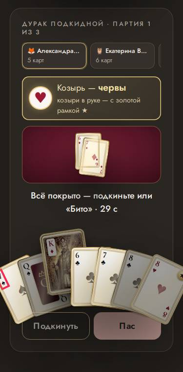

### за краем · телефон

текст выходит за край области вбок на 7 px — «6»

- где: `div.dk-hand__row > button.dk-hand__slot > div.dk-card.dk-d--gothic > span.dk-idx`, этап `playing/113/reveal/over`
- игры (1): durak 1-й шаблон, каждый сам ×4, телевизор full hd; durak 1-й шаблон, каждый сам ×4, проектор 4:3, маленький телефон, длинные имена
- раз: 2

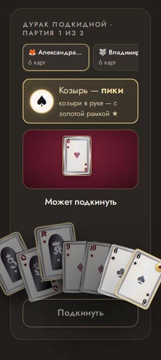

### за краем · телефон

текст выходит за край области вбок на 7 px — «6»

- где: `div.dk-hand__row > button.dk-hand__slot > div.dk-card.dk-d--russia > span.dk-idx`, этап `playing/65/question/play`
- игры (1): durak 1-й шаблон, каждый сам ×4, телевизор full hd
- раз: 1

### за краем · телефон

текст выходит за край области вбок на 10 px — «7»

- где: `div.dk-hand__row > button.dk-hand__slot > div.dk-card.dk-d--cyber > span.dk-idx`, этап `playing/109/question/play`
- игры (1): durak 1-й шаблон, каждый сам ×4, проектор 4:3, маленький телефон, длинные имена
- раз: 1

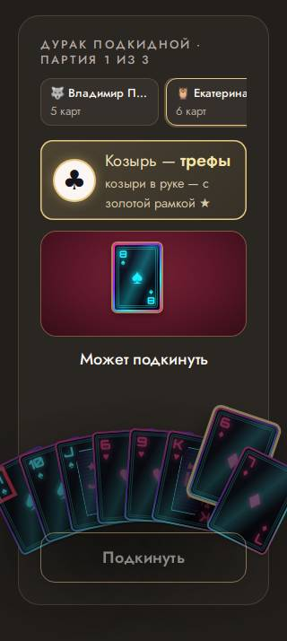

### за краем · телефон

текст выходит за край области вбок на 4 px — «♠︎»

- где: `button.dk-hand__slot > div.dk-card.dk-d--gothic > span.dk-idx > span`, этап `playing/116/reveal/over`
- игры (1): durak 1-й шаблон, каждый сам ×4, проектор 4:3, маленький телефон, длинные имена
- раз: 1

### за краем · телефон

текст выходит за край области вбок на 8 px — «7»

- где: `div.dk-hand__row > button.dk-hand__slot > div.dk-card.dk-d--wedding > span.dk-idx`, этап `playing/88/question/play`
- игры (1): durak 1-й шаблон, каждый сам ×4, ноутбук 16:10, большой зал, длинные имена
- раз: 1

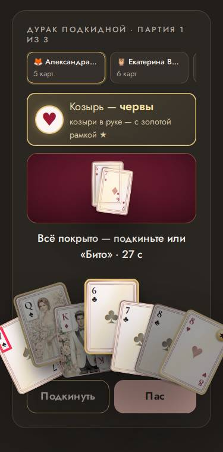

### закрыт другим элементом · экран зала

«Вход: localhost:36873/j · код 123 456» закрыт элементом div.dk-vote — «Вход: localhost:36873/j · код 123 456»

- где: `div.hall > main.quiz-stage > p.stage-code`, этап `playing/2/question/vote`
- игры (2): durak 1-й шаблон, каждый сам ×4, телевизор full hd; bunker 1-й шаблон, каждый сам ×8, телевизор full hd; bunker 1-й шаблон, каждый сам ×8, проектор 4:3, маленький телефон, длинные имена; durak 1-й шаблон, каждый сам ×4, проектор 4:3, маленький телефон, длинные имена; durak 1-й шаблон, каждый сам ×4, ноутбук 16:10, большой зал, длинные имена; bunker 1-й шаблон, каждый сам ×8, ноутбук 16:10, большой зал, длинные имена
- раз: 24

### закрыт другим элементом · телефон

«Владимир Преображенский» закрыт элементом strong.mf-tally__n — «Владимир Преображенский»

- где: `ul.mf-tally > li.mf-tally__row > span.mf-tally__name > span`, этап `playing/1/reveal/verdict`
- игры (1): mafia 1-й шаблон, каждый сам ×9, ноутбук 16:10, большой зал, длинные имена; mafia 1-й шаблон, каждый сам ×9, проектор 4:3, маленький телефон, длинные имена
- раз: 66

### закрыт другим элементом · экран зала

«Александра Константинова» закрыт элементом span.name-emoji — «Александра Константинова»

- где: `div.dk-seat__card > span.dk-seat__text > span.dk-seat__name > span`, этап `playing/1/question/deal`
- игры (1): durak 1-й шаблон, каждый сам ×4, проектор 4:3, маленький телефон, длинные имена; durak 1-й шаблон, каждый сам ×4, ноутбук 16:10, большой зал, длинные имена
- раз: 12

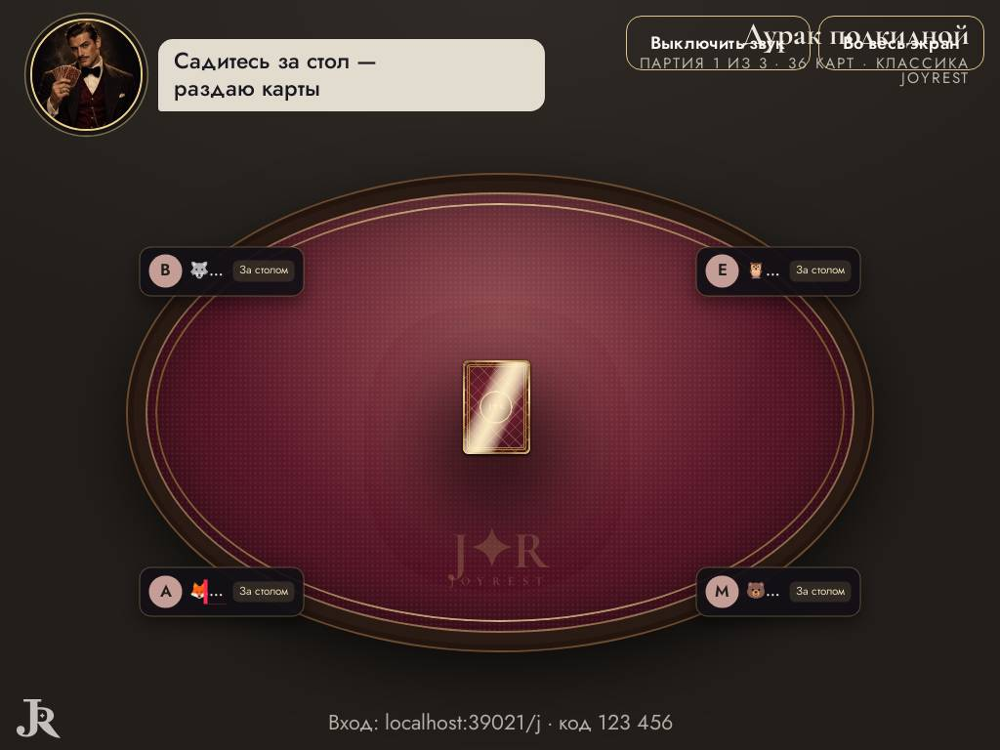

### закрыт другим элементом · экран зала

«Г» закрыт элементом div.dk-card.dk-d--rome — «Г»

- где: `div.dk-table > div.dk-seat.dk-seat--wait > div.dk-seat__card > span.dk-seat__avatar`, этап `playing/2/question/vote`
- игры (1): durak 1-й шаблон, каждый сам ×4, телевизор full hd; durak 1-й шаблон, каждый сам ×4, проектор 4:3, маленький телефон, длинные имена; durak 1-й шаблон, каждый сам ×4, ноутбук 16:10, большой зал, длинные имена
- раз: 6

### закрыт другим элементом · телефон

«🐺» закрыт элементом span.mf-tally__fill — «🐺»

- где: `ul.mf-tally > li.mf-tally__row > span.mf-tally__name > span.name-emoji`, этап `playing/25/reveal/verdict`
- игры (1): mafia 1-й шаблон, каждый сам ×9, проектор 4:3, маленький телефон, длинные имена
- раз: 2

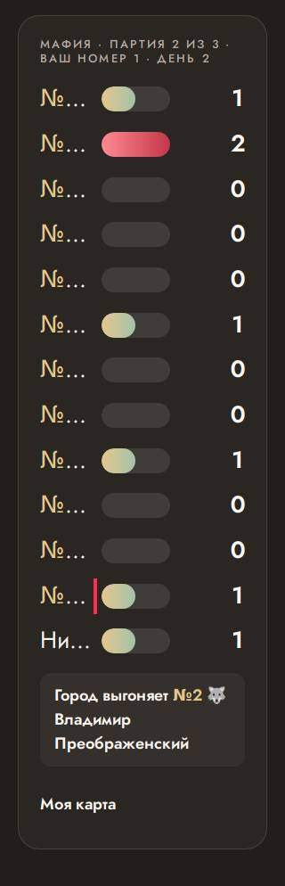

### закрыт другим элементом · экран зала

«Выбираем колоду — голосуйте на телефонах» закрыт элементом h2 — «Выбираем колоду — голосуйте на телефонах»

- где: `div.dk-hall.dk-felt--bordeaux > div.dk-hall__top > div.dk-croupier > p.dk-croupier__line`, этап `playing/2/question/vote`
- игры (1): durak 1-й шаблон, каждый сам ×4, телевизор full hd; durak 1-й шаблон, каждый сам ×4, ноутбук 16:10, большой зал, длинные имена
- раз: 2

### закрыт другим элементом · экран зала

«партия 1 из 3 · 36 карт · Классика JoyRe» закрыт элементом h2 — «партия 1 из 3 · 36 карт · Классика JoyRest»

- где: `div.dk-hall.dk-felt--bordeaux > div.dk-hall__top > div.dk-hall__title > small`, этап `playing/2/question/vote`
- игры (1): durak 1-й шаблон, каждый сам ×4, телевизор full hd
- раз: 1

### закрыт другим элементом · экран зала

«Чудесное исцеление» закрыт элементом p.stage-code — «Чудесное исцеление»

- где: `ol.bk-screen__dossiers.bk-final__survivors > li > article.bk-dossier > p.bk-dossier__used`, этап `playing/139/question/final`
- игры (1): bunker 1-й шаблон, каждый сам ×8, телевизор full hd
- раз: 1

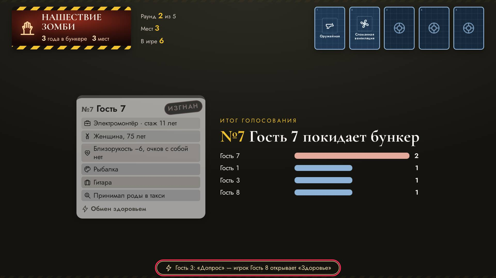

### надписи наезжают · экран зала

«Гость 7: «Медкомиссия» — для и» и «Вход: localhost:36873/j · код » друг на друге — «Гость 7: «Медкомиссия» — для игрока Гость 5 \| Вход: localhost:36873/j · код 123 »

- где: `div.hall > main.quiz-stage > div.bk-screen > p.bk-screen__log`, этап `playing/10/question/open`
- игры (1): bunker 1-й шаблон, каждый сам ×8, телевизор full hd; bunker 1-й шаблон, каждый сам ×8, проектор 4:3, маленький телефон, длинные имена; bunker 1-й шаблон, каждый сам ×8, ноутбук 16:10, большой зал, длинные имена
- раз: 16

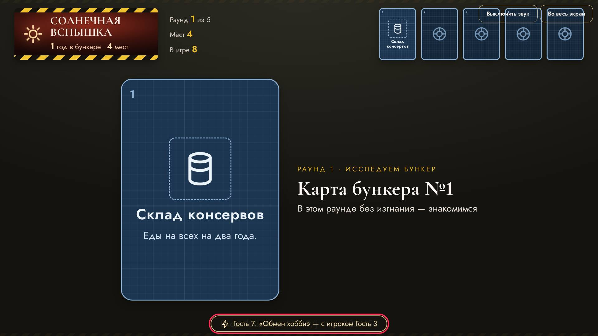

### надписи наезжают · экран зала

«Гость 7: «Медкомиссия» — для и» и «Вход: localhost:36873/j · код » друг на друге — «Гость 7: «Медкомиссия» — для игрока Гость 5 \| Вход: localhost:36873/j · код 123 »

- где: `div.hall > main.quiz-stage > div.bk-screen.bk-screen--big > p.bk-screen__log`, этап `playing/12/question/exile`
- игры (1): bunker 1-й шаблон, каждый сам ×8, телевизор full hd; bunker 1-й шаблон, каждый сам ×8, проектор 4:3, маленький телефон, длинные имена; bunker 1-й шаблон, каждый сам ×8, ноутбук 16:10, большой зал, длинные имена
- раз: 5

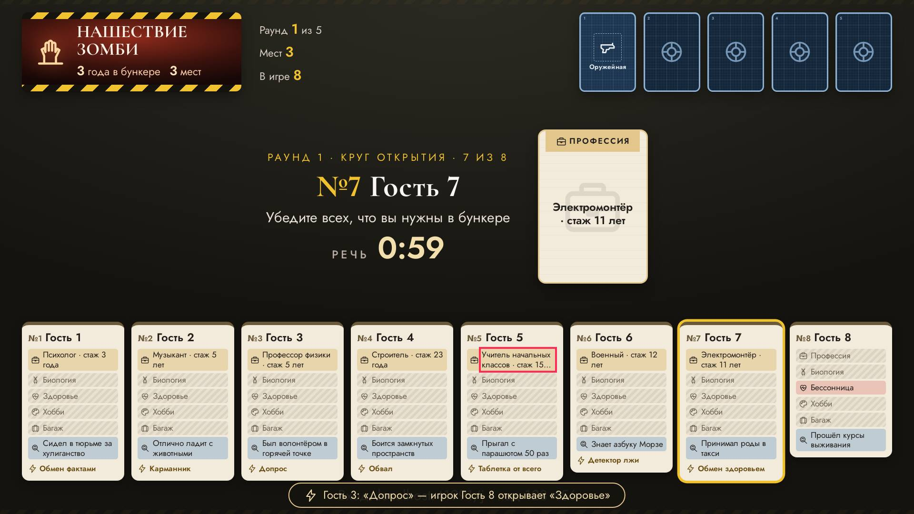

### надписи наезжают · экран зала

«Выбираем колоду — голосуйте на» и «Какой колодой играем?» друг на друге — «Выбираем колоду — голосуйте на телефонах \| Какой колодой играем?»

- где: `div.dk-hall.dk-felt--bordeaux > div.dk-hall__top > div.dk-croupier > p.dk-croupier__line`, этап `playing/2/question/vote`
- игры (1): durak 1-й шаблон, каждый сам ×4, телевизор full hd; durak 1-й шаблон, каждый сам ×4, проектор 4:3, маленький телефон, длинные имена; durak 1-й шаблон, каждый сам ×4, ноутбук 16:10, большой зал, длинные имена
- раз: 4

### надписи наезжают · экран зала

«А» и «Old fashion» друг на друге — «А \| Old fashion»

- где: `div.dk-table > div.dk-seat.dk-seat--wait > div.dk-seat__card > span.dk-seat__avatar`, этап `playing/2/question/vote`
- игры (1): durak 1-й шаблон, каждый сам ×4, проектор 4:3, маленький телефон, длинные имена
- раз: 1

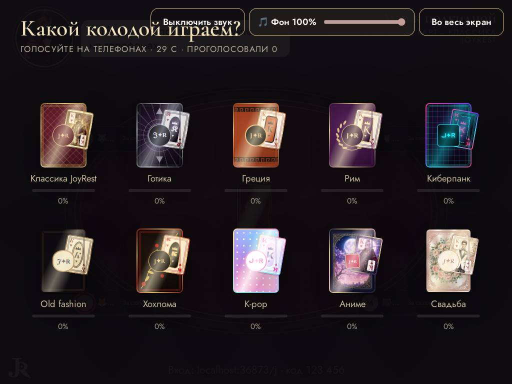

### прокрутка вбок · пульт

страница шире экрана на 4 px (button.btn.btn--secondary) — «Действие»

- где: `div.stack.host-quiz > div.card.stack > div.td-host__pick > button.btn.btn--secondary`, этап `playing/0/question/pick`
- игры (1): truth 1-й шаблон, каждый сам ×4, проектор 4:3, маленький телефон, длинные имена; truth 1-й шаблон, команды ×4, проектор 4:3, маленький телефон, длинные имена; truth 2-й шаблон, каждый сам ×4, проектор 4:3, маленький телефон, длинные имена; truth 2-й шаблон, команды ×4, проектор 4:3, маленький телефон, длинные имена
- раз: 22

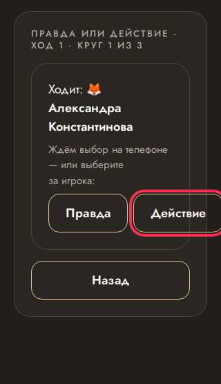

### прокрутка вбок · пульт

страница шире экрана на 5 px (button.btn.btn--quiet) — «Играет компьютер»

- где: `div.stack.stack--tight > ul.dk-host__seats > li > button.btn.btn--quiet`, этап `playing/4/question/play`
- игры (1): durak 1-й шаблон, каждый сам ×4, проектор 4:3, маленький телефон, длинные имена
- раз: 7

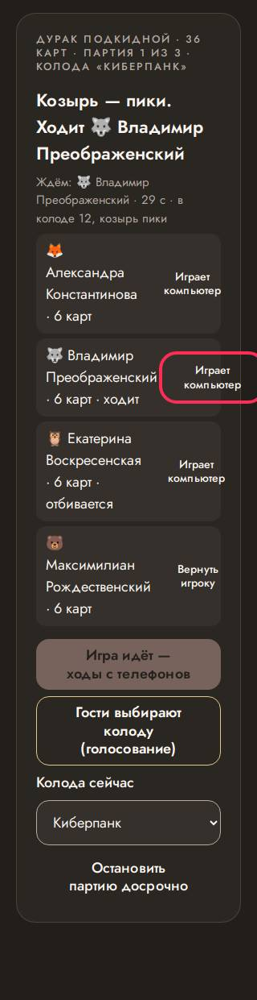

### прокрутка вбок · телефон

страница шире экрана на 10 px (span) — «Максимилиан Рождественский»

- где: `div.dk-phone__opps > span.dk-opp.dk-opp--wait > span.dk-opp__name > span`, этап `playing/88/question/play`
- игры (1): durak 1-й шаблон, каждый сам ×4, проектор 4:3, маленький телефон, длинные имена; durak 1-й шаблон, каждый сам ×4, ноутбук 16:10, большой зал, длинные имена
- раз: 4

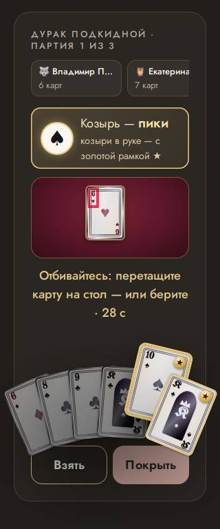

### прокрутка вбок · телефон

страница шире экрана на 10 px (div.dk-card.dk-d--gothic)

- где: `div.dk-hand > div.dk-hand__row > button.dk-hand__slot > div.dk-card.dk-d--gothic`, этап `playing/54/question/play`
- игры (1): durak 1-й шаблон, каждый сам ×4, телевизор full hd
- раз: 3

### прокрутка вбок · телефон

страница шире экрана на 19 px (button.dk-hand__slot)

- где: `div.quiz-phone.dk-phone > div.dk-hand > div.dk-hand__row > button.dk-hand__slot`, этап `playing/65/question/play`
- игры (1): durak 1-й шаблон, каждый сам ×4, телевизор full hd
- раз: 3

### прокрутка вбок · телефон

страница шире экрана на 10 px (span) — «Максимилиан Рождественский»

- где: `div.dk-phone__opps > span.dk-opp.dk-opp--defend > span.dk-opp__name > span`, этап `playing/37/question/play`
- игры (1): durak 1-й шаблон, каждый сам ×4, проектор 4:3, маленький телефон, длинные имена
- раз: 2

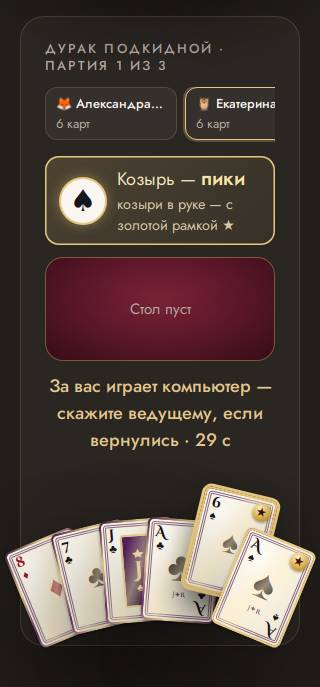

### прокрутка вбок · телефон

страница шире экрана на 20 px (span) — «Максимилиан Рождественский»

- где: `div.dk-phone__opps > span.dk-opp.dk-opp--throw > span.dk-opp__name > span`, этап `playing/109/question/play`
- игры (1): durak 1-й шаблон, каждый сам ×4, проектор 4:3, маленький телефон, длинные имена; durak 1-й шаблон, каждый сам ×4, ноутбук 16:10, большой зал, длинные имена
- раз: 2

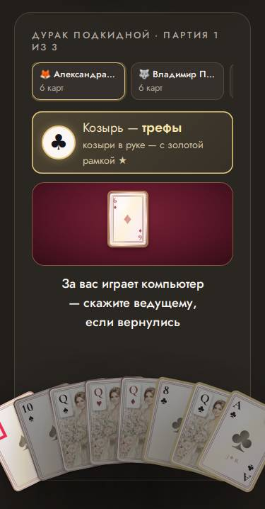

## Заметно — 110

### обрезан текст · экран зала

текст обрезан по высоте на 4 px (span.wine-cell__label) — «Красное»

- где: `div.wine-row > span.wine-row__cells > span.wine-cell > span.wine-cell__label`, этап `playing/1/question/bet`
- игры (1): wine 1-й шаблон, каждый сам ×4, телевизор full hd; wine 1-й шаблон, каждый сам ×4, проектор 4:3, маленький телефон, длинные имена; wine 1-й шаблон, команды ×4, телевизор full hd; wine 1-й шаблон, команды ×4, проектор 4:3, маленький телефон, длинные имена
- раз: 212

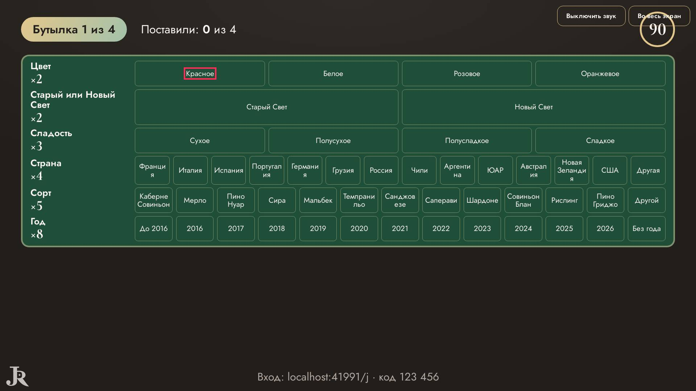

### обрезан текст · телефон

текст обрезан вбок на 29 px (div.dk-card.dk-d--rome) — «K»

- где: `div.dk-hand__row > button.dk-hand__slot > div.dk-card.dk-d--rome > span.dk-idx.dk-idx--b`, этап `playing/17/question/play`
- игры (1): durak 1-й шаблон, каждый сам ×4, телевизор full hd; durak 1-й шаблон, каждый сам ×4, проектор 4:3, маленький телефон, длинные имена; durak 1-й шаблон, каждый сам ×4, ноутбук 16:10, большой зал, длинные имена
- раз: 120

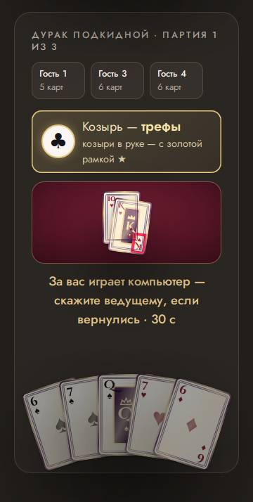

### обрезан текст · телефон

текст обрезан вбок на 28 px (div.dk-card.dk-d--gothic) — «K»

- где: `div.dk-hand__row > button.dk-hand__slot > div.dk-card.dk-d--gothic > span.dk-idx.dk-idx--b`, этап `playing/54/question/play`
- игры (1): durak 1-й шаблон, каждый сам ×4, телевизор full hd; durak 1-й шаблон, каждый сам ×4, проектор 4:3, маленький телефон, длинные имена; durak 1-й шаблон, каждый сам ×4, ноутбук 16:10, большой зал, длинные имена
- раз: 88

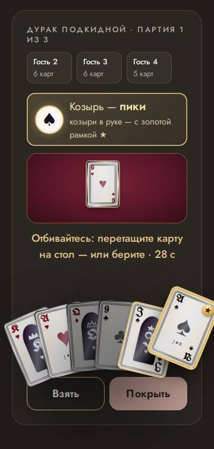

### обрезан текст · телефон

текст обрезан вбок на 29 px (div.dk-card.dk-d--russia) — «K»

- где: `div.dk-hand__row > button.dk-hand__slot > div.dk-card.dk-d--russia > span.dk-idx.dk-idx--b`, этап `playing/12/question/play`
- игры (1): durak 1-й шаблон, каждый сам ×4, телевизор full hd; durak 1-й шаблон, каждый сам ×4, проектор 4:3, маленький телефон, длинные имена; durak 1-й шаблон, каждый сам ×4, ноутбук 16:10, большой зал, длинные имена
- раз: 74

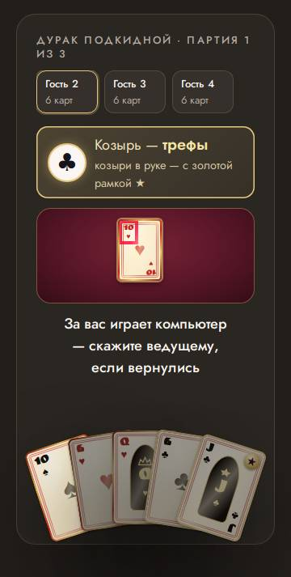

### обрезан текст · телефон

текст обрезан вбок на 29 px (div.dk-card.dk-d--cyber) — «K»

- где: `div.dk-hand__row > button.dk-hand__slot > div.dk-card.dk-d--cyber > span.dk-idx.dk-idx--b`, этап `playing/4/question/play`
- игры (1): durak 1-й шаблон, каждый сам ×4, телевизор full hd; durak 1-й шаблон, каждый сам ×4, проектор 4:3, маленький телефон, длинные имена; durak 1-й шаблон, каждый сам ×4, ноутбук 16:10, большой зал, длинные имена
- раз: 62

### обрезан текст · телефон

текст обрезан вбок на 25 px (div.dk-card.dk-d--wedding) — «K»

- где: `div.dk-hand__row > button.dk-hand__slot > div.dk-card.dk-d--wedding > span.dk-idx.dk-idx--b`, этап `playing/51/question/play`
- игры (1): durak 1-й шаблон, каждый сам ×4, телевизор full hd; durak 1-й шаблон, каждый сам ×4, проектор 4:3, маленький телефон, длинные имена; durak 1-й шаблон, каждый сам ×4, ноутбук 16:10, большой зал, длинные имена
- раз: 62

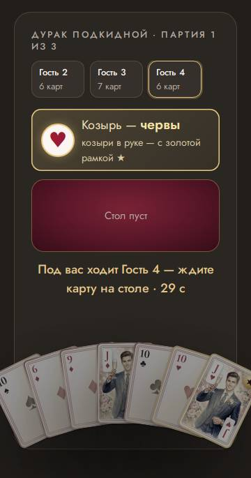

### обрезан текст · телефон

текст обрезан вбок на 21 px (div.dk-card.dk-d--rome) — «♥︎»

- где: `button.dk-hand__slot > div.dk-card.dk-d--rome > span.dk-idx.dk-idx--b > span`, этап `playing/17/question/play`
- игры (1): durak 1-й шаблон, каждый сам ×4, телевизор full hd; durak 1-й шаблон, каждый сам ×4, проектор 4:3, маленький телефон, длинные имена; durak 1-й шаблон, каждый сам ×4, ноутбук 16:10, большой зал, длинные имена
- раз: 60

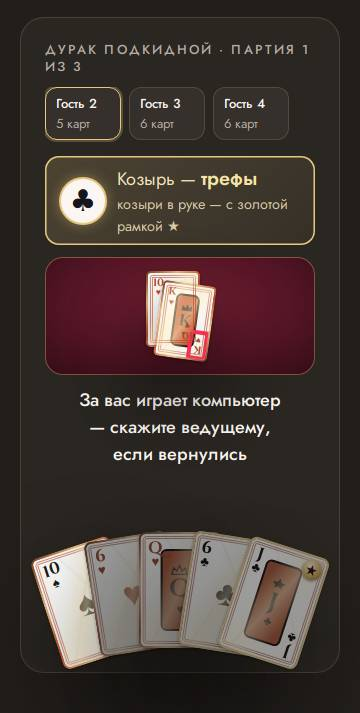

### обрезан текст · телефон

текст обрезан вбок на 33 px (div.dk-card.dk-d--classic) — «6»

- где: `div.dk-hand__row > button.dk-hand__slot > div.dk-card.dk-d--classic > span.dk-idx.dk-idx--b`, этап `playing/90/question/play`
- игры (1): durak 1-й шаблон, каждый сам ×4, телевизор full hd; durak 1-й шаблон, каждый сам ×4, проектор 4:3, маленький телефон, длинные имена; durak 1-й шаблон, каждый сам ×4, ноутбук 16:10, большой зал, длинные имена
- раз: 52

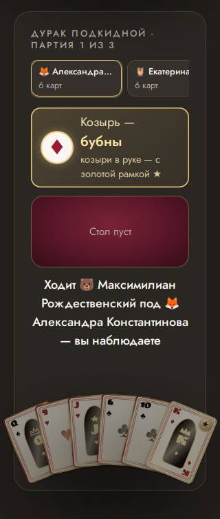

### обрезан текст · телефон

текст обрезан вбок на 29 px (div.dk-card.dk-d--kpop) — «8»

- где: `div.dk-hand__row > button.dk-hand__slot > div.dk-card.dk-d--kpop > span.dk-idx.dk-idx--b`, этап `playing/122/reveal/over`
- игры (1): durak 1-й шаблон, каждый сам ×4, телевизор full hd; durak 1-й шаблон, каждый сам ×4, проектор 4:3, маленький телефон, длинные имена; durak 1-й шаблон, каждый сам ×4, ноутбук 16:10, большой зал, длинные имена
- раз: 48

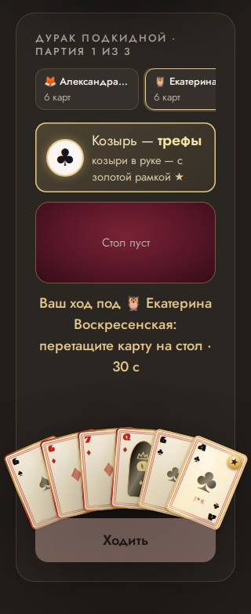

### обрезан текст · телефон

текст обрезан вбок на 21 px (div.dk-card.dk-d--gothic) — «♥︎»

- где: `button.dk-hand__slot > div.dk-card.dk-d--gothic > span.dk-idx.dk-idx--b > span`, этап `playing/54/question/play`
- игры (1): durak 1-й шаблон, каждый сам ×4, телевизор full hd; durak 1-й шаблон, каждый сам ×4, проектор 4:3, маленький телефон, длинные имена; durak 1-й шаблон, каждый сам ×4, ноутбук 16:10, большой зал, длинные имена
- раз: 43

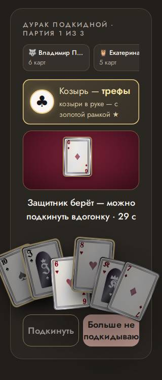

### обрезан текст · телефон

текст обрезан вбок на 21 px (div.dk-card.dk-d--russia) — «♥︎»

- где: `button.dk-hand__slot > div.dk-card.dk-d--russia > span.dk-idx.dk-idx--b > span`, этап `playing/12/question/play`
- игры (1): durak 1-й шаблон, каждый сам ×4, телевизор full hd; durak 1-й шаблон, каждый сам ×4, проектор 4:3, маленький телефон, длинные имена; durak 1-й шаблон, каждый сам ×4, ноутбук 16:10, большой зал, длинные имена
- раз: 37

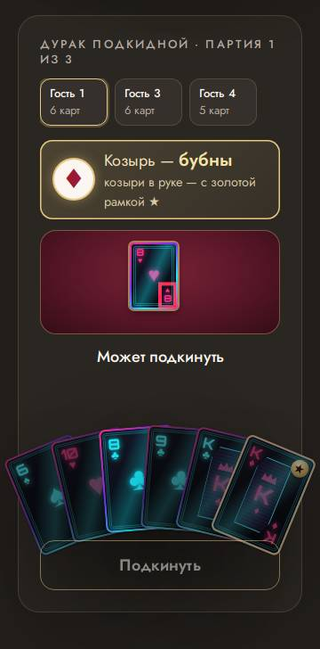

### обрезан текст · телефон

текст обрезан вбок на 21 px (div.dk-card.dk-d--cyber) — «♥︎»

- где: `button.dk-hand__slot > div.dk-card.dk-d--cyber > span.dk-idx.dk-idx--b > span`, этап `playing/4/question/play`
- игры (1): durak 1-й шаблон, каждый сам ×4, телевизор full hd; durak 1-й шаблон, каждый сам ×4, проектор 4:3, маленький телефон, длинные имена; durak 1-й шаблон, каждый сам ×4, ноутбук 16:10, большой зал, длинные имена
- раз: 30

### обрезан текст · телефон

текст обрезан вбок на 18 px (div.dk-card.dk-d--wedding) — «♥︎»

- где: `button.dk-hand__slot > div.dk-card.dk-d--wedding > span.dk-idx.dk-idx--b > span`, этап `playing/51/question/play`
- игры (1): durak 1-й шаблон, каждый сам ×4, телевизор full hd; durak 1-й шаблон, каждый сам ×4, проектор 4:3, маленький телефон, длинные имена; durak 1-й шаблон, каждый сам ×4, ноутбук 16:10, большой зал, длинные имена
- раз: 30

### обрезан текст · пульт

текст обрезан вбок на 3 px (span.wine-cell__label) — «Новый Свет»

- где: `div.wine-row > span.wine-row__cells > span.wine-cell > span.wine-cell__label`, этап `playing/1/reveal/open`
- игры (1): wine 1-й шаблон, каждый сам ×4, телевизор full hd; wine 1-й шаблон, каждый сам ×4, проектор 4:3, маленький телефон, длинные имена; wine 1-й шаблон, каждый сам ×16, ноутбук 16:10, большой зал, длинные имена; wine 1-й шаблон, команды ×4, телевизор full hd; wine 1-й шаблон, команды ×4, проектор 4:3, маленький телефон, длинные имена; wine 1-й шаблон, команды ×8, ноутбук 16:10, большой зал, длинные имена
- раз: 29

### обрезан текст · телефон

текст обрезан вбок на 27 px (div.dk-card.dk-d--classic) — «♥︎»

- где: `button.dk-hand__slot > div.dk-card.dk-d--classic > span.dk-idx.dk-idx--b > span`, этап `playing/90/question/play`
- игры (1): durak 1-й шаблон, каждый сам ×4, телевизор full hd; durak 1-й шаблон, каждый сам ×4, проектор 4:3, маленький телефон, длинные имена; durak 1-й шаблон, каждый сам ×4, ноутбук 16:10, большой зал, длинные имена
- раз: 26

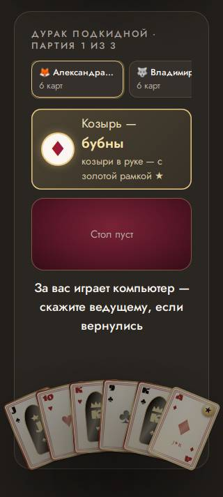

### обрезан текст · телефон

текст обрезан вбок на 20 px (div.dk-card.dk-d--kpop) — «♠︎»

- где: `button.dk-hand__slot > div.dk-card.dk-d--kpop > span.dk-idx.dk-idx--b > span`, этап `playing/122/reveal/over`
- игры (1): durak 1-й шаблон, каждый сам ×4, телевизор full hd; durak 1-й шаблон, каждый сам ×4, проектор 4:3, маленький телефон, длинные имена; durak 1-й шаблон, каждый сам ×4, ноутбук 16:10, большой зал, длинные имена
- раз: 23

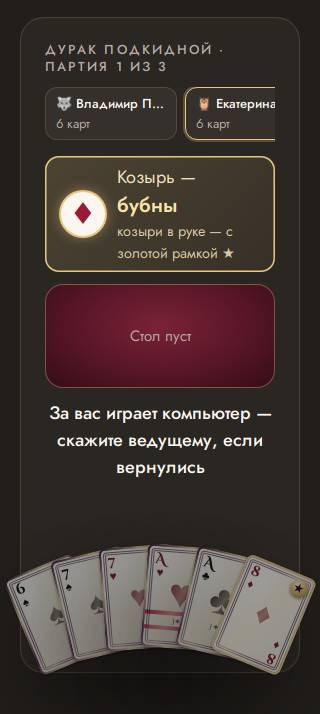

### обрезан текст · телефон

текст обрезан по высоте на 3 px (div.dk-card.dk-d--classic) — «Q»

- где: `div.dk-mini > span.dk-mini__pair > div.dk-card.dk-d--classic > span.dk-idx.dk-idx--b`, этап `playing/90/question/play`
- игры (1): durak 1-й шаблон, каждый сам ×4, телевизор full hd; durak 1-й шаблон, каждый сам ×4, ноутбук 16:10, большой зал, длинные имена
- раз: 6

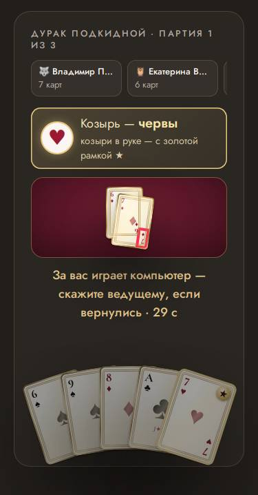

### обрезан текст · телефон

текст обрезан вбок на 5 px (div.dk-card.dk-d--gothic) — «♠︎»

- где: `div.dk-hand__row > button.dk-hand__slot > div.dk-card.dk-d--gothic > span.dk-pip.dk-pip--ace`, этап `playing/54/question/play`
- игры (1): durak 1-й шаблон, каждый сам ×4, телевизор full hd; durak 1-й шаблон, каждый сам ×4, проектор 4:3, маленький телефон, длинные имена; durak 1-й шаблон, каждый сам ×4, ноутбук 16:10, большой зал, длинные имена
- раз: 5

### обрезан текст · телефон

текст обрезан вбок на 5 px (div.dk-card.dk-d--rome) — «♠︎»

- где: `div.dk-hand__row > button.dk-hand__slot > div.dk-card.dk-d--rome > span.dk-pip.dk-pip--ace`, этап `playing/17/question/play`
- игры (1): durak 1-й шаблон, каждый сам ×4, телевизор full hd; durak 1-й шаблон, каждый сам ×4, проектор 4:3, маленький телефон, длинные имена; durak 1-й шаблон, каждый сам ×4, ноутбук 16:10, большой зал, длинные имена
- раз: 4

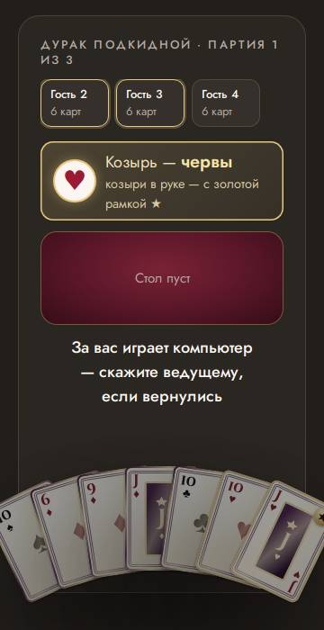

### обрезан текст · экран зала

текст обрезан по высоте на 3 px (div.dk-card.dk-d--classic) — «K»

- где: `div.dk-vote__grid > div.dk-vote__tile > div.dk-card.dk-d--classic > span.dk-idx.dk-idx--b`, этап `playing/2/question/vote`
- игры (1): durak 1-й шаблон, каждый сам ×4, телевизор full hd; durak 1-й шаблон, каждый сам ×4, проектор 4:3, маленький телефон, длинные имена; durak 1-й шаблон, каждый сам ×4, ноутбук 16:10, большой зал, длинные имена
- раз: 3

### обрезан текст · экран зала

текст обрезан по высоте на 5 px (div.dk-card.dk-d--gothic) — «K»

- где: `div.dk-vote__grid > div.dk-vote__tile > div.dk-card.dk-d--gothic > span.dk-idx.dk-idx--b`, этап `playing/2/question/vote`
- игры (1): durak 1-й шаблон, каждый сам ×4, телевизор full hd; durak 1-й шаблон, каждый сам ×4, проектор 4:3, маленький телефон, длинные имена; durak 1-й шаблон, каждый сам ×4, ноутбук 16:10, большой зал, длинные имена
- раз: 3

### обрезан текст · экран зала

текст обрезан по высоте на 8 px (div.dk-card.dk-d--greece) — «K»

- где: `div.dk-vote__grid > div.dk-vote__tile > div.dk-card.dk-d--greece > span.dk-idx.dk-idx--b`, этап `playing/2/question/vote`
- игры (1): durak 1-й шаблон, каждый сам ×4, телевизор full hd; durak 1-й шаблон, каждый сам ×4, проектор 4:3, маленький телефон, длинные имена; durak 1-й шаблон, каждый сам ×4, ноутбук 16:10, большой зал, длинные имена
- раз: 3

### обрезан текст · экран зала

текст обрезан по высоте на 8 px (div.dk-card.dk-d--rome) — «K»

- где: `div.dk-vote__grid > div.dk-vote__tile > div.dk-card.dk-d--rome > span.dk-idx.dk-idx--b`, этап `playing/2/question/vote`
- игры (1): durak 1-й шаблон, каждый сам ×4, телевизор full hd; durak 1-й шаблон, каждый сам ×4, проектор 4:3, маленький телефон, длинные имена; durak 1-й шаблон, каждый сам ×4, ноутбук 16:10, большой зал, длинные имена
- раз: 3

### обрезан текст · экран зала

текст обрезан по высоте на 7 px (div.dk-card.dk-d--cyber) — «K»

- где: `div.dk-vote__grid > div.dk-vote__tile > div.dk-card.dk-d--cyber > span.dk-idx.dk-idx--b`, этап `playing/2/question/vote`
- игры (1): durak 1-й шаблон, каждый сам ×4, телевизор full hd; durak 1-й шаблон, каждый сам ×4, проектор 4:3, маленький телефон, длинные имена; durak 1-й шаблон, каждый сам ×4, ноутбук 16:10, большой зал, длинные имена
- раз: 3

### обрезан текст · экран зала

текст обрезан по высоте на 7 px (div.dk-card.dk-d--vintage) — «K»

- где: `div.dk-vote__grid > div.dk-vote__tile > div.dk-card.dk-d--vintage > span.dk-idx.dk-idx--b`, этап `playing/2/question/vote`
- игры (1): durak 1-й шаблон, каждый сам ×4, телевизор full hd; durak 1-й шаблон, каждый сам ×4, проектор 4:3, маленький телефон, длинные имена; durak 1-й шаблон, каждый сам ×4, ноутбук 16:10, большой зал, длинные имена
- раз: 3

### обрезан текст · экран зала

текст обрезан по высоте на 5 px (div.dk-card.dk-d--russia) — «K»

- где: `div.dk-vote__grid > div.dk-vote__tile > div.dk-card.dk-d--russia > span.dk-idx.dk-idx--b`, этап `playing/2/question/vote`
- игры (1): durak 1-й шаблон, каждый сам ×4, телевизор full hd; durak 1-й шаблон, каждый сам ×4, проектор 4:3, маленький телефон, длинные имена; durak 1-й шаблон, каждый сам ×4, ноутбук 16:10, большой зал, длинные имена
- раз: 3

### обрезан текст · экран зала

текст обрезан по высоте на 7 px (div.dk-card.dk-d--kpop) — «K»

- где: `div.dk-vote__grid > div.dk-vote__tile > div.dk-card.dk-d--kpop > span.dk-idx.dk-idx--b`, этап `playing/2/question/vote`
- игры (1): durak 1-й шаблон, каждый сам ×4, телевизор full hd; durak 1-й шаблон, каждый сам ×4, проектор 4:3, маленький телефон, длинные имена; durak 1-й шаблон, каждый сам ×4, ноутбук 16:10, большой зал, длинные имена
- раз: 3

### обрезан текст · экран зала

текст обрезан по высоте на 5 px (div.dk-card.dk-d--anime) — «K»

- где: `div.dk-vote__grid > div.dk-vote__tile > div.dk-card.dk-d--anime > span.dk-idx.dk-idx--b`, этап `playing/2/question/vote`
- игры (1): durak 1-й шаблон, каждый сам ×4, телевизор full hd; durak 1-й шаблон, каждый сам ×4, проектор 4:3, маленький телефон, длинные имена; durak 1-й шаблон, каждый сам ×4, ноутбук 16:10, большой зал, длинные имена
- раз: 3

### обрезан текст · экран зала

текст обрезан по высоте на 3 px (div.dk-card.dk-d--wedding) — «K»

- где: `div.dk-vote__grid > div.dk-vote__tile > div.dk-card.dk-d--wedding > span.dk-idx.dk-idx--b`, этап `playing/2/question/vote`
- игры (1): durak 1-й шаблон, каждый сам ×4, телевизор full hd; durak 1-й шаблон, каждый сам ×4, проектор 4:3, маленький телефон, длинные имена; durak 1-й шаблон, каждый сам ×4, ноутбук 16:10, большой зал, длинные имена
- раз: 3

### обрезан текст · телефон

текст обрезан по высоте на 3 px (div.dk-card.dk-d--wedding) — «7»

- где: `div.dk-mini > span.dk-mini__pair > div.dk-card.dk-d--wedding > span.dk-idx.dk-idx--b`, этап `playing/88/question/play`
- игры (1): durak 1-й шаблон, каждый сам ×4, ноутбук 16:10, большой зал, длинные имена
- раз: 3

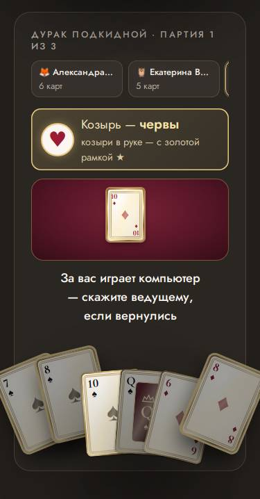

### обрезан текст · телефон

текст обрезан вбок на 5 px (div.dk-card.dk-d--cyber) — «♠︎»

- где: `div.dk-hand__row > button.dk-hand__slot > div.dk-card.dk-d--cyber > span.dk-pip.dk-pip--ace`, этап `playing/4/question/play`
- игры (1): durak 1-й шаблон, каждый сам ×4, телевизор full hd
- раз: 2

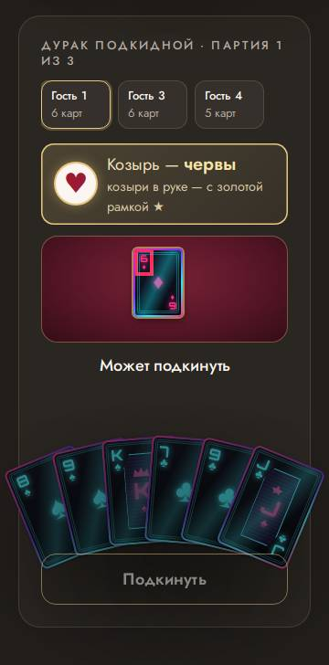

### обрезан текст · телефон

текст обрезан вбок на 5 px (div.dk-card.dk-d--russia) — «♠︎»

- где: `div.dk-hand__row > button.dk-hand__slot > div.dk-card.dk-d--russia > span.dk-pip.dk-pip--ace`, этап `playing/12/question/play`
- игры (1): durak 1-й шаблон, каждый сам ×4, телевизор full hd
- раз: 2

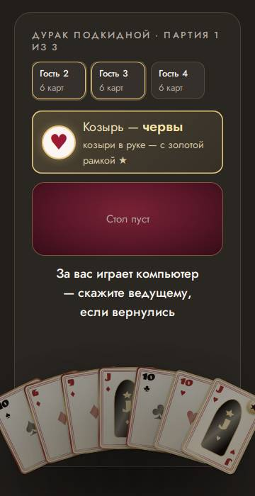

### обрезан текст · телефон

текст обрезан по высоте на 4 px (div.dk-card.dk-d--rome) — «8»

- где: `div.dk-mini > span.dk-mini__pair > div.dk-card.dk-d--rome > span.dk-idx.dk-idx--b`, этап `playing/17/question/play`
- игры (1): durak 1-й шаблон, каждый сам ×4, телевизор full hd
- раз: 2

### обрезан текст · телефон

текст обрезан вбок на 5 px (div.dk-card.dk-d--kpop) — «♦︎»

- где: `div.dk-hand__row > button.dk-hand__slot > div.dk-card.dk-d--kpop > span.dk-pip.dk-pip--ace`, этап `playing/122/reveal/over`
- игры (1): durak 1-й шаблон, каждый сам ×4, телевизор full hd; durak 1-й шаблон, каждый сам ×4, ноутбук 16:10, большой зал, длинные имена
- раз: 2

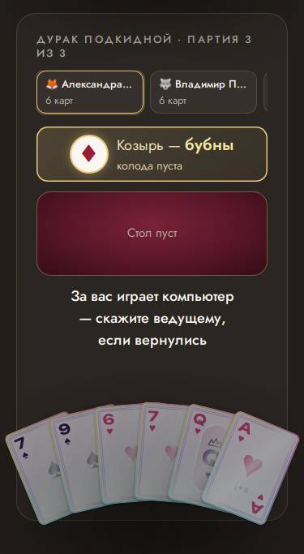

### обрезан текст · экран зала

текст обрезан вбок на 35 px (div.dk-card.dk-d--rome) — «K»

- где: `div.dk-table__felt > div.dk-stock > div.dk-card.dk-d--rome > span.dk-idx`, этап `playing/16/question/play`
- игры (1): durak 1-й шаблон, каждый сам ×4, телевизор full hd; durak 1-й шаблон, каждый сам ×4, проектор 4:3, маленький телефон, длинные имена
- раз: 2

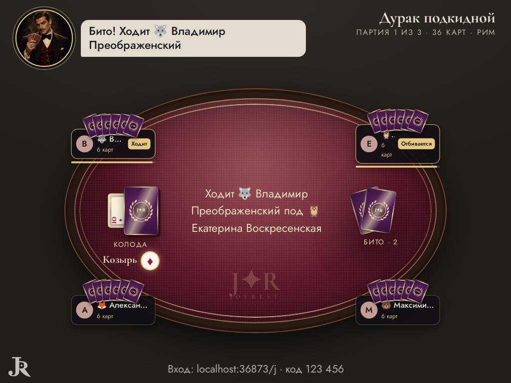

### обрезан текст · экран зала

текст обрезан вбок на 18 px (div.dk-card.dk-d--rome) — «♥︎»

- где: `div.dk-stock > div.dk-card.dk-d--rome > span.dk-idx > span`, этап `playing/16/question/play`
- игры (1): durak 1-й шаблон, каждый сам ×4, телевизор full hd; durak 1-й шаблон, каждый сам ×4, проектор 4:3, маленький телефон, длинные имена
- раз: 2

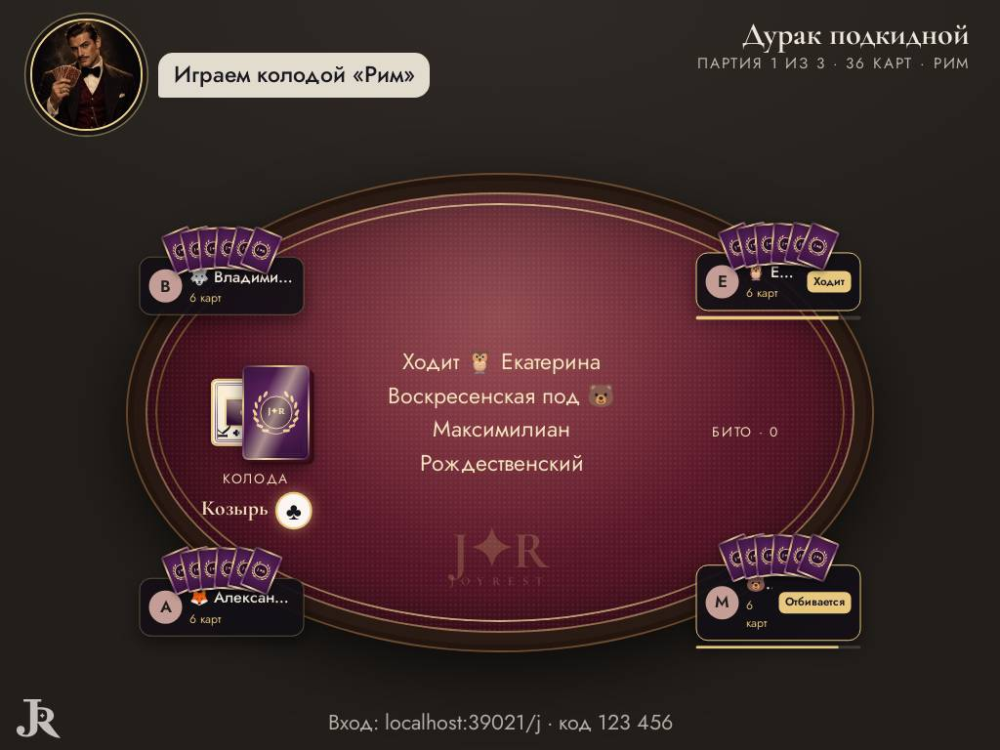

### обрезан текст · экран зала

текст обрезан вбок на 34 px (div.dk-card.dk-d--anime) — «K»

- где: `div.dk-table__felt > div.dk-stock > div.dk-card.dk-d--anime > span.dk-idx`, этап `playing/55/question/play`
- игры (1): durak 1-й шаблон, каждый сам ×4, телевизор full hd; durak 1-й шаблон, каждый сам ×4, проектор 4:3, маленький телефон, длинные имена
- раз: 2

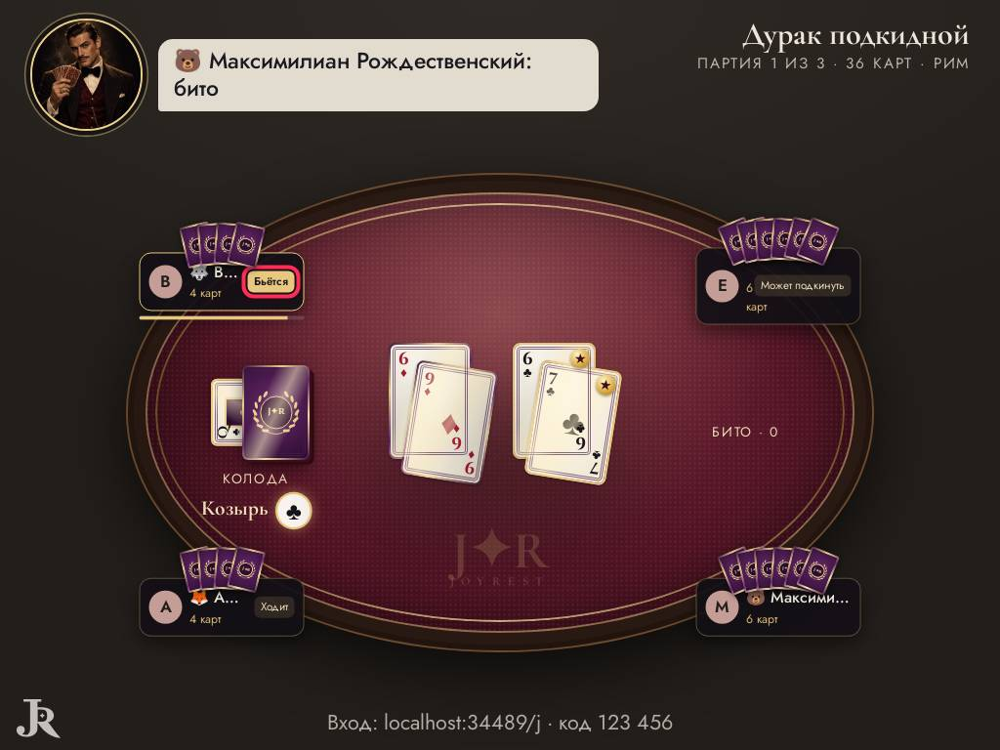

### обрезан текст · экран зала

текст обрезан вбок на 15 px (div.dk-card.dk-d--anime) — «♥︎»

- где: `div.dk-stock > div.dk-card.dk-d--anime > span.dk-idx > span`, этап `playing/55/question/play`
- игры (1): durak 1-й шаблон, каждый сам ×4, телевизор full hd; durak 1-й шаблон, каждый сам ×4, проектор 4:3, маленький телефон, длинные имена
- раз: 2

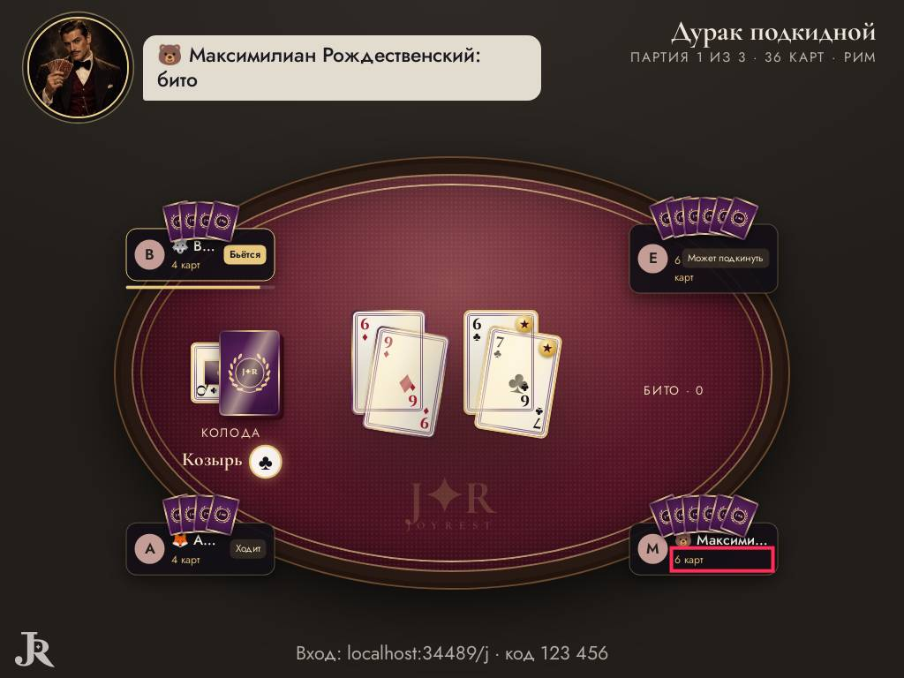

### обрезан текст · экран зала

текст обрезан по высоте на 57 px (div.podium__names) — «Команда 1»

- где: `div.podium__stage > div.podium__slot > div.podium__names > p.podium__name.podium__name--team`, этап `finished/20/podium/done`
- игры (1): truth 1-й шаблон, команды ×4, телевизор full hd; truth 2-й шаблон, команды ×4, телевизор full hd
- раз: 2

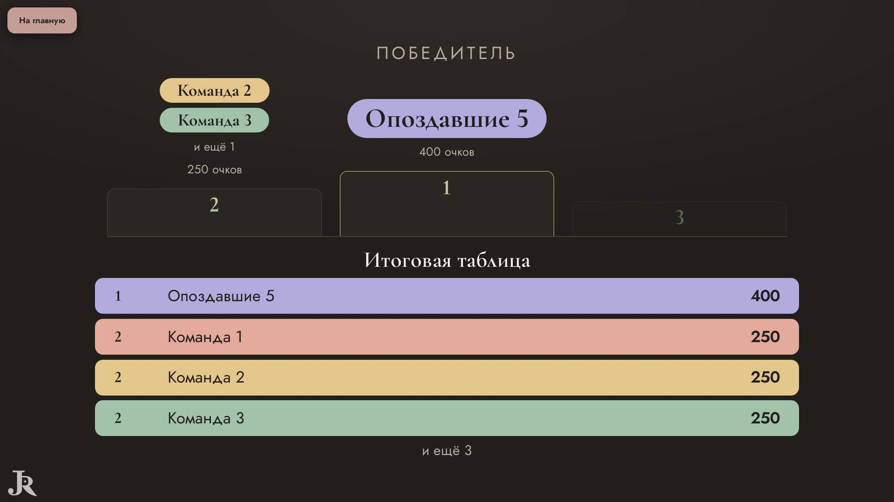

### обрезан текст · экран зала

текст обрезан по высоте на 42 px (div.podium__names) — «🐺»

- где: `div.podium__slot > div.podium__names > p.podium__name.podium__name--team > span.name-emoji`, этап `finished/20/podium/done`
- игры (1): truth 1-й шаблон, команды ×4, проектор 4:3, маленький телефон, длинные имена; truth 2-й шаблон, команды ×4, проектор 4:3, маленький телефон, длинные имена
- раз: 2

### обрезан текст · экран зала

текст обрезан по высоте на 30 px (div.podium__names) — «🐙»

- где: `div.podium__slot > div.podium__names > p.podium__name > span.name-emoji`, этап `finished/93/podium/over`
- игры (1): mafia 1-й шаблон, каждый сам ×9, проектор 4:3, маленький телефон, длинные имена
- раз: 1

### обрезан текст · телефон

текст обрезан вбок на 5 px (div.dk-card.dk-d--wedding) — «♠︎»

- где: `div.dk-hand__row > button.dk-hand__slot > div.dk-card.dk-d--wedding > span.dk-pip.dk-pip--ace`, этап `playing/51/question/play`
- игры (1): durak 1-й шаблон, каждый сам ×4, телевизор full hd
- раз: 1

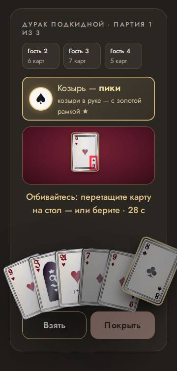

### обрезан текст · телефон

текст обрезан вбок на 9 px (div.dk-card.dk-d--classic) — «♠︎»

- где: `div.dk-hand__row > button.dk-hand__slot > div.dk-card.dk-d--classic > span.dk-pip.dk-pip--ace`, этап `playing/90/question/play`
- игры (1): durak 1-й шаблон, каждый сам ×4, телевизор full hd
- раз: 1

### обрезан текст · экран зала

текст обрезан по высоте на 9 px (div.dk-card.dk-d--anime) — «A»

- где: `div.dk-battle > div.dk-pair > div.dk-card.dk-d--anime > span.dk-idx.dk-idx--b`, этап `playing/59/question/play`
- игры (1): durak 1-й шаблон, каждый сам ×4, проектор 4:3, маленький телефон, длинные имена
- раз: 1

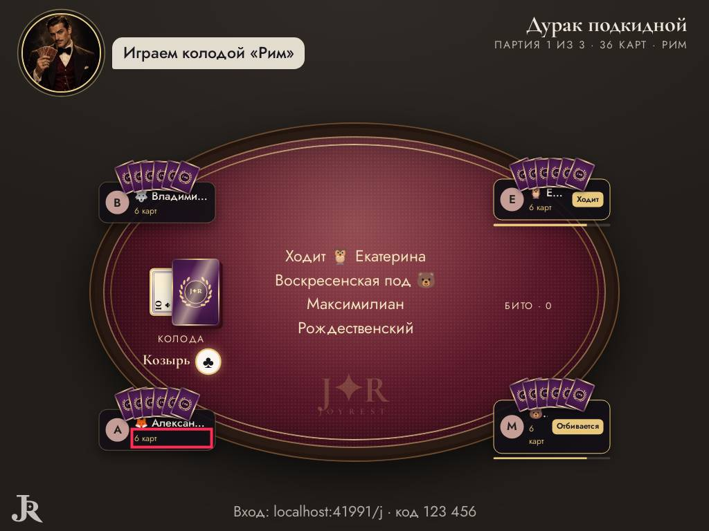

### обрезан текст · экран зала

текст обрезан вбок на 26 px (div.dk-card.dk-d--cyber) — «A»

- где: `div.dk-table__felt > div.dk-stock > div.dk-card.dk-d--cyber > span.dk-idx`, этап `playing/4/question/play`
- игры (1): durak 1-й шаблон, каждый сам ×4, ноутбук 16:10, большой зал, длинные имена
- раз: 1

### обрезан текст · экран зала

текст обрезан вбок на 12 px (div.dk-card.dk-d--cyber) — «♠︎»

- где: `div.dk-stock > div.dk-card.dk-d--cyber > span.dk-idx > span`, этап `playing/4/question/play`
- игры (1): durak 1-й шаблон, каждый сам ×4, ноутбук 16:10, большой зал, длинные имена
- раз: 1

### обрезан текст · экран зала

текст обрезан вбок на 13 px (div.dk-card.dk-d--cyber) — «♠︎»

- где: `div.dk-table__felt > div.dk-stock > div.dk-card.dk-d--cyber > span.dk-pip.dk-pip--ace`, этап `playing/4/question/play`
- игры (1): durak 1-й шаблон, каждый сам ×4, ноутбук 16:10, большой зал, длинные имена
- раз: 1

### прячется за прокруткой · экран зала

на экране зала текст виден только прокруткой (по высоте на 51 px) — «Чудесное исцеление»

- где: `ol.bk-screen__dossiers.bk-final__survivors > li > article.bk-dossier > p.bk-dossier__used`, этап `playing/139/question/final`
- игры (1): bunker 1-й шаблон, каждый сам ×8, телевизор full hd
- раз: 1

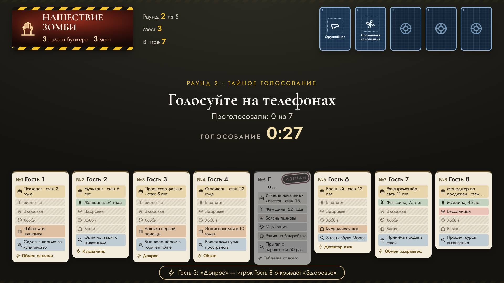

### бледный текст · телефон

контраст 2.26 (нужно от 4.5) — «видите только вы»

- где: `section.bk-phone__mine > ul.bk-phone__cards > li > span.bk-phone__state`, этап `playing/2/question/bunker`
- игры (1): bunker 1-й шаблон, каждый сам ×8, проектор 4:3, маленький телефон, длинные имена
- раз: 40

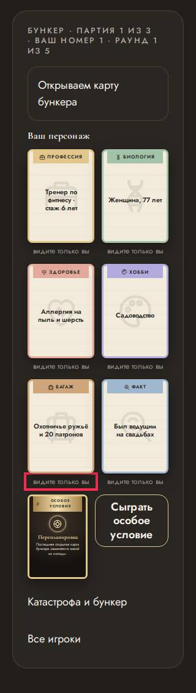

### бледный текст · пульт

контраст 3.07 (нужно от 4.5) — «Германия»

- где: `div.wine-row > span.wine-row__cells > span.wine-cell > span.wine-cell__label`, этап `playing/1/reveal/open`
- игры (1): wine 1-й шаблон, каждый сам ×4, телевизор full hd; wine 1-й шаблон, каждый сам ×4, проектор 4:3, маленький телефон, длинные имена; wine 1-й шаблон, каждый сам ×16, ноутбук 16:10, большой зал, длинные имена; wine 1-й шаблон, команды ×4, телевизор full hd; wine 1-й шаблон, команды ×4, проектор 4:3, маленький телефон, длинные имена; wine 1-й шаблон, команды ×8, ноутбук 16:10, большой зал, длинные имена
- раз: 38

### бледный текст · экран зала

контраст 2.44 (нужно от 3) — «3»

- где: `section.mf-screen__seats > ol.mf-seats.mf-seats--screen > li.mf-seat > span.mf-seat__num`, этап `playing/5/question/night`
- игры (1): mafia 1-й шаблон, каждый сам ×9, телевизор full hd; mafia 1-й шаблон, каждый сам ×9, ноутбук 16:10, большой зал, длинные имена; mafia 1-й шаблон, каждый сам ×9, проектор 4:3, маленький телефон, длинные имена
- раз: 25

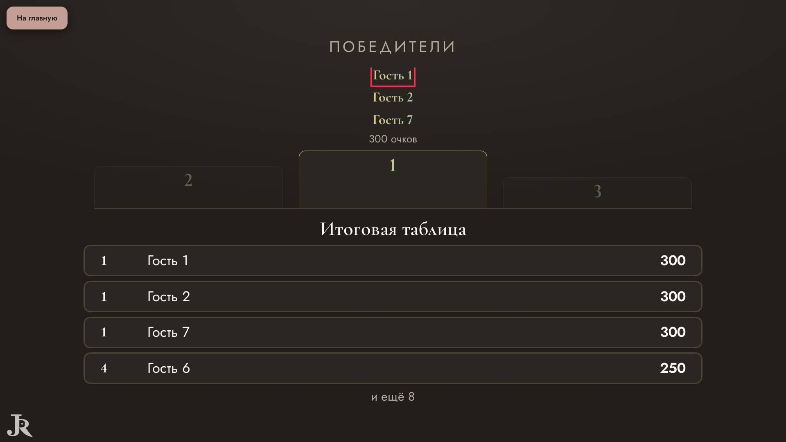

### бледный текст · телефон

контраст 3.34 (нужно от 4.5) — «7»

- где: `div.dk-hand__row > button.dk-hand__slot > div.dk-card.dk-d--russia > span.dk-idx.dk-idx--b`, этап `playing/12/question/play`
- игры (1): durak 1-й шаблон, каждый сам ×4, телевизор full hd; durak 1-й шаблон, каждый сам ×4, проектор 4:3, маленький телефон, длинные имена; durak 1-й шаблон, каждый сам ×4, ноутбук 16:10, большой зал, длинные имена
- раз: 9

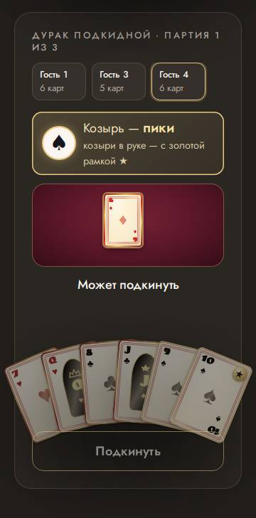

### бледный текст · экран зала

контраст 1.09 (нужно от 4.5) — «Г»

- где: `div.dk-table > div.dk-seat.dk-seat--wait > div.dk-seat__card > span.dk-seat__avatar`, этап `playing/2/question/vote`
- игры (1): durak 1-й шаблон, каждый сам ×4, телевизор full hd; durak 1-й шаблон, каждый сам ×4, проектор 4:3, маленький телефон, длинные имена; durak 1-й шаблон, каждый сам ×4, ноутбук 16:10, большой зал, длинные имена
- раз: 7

### бледный текст · экран зала

контраст 2.49 (нужно от 4.5) — «выбыл»

- где: `ul.pr-cups > li.pr-cup > span.pr-cup__dice > span.pr-cup__out`, этап `playing/19/reveal/over`
- игры (1): perudo 1-й шаблон, каждый сам ×4, проектор 4:3, маленький телефон, длинные имена; perudo 1-й шаблон, каждый сам ×4, телевизор full hd; perudo 1-й шаблон, команды ×4, ноутбук 16:10, большой зал, длинные имена
- раз: 6

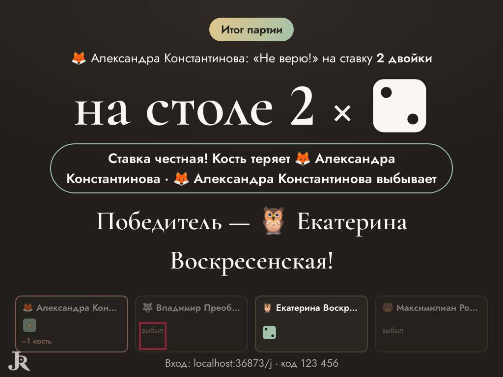

### бледный текст · экран зала

контраст 2.72 (нужно от 4.5) — «−1 кость»

- где: `section.pr-screen__table > ul.pr-cups > li.pr-cup > span.pr-cup__mark`, этап `playing/19/reveal/over`
- игры (1): perudo 1-й шаблон, каждый сам ×4, проектор 4:3, маленький телефон, длинные имена; perudo 1-й шаблон, каждый сам ×4, телевизор full hd; perudo 1-й шаблон, команды ×4, ноутбук 16:10, большой зал, длинные имена
- раз: 3

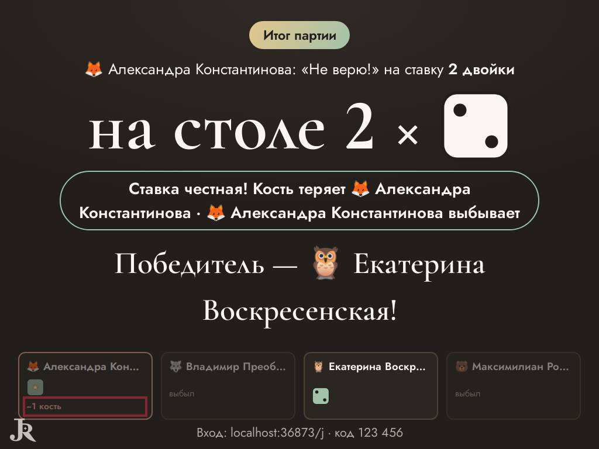

### мелко для зала · экран зала

шрифт 17.3 px — 17 px на Full HD (нужно от 18) — «№1»

- где: `li > article.bk-dossier > header.bk-dossier__head > span.bk-dossier__seat`, этап `playing/10/question/open`
- игры (1): bunker 1-й шаблон, каждый сам ×8, телевизор full hd; bunker 1-й шаблон, каждый сам ×8, проектор 4:3, маленький телефон, длинные имена; bunker 1-й шаблон, каждый сам ×8, ноутбук 16:10, большой зал, длинные имена
- раз: 160

### мелко для зала · экран зала

шрифт 17.3 px — 17 px на Full HD (нужно от 18) — «Сомелье · стаж 24 года»

- где: `article.bk-dossier > ul.bk-dossier__rows > li.bk-row.bk-row--profession > span.bk-row__text`, этап `playing/10/question/open`
- игры (1): bunker 1-й шаблон, каждый сам ×8, телевизор full hd; bunker 1-й шаблон, каждый сам ×8, проектор 4:3, маленький телефон, длинные имена; bunker 1-й шаблон, каждый сам ×8, ноутбук 16:10, большой зал, длинные имена
- раз: 160

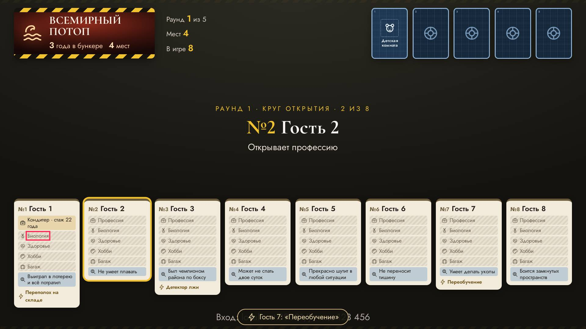

### мелко для зала · экран зала

шрифт 17.3 px — 17 px на Full HD (нужно от 18) — «Биология»

- где: `article.bk-dossier > ul.bk-dossier__rows > li.bk-row.bk-row--biology > span.bk-row__text`, этап `playing/10/question/open`
- игры (1): bunker 1-й шаблон, каждый сам ×8, телевизор full hd; bunker 1-й шаблон, каждый сам ×8, проектор 4:3, маленький телефон, длинные имена; bunker 1-й шаблон, каждый сам ×8, ноутбук 16:10, большой зал, длинные имена
- раз: 160

### мелко для зала · экран зала

шрифт 17.3 px — 17 px на Full HD (нужно от 18) — «Здоровье»

- где: `article.bk-dossier > ul.bk-dossier__rows > li.bk-row.bk-row--health > span.bk-row__text`, этап `playing/10/question/open`
- игры (1): bunker 1-й шаблон, каждый сам ×8, телевизор full hd; bunker 1-й шаблон, каждый сам ×8, проектор 4:3, маленький телефон, длинные имена; bunker 1-й шаблон, каждый сам ×8, ноутбук 16:10, большой зал, длинные имена
- раз: 160

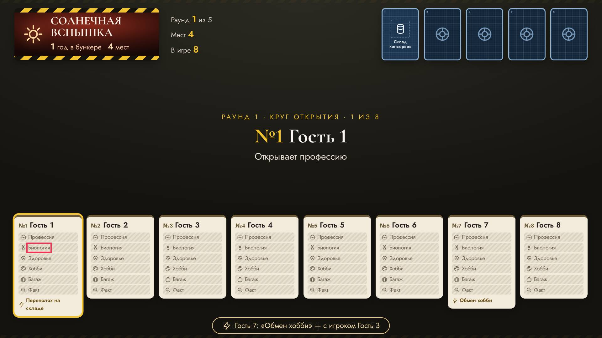

### мелко для зала · экран зала

шрифт 17.3 px — 17 px на Full HD (нужно от 18) — «Хобби»

- где: `article.bk-dossier > ul.bk-dossier__rows > li.bk-row.bk-row--hobby > span.bk-row__text`, этап `playing/10/question/open`
- игры (1): bunker 1-й шаблон, каждый сам ×8, телевизор full hd; bunker 1-й шаблон, каждый сам ×8, проектор 4:3, маленький телефон, длинные имена; bunker 1-й шаблон, каждый сам ×8, ноутбук 16:10, большой зал, длинные имена
- раз: 160

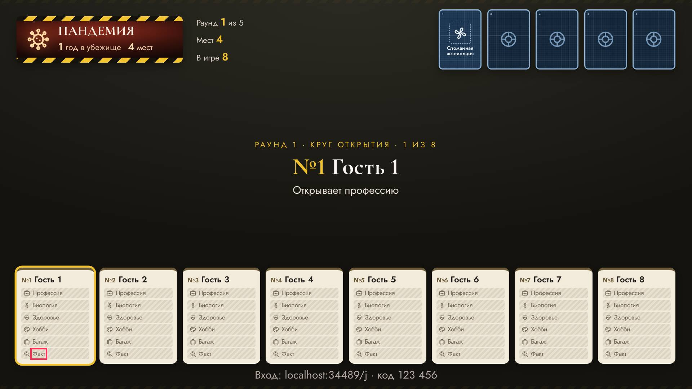

### мелко для зала · экран зала

шрифт 17.3 px — 17 px на Full HD (нужно от 18) — «Багаж»

- где: `article.bk-dossier > ul.bk-dossier__rows > li.bk-row.bk-row--baggage > span.bk-row__text`, этап `playing/10/question/open`
- игры (1): bunker 1-й шаблон, каждый сам ×8, телевизор full hd; bunker 1-й шаблон, каждый сам ×8, проектор 4:3, маленький телефон, длинные имена; bunker 1-й шаблон, каждый сам ×8, ноутбук 16:10, большой зал, длинные имена
- раз: 160

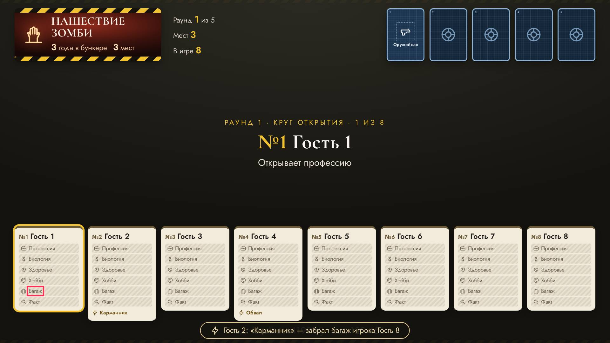

### мелко для зала · экран зала

шрифт 17.3 px — 17 px на Full HD (нужно от 18) — «Факт»

- где: `article.bk-dossier > ul.bk-dossier__rows > li.bk-row.bk-row--fact > span.bk-row__text`, этап `playing/10/question/open`
- игры (1): bunker 1-й шаблон, каждый сам ×8, телевизор full hd; bunker 1-й шаблон, каждый сам ×8, проектор 4:3, маленький телефон, длинные имена; bunker 1-й шаблон, каждый сам ×8, ноутбук 16:10, большой зал, длинные имена
- раз: 160

### мелко для зала · экран зала

шрифт 16.2 px — 16 px на Full HD (нужно от 18) — «Эпидемия»

- где: `ol.bk-screen__dossiers > li > article.bk-dossier > p.bk-dossier__used`, этап `playing/10/question/open`
- игры (1): bunker 1-й шаблон, каждый сам ×8, телевизор full hd; bunker 1-й шаблон, каждый сам ×8, проектор 4:3, маленький телефон, длинные имена; bunker 1-й шаблон, каждый сам ×8, ноутбук 16:10, большой зал, длинные имена
- раз: 129

### мелко для зала · экран зала

шрифт 7.9 px — 8 px на Full HD (нужно от 18) — «1»

- где: `li > div.bk-card.bk-plan > div.bk-in > span.bk-plan__num`, этап `playing/1/question/catastrophe`
- игры (1): bunker 1-й шаблон, каждый сам ×8, телевизор full hd; bunker 1-й шаблон, каждый сам ×8, проектор 4:3, маленький телефон, длинные имена; bunker 1-й шаблон, каждый сам ×8, ноутбук 16:10, большой зал, длинные имена
- раз: 109

### мелко для зала · экран зала

шрифт 12.7 px — 18 px на Full HD (нужно от 18) — «Александра Константинова»

- где: `article.bk-dossier > header.bk-dossier__head > span.bk-dossier__name > span`, этап `playing/7/question/open`
- игры (1): bunker 1-й шаблон, каждый сам ×8, проектор 4:3, маленький телефон, длинные имена; bunker 1-й шаблон, каждый сам ×8, ноутбук 16:10, большой зал, длинные имена
- раз: 93

### мелко для зала · экран зала

шрифт 13.6 px — 14 px на Full HD (нужно от 18) — «Курятник»

- где: `li > div.bk-card.bk-plan > div.bk-in > span.bk-plan__title`, этап `playing/10/question/open`
- игры (1): bunker 1-й шаблон, каждый сам ×8, телевизор full hd; bunker 1-й шаблон, каждый сам ×8, проектор 4:3, маленький телефон, длинные имена; bunker 1-й шаблон, каждый сам ×8, ноутбук 16:10, большой зал, длинные имена
- раз: 71

### мелко для зала · экран зала

шрифт 16.2 px — 16 px на Full HD (нужно от 18) — «За столом»

- где: `div.dk-table > div.dk-seat.dk-seat--wait > div.dk-seat__card > span.dk-seat__status`, этап `playing/1/question/deal`
- игры (1): durak 1-й шаблон, каждый сам ×4, телевизор full hd; durak 1-й шаблон, каждый сам ×4, проектор 4:3, маленький телефон, длинные имена; durak 1-й шаблон, каждый сам ×4, ноутбук 16:10, большой зал, длинные имена
- раз: 24

### мелко для зала · экран зала

шрифт 16.0 px — 16 px на Full HD (нужно от 18) — «Гость 1»

- где: `li > article.bk-dossier > header.bk-dossier__head > span.bk-dossier__name`, этап `playing/93/question/vote`
- игры (1): bunker 1-й шаблон, каждый сам ×8, телевизор full hd
- раз: 22

### мелко для зала · экран зала

шрифт 10.9 px — 11 px на Full HD (нужно от 18) — «Изгнан»

- где: `ol.bk-screen__dossiers > li > article.bk-dossier > span.bk-dossier__stamp`, этап `playing/93/question/vote`
- игры (1): bunker 1-й шаблон, каждый сам ×8, телевизор full hd; bunker 1-й шаблон, каждый сам ×8, проектор 4:3, маленький телефон, длинные имена; bunker 1-й шаблон, каждый сам ×8, ноутбук 16:10, большой зал, длинные имена
- раз: 17

### мелко для зала · экран зала

шрифт 12.3 px — 17 px на Full HD (нужно от 18) — «года в убежище»

- где: `div.bk-card.bk-cata > div.bk-in > span.bk-cata__facts > span`, этап `playing/1/question/catastrophe`
- игры (1): bunker 1-й шаблон, каждый сам ×8, проектор 4:3, маленький телефон, длинные имена
- раз: 16

### мелко для зала · экран зала

шрифт 17.3 px — 17 px на Full HD (нужно от 18) — «6 карт»

- где: `div.dk-seat.dk-seat--wait > div.dk-seat__card > span.dk-seat__text > span.dk-seat__meta`, этап `playing/16/question/play`
- игры (1): durak 1-й шаблон, каждый сам ×4, телевизор full hd; durak 1-й шаблон, каждый сам ×4, проектор 4:3, маленький телефон, длинные имена; durak 1-й шаблон, каждый сам ×4, ноутбук 16:10, большой зал, длинные имена
- раз: 6

### мелко для зала · экран зала

шрифт 17.3 px — 17 px на Full HD (нужно от 18) — «6 карт»

- где: `div.dk-seat.dk-seat--throw > div.dk-seat__card > span.dk-seat__text > span.dk-seat__meta`, этап `playing/55/question/play`
- игры (1): durak 1-й шаблон, каждый сам ×4, телевизор full hd; durak 1-й шаблон, каждый сам ×4, проектор 4:3, маленький телефон, длинные имена
- раз: 6

### мелко для зала · экран зала

шрифт 16.2 px — 16 px на Full HD (нужно от 18) — «Может подкинуть»

- где: `div.dk-table > div.dk-seat.dk-seat--throw > div.dk-seat__card > span.dk-seat__status`, этап `playing/55/question/play`
- игры (1): durak 1-й шаблон, каждый сам ×4, телевизор full hd; durak 1-й шаблон, каждый сам ×4, проектор 4:3, маленький телефон, длинные имена
- раз: 6

### мелко для зала · экран зала

шрифт 17.3 px — 17 px на Full HD (нужно от 18) — «6 карт»

- где: `div.dk-seat.dk-seat--defend > div.dk-seat__card > span.dk-seat__text > span.dk-seat__meta`, этап `playing/16/question/play`
- игры (1): durak 1-й шаблон, каждый сам ×4, телевизор full hd; durak 1-й шаблон, каждый сам ×4, проектор 4:3, маленький телефон, длинные имена; durak 1-й шаблон, каждый сам ×4, ноутбук 16:10, большой зал, длинные имена
- раз: 4

### мелко для зала · экран зала

шрифт 16.2 px — 16 px на Full HD (нужно от 18) — «Отбивается»

- где: `div.dk-table > div.dk-seat.dk-seat--defend > div.dk-seat__card > span.dk-seat__status`, этап `playing/16/question/play`
- игры (1): durak 1-й шаблон, каждый сам ×4, телевизор full hd; durak 1-й шаблон, каждый сам ×4, проектор 4:3, маленький телефон, длинные имена; durak 1-й шаблон, каждый сам ×4, ноутбук 16:10, большой зал, длинные имена
- раз: 4

### мелко для зала · экран зала

шрифт 11.5 px — 16 px на Full HD (нужно от 18) — «Эпидемия»

- где: `ol.bk-screen__dossiers.bk-final__survivors > li > article.bk-dossier > p.bk-dossier__used`, этап `playing/146/question/final`
- игры (1): bunker 1-й шаблон, каждый сам ×8, проектор 4:3, маленький телефон, длинные имена
- раз: 4

### мелко для зала · экран зала

шрифт 15.1 px — 15 px на Full HD (нужно от 18) — «K»

- где: `div.dk-vote__grid > div.dk-vote__tile > div.dk-card.dk-d--classic > span.dk-idx`, этап `playing/2/question/vote`
- игры (1): durak 1-й шаблон, каждый сам ×4, телевизор full hd; durak 1-й шаблон, каждый сам ×4, проектор 4:3, маленький телефон, длинные имена; durak 1-й шаблон, каждый сам ×4, ноутбук 16:10, большой зал, длинные имена
- раз: 3

### мелко для зала · экран зала

шрифт 15.1 px — 15 px на Full HD (нужно от 18) — «K»

- где: `div.dk-vote__grid > div.dk-vote__tile > div.dk-card.dk-d--classic > span.dk-idx.dk-idx--b`, этап `playing/2/question/vote`
- игры (1): durak 1-й шаблон, каждый сам ×4, телевизор full hd; durak 1-й шаблон, каждый сам ×4, проектор 4:3, маленький телефон, длинные имена; durak 1-й шаблон, каждый сам ×4, ноутбук 16:10, большой зал, длинные имена
- раз: 3

### мелко для зала · экран зала

шрифт 15.1 px — 15 px на Full HD (нужно от 18) — «K»

- где: `div.dk-vote__grid > div.dk-vote__tile > div.dk-card.dk-d--gothic > span.dk-idx`, этап `playing/2/question/vote`
- игры (1): durak 1-й шаблон, каждый сам ×4, телевизор full hd; durak 1-й шаблон, каждый сам ×4, проектор 4:3, маленький телефон, длинные имена; durak 1-й шаблон, каждый сам ×4, ноутбук 16:10, большой зал, длинные имена
- раз: 3

### мелко для зала · экран зала

шрифт 15.1 px — 15 px на Full HD (нужно от 18) — «K»

- где: `div.dk-vote__grid > div.dk-vote__tile > div.dk-card.dk-d--gothic > span.dk-idx.dk-idx--b`, этап `playing/2/question/vote`
- игры (1): durak 1-й шаблон, каждый сам ×4, телевизор full hd; durak 1-й шаблон, каждый сам ×4, проектор 4:3, маленький телефон, длинные имена; durak 1-й шаблон, каждый сам ×4, ноутбук 16:10, большой зал, длинные имена
- раз: 3

### мелко для зала · экран зала

шрифт 15.1 px — 15 px на Full HD (нужно от 18) — «K»

- где: `div.dk-vote__grid > div.dk-vote__tile > div.dk-card.dk-d--greece > span.dk-idx`, этап `playing/2/question/vote`
- игры (1): durak 1-й шаблон, каждый сам ×4, телевизор full hd; durak 1-й шаблон, каждый сам ×4, проектор 4:3, маленький телефон, длинные имена; durak 1-й шаблон, каждый сам ×4, ноутбук 16:10, большой зал, длинные имена
- раз: 3

### мелко для зала · экран зала

шрифт 15.1 px — 15 px на Full HD (нужно от 18) — «K»

- где: `div.dk-vote__grid > div.dk-vote__tile > div.dk-card.dk-d--greece > span.dk-idx.dk-idx--b`, этап `playing/2/question/vote`
- игры (1): durak 1-й шаблон, каждый сам ×4, телевизор full hd; durak 1-й шаблон, каждый сам ×4, проектор 4:3, маленький телефон, длинные имена; durak 1-й шаблон, каждый сам ×4, ноутбук 16:10, большой зал, длинные имена
- раз: 3

### мелко для зала · экран зала

шрифт 15.1 px — 15 px на Full HD (нужно от 18) — «K»

- где: `div.dk-vote__grid > div.dk-vote__tile > div.dk-card.dk-d--rome > span.dk-idx`, этап `playing/2/question/vote`
- игры (1): durak 1-й шаблон, каждый сам ×4, телевизор full hd; durak 1-й шаблон, каждый сам ×4, проектор 4:3, маленький телефон, длинные имена; durak 1-й шаблон, каждый сам ×4, ноутбук 16:10, большой зал, длинные имена
- раз: 3

### мелко для зала · экран зала

шрифт 15.1 px — 15 px на Full HD (нужно от 18) — «K»

- где: `div.dk-vote__grid > div.dk-vote__tile > div.dk-card.dk-d--rome > span.dk-idx.dk-idx--b`, этап `playing/2/question/vote`
- игры (1): durak 1-й шаблон, каждый сам ×4, телевизор full hd; durak 1-й шаблон, каждый сам ×4, проектор 4:3, маленький телефон, длинные имена; durak 1-й шаблон, каждый сам ×4, ноутбук 16:10, большой зал, длинные имена
- раз: 3

### мелко для зала · экран зала

шрифт 15.1 px — 15 px на Full HD (нужно от 18) — «K»

- где: `div.dk-vote__grid > div.dk-vote__tile > div.dk-card.dk-d--cyber > span.dk-idx`, этап `playing/2/question/vote`
- игры (1): durak 1-й шаблон, каждый сам ×4, телевизор full hd; durak 1-й шаблон, каждый сам ×4, проектор 4:3, маленький телефон, длинные имена; durak 1-й шаблон, каждый сам ×4, ноутбук 16:10, большой зал, длинные имена
- раз: 3

### мелко для зала · экран зала

шрифт 15.1 px — 15 px на Full HD (нужно от 18) — «K»

- где: `div.dk-vote__grid > div.dk-vote__tile > div.dk-card.dk-d--cyber > span.dk-idx.dk-idx--b`, этап `playing/2/question/vote`
- игры (1): durak 1-й шаблон, каждый сам ×4, телевизор full hd; durak 1-й шаблон, каждый сам ×4, проектор 4:3, маленький телефон, длинные имена; durak 1-й шаблон, каждый сам ×4, ноутбук 16:10, большой зал, длинные имена
- раз: 3

### мелко для зала · экран зала

шрифт 15.1 px — 15 px на Full HD (нужно от 18) — «K»

- где: `div.dk-vote__grid > div.dk-vote__tile > div.dk-card.dk-d--vintage > span.dk-idx`, этап `playing/2/question/vote`
- игры (1): durak 1-й шаблон, каждый сам ×4, телевизор full hd; durak 1-й шаблон, каждый сам ×4, проектор 4:3, маленький телефон, длинные имена; durak 1-й шаблон, каждый сам ×4, ноутбук 16:10, большой зал, длинные имена
- раз: 3

### мелко для зала · экран зала

шрифт 15.1 px — 15 px на Full HD (нужно от 18) — «K»

- где: `div.dk-vote__grid > div.dk-vote__tile > div.dk-card.dk-d--vintage > span.dk-idx.dk-idx--b`, этап `playing/2/question/vote`
- игры (1): durak 1-й шаблон, каждый сам ×4, телевизор full hd; durak 1-й шаблон, каждый сам ×4, проектор 4:3, маленький телефон, длинные имена; durak 1-й шаблон, каждый сам ×4, ноутбук 16:10, большой зал, длинные имена
- раз: 3

### мелко для зала · экран зала

шрифт 15.1 px — 15 px на Full HD (нужно от 18) — «K»

- где: `div.dk-vote__grid > div.dk-vote__tile > div.dk-card.dk-d--russia > span.dk-idx`, этап `playing/2/question/vote`
- игры (1): durak 1-й шаблон, каждый сам ×4, телевизор full hd; durak 1-й шаблон, каждый сам ×4, проектор 4:3, маленький телефон, длинные имена; durak 1-й шаблон, каждый сам ×4, ноутбук 16:10, большой зал, длинные имена
- раз: 3

### мелко для зала · экран зала

шрифт 15.1 px — 15 px на Full HD (нужно от 18) — «K»

- где: `div.dk-vote__grid > div.dk-vote__tile > div.dk-card.dk-d--russia > span.dk-idx.dk-idx--b`, этап `playing/2/question/vote`
- игры (1): durak 1-й шаблон, каждый сам ×4, телевизор full hd; durak 1-й шаблон, каждый сам ×4, проектор 4:3, маленький телефон, длинные имена; durak 1-й шаблон, каждый сам ×4, ноутбук 16:10, большой зал, длинные имена
- раз: 3

### мелко для зала · экран зала

шрифт 15.1 px — 15 px на Full HD (нужно от 18) — «K»

- где: `div.dk-vote__grid > div.dk-vote__tile > div.dk-card.dk-d--kpop > span.dk-idx`, этап `playing/2/question/vote`
- игры (1): durak 1-й шаблон, каждый сам ×4, телевизор full hd; durak 1-й шаблон, каждый сам ×4, проектор 4:3, маленький телефон, длинные имена; durak 1-й шаблон, каждый сам ×4, ноутбук 16:10, большой зал, длинные имена
- раз: 3

### мелко для зала · экран зала

шрифт 15.1 px — 15 px на Full HD (нужно от 18) — «K»

- где: `div.dk-vote__grid > div.dk-vote__tile > div.dk-card.dk-d--kpop > span.dk-idx.dk-idx--b`, этап `playing/2/question/vote`
- игры (1): durak 1-й шаблон, каждый сам ×4, телевизор full hd; durak 1-й шаблон, каждый сам ×4, проектор 4:3, маленький телефон, длинные имена; durak 1-й шаблон, каждый сам ×4, ноутбук 16:10, большой зал, длинные имена
- раз: 3

### мелко для зала · экран зала

шрифт 15.1 px — 15 px на Full HD (нужно от 18) — «K»

- где: `div.dk-vote__grid > div.dk-vote__tile > div.dk-card.dk-d--anime > span.dk-idx`, этап `playing/2/question/vote`
- игры (1): durak 1-й шаблон, каждый сам ×4, телевизор full hd; durak 1-й шаблон, каждый сам ×4, проектор 4:3, маленький телефон, длинные имена; durak 1-й шаблон, каждый сам ×4, ноутбук 16:10, большой зал, длинные имена
- раз: 3

### мелко для зала · экран зала

шрифт 15.1 px — 15 px на Full HD (нужно от 18) — «K»

- где: `div.dk-vote__grid > div.dk-vote__tile > div.dk-card.dk-d--anime > span.dk-idx.dk-idx--b`, этап `playing/2/question/vote`
- игры (1): durak 1-й шаблон, каждый сам ×4, телевизор full hd; durak 1-й шаблон, каждый сам ×4, проектор 4:3, маленький телефон, длинные имена; durak 1-й шаблон, каждый сам ×4, ноутбук 16:10, большой зал, длинные имена
- раз: 3

### мелко для зала · экран зала

шрифт 15.1 px — 15 px на Full HD (нужно от 18) — «K»

- где: `div.dk-vote__grid > div.dk-vote__tile > div.dk-card.dk-d--wedding > span.dk-idx`, этап `playing/2/question/vote`
- игры (1): durak 1-й шаблон, каждый сам ×4, телевизор full hd; durak 1-й шаблон, каждый сам ×4, проектор 4:3, маленький телефон, длинные имена; durak 1-й шаблон, каждый сам ×4, ноутбук 16:10, большой зал, длинные имена
- раз: 3

### мелко для зала · экран зала

шрифт 15.1 px — 15 px на Full HD (нужно от 18) — «K»

- где: `div.dk-vote__grid > div.dk-vote__tile > div.dk-card.dk-d--wedding > span.dk-idx.dk-idx--b`, этап `playing/2/question/vote`
- игры (1): durak 1-й шаблон, каждый сам ×4, телевизор full hd; durak 1-й шаблон, каждый сам ×4, проектор 4:3, маленький телефон, длинные имена; durak 1-й шаблон, каждый сам ×4, ноутбук 16:10, большой зал, длинные имена
- раз: 3

### мелко для зала · экран зала

шрифт 17.3 px — 17 px на Full HD (нужно от 18) — «6 карт»

- где: `div.dk-seat.dk-seat--turn > div.dk-seat__card > span.dk-seat__text > span.dk-seat__meta`, этап `playing/16/question/play`
- игры (1): durak 1-й шаблон, каждый сам ×4, телевизор full hd; durak 1-й шаблон, каждый сам ×4, проектор 4:3, маленький телефон, длинные имена; durak 1-й шаблон, каждый сам ×4, ноутбук 16:10, большой зал, длинные имена
- раз: 3

### мелко для зала · экран зала

шрифт 16.2 px — 16 px на Full HD (нужно от 18) — «Ходит»

- где: `div.dk-table > div.dk-seat.dk-seat--turn > div.dk-seat__card > span.dk-seat__status`, этап `playing/16/question/play`
- игры (1): durak 1-й шаблон, каждый сам ×4, телевизор full hd; durak 1-й шаблон, каждый сам ×4, проектор 4:3, маленький телефон, длинные имена; durak 1-й шаблон, каждый сам ×4, ноутбук 16:10, большой зал, длинные имена
- раз: 3

### мелко для зала · экран зала

шрифт 16.9 px — 17 px на Full HD (нужно от 18) — «Хобби»

- где: `div.bk-card.bk-trait > div.bk-in > span.bk-trait__band > span`, этап `playing/14/question/open`
- игры (1): bunker 1-й шаблон, каждый сам ×8, телевизор full hd; bunker 1-й шаблон, каждый сам ×8, проектор 4:3, маленький телефон, длинные имена; bunker 1-й шаблон, каждый сам ×8, ноутбук 16:10, большой зал, длинные имена
- раз: 3

### мелко для зала · экран зала

шрифт 6.5 px — 9 px на Full HD (нужно от 18) — «Угроза»

- где: `li > div.bk-card.bk-threat > div.bk-in > span.bk-threat__kicker`, этап `playing/146/question/final`
- игры (1): bunker 1-й шаблон, каждый сам ×8, проектор 4:3, маленький телефон, длинные имена; bunker 1-й шаблон, каждый сам ×8, ноутбук 16:10, большой зал, длинные имена
- раз: 3

### мелко для зала · экран зала

шрифт 7.2 px — 10 px на Full HD (нужно от 18) — «Вооружённая группа требует открыть дверь.»

- где: `li > div.bk-card.bk-threat > div.bk-in > span.bk-threat__text`, этап `playing/146/question/final`
- игры (1): bunker 1-й шаблон, каждый сам ×8, проектор 4:3, маленький телефон, длинные имена; bunker 1-й шаблон, каждый сам ×8, ноутбук 16:10, большой зал, длинные имена
- раз: 3

### мелко для зала · экран зала

шрифт 6.3 px — 9 px на Full HD (нужно от 18) — «Поможет: военный, полицейский, переговорщик, оружие»

- где: `li > div.bk-card.bk-threat > div.bk-in > span.bk-threat__helps`, этап `playing/146/question/final`
- игры (1): bunker 1-й шаблон, каждый сам ×8, проектор 4:3, маленький телефон, длинные имена; bunker 1-й шаблон, каждый сам ×8, ноутбук 16:10, большой зал, длинные имена
- раз: 3

### мелко для зала · экран зала

шрифт 8.7 px — 12 px на Full HD (нужно от 18) — «Не справились»

- где: `li > div.bk-card.bk-threat > div.bk-in > span.bk-threat__stamp`, этап `playing/146/question/final`
- игры (1): bunker 1-й шаблон, каждый сам ×8, проектор 4:3, маленький телефон, длинные имена; bunker 1-й шаблон, каждый сам ×8, ноутбук 16:10, большой зал, длинные имена
- раз: 3

### мелко для зала · экран зала

шрифт 17.3 px — 17 px на Full HD (нужно от 18) — «6 карт»

- где: `div.dk-seat.dk-seat--take > div.dk-seat__card > span.dk-seat__text > span.dk-seat__meta`, этап `playing/55/question/play`
- игры (1): durak 1-й шаблон, каждый сам ×4, телевизор full hd
- раз: 1

### мелко для зала · экран зала

шрифт 16.2 px — 16 px на Full HD (нужно от 18) — «Берёт»

- где: `div.dk-table > div.dk-seat.dk-seat--take > div.dk-seat__card > span.dk-seat__status`, этап `playing/55/question/play`
- игры (1): durak 1-й шаблон, каждый сам ×4, телевизор full hd
- раз: 1

### мелко для зала · экран зала

шрифт 13.1 px — 18 px на Full HD (нужно от 18) — «Карманник»

- где: `div.bk-stage.bk-stage--exile > div.bk-stage__dossier > article.bk-dossier.bk-dossier--big > p.bk-dossier__used`, этап `playing/108/question/exile`
- игры (1): bunker 1-й шаблон, каждый сам ×8, проектор 4:3, маленький телефон, длинные имена
- раз: 1

### мелко для зала · экран зала

шрифт 13.1 px — 18 px на Full HD (нужно от 18) — «Изгнан»

- где: `div.bk-stage.bk-stage--exile > div.bk-stage__dossier > article.bk-dossier.bk-dossier--big > span.bk-dossier__stamp`, этап `playing/108/question/exile`
- игры (1): bunker 1-й шаблон, каждый сам ×8, проектор 4:3, маленький телефон, длинные имена
- раз: 1

### мелко для зала · экран зала

шрифт 10.9 px — 15 px на Full HD (нужно от 18) — «Чужаки у входа»

- где: `li > div.bk-card.bk-threat > div.bk-in > span.bk-threat__title`, этап `playing/146/question/final`
- игры (1): bunker 1-й шаблон, каждый сам ×8, проектор 4:3, маленький телефон, длинные имена
- раз: 1

### мелко для зала · экран зала

шрифт 8.4 px — 12 px на Full HD (нужно от 18) — «J✦R»

- где: `div.dk-battle > div.dk-pair > div.dk-card.dk-d--anime > span.dk-brand`, этап `playing/59/question/play`
- игры (1): durak 1-й шаблон, каждый сам ×4, проектор 4:3, маленький телефон, длинные имена
- раз: 1

### мелко для зала · экран зала

шрифт 7.2 px — 10 px на Full HD (нужно от 18) — «J✦R»

- где: `div.dk-table__felt > div.dk-stock > div.dk-card.dk-d--cyber > span.dk-brand`, этап `playing/4/question/play`
- игры (1): durak 1-й шаблон, каждый сам ×4, ноутбук 16:10, большой зал, длинные имена
- раз: 1

## Мелочи — 42

### мелкий текст · телефон

шрифт 9.2 px (нужно от 12) — «Профессия»

- где: `div.bk-card.bk-trait > div.bk-in > span.bk-trait__band > span`, этап `playing/1/question/catastrophe`
- игры (1): bunker 1-й шаблон, каждый сам ×8, телевизор full hd; bunker 1-й шаблон, каждый сам ×8, проектор 4:3, маленький телефон, длинные имена; bunker 1-й шаблон, каждый сам ×8, ноутбук 16:10, большой зал, длинные имена
- раз: 2016

### мелкий текст · пульт

шрифт 10.0 px (нужно от 12) — «Красное»

- где: `div.wine-row > span.wine-row__cells > span.wine-cell > span.wine-cell__label`, этап `playing/1/question/bet`
- игры (1): wine 1-й шаблон, каждый сам ×4, телевизор full hd; wine 1-й шаблон, каждый сам ×4, проектор 4:3, маленький телефон, длинные имена; wine 1-й шаблон, каждый сам ×16, ноутбук 16:10, большой зал, длинные имена; wine 1-й шаблон, команды ×4, телевизор full hd; wine 1-й шаблон, команды ×4, проектор 4:3, маленький телефон, длинные имена; wine 1-й шаблон, команды ×8, ноутбук 16:10, большой зал, длинные имена
- раз: 1200

### мелкий текст · телефон

шрифт 10.8 px (нужно от 12) — «Таксист · стаж 3 года»

- где: `li > div.bk-card.bk-trait > div.bk-in > span.bk-trait__text`, этап `playing/1/question/catastrophe`
- игры (1): bunker 1-й шаблон, каждый сам ×8, проектор 4:3, маленький телефон, длинные имена
- раз: 684

### мелкий текст · телефон

шрифт 7.2 px (нужно от 12) — «Особое условие»

- где: `div.bk-card.bk-special > div.bk-in > span.bk-special__band > span`, этап `playing/1/question/catastrophe`
- игры (1): bunker 1-й шаблон, каждый сам ×8, телевизор full hd; bunker 1-й шаблон, каждый сам ×8, проектор 4:3, маленький телефон, длинные имена; bunker 1-й шаблон, каждый сам ×8, ноутбук 16:10, большой зал, длинные имена
- раз: 336

### мелкий текст · телефон

шрифт 11.0 px (нужно от 12) — «Лишняя койка»

- где: `div.bk-phone__specialcard > div.bk-card.bk-special > div.bk-in > span.bk-special__title`, этап `playing/1/question/catastrophe`
- игры (1): bunker 1-й шаблон, каждый сам ×8, телевизор full hd; bunker 1-й шаблон, каждый сам ×8, проектор 4:3, маленький телефон, длинные имена; bunker 1-й шаблон, каждый сам ×8, ноутбук 16:10, большой зал, длинные имена
- раз: 336

### мелкий текст · телефон

шрифт 7.3 px (нужно от 12) — «В убежище нашлось ещё одно место: изгоняем на одного меньше.»

- где: `div.bk-phone__specialcard > div.bk-card.bk-special > div.bk-in > span.bk-special__text`, этап `playing/1/question/catastrophe`
- игры (1): bunker 1-й шаблон, каждый сам ×8, телевизор full hd; bunker 1-й шаблон, каждый сам ×8, проектор 4:3, маленький телефон, длинные имена; bunker 1-й шаблон, каждый сам ×8, ноутбук 16:10, большой зал, длинные имена
- раз: 336

### мелкий текст · телефон

шрифт 9.9 px (нужно от 12) — «сыграно»

- где: `div.bk-phone__specialcard > div.bk-card.bk-special > div.bk-in > span.bk-special__stamp`, этап `playing/2/question/bunker`
- игры (1): bunker 1-й шаблон, каждый сам ×8, телевизор full hd; bunker 1-й шаблон, каждый сам ×8, проектор 4:3, маленький телефон, длинные имена; bunker 1-й шаблон, каждый сам ×8, ноутбук 16:10, большой зал, длинные имена
- раз: 253

### мелкий текст · пульт

шрифт 11.0 px (нужно от 12) — «Цвет»

- где: `div.wine-table.wine-table--compact > div.wine-row > span.wine-row__head > span.wine-row__title`, этап `playing/1/question/bet`
- игры (1): wine 1-й шаблон, каждый сам ×4, телевизор full hd; wine 1-й шаблон, каждый сам ×4, проектор 4:3, маленький телефон, длинные имена; wine 1-й шаблон, каждый сам ×16, ноутбук 16:10, большой зал, длинные имена; wine 1-й шаблон, команды ×4, телевизор full hd; wine 1-й шаблон, команды ×4, проектор 4:3, маленький телефон, длинные имена; wine 1-й шаблон, команды ×8, ноутбук 16:10, большой зал, длинные имена
- раз: 144

### мелкий текст · телефон

шрифт 6.1 px (нужно от 12) — «во время голосования»

- где: `div.bk-phone__specialcard > div.bk-card.bk-special > div.bk-in > span.bk-special__when`, этап `playing/1/question/catastrophe`
- игры (1): bunker 1-й шаблон, каждый сам ×8, телевизор full hd; bunker 1-й шаблон, каждый сам ×8, проектор 4:3, маленький телефон, длинные имена; bunker 1-й шаблон, каждый сам ×8, ноутбук 16:10, большой зал, длинные имена
- раз: 48

### мелкий текст · телефон

шрифт 11.9 px (нужно от 12) — «от гостя: Игрок»

- где: `div.quiz-phone.td-phone > div.td-flip.td-flip--phone > div.td-face.td-face--dare > span.td-face__from`, этап `playing/2/reveal/done`
- игры (1): truth 1-й шаблон, команды ×4, телевизор full hd; truth 1-й шаблон, команды ×4, проектор 4:3, маленький телефон, длинные имена; truth 2-й шаблон, команды ×4, телевизор full hd; truth 2-й шаблон, команды ×4, проектор 4:3, маленький телефон, длинные имена
- раз: 36

### мелкий текст · телефон

шрифт 11.4 px (нужно от 12) — «№ 1»

- где: `button.mf-card > span.mf-card__inner > div.mf-card__face.mf-card__front > span.mf-card__seat`, этап `playing/0/reveal/roles`
- игры (1): mafia 1-й шаблон, каждый сам ×9, ноутбук 16:10, большой зал, длинные имена; mafia 1-й шаблон, каждый сам ×9, телевизор full hd; mafia 1-й шаблон, каждый сам ×9, проектор 4:3, маленький телефон, длинные имена
- раз: 27

### мелкий текст · телефон

шрифт 11.4 px (нужно от 12) — «Город»

- где: `button.mf-card > span.mf-card__inner > div.mf-card__face.mf-card__front > span.mf-card__side`, этап `playing/0/reveal/roles`
- игры (1): mafia 1-й шаблон, каждый сам ×9, ноутбук 16:10, большой зал, длинные имена; mafia 1-й шаблон, каждый сам ×9, телевизор full hd; mafia 1-й шаблон, каждый сам ×9, проектор 4:3, маленький телефон, длинные имена
- раз: 27

### мелкий текст · телефон

шрифт 10.6 px (нужно от 12) — «Убежище»

- где: `div.bk-phone__back > div.bk-card.bk-back > div.bk-in > span.bk-back__word`, этап `playing/0/question/deal`
- игры (1): bunker 1-й шаблон, каждый сам ×8, телевизор full hd; bunker 1-й шаблон, каждый сам ×8, проектор 4:3, маленький телефон, длинные имена; bunker 1-й шаблон, каждый сам ×8, ноутбук 16:10, большой зал, длинные имена
- раз: 24

### мелкий текст · телефон

шрифт 11.6 px (нужно от 12) — «Ночью спите. Днём — ваш голос решает, кто покинет город.»

- где: `button.mf-card > span.mf-card__inner > div.mf-card__face.mf-card__front > p.mf-card__power`, этап `playing/0/reveal/roles`
- игры (1): mafia 1-й шаблон, каждый сам ×9, телевизор full hd; mafia 1-й шаблон, каждый сам ×9, проектор 4:3, маленький телефон, длинные имена
- раз: 18

### мелкий текст · телефон

шрифт 8.3 px (нужно от 12) — «J✦R»

- где: `div.dk-hand__row > button.dk-hand__slot > div.dk-card.dk-d--rome > span.dk-brand`, этап `playing/17/question/play`
- игры (1): durak 1-й шаблон, каждый сам ×4, телевизор full hd; durak 1-й шаблон, каждый сам ×4, проектор 4:3, маленький телефон, длинные имена; durak 1-й шаблон, каждый сам ×4, ноутбук 16:10, большой зал, длинные имена
- раз: 17

### мелкий текст · телефон

шрифт 8.3 px (нужно от 12) — «J✦R»

- где: `div.dk-hand__row > button.dk-hand__slot > div.dk-card.dk-d--gothic > span.dk-brand`, этап `playing/54/question/play`
- игры (1): durak 1-й шаблон, каждый сам ×4, телевизор full hd; durak 1-й шаблон, каждый сам ×4, проектор 4:3, маленький телефон, длинные имена; durak 1-й шаблон, каждый сам ×4, ноутбук 16:10, большой зал, длинные имена
- раз: 13

### мелкий текст · телефон

шрифт 11.4 px (нужно от 12) — «№ 1»

- где: `div.mf-card.mf-card--still > span.mf-card__inner > div.mf-card__face.mf-card__front > span.mf-card__seat`, этап `playing/34/reveal/over`
- игры (1): mafia 1-й шаблон, каждый сам ×9, ноутбук 16:10, большой зал, длинные имена; mafia 1-й шаблон, каждый сам ×9, телевизор full hd; mafia 1-й шаблон, каждый сам ×9, проектор 4:3, маленький телефон, длинные имена
- раз: 12

### мелкий текст · телефон

шрифт 11.4 px (нужно от 12) — «Город»

- где: `div.mf-card.mf-card--still > span.mf-card__inner > div.mf-card__face.mf-card__front > span.mf-card__side`, этап `playing/34/reveal/over`
- игры (1): mafia 1-й шаблон, каждый сам ×9, ноутбук 16:10, большой зал, длинные имена; mafia 1-й шаблон, каждый сам ×9, телевизор full hd; mafia 1-й шаблон, каждый сам ×9, проектор 4:3, маленький телефон, длинные имена
- раз: 12

### мелкий текст · телефон

шрифт 10.8 px (нужно от 12) — «6»

- где: `div.dk-mini > span.dk-mini__pair > div.dk-card.dk-d--gothic > span.dk-idx`, этап `playing/54/question/play`
- игры (1): durak 1-й шаблон, каждый сам ×4, телевизор full hd; durak 1-й шаблон, каждый сам ×4, проектор 4:3, маленький телефон, длинные имена; durak 1-й шаблон, каждый сам ×4, ноутбук 16:10, большой зал, длинные имена
- раз: 12

### мелкий текст · телефон

шрифт 10.8 px (нужно от 12) — «6»

- где: `div.dk-mini > span.dk-mini__pair > div.dk-card.dk-d--gothic > span.dk-idx.dk-idx--b`, этап `playing/54/question/play`
- игры (1): durak 1-й шаблон, каждый сам ×4, телевизор full hd; durak 1-й шаблон, каждый сам ×4, проектор 4:3, маленький телефон, длинные имена; durak 1-й шаблон, каждый сам ×4, ноутбук 16:10, большой зал, длинные имена
- раз: 12

### мелкий текст · телефон

шрифт 10.8 px (нужно от 12) — «8»

- где: `div.dk-mini > span.dk-mini__pair > div.dk-card.dk-d--classic > span.dk-idx`, этап `playing/90/question/play`
- игры (1): durak 1-й шаблон, каждый сам ×4, телевизор full hd; durak 1-й шаблон, каждый сам ×4, ноутбук 16:10, большой зал, длинные имена
- раз: 12

### мелкий текст · телефон

шрифт 10.8 px (нужно от 12) — «8»

- где: `div.dk-mini > span.dk-mini__pair > div.dk-card.dk-d--classic > span.dk-idx.dk-idx--b`, этап `playing/90/question/play`
- игры (1): durak 1-й шаблон, каждый сам ×4, телевизор full hd; durak 1-й шаблон, каждый сам ×4, ноутбук 16:10, большой зал, длинные имена
- раз: 12

### мелкий текст · телефон

шрифт 10.8 px (нужно от 12) — «6»

- где: `div.dk-mini > span.dk-mini__pair > div.dk-card.dk-d--wedding > span.dk-idx`, этап `playing/51/question/play`
- игры (1): durak 1-й шаблон, каждый сам ×4, телевизор full hd; durak 1-й шаблон, каждый сам ×4, проектор 4:3, маленький телефон, длинные имена; durak 1-й шаблон, каждый сам ×4, ноутбук 16:10, большой зал, длинные имена
- раз: 11

### мелкий текст · телефон

шрифт 10.8 px (нужно от 12) — «6»

- где: `div.dk-mini > span.dk-mini__pair > div.dk-card.dk-d--wedding > span.dk-idx.dk-idx--b`, этап `playing/51/question/play`
- игры (1): durak 1-й шаблон, каждый сам ×4, телевизор full hd; durak 1-й шаблон, каждый сам ×4, проектор 4:3, маленький телефон, длинные имена; durak 1-й шаблон, каждый сам ×4, ноутбук 16:10, большой зал, длинные имена
- раз: 11

### мелкий текст · телефон

шрифт 11.6 px (нужно от 12) — «Ночью спите. Днём — ваш голос решает, кто покинет город.»

- где: `div.mf-card.mf-card--still > span.mf-card__inner > div.mf-card__face.mf-card__front > p.mf-card__power`, этап `playing/30/reveal/over`
- игры (1): mafia 1-й шаблон, каждый сам ×9, телевизор full hd; mafia 1-й шаблон, каждый сам ×9, проектор 4:3, маленький телефон, длинные имена
- раз: 9

### мелкий текст · телефон

шрифт 8.3 px (нужно от 12) — «J✦R»

- где: `div.dk-hand__row > button.dk-hand__slot > div.dk-card.dk-d--russia > span.dk-brand`, этап `playing/12/question/play`
- игры (1): durak 1-й шаблон, каждый сам ×4, телевизор full hd; durak 1-й шаблон, каждый сам ×4, ноутбук 16:10, большой зал, длинные имена
- раз: 8

### мелкий текст · телефон

шрифт 8.3 px (нужно от 12) — «J✦R»

- где: `div.dk-hand__row > button.dk-hand__slot > div.dk-card.dk-d--wedding > span.dk-brand`, этап `playing/51/question/play`
- игры (1): durak 1-й шаблон, каждый сам ×4, телевизор full hd; durak 1-й шаблон, каждый сам ×4, ноутбук 16:10, большой зал, длинные имена
- раз: 8

### мелкий текст · телефон

шрифт 8.3 px (нужно от 12) — «J✦R»

- где: `div.dk-hand__row > button.dk-hand__slot > div.dk-card.dk-d--kpop > span.dk-brand`, этап `playing/122/reveal/over`
- игры (1): durak 1-й шаблон, каждый сам ×4, телевизор full hd; durak 1-й шаблон, каждый сам ×4, проектор 4:3, маленький телефон, длинные имена; durak 1-й шаблон, каждый сам ×4, ноутбук 16:10, большой зал, длинные имена
- раз: 8

### мелкий текст · телефон

шрифт 8.3 px (нужно от 12) — «J✦R»

- где: `div.dk-hand__row > button.dk-hand__slot > div.dk-card.dk-d--cyber > span.dk-brand`, этап `playing/4/question/play`
- игры (1): durak 1-й шаблон, каждый сам ×4, телевизор full hd; durak 1-й шаблон, каждый сам ×4, проектор 4:3, маленький телефон, длинные имена; durak 1-й шаблон, каждый сам ×4, ноутбук 16:10, большой зал, длинные имена
- раз: 7

### мелкий текст · телефон

шрифт 11.4 px (нужно от 12) — «Ваша семья: 🦋 Александра Воскресенская (Дон)»

- где: `button.mf-card > span.mf-card__inner > div.mf-card__face.mf-card__front > p.mf-card__family`, этап `playing/0/reveal/roles`
- игры (1): mafia 1-й шаблон, каждый сам ×9, ноутбук 16:10, большой зал, длинные имена; mafia 1-й шаблон, каждый сам ×9, проектор 4:3, маленький телефон, длинные имена
- раз: 6

### мелкий текст · телефон

шрифт 10.8 px (нужно от 12) — «6»

- где: `div.dk-mini > span.dk-mini__pair > div.dk-card.dk-d--russia > span.dk-idx`, этап `playing/12/question/play`
- игры (1): durak 1-й шаблон, каждый сам ×4, телевизор full hd; durak 1-й шаблон, каждый сам ×4, ноутбук 16:10, большой зал, длинные имена
- раз: 5

### мелкий текст · телефон

шрифт 10.8 px (нужно от 12) — «6»

- где: `div.dk-mini > span.dk-mini__pair > div.dk-card.dk-d--russia > span.dk-idx.dk-idx--b`, этап `playing/12/question/play`
- игры (1): durak 1-й шаблон, каждый сам ×4, телевизор full hd; durak 1-й шаблон, каждый сам ×4, ноутбук 16:10, большой зал, длинные имена
- раз: 5

### мелкий текст · телефон

шрифт 10.8 px (нужно от 12) — «6»

- где: `div.dk-mini > span.dk-mini__pair > div.dk-card.dk-d--rome > span.dk-idx`, этап `playing/17/question/play`
- игры (1): durak 1-й шаблон, каждый сам ×4, телевизор full hd
- раз: 5

### мелкий текст · телефон

шрифт 10.8 px (нужно от 12) — «6»

- где: `div.dk-mini > span.dk-mini__pair > div.dk-card.dk-d--rome > span.dk-idx.dk-idx--b`, этап `playing/17/question/play`
- игры (1): durak 1-й шаблон, каждый сам ×4, телевизор full hd
- раз: 5

### мелкий текст · телефон

шрифт 8.3 px (нужно от 12) — «J✦R»

- где: `div.dk-hand__row > button.dk-hand__slot > div.dk-card.dk-d--classic > span.dk-brand`, этап `playing/90/question/play`
- игры (1): durak 1-й шаблон, каждый сам ×4, телевизор full hd; durak 1-й шаблон, каждый сам ×4, ноутбук 16:10, большой зал, длинные имена
- раз: 4

### мелкий текст · телефон

шрифт 10.8 px (нужно от 12) — «6»

- где: `div.dk-mini > span.dk-mini__pair > div.dk-card.dk-d--kpop > span.dk-idx`, этап `playing/37/question/play`
- игры (1): durak 1-й шаблон, каждый сам ×4, проектор 4:3, маленький телефон, длинные имена
- раз: 3

### мелкий текст · телефон

шрифт 10.8 px (нужно от 12) — «6»

- где: `div.dk-mini > span.dk-mini__pair > div.dk-card.dk-d--kpop > span.dk-idx.dk-idx--b`, этап `playing/37/question/play`
- игры (1): durak 1-й шаблон, каждый сам ×4, проектор 4:3, маленький телефон, длинные имена
- раз: 3

### мелкий текст · телефон

шрифт 10.8 px (нужно от 12) — «8»

- где: `div.dk-mini > span.dk-mini__pair > div.dk-card.dk-d--cyber > span.dk-idx`, этап `playing/109/question/play`
- игры (1): durak 1-й шаблон, каждый сам ×4, проектор 4:3, маленький телефон, длинные имена
- раз: 3

### мелкий текст · телефон

шрифт 10.8 px (нужно от 12) — «8»

- где: `div.dk-mini > span.dk-mini__pair > div.dk-card.dk-d--cyber > span.dk-idx.dk-idx--b`, этап `playing/109/question/play`
- игры (1): durak 1-й шаблон, каждый сам ×4, проектор 4:3, маленький телефон, длинные имена
- раз: 3

### мелкий текст · телефон

шрифт 11.1 px (нужно от 12) — «Вы не знаете, где все. Слушайте и угадайте локацию — или не выдайте себя.»

- где: `button.sp-card > span.sp-card__inner > span.sp-card__face.sp-card__face--spy > span.sp-card__hint`, этап `playing/126/reveal/cards`
- игры (1): spy 1-й шаблон, каждый сам ×11, телевизор full hd
- раз: 1

### мелкая кнопка · пульт

кнопка 25×56 px (пальцу нужно от 40×40)

- где: `div.stack.host-quiz > section.card.stack > div.pr-faces > button.pr-face`, этап `playing/1/question/bid`
- игры (1): perudo 1-й шаблон, каждый сам ×4, проектор 4:3, маленький телефон, длинные имена; perudo 1-й шаблон, каждый сам ×4, телевизор full hd; perudo 1-й шаблон, каждый сам ×4, ноутбук 16:10, большой зал, длинные имена; perudo 1-й шаблон, команды ×4, телевизор full hd; perudo 1-й шаблон, команды ×4, проектор 4:3, маленький телефон, длинные имена; perudo 1-й шаблон, команды ×4, ноутбук 16:10, большой зал, длинные имена
- раз: 327

### мелкая кнопка · телефон

кнопка 33×56 px (пальцу нужно от 40×40)

- где: `div.stack > div.stack.stack--tight > div.pr-faces > button.pr-face`, этап `playing/1/question/bid`
- игры (1): perudo 1-й шаблон, каждый сам ×4, проектор 4:3, маленький телефон, длинные имена; perudo 1-й шаблон, команды ×4, проектор 4:3, маленький телефон, длинные имена
- раз: 68

