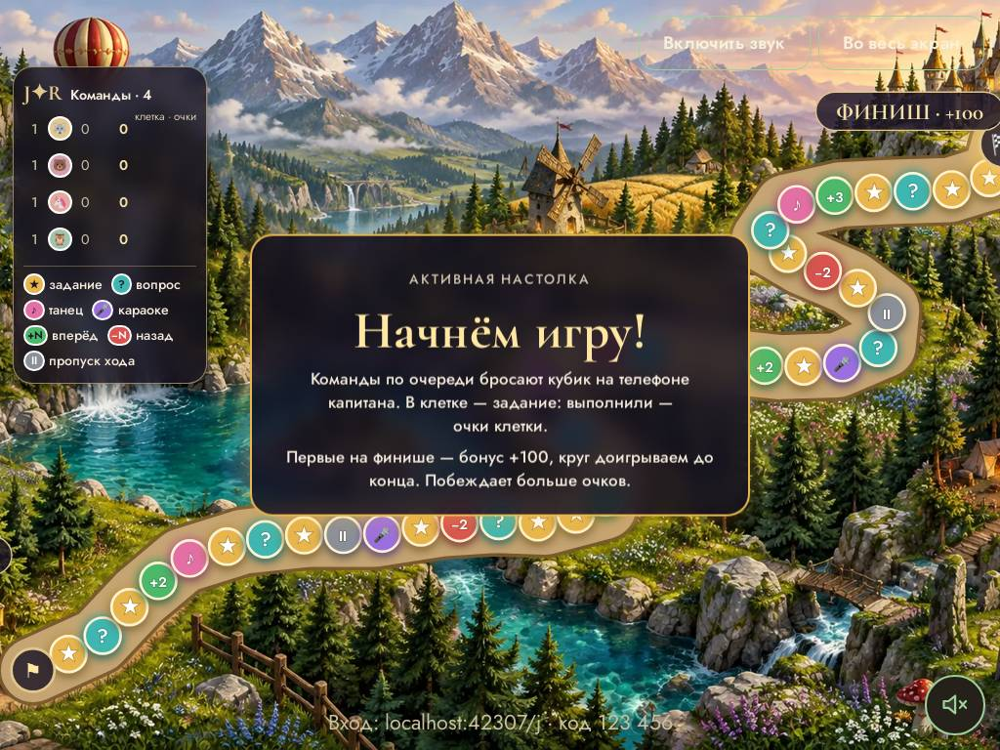
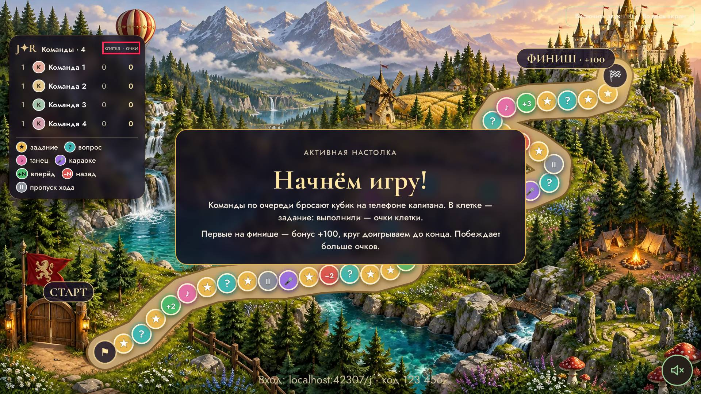
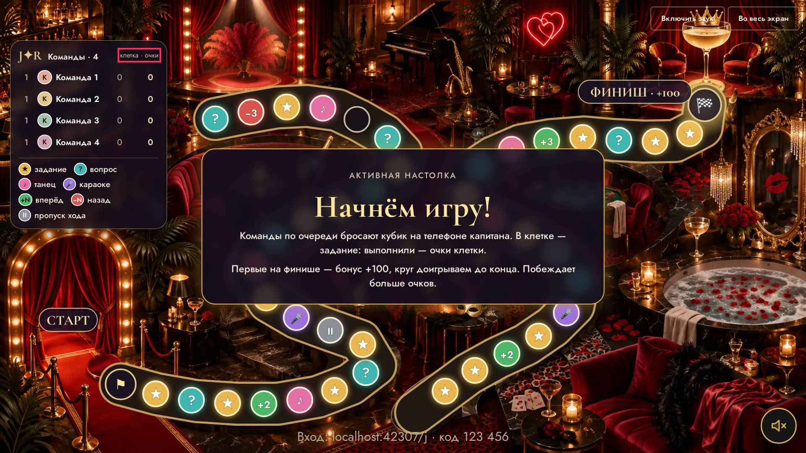

# Ревизор — что видят ведущий и гости

Прогонов: 6 · видов игры проверено: 263 · разных находок: 3

Размеры: Телевизор Full HD (1920x1080); Проектор 4:3, маленький телефон, длинные имена (1024x768); Большой праздник: 10 команд или 40 гостей, телевизор (1920x1080).

## Мешает игре — 1

### закрыт другим элементом · экран зала

«🐺» закрыт элементом span.qx-row__cell — «🐺»

- где: `ol.qx-panel__list > li.qx-row > span.qx-row__name > span.name-emoji`, этап `playing/0/ready/`
- игры (1): quest 1-й шаблон, команды ×4, проектор 4:3, маленький телефон, длинные имена; quest 2-й шаблон, команды ×4, проектор 4:3, маленький телефон, длинные имена
- раз: 32

## Заметно — 2

### мелко для зала · экран зала

шрифт 16.2 px — 16 px на Full HD (нужно от 18) — «клетка · очки»

- где: `div.quest-screen.qx--classic > aside.qx-panel > p.qx-panel__head > span.qx-panel__cols`, этап `playing/0/ready/`
- игры (1): quest 1-й шаблон, команды ×4, телевизор full hd; quest 1-й шаблон, команды ×4, проектор 4:3, маленький телефон, длинные имена; quest 1-й шаблон, команды ×10, большой праздник: 10 команд или 40 гостей, телевизор
- раз: 16

### мелко для зала · экран зала

шрифт 16.2 px — 16 px на Full HD (нужно от 18) — «клетка · очки»

- где: `div.quest-screen.qx--adult > aside.qx-panel > p.qx-panel__head > span.qx-panel__cols`, этап `playing/0/ready/`
- игры (1): quest 2-й шаблон, команды ×4, телевизор full hd; quest 2-й шаблон, команды ×4, проектор 4:3, маленький телефон, длинные имена; quest 2-й шаблон, команды ×10, большой праздник: 10 команд или 40 гостей, телевизор
- раз: 15

## Мелочи — 0

