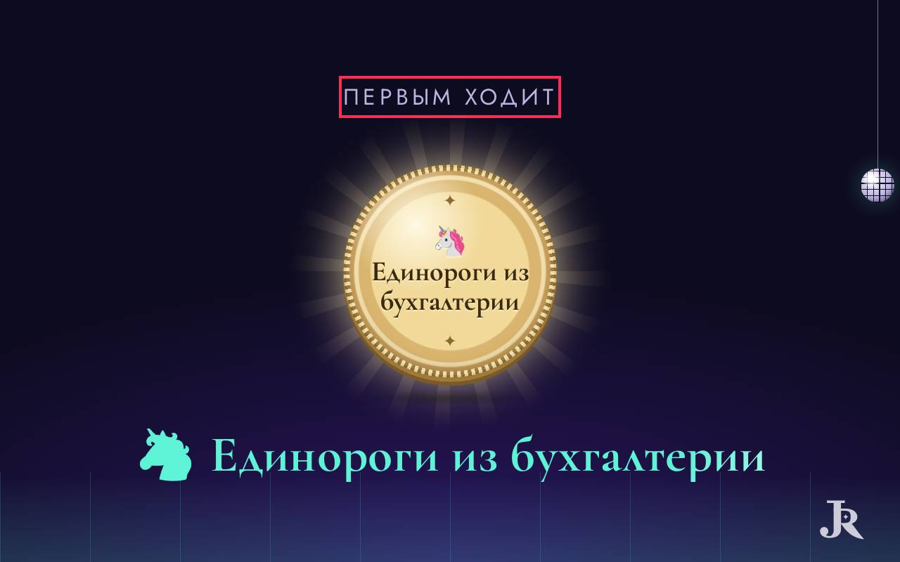
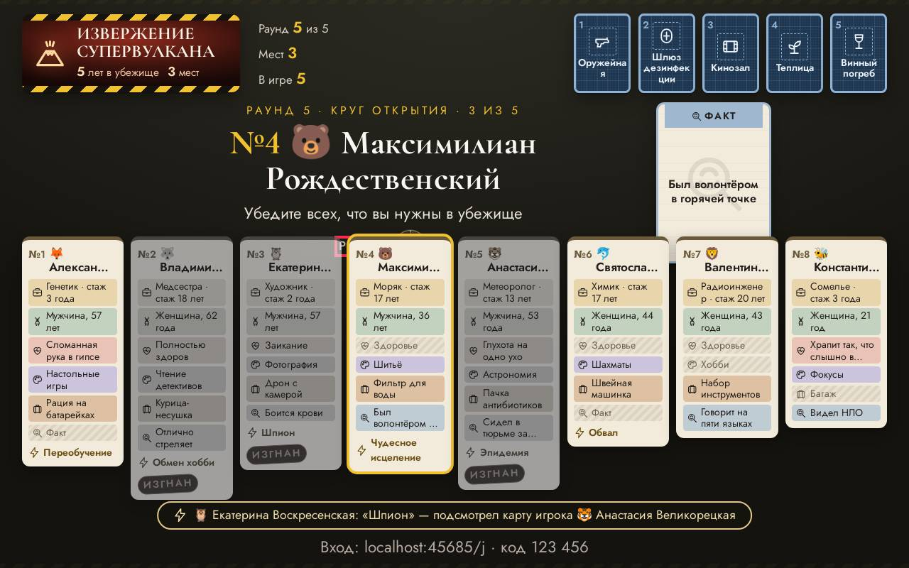
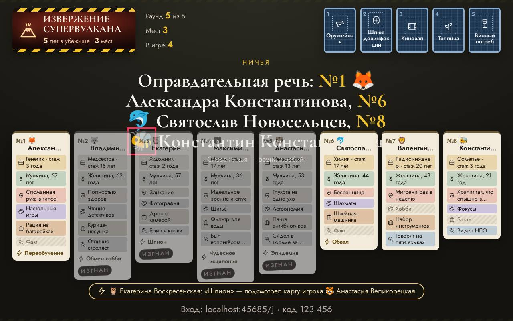
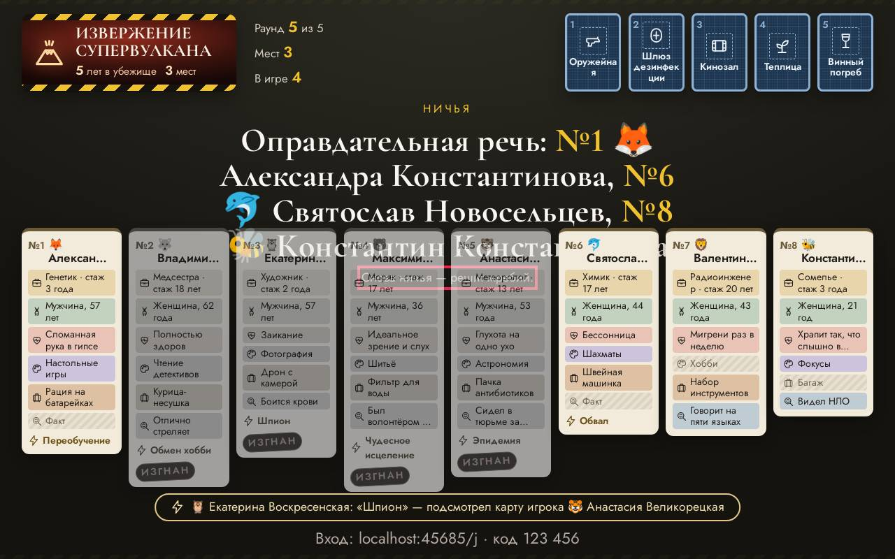
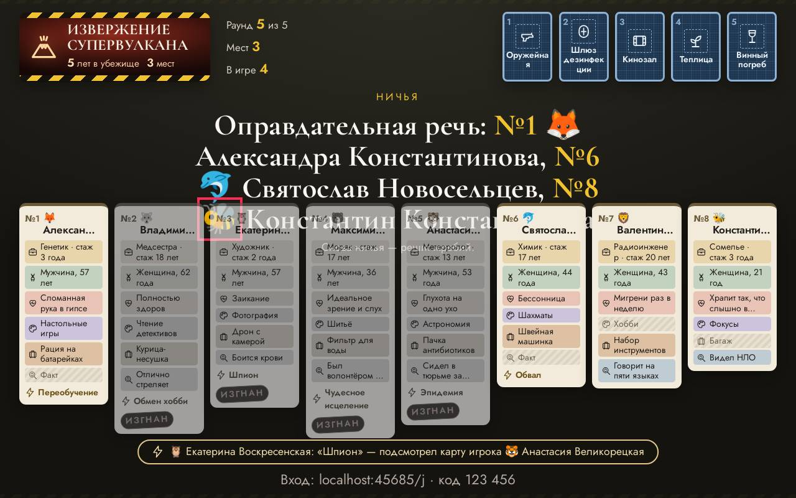
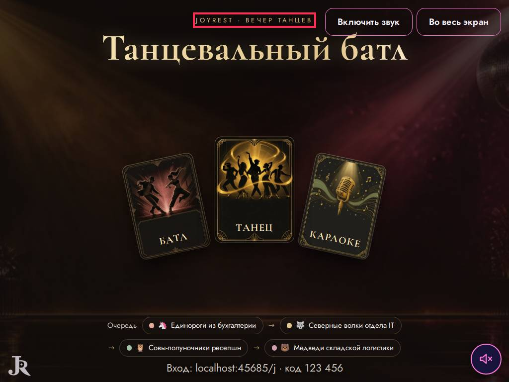

# Ревизор — что видят ведущий и гости

Прогонов: 48 · видов игры проверено: 2177 · разных находок: 11

Размеры: Телевизор Full HD (1920x1080); Проектор 4:3, маленький телефон, длинные имена (1024x768); Ноутбук 16:10, большой зал, длинные имена (1280x800).

## Мешает игре — 10

### не успел · страница

TimeoutError: page.waitForFunction: Timeout 600000ms exceeded.

- где: `—`
- игры (1): bunker 1-й шаблон, каждый сам ×8, телевизор full hd
- раз: 1

### не успел · страница

TimeoutError: page.waitForFunction: Timeout 600000ms exceeded.

- где: `—`
- игры (1): bunker 1-й шаблон, каждый сам ×8, телевизор full hd
- раз: 1

### закрыт другим элементом · экран зала

«Первым ходит» закрыт элементом div.draw-coin__rays — «Первым ходит»

- где: `div.hall > main.quiz-stage > div.slide.slide--draw > p.slide__eyebrow`, этап `playing/17/podium/result`
- игры (3): dance 1-й шаблон, команды ×8, ноутбук 16:10, большой зал, длинные имена; mafia 1-й шаблон, каждый сам ×9, телевизор full hd; mafia 1-й шаблон, каждый сам ×9, проектор 4:3, маленький телефон, длинные имена; mafia 1-й шаблон, каждый сам ×9, ноутбук 16:10, большой зал, длинные имена; bunker 1-й шаблон, каждый сам ×8, телевизор full hd; bunker 1-й шаблон, каждый сам ×8, проектор 4:3, маленький телефон, длинные имена …
- раз: 21

### закрыт другим элементом · экран зала

«Речь» закрыт элементом article.bk-dossier — «Речь»

- где: `div.bk-stage.bk-stage--turn > div.bk-stage__text > div.bk-timer.bk-timer--hall > span`, этап `playing/50/question/open`
- игры (1): bunker 1-й шаблон, каждый сам ×8, ноутбук 16:10, большой зал, длинные имена
- раз: 1

### закрыт другим элементом · экран зала

«🐝» закрыт элементом span.bk-dossier__seat — «🐝»

- где: `div.bk-stage__text > h2.bk-title > span > span.name-emoji`, этап `playing/57/question/justify`
- игры (1): bunker 1-й шаблон, каждый сам ×8, ноутбук 16:10, большой зал, длинные имена
- раз: 1

### закрыт другим элементом · экран зала

«Константин Константинова» закрыт элементом span.bk-dossier__seat — «Константин Константинова»

- где: `div.bk-stage__text > h2.bk-title > span > span`, этап `playing/57/question/justify`
- игры (1): bunker 1-й шаблон, каждый сам ×8, ноутбук 16:10, большой зал, длинные имена
- раз: 1

### надписи наезжают · экран зала

«Константин Константинова» и «🦉» друг на друге — «Константин Константинова \| 🦉»

- где: `div.bk-stage__text > h2.bk-title > span > span`, этап `playing/57/question/justify`
- игры (1): bunker 1-й шаблон, каждый сам ×8, ноутбук 16:10, большой зал, длинные имена
- раз: 11

### надписи наезжают · экран зала

«Снова ничья — решит жребий.» и «Моряк · стаж 17 лет» друг на друге — «Снова ничья — решит жребий. \| Моряк · стаж 17 лет»

- где: `section.bk-screen__stage > div.bk-stage.bk-stage--turn > div.bk-stage__text > p.bk-lead.bk-lead--muted`, этап `playing/57/question/justify`
- игры (1): bunker 1-й шаблон, каждый сам ×8, ноутбук 16:10, большой зал, длинные имена
- раз: 2

### надписи наезжают · экран зала

«Речь» и «№4» друг на друге — «Речь \| №4»

- где: `div.bk-stage.bk-stage--turn > div.bk-stage__text > div.bk-timer.bk-timer--hall > span`, этап `playing/50/question/open`
- игры (1): bunker 1-й шаблон, каждый сам ×8, ноутбук 16:10, большой зал, длинные имена
- раз: 1

### надписи наезжают · экран зала

«🐝» и «№3» друг на друге — «🐝 \| №3»

- где: `div.bk-stage__text > h2.bk-title > span > span.name-emoji`, этап `playing/57/question/justify`
- игры (1): bunker 1-й шаблон, каждый сам ×8, ноутбук 16:10, большой зал, длинные имена
- раз: 1

## Заметно — 1

### мелко для зала · экран зала

шрифт 12.8 px — 18 px на Full HD (нужно от 18) — «JoyRest · вечер танцев»

- где: `main.quiz-stage > div.dance-screen.db-stage > div.db-head > span.db-kicker`, этап `playing/0/ready/`
- игры (1): dance 1-й шаблон, команды ×4, проектор 4:3, маленький телефон, длинные имена
- раз: 1

## Мелочи — 0

