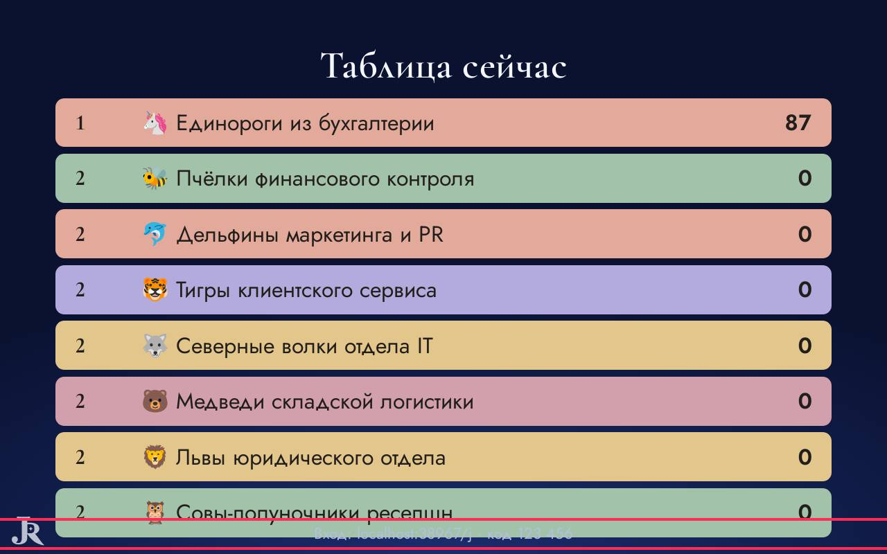

# Ревизор — что видят ведущий и гости

Прогонов: 60 · видов игры проверено: 2991 · разных находок: 4

Размеры: Телевизор Full HD (1920x1080); Проектор 4:3, маленький телефон, длинные имена (1024x768); Ноутбук 16:10, большой зал, длинные имена (1280x800).

## Мешает игре — 0

## Заметно — 4

### обрезан текст · экран зала

текст обрезан по высоте на 4 px (span.hd-row__text) — «Букет невесты»

- где: `div.hd-row > div.hd-row__inner > div.hd-row__face.hd-row__face--open > span.hd-row__text`, этап `playing/3/reveal/play`
- игры (1): hundred 1-й шаблон, команды ×4, телевизор full hd; hundred 1-й шаблон, каждый сам ×4, телевизор full hd; hundred 2-й шаблон, команды ×4, телевизор full hd; hundred 2-й шаблон, каждый сам ×4, телевизор full hd; hundred 3-й шаблон, команды ×4, телевизор full hd; hundred 3-й шаблон, каждый сам ×4, телевизор full hd
- раз: 45

### бледный текст · экран зала

контраст 1.05 (нужно от 4.5) — «Вход: localhost:38967/j · код 123 456»

- где: `div.hall > main.quiz-stage > p.stage-code`, этап `playing/1/reveal/done`
- игры (1): hundred 1-й шаблон, команды ×8, ноутбук 16:10, большой зал, длинные имена; hundred 2-й шаблон, команды ×8, ноутбук 16:10, большой зал, длинные имена; hundred 3-й шаблон, команды ×8, ноутбук 16:10, большой зал, длинные имена
- раз: 3

### бледный текст · пульт

контраст 1.07 (нужно от 4.5) — «Начальник»

- где: `li > button.hd-host__row > span.hd-host__text > strong`, этап `playing/3/reveal/play`
- игры (1): hundred 2-й шаблон, команды ×4, телевизор full hd
- раз: 3

### бледный текст · пульт

контраст 1.85 (нужно от 4.5) — «ещё: столы»

- где: `li > button.hd-host__row > span.hd-host__text > small`, этап `playing/3/reveal/play`
- игры (1): hundred 2-й шаблон, команды ×4, проектор 4:3, маленький телефон, длинные имена
- раз: 2

## Мелочи — 0

