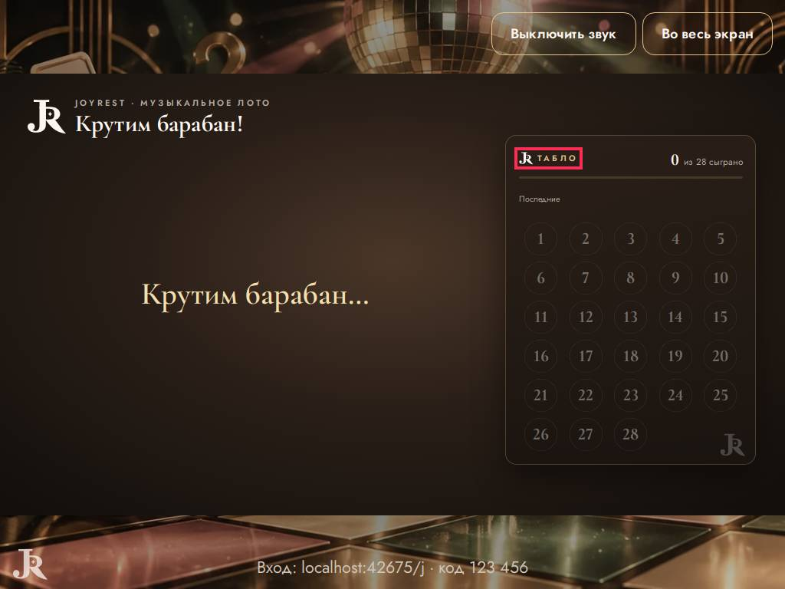
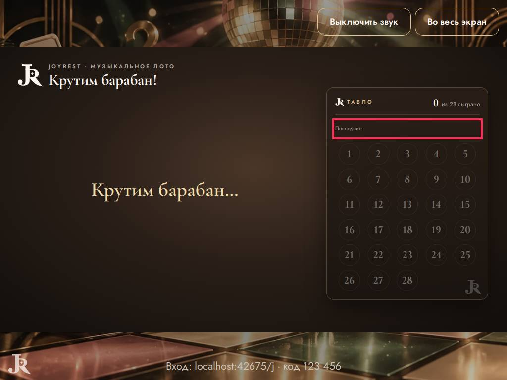
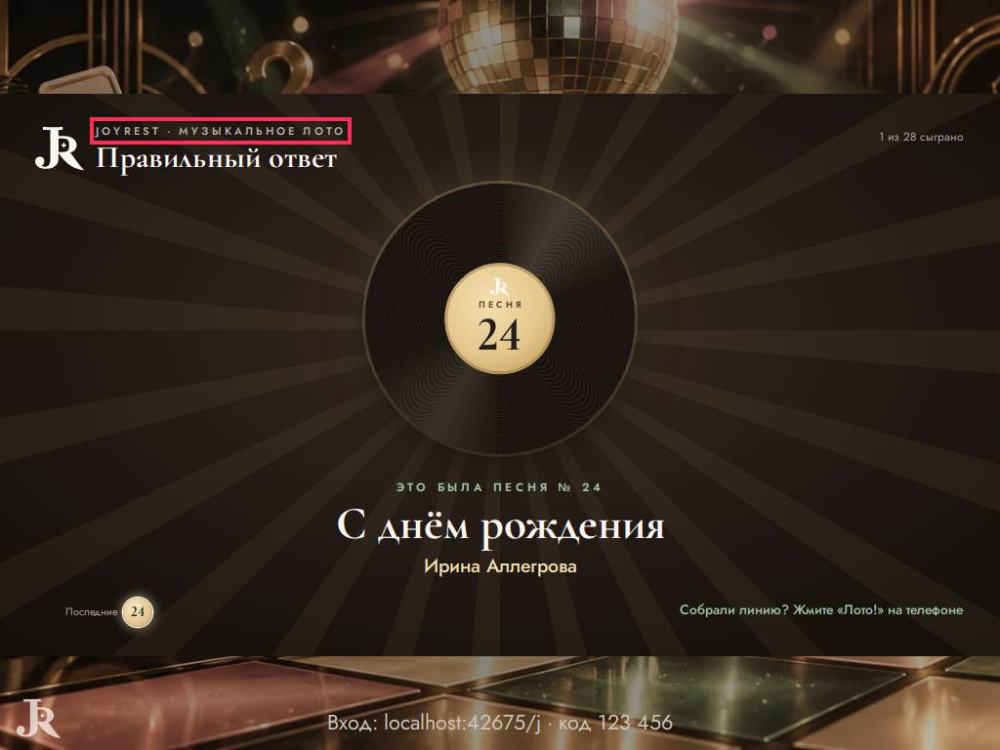
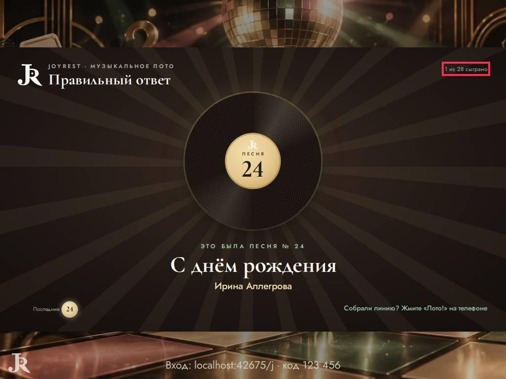
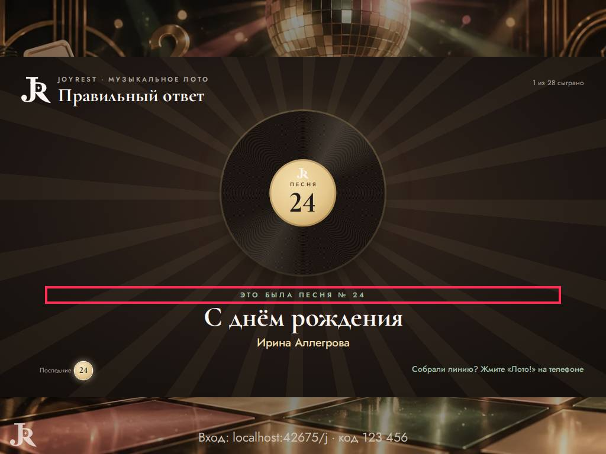
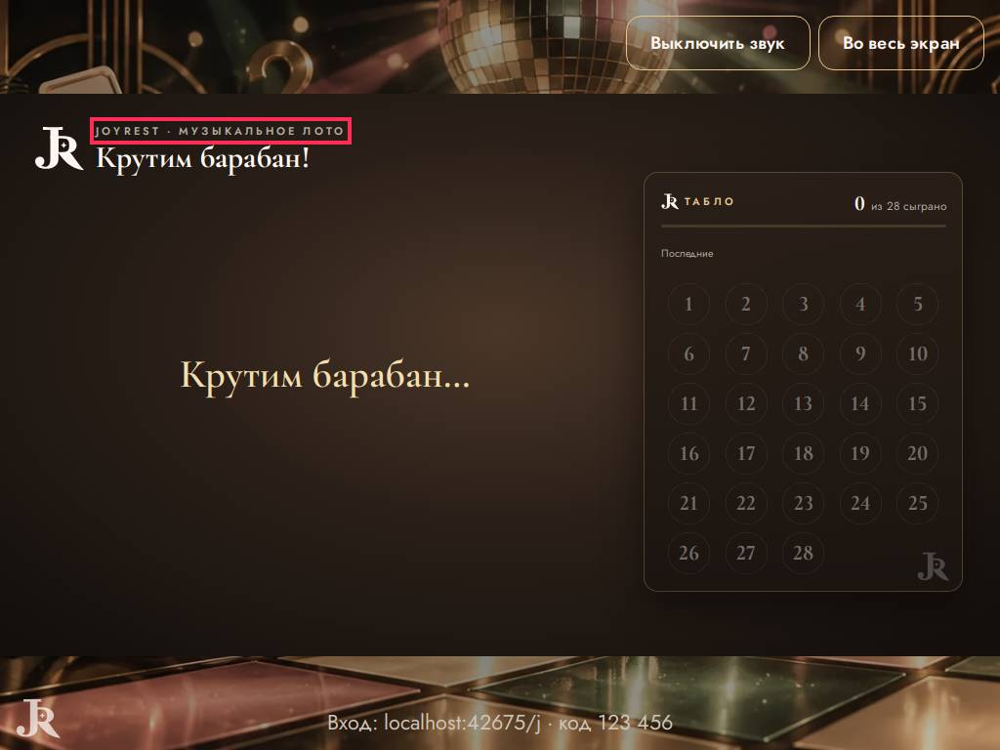
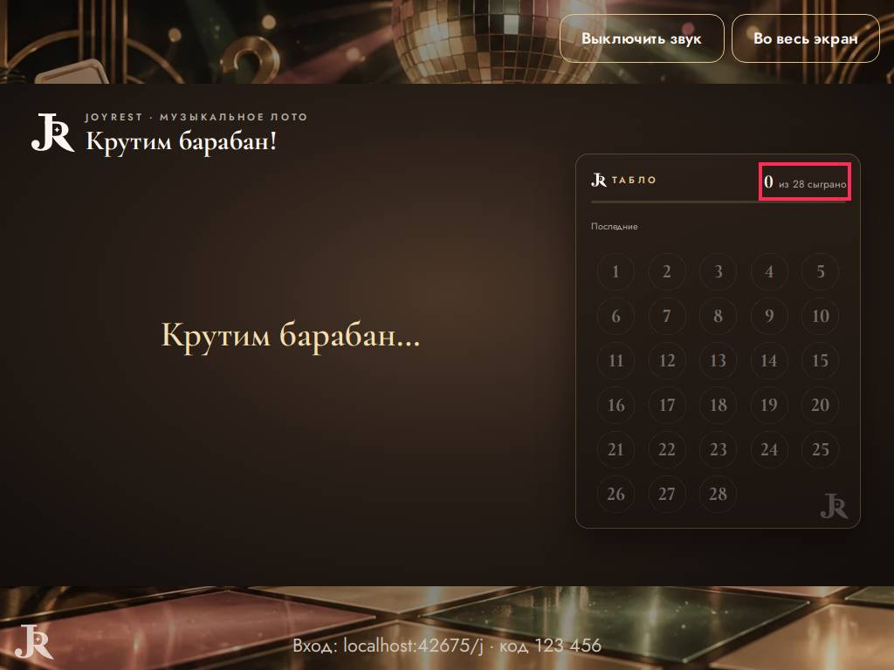

# Ревизор — что видят ведущий и гости

Прогонов: 8 · видов игры проверено: 232 · разных находок: 8

Размеры: Телевизор Full HD (1920x1080); Проектор 4:3, маленький телефон, длинные имена (1024x768); Ноутбук 16:10, большой зал, длинные имена (1280x800); Большой праздник: 10 команд или 40 гостей, телевизор (1920x1080).

## Мешает игре — 0

## Заметно — 8

### мелко для зала · экран зала

шрифт 10.6 px — 15 px на Full HD (нужно от 18) — «Последние»

- где: `main.quiz-stage.show-stage > div.lh > div.lh-frame.lh-song > p.lh-last`, этап `playing/0/reveal/`
- игры (1): lotto 1-й шаблон, каждый сам ×4, проектор 4:3, маленький телефон, длинные имена; lotto 1-й шаблон, каждый сам ×16, ноутбук 16:10, большой зал, длинные имена; lotto 1-й шаблон, команды ×4, проектор 4:3, маленький телефон, длинные имена; lotto 1-й шаблон, команды ×8, ноутбук 16:10, большой зал, длинные имена
- раз: 6

### мелко для зала · экран зала

шрифт 10.6 px — 15 px на Full HD (нужно от 18) — «Табло»

- где: `div.lh-frame > aside.lh-board > div.lh-board__head > p.lh-board__title`, этап `playing/0/question/`
- игры (1): lotto 1-й шаблон, каждый сам ×4, проектор 4:3, маленький телефон, длинные имена; lotto 1-й шаблон, каждый сам ×16, ноутбук 16:10, большой зал, длинные имена; lotto 1-й шаблон, команды ×4, проектор 4:3, маленький телефон, длинные имена; lotto 1-й шаблон, команды ×8, ноутбук 16:10, большой зал, длинные имена
- раз: 5

### мелко для зала · экран зала

шрифт 10.6 px — 15 px на Full HD (нужно от 18) — «Последние»

- где: `div.lh > div.lh-frame > aside.lh-board > p.lh-board__last`, этап `playing/0/question/`
- игры (1): lotto 1-й шаблон, каждый сам ×4, проектор 4:3, маленький телефон, длинные имена; lotto 1-й шаблон, каждый сам ×16, ноутбук 16:10, большой зал, длинные имена; lotto 1-й шаблон, команды ×4, проектор 4:3, маленький телефон, длинные имена; lotto 1-й шаблон, команды ×8, ноутбук 16:10, большой зал, длинные имена
- раз: 5

### мелко для зала · экран зала

шрифт 11.1 px — 16 px на Full HD (нужно от 18) — «JoyRest · Музыкальное лото»

- где: `div.lh-frame.lh-song > div.lh-head > div > p.lh-head__eb`, этап `playing/0/reveal/`
- игры (1): lotto 1-й шаблон, каждый сам ×4, проектор 4:3, маленький телефон, длинные имена; lotto 1-й шаблон, команды ×4, проектор 4:3, маленький телефон, длинные имена
- раз: 3

### мелко для зала · экран зала

шрифт 11.8 px — 17 px на Full HD (нужно от 18) — «1 из 28 сыграно»

- где: `main.quiz-stage.show-stage > div.lh > div.lh-frame.lh-song > p.lh-count`, этап `playing/0/reveal/`
- игры (1): lotto 1-й шаблон, каждый сам ×4, проектор 4:3, маленький телефон, длинные имена; lotto 1-й шаблон, команды ×4, проектор 4:3, маленький телефон, длинные имена
- раз: 3

### мелко для зала · экран зала

шрифт 11.8 px — 17 px на Full HD (нужно от 18) — «Это была песня № 24»

- где: `div.lh-frame.lh-song > div.lh-track > div.lh-track__answer > p.lh-track__k`, этап `playing/0/reveal/`
- игры (1): lotto 1-й шаблон, каждый сам ×4, проектор 4:3, маленький телефон, длинные имена; lotto 1-й шаблон, команды ×4, проектор 4:3, маленький телефон, длинные имена
- раз: 3

### мелко для зала · экран зала

шрифт 11.1 px — 16 px на Full HD (нужно от 18) — «JoyRest · Музыкальное лото»

- где: `div.lh-frame > div.lh-head > div > p.lh-head__eb`, этап `playing/0/question/`
- игры (1): lotto 1-й шаблон, каждый сам ×4, проектор 4:3, маленький телефон, длинные имена; lotto 1-й шаблон, команды ×4, проектор 4:3, маленький телефон, длинные имена
- раз: 2

### мелко для зала · экран зала

шрифт 11.8 px — 17 px на Full HD (нужно от 18) — «из 28 сыграно»

- где: `div.lh-frame > aside.lh-board > div.lh-board__head > p.lh-board__count`, этап `playing/0/question/`
- игры (1): lotto 1-й шаблон, каждый сам ×4, проектор 4:3, маленький телефон, длинные имена; lotto 1-й шаблон, команды ×4, проектор 4:3, маленький телефон, длинные имена
- раз: 2

## Мелочи — 0

