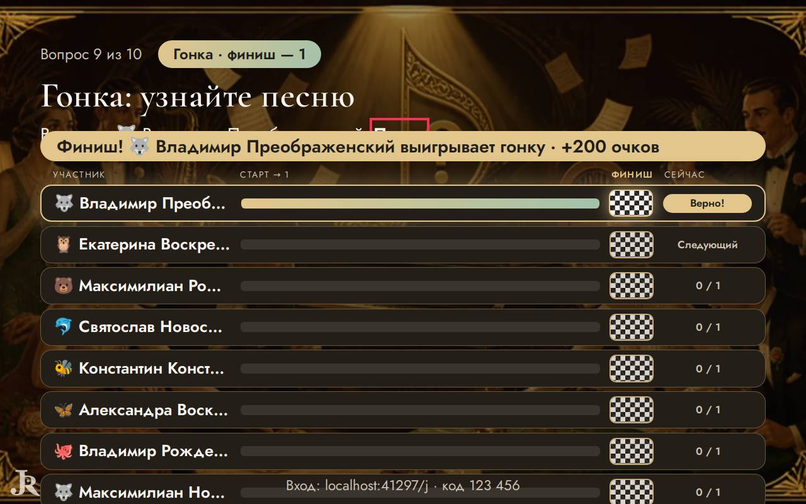
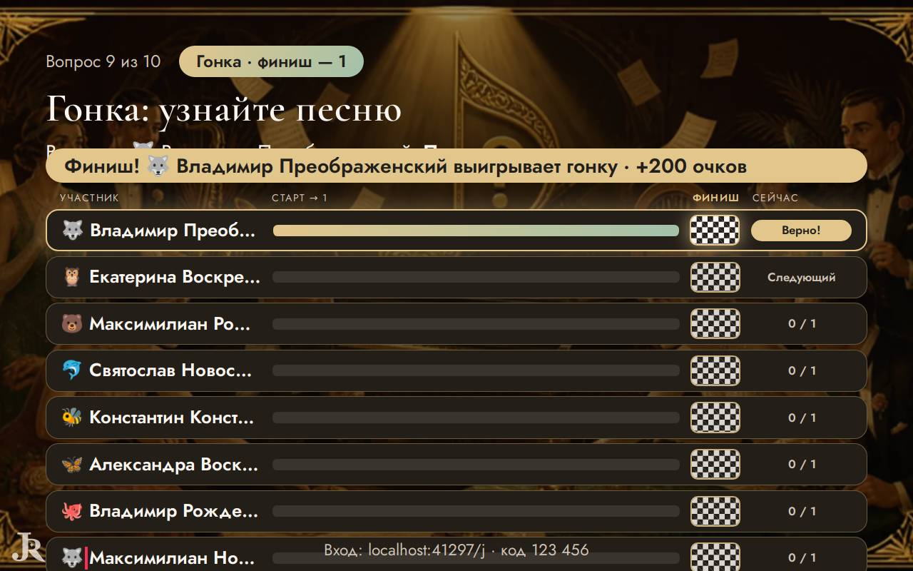
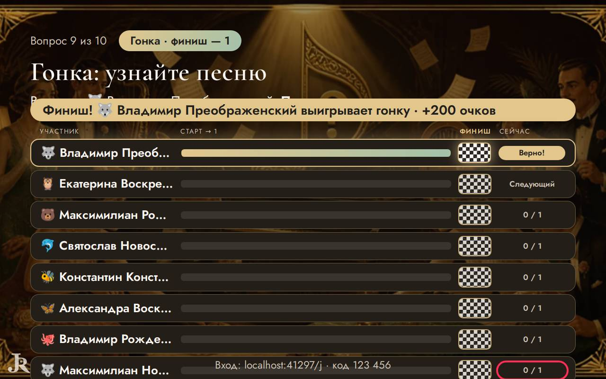
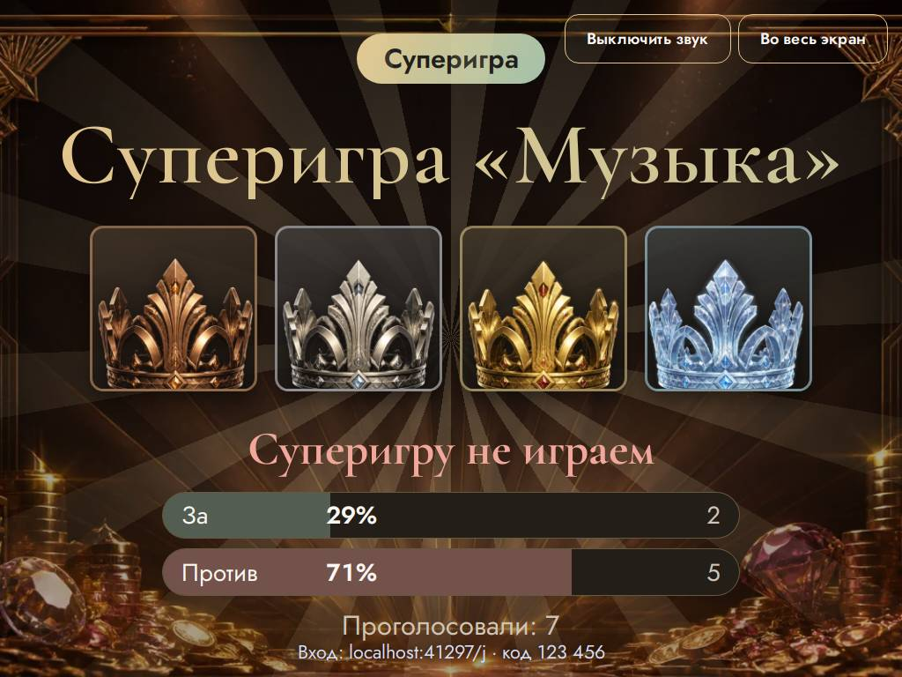

# Ревизор — что видят ведущий и гости

Прогонов: 24 · видов игры проверено: 907 · разных находок: 27

Размеры: Телевизор Full HD (1920x1080); Проектор 4:3, маленький телефон, длинные имена (1024x768); Ноутбук 16:10, большой зал, длинные имена (1280x800).

## Мешает игре — 16

### за краем экрана · экран зала

текст выходит за край экрана по высоте на 40 px — «и ещё 10»

- где: `main.quiz-stage.show-stage > div.quiz-screen.quiz-screen--race > div.race > p.race__more`, этап `playing/8/reveal/`
- игры (1): quiz 4-й шаблон, каждый сам ×16, ноутбук 16:10, большой зал, длинные имена
- раз: 1

### закрыт другим элементом · экран зала

«Серебро» закрыт элементом p.super-vote__verdict — «Серебро»

- где: `div.super-screen.super-screen--intro > ol.super-levels.super-levels--intro > li.super-level.super-level--silver > span.super-level__name`, этап `playing/7/ready/`
- игры (1): quiz 4-й шаблон, команды ×4, телевизор full hd; quiz 4-й шаблон, каждый сам ×16, ноутбук 16:10, большой зал, длинные имена; quiz 4-й шаблон, команды ×4, проектор 4:3, маленький телефон, длинные имена
- раз: 3

### закрыт другим элементом · экран зала

«Золото» закрыт элементом p.super-vote__verdict — «Золото»

- где: `div.super-screen.super-screen--intro > ol.super-levels.super-levels--intro > li.super-level.super-level--gold > span.super-level__name`, этап `playing/7/ready/`
- игры (1): quiz 4-й шаблон, команды ×4, телевизор full hd; quiz 4-й шаблон, каждый сам ×16, ноутбук 16:10, большой зал, длинные имена; quiz 4-й шаблон, команды ×4, проектор 4:3, маленький телефон, длинные имена
- раз: 3

### закрыт другим элементом · экран зала

«Верно — :» закрыт элементом p.quiz-screen__finish — «Верно — :»

- где: `div.hall > main.quiz-stage.show-stage > div.quiz-screen.quiz-screen--race > p.quiz-screen__race-answer`, этап `playing/8/reveal/`
- игры (1): quiz 4-й шаблон, каждый сам ×16, ноутбук 16:10, большой зал, длинные имена
- раз: 1

### закрыт другим элементом · экран зала

«🐺» закрыт элементом p.quiz-screen__finish — «🐺»

- где: `main.quiz-stage.show-stage > div.quiz-screen.quiz-screen--race > p.quiz-screen__race-answer > span.name-emoji`, этап `playing/8/reveal/`
- игры (1): quiz 4-й шаблон, каждый сам ×16, ноутбук 16:10, большой зал, длинные имена
- раз: 1

### закрыт другим элементом · экран зала

«Владимир Преображенский» закрыт элементом span — «Владимир Преображенский»

- где: `main.quiz-stage.show-stage > div.quiz-screen.quiz-screen--race > p.quiz-screen__race-answer > span`, этап `playing/8/reveal/`
- игры (1): quiz 4-й шаблон, каждый сам ×16, ноутбук 16:10, большой зал, длинные имена
- раз: 1

### закрыт другим элементом · экран зала

«Песня» закрыт элементом p.quiz-screen__finish — «Песня»

- где: `main.quiz-stage.show-stage > div.quiz-screen.quiz-screen--race > p.quiz-screen__race-answer > strong`, этап `playing/8/reveal/`
- игры (1): quiz 4-й шаблон, каждый сам ×16, ноутбук 16:10, большой зал, длинные имена
- раз: 1

### закрыт другим элементом · экран зала

«🐺» закрыт элементом p.stage-code — «🐺»

- где: `div.race > div.race__lane > span.race__name > span.name-emoji`, этап `playing/8/reveal/`
- игры (1): quiz 4-й шаблон, каждый сам ×16, ноутбук 16:10, большой зал, длинные имена
- раз: 1

### закрыт другим элементом · экран зала

«Максимилиан Новосельцев» закрыт элементом p.stage-code — «Максимилиан Новосельцев»

- где: `div.race > div.race__lane > span.race__name > span`, этап `playing/8/reveal/`
- игры (1): quiz 4-й шаблон, каждый сам ×16, ноутбук 16:10, большой зал, длинные имена
- раз: 1

### закрыт другим элементом · экран зала

«0 / 1» закрыт элементом p.stage-code — «0 / 1»

- где: `div.quiz-screen.quiz-screen--race > div.race > div.race__lane > span.race__status`, этап `playing/8/reveal/`
- игры (1): quiz 4-й шаблон, каждый сам ×16, ноутбук 16:10, большой зал, длинные имена
- раз: 1

### закрыт другим элементом · экран зала

«100 очков» закрыт элементом div.super-vote__bar — «100 очков»

- где: `div.super-screen.super-screen--intro > ol.super-levels.super-levels--intro > li.super-level.super-level--bronze > span.super-level__points`, этап `playing/7/ready/`
- игры (1): quiz 4-й шаблон, команды ×4, проектор 4:3, маленький телефон, длинные имена
- раз: 1

### закрыт другим элементом · экран зала

«200 очков» закрыт элементом strong — «200 очков»

- где: `div.super-screen.super-screen--intro > ol.super-levels.super-levels--intro > li.super-level.super-level--silver > span.super-level__points`, этап `playing/7/ready/`
- игры (1): quiz 4-й шаблон, команды ×4, проектор 4:3, маленький телефон, длинные имена
- раз: 1

### закрыт другим элементом · экран зала

«300 очков» закрыт элементом div.super-vote__bar — «300 очков»

- где: `div.super-screen.super-screen--intro > ol.super-levels.super-levels--intro > li.super-level.super-level--gold > span.super-level__points`, этап `playing/7/ready/`
- игры (1): quiz 4-й шаблон, команды ×4, проектор 4:3, маленький телефон, длинные имена
- раз: 1

### закрыт другим элементом · экран зала

«500 очков» закрыт элементом div.super-vote__bar — «500 очков»

- где: `div.super-screen.super-screen--intro > ol.super-levels.super-levels--intro > li.super-level.super-level--diamond > span.super-level__points`, этап `playing/7/ready/`
- игры (1): quiz 4-й шаблон, команды ×4, проектор 4:3, маленький телефон, длинные имена
- раз: 1

### надписи наезжают · экран зала

«Верно — :» и «Финиш! выигрывает гонку · +200» друг на друге — «Верно — : \| Финиш! выигрывает гонку · +200 очков»

- где: `div.hall > main.quiz-stage.show-stage > div.quiz-screen.quiz-screen--race > p.quiz-screen__race-answer`, этап `playing/8/reveal/`
- игры (1): quiz 4-й шаблон, каждый сам ×16, ноутбук 16:10, большой зал, длинные имена
- раз: 2

### надписи наезжают · экран зала

«Владимир Преображенский» и «Владимир Преображенский» друг на друге — «Владимир Преображенский \| Владимир Преображенский»

- где: `main.quiz-stage.show-stage > div.quiz-screen.quiz-screen--race > p.quiz-screen__race-answer > span`, этап `playing/8/reveal/`
- игры (1): quiz 4-й шаблон, каждый сам ×16, ноутбук 16:10, большой зал, длинные имена
- раз: 1

## Заметно — 11

### обрезан текст · экран зала

текст обрезан по высоте на 97 px (li.super-level.super-level--bronze) — «Бронза»

- где: `div.super-screen.super-screen--intro > ol.super-levels.super-levels--intro > li.super-level.super-level--bronze > span.super-level__name`, этап `playing/7/ready/`
- игры (1): quiz 4-й шаблон, команды ×4, телевизор full hd; quiz 4-й шаблон, каждый сам ×16, ноутбук 16:10, большой зал, длинные имена; quiz 4-й шаблон, команды ×4, проектор 4:3, маленький телефон, длинные имена
- раз: 3

### обрезан текст · экран зала

текст обрезан по высоте на 185 px (li.super-level.super-level--bronze) — «100 очков»

- где: `div.super-screen.super-screen--intro > ol.super-levels.super-levels--intro > li.super-level.super-level--bronze > span.super-level__points`, этап `playing/7/ready/`
- игры (1): quiz 4-й шаблон, команды ×4, телевизор full hd; quiz 4-й шаблон, каждый сам ×16, ноутбук 16:10, большой зал, длинные имена; quiz 4-й шаблон, команды ×4, проектор 4:3, маленький телефон, длинные имена
- раз: 3

### обрезан текст · экран зала

текст обрезан по высоте на 97 px (li.super-level.super-level--silver) — «Серебро»

- где: `div.super-screen.super-screen--intro > ol.super-levels.super-levels--intro > li.super-level.super-level--silver > span.super-level__name`, этап `playing/7/ready/`
- игры (1): quiz 4-й шаблон, команды ×4, телевизор full hd; quiz 4-й шаблон, каждый сам ×16, ноутбук 16:10, большой зал, длинные имена; quiz 4-й шаблон, команды ×4, проектор 4:3, маленький телефон, длинные имена
- раз: 3

### обрезан текст · экран зала

текст обрезан по высоте на 185 px (li.super-level.super-level--silver) — «200 очков»

- где: `div.super-screen.super-screen--intro > ol.super-levels.super-levels--intro > li.super-level.super-level--silver > span.super-level__points`, этап `playing/7/ready/`
- игры (1): quiz 4-й шаблон, команды ×4, телевизор full hd; quiz 4-й шаблон, каждый сам ×16, ноутбук 16:10, большой зал, длинные имена; quiz 4-й шаблон, команды ×4, проектор 4:3, маленький телефон, длинные имена
- раз: 3

### обрезан текст · экран зала

текст обрезан по высоте на 97 px (li.super-level.super-level--gold) — «Золото»

- где: `div.super-screen.super-screen--intro > ol.super-levels.super-levels--intro > li.super-level.super-level--gold > span.super-level__name`, этап `playing/7/ready/`
- игры (1): quiz 4-й шаблон, команды ×4, телевизор full hd; quiz 4-й шаблон, каждый сам ×16, ноутбук 16:10, большой зал, длинные имена; quiz 4-й шаблон, команды ×4, проектор 4:3, маленький телефон, длинные имена
- раз: 3

### обрезан текст · экран зала

текст обрезан по высоте на 185 px (li.super-level.super-level--gold) — «300 очков»

- где: `div.super-screen.super-screen--intro > ol.super-levels.super-levels--intro > li.super-level.super-level--gold > span.super-level__points`, этап `playing/7/ready/`
- игры (1): quiz 4-й шаблон, команды ×4, телевизор full hd; quiz 4-й шаблон, каждый сам ×16, ноутбук 16:10, большой зал, длинные имена; quiz 4-й шаблон, команды ×4, проектор 4:3, маленький телефон, длинные имена
- раз: 3

### обрезан текст · экран зала

текст обрезан по высоте на 97 px (li.super-level.super-level--diamond) — «Бриллиант»

- где: `div.super-screen.super-screen--intro > ol.super-levels.super-levels--intro > li.super-level.super-level--diamond > span.super-level__name`, этап `playing/7/ready/`
- игры (1): quiz 4-й шаблон, команды ×4, телевизор full hd; quiz 4-й шаблон, каждый сам ×16, ноутбук 16:10, большой зал, длинные имена; quiz 4-й шаблон, команды ×4, проектор 4:3, маленький телефон, длинные имена
- раз: 3

### обрезан текст · экран зала

текст обрезан по высоте на 185 px (li.super-level.super-level--diamond) — «500 очков»

- где: `div.super-screen.super-screen--intro > ol.super-levels.super-levels--intro > li.super-level.super-level--diamond > span.super-level__points`, этап `playing/7/ready/`
- игры (1): quiz 4-й шаблон, команды ×4, телевизор full hd; quiz 4-й шаблон, каждый сам ×16, ноутбук 16:10, большой зал, длинные имена; quiz 4-й шаблон, команды ×4, проектор 4:3, маленький телефон, длинные имена
- раз: 3

### бледный текст · экран зала

контраст 1.54 (нужно от 3) — «Верно — :»

- где: `div.hall > main.quiz-stage.show-stage > div.quiz-screen.quiz-screen--race > p.quiz-screen__race-answer`, этап `playing/8/reveal/`
- игры (1): quiz 4-й шаблон, каждый сам ×16, ноутбук 16:10, большой зал, длинные имена
- раз: 1

### бледный текст · экран зала

контраст 1.54 (нужно от 3) — «Владимир Преображенский»

- где: `main.quiz-stage.show-stage > div.quiz-screen.quiz-screen--race > p.quiz-screen__race-answer > span`, этап `playing/8/reveal/`
- игры (1): quiz 4-й шаблон, каждый сам ×16, ноутбук 16:10, большой зал, длинные имена
- раз: 1

### бледный текст · экран зала

контраст 1.54 (нужно от 3) — «Песня»

- где: `main.quiz-stage.show-stage > div.quiz-screen.quiz-screen--race > p.quiz-screen__race-answer > strong`, этап `playing/8/reveal/`
- игры (1): quiz 4-й шаблон, каждый сам ×16, ноутбук 16:10, большой зал, длинные имена
- раз: 1

## Мелочи — 0

