# Ревизор — что видят ведущий и гости

Прогонов: 141 · видов игры проверено: 6649 · разных находок: 35

Размеры: Телевизор Full HD (1920x1080); Проектор 4:3, маленький телефон, длинные имена (1024x768); Ноутбук 16:10, большой зал, длинные имена (1280x800).

## Мешает игре — 8

### не успел · страница

TimeoutError: page.waitForFunction: Timeout 600000ms exceeded.

- где: `—`
- игры (1): bunker 1-й шаблон, каждый сам ×8, телевизор full hd; bunker 1-й шаблон, каждый сам ×8, проектор 4:3, маленький телефон, длинные имена; bunker 1-й шаблон, каждый сам ×8, ноутбук 16:10, большой зал, длинные имена
- раз: 3

### не успел · страница

TimeoutError: page.waitForFunction: Timeout 600000ms exceeded.

- где: `—`
- игры (1): bunker 1-й шаблон, каждый сам ×8, телевизор full hd; bunker 1-й шаблон, каждый сам ×8, проектор 4:3, маленький телефон, длинные имена; bunker 1-й шаблон, каждый сам ×8, ноутбук 16:10, большой зал, длинные имена
- раз: 3

### закрыт другим элементом · экран зала

«Первым ходит» закрыт элементом div.draw-coin__rays — «Первым ходит»

- где: `div.hall > main.quiz-stage > div.slide.slide--draw > p.slide__eyebrow`, этап `playing/4/reveal/`
- игры (7): lotto 1-й шаблон, каждый сам ×4, проектор 4:3, маленький телефон, длинные имена; lotto 1-й шаблон, каждый сам ×4, телевизор full hd; lotto 1-й шаблон, каждый сам ×16, ноутбук 16:10, большой зал, длинные имена; lotto 1-й шаблон, команды ×4, телевизор full hd; lotto 1-й шаблон, команды ×4, проектор 4:3, маленький телефон, длинные имена; lotto 1-й шаблон, команды ×8, ноутбук 16:10, большой зал, длинные имена …
- раз: 43

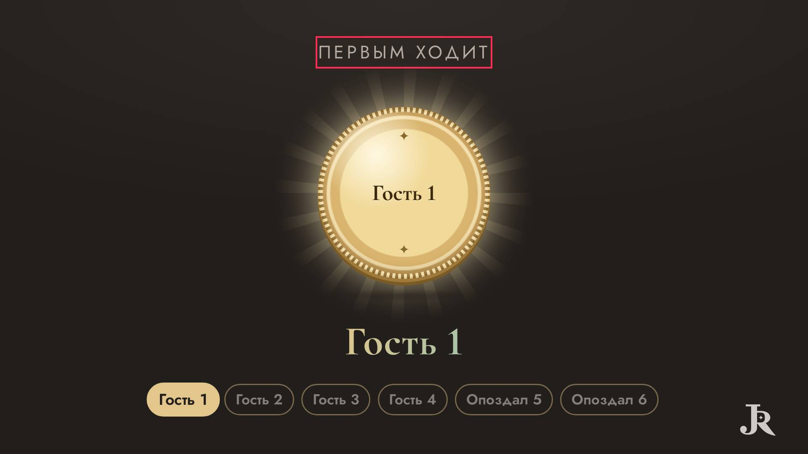

### закрыт другим элементом · экран зала

«клетка · очки» закрыт элементом span.qx-row__score — «клетка · очки»

- где: `div.quest-screen.qx--classic > aside.qx-panel > p.qx-panel__head > span.qx-panel__cols`, этап `playing/17/reveal/done`
- игры (1): quest 1-й шаблон, команды ×8, ноутбук 16:10, большой зал, длинные имена
- раз: 2

### закрыт другим элементом · экран зала

«клетка · очки» закрыт элементом span.qx-row__score — «клетка · очки»

- где: `div.quest-screen.qx--adult > aside.qx-panel > p.qx-panel__head > span.qx-panel__cols`, этап `playing/17/reveal/done`
- игры (1): quest 2-й шаблон, команды ×8, ноутбук 16:10, большой зал, длинные имена
- раз: 2

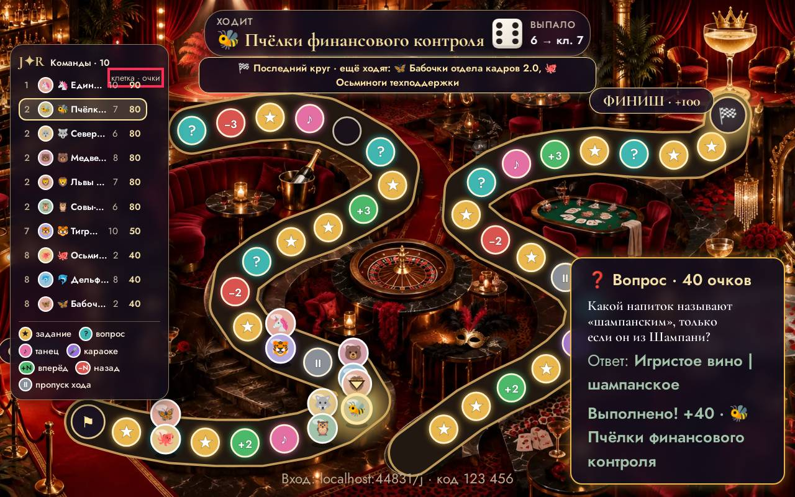

### надписи наезжают · экран зала

«клетка · очки» и «8» друг на друге — «клетка · очки \| 8»

- где: `div.quest-screen.qx--classic > aside.qx-panel > p.qx-panel__head > span.qx-panel__cols`, этап `playing/17/reveal/done`
- игры (1): quest 1-й шаблон, команды ×8, ноутбук 16:10, большой зал, длинные имена
- раз: 4

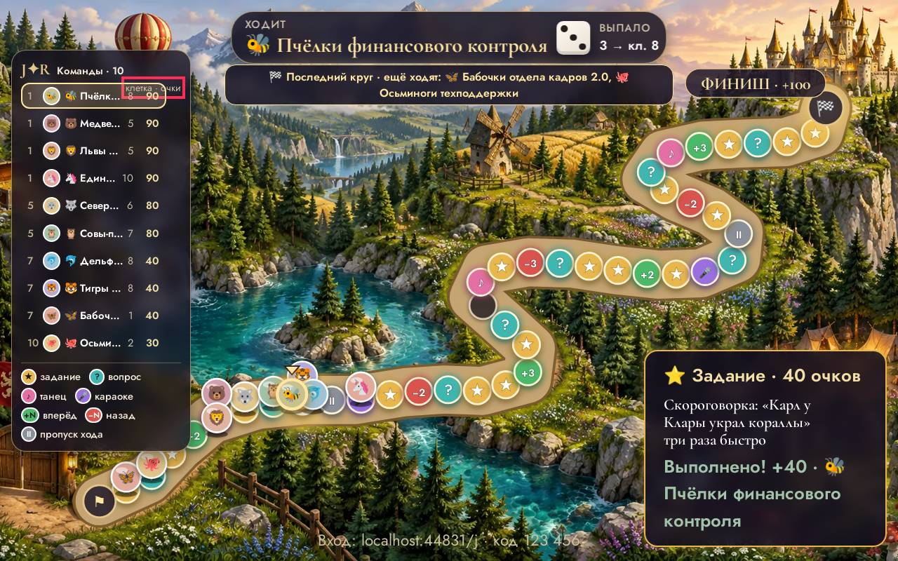

### надписи наезжают · экран зала

«Бочонок» и «6» друг на друге — «Бочонок \| 6»

- где: `div.lh-frame > div.lh-drum > div.lh-drum__reveal > p.lh-drum__lbl`, этап `playing/15/question/`
- игры (1): lotto 1-й шаблон, каждый сам ×16, ноутбук 16:10, большой зал, длинные имена; lotto 1-й шаблон, команды ×4, телевизор full hd
- раз: 2

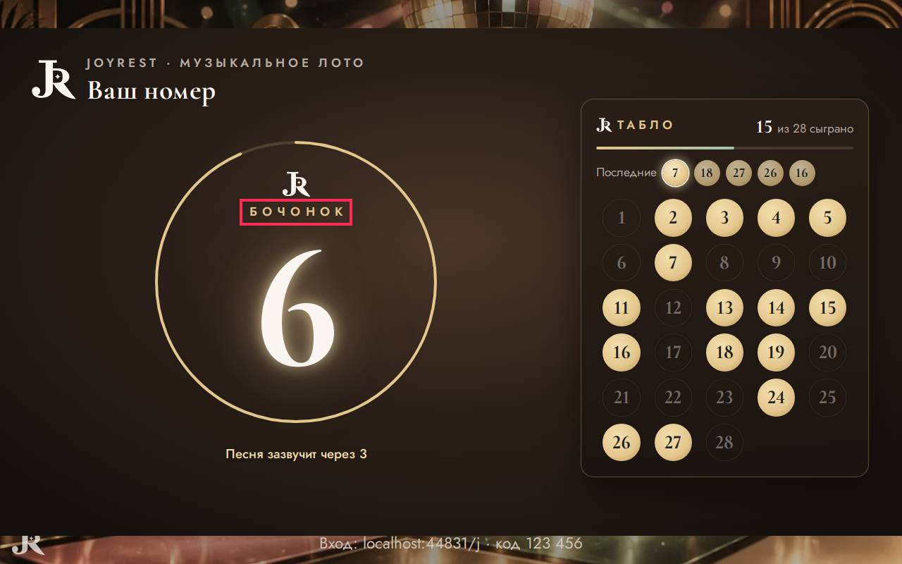

### надписи наезжают · экран зала

«клетка · очки» и «90» друг на друге — «клетка · очки \| 90»

- где: `div.quest-screen.qx--adult > aside.qx-panel > p.qx-panel__head > span.qx-panel__cols`, этап `playing/17/reveal/done`
- игры (1): quest 2-й шаблон, команды ×8, ноутбук 16:10, большой зал, длинные имена
- раз: 2

## Заметно — 18

### обрезан текст · экран зала

текст обрезан по высоте на 4 px (span.hd-row__text) — «Букет невесты»

- где: `div.hd-row > div.hd-row__inner > div.hd-row__face.hd-row__face--open > span.hd-row__text`, этап `playing/3/reveal/play`
- игры (1): hundred 1-й шаблон, команды ×4, телевизор full hd; hundred 1-й шаблон, каждый сам ×4, телевизор full hd; hundred 2-й шаблон, команды ×4, телевизор full hd; hundred 2-й шаблон, каждый сам ×4, телевизор full hd; hundred 3-й шаблон, команды ×4, телевизор full hd; hundred 3-й шаблон, каждый сам ×4, телевизор full hd
- раз: 45

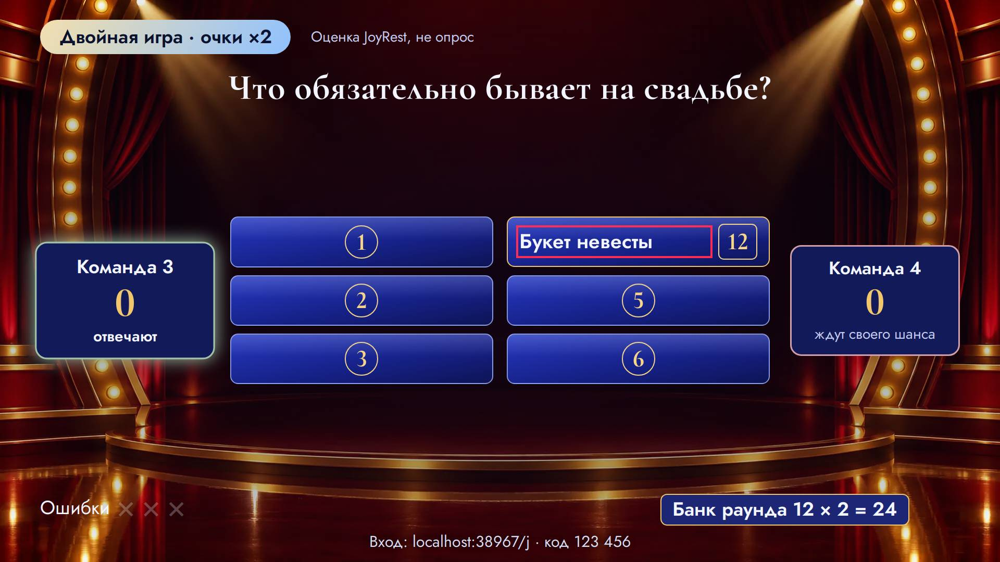

### прячется за прокруткой · экран зала

на экране зала текст виден только прокруткой (по высоте на 32 px) — «Угроза»

- где: `li > div.bk-card.bk-threat > div.bk-in > span.bk-threat__kicker`, этап `playing/150/reveal/final`
- игры (1): bunker 1-й шаблон, каждый сам ×8, проектор 4:3, маленький телефон, длинные имена
- раз: 1

### прячется за прокруткой · экран зала

на экране зала текст виден только прокруткой (по высоте на 78 px) — «Сломался фильтр воздуха»

- где: `li > div.bk-card.bk-threat > div.bk-in > span.bk-threat__title`, этап `playing/150/reveal/final`
- игры (1): bunker 1-й шаблон, каждый сам ×8, проектор 4:3, маленький телефон, длинные имена
- раз: 1

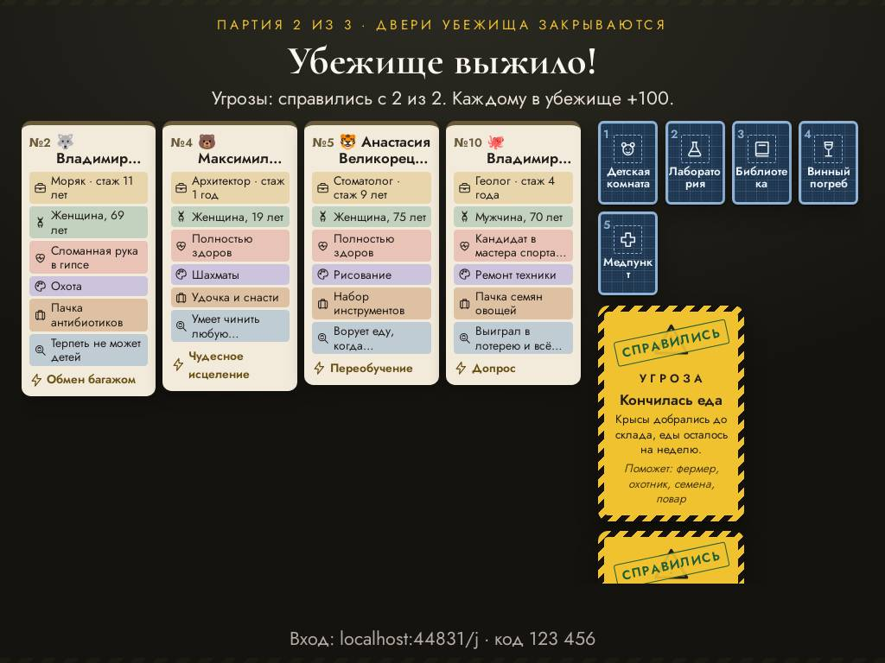

### прячется за прокруткой · экран зала

на экране зала текст виден только прокруткой (по высоте на 115 px) — «Через сутки дышать станет нечем.»

- где: `li > div.bk-card.bk-threat > div.bk-in > span.bk-threat__text`, этап `playing/150/reveal/final`
- игры (1): bunker 1-й шаблон, каждый сам ×8, проектор 4:3, маленький телефон, длинные имена
- раз: 1

### прячется за прокруткой · экран зала

на экране зала текст виден только прокруткой (по высоте на 155 px) — «Поможет: инженер, механик, инструменты»

- где: `li > div.bk-card.bk-threat > div.bk-in > span.bk-threat__helps`, этап `playing/150/reveal/final`
- игры (1): bunker 1-й шаблон, каждый сам ×8, проектор 4:3, маленький телефон, длинные имена
- раз: 1

### бледный текст · телефон

контраст 1.00 (нужно от 4.5) — «33%»

- где: `div.mil-question.mil-question--phone > ol.mil-options > li.mil-option > span.mil-option__pct`, этап `playing/13/question/question`
- игры (1): millionaire 1-й шаблон, команды ×4, телевизор full hd; millionaire 1-й шаблон, команды ×4, проектор 4:3, маленький телефон, длинные имена; millionaire 1-й шаблон, команды ×8, ноутбук 16:10, большой зал, длинные имена; millionaire 1-й шаблон, каждый сам ×4, телевизор full hd; millionaire 1-й шаблон, каждый сам ×4, проектор 4:3, маленький телефон, длинные имена; millionaire 1-й шаблон, каждый сам ×16, ноутбук 16:10, большой зал, длинные имена
- раз: 95

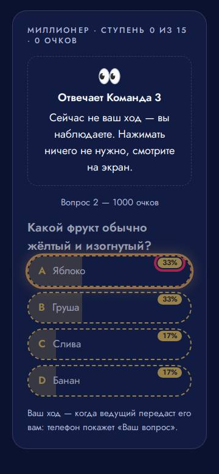

### бледный текст · телефон

контраст 1.00 (нужно от 4.5) — «Зелёного»

- где: `div.mil-question.mil-question--phone > ol.mil-options > li.mil-option > span.mil-option__text`, этап `playing/2/question/question`
- игры (1): millionaire 1-й шаблон, команды ×4, телевизор full hd; millionaire 1-й шаблон, команды ×4, проектор 4:3, маленький телефон, длинные имена; millionaire 1-й шаблон, команды ×8, ноутбук 16:10, большой зал, длинные имена; millionaire 1-й шаблон, каждый сам ×4, телевизор full hd; millionaire 1-й шаблон, каждый сам ×4, проектор 4:3, маленький телефон, длинные имена; millionaire 1-й шаблон, каждый сам ×16, ноутбук 16:10, большой зал, длинные имена
- раз: 62

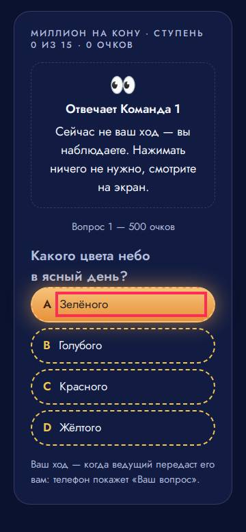

### бледный текст · телефон

контраст 1.10 (нужно от 4.5) — «A»

- где: `div.mil-question.mil-question--phone > ol.mil-options > li.mil-option > span.mil-option__letter`, этап `playing/2/question/question`
- игры (1): millionaire 1-й шаблон, команды ×4, телевизор full hd; millionaire 1-й шаблон, команды ×4, проектор 4:3, маленький телефон, длинные имена; millionaire 1-й шаблон, команды ×8, ноутбук 16:10, большой зал, длинные имена; millionaire 1-й шаблон, каждый сам ×4, телевизор full hd; millionaire 1-й шаблон, каждый сам ×4, проектор 4:3, маленький телефон, длинные имена; millionaire 1-й шаблон, каждый сам ×16, ноутбук 16:10, большой зал, длинные имена
- раз: 55

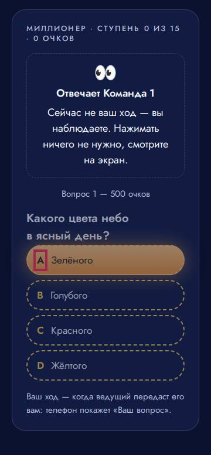

### бледный текст · телефон

контраст 1.00 (нужно от 4.5) — «A»

- где: `div.dk-hand__row > button.dk-hand__slot > div.dk-card.dk-d--russia > span.dk-idx.dk-idx--b`, этап `playing/12/question/play`
- игры (1): durak 1-й шаблон, каждый сам ×4, телевизор full hd; durak 1-й шаблон, каждый сам ×4, проектор 4:3, маленький телефон, длинные имена
- раз: 5

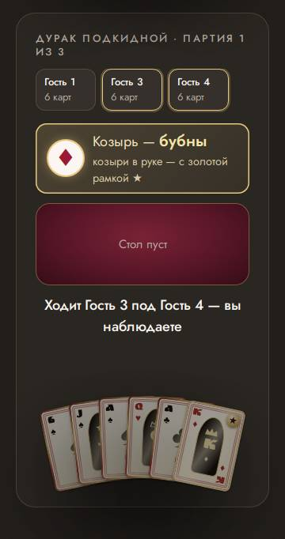

### бледный текст · пульт

контраст 1.07 (нужно от 4.5) — «Начальник»

- где: `li > button.hd-host__row > span.hd-host__text > strong`, этап `playing/3/reveal/play`
- игры (1): hundred 2-й шаблон, команды ×4, телевизор full hd
- раз: 3

### бледный текст · телефон

контраст 3.34 (нужно от 4.5) — «10»

- где: `div.dk-mini > span.dk-mini__pair > div.dk-card.dk-d--russia > span.dk-idx.dk-idx--b`, этап `playing/61/question/play`
- игры (1): durak 1-й шаблон, каждый сам ×4, ноутбук 16:10, большой зал, длинные имена
- раз: 3

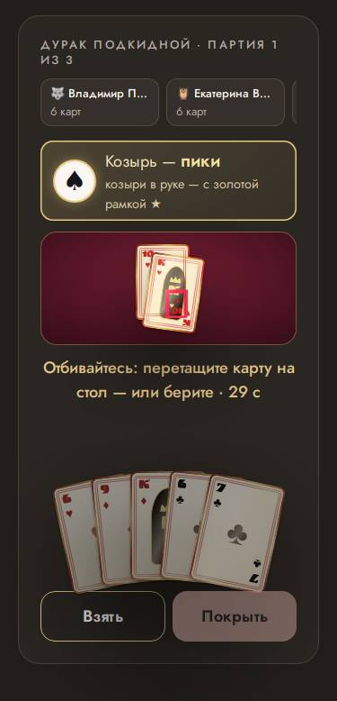

### бледный текст · экран зала

контраст 3.44 (нужно от 4.5) — «Мимо ✕»

- где: `div.race.race--cols-3 > div.race__grid > div.race__lane > span.race__status`, этап `playing/9/question/`
- игры (1): quiz 4-й шаблон, каждый сам ×16, ноутбук 16:10, большой зал, длинные имена
- раз: 2

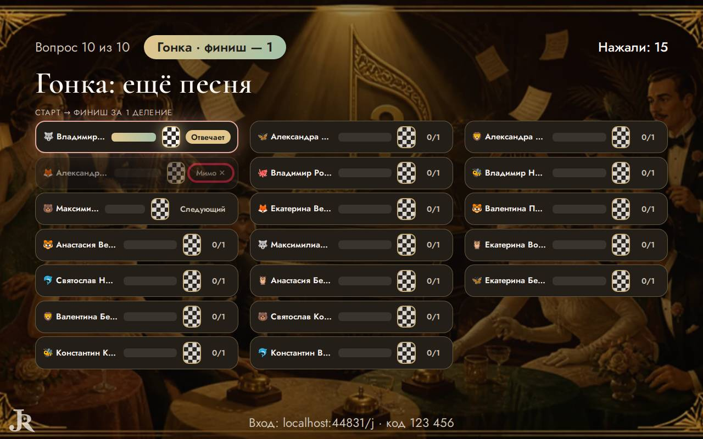

### бледный текст · пульт

контраст 1.85 (нужно от 4.5) — «ещё: столы»

- где: `li > button.hd-host__row > span.hd-host__text > small`, этап `playing/3/reveal/play`
- игры (1): hundred 2-й шаблон, команды ×4, проектор 4:3, маленький телефон, длинные имена
- раз: 2

### бледный текст · телефон

контраст 1.85 (нужно от 4.5) — «Подсказки»

- где: `div.card > div.quiz-phone > section.stack.stack--tight > p.eyebrow`, этап `playing/2/question/question`
- игры (1): millionaire 1-й шаблон, команды ×4, проектор 4:3, маленький телефон, длинные имена
- раз: 1

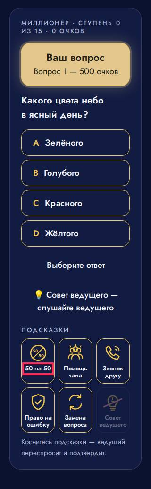

### бледный текст · телефон

контраст 1.52 (нужно от 4.5) — «Они ответили верно!»

- где: `main.page.page--play > div.card > div.quiz-phone.mil-watch > p.success`, этап `playing/8/reveal/reveal`
- игры (1): millionaire 1-й шаблон, команды ×4, проектор 4:3, маленький телефон, длинные имена
- раз: 1

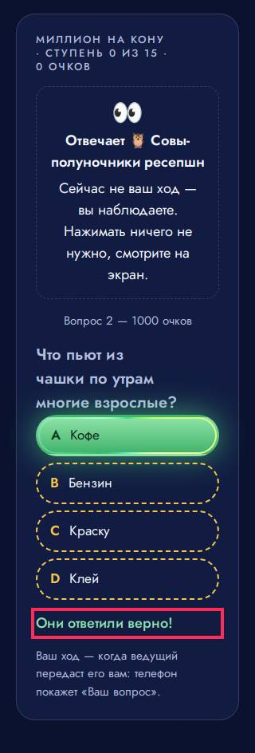

### бледный текст · пульт

контраст 1.07 (нужно от 4.5) — «Назад»

- где: `section.card > div.stack.host-quiz > div.actions > button.btn.btn--secondary`, этап `playing/6/reveal/answer`
- игры (1): wager 1-й шаблон, каждый сам ×4, проектор 4:3, маленький телефон, длинные имена
- раз: 1

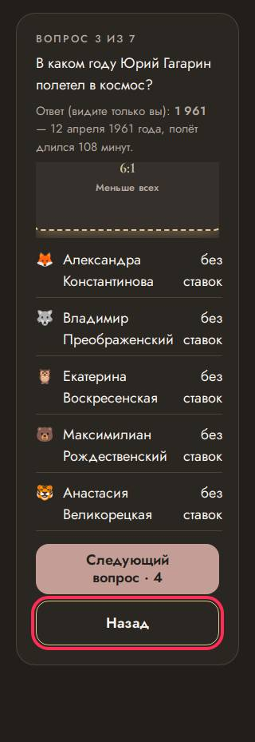

### мелко для зала · экран зала

шрифт 12.8 px — 18 px на Full HD (нужно от 18) — «JoyRest · вечер танцев»

- где: `main.quiz-stage > div.dance-screen.db-stage > div.db-head > span.db-kicker`, этап `playing/0/ready/`
- игры (1): dance 1-й шаблон, команды ×4, проектор 4:3, маленький телефон, длинные имена
- раз: 1

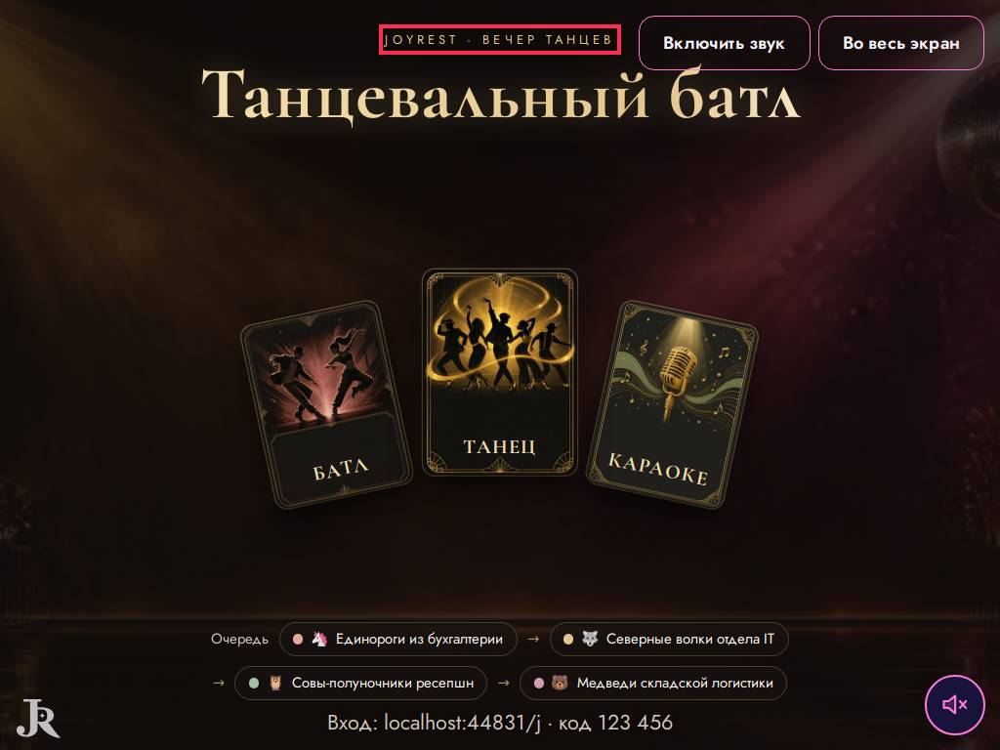

### мелко для зала · экран зала

шрифт 12.5 px — 17 px на Full HD (нужно от 18) — «Лук и стрелы»

- где: `div.bk-stage__card.bk-stage__card--small > div.bk-card.bk-trait > div.bk-in > span.bk-trait__text`, этап `playing/81/question/open`
- игры (1): bunker 1-й шаблон, каждый сам ×8, ноутбук 16:10, большой зал, длинные имена
- раз: 1

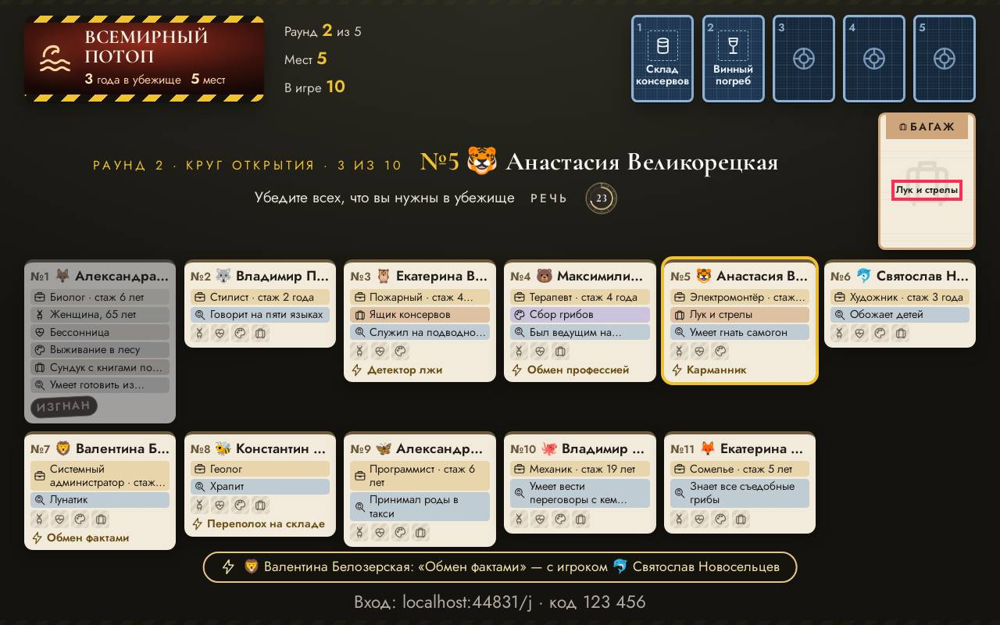

## Мелочи — 9

### мелкий текст · телефон

шрифт 11.4 px (нужно от 12) — «7»

- где: `div.dk-hand__row > button.dk-hand__slot > div.dk-card.dk-d--gothic > span.dk-idx`, этап `playing/53/question/play`
- игры (1): durak 1-й шаблон, каждый сам ×4, проектор 4:3, маленький телефон, длинные имена
- раз: 21

### мелкий текст · телефон

шрифт 11.4 px (нужно от 12) — «7»

- где: `div.dk-hand__row > button.dk-hand__slot > div.dk-card.dk-d--gothic > span.dk-idx.dk-idx--b`, этап `playing/53/question/play`
- игры (1): durak 1-й шаблон, каждый сам ×4, проектор 4:3, маленький телефон, длинные имена
- раз: 21

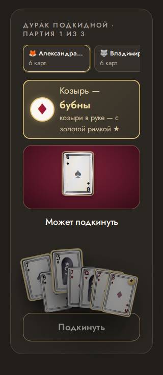

### мелкий текст · телефон

шрифт 11.4 px (нужно от 12) — «6»

- где: `div.dk-hand__row > button.dk-hand__slot > div.dk-card.dk-d--classic > span.dk-idx`, этап `playing/90/question/play`
- игры (1): durak 1-й шаблон, каждый сам ×4, проектор 4:3, маленький телефон, длинные имена
- раз: 21

### мелкий текст · телефон

шрифт 11.4 px (нужно от 12) — «6»

- где: `div.dk-hand__row > button.dk-hand__slot > div.dk-card.dk-d--classic > span.dk-idx.dk-idx--b`, этап `playing/90/question/play`
- игры (1): durak 1-й шаблон, каждый сам ×4, проектор 4:3, маленький телефон, длинные имена
- раз: 21

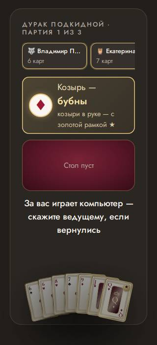

### мелкий текст · телефон

шрифт 11.4 px (нужно от 12) — «7»

- где: `div.dk-hand__row > button.dk-hand__slot > div.dk-card.dk-d--wedding > span.dk-idx`, этап `playing/50/question/play`
- игры (1): durak 1-й шаблон, каждый сам ×4, проектор 4:3, маленький телефон, длинные имена
- раз: 7

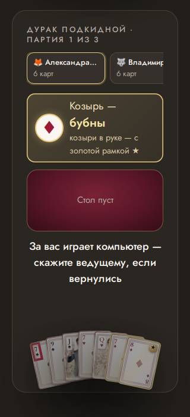

### мелкий текст · телефон

шрифт 11.4 px (нужно от 12) — «7»

- где: `div.dk-hand__row > button.dk-hand__slot > div.dk-card.dk-d--wedding > span.dk-idx.dk-idx--b`, этап `playing/50/question/play`
- игры (1): durak 1-й шаблон, каждый сам ×4, проектор 4:3, маленький телефон, длинные имена
- раз: 7

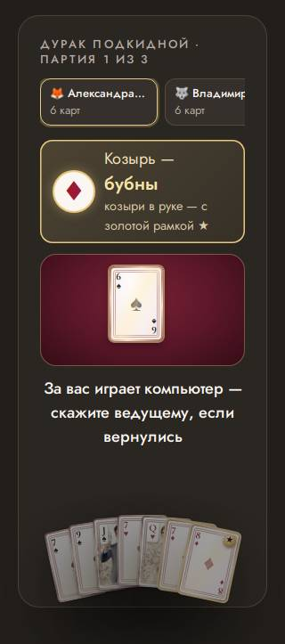

### мелкий текст · телефон

шрифт 11.4 px (нужно от 12) — «7»

- где: `div.dk-hand__row > button.dk-hand__slot > div.dk-card.dk-d--russia > span.dk-idx`, этап `playing/64/question/play`
- игры (1): durak 1-й шаблон, каждый сам ×4, проектор 4:3, маленький телефон, длинные имена
- раз: 7

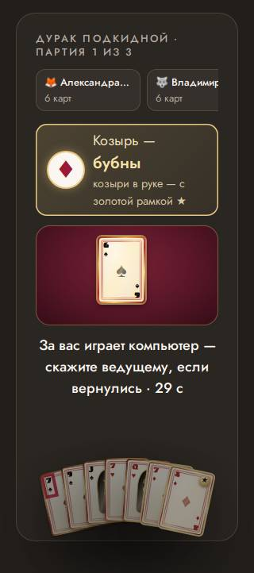

### мелкий текст · телефон

шрифт 11.4 px (нужно от 12) — «7»

- где: `div.dk-hand__row > button.dk-hand__slot > div.dk-card.dk-d--russia > span.dk-idx.dk-idx--b`, этап `playing/64/question/play`
- игры (1): durak 1-й шаблон, каждый сам ×4, проектор 4:3, маленький телефон, длинные имена
- раз: 7

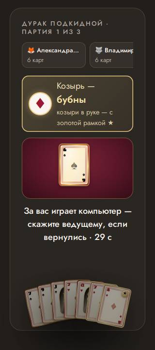

### мелкий текст · телефон

шрифт 11.5 px (нужно от 12) — «Локация»

- где: `button.sp-card > span.sp-card__inner > span.sp-card__face.sp-card__face--place > span.sp-card__label`, этап `playing/0/reveal/cards`
- игры (1): spy 1-й шаблон, каждый сам ×11, проектор 4:3, маленький телефон, длинные имена
- раз: 4

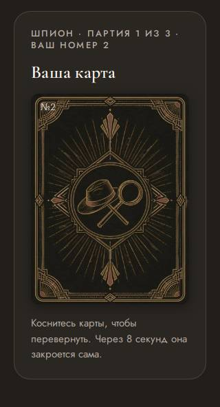

