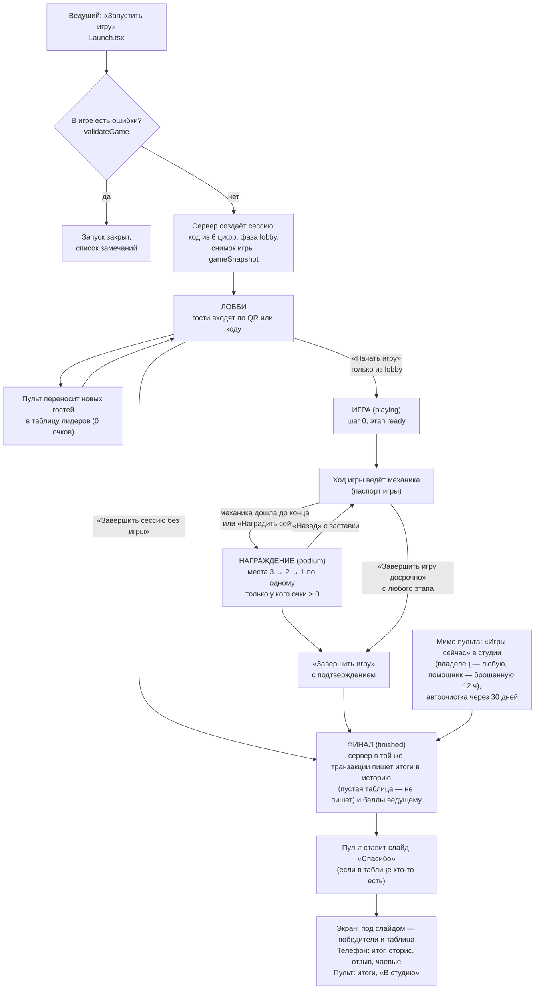
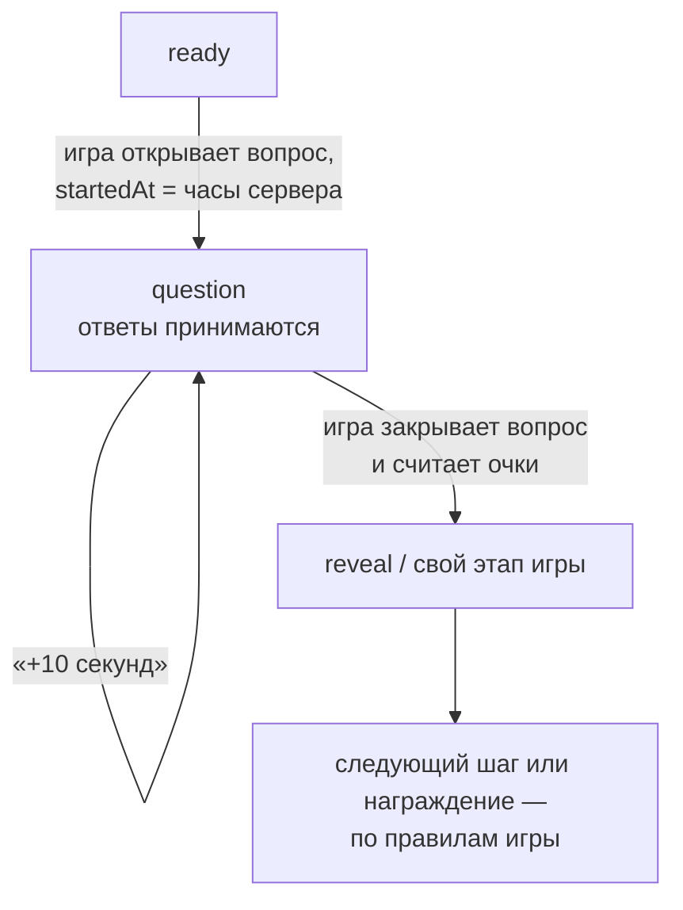
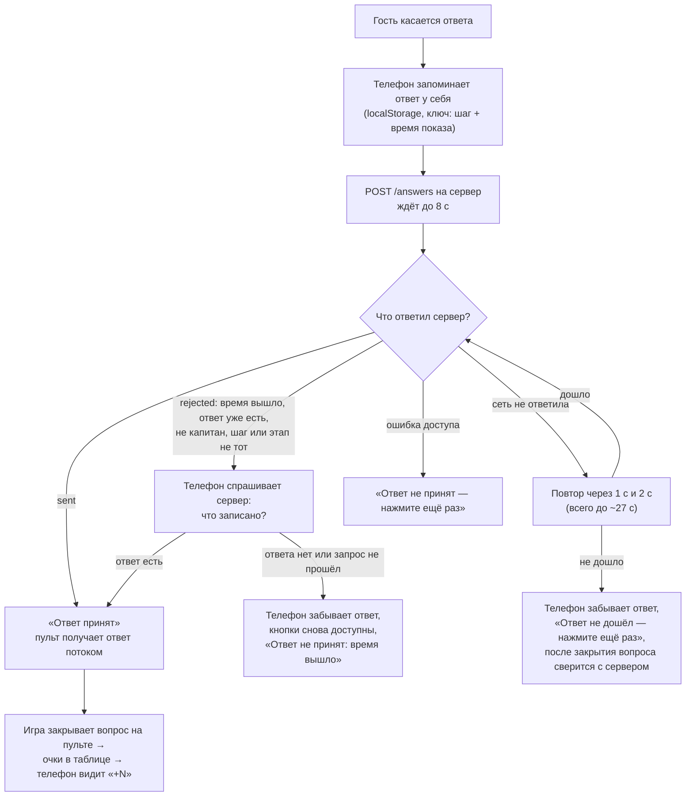
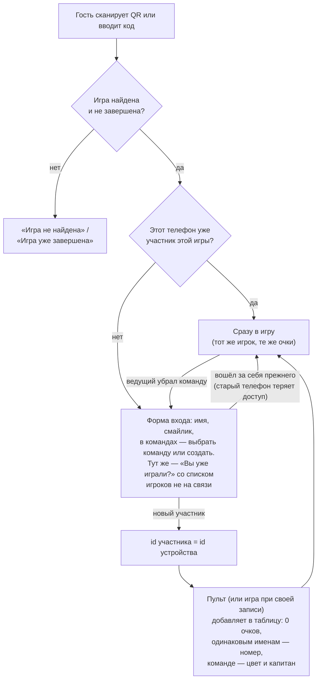

# Паспорт логики — общая часть (основа всех игр)

> **Эталон.** Этот файл описывает, как *должна* работать основа, на которой стоят все игры: вход гостя, лобби, пульт,
> экран зала, телефон, очки, награждение, итоги, переподключение. Любая правка этих мест идёт так:
> **прочитать паспорт → правка → сверить с паспортом → если логика изменилась намеренно, обновить паспорт в том же PR**.
> Расхождение кода с паспортом — ошибка. Указатель всех паспортов — [`LOGIC.md`](LOGIC.md).

- Составлен: 12 ноября 2026, по коммиту `afeceb5`.
- Независимая проверка: пройдена 12 ноября 2026, поправки внесены (раздел 10).
- Исправления: Н-1…Н-4 исправлены 12 ноября 2026 (коммиты `7fc49cb` и следующий), независимо перепроверены.
- Что сюда **не входит** (свои паспорта, когда будут составлены): «Мероприятие из блоков», быстрый канал комнат
  (`server/src/room.ts` — пока ни одна выпущенная игра на нём не работает), слайды, музыка и звуки пульта, суперигра,
  репетиция, Firebase-версия.

## 1. Кто участвует

| Устройство | Адрес | Что слушает | Что пишет |
|---|---|---|---|
| **Пульт** ведущего | `/host/:code` | сессию, участников, ответы текущего шага | всё состояние игры и таблицу (`apply`), завершение |
| **Экран зала** | `/screen/:code`, `/s` | только сессию | ничего в игру (только «я на связи» экрана) |
| **Телефон гостя** | `/play/:code`, `/j` | только сессию | вход, ответ, «я на связи» |
| **Сервер** | `server/src/live.ts` | — | хранит сессию, ставит время, проверяет права и приём ответов |

Главное следствие: **экран и телефоны видят только документ сессии**. Всё, что они должны показать (участники, очки,
итоги шага), попадает туда **через пульт**. Очки считает пульт (механика), сервер их только хранит.

## 2. Жизнь сессии

Правила:

- **О-1.** Пульт двигает фазу только вперёд: `lobby → playing → finished`. «Начать игру» сработает только из лобби
  (`expect: { phase: "lobby" }`): отставший второй пульт не вернёт идущую игру к первому шагу. *Сервер* сам «только
  вперёд» не держит: он запрещает лишь повторный старт и правки после финиша через `/apply` — новый код не должен
  слать фазу назад.
- **О-2.** Игра копируется в сессию при запуске (`gameSnapshot`): правка игры в конструкторе не меняет идущую сессию.
- **О-3.** После «Завершить игру» запись пульта (`/apply`) может менять только звук, музыку, микшер, слайд и таблицу
  поверх игры (`allowedAfterFinish`). Очки, шаг, имена — нет.
- **О-4.** Итоги для истории сервер берёт **из своей таблицы**, а не из присланной браузером (число телефонов у своей
  игры — из браузера). Сессия с пустой таблицей (в лобби или после «Начать игру» без гостей) в историю не пишется (Н-14).
  Фаза «завершена», итоги и баллы ведущему записываются одной транзакцией: «завершена без итогов» не бывает (Н-8).
- **О-5.** Код сессии уникален среди незавершённых; повтор «Создать сессию» с тем же id возвращает ту же сессию.
- **О-6.** Награждают только тех, у кого очки больше нуля; при равных очках — общее место (10, 10, 7 → 1, 1, 3).
  Кнопка «Наградить сейчас» доступна, когда на экране нет открытого вопроса (`ready`, `reveal`, `board`), и не
  показывается у игр со своим награждением (`ownAward`) и у «Олимпа» (`standalone`).

## 3. Шаг игры: что общее, а что решает игра

Общее для всех игр — только это:

- этапы шага `state.stage`: `ready` (объявлен), `question` (открыт, принимаются ответы), `reveal` (ответ показан),
  `board` (таблица), `podium` (награждение);
- время показа вопроса `startedAt` ставит **сервер**; таймер — `timeLimit` секунд;
- кнопка «+10 секунд», пока вопрос открыт и у него есть таймер;
- награждение и завершение.

**Переходы между этапами и «Назад» каждая игра пишет сама** — они описаны в паспорте игры. Многие игры почти всё
время стоят на `question` и ведут свой ход внутри `state.result`; этап `board` использует только квиз.

Правила:

- **О-7.** Ответы принимаются только когда `phase = playing`, шаг совпадает, `stage = question`, ответ ещё не показан
  (`revealed = false`) и не вышло время. Время — **по часам сервера**, запас на сеть 3 с (`ANSWER_GRACE_MS`). Телефон
  закрывает кнопки ровно по таймеру, без запаса.
- **О-8.** Очки шага игра считает по **свежему** списку ответов с сервера (`freshAnswers`), а не по тому, что успел
  получить пульт. Список и запись — два отдельных запроса, поэтому запись, которая подводит итог по ответам, должна
  нести **отметку списка** (`expect.answers` = `answersMark`: шаг, число ответов, время последнего, сумма времён).
  Сервер под блокировкой сверяет её с ответами шага: пришёл или сменился ответ — отказ 409, пульт берёт список заново
  (до трёх попыток с короткой паузой, чтобы свежая сессия дошла до пульта; потом «Игра изменилась — нажмите ещё раз»). Подключено в квизе; игра без отметки — см. **Н-1**.
- **О-9.** Каждая запись пульта, которая **двигает шаг или этап**, несёт `expect` — этап и шаг, которые видел ведущий.
  Игра уже ушла дальше (второй пульт, двойное касание) — сервер отвечает отказом 409, пульт молча ждёт свежее
  состояние. Ни шаг, ни таймер дважды не сдвигаются. Без `expect` идут только действия, которые не двигают игру:
  ручные очки, переименование, добавить и убрать участника, звук, музыка, слайд, завершение.
- **О-10.** Очки можно записать двумя способами: прибавкой `addScore` (сервер складывает, быстрые «+10» не теряются)
  или записью строки таблицы целиком. Прибавка достаётся только тому, кто уже есть в таблице. Новый код должен
  использовать прибавку; запись целиком затирает чужие одновременные правки (см. **Н-6**).
- **О-11.** Любая смена шага, этапа или фазы убирает таблицу «посмотреть сейчас» (`peek`) с экрана.
- **О-12.** «+10 секунд»: время ещё идёт — прибавляет 10 с (не дальше 900 с от показа вопроса); время вышло — даёт
  10 с от текущего момента, **сколько бы ни прошло с показа**. Потолок 900 с не действует, если лимит уже больше 900
  или с показа вопроса прошло больше 880 с (вопрос открыли заново у самого потолка). Общий предел — 12 часов. Игра,
  которая сама продлевает таймер («Ставка на знания» после «Неверно»), не режет лимит, который уже больше 900 с.
- **О-13.** Слайд или таблица поверх игры закрывают вопрос на экране, но таймер при этом идёт.

## 4. Путь ответа гостя

Правила:

- **О-14.** Один ответ на шаг от участника (ключ `сессия + шаг + участник`): повторное касание ничего не меняет.
  Исключение — шаги, которые ведущий пометил `result.changeable` (например, ночь «Мафии»). В командах у телефона
  есть ещё **личный ответ** на тот же шаг (подсказка капитана, голос участника) — он хранится по игроку, не по команде.
- **О-15.** В командах за команду отвечает **только капитан**; сервер проверяет это сам (`captain_uid`). Остальные
  телефоны команды видят вопрос, а ответ капитана — на показе ответа.
- **О-16.** Телефон никогда не должен показывать «ответ принят» или «Верно!», если этого ответа нет в подсчёте.
  Телефон запоминает ответ у себя только когда сервер его подтвердил; прежний ответ шага забывает перед отправкой
  нового. Остаточные случаи — в **Н-1** (игры без отметки списка) и **Н-3**.
- **О-17.** Ответ, оставшийся от прошлого показа того же шага (после «Назад»), заменяется новым, если гость ответил
  заново: он не блокирует новый ответ и не даёт очков «за скорость». Не ответил заново — квиз старую запись не считает
  (`shownAnswers`, паспорт квиза, К-Н-6); другие игры — по своим паспортам.
- **О-18.** Телефон спрашивает свой ответ у сервера в четырёх случаях: его открыли заново посреди показа вопроса (сразу
  и ещё раз, когда приём закрылся, если на телефоне нет запомненного ответа; открытый в лобби или на заставке — не
  спрашивает, Н-7); ответ не дошёл из-за сети — при закрытии
  приёма; сервер ответил отказом — сразу (вдруг прошлая попытка всё же дошла); участник команды — на показе ответа
  (и на шаге, где телефон открыли, — ещё раз: в первый раз капитан мог ещё не ответить). В остальное время он верит
  своей памяти. Запись старше нынешнего показа вопроса (ставка аукциона до «Ставки сделаны», ответ до «Назад») телефон
  ответом не считает (`staleAnswer`) — кроме шагов, где ответ можно менять. Личный ответ телефона в командах после
  перезагрузки при закрытии приёма не перепроверяется.

## 5. Вход гостя и возвращение

Правила:

- **О-19.** Телефон = один участник (`pid = uid` устройства, cookie). Повторный вход, перезагрузка, обрыв сети дубля
  не создают и очки не обнуляют. Другой браузер или приватный режим — это другое устройство.
- **О-20.** Все телефоны раз в 30 с шлют «я на связи» (только пока вкладка видна). Молчит дольше 75 с — «не на связи»:
  на пульте серая точка (с опозданием до минуты), за такого игрока может войти другой телефон.
- **О-21.** Войти можно только за того, кто не на связи; у нового телефона не должно быть своего игрока в этой игре;
  ни одно из двух устройств не должно играть в другой идущей игре; не больше 5 попыток с телефона за 10 минут.
- **О-22.** Капитан команды молчит дольше 90 с — пульт назначает капитаном следующего по времени входа из тех, кто на
  связи (проверка раз в 15 с); не на связи никто — капитан не меняется (Н-9). Ведущий может назначить капитана сам.
- **О-23.** В таблице лидеров — только игроки (режим «каждый сам») или только команды (режим команд), плюс
  добавленные ведущим вручную «без телефона». Телефоны участников команды в таблицу не попадают.
- **О-24.** Войти в завершённую игру нельзя; уже игравший телефон открывает её финал по сохранённому id.
- **О-25.** Ведущий убрал гостя — телефон, который уже видел себя в таблице, показывает «Вас нет в списке игроков» и
  «Войти снова». Убранного пульт не возвращает в таблицу 15 с.
- **О-26.** Ручные правки ведущего («Гости»): ±10 и любые очки выбранному, переименовать, убрать, добавить игрока или
  команду без телефона. Порядок строк от очков не меняется.

## 6. От чего зависит игра

- **О-27. Пульт должен быть открыт всю игру.** Только открытый пульт: переносит новых гостей в таблицу, пишет счётчик
  «Ответили: N», меняет ушедшего капитана, пишет звёздочки команд в лобби, заканчивает перерыв по времени, ведёт
  фоновые записи игр (ходы с телефонов, голоса, фишки). Пульт держит экран включённым (`useWakeLock`). См. **Н-5**.
- **О-28.** Обрыв сети у экрана или телефона: поток переподключается сам и получает свежий снимок; после двух сбоев —
  опрос раз в 2 с. Состояние игры не теряется, оно на сервере.
- **О-29.** Экран зала не перезагружается сам при обновлении платформы, пока идёт игра или пока на нём что-то звучит
  либо показан слайд. В тихом лобби и после финала — перезагружается.

## 7. Где это в коде

| Что | Файл |
|---|---|
| Этапы, таймер, «+10 секунд», сверка `expect`, применение записи | `src/core/session.ts` |
| Кто в таблице, одинаковые имена, смена капитана, места | `src/core/leaderboard.ts` |
| Награждение по местам, «Наградить сейчас», «Назад» | `src/core/podium.ts` |
| «На связи» (75 с) | `src/core/presence.ts` |
| Скрытые названия и представление команд | `src/core/teams.ts` |
| Итоги для истории, места при равных очках | `src/core/results.ts` |
| Интерфейс механики и действий пульта | `src/mechanics/types.ts` |
| Общая кнопка пульта с повтором и `expect` | `src/components/live/useHostRun.ts` |
| Пульт: участники → таблица, счётчик ответов, старт, финиш, «Гости» | `src/screens/HostConsole.tsx` |
| Телефон: вход, ответ, повторы, роль капитана | `src/screens/Play.tsx` |
| Экран зала: лобби, игра, финал | `src/screens/HallScreen.tsx` |
| Сервер: сессии, `apply`, ответы, вход, финиш, итоги | `server/src/live.ts` |
| Право на ответ и остальные права | `src/data/permissions.ts` |

## 8. Находки

Статусы: **подтверждено дважды** — нашёл один, второй перепроверил по коду; **найдено проверяющим** — автор паспорта
сам не перепроверял. Прогоном в браузере не подтверждалась ни одна. **Исправлены Н-1 (в квизе), Н-2, Н-3 (частично),
Н-4** — у каждой ниже строка «Исправлено»; остальные не исправлены.

### Н-1. Ответ принят сервером, но не посчитан — важно

- **Статус:** подтверждено дважды.
- **Где:** `src/mechanics/quiz/HostControls.tsx` (`revealChange`, `run`), так же устроены остальные игры со
  `freshAnswers`; сервер — `server/src/live.ts`, приём ответа.
- **Что происходит.** На «Показать ответ» пульт сначала запрашивает список ответов, потом **отдельным запросом**
  закрывает вопрос. Ответ, пришедший между этими двумя запросами, сервер принимает («Ответ принят»), а в подсчёт он
  уже не попал.
- **Как повторить.** Слабый Wi-Fi; гость нажимает на последней секунде; ведущий жмёт «Показать ответ» сразу после
  нуля, пока действует запас 3 с.
- **Чем грозит.** Гость видит «Ответ принят», потом «Верно!» — а очков нет.
- **Решение А (советую).** Первой записью закрыть приём ответов, потом взять список, потом записать очки. Правка в
  пультах игр; нужно проверить экраны на короткое состояние «вопрос закрыт, ответ ещё не показан».
- **Решение Б.** Сервер возвращает ответы шага в той же транзакции, что закрывает вопрос. Надёжнее, но это правка
  основы сервера.
- **Исправлено 12 ноября 2026 (третьим способом — сверкой, см. О-8).** Запись несёт отметку списка ответов, сервер
  сверяет её под блокировкой и при расхождении отказывает; экраны промежуточных состояний не видят. Подключено **в
  квизе**: «Показать ответ», «Ставки сделаны» (аукцион), итоги голосований суперигры. **Остальные игры со
  `freshAnswers` пока без отметки** — подключаются при составлении их паспортов. Тесты: `server/src/live.test.ts`
  («показать ответ: пока пульт считал очки…», «сверка ответов ловит и ответ, заменённый…»), `core/session.test.ts`.

### Н-2. Телефон показывает принятый ответ, которого нет на сервере — важно

- **Статус:** подтверждено дважды.
- **Где:** `src/screens/Play.tsx` — `answer()` и `useMyAnswer()`.
- **Что происходит.** Телефон запоминает ответ у себя **до** подтверждения сервера. Если страница перезагрузилась,
  пока запрос шёл (гость свернул браузер, вкладку выгрузило, обновил страницу — окно до ~27 с при плохой сети),
  после загрузки телефон находит запомненный ответ и сервер больше не спрашивает.
- **Чем грозит.** В квизе гость видит «Ответ принят», после показа — «Верно!» без строки «+N очков». На пульте он
  в списке не ответивших.
- **Решение А (советую).** Запоминать ответ только после подтверждения сервера. После перезагрузки телефон и так
  спрашивает сервер на текущем шаге, поэтому потери нет.
- **Решение Б.** Помечать запомненный ответ «не подтверждён» и после загрузки один раз сверять с сервером.
- **Исправлено 12 ноября 2026 (решение А).** Телефон запоминает ответ только после подтверждения сервера, прежний
  ответ шага забывает перед отправкой нового; телефон, открытый посреди вопроса без запомненного ответа, сверяется с
  сервером сразу и ещё раз при закрытии приёма. Автотеста нет (экран телефона), проверяется в браузере на test.

### Н-3. «Назад» стирает ответы раньше, чем записан шаг назад — средняя

- **Статус:** подтверждено дважды.
- **Где:** `src/components/live/useHostRun.ts` — сначала `clearAnswers`, потом `apply`. Игры на этом пульте: «Ставка
  на знания», «Танцевальный батл», «Танцуй как звезда», «Активная настолка», «Бой с драконом», «Миллион на кону»,
  «Держи пари», «Винное казино», «Шашки».
- **Что происходит.** Ответы шага удалены, а запись не прошла (обрыв связи, отказ 409) — вопрос остался открыт,
  ответов на сервере нет, а телефоны показывают «Ответ принят».
- **Решение (советую).** Поменять порядок: сначала запись шага, потом очистка ответов — как уже сделано в квизе.
  Лучше, но больше работы: удалять ответы на сервере в той же транзакции, что и запись.
- **Исправлено 12 ноября 2026 — там, где это безопасно.** Если запись закрывает приём ответов на стираемых шагах
  («Назад» к заставке или на прошлый шаг) — сначала запись, потом очистка (две попытки). Если вопрос остаётся открытым
  на том же шаге (переигровка: «Танцевальный батл», «Шашки», «Активная настолка») — порядок прежний, иначе стёрлись
  бы ответы, пришедшие сразу после записи; для этих случаев находка остаётся. Тест: `useHostRun.test.ts`.
- **Остаточные риски (низкие).** Обе попытки очистки не прошли — старые ответы остаются на сервере (игры на этой
  кнопке отбрасывают ответы старше нового показа; телефон после перезагрузки может показать старый ответ). Два
  пульта: второй успел заново открыть шаг, пока первый стирает, — сотрутся свежие ответы (окно около секунды).

### Н-4. «+10 секунд» перестаёт работать через 15 минут после показа вопроса — средняя

- **Статус:** подтверждено дважды (проверяющий ещё и запустил функцию: через 16 минут она возвращает «нечего
  продлевать»).
- **Где:** `src/core/session.ts`, `addTimeChange`.
- **Что происходит.** Вопрос с таймером открыт, начался долгий перерыв (тост, поздравление). Через ~15 минут кнопка
  неактивна, хотя пульт советует именно её. Остаётся только «Назад» и показ заново — со стиранием ответов.
- **Решение (советую).** Если время уже вышло — сдвигать начало отсчёта на «сейчас», а не упираться в потолок от
  первого показа.
- **Исправлено 12 ноября 2026.** Время вышло — кнопка даёт 10 секунд от текущего момента и после 15 минут, и после
  часа (лимит таймера растёт, начало отсчёта не трогается — ответы и очки за скорость не сбрасываются); «Ставка на
  знания» после «Неверно» такой лимит не режет. Тесты: `core/session.test.ts`, `board/board.test.ts`.
- **Остаток (внешний вид).** После такого продления кольцо таймера на экране зала почти пустое и сразу в «тревоге»:
  оно рисует долю от всего времени с показа вопроса.

### Н-5. Игра зависит от одного открытого пульта — риск, не ошибка в коде

- **Исправлено 12 ноября 2026 (решение А):** пульт раз в 10 с спрашивает сервер об экране (и без экрана зала) — так сервер знает, что пульт открыт. В студии у своей идущей игры пульт молчит дольше 30 с — «⚠️ Пульт не открыт — коснитесь, чтобы открыть». Экран зала у вошедшего ведущего видят и гости, поэтому там короткое «Новые гости ждут — откройте пульт» — только если пульт молчит дольше минуты и есть вошедшие гости (команды), которых нет в таблице: заблокированный на полминуты телефон зал не пугает (поправка по независимой проверке). Только память сервера; тест — «Пульт не открыт» в `live.test.ts`.
- **Статус:** подтверждено дважды; так задумано (CLAUDE.md, раздел 5), но предупреждения нет.
- **Что происходит при закрытом пульте.** Опоздавшего гостя нет на экране лобби и в таблице; счётчик «Ответили»
  стоит; ушедший капитан не меняется — его команда не может ответить; перерыв по времени не кончается; игры с ходами
  с телефонов замирают. Ответы гостей при этом сервер принимает и хранит. Когда пульт открывается, всё догоняется,
  и очки за открытый шаг опоздавший получит.
- **Решение А (советую).** Предупреждение «Пульт не открыт» на экране зала у ведущего и в студии («Идёт игра»),
  когда пульт молчит дольше 30 с.
- **Решение Б.** Сервер сам вносит участника в таблицу при входе. Это переделка основы — без отдельного согласия
  владельца не делаем.

### Н-6. Ручные очки могут пропасть при одновременном «Показать ответ» в квизе — средняя, только с двумя пультами

- **Исправлено 12 ноября 2026:** квиз пишет очки прибавкой, «+100» и стрелки — полем `patch` (паспорт квиза, К-Н-3).
- **Статус:** найдено проверяющим. Подробно — в паспорте квиза.
- **Где:** `src/mechanics/quiz/flow.ts` — квиз пишет строки таблицы целиком по своей копии.
- **Что происходит.** «+10» со второго пульта, не успевший дойти, затирается; убранный в этот момент участник
  возвращается в таблицу. На одном пульте практически недостижимо.
- **Решение.** В показе ответа и «Назад» квиза писать очки прибавкой (`addScore`).

### Н-7. На первом вопросе кнопки ответа заблокированы, пока не ответит сервер — низкая-средняя

- **Исправлено 12 ноября 2026:** телефон спрашивает сервер о своём ответе, только если его открыли во время этого показа вопроса (`openedSlot` в `Play.tsx`); открытый в лобби или на заставке — нет, кнопки доступны сразу.
- **Статус:** найдено проверяющим.
- **Где:** `src/screens/Play.tsx` — телефон, открытый ещё в лобби, считает первый шаг «шагом, где его открыли» и
  спрашивает сервер о своём ответе.
- **Что происходит.** До ответа сервера кнопки неактивны; при сбое сети повтор через 2, 4, 8 с — гость теряет время
  на первом вопросе.
- **Решение.** Не спрашивать сервер, если телефон был открыт до показа вопроса.

### Н-8. Итоги могут не сохраниться в историю — низкая

- **Исправлено 12 ноября 2026:** `/finish` пишет фазу, итоги и баллы ведущему в одной транзакции (`change(…, { after })`). Упало — ничего не записано, игра не завершена, ведущий жмёт ещё раз.
- **Статус:** найдено проверяющим; порядок шагов на сервере автор видел.
- **Где:** `server/src/live.ts`, `/finish` — смена фазы, запись итогов и баллы ведущему идут тремя отдельными шагами.
- **Что происходит.** Фаза уже «завершена», а запись итогов упала. Повторить можно только из ещё открытого окна
  подтверждения; иначе итоги появятся в истории только через 30 дней из автоочистки.
- **Решение.** Писать фазу и итоги одной транзакцией.

### Мелкие (низкая важность, найдены проверяющим)

- **Н-9.** Новый капитан назначается «следующий по кругу» без проверки, на связи ли он. Если вся команда не на связи,
  капитан меняется каждые 15 с. **Исправлено 12 ноября 2026:** только из тех, кто на связи; никого — не меняется.
- **Н-10.** Правка очков во время награждения сдвигает уже открытые места (появился третий призёр — открытым
  становится не то место). **Исправлено 12 ноября 2026:** пьедестал помнит, до какого места открыто (`result.podiumAt`),
  а не сколько мест; новое место ниже открытого сразу становится открытым — без отдельного объявления (так задумано;
  владельцу сказано). Окно смешанных версий (старый пульт пишет только `podium`) — только при выкладке во время игры,
  а она заблокирована.
- **Н-11.** Сервер отклонил ответ, а запрос сверки не прошёл — телефон забывает ответ без повторной сверки и может
  показать «Ответа не было» при начисленных очках. **Исправлено 12 ноября 2026:** сверка не прошла — «Не удалось проверить
  ответ…», шаг помечен для перепроверки при закрытии приёма.
- **Н-12.** Вход за прежнего игрока: на «игрок на связи» и «устройство занято в другой игре» сервер отвечает одним
  кодом — гость видит неверный текст. **Исправлено 12 ноября 2026:** другая идущая игра — `reason: "other-game"` и свой
  текст.
- **Н-13.** После того как за игрока вошёл другой телефон, старый видит только «Ответ не принят — нажмите ещё раз»,
  без объяснения. **Исправлено 12 ноября 2026:** «похоже, за вас вошли с другого телефона. Обновите страницу и войдите снова».
- **Н-14.** Игра, начатая без игроков и завершённая, попадает в историю, а пульт пишет «в историю не попала».
  **Исправлено 12 ноября 2026:** пустая таблица в историю не пишется (свой сервер и Firebase).
- **Н-15 (предположение, не проверено).** При сотнях гостей запись показа ответа квиза может превысить лимит запроса
  128 КБ.

## 9. Чего в схемах нет (но так работает)

- Механики сами вносят опоздавших в таблицу при своих записях (тот же `leaderboardAdditions`).
- Флаги игры `standalone`, `ownPeek`, `ownAward`, `ownAnswered` убирают общие кнопки и общий счётчик ответов.
- Капитана телефоны узнают из таблицы, а сервер проверяет по участнику: между сменой капитана и записью пульта в
  таблицу они на мгновение расходятся.
- Какую сессию открывает устройство: сначала `?s=<id>` в адресе, потом код, потом запомненные id.
- Лимиты: поиск по коду — 20 промахов с устройства и 200 с адреса за 10 минут; 100 команд в сессии, одна на телефон
  капитана.
- Время вечера и перерывы (слайд «Перерыв») пишутся в итоги.

## 10. Проверка паспорта

- **Автор** читал целиком: `core/session.ts`, `core/leaderboard.ts`, `core/podium.ts`, `core/presence.ts`,
  `core/teams.ts`, `core/results.ts`, `mechanics/types.ts`; ключевые части `screens/HostConsole.tsx`,
  `screens/Play.tsx`, `server/src/live.ts`.
- **Независимый проверяющий** (не видел, как составлялся паспорт) сверил каждое правило и стрелку с кодом в обе
  стороны: из 25 правил первой версии 14 верны, 9 неточны, 2 неверны; раздел «шаг игры» описывал квиз, а не общий
  каркас. Всё это исправлено в текущей версии. Обе находки автора подтверждены (вторая уточнена), добавлено 13 новых.
- **Автор перепроверил** по коду три главные новые находки (Н-1, Н-3, Н-4).
- **Исправления Н-1…Н-4** прошёл второй независимый проверяющий: нашёл три дефекта средней важности в самих правках
  («Ставка на знания» резала продлённый таймер; три отказа сверки подряд — без сообщения ведущему; ставки и
  голосования квиза были без отметки) — все три исправлены. Полный набор автотестов проекта прошёл в GitHub Actions.
- **Финальная независимая проверка** поправок (12 ноября 2026): блокирующих дефектов нет; ложного отказа сверки
  (сумма времён, округление, часовые пояса) не найдено — запрос проверен на PostgreSQL. Исправлены три мелочи: «+10
  секунд» у самого потолка; «Ставка на знания» резала лимит, уже превысивший 900 с; повтор после отказа сверки шёл без
  ожидания свежей сессии. Там же найдено и исправлено: участник команды, вошедший в лобби, на первом вопросе не видел
  ответ капитана при показе ответа.
- **Вторая порция (12 ноября 2026, решения владельца):** исправлены Н-5…Н-14 и находки квиза К-Н-3, 6, 7, 12; К-Н-5 —
  совет в инструкции. Новое поле записи пульта `patch` (поля таблицы без очков).
- **Независимая проверка второй порции:** блокирующих дефектов нет; `patch`, очки и «Назад» с чужим «+10», раунды,
  гонка, пьедестал, транзакция завершения проверены прогонами. Поправлено по её замечаниям: «Пульт не открыт» на экране
  зала — только когда гости ждут таблицы; «1.000», «3.0» снова совпадают с «1000», «3»; суперигра, как квиз, не
  принимает верный ответ из одних знаков; счётчик «Ответили» на экране не считает ответы прошлого показа; текст сбоя
  сверки; «за вас вошли с другого телефона» — только при 401. Сборка в GitHub нашла ещё два дефекта (баллы ведущему при
  пустой таблице, ответ из знаков в опросе) — исправлены. Оставлено как есть: старт раунда квиза берёт счёт из копии
  пульта (чужое «+10» может попасть в очки раунда — лучше, чем прежняя потеря «+10»); объединения в старых опросах с
  дробными ответами («1,5 часа») перестанут применяться — ключ сменился; Firebase-версия создаёт неполную запись таблицы
  для только что убранного участника.
- **Не проверялось:** Firebase-версия и `firestore.rules`; репетиция; пульты других игр, кроме квиза (у них — только
  использование общих функций). Автотесты и браузер не запускались: в сессии составления нет установленных пакетов.
