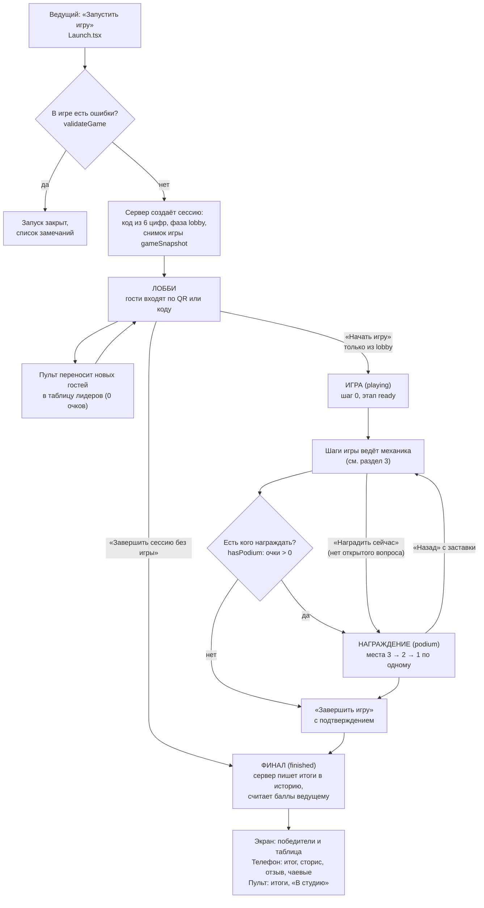
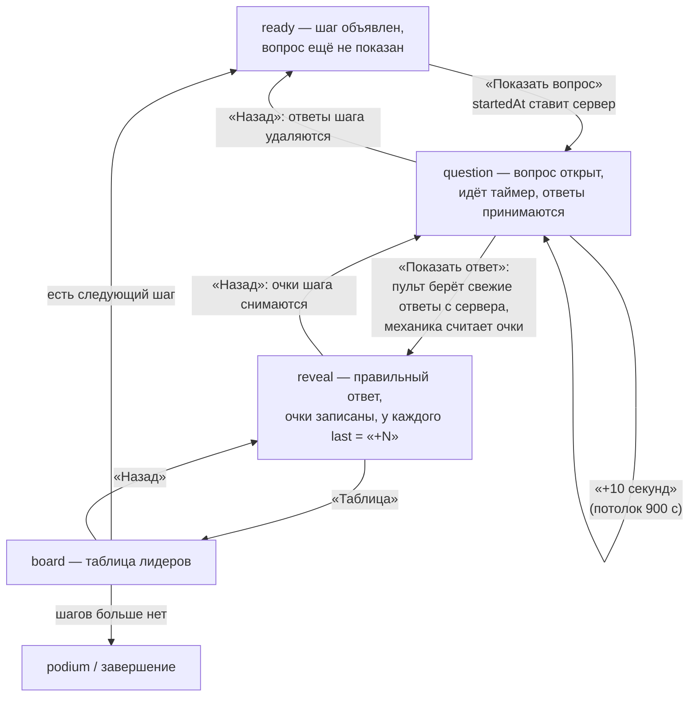
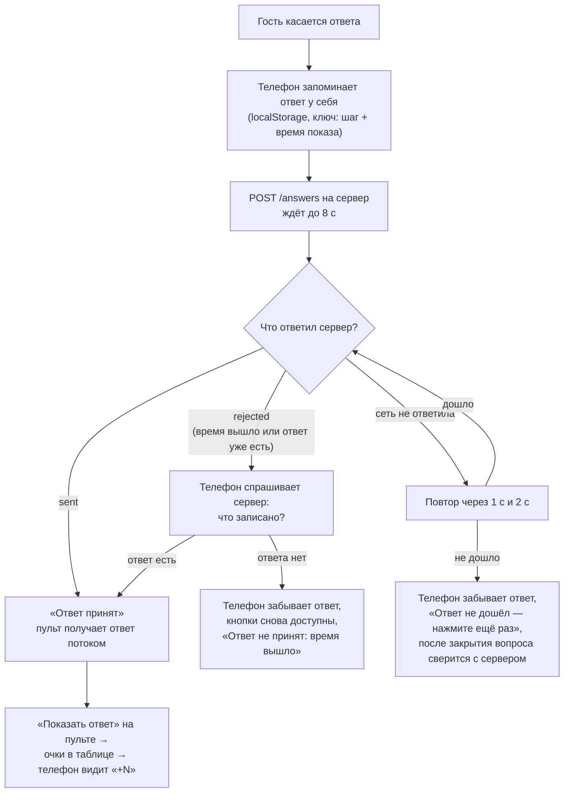
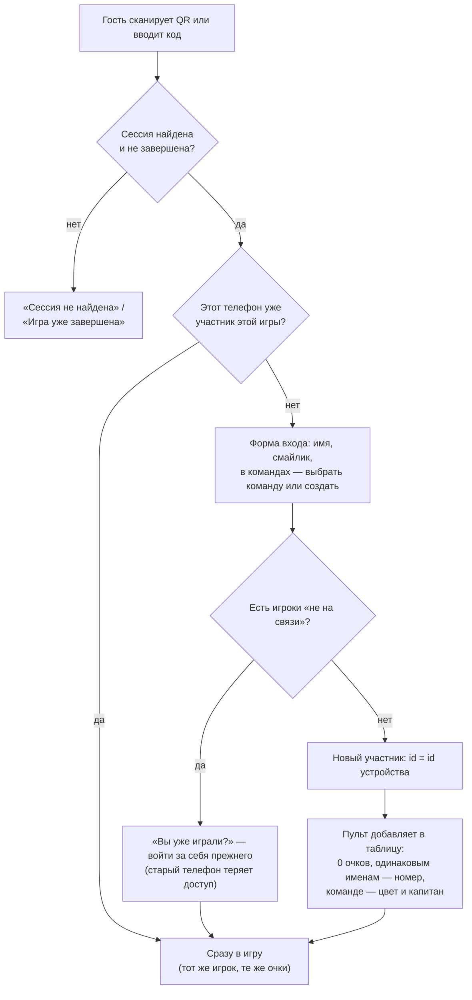

# Паспорт логики — общая часть (основа всех игр)

> **Эталон.** Этот файл описывает, как *должна* работать основа, на которой стоят все игры: вход гостя, лобби, пульт,
> экран зала, телефон, очки, награждение, итоги, переподключение. Любая правка этих мест идёт так:
> **прочитать паспорт → правка → сверить с паспортом → если логика изменилась намеренно, обновить паспорт в том же PR**.
> Расхождение кода с паспортом — ошибка. Указатель всех паспортов — [`LOGIC.md`](LOGIC.md).

- Составлен: 12 ноября 2026, по коммиту `afeceb5`.
- Независимая проверка: см. раздел 9.
- Что сюда **не входит** (свои паспорта): «Мероприятие из блоков» (`evening/LOGIC.md`), быстрый канал комнат
  (`server/src/room.ts` — пока ни одна выпущенная игра на нём не работает), слайды, музыка и звуки пульта, суперигра.

## 1. Кто участвует

| Устройство | Адрес | Что слушает | Что пишет |
|---|---|---|---|
| **Пульт** ведущего | `/host/:code` | сессию, участников, ответы текущего шага | всё состояние игры и таблицу (`apply`), завершение |
| **Экран зала** | `/screen/:code`, `/s` | только сессию | ничего в игру (только «я на связи» экрана) |
| **Телефон гостя** | `/play/:code`, `/j` | только сессию | вход, ответ, «я на связи» |
| **Сервер** | `server/src/live.ts` | — | хранит сессию, ставит время, проверяет права и приём ответов |

Главное следствие: **экран и телефоны видят только документ сессии**. Всё, что они должны показать (участники, очки,
итоги шага), попадает туда **через пульт**. Очки считает пульт (механика), сервер их только хранит и складывает.

## 2. Жизнь сессии

Правила:

- **О-1.** Фаза идёт только вперёд: `lobby → playing → finished`. «Начать игру» сработает только из лобби
  (`expect: { phase: "lobby" }`): отставший второй пульт не вернёт идущую игру к первому шагу.
- **О-2.** Игра копируется в сессию при запуске (`gameSnapshot`): правка игры в конструкторе не меняет идущую сессию.
- **О-3.** После «Завершить игру» пульт может менять только звук, музыку, микшер, слайд и таблицу поверх игры
  (`allowedAfterFinish`). Очки, шаг, имена — нет.
- **О-4.** Итоги для истории сервер берёт **из своей таблицы**, а не из присланной браузером. Сессия, закрытая в лобби
  без единого игрока, в историю не пишется.
- **О-5.** Код сессии уникален среди незавершённых; повтор «Создать сессию» с тем же id возвращает ту же сессию.

## 3. Один шаг игры (общий каркас)

Каждая механика ведёт шаги сама, но этапы шага общие — `state.stage`.

Правила:

- **О-6.** Ответы принимаются только когда `phase = playing`, шаг совпадает, `stage = question`, ответ ещё не показан и
  не вышло время (`canSubmitAnswer`; запас на сеть — `ANSWER_GRACE_MS`). Время — **по часам сервера**.
- **О-7.** «Показать ответ» считает очки по **свежему** списку ответов с сервера (`freshAnswers`), а не по тому, что
  успел получить пульт. Запись «показать ответ» и приём ответа идут под блокировкой строки сессии: ответа, который
  принят, но не посчитан, быть не может.
- **О-8.** Каждая запись пульта несёт `expect` — этап и шаг, которые видел ведущий. Игра уже ушла дальше (второй пульт,
  двойное касание) — сервер отвечает отказом 409, пульт молча ждёт свежее состояние. Ни шаг, ни таймер дважды не
  сдвигаются.
- **О-9.** Очки прибавляются на сервере (`addScore`), а не перезаписью: быстрые «+10» складываются и не затирают
  чужие правки. Прибавка — только тому, кто уже есть в таблице.
- **О-10.** Любая смена шага, этапа или фазы убирает таблицу «посмотреть сейчас» (`peek`) с экрана.
- **О-11.** «Назад» возвращает ровно на предыдущий этап: с показанного ответа — снимаются очки шага, с открытого
  вопроса — удаляются ответы шага, и телефон снова даёт ответить.

## 4. Путь ответа гостя

Правила:

- **О-12.** Один ответ на шаг от участника (ключ `сессия + шаг + участник`): повторное касание ничего не меняет.
  Исключение — шаги, которые ведущий пометил `result.changeable` (например, ночь «Мафии»).
- **О-13.** В командах отвечает **только капитан**; сервер проверяет это сам (`captain_uid`). Остальные телефоны
  команды видят вопрос и ответ капитана.
- **О-14.** Телефон никогда не должен показывать «ответ принят» или «Верно!», если ответа нет на сервере.
  ⚠ Сейчас это правило нарушается в одном случае — **находка Н-1** (раздел 8).
- **О-15.** Ответ, оставшийся от прошлого показа того же шага (после «Назад»), заменяется новым — он не блокирует
  новый ответ и не даёт очков «за скорость».

## 5. Вход гостя и возвращение

Правила:

- **О-16.** Телефон = один участник (`pid = uid` устройства). Повторный вход, перезагрузка, обрыв сети дубля не
  создают и очки не обнуляют.
- **О-17.** Все телефоны раз в 30 с шлют «я на связи» (только пока вкладка видна). Молчит дольше 75 с — «не на связи»:
  на пульте серая точка, за такого игрока может войти другой телефон.
- **О-18.** Войти можно только за того, кто не на связи, и только если у нового телефона нет своего игрока в этой игре.
  Проверка и перенос — одной транзакцией.
- **О-19.** Капитан команды молчит дольше 90 с — пульт назначает капитаном следующего по времени входа. Ведущий может
  назначить капитана сам.
- **О-20.** В таблице лидеров — только игроки (режим «каждый сам») или только команды (режим команд). Телефоны
  участников команды в таблицу не попадают.
- **О-21.** Войти в завершённую игру нельзя; уже игравший телефон открывает её финал по сохранённому id.
- **О-22.** Ведущий убрал гостя — телефон показывает «Вас нет в списке игроков» и «Войти снова».

## 6. От чего зависит игра (что должно быть включено)

- **О-23. Пульт должен быть открыт всю игру.** Только открытый пульт: переносит новых гостей в таблицу, пишет счётчик
  «Ответили: N», меняет ушедшего капитана. Пульт держит экран включённым (`useWakeLock`). См. **находку Н-2**.
- **О-24.** Обрыв сети у экрана или телефона: поток переподключается сам и получает свежий снимок; не вышло — опрос раз
  в 2 с. Состояние игры не теряется, оно на сервере.
- **О-25.** Экран зала не перезагружается сам при обновлении платформы, пока идёт игра.

## 7. Где это в коде

| Что | Файл |
|---|---|
| Этапы, таймер, «+10 секунд», сверка `expect`, применение записи | `src/core/session.ts` |
| Кто в таблице, одинаковые имена, смена капитана, места | `src/core/leaderboard.ts` |
| Награждение по местам, «Наградить сейчас», «Назад» | `src/core/podium.ts` |
| «На связи» (75 с) | `src/core/presence.ts` |
| Скрытые названия и представление команд | `src/core/teams.ts` |
| Итоги для истории, места при равных очках | `src/core/results.ts` |
| Интерфейс механики и действий пульта | `src/mechanics/types.ts` |
| Пульт: участники → таблица, счётчик ответов, старт, финиш | `src/screens/HostConsole.tsx` |
| Телефон: вход, ответ, повторы, роль капитана | `src/screens/Play.tsx` |
| Экран зала: лобби, игра, финал | `src/screens/HallScreen.tsx` |
| Сервер: сессии, `apply`, ответы, вход, финиш, итоги | `server/src/live.ts` |
| Право на ответ и остальные права | `src/data/permissions.ts` |

## 8. Находки

### Н-1. Телефон может показать принятый ответ, которого нет на сервере (потеря ответа)

- **Важность:** важно. **Статус:** найдено по коду, ждёт решения владельца.
- **Где:** `src/screens/Play.tsx` — `answer()` и `useMyAnswer()`.
- **Что происходит.** Телефон запоминает ответ у себя **до** того, как сервер его подтвердил. Если ответ не дошёл и
  вкладка осталась открытой — телефон его забывает и просит нажать ещё раз (это исправили 29 октября 2026). Но если
  в эти секунды страница **перезагрузилась** (гость свернул браузер, телефон выгрузил вкладку, обновил страницу),
  после загрузки телефон находит запомненный ответ и больше **не спрашивает сервер**. Гость видит, что ответил; после
  «Показать ответ» — «Верно!», а очков нет.
- **Как повторить.** Плохая сеть в зале → гость касается ответа → запрос висит (до 8 с и два повтора) → гость
  обновляет страницу или переключается в другое приложение, и вкладка перезагружается.
- **Чем грозит.** Гость уверен, что ответил верно, а очки не получил — спор с ведущим.
- **Решение А (советую, точечно).** Помечать запомненный ответ «не подтверждён», пока сервер не ответил `sent`.
  После загрузки неподтверждённый ответ один раз сверять с сервером: есть — оставить, нет — забыть и снова дать
  ответить. Механики и сервер не трогаются.
- **Решение Б.** Запоминать ответ только после подтверждения сервера. Проще, но при перезагрузке посреди отправки
  гость увидит кнопки заново (сервер повторный ответ отклонит и вернёт записанный — потери нет).

### Н-2. Вся игра зависит от одного открытого пульта (риск, не ошибка в коде)

- **Важность:** важно для праздника. **Статус:** так задумано (CLAUDE.md, раздел 5), но защиты нет.
- **Где:** `src/screens/HostConsole.tsx` — перенос участников в таблицу, счётчик ответов, смена капитана.
- **Что происходит.** Если пульт закрыт (ведущий ушёл в студию, телефон сел, браузер выгрузил вкладку), опоздавшие
  гости входят, но **не появляются в таблице** и не получают очков; «Ответили: N» на экране замирает; ушедший капитан
  не меняется. Всё восстанавливается, как только пульт открыт снова, — очки за пропущенные шаги не вернуть.
- **Решение А (советую, точечно).** На экране зала у ведущего и в студии («Идёт игра») — заметное предупреждение
  «Пульт не открыт — гости не добавляются», когда пульт молчит дольше 30 с.
- **Решение Б (больше работы, меняет сервер).** Сервер сам добавляет нового участника в таблицу при входе. Надёжнее,
  но это переделка основы — по решению владельца от октября 2026 такие правки не делаем без отдельного согласия.

## 9. Проверка паспорта

- Автор читал целиком: `core/session.ts`, `core/leaderboard.ts`, `core/podium.ts`, `core/presence.ts`,
  `core/teams.ts`, `core/results.ts`, `mechanics/types.ts`; ключевые части: `screens/HostConsole.tsx` (строки 109–330),
  `screens/Play.tsx` (88–135, 343–670), `server/src/live.ts` (создание, `apply`, `phase`, `finish`, вход, ответы,
  «я на связи», вход за отключившегося).
- Не прогонялось: полные автотесты в сессии составления недоступны (нет установленных пакетов).
- Независимая проверка: _заполняется после проверки_.
