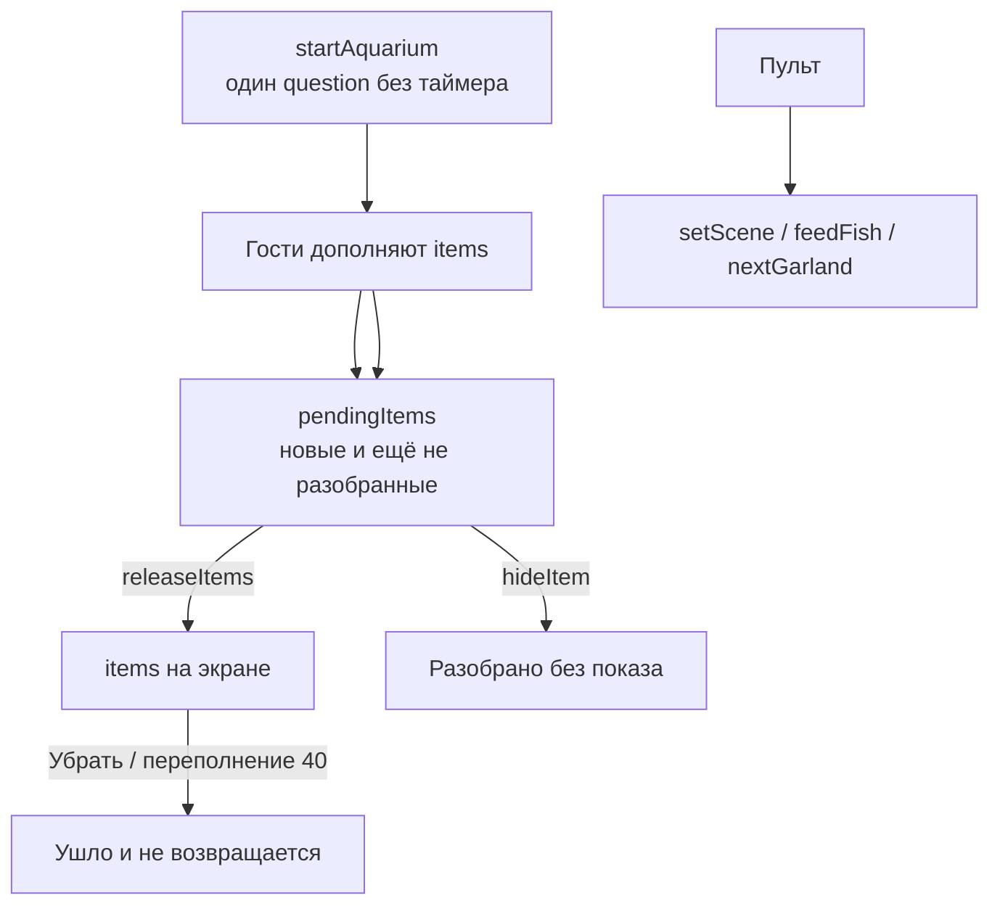

# Паспорт логики — Аквариум и Ёлка

> Перед правкой обязательны [`../LOGIC.common.md`](../LOGIC.common.md), этот паспорт и `aquarium.test.ts`.

- Составлен: 19.11.2026 по `main` после `1e6dd753`.
- Проверка: **12/12 тестов**; новых подтверждённых дефектов не найдено.
- Браузер, PostgreSQL, два реальных пульта и test/production отдельно не проверялись.

## 1. Назначение

Перерыв с раскраской: гости рисуют на телефоне рыбок или ёлочные игрушки, ведущий выпускает их на общий 3D-экран.
Общий экран обязателен, очков и пьедестала нет. Поддерживаются одиночный и командный вход, сцены `aqua` и `tree`,
корм, гирлянда, имена и модерация.

Настройки: стартовые фигуры, режим модерации, показ имён, 1–10 рисунков на гостя. На каждой сцене одновременно не
больше 40 элементов; самые старые уходят и не появляются повторно.

## 2. Схема

Вся игра — один шаг с `changeable: true`: ответ телефона можно дополнять. Рисунок содержит `id`, сцену, фигуру,
имя до 16 знаков, `onBody` и SHA-256 файла. Неверная сцена/фигура, повтор `id` или неправильный SHA отбрасываются.

## 3. Учёт без повторов

Для новых сессий используются `seen` и `skip`:

- `seen[pid]` — сколько первых рисунков телефона уже разобрано;
- `skip[pid]` — разобранные не по порядку номера;
- подряд идущие `skip` сворачиваются в `seen`, поэтому состояние не растёт с каждым действием;
- `items` хранит только текущую сцену; `gone` — совместимость со старыми записями.

`pendingItems` исключает уже выпущенные/скрытые и ограничивает `perGuest`. `releaseItems` повторно не добавляет ключ
`pid:id`. `hideItem` окончательно помечает рисунок разобранным. Старые сессии читаются по `gone` и элементам без `n`.

## 4. Экран, телефон, пульт

- **Экран:** 3D-сцена, текущие рисунки, корм/гирлянда и музыка по сцене.
- **Телефон:** раскраска и массив `items` с дополнением. Нет самостоятельного немедленного попадания на экран.
- **Пульт:** список ожидающих, выпуск, скрытие, сцена, корм, гирлянда и общее завершение (`ownAward`).

Файл раскраски идентифицируется SHA, а не произвольным путём. Реальная загрузка/существование файла, производительность
3D и отсутствие нежелательного содержимого в изображении unit-тестами не проверяются.

## 5. Инварианты

- **А-1.** Один рисунок `pid:id` попадает на экран не более одного раза.
- **А-2.** Разобранный/скрытый не возвращается при повторном ответе.
- **А-3.** С одного телефона учитывается не больше `perGuest`, на сцене не больше 40 каждого вида.
- **А-4.** Переполнение удаляет самые старые, сохраняя факт их обработки.
- **А-5.** Фигура соответствует сцене и существует в каталоге; имя ограничено.
- **А-6.** `seen/skip` не растут линейно от числа действий и корректно обрабатывают порядок.
- **А-7.** Команды плеера сцены монотонны (`feed`), гирлянда циклична (0–2).

## 6. Связи и код

`content.ts`/`Editor.tsx` задают настройки; `index.ts` регистрирует `ownAward`, музыку и представления. `logic.ts`
создаёт `SessionChange`, общий сервер применяет права/`expect`. Шагов и очков механики нет, завершение общее.

| Файлы | Ответственность |
|---|---|
| `logic.ts` | Приём, разбор, лимиты и состояние |
| `paint.ts`, `figures.ts` | Раскраска и каталог контуров |
| `scene.ts`, `views.tsx` | 3D и представления |
| `HostControls.tsx`, `Editor.tsx` | Пульт и конструктор |
| `aquarium.test.ts` | 12 тестов |

Покрыты настройки, контуры, запуск, валидация, модерация, лимиты, 70 гостей × 10 рисунков, постепенное добавление,
непоследовательный выпуск и старая сессия. Не проверены реальные файлы, 3D FPS, Safari/мобильные размеры, два пульта
и PostgreSQL.

**Итог:** логика учёта принята по 12 тестам; новых находок нет. Полный браузерно-серверный статус не присваивается.
