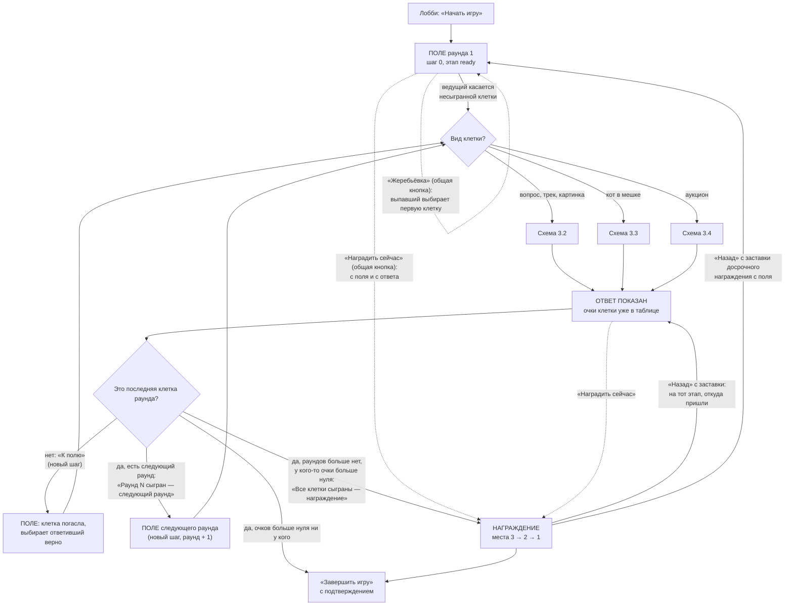
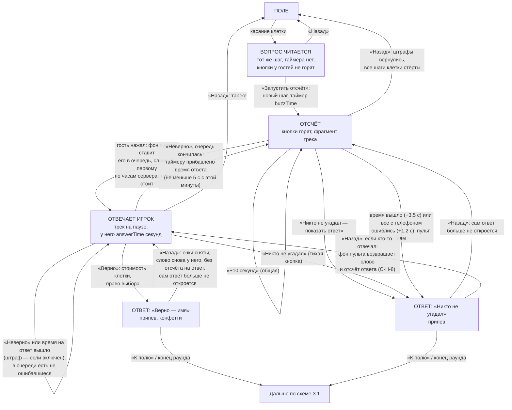
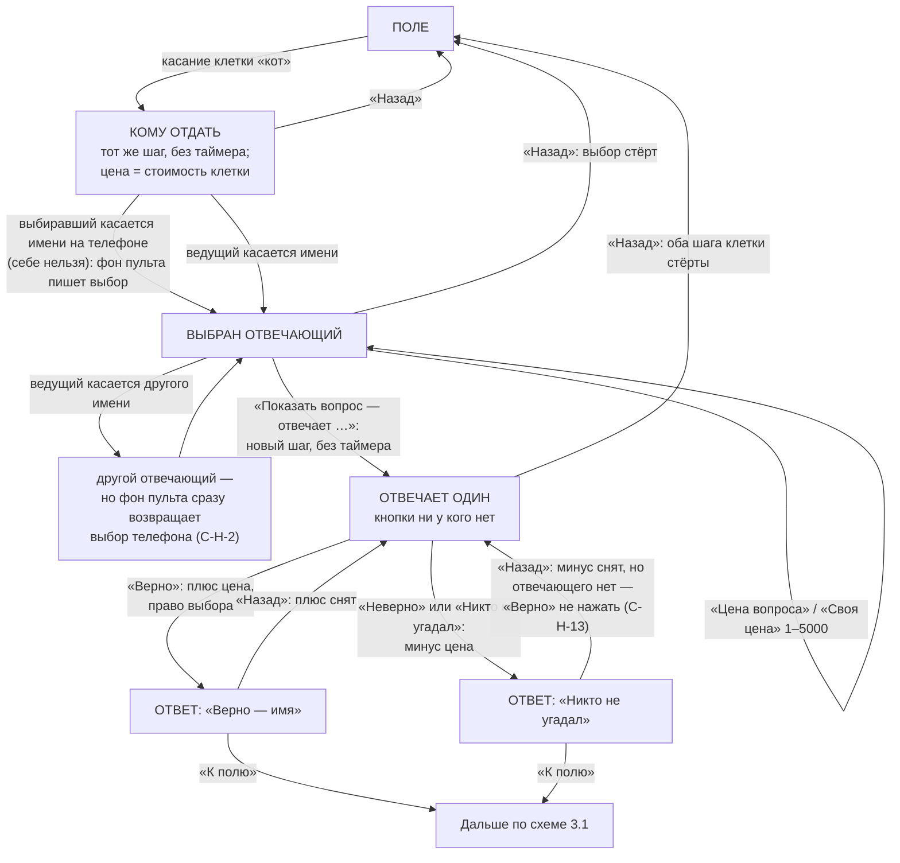
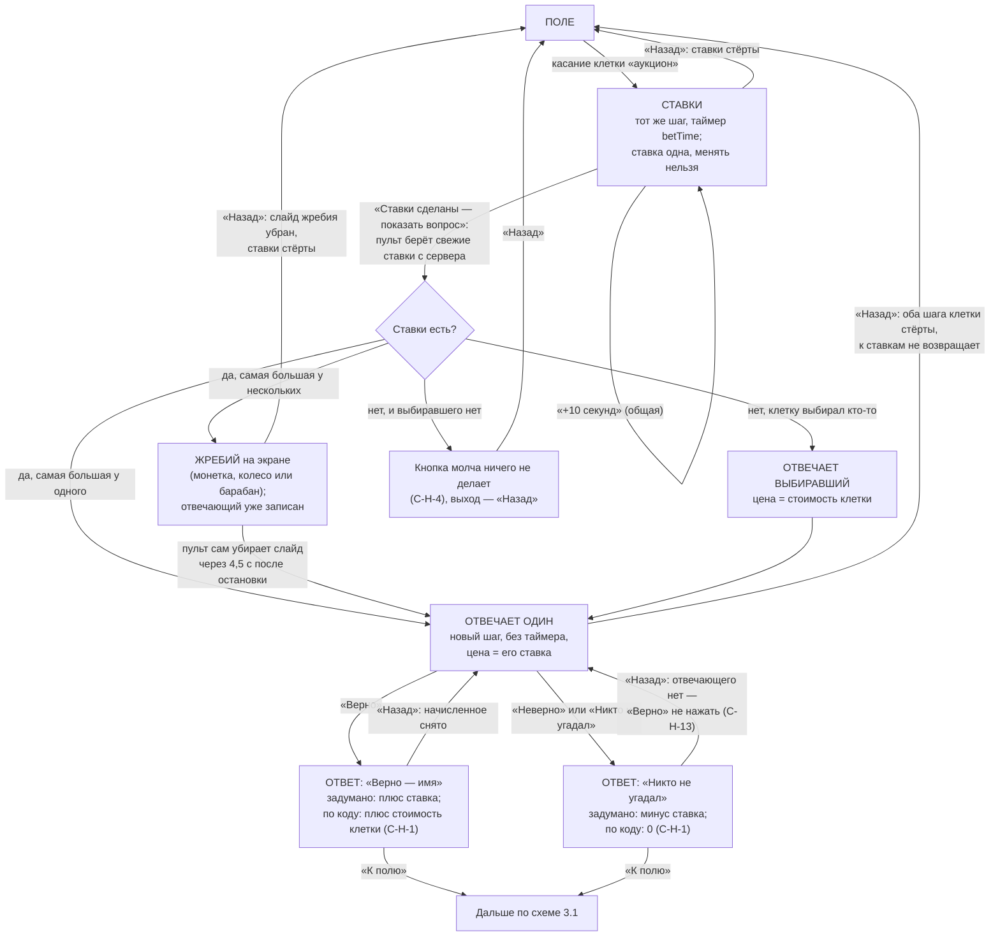
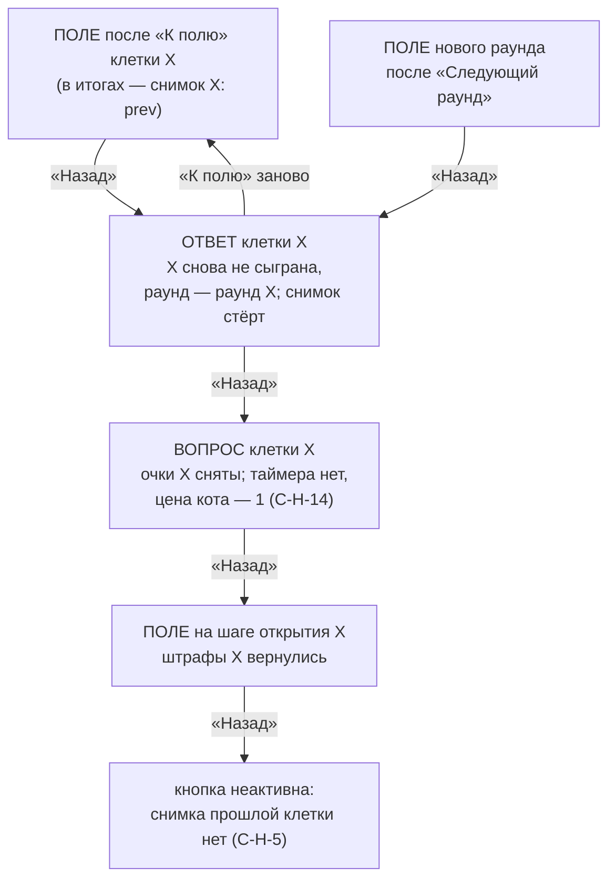
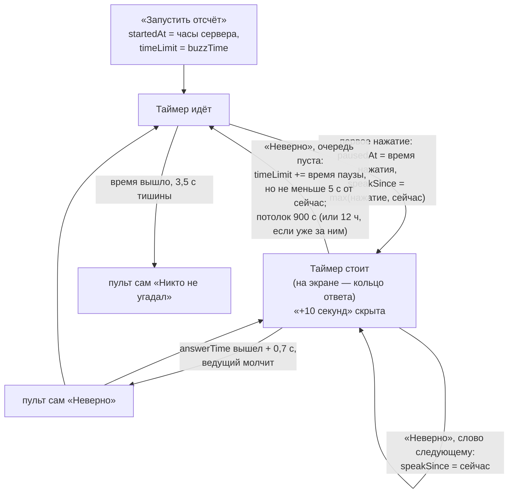

# Паспорт логики — «Ставка на знания»

> **Эталон.** Этот файл описывает, как *должна* работать «Ставка на знания»: поле, клетки, кнопка «кто первый»,
> «Кот в мешке», «Аукцион», раунды, очки и «Назад». Любая правка игры идёт так: **прочитать паспорт → правка → сверить
> с паспортом → если логика изменилась намеренно, обновить паспорт в том же PR**. Расхождение кода с паспортом —
> ошибка. Общая часть (вход гостя, лобби, приём ответов, пульт, телефон, награждение, итоги) — в
> [`../LOGIC.common.md`](../LOGIC.common.md): здесь она не повторяется, ссылки вида «О-7», «Н-1» ведут туда. Образец
> устройства паспорта — [`../quiz/LOGIC.md`](../quiz/LOGIC.md). Указатель всех паспортов — [`../LOGIC.md`](../LOGIC.md).

- Составлен: 12 ноября 2026, по коммиту `cae7eb3` (файлы `src/mechanics/board/` в рабочей копии не менялись).
- Независимая проверка: _заполняется после проверки_.
- Что сюда **не входит**: «Мероприятие из блоков» (игра как блок вечера), репетиция, предпросмотр в конструкторе,
  Firebase-версия, внешний вид (размеры, цвета, анимации, оформления «Игровой стол» / «Студия» / «Вечер JoyRest»).

## 1. Что за игра

Поле: строки — категории (темы), колонки — стоимость. Ведущий касается клетки, которую назвал игрок (команда), вопрос
появляется на экране, ведущий читает его вслух, потом «Запустить отсчёт» — у гостей загорается кнопка «кто первый».
Первый нажавший отвечает голосом, ведущий жмёт «Верно» или «Неверно». Сыгранная клетка гаснет. Кто ответил верно, тот
выбирает следующую клетку. Очки считает пульт в момент «Верно» / показа ответа.

**Виды клеток** (`kind`, `content.ts`):

| Вид | Метка на пульте | Как играется | Очки |
|---|---|---|---|
| `question` Вопрос | — | вопрос на экране → отсчёт → кнопка «кто первый» | верно — стоимость клетки; неверно — 0 или минус стоимость (настройка «штраф») |
| `track` Трек | ♪ | то же, на экране звучит фрагмент трека, на ответе — припев | как у вопроса |
| `picture` Картинка | фото | то же, картинка на экране | как у вопроса |
| `cat` Кот в мешке | кот | кто выбирал клетку, отдаёт вопрос другому (телефоном или называет ведущему), ведущий может поставить свою цену; отвечает только он | верно — плюс цена, неверно — минус цена |
| `auction` Аукцион | аукц. | все ставят очки на телефонах, отвечает поставивший больше всех (равные — жребий); ставок нет — выбиравший клетку | **задумано:** верно — плюс ставка, неверно — минус ставка. **По коду сейчас — иначе, см. С-Н-1** |

**Режимы** (`index.ts`, `supports`): каждый сам, команды, без экрана зала — все три. В командах кнопку жмёт, ставит и
отдаёт «Кота» капитан (О-15), участники видят «Кнопку жмёт капитан».

**Что ещё есть в коде:**

- **Раунды** — 1–3 (`MAX_ROUNDS`), у каждой категории свой `round`. Поле раунда — его категории. Новый раунд в
  конструкторе — того же размера, стоимость по умолчанию ×2 (второй) и ×3 (третий). Новая игра — 2 раунда по 4×5.
- **Время.** Отсчёт кнопки `buzzTime` (5/10/15/20/30 с, по умолчанию 15). Пока кто-то отвечает, отсчёт стоит
  (`pausedAt`). У отвечающего своё время `answerTime` (0 — без отсчёта, 5–30 с, по умолчанию 10): не уложился, а
  ведущий не отметил — пульт сам ставит «Неверно». Ставки аукциона — `betTime` (10–120 с, по умолчанию 30).
- **Картинка клетки** сразу с вопросом (`imageShow: now`) или по кнопке ведущего (`host`); своя картинка к ответу
  (`answerImageId`) заменяет картинку вопроса на этапе ответа.
- **Трек клетки:** фрагмент на вопросе (на паузе, пока кто-то отвечает), припев на ответе (и при «Никто не угадал»),
  конфетти на верный ответ, «♪ Повторить фрагмент» на пульте.
- **Жеребьёвка «кто ходит первым»** (общая кнопка пульта): монетка на экране, выпавший получает право выбрать первую
  клетку (`firstTurn` → `boardFirstTurn`, только пока на экране поле).
- **«Таблица очков на экран»** — своя крупная кнопка пульта (`ownPeek`), общей карточки «Таблица поверх игры» нет.
- **Награждение** — общее (О-6); после последней клетки последнего раунда.
- **Готовый шаблон** (`demo.ts`): 2 раунда × 4 категории × 5 вопросов, 3 «Кота в мешке» и 2 «Аукциона», без штрафа,
  отсчёт 15 с, время на ответ 10 с, оформление «Игровой стол», жребий — колесо. Проходит проверку (прогон).

## 2. Этапы шага и что на них видно

Этапы общие (`state.stage`): `ready` — поле, `question` — клетка открыта (внутри — свой ход, `result.mode`),
`reveal` — ответ показан, `podium` — награждение. Этап `board` игра не использует. Номер шага (`state.step`) растёт
не по клеткам, а по действиям: «Запустить отсчёт», «Показать вопрос» у кота, «Ставки сделаны», «К полю» и «Следующий
раунд» — новый шаг (ответы прошлого шага на новом не считаются).

| Этап (`stage` / `mode`) | Экран зала | Телефон гостя | Пульт |
|---|---|---|---|
| Поле (`ready`) | поле раунда, сыгранные клетки погасли; «Выбирает: …» или «Ведущий выбирает первую клетку» | «Вы выбираете клетку!» или «Выбирает …»; без экрана — поле | поле с метками ♪/фото/кот/аукц., «Таблица очков на экран», «Назад»; поле сыграно — «Раунд N сыгран — следующий раунд» / «Все клетки сыграны — награждение» / «Завершить игру» |
| Вопрос читается (`question`, `buzz`, не `armed`) | вопрос, картинка (если «сразу»), «Слушаем вопрос — кнопки включатся…» | «Слушайте вопрос» | вопрос, верный ответ, «Запустить отсчёт · N с», «🖼 Показать картинку» |
| Отсчёт (`armed`, слово ни у кого) | таймер, «Нажали: N», фрагмент трека | большая кнопка | таймер, «Ждём нажатия», очередь, «Никто не угадал — показать ответ» |
| Отвечает (`buzz.current`) | «Отвечает …», кольцо времени на ответ, трек на паузе | у него — «ваше слово» и секунды, у остальных — место в очереди | «Отвечает …», «Верно», «Неверно», «Ещё N с на ответ» |
| Кот: кому отдать (`bet`) | мешок с котом, «… выбирает, кому отдать» / «Вопрос достаётся: …, цена» | у выбиравшего — список игроков; у остальных — кто отвечает | «Кому достаётся вопрос», «Цена вопроса», «Показать вопрос — отвечает …» |
| Аукцион: ставки (`auction`) | «Аукцион!», таймер ставок, «Ставок: N» | форма ставки → «Ставка принята: N» | ставки с суммами, выбор жребия, «Ставки сделаны — показать вопрос» |
| Кот / аукцион: отвечает один (`buzz`, `catStep`) | вопрос, «Кот в мешке / Аукцион · N очков»; при жребии — «Ставки равны… жребий выбрал …» | у него — «Отвечаете вы — говорите ведущему!», у остальных — кто отвечает и цена | «Отвечает … · ставка N», «Верно», «Неверно» (сразу показывает ответ) |
| Ответ (`reveal`) | «Верно — …» или «Никто не угадал. Правильный ответ:», картинка к ответу, припев, конфетти | правильный ответ, «победа» / «мимо», счёт | «К полю» (или конец раунда / игры), «Назад» |
| Награждение (`podium`) | пьедестал (общая часть) | пьедестал (общая часть) | «Открыть следующее место» → «Завершить игру» |

Где в коде: экран — `views.tsx`, `BoardScreenView`; телефон — `views.tsx`, `BoardPlayerView`; пульт —
`HostControls.tsx`. Пьедестал рисуют `HallScreen.tsx` и `Play.tsx`.

## 3. Блок-схемы

### 3.1. Ход игры целиком

На схеме нет «Таблица очков на экран» (кладёт таблицу поверх игры на любом этапе, шага не двигает; смена шага или
этапа убирает её сама — О-11) и «Назад» с поля и с ответа — они на схемах 3.2–3.5.

Где в коде: `logic.ts` — `boardPrimary` (главная кнопка), `openCell`, `toBoard`, `nextRound`, `allOpened`,
`hasNextRound`; награждение — `core/podium.ts` (`awardNow`, `podiumBack`).

### 3.2. Обычная клетка: вопрос, трек, картинка

Где в коде: `logic.ts` — `openCell`, `armBuzz`, `boardBuzzSync`, `boardWrong`, `speakLeft`, `speakTimeout`,
`speakMore`, `boardReveal`, `boardBack`; кнопка — `core/buzz.ts` (`syncBuzz`, `buzzWrong`, `buzzRight`, `buzzPhone`);
фоновые записи пульта — `HostControls.tsx` (стр. 53–96).

### 3.3. «Кот в мешке»

Где в коде: `logic.ts` — `catGiveOf`, `setCat`, `startCatQuestion`, `playDeltas`, `boardReveal`, `boardBack`;
`HostControls.tsx` (стр. 132–139 — фон пишет выбор телефона; 329–386 — пульт; 415 — «Неверно» сразу показывает ответ).

### 3.4. «Аукцион»

Где в коде: `logic.ts` — `auctionBets`, `maxBet`, `startAuction`, `AUCTION_DRAW_HOLD_MS`, `playDeltas`;
`HostControls.tsx` (стр. 118–130 — убрать слайд жребия; 141–151 — счётчик ставок на экран; 280–327 — пульт);
`views.tsx` (стр. 361–386 — форма ставки).

### 3.5. «Назад» с поля и раунды

Где в коде: `logic.ts` — `toBoard` (кладёт `prev`), `boardBack` (стр. 586–600), `nextRound`.

### 3.6. Время клетки: пауза и время на ответ

Сервер принимает нажатия по своему таймеру (О-7): пока таймер «стоит» на пульте, на сервере срок идёт, поэтому после
исходного срока + 3 с новые нажатия в очередь не принимаются, пока «Неверно» не вернёт время.

## 4. Правила логики

Каждое правило должно выполняться всегда. «Где» — файл и функция; номера строк — по коммиту `cae7eb3`.

### Поле, клетка, кнопки

- **С-1.** Один шаг игры — не одна клетка. Список шагов механики (`boardSteps`) — все клетки поля, но ход идёт по
  `state.step`, который растёт на каждом действии с новым приёмом ответов («Запустить отсчёт», «Показать вопрос» у
  кота, «Ставки сделаны», «К полю», «Следующий раунд»). Нажатие или ставка прошлого шага на новом не считаются.
  *Где:* `logic.ts`, `armBuzz` (стр. 392), `startCatQuestion` (283), `startAuction` (339), `toBoard` (529),
  `nextRound` (376).
- **С-2.** Главная кнопка пульта — одна на этапе, её выбирает `boardPrimary` (стр. 209): поле — «выбрать клетку» или
  (поле раунда сыграно) «следующий раунд» / «награждение» / «завершить»; клетка — «Запустить отсчёт», «Показать
  вопрос» (кот), «Ставки сделаны» (аукцион); ответ — «К полю» или конец раунда/игры; награждение — «Открыть следующее
  место» / «Завершить игру». Пульт берёт из `boardPrimary` только «К полю», конец раунда и награждение; пока идёт отсчёт и
  никто не отвечает, главная кнопка пульта — «Никто не угадал — показать ответ», а «Верно» / «Неверно» — пока кто-то
  отвечает (`HostControls.tsx:505`; проверка 12 ноября 2026).
- **С-3.** Сыгранную клетку не открыть снова (`openCell` возвращает пустую запись). Играющая клетка считается
  сыгранной для решения «это последняя клетка раунда?» (`allOpened`, стр. 197). *Где:* `openCell` (стр. 226).
- **С-4.** Открытие клетки: этап «вопрос», `startedAt` — часы сервера, таймер только у аукциона (`betTime`); у
  остальных таймера нет, кнопки не горят (`armed: false`). В итогах: клетка, вид хода, кто выбирал до неё
  (`pickerBefore`), шаг открытия (`openStep`), цена кота = стоимость, картинка скрыта, ничьей нет.
  *Где:* `openCell` (стр. 232–242).
- **С-5.** «Запустить отсчёт» — только из «вопрос читается» обычной клетки: новый шаг, таймер `buzzTime`, очередь
  пустая, пауза и отсчёт ответа сброшены, авто-показ снова разрешён (`noAuto: false`). *Где:* `armBuzz` (стр. 392–406).
- **С-6.** Каждая кнопка пульта уходит через общую запись `useHostRun` с `expect`: этап, шаг и отпечаток итогов шага.
  Игра ушла дальше или итоги изменились — сервер отказывает; повтор — только если «момент» тот же (`boardMoment`: вид
  хода, клетка, число сыгранных, раунд, `catStep`, `armed`, выбирающий — без очереди нажатий). «Верно» и «Неверно»
  срабатывают только для того, кто отвечал в момент касания (`sameSpeaker`). Двойное касание и второй пульт не
  начисляют дважды. Защищает именно отказ сервера по этапу: «Верно», собранное заново по сессии уже на этапе ответа,
  дало бы очки ещё раз (прогон: 100 → 200); одна и та же запись, применённая дважды, счёт не меняет (строка пишется
  целиком), а запись «Неверно» со штрафом дважды сняла бы штраф дважды (прогон: −100 → −200). *Где:* `HostControls.tsx`, стр. 16–35, 43, 153–154, 407–418;
  `components/live/useHostRun.ts`, `runHostChange`.
- **С-7.** «Назад» — та же запись с `expect`, до 4 попыток со своим моментом (`backMoment`: момент игры + число
  открытых мест пьедестала), шаги для очистки ответов считаются заранее. *Где:* `HostControls.tsx`, стр. 177–181.
- **С-8.** Фоновые записи пульта (без «занято» на кнопках, по одной, с отпечатком итогов): очередь нажатий
  (`boardBuzzSync`), сам «Никто не угадал», сам «Неверно» по времени ответа, выбор «Кота» с телефона (`setCat`).
  Пока ведущий жмёт, фон пропускает ход. Слайд жребия и счётчик ставок пульт пишет мимо `useHostRun`, с `expect`
  (слайд — по его id; счётчик — по шагу и этапу). *Где:* `HostControls.tsx`, стр. 53–151.

### Кнопка «кто первый» и время

- **С-9.** Очередь нажатий — по времени сервера, только дополняется (позднее нажатие не обгоняет записанное). Слово
  у того, у кого оно уже есть, иначе у первого в очереди, кто ещё не ошибся. Ошибившийся до конца клетки не отвечает.
  У кота и аукциона слово только у того, у кого есть ставка. *Где:* `core/buzz.ts` (`buzzOrder`, `syncBuzz`);
  `logic.ts`, `boardBuzzSync` (стр. 412–429).
- **С-10.** Слово досталось — отсчёт стоит с момента нажатия (`pausedAt`), трек на экране на паузе, «+10 секунд»
  скрыта. Отсчёт ответа (`speakSince`) — с нажатия, но не раньше, чем слово освободилось. *Где:* `boardBuzzSync`
  (стр. 420–427); `components/live/AddTimeButton.tsx` (`frozen`); `views.tsx`, `useCellMedia` (стр. 130).
- **С-11.** «Неверно»: отвечавший — «мимо»; при включённом штрафе — минус стоимость клетки прибавкой (`addScore`) и
  запись в `fines` (не у кота). Слово следующему из очереди — у него свой отсчёт ответа, таймер дальше стоит. Очередь
  пуста — пауза кончилась: к таймеру прибавляется время паузы, но так, чтобы с этой минуты было не меньше 5 с; потолок
  900 с, а если лимит или нужное время уже за потолком — 12 ч (не режет продлённое, О-12). *Где:* `boardWrong`
  (стр. 481–506). Прогон: нажал на 3-й секунде, отвечал 40 с, «Неверно» со штрафом 200 → лимит 15 → 55 с, счёт −200.
- **С-12.** Время на ответ (`answerTime` > 0): вышло, ведущий 0,7 с ничего не нажал — пульт сам делает «Неверно» (со
  штрафом, если включён) — только для того же отвечающего и того же отсчёта. «Ещё N с на ответ» — отсчёт заново с этой
  минуты. У кота и аукциона отсчёта ответа нет. После «Назад» с ответа отсчёта нет только у того, кому вернули слово:
  нажал ведущий «Неверно» — следующий в очереди получает отсчёт и автоматическое «Неверно» (`logic.ts:489`); путь
  «Никто не угадал» → «Назад» — в С-Н-8. *Где:* `speakLeft`, `speakTimeout`,
  `speakMore` (стр. 432–453); `HostControls.tsx`, стр. 86–96, 420–430.
- **С-13.** Сам «Никто не угадал»: клетка с кнопкой, отсчёт запущен, слово ни у кого, победителя нет, ведущий не
  возвращался «Назад» с ответа (`noAuto`), и время вышло (ждём 3,5 с — запоздалое нажатие ещё дойдёт) или все
  участники с телефоном ошиблись (ждём 1,2 с). Перед записью пульт ещё раз проверяет всё по свежей сессии.
  *Где:* `HostControls.tsx`, стр. 61–84.
- **С-14.** «Никто не угадал — показать ответ» доступна, пока отсчёт запущен, и когда кто-то отвечает (тогда — тихая
  кнопка): слово снимается без «мимо» и без штрафа. Так — только у обычной клетки: у кота и аукциона эта кнопка — то же,
  что «Неверно» (кот — минус цена, `playDeltas`). *Где:* `HostControls.tsx`, стр. 504–508; `boardReveal`.

### Очки

- **С-15.** Очки клетки начисляются в одном месте — при показе ответа (`boardReveal`, стр. 509): прибавка
  `playDeltas` (стр. 172) пишется в строку участника целиком (счёт + прибавка, `last` = прибавка). Штрафы «Неверно»
  идут отдельно прибавкой (С-11). Участников, которых пульт ещё не внёс в таблицу, показ ответа вносит сам.
- **С-16. Вопрос, трек, картинка:** «Верно» — стоимость клетки тому, кто отвечал; «Никто не угадал» — 0.
  Право выбора — у ответившего верно; никто не угадал — у прежнего выбирающего. *Где:* `playDeltas` (стр. 174),
  `boardReveal` (стр. 523).
- **С-17. Кот в мешке:** цена — стоимость клетки или своя цена ведущего (1–5000). «Верно» — плюс цена и право
  выбора, «Неверно» / «Никто не угадал» — минус цена. Штраф `penalty` у кота не действует. Прогон: цена 200, у
  отвечающего −100 → «Неверно» −300, «Верно» 100. *Где:* `startCatQuestion` (стр. 287), `playDeltas` (стр. 175–180).
- **С-18. Аукцион (задумано — CLAUDE.md, инструкция, тексты экрана, телефона, пульта и конструктора):** потолок ставки
  — больше из «свой счёт» и «стоимость клетки» (`maxBet`; при нуле и минусе — до стоимости; прогон: 0 → 100,
  −500 → 100, 700 → 700); пульт обрезает ставку до потолка. Отвечает самая большая ставка; равные — жребий; ставок нет
  — выбиравший клетку за её стоимость. Верно — плюс ставка, неверно — минус ставка. **Код этому не соответствует:
  С-Н-1.** *Где:* `auctionBets` (стр. 320), `startAuction` (стр. 339), `maxBet` (стр. 164).
- **С-19.** Счёт может стать отрицательным (штраф, кот); нижней границы нет. На пьедестал попадают только те, у кого
  больше нуля (О-6). После последней клетки: у кого-то очки больше нуля — «награждение», нет — «Завершить игру».
  *Где:* `boardPrimary` (стр. 215, 221); `core/podium.ts`, `hasPodium`.

### «Кот в мешке» и «Аукцион» — ход

- **С-20.** Кот: отдаёт вопрос тот, кто выбирал клетку (`pickerBefore`), ответом `{ give: pid }` на шаге клетки;
  себе нельзя, только тому, кто есть в таблице; ответ один (менять нельзя, «Передумали — скажите ведущему»). Пульт
  пишет выбор на экран сам. Ведущий может выбрать сам и поставить цену; без выбора «Показать вопрос» неактивна.
  Выбиравшего нет (первая клетка без жеребьёвки) — выбирает ведущий. *Где:* `catGiveOf` (стр. 260), `setCat`
  (стр. 273); `HostControls.tsx`, стр. 132–139, 329–386; `views.tsx`, стр. 388–440.
- **С-21.** Аукцион: ставка `{ bet }` — одна на участника, принимается до конца `betTime` (+3 с запаса сервера);
  экран видит только число ставок. «Ставки сделаны» берёт свежий список с сервера; самая большая у нескольких — жребий
  среди них (эффект — выбор на пульте, по умолчанию из настроек игры), слайд жребия с id `auc…` пульт убирает сам
  через 4,5 с после остановки и только если на экране тот же слайд; без жребия (старый путь) — раньше поставивший.
  Отвечающий записан сразу, ещё до остановки жребия. *Где:* `startAuction` (стр. 339–369), `HostControls.tsx`,
  стр. 118–130, 320.
- **С-22.** У кота и аукциона на этапе ответа таймера нет, кнопки «кто первый» ни у кого нет, «Неверно» сразу
  показывает ответ (`boardReveal(…, false)`), время на ответ не считается. *Где:* `startCatQuestion` и
  `startAuction` (`timeLimit: null`, `catStep: true`, `armed: true`); `HostControls.tsx`, стр. 415.

### Раунды и конец поля

- **С-23.** Раунд кончился — «Раунд N сыгран — следующий раунд»: клетка гаснет (с этапа ответа — вместе с «К полю»),
  новый шаг, поле следующего раунда; раунды без клеток пропускаются. *Где:* `nextRound` (стр. 376–386),
  `hasNextRound` (стр. 203).
- **С-24.** Раунд у всех один на игру: переход в раунд выше — только кнопкой, назад — только «Назад» с поля
  нового раунда (С-27). *Где:* `result.round`.

### «Назад»

- **С-25. Куда ведёт «Назад»** (`boardBack`, стр. 558–601):

  | Откуда | Куда | Что с очками и ответами |
  |---|---|---|
  | Награждение, открыто хоть одно место | закрывает последнее место | ничего |
  | Награждение, заставка | на этап, откуда пришли (ответ или поле) | ничего |
  | Ответ | вопрос той же клетки, тот же шаг | очки клетки сняты прибавкой; слово снова у ответившего верно (был победитель); после «Никто не угадал» слово ни у кого — у обычной клетки его вернёт фон пульта (С-Н-8), у кота и аукциона — нет (С-Н-13); право выбора — у прежнего; сам ответ больше не откроется (`noAuto`); штрафы остаются |
  | Вопрос (любой: читается, отсчёт, отвечает, кот, ставки, отвечает один) | поле, шаг открытия клетки | штрафы клетки вернулись; ответы всех шагов клетки стёрты; слайд жребия аукциона убран |
  | Поле после «К полю» или «Следующий раунд» | ответ прошлой клетки (раунд — её раунд) | клетка снова не сыграна; снимок прошлой клетки стёрт; снимок не хранит `startedAt`/`timeLimit`, `catTo`/`catPrice`, `auctionTie`, `imageShown` — следующий «Назад» даёт вопрос без таймера, у кота цена 1 (С-Н-14) |
  | Поле без снимка (начало игры, или уже вернулись на одну клетку) | некуда, кнопка неактивна | — |

- **С-26.** «Назад» с ответа и снова «Верно» не удваивает очки: снимается ровно то, что даёт `playDeltas` по итогам
  клетки, повторный показ считает заново (тесты; прогон полной игры и «Назад»). *Где:* `boardBack` (стр. 562–573).
- **С-27.** Снимок для «Назад» с поля — один (`prev`): вернуться можно только на одну клетку назад (С-Н-5).
  *Где:* `toBoard` (стр. 532), `boardBack` (стр. 587–588).
- **С-28.** «Назад» с вопроса: сначала записывается «поле», потом стираются ответы всех шагов клетки (две попытки,
  сбой ведущему не показывается). *Где:* `useHostRun.ts`, `runHostChange` (`applyFirst`), `clearClosed`.

### Что лежит в итогах шага (`state.result`, `BoardResult`)

- **С-29.** `opened` (сыгранные клетки), `cell` (играющая), `picker` (кто выбирает), `pickerBefore` (кто выбирал до
  этой клетки), `mode` (`pick` / `bet` / `auction` / `buzz`), `buzz` (`order`, `current`, `out`, `winner`), `bets`
  (у кота и аукциона — одна запись «отвечающий: цена»), `fines`, `catStep`, `catTo`, `catPrice`, `armed`, `openStep`,
  `round`, `pausedAt`, `speakSince`, `noAuto`, `imageShown`, `auctionTie`, `replay`, `prev` (снимок прошлой клетки) и
  у награждения — `podium`, `podiumFrom` и (с 12 ноября 2026, общая часть Н-10) `podiumAt` — до какого места открыто;
  «Назад» на награждении считает по нему, `backMoment` (С-7) смотрит на `podium` — оба поля пишут `podiumNext`/`podiumBack`. Разбор не бросает: неизвестное — значения по умолчанию, ставки и штрафы —
  целые ≥ 0. *Где:* `parseBoardResult` (стр. 118–144).
- **С-30.** Запись участника: `score`, `last` (прибавка последнего показа ответа). `move`, `roundBase` игра не пишет.

### Медиа и экран

- **С-31.** Фрагмент трека играет с открытия клетки (ключ — клетка, «Запустить отсчёт» его не перезапускает), на
  паузе, пока кто-то отвечает; на ответе — припев (если задан) при любом исходе, иначе снова фрагмент (не короче 20 с);
  «♪ Повторить фрагмент» — заново. Музыка момента: на поле — тихий фон `boardBed`, на отсчёте без трека — `thinkLow`, а также пока кто-то
  отвечает и на этапе ответа кота и аукциона (`armed: true`).
  *Где:* `views.tsx`, `useCellMedia` (стр. 111–132); `index.ts`, `music`.
- **С-32.** Картинка: «сразу» — видна с вопросом; «по кнопке» — после «🖼 Показать картинку» (только пока вопрос
  открыт); на ответе есть картинка к ответу — она вместо картинки вопроса. Новая клетка — снова скрыта. Экран заранее
  грузит картинки всех несыгранных клеток и треки первых шести. *Где:* `cellImageOf`, `setImageShown`
  (стр. 459–471); `views.tsx`, стр. 114–119.

### Данные игры

- **С-33. С чем игру нельзя запустить** (`validate.ts`): нет ни одной клетки; в каком-то раунде от 1 до последнего нет
  категорий; у категории нет названия; у трека нет трека; у картинки нет картинки; у вопроса, кота, аукциона нет ни
  текста, ни картинки; у любой клетки нет правильного ответа; стоимость ≤ 0. **Не проверяется:** что трек и картинка
  существуют; одинаковые названия категорий.
- **С-34. Разбор** (`parseBoard`, не бросает): категорий не больше 24 (8 × 3 раунда), клеток в категории не больше 8;
  раунд 1–3; стоимость 0–5000; тексты: название 40, вопрос 300, ответ 120; неизвестный вид клетки — «вопрос»;
  одинаковые id делаются разными; `buzzTime` и `answerTime` — только из списков (иначе 15 и 10); `betTime` 10–120;
  оформление — из `TABLE_LOOKS` (иначе «Классика»); жребий — по `parseDrawEffect`.
- **С-35.** Правка игры в конструкторе не меняет идущую сессию (О-2).

## 5. Крайние случаи

| Случай | Что происходит по коду | Оценка |
|---|---|---|
| 0 игроков | Клетка открывается, отсчёт идёт, сам «Никто не угадал» — только по времени; ответ, «К полю»; в конце — «Завершить игру» (прогон) | нормально |
| 1 игрок | Кнопка и очки работают. Кот: в списке пульта сам выбиравший (иначе некому), телефон выбиравшего показывает пустой список | нормально, мелочь |
| Никто не нажал | Через 3,5 с после конца отсчёта — «Никто не угадал», правильный ответ и припев | нормально |
| Все с телефоном ответили неверно | Через 1,2 с — «Никто не угадал» сам | нормально |
| Нажал в последнюю секунду | Сервер принимает ещё 3 с; пульт ждёт 3,5 с перед авто-показом. Нажатие дошло до сервера, а до пульта позже — см. С-Н-3 (б) | находка |
| Отвечал дольше отсчёта | Отсчёт стоял; после «Неверно» время возвращается (прогон: 15 → 55 с) | нормально |
| Отвечающий молчит, ведущий занят | Через `answerTime` + 0,7 с — «Неверно» само (и штраф, если включён) | нормально, задумано |
| «Никто не угадал», пока кто-то отвечал, потом «Назад» | Фон пульта снова даёт слово тому же, отсчёт ответа идёт, через 10 с — «Неверно» само, хотя авто-показ выключен | находка **С-Н-8** |
| «+10 секунд» | Пока отсчёт идёт и никто не отвечает; во время ответа скрыта | нормально |
| Долгий перерыв при открытом вопросе | «+10 секунд» даёт 10 с от сейчас; «Неверно» лимит за потолком не режет (тесты) | нормально |
| Двойное касание «Верно» / «Неверно» / «К полю» | Вторая запись — отказ сервера, повтор не по тому же отвечающему не пишется (С-6) | нормально |
| Второй пульт | Записи мирит `expect`; выбор «Кота» второй пульт не поправит (С-Н-2); жеребьёвка пишется без `expect` (С-Н-12) | находки |
| Перезагрузка пульта на любом этапе | Всё в сессии; эффект жребия — из памяти устройства; таймер слайда жребия считается от его конца | нормально |
| Перезагрузка телефона | Нажатие и ставка запоминаются по шагу и времени показа; посреди шага телефон спрашивает сервер (О-18) | нормально |
| Перезагрузка экрана | Видит текущий этап; музыку этапа заново не начинает (общая часть) | нормально |
| Опоздавший | Попадает в таблицу (пульт), может жать кнопку и ставить; показ ответа сам вносит его, если пульт не успел | нормально |
| Гость без телефона (добавлен ведущим) | Не может нажать кнопку и поставить в аукционе; кнопки «дать слово» на пульте нет; кот ему отдать можно | находка **С-Н-10** |
| Убранный гость: его нажатие | Остаётся в очереди, может получить слово («Игрок»); «Верно» ему — очков нет (его нет в таблице), право выбора уходит «никому» | мелочь (выход — «Неверно») |
| Убранный гость: самая большая ставка | Отвечает он, очков никто не получает (прогон) | мелочь (выход — «Назад») |
| Убранный гость в момент показа ответа | Показ ответа может вернуть его в таблицу с нулём (прогон) | находка **С-Н-7** |
| Ставка при нуле и минусе | Можно до стоимости клетки (прогон) | нормально |
| Аукцион: ставок нет, клетку выбирал игрок | Отвечает он, цена — стоимость клетки (прогон) | нормально |
| Аукцион: ставок нет, никто не выбирал | «Ставки сделаны» молча ничего не делает, выход — «Назад» | находка **С-Н-4** |
| Аукцион: равные ставки без экрана зала | Слайд жребия всё равно пишется (его никто не видит), решение сразу | мелочь |
| Аукцион: жребий крутится | Телефоны уже пишут, кто отвечает | находка **С-Н-9** |
| Аукцион: ставка ≠ стоимость клетки | Верно — стоимость клетки, неверно — 0 (прогон) | находка **С-Н-1** |
| Кот: телефон выбрал, ведущий поправил | Фон пульта возвращает выбор телефона | находка **С-Н-2** |
| Кот: в таблице никого | Выбрать некого, «Показать вопрос» неактивна, выход — «Назад» | нормально: тупика нет |
| «Назад» с вопроса, стирание ответов не дошло | Номер шага используется снова: старое нажатие даёт слово, старая ставка входит в аукцион (прогон) | находка **С-Н-6** |
| «Назад» от награждения до начала | Работает 7 раз: награждение → ответ → вопрос → поле → ответ прошлой клетки → вопрос → поле; дальше неактивна; очки ранних клеток остаются (прогон: −1800/1800 → −1200/1200) | находка **С-Н-5** |
| «Назад» с поля нового раунда | Ответ последней клетки прошлого раунда, раунд прошлый (тест, прогон) | нормально |
| Последняя клетка раунда | На ответе вместо «К полю» — «следующий раунд» / «награждение» / «Завершить игру» | нормально |
| Раунд без клеток | Через конструктор не получить (клетки не удаляются по одной); `nextRound` пропускает пустые раунды | нормально |
| Пустое поле, раунд без категорий | Запуск закрыт (прогон проверки) | нормально |
| Картинки или трека нет на сервере | Экран — надпись вместо картинки; трек молчит (как в квизе, К-Н-10) | общее |

## 6. Конструктор → игра

### Настройки (`Editor.tsx`, карточка «Поле»)

| Настройка | Поле | Где применяется в игре |
|---|---|---|
| Раундов 1–3 | `setRounds` → `category.round` | поле раунда, «следующий раунд», «Назад» через раунд |
| Категорий в раунде, вопросов в категории (1–8) | `resizeBoard` | поле; размер одинаковый во всех раундах |
| «Неверный ответ — минус стоимость клетки» | `penalty` | `boardWrong` (не у кота; у аукциона не срабатывает — там «Неверно» сразу показывает ответ) |
| Секунд на ставки | `betTime` | таймер ставок аукциона |
| Время на кнопку | `buzzTime` | таймер после «Запустить отсчёт» |
| Время на ответ | `answerTime` | отсчёт отвечающего, «Ещё N с на ответ», «Неверно» само |
| Жребий при равных ставках | `drawEffect` | эффект по умолчанию; ведущий меняет на пульте (память устройства) |
| Оформление экрана | `look` | только вид экрана зала |
| Сбросить стоимости | `defaultPoints` | 100, 200… (×2, ×3 по раунду) |

### Поля клетки

| Поле | Где применяется |
|---|---|
| Вид | ход клетки (раздел 3) |
| Стоимость 0–5000 (0 запуск не пропустит) | очки, цена кота по умолчанию, потолок ставки для тех, у кого мало очков |
| Вопрос / подсказка у трека | экран; телефон — только без экрана зала |
| Правильный ответ | пульт, экран и телефон на ответе |
| Картинка, «когда показывать», картинка к ответу | экран, телефон без экрана зала (`cellImageOf`) |
| Трек: фрагмент, громкость, припев, склейка, конфетти | экран зала (С-31) |

### Что не сходится

- Подсказки конструктора, экран, телефон, пульт, инструкция и CLAUDE.md обещают у аукциона «верно — плюс ставка,
  неверно — минус ставка», код считает как обычную клетку — С-Н-1.
- Штраф `penalty` у аукциона не действует никогда (пульт сразу показывает ответ), подсказка в конструкторе об этом не
  говорит. После исправления С-Н-1 это станет неважно: проигрыш аукциона и так минус ставка.
- Настроек, которые сохраняются, но ни на что не влияют, и мест, где игра читает поле, которого нет в конструкторе, не
  найдено.

## 7. Где это в коде

| Что | Файл |
|---|---|
| Формат поля, пределы, раунды, разбор, шаблон новой игры | `src/mechanics/board/content.ts` |
| Проверка перед запуском | `src/mechanics/board/validate.ts` |
| Ход: главная кнопка, клетка, отсчёт, очередь, «Неверно», время ответа, кот, аукцион, ответ, «К полю», раунды, «Назад» | `src/mechanics/board/logic.ts` |
| Пульт: кнопки, фоновые записи, жребий, счётчик ставок | `src/mechanics/board/HostControls.tsx` |
| Экран зала и телефон | `src/mechanics/board/views.tsx` |
| Регистрация, музыка момента, первый ход | `src/mechanics/board/index.ts` |
| Кнопка «кто первый» | `src/core/buzz.ts`, `src/components/live/BuzzButton.tsx` |
| Жребий (слайд) | `src/core/draw.ts` |
| Таймер, «+10 секунд», `expect`, ответы старше показа | `src/core/session.ts`, `src/components/live/AddTimeButton.tsx` |
| Общая запись пульта | `src/components/live/useHostRun.ts` |
| Награждение | `src/core/podium.ts` |
| Конструктор, шаблон, предпросмотр | `Editor.tsx`, `demo.ts`, `preview.ts` |
| Задуманные правила | `CLAUDE.md`, раздел 6; `src/core/guide.ts` (раздел «Ставка на знания»); `src/core/rules.ts` |
| Тесты как описание задуманного | `board.test.ts` |

## 8. Находки

Статусы: **подтверждено прогоном** — чистая функция выполнена через `tsx` (импорт по абсолютному пути из
`/home/claude/joyrest-games/src/…`), приведены вызов и вывод; **найдено по коду** — цепочка прочитана, но выполнить её
без браузера и сервера нельзя; **предположение** — не проверено. В браузере не проверялась ни одна.

Тупиков в строгом смысле (нет ни одной кнопки дальше) не найдено: из любого состояния есть «Назад». Почти-тупик —
С-Н-4. Двойного начисления не найдено (его не даёт отказ сервера по `expect`, С-6).

### С-Н-1. «Аукцион» считает очки как обычная клетка — важно

- **Статус:** подтверждено прогоном.
- **Где:** `logic.ts`, `playDeltas` (стр. 172–181): особый счёт по ставке только у `kind === "cat"`; аукцион идёт по
  ветке обычной клетки. `boardBack` (стр. 567) снимает по той же функции — поэтому «Назад» согласован с ошибкой.
- **Прогон.** У всех по 500, клетка-аукцион 100 очков, p1 ставит 300, p2 — 50. `startAuction` → отвечает p1,
  `bets: {"p1":300}`, `catPrice: 300`. `boardReveal(…, true)` → `{"p1":600,…}` (+100, а не +300).
  `boardReveal(…, false)` → `{"p1":500,…}` (0, а не −300); с включённым штрафом — тоже 500.
  `playDeltas(auction, winner p1, bets p1:300)` → `[{"pid":"p1","delta":100}]`; та же клетка как «кот» →
  `[{"pid":"p1","delta":300}]`, без победителя → `[{"pid":"p1","delta":-300}]`.
- **Что происходит.** Экран («Верно — ставка ваша, неверно — минус ставка»), телефон, пульт («Верно — плюс ставка,
  неверно — минус»), подсказка конструктора, инструкция ведущим и CLAUDE.md обещают игру на ставку. На деле ставка
  выбирает только, кто отвечает: верный ответ даёт стоимость клетки, неверный — ничего. Тест `board.test.ts` («аукцион:
  … верно плюс, неверно минус») этого не ловит: в нём ставка случайно равна стоимости, а неверный ответ не проверяется.
- **Как повторить на празднике.** Шаблон «Ставка на знания» из библиотеки (в нём 2 аукциона): лидер ставит «Всё:
  800» на клетке 200 и отвечает верно — получает 200; ошибается — ничего не теряет.
- **Чем грозит.** Главная интрига аукциона пропадает; гости видят обещание «минус ставка», а счёт не меняется —
  ведущему придётся править очки вручную.
- **Решение (советую).** В `playDeltas` считать по ставке и аукцион: условие `cell.kind !== "cat"` заменить на
  `cell.kind !== "cat" && cell.kind !== "auction"`. Остальное уже готово: в `bets` у аукциона лежит одна запись
  «отвечающий: цена» (при отсутствии ставок — выбиравший и стоимость клетки, тогда «верно» +стоимость, «неверно»
  −стоимость, как «за её стоимость» в правилах); «Назад» снимает по той же функции. В тест аукциона добавить ставку,
  отличную от стоимости, и неверный ответ.

### С-Н-2. «Кот в мешке»: ведущий не может поправить выбор игрока — средняя

- **Статус:** найдено по коду.
- **Где:** `HostControls.tsx`, стр. 132–139: фон пульта пишет выбор телефона (`catGive`), если он не совпадает с
  `catTo`; эффект перезапускается при каждой смене `busy`.
- **Что происходит.** Игрок на телефоне отдал вопрос А. Ведущий касается имени Б — запись проходит, кнопки
  освобождаются (`busy` → false), эффект видит «телефон выбрал А, а на экране Б» и тут же пишет А обратно. Телефон
  выбиравшего говорит «Передумали — скажите ведущему», CLAUDE.md и инструкция — «ведущий может поправить», а
  поправить нельзя. Цену поправить можно (её эффект не трогает).
- **Как повторить.** Игрок ошибся касанием и просит ведущего отдать вопрос другому.
- **Чем грозит.** Отвечает не тот, кого назвали; выход — «Назад» (выбор стирается) и снова открыть клетку.
- **Решение (советую).** Писать выбор телефона один раз на каждый новый ответ: запоминать в `useRef` последний
  записанный выбор и запускать запись, только когда `catGive` отличается от него (а не от `catTo`). Правка в одном
  эффекте пульта.

### С-Н-3. Ставка или нажатие, принятые сервером, могут не попасть в игру — средняя

- **Статус:** найдено по коду (связь с Н-1 общей части).
- **Где:** (а) `HostControls.tsx`, стр. 320 — «Ставки сделаны»: `freshAnswers`, затем отдельной записью
  `startAuction`, без отметки списка ответов; `useHostRun.ts`, `runHostChange` (стр. 132) сам собирает `expect` и
  `expect.answers` не передаёт. (б) Стр. 61–84 — сам «Никто не угадал» решает по сессии, а не по свежему списку.
- **Что происходит.** (а) Ставка, пришедшая между запросом списка и записью «Ставки сделаны» (таймер ставок вышел, но
  у сервера ещё 3 с запаса), принята — на телефоне «Ставка принята», — а в выборе отвечающего её нет. Самая большая
  ставка может «пропасть». (б) Нажатие в последнюю секунду дошло до сервера, но поток донёс его до пульта позже 3,5 с —
  пульт сам показывает «Никто не угадал». Ведущий может вернуть «Назад»: нажатие тогда получит слово.
- **Чем грозит.** (а) Отвечает не тот, кто поставил больше всех. (б) Редкое ложное «Никто не угадал».
- **Решение (советую).** (а) Как в квизе: передавать в запись «Ставки сделаны» `expect.answers = answersMark(step,
  свежий список)` и при отказе повторять с новым списком. Для этого `useHostRun` должен уметь дописать `answers` в свой
  `expect` (новое поле в `HostRunOptions` или сохранять `change.expect.answers`). (б) Перед самим «Никто не угадал»
  брать свежий список нажатий (`freshAnswers`) и не показывать ответ, если в нём есть нажатие, которого нет в очереди.

### С-Н-4. «Аукцион» без ставок, когда клетку никто не выбирал: кнопка молчит — средняя

- **Статус:** подтверждено прогоном.
- **Где:** `logic.ts`, `startAuction` (стр. 346–349): ставок нет и `pickerBefore` пуст → `null`;
  `HostControls.tsx`, стр. 43 и 320 — у пульта нет `emptyText`, пустой ответ `useHostRun` молчит.
- **Прогон.** Аукцион первой клеткой, жеребьёвки не было, ставок нет: `startAuction(s, c, [])` → `null`, главная
  кнопка — по-прежнему `"auction"`.
- **Как повторить.** Первая клетка игры — аукцион (жеребьёвку не провели), у всех 0 очков, никто не поставил.
- **Чем грозит.** Ведущий жмёт «Ставки сделаны — показать вопрос» — ничего не происходит, объяснения нет. Выход —
  «Назад» (клетка закрывается). Похоже на зависание у всех на глазах.
- **Решение (советую).** Если ставок нет и выбиравшего нет — открыть вопрос всем кнопкой «кто первый» за стоимость
  клетки (как обычную клетку: `mode: "buzz"`, `armed: false`). Минимум — `emptyText`: «Ставок нет и клетку никто не
  выбирал — нажмите «Назад» или проведите жеребьёвку».

### С-Н-5. «Назад» возвращает только на одну клетку — низкая

- **Статус:** подтверждено прогоном.
- **Где:** `logic.ts`, `toBoard` (стр. 532 — один снимок `prev`), `boardBack` (стр. 587–597 — после возврата снимок
  стирается).
- **Прогон.** Полная игра 2 раунда × 4 клетки, у каждой клетки «Неверно» со штрафом p1 и «Верно» p2, затем
  награждение. Счёт `{"p1":-1800,"p2":1800}`. «Назад» до упора сработала 7 раз: `podium/15 → reveal/15 → question/15 →
  ready/14 → reveal/13 → question/13 → ready/12`, дальше `null`. Счёт `{"p1":-1200,"p2":1200}`, сыграно 6 клеток.
- **Что происходит.** Задумано ли так — в документах не сказано («Назад» с каждого этапа»). Ошиблись на клетку раньше —
  кнопкой не вернуть.
- **Чем грозит.** Ведущий правит очки в «Гостях»; клетку заново не сыграть.
- **Решение.** Решить владельцу. Советую оставить (на празднике дальше одной клетки назад не ходят) и дописать в
  инструкцию ведущим: «Назад» — на одну клетку; ошибку раньше правьте очками в «Гостях». Иначе — стопка снимков, как в
  квизе (К-28).

### С-Н-6. Ответы старше нового показа учитываются — низкая

- **Статус:** подтверждено прогоном (подсчёт); условие появления — найдено по коду.
- **Где:** `core/buzz.ts`, `buzzOrder`; `logic.ts`, `auctionBets` (стр. 320), `catGiveOf` (стр. 260) — ни одна не
  смотрит на время показа; «Назад» с вопроса возвращает шаг к шагу открытия клетки, поэтому номера шагов
  используются снова.
- **Прогон.** Клетка A, отсчёт на шаге 1, p3 нажал; «Назад» (`clear: [0,1]`), стирание «не дошло»; клетка B, отсчёт —
  снова шаг 1; `boardBuzzSync` со старым нажатием p3 → слово у `"p3"`. Аукцион: старая ставка p1 400 (до нового
  открытия) и новая p2 100 → `auctionBets` отдаёт обе.
- **Что происходит.** Если стирание ответов после «Назад» не дошло (обе попытки), старые нажатия, ставки и выбор кота
  с того же номера шага попадают в игру. Телефон такого игрока считает запись устаревшей (`staleAnswer`) и показывает
  кнопку, а пульт уже отдал ему слово. Паспорт общей части (Н-3) утверждает, что игры на общей кнопке пульта отбрасывают
  ответы старше нового показа, — для этой игры это неверно.
- **Решение (советую).** В `boardBuzzSync`, `auctionBets` и `catGiveOf` брать только ответы с временем не раньше
  `state.startedAt` (`olderThanShow` из `core/session.ts`). И поправить текст Н-3 в общем паспорте.

### С-Н-7. Показ ответа пишет строки таблицы целиком — низкая, в основном с двумя пультами

- **Статус:** подтверждено прогоном (содержимое записи); гонка — найдено по коду (то же, что Н-6 и К-Н-3).
- **Где:** `logic.ts`, `boardReveal` (стр. 515–521).
- **Прогон.** В таблице p1, p2; список участников на пульте ещё с p3 (его только что убрали). «Никто не угадал» →
  в записи таблицы `["p3"]` — он вернётся с нулём. «Верно» p1 → запись `{"name":"Игрок 1","kind":"player","score":100,"last":100}`
  целиком.
- **Что происходит.** «+10» со второго пульта, не дошедшее до этого пульта, затирается; только что убранный гость
  возвращается (у общей части есть защита 15 с, здесь — нет).
- **Решение (советую).** Очки клетки — прибавкой `addScore` (как уже сделано у штрафов и «Назад»), а целиком писать
- **Уточнение проверки 12 ноября 2026:** решение — как в квизе (К-Н-3): очки прибавкой `addScore`, `last` — полем записи
  `patch` (появилось в общей части в тот же день), а не «целиком только last».
  только `last`; новых в таблицу не вносить — это делает общая часть пульта с защитой 15 с.

### С-Н-8. После «Никто не угадал» и «Назад» пульт сам засчитывает «Неверно» — низкая

- **Статус:** подтверждено прогоном.
- **Где:** `logic.ts`, `boardReveal` (стр. 513 — слово снимается без «мимо»), `boardBuzzSync` (стр. 422–426),
  `speakTimeout` (стр. 440 — не смотрит на `noAuto`).
- **Прогон.** p1 нажал и отвечает; ведущий «Никто не угадал»; «Назад» → `{"cur":null,"noAuto":true}`; фон пульта →
  слово снова у `"p1"`, `speakSince` = сейчас; через 10 с `speakTimeout` → запись «Неверно».
- **Что происходит.** Инструкция говорит: после «Назад» с ответа «дальше решаете вы». Но слово возвращается тому же
  игроку с новым отсчётом, и через 10 с пульт сам ставит «Неверно» (со штрафом, если включён).
- **Решение (советую).** В `speakTimeout` возвращать `null`, если `noAuto` (одна строка).

### С-Н-9. Жребий аукциона: телефоны раньше времени показывают, кто отвечает — низкая

- **Статус:** найдено по коду.
- **Где:** `views.tsx`, стр. 456–464 (этап ответа кота и аукциона); в квизе то же место прикрыто `useDrawSpinning`.
- **Что происходит.** Колесо на экране ещё крутится, а на телефонах уже «Отвечаете вы — говорите ведущему!» / «Отвечает
  …».
- **Решение (советую).** Пока слайд жребия с id `auc…` крутится (`useDrawSpinning` из `quiz/auctionViews.tsx`),
  показывать на телефонах «Жребий крутится — смотрите на экран».

### С-Н-10. Гость без телефона не может играть обычную клетку и аукцион — низкая

- **Статус:** найдено по коду.
- **Где:** `HostControls.tsx` — нет кнопки «дать слово» и «поставить за участника»; кнопка «кто первый» и ставка есть
  только у телефона.
- **Что происходит.** Команда, добавленная ведущим «без телефона», в «Ставке на знания» может только получить «Кота в
  мешке». Очки — только руками в «Гостях».
- **Решение.** Решить владельцу. Если нужно — на пульте в отсчёте список «Слово: …» для участников без телефона
  (запись в очередь от имени ведущего).

### С-Н-11. Расхождения с документами — мелочь

- `CLAUDE.md`, абзац «Ставка на знания»: первая фраза про «Кота в мешке» (ставки всех поставивших, `betTime`) устарела —
  ниже в том же абзаце решение 11 октября 2026 (кот без ставок). Комментарии `collectBets` («ставки на шаге кота») и
  `playDeltas` («остальные поставившие теряют») — оттуда же.
- `LOGIC.common.md`, Н-3: «игры на этой кнопке отбрасывают ответы старше нового показа» — у этой игры нет (С-Н-6).
- Аукцион: тексты обещают игру на ставку — до исправления С-Н-1 расходятся с кодом.
- Подсказка штрафа в конструкторе не говорит, что у кота и аукциона он не действует.
- **Решение.** Поправить тексты вместе с С-Н-1 и С-Н-6.

### С-Н-12. Жеребьёвка пишет право выбора без `expect` — низкая, только с двумя пультами

- **Статус:** найдено по коду.
- **Где:** `screens/HostConsole.tsx`, `runDraw` (общая кнопка) — запись `firstTurn` (итоги шага целиком) без `expect`.
- **Что происходит.** Если в ту же секунду второй пульт открыл клетку, жеребьёвка перепишет итоги шага старыми (без
  клетки) при этапе «вопрос». Пульт покажет поле, а этап будет «вопрос»; касание клетки исправит.
- **Решение.** Добавить `expect: { phase, step, stage: "ready" }` к записи жеребьёвки, когда игра даёт право первого хода.

### Как игра связана с находками общей части

- **Н-1** (ответ принят, но не посчитан): «Ставки сделаны» без отметки списка — С-Н-3 (а); сам «Никто не угадал» —
  С-Н-3 (б). Остальные записи этой игры итог по списку ответов не подводят: очки решает ведущий кнопками.
- **Н-2** (телефон и неподтверждённый ответ): исправлено в общей части; нажатие и ставка запоминаются только после
  подтверждения сервера.
- **Н-3** («стереть — записать»): «Назад» с вопроса закрывает приём ответов, поэтому сначала запись, потом стирание
  (С-28). Переигровки на том же шаге в игре нет. Остаток — С-Н-6.
- **Н-4** («+10 секунд» после перерыва): исправлено; игра не режет продлённый лимит при «Неверно» (С-11, тесты).
- **Н-5** (игра зависит от пульта): без открытого пульта очередь нажатий не ведётся (никто не получает слово), не
  открывается сам ответ, не идёт «Неверно» по времени ответа, выбор кота с телефона не попадает на экран, слайд
  жребия не убирается.
- **Н-6** (строки таблицы целиком): в общей части исправлена только для квиза; здесь остаётся — С-Н-7.
- **Н-7** (первый шаг: телефон спрашивает сервер): исправлено в общей части 12 ноября 2026 — телефон, открытый на поле
  (этап `ready`), сервер не спрашивает (`openedSlot` в `Play.tsx`), поэтому форма ставки и выбор кота на первой клетке
  не ждут сервер.
- **Н-14** (пустая таблица): игра «0 игроков» после «Завершить игру» в историю больше не пишется.
- **Свежие правки 12 ноября 2026 (`staleAnswer`, `olderThanShow`).** У этой игры ставки аукциона и ответ отвечающего —
  на **разных** шагах (ставки — шаг открытия, ответ — следующий шаг, и отвечающий ничего не шлёт), выбор кота — тоже
  на шаге открытия. Поэтому случай квиза (ставка, принятая за ответ, К-Н-1) здесь не возникает. Шагов с
  `changeable` в игре нет. «Назад» с ответа на вопрос время показа не меняет — нажатия остаются действующими (верно).
  Новое время показа на том же номере шага бывает только после «Назад» с вопроса и повторного открытия — тогда телефон
  верно не считает старую запись ответом, а пульт её считает — С-Н-6.

### С-Н-13. «Кот в мешке» и «Аукцион»: после «Неверно» → «Назад» не засчитать «Верно» — средняя

- **Статус:** найдено независимой проверкой 12 ноября 2026, подтверждено прогоном.
- **Где:** `logic.ts`, `boardReveal(false)` обнуляет `buzz.current`; `boardBack` (стр. 568) возвращает слово только
  победителю. Фон пульта слово не вернёт: на шаге ответа кота ответов нет, `syncKey` пустой (`HostControls.tsx:54–56`).
- **Прогон.** После «Неверно» и «Назад»: `{"order":["p2"],"current":null}`, этап `question`, у пульта одна главная
  кнопка — «Никто не угадал».
- **Чем грозит.** Ведущий промахнулся по «Неверно» — минус возвращается, но засчитать «Верно» нельзя; у аукциона
  повтор через поле требует ставок заново.
- **Решение (советую).** В `boardBack` для шага ответа кота и аукциона без победителя ставить
  `current: result.catTo ?? result.buzz.order[0]`.

### С-Н-14. «Назад» с поля → ответ → «Назад» → вопрос без таймера, у кота цена 1 — низкая

- **Статус:** найдено независимой проверкой, подтверждено прогоном.
- **Где:** снимок `prev` (`toBoard`, `boardBack`) не хранит `startedAt`/`timeLimit`, `catTo`/`catPrice`, `auctionTie`,
  `imageShown`; `parseBoardResult` поднимает цену 0 до 1 (`logic.ts:136`).
- **Прогон.** `startedAt: null, timeLimit: null` — нажатие принимается и через час, сам «Никто не угадал» не сработает,
  «+10 секунд» нет. У кота `catTo: null`, `catPrice: 1`: телефоны пишут «цена 1». Очки при этом верные.
- **Решение (советую).** Класть эти поля в снимок `prev`.

### С-Н-15. Правка С-Н-1 и С-Н-4 вместе может обнулить очки аукциона — низкая (про будущую правку)

- **Статус:** найдено независимой проверкой (по коду).
- **Что.** Если исправить С-Н-1 условием по виду клетки, а С-Н-4 — открывая аукцион без ставок «кнопкой кто первый»
  (`mode: buzz`), верный ответ даст 0.
- **Решение.** Ветку счёта выбирать по `catStep` (есть отвечающий и цена), а не по виду клетки.

### С-Н-16. Ставка убранного участника остаётся в аукционе — низкая

- **Статус:** найдено независимой проверкой (по коду).
- **Где:** `auctionBets` берёт ставки всех, в квизе убранных отсекают (`closeBets(..., present)`, К-Н-8).
- **Решение.** Так же, как в квизе: брать ставки только тех, кто есть в таблице или в списке участников.

## 9. Что не проверено и почему

- **Ничего не запускалось в браузере и на сервере.** Через `tsx` выполнялись чистые функции `logic.ts`, `content.ts`,
  `validate.ts`, `core/session.ts`, `core/podium.ts`; скрипты прогонов —
  `/tmp/claude-0/-home-claude/f7f4b586-e667-51c5-88fb-5e48895cd9fb/scratchpad/board/probe1.ts` и `probe2.ts`.
  Прогнаны: обычная клетка (верно сразу; неверно → следующий → верно; все неверно; никто не нажал; штраф и возврат
  времени), кот в мешке, аукцион (одна ставка, равные, нет ставок, нет выбиравшего, убранный участник, старая ставка),
  полная игра 2 раунда с награждением, цепочка «Назад» до упора, 0 и 1 игрок, ставка при нуле и минусе, двойное
  применение записей, старое нажатие на повторном номере шага, «Назад» после «Никто не угадал», шаблон.
- **Тесты игры** (`board.test.ts`) прогнаны через замену vitest: 27 прошли, 1 не выполнился из-за замены
  (`expect.arrayContaining` в ней нет) — проверка самой игры там не падала.
- **Только чтение кода:** С-Н-2, С-Н-3, С-Н-9, С-Н-10, С-Н-12 и все фоновые записи пульта (React-эффекты), сценарии с
  двумя пультами и обрывами связи.
- **Не читались целиком:** `Editor.tsx` (настройки и поля клетки — по поиску), `server/src/live.ts` (приём ответа и
  `expect` — по поиску), `screens/Play.tsx` (запоминание ответа — нужные места), `screens/HallScreen.tsx`,
  `core/draw.ts`, `components/live/BuzzButton.tsx`.
- **Не проверялись режимы:** репетиция (`applyChange` не проверяет `expect` — двойное касание там защищено только
  скрытием кнопок), игра блоком «Мероприятия из блоков», Firebase-версия, предпросмотр в конструкторе.
- **Внешний вид:** длинные названия категорий, 8×8 поле, много участников в очереди, оформления — не смотрелись.

## 10. Проверка паспорта

- **Независимый проверяющий (12 ноября 2026)**, не видевший составления: из 35 правил 29 верны, 6 неточны (С-2, С-12,
  С-14, С-25, С-29, С-31 — исправлены в тексте ниже по его замечаниям), неверных нет. Все 12 находок подтверждены
  (С-Н-1, С-Н-4, С-Н-6, С-Н-8 — прогоном). Добавлены С-Н-13…С-Н-16. Четыре стрелки схем поправлены (3.1 P→B, 3.2 F→D,
  3.3 и 3.4 F→D, 3.5 B→C). Схемы собираются `mmdc`. Двойного начисления и настоящих тупиков не найдено. В браузере не
  проверялось.

- **Автор** составил паспорт по коду и прогонам чистых функций (раздел 9). Все 6 схем Mermaid собраны `mmdc`.
- Независимая проверка: _заполняется после проверки_.
