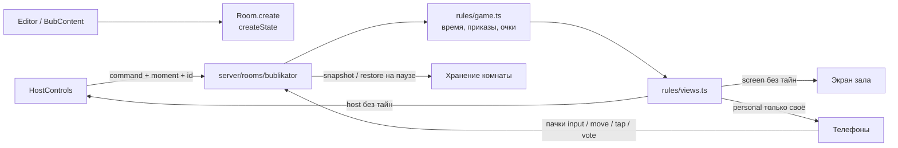

# Паспорт логики — Бубликатор

> **Основной подробный эталон:** [`docs/bublikator.md`](../../../docs/bublikator.md) (836 строк: все правила, числа,
> команды и прошлый аудит). Перед правкой обязательны он, [`../LOGIC.common.md`](../LOGIC.common.md), `docs/fast-room.md`
> и профильные тесты. Этот паспорт фиксирует карту системы и проверку, не заменяя подробную спецификацию.

- Составлен: 19.11.2026 по `main` после `1e6dd753`.
- Проверка: **193/193 тестов**; новых подтверждённых дефектов не найдено.
- Настоящие PostgreSQL, браузерная полная игра и test/production в этом проходе не запускались.

## 1. Архитектура

Командная игра с обязательным экраном зала. Экипажи получают приборы и приказы, выполняют их на телефонах,
проходят 2–3 перелёта, события, ремонт, голосование за диверсанта и пьедестал.

Это **не пошаговая сессия**: `index.ts` содержит `room: true`, `standalone`, `ownAward`, `ownAnswered`, `ownMusic`.
Состояние живёт в быстрой комнате `server/src/rooms/bublikator.ts`; обычные `steps` и `score` пустые. На Firebase
формат недоступен. После игры используются общие дела гостя и финальный «Спасибо» с QR.

## 2. Фазы

`lobby → crews → drill (опционально) → leg(launch → fly → dock [→ vote → voted]) → следующий leg → podium → finished`.

- Команда платформы = экипаж; до 20, размер 1–10, лишние — дублёры.
- Перелёты 1–2: три прибора разных типов; перелёт 3: четыре с парой близнецов.
- Выполнение требует удержания цели 0,7 с; импульс = `1000 / (7,5 × минуты × n)`.
- Просрочка/ложный выполненный приказ: урон `4/n`; корпус 0 → ремонт до 3.
- События: метеоритный дождь, притяжение, SOS, «Все на палубу»; время игры/приказов стоит по правилам события.
- Диверсант появляется в экипаже от 5; примерно треть его приказов ложная; раскрытие только после голосования.
- Итог = дальность + ранний финиш + события + объединённые очки + 50 за угаданного диверсанта.

Все константы и тонкости — обязательно сверять с `rules/constants.ts` и `docs/bublikator.md`, а не сокращённым списком выше.

## 3. Представления и секретность

- **Телефон:** только свои приборы, приказ, роль и личные события; дублёр разделяет пульт хозяина, приказ получает хозяин.
- **Экран:** сводка без диверсантов, ложных пометок и чужих личных приказов; до 5 обновлений/с, в простое — раз/с.
- **Пульт:** этапы, экипажи, связь, события, оценки, объединение и переигровка; диверсантов и ложные приказы до раскрытия не видит.
- **Комната:** личный снимок при подписке, дальше частичные изменения; `seq`, повторы и `delayed` не откатывают свежее.

Проверено тестом потоков: чужие приказы отсутствуют в личном снимке, экран и пульт не содержат `saboteur/fake/mark`.

## 4. Ключевые инварианты

- **Б-1.** Игровое время не идёт на паузе; после восстановления продолжается с сохранённой точки без скачка.
- **Б-2.** Поздняя пачка не затирает более свежее движение; игровое время события ограничено `BACKDATE_MS`.
- **Б-3.** Приказ засчитывается только после целевого удержания, не просто прохождением через цель.
- **Б-4.** Хозяин прибора офлайн → его приказ отменяется без штрафа, новых на него нет.
- **Б-5.** На тренировке нет очков/урона; корпус не ниже 0, ремонт 5–10 секунд, после него 3.
- **Б-6.** Чужие роли и ложные приказы не утекают в потоки до раскрытия.
- **Б-7.** Команда пульта с устаревшим `moment` возвращает `moved`; повтор по id возвращает прежний итог.
- **Б-8.** Переигровка не откатывает номера приказов/событий/приборов и использует новую случайность.
- **Б-9.** Снимок не содержит служебный `rt`; после восстановления комната находится на паузе.
- **Б-10.** Места при равных очках общие; объединение переносит очки без потери и не допускается во время голосования.

## 5. Пульт, повторы и восстановление

Команды: `gather`, `drill`, `start`, `next`, `vote`, `vote-end`, `podium`, `finish`, `back`, `time`, `event`,
`event-end`, `rate`, `remove`, `move`, `merge` — условия и аргументы описаны в `docs/bublikator.md`.

`moment = фаза:перелёт:этап:попытка`. Второй пульт/двойное касание не меняет состояние. После снимка комнаты
восстановление возвращает то же игровое состояние и ставит паузу; `resume` продолжает с того же момента.

## 6. Проверка 19 ноября 2026

| Набор | Результат | Что подтверждено |
|---|---|---|
| `rules/bublikator.test.ts` | 112/112 | Правила, названия, раздача, приказы, события, итоги |
| `server/src/rooms/bublikator.test.ts` | 15/15 | Настоящий Room: моменты, пауза, restore, потоки, сквозная игра |
| `sim/room.test.ts` | 11/11 | Комната в памяти, автопилот, 50 гостей/10 команд |
| `screen/model.test.ts` | 21/21 | Модель экрана и проход фаз |
| `phone/model.test.ts` | 22/22 | Модель телефона, снимки/куски/пауза |
| **Итого** | **193/193** | Все перечисленные наборы |

Замер 50 гостей в комнате прошёл: снимок около 86 КБ, заявленные в тесте пределы команд и рассылки соблюдены.
Это изолированный комнатный движок, **не PostgreSQL и не доказательство производительности production**.

Не подтверждены в этом проходе: реальная база, SSE через сеть, 50 настоящих браузеров, мобильная раскладка по скриптам
роботов, test/production. Новых находок по прочитанной логике и тестам нет; существующие решения/ограничения остаются
в разделе аудита `docs/bublikator.md`.

## 7. Файлы

- Правила: `rules/{constants,types,content,names,panels,crews,game,views}.ts`.
- Комната: `server/src/rooms/{bublikator,engine}.ts`.
- Платформа: `index.ts`, `views.tsx`, `host/*`, `screen/*`, `phone/*`, `editor/*`, `sim/*`.
- Спецификация и прошлые решения: `docs/bublikator.md`, `docs/fast-room.md`.

**Итог:** по коду и 193 тестам состояние принято. Полный статус «PostgreSQL + браузер + test + production» не присваивается.
