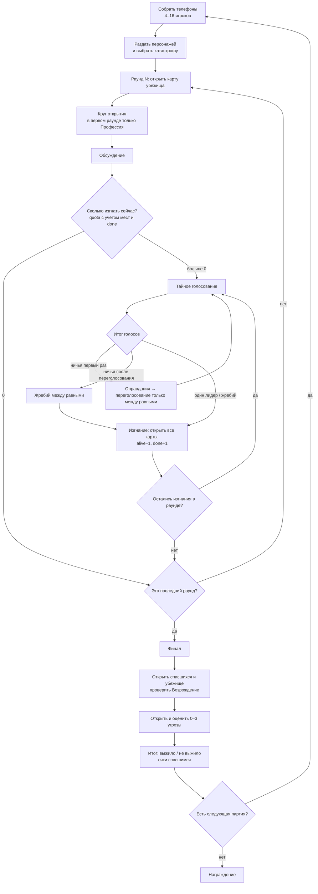

# Паспорт логики — Убежище

> **Эталон.** Этот файл описывает полный ход «Убежища», скрытые персонажи, изгнания, особые условия и финал.
> Перед правкой обязательны [`../LOGIC.common.md`](../LOGIC.common.md), этот паспорт, `bunker.test.ts` и
> [`docs/bunker-rules.md`](../../../docs/bunker-rules.md). Намеренное изменение правил фиксируется здесь в том же PR.
> Указатель паспортов — [`../LOGIC.md`](../LOGIC.md).

- Составлен: 18 ноября 2026, по `main` `8f486f6ab7809045129e229c3f451faa6f484b9c`.
- Статус: исходный паспорт по коду, правилам и существующим тестам; новых дефектов не заявлено.
- Входит: настройки, раздача, карты, раунды, квоты изгнания, голосование, особые условия, финал, очки, партии, «Назад».
- Не входит: общая доставка SSE, визуальный аудит карт, внутренние правила других игр.

## 1. Что за игра

Катастрофа оставляет игрокам убежище, но мест в нём — только половина игроков с округлением вниз. Каждый получает тайного
персонажа из шести характеристик и, если включено, одно особое условие. По кругам игроки открывают карты, говорят, обсуждают
и голосуют, кого изгнать. В финале спасшиеся открываются, проверяются «Возрождение» и угрозы «Истории выживания».

- Только `solo`, 4–16 игроков.
- 3–5 раундов, по умолчанию 5.
- 1–10 партий, очки накапливаются.
- У каждого: Профессия со стажем, Биология, Здоровье, Хобби, Багаж, Факт; при включении — особое условие.
- Мест в убежище: `max(1, floor(players / 2))`.
- Настраиваются речи, обсуждение, голосование, оправдание, голос изгнанных, пропуски, особые условия, возрождение,
  0–3 угроз, катастрофа и очки.

`bunkerSteps()` и `score()` пусты: обычных вопросов нет. Очки начисляются при переходах. `ownPeek`, `ownAward` и
`ownAnswered` включены: механика сама управляет таблицей, награждением и счётчиком голосов.

## 2. Тайная и публичная модель

### `Secrets` — только пульт

- `chars` — персонажи всех игроков;
- `bunker` — пять карт убежища по раундам;
- `threats` — выбранные угрозы;
- `notes` — личные заметки, например подсмотренная карта.

Всё хранится в `hostSeal`, зашифрованном ключом исходного пульта.

### Телефон

`sealed[pid]` содержит своего персонажа и личные заметки, зашифрованные ключом телефона. Карты имеют одинаковую длину
в байтах UTF-8. Открытые характеристики дополнительно хранятся открыто в `shown`, а список открытых типов — в `open`.

### Второй пульт

`charsFromCards` восстанавливает персонажей по телефонам, но не знает закрытые карты убежища и угрозы. В этом частичном
режиме переходы раундов, финал и итог блокируются: вести их нужно с исходного устройства.

### Отказ особого условия

Причина и отпечаток просьбы не записываются открыто. `refusedSeal[pid]` шифруется ключом телефона; игрока без телефона —
ключом ведущего. Все отказы имеют одну длину шифра. Старое публичное поле `refused` читается только для совместимости,
новые записи туда не идут.

## 3. Общая блок-схема



Особые условия могут менять этот путь: добавлять/убирать место, возвращать изгнанного, отменять голосование, защищать или
удваивать голос. Эти изменения обязаны пересчитывать `quota`, а не оставлять старую квоту.

## 4. Раздача и катастрофа

`startDeal` собирает места по `joinedAt`, добавленные ведущим — в конце. Кнопка старта проверяет 4–16. В следующей партии
увеличивает `party`, создаёт новый шаг, возвращает всех в `alive` и сохраняет очки.

`dealSecrets`:

- тасует карты без повторов ссылок внутри раздачи;
- ограничивает стаж числом лет после 18;
- выдаёт разные особые условия, пока хватает колоды, дальше по кругу;
- выбирает пять карт убежища и `content.threats` угроз без повторов;
- создаёт пустые личные заметки.

`dealt`:

- выбирает заданную катастрофу или случайную;
- выбирает срок в её допустимом диапазоне лет;
- вычисляет места по числу игроков;
- вычисляет площадь: `40 + places × 15 + случайные 0–25 с шагом 5`;
- открывает катастрофу, сохраняет `sealed` и `hostSeal`.

## 5. Раунды и круг открытия

### Карта убежища

`startRound` увеличивает `round`, открывает `secrets.bunker[round-1]`, очищает голосование и особые действия прежнего
голосования, ставит `done = 0`. Новый шаг, `stage = question`.

### Очки за пережитый раунд

При каждом новом раунде и при входе в финал `roundPay` добавляет `roundPoints` каждому, кто остался в игре, кроме самого
первого перехода. Эти очки записываются в `undo.scores`, чтобы «Назад» снял их ровно один раз.

### Круг открытия

`startOpening` поворачивает порядок живых: раунд 1 начинает первый, раунд 2 — второй и так далее по кругу.

- Раунд 1: можно открыть только Профессию.
- Следующие: любую ещё закрытую карту.
- `openCard` добавляет карту и обновляет её публичный текст.
- Если это ход игрока, запускается речь: 60 секунд по умолчанию в первом раунде, 30 — дальше.
- Если карту уже открыли «Допросом» или всё открыто, `openable` пуст: игрок не зависает, доступна только речь.
- `turnDone`: есть таймер речи или открывать нечего.
- `nextSpeaker` создаёт новый шаг и переводит ход; после последнего начинается обсуждение.

## 6. Обсуждение и квота изгнания

`startDiscuss` запускает общий таймер `discussSeconds`; 0 — без таймера.

Квота вычисляется по текущему состоянию:

```text
left  = max(1, rounds − round + 1)
extra = alive + done − places
план на раунд = round == rounds ? extra : floor(extra / left)
quota = max(0, план − done)
```

Смысл: лишних распределяют по оставшимся раундам, остаток откладывается в последние. Если в раунде изгоняют двоих,
проводят два голосования подряд: `done` уменьшает остаток.

Примеры для 5 раундов:

| Игроков | Изгнания по раундам |
|---|---|
| 4 | 0, 0, 0, 1, 1 |
| 6 | 0, 0, 1, 1, 1 |
| 10 | 1, 1, 1, 1, 1 |
| 16 | 1, 1, 2, 2, 2 |

«Лишняя койка», «Обвал», «Второй шанс», пропуск и отмена голосования меняют входные данные формулы, поэтому следующая
квота обязана считаться заново.

### Пропуск ведущего

`canSkip`: есть неиспользованные пропуски, не последний раунд, в этом раунде ещё никого не изгнали. По умолчанию один,
настройка 0–3. `skipVote` не изгоняет, увеличивает `skips`, помечает голосование отменённым; квота перейдёт дальше.

## 7. Голосование и изгнание

`startVote`:

- создаёт новый шаг и `voteEndsAt = now + voteSeconds`;
- кандидаты — все живые или только кандидаты ничьей;
- `revote = true`, если список задан явно;
- защита, двойной голос и отмена сохраняются на переголосование; на новом голосовании очищаются.

### Подсчёт

- Голосуют живые, за себя нельзя, только за кандидата.
- `immune`: голоса против защищённого не добавляются; `voters` всё равно учитывает валидный голос.
- `doubled`: голос такого игрока весит 2.
- При `exiledVote = common` все изгнанные выбирают одного общего кандидата по большинству; только единственный лидер добавляет
  1 голос. При равенстве общего голоса нет.
- При `cancelled` никто не выбывает.

Дальше:

- один лидер среди доступных — он изгнан;
- первая ничья — `justify`: оправдательные речи по `justifySeconds`, затем переголосование только между равными;
- повторная ничья — случайный жребий между равными;
- если все кандидаты защищены, поле для жребия возвращается к исходному списку кандидатов, чтобы не остаться с пустым набором.

Изгнанный удаляется из `alive`, добавляется в `exiled`, `done += 1`, все его карты открываются в `open` и `shown`.

## 8. Особые условия

23 карты, каждая у игрока не более одного раза за партию. `used[pid]` записывает сыгранную карту. Отказ не тратит карту.

### Обмен и изменение персонажей

- Обмен багажом / здоровьем / хобби / фактом / профессией — с другим живым игроком.
- Переобучение — новая профессия себе.
- Медкомиссия — новое здоровье другому.
- Чудесное исцеление — своё здоровье «Полностью здоров».
- Таблетка от всего — такое здоровье другому.
- Заразный — здоровье другого становится как у автора.
- Карманник — забирает багаж цели, прежний сбрасывается, цель берёт новый.
- Эпидемия — перемешивает здоровье всех живых.
- Переполох на складе — перемешивает багаж всех живых.

### Подсмотр и раскрытие

- Шпион — личная заметка с картой другого; публично карта не открывается.
- Допрос — выбранная закрытая карта цели открывается всем.
- Детектор лжи — все живые открывают Факт.

### Голосование — только во время него

- Неприкосновенность — голоса против автора не считаются.
- Решающий голос — голос автора весит два.
- Отмена голосования — никто не выбывает, изгнание переносится; в последнем раунде отказ `last`.

### Места и убежище

- Лишняя койка — `places + 1`.
- Обвал — `places − 1`, но не ниже 1.
- Второй шанс — последний изгнанный возвращается в `alive`; если никого нет — отказ.
- Перепланировка — заменяет последнюю открытую карту убежища новой неиспользованной; до открытия карты — отказ.

`applyUse` обновляет тайное и публичное состояние, журнал последних 20 действий, карты телефонов и `hostSeal` заново.
Пульт применяет просьбу с `expect` по фазе, шагу и `resultKey`: изменение, собранное по старому состоянию, не затирает новое.

## 9. Финал и исход

`startFinal`:

- добавляет очки за завершение последнего раунда;
- открывает все карты всех спасшихся;
- открывает все карты убежища;
- очищает прежние решения угроз и итог.

### Возрождение

Если включено, среди спасшихся должны быть мужчина и женщина:

- возраст 18–55 включительно;
- без бесплодия по карте Здоровья.

Это могут быть разные люди. `hasPair` проверяет обе стороны.

### Угрозы

Ведущий открывает по одной, спасшиеся обсуждают, ведущий выбирает «Справились» или «Не справились». Каждое решение хранится
в `verdicts`. Следующая угроза недоступна, пока текущая не оценена.

`finishBunker`:

```text
rebirth = null, если правило выключено; иначе hasPair
beaten = число угроз с verdict=true
won = rebirth != false и beaten == числу всех оценённых угроз
```

При `threats = 0` угроз автоматически нет и условие угроз выполнено. При выживании каждый спасшийся получает `winPoints`;
при поражении очков за победу нет.

После итога — следующая партия или награждение по накопленным очкам. Можно сыграть дополнительную партию.

## 10. «Назад»

`undo` хранит один переход, включая очки действия. `bunkerBack`:

- возвращает прежние `step`, `stage`, `result`;
- очищает ответы покинутого шага;
- вычитает очки через `addScore` с отрицательными дельтами;
- восстанавливает приём ответов на `question`;
- не пытается хранить неограниченную историю.

Отдельный `podiumBack` работает на награждении. Подтверждение предупреждает, что очки действия снимутся, ответы шага сотрутся.

## 11. Инварианты

- **У-1.** Игра только `solo`; старт и новая партия ограничены 4–16 игроками.
- **У-2.** Места равны половине игроков с округлением вниз, но минимум одно.
- **У-3.** Персонажи содержат все шесть карт, стаж не превышает лет после 18.
- **У-4.** Скрытые персонажи, закрытое убежище и угрозы не попадают в публичное состояние открытым текстом.
- **У-5.** Телефон видит только своего персонажа и свои заметки; шифры одной длины.
- **У-6.** Открытая карта имеет тот же текст в `shown`, что в секретном персонаже после всех обменов.
- **У-7.** В первом раунде круг открывает только Профессию.
- **У-8.** Игрок, которому нечего открывать, всё равно может завершить ход речью.
- **У-9.** Каждый раунд открывает свою карту убежища и сдвигает первого говорящего по кругу.
- **У-10.** Квота изгнания вычисляется по текущим `alive`, `places`, `done` и оставшимся раундам.
- **У-11.** Пропуск или отмена голосования не удаляет игрока и переносит квоту.
- **У-12.** Голос за себя не засчитывается; защита и двойной голос действуют на переголосование.
- **У-13.** Общий голос изгнанных появляется только при единственном лидере их выбора.
- **У-14.** Первая ничья ведёт к оправданию и переголосованию, повторная — к жребию.
- **У-15.** Изгнанный открывает все карты и не остаётся в `alive`.
- **У-16.** Особое условие можно сыграть один раз; отказ не тратит его и не раскрывается чужим телефонам.
- **У-17.** Изменение особого условия пересобирает шифрование, а не оставляет у телефонов старые карты.
- **У-18.** Финал открывает спасшихся и всё убежище.
- **У-19.** Возрождение требует подходящих мужчину и женщину 18–55 без бесплодия.
- **У-20.** Убежище выживает только при выполненном возрождении и всех угрозах, отмеченных «Справились».
- **У-21.** Очки за раунды и победу начисляются через обратимые дельты; «Назад» снимает их один раз.
- **У-22.** Новая партия возвращает всех, создаёт новых персонажей и сохраняет общие очки.
- **У-23.** Второй пульт без тайн убежища и угроз не ведёт эти переходы.

## 12. Где это в коде

| Место | Ответственность |
|---|---|
| `content.ts` | Настройки, лимиты, места и квота |
| `decks.ts` | Карты персонажей, катастроф, убежища и угроз |
| `logic.ts` | Все переходы, голоса, очки, финал и возврат |
| `specials.ts` | 23 особые условия |
| `deal.ts` | Ключи, шифрование, личные карты и отказы |
| `HostControls.tsx` | Пульт, фоновые действия, ручной ввод и права состояния |
| `views.tsx` | Экран и телефон |
| `bunker.test.ts` | Правила, тайна, ход, особые условия, партии и возврат |
| `docs/bunker-rules.md` | Исходные игровые правила |

## 13. Что не проверено

- Новый дефект не заявлен: это исходный паспорт, не независимый полный аудит.
- Реальный браузер, второй пульт, телефоны и обрывы связи в этой работе не запускались.
- Визуальная проверка 16 игроков, длинных имён, всех карт и 3D/анимаций не выполнялась.
- Взаимодействие с вечером из блоков требует отдельной проверки локальных ключей и архивных ответов.

## 14. Проверка паспорта

Минимум:

- `npx vitest run src/mechanics/bunker/bunker.test.ts`;
- все варианты квоты 4/6/10/16 игроков, несколько изгнаний в одном раунде;
- ничья → оправдание → переголосование → жребий;
- защита, двойной голос, отмена, общий голос изгнанных;
- все 23 особых условия, повтор и отказ;
- свой/чужой телефон, отказ с одной длиной шифра, исходный и второй пульт;
- возрождение, 0–3 угроз, победа/поражение и очки;
- «Назад» после очков, изгнания, голосования и новой партии.
