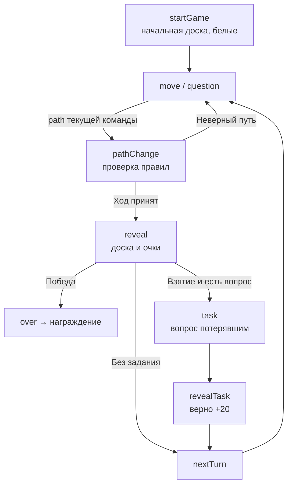

# Паспорт логики — Шашки

> Перед правкой обязательны [`../LOGIC.common.md`](../LOGIC.common.md), этот паспорт, `rules.test.ts` и `logic.test.ts`.

- Составлен: 19.11.2026 по `main` после `1e6dd753`.
- Проверка: **11/11 тестов** (5 правила + 6 ход); новых подтверждённых дефектов не найдено.
- Браузер, PostgreSQL, два реальных пульта и test/production отдельно не проверялись.

## 1. Правила

Игра только для двух команд. Первая по времени входа — белые, вторая — чёрные. Капитан выбирает путь на телефоне,
либо ведущий ходит на пульте. Используются правила русских шашек: обязательное взятие, простая бьёт назад,
серия взятий, превращение в дамку и дальний ход дамки.

Очки: 10 за обычную шашку, 30 за дамку, 50 за победу на доске. После взятия потерявшая команда получает вопрос;
верный ответ приносит ей 20. Вопросы закончились — партия продолжается без заданий.

## 2. Схема

После задания ходит потерявшая шашку команда. Ведущий может пропустить ход или завершить партию досрочно;
в последнем случае победитель определяется общим счётом.

## 3. Представления и связи

- **Экран:** доска, последний ход, очки и вопрос.
- **Телефон капитана:** путь текущей стороны или ответ потерявшей команды. Чужой ход отбрасывается.
- **Пульт:** ход за команду, задание, ручная оценка, следующий ход, досрочное завершение и «Назад».

`content.ts` хранит вопросы с вариантами/открытым ответом и таймер; `rules.ts` не знает о сессии. `logic.ts` создаёт
`SessionChange`, общий сервер применяет права/`expect`. Очки пишет механика через `addScore`; `score()` пустой.
`HostControls.tsx`, `views.tsx` и `index.ts` связывают представления с общей платформой.

## 4. Инварианты

- **Ш-1.** Ходит только текущая сторона и только допустимым правилами путём.
- **Ш-2.** Взятие обязательно; серия не считается завершённой раньше времени.
- **Ш-3.** Очки соответствуют снятым фигурам и победе; чужой ответ на задание не учитывается.
- **Ш-4.** Потерявшая получает не более одного вопроса за взятие и 20 очков за верный ответ.
- **Ш-5.** После победы дополнительных ходов нет; награждение по общему счёту.
- **Ш-6.** Старый ответ до нового показа хода не принимается.
- **Ш-7.** «Назад» восстанавливает доску и снимает ровно очки последнего хода/задания.
- **Ш-8.** Глубина истории ограничена 20 снимками; после её исчерпания возврат гаснет без рассинхронизации очков.

## 5. «Назад» и крайние случаи

Показанный ход отменяется с восстановлением строки доски и очков. Ответ задания возвращается к вопросу. Начало
следующего этапа восстанавливает предыдущий `undo`; первый ход возвращает к старту. Досрочное завершение обратимо
через `overFrom`. С пьедестала — общий возврат.

Тесты подтверждают начальную доску, обязательное/двойное взятие, дамку, неправильный/чужой ход, вопрос потерявшим,
победу, конец вопросов, длинный возврат к началу и безопасную остановку после 20 снимков.

## 6. Файлы и непокрытое

| Файлы | Ответственность |
|---|---|
| `rules.ts` | Русские шашки, пути, взятия, победа |
| `logic.ts` | Сессия, очки, задания, возврат |
| `content.ts`, `validate.ts`, `Editor.tsx` | Вопросы и настройки |
| `HostControls.tsx`, `views.tsx` | Пульт, телефон, экран |
| `rules.test.ts`, `logic.test.ts` | 11 тестов |

Не проверены длинные партии со всеми вариантами серий, два реальных пульта, PostgreSQL, телефоны и визуальная доска.
Общие риски ответов/очистки остаются по `LOGIC.common.md`.

**Итог:** логика принята по 11 тестам; новых находок нет. Полный браузерно-серверный статус не присваивается.
