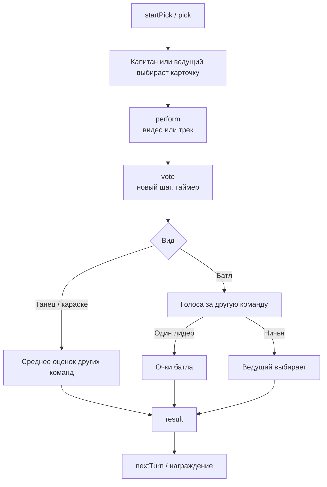

# Паспорт логики — Танцевальный батл

> Перед правкой обязательны [`../LOGIC.common.md`](../LOGIC.common.md), этот паспорт и `dance.test.ts`.

- Составлен: 19.11.2026 по `main` после `1e6dd753`.
- Проверка: **6/6 профильных тестов**; открыты ТБ-Н-1 (копирование музыки) и ТБ-Н-2 (новый спецраунд ломает сборку).
- Браузер, PostgreSQL, два реальных пульта и test/production отдельно не проверялись.
- После базового аудита в рабочей копии появились новые изменения `special/modifier/remix`; они описаны отдельно в ТБ-Н-2.

## 1. Правила

Игра только для команд. Капитан текущей команды выбирает ещё не сыгранную карточку, либо это делает ведущий.
После выступления другие команды оценивают его от минимума до максимума; выступающая получает округлённое среднее.
В батле голосуют за другую команду, победитель получает `battlePoints`, при ничьей победителя называет ведущий.

Карточки бывают `dance`, `karaoke`, `battle`, имеют стили, видео YouTube/VK/Rutube и музыкальный `Clip`.
Каждая карточка играется один раз; новые команды добавляются в конец очереди.

## 2. Схема

## 3. Представления и медиа

- **Экран:** карточки, выступление, видео/музыка, голосование и результат.
- **Телефон:** выбор карточки только текущей командой; оценка `{ rate }` или голос `{ team }`.
- **Пульт:** выбор, переходы, повтор/пауза, разрешение ничьей и «Назад». Голосование считается по ответам шага.

`content.ts` проверяет ссылки через `embedUrl`; небезопасные и неподдерживаемые адреса отклоняются. `TrackTimeline`
использует общий музыкальный фрагмент. Реальное воспроизведение внешних видео в этом аудите не запускалось.

## 4. Инварианты

- **ТБ-1.** Выбирает только текущая команда и только несыгранную карточку.
- **ТБ-2.** Выступающая не оценивает себя; оценки ограничиваются настройками и округляются.
- **ТБ-3.** Нет оценок — нет начисления; среднее не делится на ноль.
- **ТБ-4.** В батле нельзя голосовать за свою команду; победитель один, пока ведущий не разрешил ничью.
- **ТБ-5.** Повторное разрешение ничьей не добавляет очки.
- **ТБ-6.** Карточка попадает в `played` только при смене хода; возврат удаляет её оттуда.
- **ТБ-7.** «Назад» снимает ровно очки последнего результата и не открывает закрытое голосование автоматически.
- **ТБ-8.** Команды плеера имеют монотонный `replay`; новая карточка сбрасывает медиа-состояние.

## 5. «Назад» и связи

Из выступления — к выбору с очисткой шага. Из голосования — к выступлению. Из результата — снимаются очки; если
время уже закрыто, остаётся `reveal` для пересчёта по поданным голосам, прошлое время не возвращается. Из выбора —
к итогу прошлого выступления через `prev`. С пьедестала — общий возврат.

Связь: `Editor.tsx`/`content.ts`/`validate.ts` → `gameSnapshot` → `HostControls.tsx`/`logic.ts` → общий сервер и
таблица. `index.ts` регистрирует механику и медиа-зависимости согласно своей реализации. Общий `score()` пустой.

## 6. Код и проверка

| Файлы | Ответственность |
|---|---|
| `content.ts`, `styles.ts`, `validate.ts` | Карточки, стили, ссылки |
| `logic.ts` | Очередь, голоса, очки, возврат |
| `HostControls.tsx`, `views.tsx` | Пульт, телефон, экран |
| `Editor.tsx` | Конструктор и медиа |
| `dance.test.ts` | 6 тестов |

Подтверждены очередь, запрет чужого выбора, среднее без своего голоса, ограничение оценки, ничья, повторное решение,
возврат, ссылки и шаблоны стилей. Не проверены свежесть при гонке сети, копирование музыки, реальные видео, мобильная
вёрстка, два пульта и PostgreSQL.

## 7. Находка ТБ-Н-1 — открыта: музыка не попадает в копирование игры

`content.ts` экспортирует `danceTrackIds(content)`, но `index.ts` содержит `mediaIds: () => []`. Других подключений
функции не найдено. Как и в «Активной настолке», копия игры может сохранить ссылки на треки без копирования самих
медиа. Нужно подключить сбор идентификаторов и добавить тест переноса; код аудит не менял.

## 8. Находка ТБ-Н-2 — открыта: новый спецраунд в рабочей копии не проходит TypeScript

После базового аудита `content.ts`, `logic.ts`, `HostControls.tsx`, `Editor.tsx`, `validate.ts` и `views.tsx` были изменены
другим процессом: добавлены `kind = special`, голосование `modifier` и ремикс из трёх фрагментов. Этот новый вариант
не считается проверенным по базовым шести тестам.

Финальная `npm run build` падает: `leadingModifier` и `DANCE_MODIFIERS[0]` возможны `undefined`, а `remixAt` читает
возможно отсутствующий `clip`. Нужно завершить типобезопасность списков модификаторов/ремикса, добавить тесты нового
цикла `pick → modifier → perform → vote → result`, паузы/возврата и повторно провести сборку. Код аудит не менял.

**Итог:** базовая игровая логика принята по 6 тестам; открыты ТБ-Н-1 и ТБ-Н-2. Новый спецраунд и общая сборка текущей
рабочей копии не приняты.

## 8. Специальный раунд «Танцуй иначе» — добавлен 19 ноября 2026

Полное ТЗ: `DANCE_SPECIAL_ROUND_TZ.md` в корне проекта.

- Добавлен тип карточки `special`. Старые карточки сохраняют прежний автомат `pick → perform → vote → result`.
- Новый автомат: `pick → modifier → perform → vote → result`. Ответы `{ modifier }` и финальные `{ team }`
  разнесены по разным шагам.
- Капитаны выбирают «Только руки», «Как роботы» или «Замедление». При равенстве действует порядок списка,
  без голосов — `hands`. Участники команды по-прежнему подсказывают капитану, отдельного голоса не имеют.
- В `DanceResult` добавлены `modifier` и `elapsed`; в `Prev` сохраняется `modifier`. Повреждённые значения
  нормализуются `parseDanceResult`.
- Специальная карточка хранит три `Clip` по 3–15 секунд. Видео и одиночный трек для неё не используются.
- Ремикс идёт по серверным меткам. `performanceElapsed` и `remixAt` определяют участок и смещение; при открытии
  экрана посреди раунда звук начинается в текущем участке с нужного места. Пауза накапливает `elapsed` и
  останавливает отсчёт, продолжение использует оставшееся время, повтор сбрасывает обе величины.
- Финальный подсчёт, ничья, очки и снятие очков при возврате общие с обычным батлом через `isTeamBattle`.
- «Назад» из `modifier`/`perform` возвращает выбор карточки, из финального `vote` перезапускает ремикс,
  из `result` снимает очки; возврат через `prev` восстанавливает усложнение.
- Автоматический предпросмотр подаёт ответы об усложнении, затем о победителе и доходит до следующего хода.

Проверка: `special.test.ts` — 7 новых тестов; вместе с прежними — **13/13 профильных тестов**. Проверены полный
раунд, ничья и пустое голосование, белый список ответов, границы фрагментов, пауза/продолжение/повтор,
возвраты, начисление и снятие очков, повреждённые данные, обязательность трёх треков, длина 3–15 секунд и автопредпросмотр.
Отдельный Chromium-стенд подтвердил настоящие экран, пульт, телефон и конструктор без ошибок и 404. Визуальный
аудит нашёл и исправил перекрытие индикатора выступления панелью ремикса. На трёх настоящих WAV подтверждено
звуковое переключение `track1 → track2 → track3` с нужных секунд.

Уточнение к ТБ-Н-1: `mediaIds` по контракту механики относится только к изображениям. Добавлять туда треки
нельзя. Для специального раунда `danceTrackIds` собирает обычные и remix-id отдельно, экран предзагружает их.
Полный статус браузерной и серверной проверки фиксируется отдельно после выполнения, не присваивается заранее.

## 9. Полный аудит конструктора и макетов — 19 ноября 2026

Дополнительно исправлены два дефекта: длина remix теперь ограничивается 3–15 секундами сразу при вводе и при
проверке, а без `tracksRepo` специальная карточка не предлагается к добавлению — вместо тупиковой настройки
показывается объяснение.

Сквозной Chromium-тест проверил общие настройки, все четыре типа карточек, смену классического типа без потери
видео, три трека, немедленное ограничение 15 секунд, добавление/удаление/возврат и шесть игровых состояний.
Галерея из 11 настоящих макетов находится в `dance-workflow-gallery/`; у длинных снимков есть полноэкранный
просмотр с закрытием кнопкой и Esc. Подробности: `DANCE_CONSTRUCTOR_AUDIT.md` в корне проекта.
