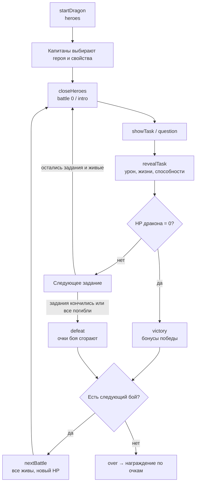

# Паспорт логики — Бой с драконом

> **Эталон.** Перед правкой обязательны [`../LOGIC.common.md`](../LOGIC.common.md), этот паспорт и `dragon.test.ts`.
> Намеренное изменение правил фиксируется здесь в том же PR. Указатель — [`../LOGIC.md`](../LOGIC.md).

- Составлен: 19 ноября 2026, по коду ветки `main` после `1e6dd753`.
- Проверка: **17/17 профильных тестов**; совместный запуск трёх игр — 51/51.
- Новых подтверждённых дефектов в прочитанной логике не зафиксировано.
- Браузер, два реальных пульта, PostgreSQL и test/production в этом аудите не запускались.

## 1. Назначение и режимы

Команды или отдельные игроки выбирают героев, распределяют свойства и в нескольких боях наносят драконам урон.
Поддерживаются `solo`, `teams` и режим без общего экрана; в команде действует капитан.

Содержимое: 1–5 боёв, до 20 заданий в каждом, здоровье дракона 1–100 000, базовые жизни 1–9.
Можно играть первые `perBattle` заданий или все при 0. Есть взрослый и детский стиль, фоновая музыка лобби и боя.

Виды заданий:

- `choice` — четыре варианта, верный ответ наносит урон;
- `task` — ведущий отмечает выполнивших;
- `dice` — бросок кубика, 3 и выше наносит урон, меньше 3 — дракон бьёт.

Каждое задание относится к свойству: сила, ум, ловкость, удача или харизма.

## 2. Блок-схема

Досрочное награждение доступно после выбора героев с подтверждением. Во время выбора героев — только возврат/ожидание.

## 3. Герои и свойства

Капитан распределяет не более 5 очков, каждое свойство 0–3. Парсер при нулевой сумме или превышении возвращает
все свойства по 1. Не выбравший получает героя по порядку и такие же базовые свойства.

| Герой | Способность |
|---|---|
| Эльфийка | Первый верный на вопросе: урон ×2 при ловкости |
| Эльф | Уклонение от каждого второго полученного удара |
| Гном | +2 жизни в каждом бою |
| Рыцарь | Первый удар дракона в бою блокирует щит |
| Волшебница | На заданиях ума урон ×1,5 |
| Лучник | +20 к урону за верный вопрос |
| Варвар | На заданиях силы урон ×2 |
| Жрица | Каждое третье успешное задание восстанавливает жизнь до максимума |
| Вор | +1 к кубику, максимум 6 |
| Бард | На заданиях харизмы урон ×2 |

## 4. Урон, жизни и исход боя

Базовая формула: `power × (1 + stat) × модификаторы`, округление до целого. Для кубика добавляется множитель
`roll / 3,5`. Неуспех даёт 0 урона.

- Верный ответ/выполнение: урон и столько же очков, плюс счётчик успехов.
- Ошибка/промах: дракон отнимает одну жизнь, если не сработали щит или уклонение.
- Ноль жизней: команда погибает, её урон и очки текущего боя сгорают, до следующего боя она не действует.
- Дракон побеждён: автор наибольшего урона в добившем показе получает `killBonus`, все живые — `winBonus`.
- Дракон дожил до конца заданий или все погибли: оставшиеся очки урона этого боя сгорают.
- Новый бой: полные жизни с учётом героя, погибшие оживают, HP и счётчики боя новые; общие очки прошлых боёв остаются.
- Последний бой: общий пьедестал по очкам.

## 5. Экран, телефон и пульт

- **Экран:** дракон, HP, герои, жизни, урон, задание, верный ответ на показе и визуальные эффекты.
- **Телефон:** выбор героя, варианты ответа и кубик. Кнопки только у капитана/игрока, живого и при открытом приёме.
  Член команды видит ход, но не действует.
- **Пульт:** закрытие выбора героев, показ задания, ручные отметки, «Удар!» по свежим ответам, следующий бой,
  досрочное завершение и «Назад». Если кто-то не выбрал героя, требуется отдельное подтверждение запуска без него.

Скрытых ролей нет. Варианты и правильный ответ находятся в обычном снимке игры, как и у других вопросных механик.

## 6. Инварианты

- **БД-1.** У каждой команды один герой и допустимый набор свойств.
- **БД-2.** Действовать могут только живые участники текущего порядка; в команде — капитан.
- **БД-3.** Кубик определяется серверным ответом/детерминированным броском ведущего, а не числом от телефона.
- **БД-4.** Ответы прошлого шага и ответы погибших не участвуют.
- **БД-5.** Неуспешное задание не создаёт урона; успешное создаёт урон по формуле и очки.
- **БД-6.** Щит и уклонение применяются не чаще своих правил; жизни не уходят ниже нуля.
- **БД-7.** Погибший теряет очки только текущего боя и восстанавливается в следующем.
- **БД-8.** HP не ниже нуля; победа и бонусы применяются один раз на показ.
- **БД-9.** При поражении дракона очки текущего боя не сгорают; при его выживании сгорают.
- **БД-10.** Новый бой не стирает общие очки предыдущих боёв.
- **БД-11.** Все изменения очков показа хранятся в `deltas` и обратимы.
- **БД-12.** «Назад» восстанавливает HP, жизни, погибших, способности, счётчики и очки.
- **БД-13.** `perBattle` ограничивает список играемых заданий, а не общее содержимое конструктора.

## 7. «Назад» и повторы

- Из `reveal/victory`: восстанавливается снимок до удара, снимаются `deltas`, задание открывается заново.
- Из `defeat`: сначала возвращается показ последнего удара через `prev/stash`, следующий возврат отменяет сам удар.
- Из `task`: возврат на заставку с очисткой ответов шага.
- Из `intro/over`: предыдущий этап через `before`.
- Из выбора героев: к «Начать игру»; с пьедестала — общий `podiumBack`.
- Повторный «Удар!» после возврата использует тот же детерминированный бросок ведущего, если телефон не бросил сам.

Профильные тесты покрывают возврат после поражения, заставок, следующих боёв и конца игры. Сетевые гонки двух пультов
остаются на общем механизме `expect` и отдельно здесь не проверялись.

## 8. Конструктор → сессия → сервер → история

1. `Editor.tsx`, `content.ts` и `validate.ts` создают допустимые бои и задания.
2. `index.ts` регистрирует механику, представления, репетицию и фоновую музыку.
3. Содержимое попадает в `gameSnapshot`, `DragonResult` — в общую сессию.
4. Пульт получает свежие ответы и создаёт `SessionChange`; общий сервер применяет права и ожидаемое состояние.
5. Механика сама пишет очки через `addScore` или таблицу при большом изменении; общий `score()` пустой.
6. Общая платформа завершает игру и сохраняет итоги. Отдельной комнаты нет.

## 9. Где это в коде

| Файл | Ответственность |
|---|---|
| `content.ts` | Герои, свойства, бои, импорт и лимиты |
| `validate.ts` | Проверка содержимого |
| `logic.ts` | Фазы, урон, жизни, очки, бои, «Назад» |
| `HostControls.tsx` | Пульт и свежие ответы |
| `views.tsx`, `look/*` | Телефон и экран |
| `Editor.tsx` | Конструктор |
| `preview.ts` | Репетиция |
| `dragon.test.ts` | 17 профильных тестов |

## 10. Покрытие и крайние случаи

Тесты подтверждают: импорт и шаблоны, свойства, выбор по умолчанию, формулы героев, победу, смерть, сгорание очков,
поражение дракона, новый бой, кубик и воровской бонус, порог 3, `perBattle`, `solo`, последний бой и цепочки «Назад».

Не подтверждены: все комбинации десяти героев на длинной случайной серии боёв, равный урон претендентов на добивание,
массовое подключение/удаление посреди боя, два реальных пульта, PostgreSQL, браузерная графика и мобильные размеры.

## 11. Находки

Новых подтверждённых дефектов в этом проходе не зарегистрировано. Это не означает полного отсутствия ошибок вне
перечисленного покрытия. Общие риски сессии, ответов и Firebase остаются действующими по `LOGIC.common.md`.

## 12. Итог проверки 19 ноября 2026

Профильные тесты — **17/17 passed**. Основные игровые правила и возврат приняты по unit-тестам; статус браузерной и
серверной E2E-приёмки отдельно не присваивается.
