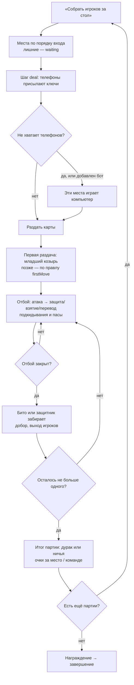

# Паспорт логики — Дурак (подкидной и переводной)

> **Эталон.** Этот файл описывает карточный движок, раздачу, скрытые руки, очки и связь с живой сессией. Перед правкой
> обязательны [`../LOGIC.common.md`](../LOGIC.common.md), этот паспорт и проверка `engine.test.ts`. Изменение правил или
> ограничений фиксируется здесь в том же PR. Указатель паспортов — [`../LOGIC.md`](../LOGIC.md).

- Составлен: 18 ноября 2026; актуализирован 19 ноября 2026 после исправления Д-Н-1.
- Статус: настройка «Погоны» передана в движок; включение, выключение и совместимость старых партий покрыты тестами.
- Входит: настройки, места, движок, руки и шифрование, ходы телефонов, боты, таймер, очки, голосование за колоду, партии.
- Не входит: внутреннее устройство общей сессии, внешний вид карт и стола, «Мероприятие из блоков» кроме отдельных ссылок.

## 1. Что за игра

Карточный «Дурак» для 2–6 мест на колоде 36 карт и 2–8 мест на колоде 52. Экран показывает стол с крупье, атаки, бито,
колоду и число карт у каждого. Телефон показывает владельцу только его руку. Пульт проверяет каждый ход по полному движку.

Поддерживаются:

- `podkidnoy` и `perevodnoy`;
- каждый сам (`seating = solo`);
- партнёры через одного (`seating = partners`) — только 4 или 6 мест, две группы;
- подкидывают все или только соседи;
- запрет перевода в первом отбое;
- «пики пиками»;
- таймер хода от 10 до 120 секунд или 0 без таймера;
- подсветка допустимых карт;
- 0–20 партий: 0 означает неограниченно, пока ведущий не завершит;
- очки за место и очки победившей команде;
- выбор оформления стола и 10 колод.

Режимы платформы `solo` и `teams` допустимы. В командной сессии место за столом — команда; отвечает её капитан по общим
правилам сессии. `partners` — отдельная карточная настройка внутри одного стола, не то же самое, что `playMode = teams`.

`durakSteps()` и `score()` пусты: игра не идёт по обычным вопросам. Очки записываются вручную при завершении партии.
`ownPeek` и `ownAward` включены: общая таблица и общая кнопка «Наградить сейчас» посреди партии не используются.

## 2. Скрытая и публичная модель

### Полная партия `Game` — только на исходном пульте

Содержит:

- колоду и открытую козырную карту;
- руки всех мест;
- текущий отбой, атакующего, защитника, взятие, пасовавших, лимит;
- вышедших, бито, конец партии, дурака, ничью, погоны;
- кто подкидывал, последние сыгранные карты и последний выход.

### Публичный `TableView`

Содержит стол, козырь, кто ходит, лимит, настройки, число карт у каждого, остаток колоды, бито, вышедших и итог.
**Чужих карт и колоды там нет.**

### Шифрование

- Телефон создаёт AES-GCM-ключ на 32 байта и отправляет его ответом на шаге раздачи. Ответы видит только пульт.
- `sealed[pid]` — рука игрока его ключом.
- `hostSeal` — вся партия и ключи телефонов ключом исходного пульта.
- Руки дополняются до одинаковой длины, чтобы по размеру шифра нельзя было отличить десятки или состав руки.
- Ключ ведущего хранится в `localStorage` `joyrest.mafia.host.<sessionId>`; при недоступном хранилище — в памяти вкладки.

**Ограничение:** второй пульт не открывает `hostSeal`, если не имеет ключа исходного устройства. Он может выполнять общие
действия, но не является полноценным продолжением карточного движка. Пульт прямо требует открыть исходное устройство.

## 3. Ход игры

Голосование за колоду возможно из `deal`, `play` и `over`: сохраняется прежний режим, открывается новый шаг на 30 секунд,
после итога игра возвращается в сохранённый режим.

## 4. Раздача и места

`seatOrder` объединяет участников из таблицы и фактических игроков/команд:

1. по `joinedAt`;
2. добавленные ведущим без фактического участника — в конце по `pid`;
3. первые `maxSeats` попадают за стол, остальные — `waiting`.

`startDeal` добавляет недостающих участников в таблицу и запоминает `keysStep`. До повторной раздачи можно пересадить заново
и добавить компьютер. После прошлой партии номер `party` увеличивается, `prevLoser` сохраняется.

Первая раздача:

- новая колода тасуется Фишером—Йетсом с `cryptoRandom`;
- каждому по 6 карт, открытый козырь остаётся внизу колоды и уходит последним;
- первый атакующий — обладатель младшего козыря; если задан `first`, он;
- первый защитник — следующий активный по часовой;
- лимит первого отбоя — минимум(5, карты защитника).

В следующих партиях `firstMove`:

- `under` — ходит сосед перед прошлым дураком, дурак отбивается;
- `from` — ходит сосед после дурака;
- без дурака или при ничьей — снова младший козырь.

## 5. Правила отбоя

### 5.1. Атака и подкидывание

- Первым действием атакующий кладёт одну или несколько карт **одного достоинства**, не больше лимита.
- Дальше подкидывают только достоинства, уже лежащие на столе в атаках или защите.
- Подкидывать можно не больше `room = limit - table.length`.
- Подкидывают активные, кроме защитника и его партнёра.
- При `neighbors` — только главный атакующий и следующий активный после защитника.
- Любой принятый ход сбрасывает список пасовавших: после новой карты можно снова решать, подкидывать ли.

### 5.2. Защита

Обычно карта бьёт старшую той же масти или козырь некозырной масти. Козырь бьётся только старшим козырем.
При `spades` пика бьётся только пикой по старшинству; козырь пикой не бьётся.

Защитник покрывает каждую открытую пару по одной или берёт. Взятие возможно только при непокрытых картах.

### 5.3. Перевод

Только в `perevodnoy` и только защитнику:

- все пары ещё не покрыты;
- новые карты имеют достоинство первой атакующей;
- нет запрета первого отбоя;
- сумма карт на столе не превышает лимит отбоя;
- у следующего защитника достаточно карт для всего стола.

После перевода прежний защитник становится атакующим, следующий — защитником, лимит пересчитывается.

### 5.4. Завершение отбоя

Отбой заканчивается, если:

- все пары покрыты **или** защитник берёт;
- каждый возможный подкидывающий пасует или уже не имеет допустимых карт.

Дальше:

- при взятии все карты стола уходят защитнику, иначе в бито;
- добор: главный атакующий, затем подкидывавшие по часовой, остальные активные, защитник последним — до 6 карт;
- следующий атакующий после взятия — следующий после защитника; после успешного отбоя — сам защитник;
- вышедший пропускается;
- новый лимит — минимум(6, карты нового защитника).

## 6. Выход, дурак, ничья и очки

Игрок выходит только после завершения отбоя, когда колода пуста и его рука пуста. Одновременно вышедшие записываются в
порядке мест. Последний активный с картами — дурак. Если активных не осталось — ничья.

Очки `partyPoints`:

- для `solo`: вышедший `i`-м получает `(число мест − 1 − i) × placePoints`, только если результат положительный;
- дурак получает 0;
- при `partners`: каждый член группы без дурака получает `teamPoints`; при отсутствии дурака очков нет;
- досрочная остановка `abortParty` очков не даёт;
- очки добавляются к существующему `score`, `last` показывает дельту партии.

Погоны в движке: если `opts.pogony = true` и последний ход последнего вышедшего состоял только из шестёрок,
`pogony` равно их числу. При `opts.pogony = false` результат всегда остаётся 0, реплика и пульт погоны не объявляют.
`engineOptions` передаёт настройку конструктора; при чтении старого публичного снимка без этого поля используется `true`,
что сохраняет поведение уже начатой партии прежней версии.

## 7. Ходы телефонов, боты и таймер

### Телефон

Показывает руку веером, допустимые действия, мини-стол и причину отказа. `playable` подсвечивает карты по тем же правилам.
`parseAction` допускает `attack`, `defend`, `transfer`, `take`, `pass`; список карт ограничен 6.

Пульт обрабатывает новые ответы по `submittedAt`, пропускает уже обработанные и действия от мест с ботами. Неверный ход
не меняет стол: телефону записывается `reject { pid, n, msg }`, можно повторить действие.

Каждый принятый ход записывается новым шагом сессии: `stage = question`, новый `startedAt`, таймер по настройке,
`changeable = true`, `seq += 1`.

### Компьютер

Место без ключа становится ботом. Также ведущий переключает место на бота и обратно.

`botAction`:

- пустой стол и ход атакующего — младшая некозырная/козырная карта;
- защита — младшая подходящая, иначе взять;
- после покрытия/взятия — пас.

`runBots` выполняет максимум 80 ходов за проход, чтобы не зациклиться.

### Таймер

Один раз на шаг:

- атакующий на пустом столе кладёт младшую;
- защитник берёт;
- остальные подкидывающие пасуют.

После автоматических действий снова запускаются боты. Кнопка «+10 секунд» относится к общей части и не рассматривается здесь.

## 8. Голосование за колоду

- Новый шаг `vote`, 30 секунд, `changeable = true`.
- `tallyOf` считает только валидные `DeckStyle` на текущем шаге.
- Пульт синхронизирует голоса с задержкой 700 мс, фоновая запись одна.
- Победитель — единственный лидер. При ничьей или отсутствии голосов сохраняется текущая колода; если она среди лидеров —
  тоже остаётся. Иначе выбирается первая по порядку среди лидеров.
- `endVote` восстанавливает `deal`, `play` или `over`, новый шаг для дальнейших ходов и соответствующий таймер.
- Ведущий также может сменить колоду напрямую без голосования: игра продолжается с того же места.

## 9. Инварианты

- **Д-1.** Колода содержит ровно 36 или 52 уникальные карты; суммарное число карт не меняется.
- **Д-2.** У каждого места только своя рука; публичный `TableView` не содержит рук и колоды.
- **Д-3.** Первый отбой ограничен 5 картами, последующие — 6 и фактическим числом карт защитника.
- **Д-4.** Первая атака — одного достоинства; подкидывание — только достоинствами стола.
- **Д-5.** Партнёру не подкидывают; при `neighbors` подкидывают только разрешённые соседи.
- **Д-6.** Защитник один, порядок следующих активных определяется по часовой без вышедших.
- **Д-7.** Перевод невозможен при покрытой паре, неверном достоинстве, недостатке карт у следующего или запрете первого отбоя.
- **Д-8.** Отбой не завершается, пока возможные подкидывающие не пасовали и имеют допустимые карты.
- **Д-9.** Защитник добирает последним; следующий атакующий зависит от взятия.
- **Д-10.** Выход проверяется только при пустой колоде после завершения отбоя.
- **Д-11.** Дурак — последний активный с картами; отсутствие активных — ничья.
- **Д-12.** Досрочная остановка не даёт очков; повторная запись хода не должна выполняться дважды.
- **Д-13.** Недопустимый ход не меняет партию и возвращает понятный `reject`.
- **Д-14.** Место без телефона играет ботом; переключение бота не открывает руку.
- **Д-15.** Голосование за колоду возвращает игру в сохранённый режим, а не начинает новую партию.
- **Д-16.** Исходный пульт остаётся владельцем полной партии; второй без его ключа не должен имитировать полноценную раздачу.

## 10. Крайние случаи

- 6 игроков на 36 картах: вся колода раздаётся сразу; выходы начинаются после первого отбоя.
- Одновременный выход всех: ничья, дурак отсутствует.
- Взятие: следующий атакующий не сам взявший, а следующий после него.
- Партнёры допускаются только при 4 или 6 местах; при другом числе групп нет.
- Игроков больше мест: ожидание отдельным списком, для них нужен другой стол.
- Второй пульт: читает публичный стол, но без `hostSeal` не знает полную партию.
- Пустая колода и добор: открытый козырь уходит последним.
- Остановка после нескольких партий: общие очки сохраняются, текущая партия не добавляет новых.

## 11. Где это в коде

| Место | Ответственность |
|---|---|
| `content.ts` | Настройки, лимиты, колоды, оформление |
| `engine.ts` | Чистый движок карт и отбоя |
| `engine.test.ts` | Правила и 1000 случайных партий с сохранением карт |
| `logic.ts` | Сессия, очки, раздача, голосование, результат |
| `HostControls.tsx` | Раздача, шифрование, обработка ответов, боты, таймер |
| `views.tsx` | Публичный стол и личная рука |
| `preview.ts` | Предпросмотр с компьютерными игроками |
| `../mafia/seal.ts` | AES-GCM и ключи телефонов |
| `../mafia/deal.ts` | Ключ исходного пульта |

## 12. Находки

### Д-Н-1. Настройка «Погоны» не отключала погоны — исправлено 19 ноября 2026

`DurakOptions` получил поле `pogony`, `engineOptions(content, seats)` передаёт его из конструктора, а `settle`
рассчитывает погоны только при включённой настройке. Публичный экран и пульт продолжают использовать `view.pogony`,
поэтому при выключенной настройке реплика и подпись без погонов получаются автоматически.

Проверка 19 ноября 2026: **21/21 профильный тест**, включая 1000 случайных партий. Отдельные сценарии подтверждают:
`pogony: true` → 2 погоны за две последние шестёрки; `pogony: false` → 0; переключение в `engineOptions`; чтение
старого снимка без нового поля с прежним поведением `true`.

## 13. Что не проверено

- Ручной браузерный сценарий с настоящими телефонами и двумя пультами не выполнялся.
- `views.tsx`, `Editor.tsx`, `CardArt.tsx` рассмотрены только для подтверждения публичной модели и настроек, не для визуального аудита.
- Тест 1000 партий подтверждает сохранение числа карт и завершение партий, но не проверяет React, SSE или шифрование.
- Д-Н-1 проверена на чистом движке и связке настроек; полный браузерный путь конструктор → партия → реплика входит
  в финальную приёмку.
- «Мероприятие из блоков» описывается отдельно; локальные ключи «Дурака» должны изолироваться его `storeScope`.

## 14. Проверка паспорта

Минимум:

- `npx vitest run src/mechanics/durak/engine.test.ts`;
- проверка `deal → attack → defend/transfer/take → settle → out/loser/draw`;
- 36/52 карты, 2/4/6/8 мест, соседи, партнёры, первый отбой, пики пиками;
- тест Д-Н-1;
- телефон с ключом, телефон без ключа, чужой телефон, исходный и второй пульт;
- таймер один раз на шаг, повтор ответа, остановка партии, следующая партия и голосование за колоду.
