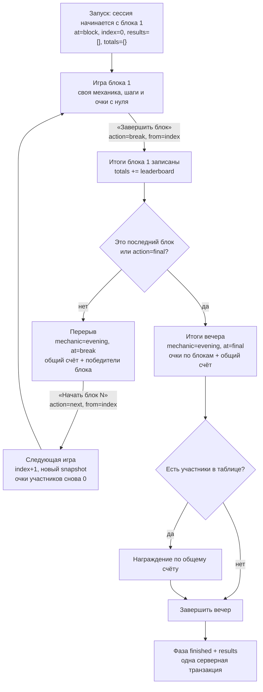

# Паспорт логики — Мероприятие из блоков

> **Эталон.** Этот файл описывает, как должна работать связка «программа вечера → блоки → перерывы → общие итоги».
> Перед правкой: прочитать паспорт → сверить общую часть [`../LOGIC.common.md`](../LOGIC.common.md) и паспорт каждой
> затрагиваемой игры → после изменения повторно проверить все переходы. Намеренное изменение логики фиксируется здесь в том же PR.
> Указатель паспортов — [`../LOGIC.md`](../LOGIC.md).

- Составлен: 18 ноября 2026, по `main` `8f486f6ab7809045129e229c3f451faa6f484b9c`.
- Статус: исходный паспорт по коду и существующим тестам; независимая браузерная проверка ещё не выполнялась.
- Входит: конструктор программы, запуск, серверные переходы, очки блока и вечера, ответы, вторая пультовая вкладка, завершение.
- Не входит: внутренние правила каждой отдельной игры, внешний вид, «Олимп», «Бубликатор», Firebase-реализация (там вечер недоступен).

## 1. Что это за режим

«Мероприятие из блоков» объединяет **от 1 до 5 игр** в одну сессию с одним кодом. Гость входит один раз, состав участника
и его команда сохраняются. После каждого блока ведущий открывает перерыв с победителями блока и общим счётом; затем сам
запускает следующий блок. В конце — таблица очков по блокам и пьедестал по сумме.

Ключевая особенность: **это не одна длинная механика с общим списком шагов**. Во время блока сессия использует механику и
снимок этой игры с нулевым шагом и очками блока с нуля. В перерыве и финале механика сессии — `evening`, а таблица — общая.

Ограничения:

- `PROGRAM_LIMITS`: минимум 1, максимум 5 блоков, название до 80 символов, до 200 строк участников в итогах блока.
- В вечер нельзя ставить `evening`, `olymp`, `bublikator` (`NOT_IN_EVENING`). Проверка есть в конструкторе, при запуске и на сервере.
- Целый вечер нельзя прорепетировать: пульт сообщает, что каждую игру репетируют отдельно. Работает только живая серверная сессия.
- Поддерживаются `solo`, `teams`, `noScreen`, но фактический набор режимов — пересечение возможностей всех блоков.
- «Только solo» и «только teams» в одной программе несовместимы. Проверяется перед запуском и тестами готовых программ.

## 2. Два разных представления программы

### 2.1. В конструкторе

`EveningContent.blocks`: ссылки `gameId`, запомненные `title`, `mechanic`. Парсер оставляет не более 5 валидных ссылок,
ограничивает длину полей. Содержимое игр по ссылкам не хранится.

Вечер в общей библиотеке собирается **только из игр библиотеки**: иначе ведущий не смог бы открыть чужую личную игру.
Личный вечер может содержать личные игры и шаблоны библиотеки.

### 2.2. На сервере

`StoredProgram`:

- `blocks` — публичные сведения о блоках;
- `snapshots` — снимки игр на момент запуска;
- `at`: `block | break | final`;
- `index` — текущий блок;
- `results` — полная таблица каждого закрытого блока;
- `totals` — очки только уже закрытых блоков по `pid`.

Браузер получает `SessionProgram` **без `snapshots`**. Правка исходной игры после запуска не меняет сессию.

### 2.3. Во время блока

- `mechanic`, `gameSnapshot` и `gameId` — от текущей игры;
- `state.step = 0`, `stage = ready`;
- `leaderboard` содержит только очки текущего блока;
- `program.totals` хранит закрытые блоки;
- `eveningScore = totals[pid] + текущий score`.

В перерыве/финале:

- `mechanic = evening`, `gameSnapshot = eveningSnapshot(program)`;
- `leaderboard` содержит общий счёт;
- служебные поля записи (`last`, `roundBase`, `move`) очищаются; сохраняются `name`, `kind`, `score`, при наличии —
  `colorIndex` и `captainUid`.

## 3. Проверки перед запуском

`EveningLoader` загружает каждую игру отдельно и не даёт запустить программу, если:

- игра не найдена или ведущий не имеет права её запускать;
- механика входит в `NOT_IN_EVENING`;
- `validateGame` игры возвращает ошибки;
- есть несочетаемые обязательные режимы участников;
- сервер не поддерживает `sessionsRepo.program` (вечер доступен только на своём сервере).

Дополнительно:

- режим экрана выбирается так, чтобы все блоки поддерживали его;
- режим участников выбирается так, чтобы все блоки поддерживали его;
- возрастной уровень оформления — по самой «взрослой» игре;
- каждый снимок создаётся через `gameSnapshot(game)`;
- повтор создания сессии с теми же настройками использует тот же `id`; изменённые настройки — новый `id`.

Если в личном вечере остались библиотечные шаблоны, перед запуском показывается предупреждение. Можно подготовить копии
или явно выбрать «Запустить как есть».

## 4. Общая блок-схема



Переход из перерыва в `final` не добавляет очки повторно: текущий блок уже был закрыт ранее. Повтор `break` с тем же
`from` возвращает конфликт, а не второе начисление.

## 5. Серверные переходы

`moveProgram(stored, board, action, from)` — чистая функция; `moveEvening` выполняет её под блокировкой строки PostgreSQL.

| Действие | Разрешено из | Что происходит | Результат при ошибке |
|---|---|---|---|
| `break` | `block`, тот же `from=index` | Закрывает блок, пишет `results` и `totals`; далее перерыв или финал у последнего | `409 failed-precondition` при повторе или другом `from` |
| `next` | `break`, тот же `from=index` | Переключает на `index+1`, снимок игры, очки с нуля | `409`, если блока нет или состояние другое |
| `final` | `block` или `break`, тот же `from=index` | Из блока сначала закрывает его; из перерыва только меняет `at` на `final` | `409` при повторном/неподходящем переходе |
| `finish` | Любой идущий блок | Сначала делает `final`, затем обычное завершение игры | Активная игра помощником не закрывается; брошенность проверяется отдельно |

Сервер требует `state.phase = playing`. После `finished` переходы запрещены.

### Что меняется в состоянии при переходе

- Механика, снимок и `gameId` текущего блока.
- `program`, `leaderboard`, `version += 1`.
- Новое состояние игры: `PLAYING_RESET`, `startedAt = null`.
- Убираются `cue`, `slide`, `peek`; слайд-перерыв завершается через `trackBreaks`.
- Музыка, микшер и представление команд (`state.teams`) сохраняются.
- `hidden_at = null`; время `updated_at` обновляется только у обычного перехода пульта.

## 6. Очки и итоги

### 6.1. Закрытие блока

1. Таблица ранжируется общей `rankedLeaderboard`.
2. В `results[index]` записываются `pid`, `name`, `score`, опционально `colorIndex` всех участников (максимум 200).
3. Старый результат с тем же `index` заменяется, а не дублируется.
4. `totals[pid] += score текущего блока`.
5. Таблица для перерыва/финала строится из `totals`.

Победители блока — все участники с максимальным **положительным** счётом. Если максимум 0 или таблица пуста, победителя нет.

### 6.2. Итоговая таблица

Для каждого участника из общей таблицы:

- `Б1…Б5` — очки из `results` соответствующего блока;
- `null` отображается как `—`: блок не был сыгран;
- отсутствие участника в сыгранном блоке отображается как `0`: он пришёл позже или не заработал очков;
- `total` — общий счёт, места считает `rankedLeaderboard`, равные очки делят место.

Пример из теста: Аня 300 в первом блоке, Боря 100 → во втором Боря получает ещё 400. В итогах Боря 500, Аня 300;
третий несыгранный блок — `null`, а не 0.

### 6.3. История игр

Финальный `results` пишется по общей таблице в той же транзакции, что и `phase = finished`. Пустая таблица в историю не
пишется. Баллы ведущему считаются сервером по телефонам и ответам, включая архивные ответы закрытых блоков.

## 7. Ответы и локальное состояние блоков

При смене блока сервер архивирует ответы текущего блока:

```text
newStep = -(oldStep + 1) - 100000 × (index старого блока + 1)
```

Так ответы:

- остаются в базе для истории и баллов ведущему;
- не попадают в шаги новой игры, которая снова начинается с 0;
- получают событие `clear` в Hub;
- не переходят в «Помощь зала»: `audience` сессии очищается.

`storeScope(session)` даёт блокам разные локальные ключи: первый блок использует `session.id`, последующие —
`session.id.bN`. Поэтому повторная механика в следующем блоке начинается с чистого локального состояния: выборы ведущего,
отметки лото и другие данные не смешиваются.

## 8. Что видно участникам

| Этап | Экран зала | Телефон гостя | Пульт |
|---|---|---|---|
| Игра блока | Механика текущей игры | Механика текущей игры | Механика текущей игры + «Завершить блок» |
| Перерыв | Победители блока, программа и общий счёт | Место в вечере, программа; телефон переключится сам | «Начать блок N» или «Закончить вечер без оставшихся» |
| Финал до награждения | Очки по блокам и общий счёт | Своя строка итоговой таблицы | «Награждение вечера» или «Завершить вечер» |
| Пьедестал | Общая система награждения | Общая система награждения | Открытие мест, затем «Завершить вечер» |

`EveningScreenView` показывает до 8 строк итогов, `EveningPlayerView` — до 5 и добавляет свою строку, если она не вошла.

## 9. Конструктор и готовые программы

В редакторе можно:

- добавлять, убирать и переставлять блоки;
- открыть игру блока с возвратом `?evening=<id программы>`;
- выбрать одну из 15 готовых программ;
- подготовить личную копию библиотечного шаблона.

«Подготовить под вечер»:

1. защищено `preparingRef` от двойного касания;
2. создаёт личную копию с названием `prepTitle`;
3. копирует связанные медиа через `gameMediaIds`;
4. заменяет ссылку в **свежем** содержимом программы, даже если блок сдвинули;
5. если блок уже убрали, оставляет копию в «Моих игр» и сообщает об этом;
6. открывает конструктор копии с возвратом к программе.

Готовые программы проверяются на уникальность, лимит блоков, совместимость режимов, возраст, вид поля/арены, лимиты игроков
и наличие понятной подсказки по рассадке. Подбор сначала ищет личные игры, затем библиотеку и не использует одну игру дважды.

## 10. Инварианты

- **В-1.** Одна сессия и один код сохраняются на весь вечер.
- **В-2.** Число блоков — от 1 до 5.
- **В-3.** `evening`, `olymp`, `bublikator` не могут быть блоком.
- **В-4.** Во время блока игра идёт по снимку, а не по текущему содержимому библиотеки.
- **В-5.** Во время блока таблица содержит очки только этого блока.
- **В-6.** В перерыве и финале таблица содержит только общий счёт закрытых блоков.
- **В-7.** Закрытие блока добавляет очки ровно один раз; повторная команда не добавляет их снова.
- **В-8.** Переход из перерыва в `final` не удваивает `totals`.
- **В-9.** Новый блок начинается с `step = 0`, `stage = ready` и очков 0 у всех участников.
- **В-10.** `from` обязан равняться текущему `index`; устаревший пульт получает 409.
- **В-11.** После `final` и после `finished` переходов между блоками нет.
- **В-12.** Ответы прошлого блока не попадают в новый; архив сохраняется для баллов ведущему.
- **В-13.** Публичная программа не содержит снимки игр.
- **В-14.** Победитель блока существует только при положительном максимальном счёте; равные победители идут вместе.
- **В-15.** Несыгранный блок в итоговой таблице — `null`, а не 0.
- **В-16.** Участник, пришедший позже, получает 0 за уже сыгранный блок, если он там был записан; его личность не пересоздаётся.
- **В-17.** Режимы сессии должны поддерживаться всеми блоками.
- **В-18.** Вечер библиотеки содержит только игры библиотеки.
- **В-19.** Завершение посреди блока сначала закрывает его и формирует общий счёт.
- **В-20.** Повторная механика в другом блоке получает новый `storeScope`.

## 11. Крайние случаи

- Один блок: `break` сразу ведёт в `final`.
- Завершить вечер из перерыва: оставшиеся блоки отмечаются несыгранными, очки не добавляются.
- Завершить вечер из блока: сначала записываются его итоги.
- Повторное нажатие из второй вкладки: конфликт, свежее состояние приходит по SSE.
- Пришёл новый гость в середине вечера: сохраняет того же участника и нулевые/текущие очки согласно правилам блоков.
- Битая программа: парсер возвращает `null` для пустой/неверной структуры и ограничивает `index` диапазоном блоков.
- Более 200 участников: результат блока ограничен первыми 200 строками после ранжирования — это лимит хранения, требующий
  отдельного решения перед увеличением зала.
- Помощник владельца может закрыть только брошенный вечер; активный вечер ведущего он завершить не может.

## 12. Где это в коде

| Место | Ответственность |
|---|---|
| `src/core/program.ts` | Модель, переходы, очки, публичная программа, `storeScope` |
| `src/core/program.test.ts` | Основные переходы, итоги, повторы, парсер |
| `src/core/eveningPrep.ts` | Памятки и подготовка библиотечных шаблонов |
| `src/mechanics/evening/content.ts` | Содержимое конструктора |
| `src/mechanics/evening/validate.ts` | Лимиты и запрещённые механики |
| `src/mechanics/evening/templates.ts` | 15 программ и подбор игр |
| `src/mechanics/evening/templates.test.ts` | Совместимость программ и лимиты |
| `src/mechanics/evening/Editor.tsx` | Блоки, копии, порядок, памятки |
| `src/mechanics/evening/HostControls.tsx` | Перерыв, финал, награждение |
| `src/mechanics/evening/views.tsx` | Экран и телефон |
| `src/screens/studio/Launch.tsx` | Проверка и создание вечера |
| `src/screens/HostConsole.tsx` | «Завершить блок» |
| `server/src/live.ts` | Транзакции `/program`, архив ответов, завершение |
| `server/src/live.test.ts` | Серверные сценарии вечера |
| `scripts/studio.ts` | Права и повторное переключение |

## 13. Ограничения и непроверенное

- Целый вечер в браузере в рамках составления этого паспорта не запускался; выводы сделаны по коду и тестам.
- Не проверялась визуальная работа таблицы с пятью блоками на узком телефоне.
- Не воспроизводились два пульта на реальном сервере; поведение описано по транзакции и существующим серверным тестам.
- Внутренние правила каждой механики блока остаются обязательными: если у игры нет собственного паспорта, её включение в вечер
  не снижает риск её изменений.
- Не выявлялась новая ошибка и не ставилась задача исправления. Открытые ограничения перечислены выше и не должны
  выдаваться за найденные дефекты.

## 14. Проверка паспорта

Перед использованием для изменения логики выполнить:

- `npx vitest run src/core/program.test.ts src/mechanics/evening/validate.test.ts src/mechanics/evening/templates.test.ts`;
- серверный сценарий вечера из `server/src/live.test.ts` с PostgreSQL;
- браузерный путь «программа → блок 1 → перерыв → блок 2 → итоги → награждение» на test;
- повтор `break` и `next` со второй вкладки;
- завершение посреди блока и проверку `results`, архивных ответов и `storeScope`.
