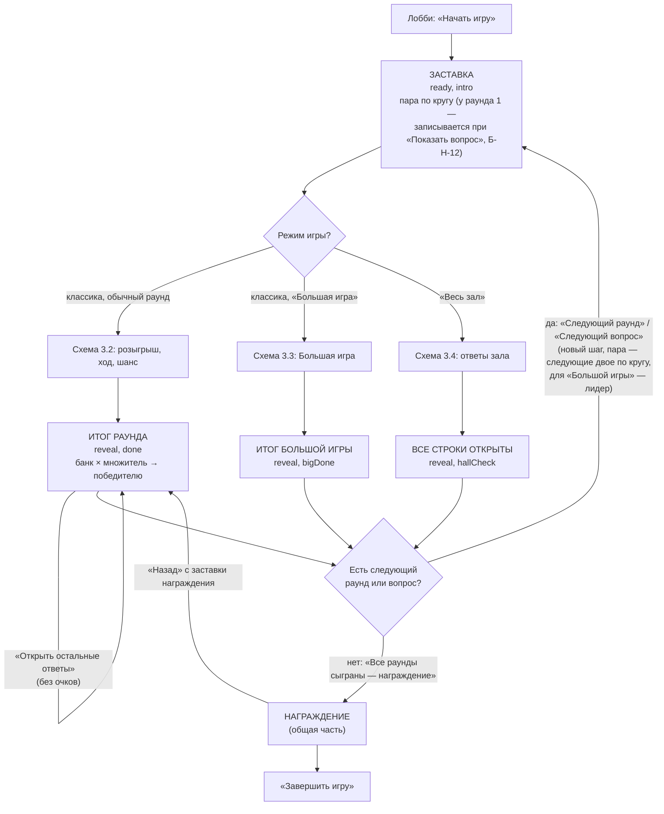
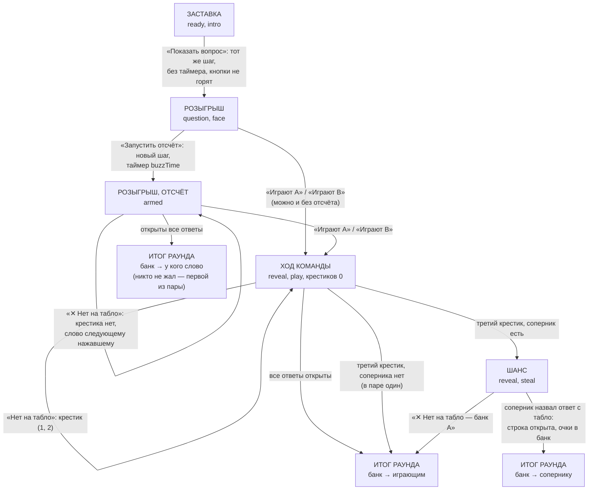
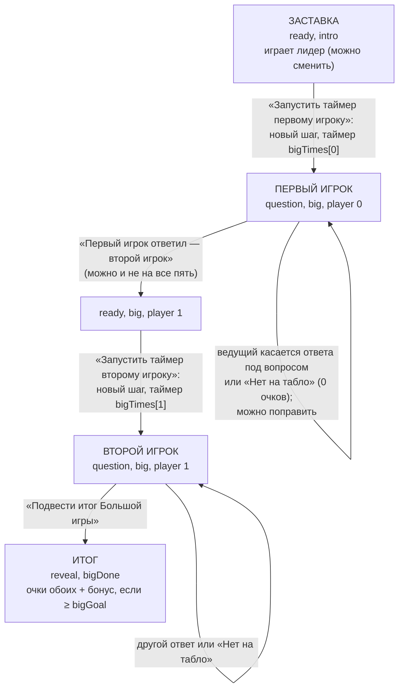
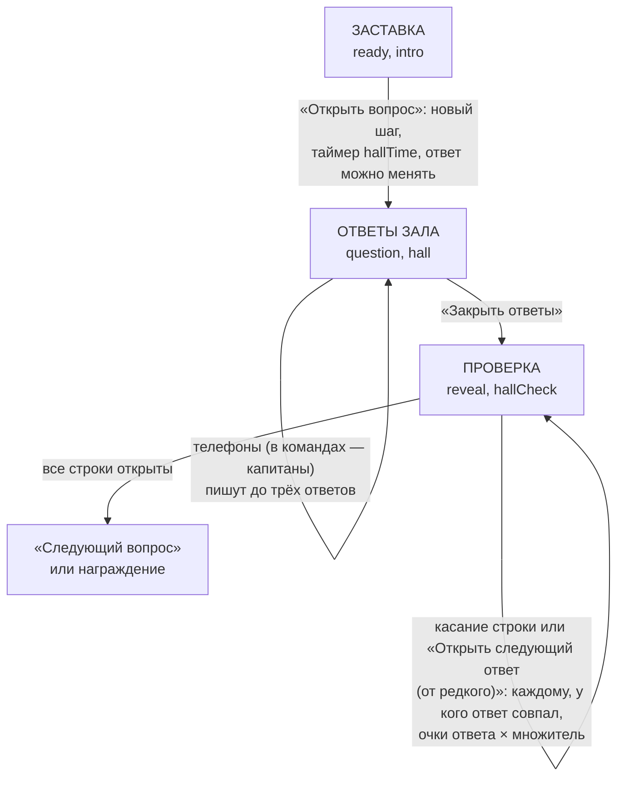
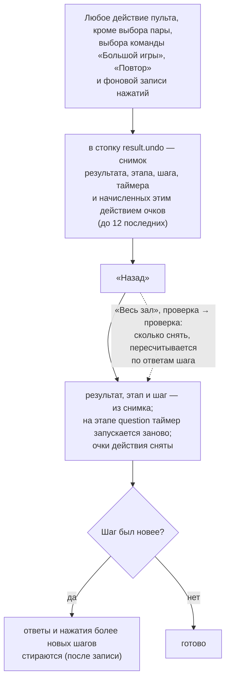

# Паспорт логики — «Что скажет большинство»

> **Эталон.** Этот файл описывает, как *должна* работать игра «Что скажет большинство»: раунды, розыгрыш «Жми первым!»,
> ход команды, три крестика и шанс соперника, банк и множитель, «Игра наоборот», «Большая игра», режим «Весь зал» и
> «Назад». Любая правка игры идёт так: **прочитать паспорт → правка → сверить с паспортом → если логика изменилась
> намеренно, обновить паспорт в том же PR**. Расхождение кода с паспортом — ошибка. Общая часть (вход гостя, лобби,
> приём ответов, пульт, телефон, награждение, итоги) — в [`../LOGIC.common.md`](../LOGIC.common.md): здесь она не
> повторяется, ссылки вида «Н-1» ведут туда. Указатель всех паспортов — [`../LOGIC.md`](../LOGIC.md).

- Составлен: 14 ноября 2026, по коммиту `38c2018` (файлы `src/mechanics/hundred/` в рабочей копии не менялись).
- Независимая проверка: 14 ноября 2026 (раздел 10).
- Что сюда **не входит**: «Опрос гостей заранее» (`PollPanel`, `server/src/polls.ts` — свой тест `polls.test.ts`),
  конструктор и импорт списком (кроме того, что влияет на ход игры), «Мероприятие из блоков», репетиция и
  предпросмотр, Firebase-версия, внешний вид экрана (табло с переворотом строк, оформления «Студия», «Вечер JoyRest»,
  «Игровой стол»), звуки и музыка момента (`index.ts`, `music`).

## 1. Что за игра

Ведущий задаёт вопрос, на табло скрыты 4–8 самых частых ответов «людей», у каждого — очки (сколько человек из 100 так
ответили). Игра идёт **раундами по порядку**. Есть два режима всей игры:

- **Классика** (`content.mode = "classic"`) — у табло две команды (или два игрока). Розыгрыш: после отсчёта ведущего
  капитаны жмут «Жми первым!», первый называет ответ, ведущий отмечает его на табло или «Нет на табло». Потом ведущий
  отдаёт раунд одной из двух («Играют …»): она называет ответы по очереди, угаданные идут в **банк**, промах — крестик;
  три крестика — **шанс** соперника назвать один ответ. Банк × множитель раунда уходит победителю раунда. Финал —
  **«Большая игра»**: лидер, пять вопросов на время, два игрока (или два захода).
- **«Весь зал»** (`content.mode = "hall"`) — для большого зала: каждый вопрос все (в командах — капитаны) пишут до трёх
  ответов с телефона; ведущий открывает табло по одной строке, каждый, кто написал этот ответ, получает его очки.

**Виды раундов** (`RoundKind`, `content.ts`):

| Вид | В раунде | Очки ответа | Множитель банка |
|---|---|---|---|
| `simple` Простая игра | 1 вопрос | очки ответа | ×1 |
| `double` Двойная | 1 вопрос | очки ответа | ×2 |
| `triple` Тройная | 1 вопрос | очки ответа | ×3 |
| `reverse` Игра наоборот | 1 вопрос | по месту: самый популярный 15, дальше 30, 60, 120, 180, самый редкий 240 (`reversePoints`; 4–5 ответов — хвост ряда, 7–8 — ещё 10 и 5) | ×1 |
| `big` Большая игра | 5 вопросов | очки ответа | — (в классике — своя схема 3.3; в «Весь зал» — обычные вопросы зала ×1) |

**Настройки игры** (`HundredContent`):

| Поле | Что | По умолчанию | Границы |
|---|---|---|---|
| `mode` | классика или «Весь зал» | классика | — |
| `rounds` | раунды по порядку, у каждого вид и вопросы | все пять видов по разу | до 10 раундов |
| `buzzTime` | секунд жать «Жми первым!» после «Запустить отсчёт» | 10 | 5–30 |
| `hallTime` | «Весь зал»: секунд на ответы | 60 | 20–180 |
| `bigTimes` | «Большая игра»: секунд первому и второму игроку | 20 и 25 | 10–90 |
| `bigGoal` | «Большая игра»: сколько набрать вдвоём | 200 | 1–500 |
| `bigBonus` | бонус, если набрали `bigGoal` | 100 | 0–2000 |
| `look` | оформление экрана | «Студия» (и шаблоны); игра без поля — «Классика» | — |
| `pollId` | опрос гостей заранее (только свой сервер) | нет | — |

У вопроса — текст, 4–8 ответов (у ответа текст, очки 1–100, до 12 синонимов для ведущего и для «Весь зал»), источник
очков (`estimate` — оценка JoyRest, **не опрос**; `poll` — опрос гостей, число ответивших). Сумма очков вопроса ≤ 100.

**Режимы участников** (`index.ts`, `supports`): каждый сам, команды, без экрана зала — все три. В командах жмёт кнопку и
пишет ответы «Весь зал» капитан; остальные телефоны команды видят подсказку «подскажите капитану».

## 2. Этапы и что на них видно

Этапы общие (`state.stage`): `ready` — заставка, `question` — открыт приём (розыгрыш, ответы зала, таймер «Большой
игры»), `reveal` — ход команды, шанс, итог раунда, проверка ответов зала, `podium` — награждение. Внутри — свой режим
`result.mode`: `intro`, `face`, `play`, `steal`, `done`, `big`, `bigDone`, `hall`, `hallCheck`. Номер шага растёт на
«Запустить отсчёт», «Запустить таймер» «Большой игры», «Открыть вопрос» «Весь зал» и на каждом новом раунде или
вопросе — нажатия и ответы прошлого шага на новом не считаются.

| Этап (`stage` / `mode`) | Экран зала | Телефон играющей пары / команды хода | Другие телефоны | Пульт |
|---|---|---|---|---|
| Заставка раунда (`ready`, `intro`) | вид раунда, ×2 / ×3, «редкие дороже» | «Простая игра» (или «Скоро вопрос»), «смотрите на экран» | то же | выбор пары (если гостей больше двух) или команды «Большой игры», «Показать вопрос» / «Открыть вопрос · 60 с» / «Запустить таймер первому игроку» |
| Розыгрыш, кнопка ещё не горит (`question`, `face`, не `armed`) | вопрос, закрытое табло, плашки пары | «Слушайте вопрос» | «Отвечают A и B» | «Прочитайте вопрос вслух…», «Запустить отсчёт · 10 с», табло с синонимами, «Нет на табло», «Играют A» / «Играют B» |
| Розыгрыш, отсчёт (`question`, `face`, `armed`) | таймер, кто нажал первым | «Жми первым!» → «Ваше слово!» / «Нажато — ждите» / «Слово перешло сопернику» | «Отвечают …» | «Первым нажал …», таймер, «Нажали: N», табло, «Нет на табло», «Играют …» |
| Ход команды (`reveal`, `play`) | табло, банк, крестики ✕ | «Ваша команда отвечает» | «Отвечают …, ошибок N из 3» | «Ход: … · ошибки ✕✕·», табло, «Нет на табло» |
| Шанс (`reveal`, `steal`) | «шанс!» у соперника | соперник: «Шанс! … один ответ» | «Шанс для …» | «Шанс для …», табло, «✕ Нет на табло — банк …» |
| Итог раунда (`reveal`, `done`) | банк × множитель → победитель | «Банк — …, +N очков» | то же | «Банк N × 2 = M → …», «Открыть остальные ответы», «Дальше без остальных ответов» / «Следующий раунд» / «Все раунды сыграны — награждение» |
| «Большая игра» (`question` или `ready`, `big`) | пять вопросов, ответы игроков (ответы первого видны, пока отвечает второй — Б-Н-15), таймер | лидер: «Большая игра — ваша!» | «Играет …» | вопросы с ответами табло касанием, «Нет на табло», «Первый игрок ответил — второй игрок», «Запустить таймер второму игроку», «Подвести итог Большой игры» |
| Итог «Большой игры» (`reveal`, `bigDone`) | «Победа! +N бонус» или «Почти получилось!», «Итог: N из M» | «Итог: N из 200» | то же | «Цель взята! … → +N», «Следующий раунд» / награждение |
| «Весь зал», ответы (`question`, `hall`) | вопрос, таймер | поле до трёх ответов, «Ответы отправлены… можно исправить» (участник команды — «Ответы пишет капитан») | то же | «Ответили: N», таймер, «Закрыть ответы» |
| «Весь зал», проверка (`reveal`, `hallCheck`) | табло, «угадали: N» у открытых строк | «Смотрите на табло!», свои ответы и сколько на табло | то же | «Не распознано — засчитать?» со списком, табло касанием, «Открыть следующий ответ (от редкого)», «Следующий вопрос» |
| Награждение (`podium`) | пьедестал (общая часть) | пьедестал | пьедестал | «Открыть следующее место» → «Завершить игру» |

Без экрана зала телефоны показывают маленькое табло (`HundredBoard small`) на всех этапах, кроме заставки и «Большой
игры»; в «Большой игре» — список ответов обоих игроков (`views.tsx`, стр. 385–393). Где в коде: экран — `views.tsx`, `HundredScreenView`; телефон — `views.tsx`, `HundredPlayerView` (стр. 339);
пульт — `HostControls.tsx`.

## 3. Блок-схемы

### 3.1. Игра целиком

Где в коде: `logic.ts` — `hundredPrimary` (стр. 361, главная кнопка), `nextQuestion` (488), `defaultPair` (237),
`leaderOf` (247), `hundredAward` (504) → `core/podium.ts`.

### 3.2. Классика: розыгрыш, ход, шанс

Где в коде: `startFace` (397), `setPair` (407), `armFace` (415), `hundredBuzzSync` (422; фон пульта —
`HostControls.tsx`, стр. 91–96), `openAnswer` (438), `missAnswer` (454), `choosePlaying` (471), `finishRound` (431),
`showRest` (478); кнопка «кто первый» — `core/buzz.ts`.

### 3.3. «Большая игра» (классика)

В режиме «каждый сам» лидер играет оба захода сам; во втором заходе нельзя повторять свои ответы первого. Где в коде:
`setBigTeam` (511), `bigStart` (520), `bigEnter` (530), `bigSecond` (550), `bigFinish` (557), `bigAward` (267).

### 3.4. «Весь зал»

Сравнение ответа (`match.ts`): без регистра, ё/е, пробелов и пунктуации; опечатки — от 5 букв одна, от 9 — две; ответ
от 5 букв засчитывается и внутри фразы («конверт с деньгами» → «конверт»); засчитанные ведущим слова (`accepted`) — для
всех, кто так написал. Где в коде: `hallOpen` (568), `hallClose` (575), `hallPayouts` (582), `repay` (618),
`hallOpenRow` (627), `hallOpenNext` (635), `hallAccept` (644); `match.ts` — `matchWord`, `matchedAnswers`, `unmatchedWords`.

### 3.5. «Назад»

Где в коде: `commit` (291), `hundredBack` (669), кнопка — `HostControls.tsx`, стр. 120–124.

## 4. Правила логики

### Раунды, пара и очередь

- **Б-1.** Раунды идут по порядку конструктора; в классике обычный раунд — один вопрос, «Большая игра» — пять вопросов
  и только последним раундом (проверка перед запуском). В «Весь зал» вопросы «Большой игры» идут обычными вопросами
  зала по одному, ×1. *Где:* `validate.ts`, `hasNext` (213), `nextQuestion` (488).
- **Б-2.** Пара раунда по умолчанию — по кругу в порядке входа: раунд k (считая только обычные) — участники 2k и 2k+1
  по кругу; двое или меньше — играют все. На заставке ведущий меняет пару касанием (не больше двух, только те, кто в
  таблице; логика пускает и до «Запустить отсчёт», но на пульте выбор — только на заставке); можно оставить одного —
  тогда шанса нет и после трёх крестиков банк ему. Число участников считается на момент перехода к раунду, поэтому
  новая команда сдвигает круг (Б-Н-13). *Где:* `defaultPair` (237), `setPair` (407), `orderedIds` (231), пульт — стр. 201.
- **Б-3.** «Большую игру» играет лидер по счёту на момент перехода к ней; при равных — кто раньше вошёл. Пока
  ни у одного из игроков нет ни одного ответа, ведущий может сменить команду (на пульте — только на заставке). *Где:* `nextQuestion` (стр. 499),
  `leaderOf` (247), `setBigTeam` (511).

### Розыгрыш

- **Б-4.** «Показать вопрос» открывает вопрос без таймера, кнопка у пары не горит — фальстарта нет. «Запустить отсчёт» —
  **новый шаг** (нажатия раньше не считаются) и таймер `buzzTime`. *Где:* `startFace` (397), `armFace` (415).
- **Б-5.** Жать могут только капитаны (в «каждый сам» — игроки) играющей пары; порядок — по часам сервера
  (`submittedAt`), записанный порядок только дополняется. Слово — первому, кто ещё не ошибся. *Где:* `hundredBuzzSync`
  (422), `core/buzz.ts`, `syncBuzz`.
- **Б-6.** В розыгрыше «Нет на табло» крестика не ставит: слово переходит следующему нажавшему. Названный ответ с табло
  открывается и его очки идут в банк. *Где:* `missAnswer` (стр. 456), `openAnswer` (447).
- **Б-7.** Кто играет раунд, решает ведущий («Играют A» / «Играют B») — в любой момент розыгрыша, даже без отсчёта
  (репетиция, нет телефонов). Крестики начинаются с нуля. *Где:* `choosePlaying` (471).
- **Б-8.** Открыты все ответы ещё в розыгрыше — раунд закончен: банк тому, у кого слово, а если никто не жал — первой
  из пары. *Где:* `openAnswer` (стр. 449).

### Ход команды и шанс

- **Б-9.** Играющая команда называет ответы: ответ с табло — строка открыта, очки ответа (в «Игре наоборот» — по месту)
  в банк; «Нет на табло» — крестик. Все ответы открыты — банк играющим. *Где:* `openAnswer` (447–450), `missAnswer`
  (457–464).
- **Б-10.** Третий крестик — «Шанс» соперника (второй из пары); соперника нет — банк играющим сразу. *Где:* `missAnswer`
  (стр. 460–463), `HUNDRED_LIMITS.strikes` = 3.
- **Б-11.** Шанс — один ответ: на табло — строка открыта, её очки добавлены в банк, **весь банк сопернику**; «Нет на
  табло» — банк играющим. *Где:* `openAnswer` (стр. 448), `missAnswer` (стр. 466).
- **Б-12.** Банк × множитель раунда (×1, ×2, ×3; «Игра наоборот» ×1) — прибавкой (`addScore`) победителю раунда, один раз;
  на экране и телефоне — «Банк — …, +N». Банк 0 — очков нет. *Где:* `finishRound` (431), `multiplierOf`.
- **Б-13.** После итога раунда закрытые строки открываются **без очков** — касанием по одной или «Открыть остальные
  ответы». Можно идти дальше и не открывая их. *Где:* `openAnswer` (стр. 445), `showRest` (478); пульт — «Дальше без
  остальных ответов».

### «Большая игра»

- **Б-14.** Каждому игроку — свой шаг и свой таймер (`bigTimes`); время вышло — ведущий всё равно может записать
  сказанное. Ответы записывает ведущий касанием, «Нет на табло» — 0 очков; запись можно поправить. *Где:* `bigStart`
  (520), `bigEnter` (530).
- **Б-15.** Второй игрок не может повторить ответ первого на тот же вопрос: на пульте кнопка этого ответа у второго
  игрока недоступна; логика такой ответ не записывает и ставит «Повтор, другой ответ!» (`repeat`), но с пульта до неё
  не дойти — надпись видна только в предпросмотре (Б-Н-15). *Где:* `bigEnter` (стр. 538–541), пульт — стр. 298.
- **Б-16.** Итог — сумма очков всех десяти ответов; набрали `bigGoal` — плюс `bigBonus`. Всё — прибавкой команде из `big.team` (лидер или та, кого выбрал ведущий).
  *Где:* `bigFinish` (557), `bigAward` (267).

### «Весь зал»

- **Б-17.** «Открыть вопрос» — новый шаг, таймер `hallTime`, ответ можно менять до конца времени (`changeable`). С
  телефона — до трёх ответов; в командах пишет только капитан. После «Закрыть ответы» приём закрыт. *Где:* `hallOpen`
  (568), `hallClose` (575), телефон — `HallForm`.
- **Б-18.** Очки дают только **открытые** строки: каждому участнику, у кого ответ совпал со строкой (или засчитан
  ведущим как эта строка), — очки ответа × множитель раунда; один ответ табло — один раз, сколько бы слов на него ни
  пришлось. Засчитали слово после открытия строки — очки сразу. *Где:* `hallPayouts` (582), `matchedAnswers`.
- **Б-19.** Сколько кому начислено, в результате не хранится (результат уходит всем телефонам): начисление — разница
  «после минус до», посчитанная по свежему списку ответов шага с сервера; не получилось получить его — по списку, который уже есть у
  пульта (`.catch(() => answers)`). *Где:* `repay` (618), пульт — `withAnswers` (стр. 98).
- **Б-20.** Пока не открыты все строки, «Следующий вопрос» не появляется; «Открыть следующий ответ» идёт от самого
  редкого. *Где:* `hundredPrimary` (стр. 390), `hallOpenNext` (635).

### «Назад» и запись пульта

- **Б-21.** «Назад» — ровно одно действие вместе с его очками, до 12 действий подряд; выбор пары, выбор команды
  «Большой игры», «Повтор» и фоновая запись нажатий в стопку не идут. *Где:* `commit` (291), `UNDO_DEPTH`.
- **Б-22.** «Назад» возвращает этап, шаг и результат из снимка; если вернулись на этап `question` — таймер запускается
  заново на полное время. Ответы и нажатия шагов новее восстановленного стираются (после записи — Н-3). *Где:*
  `hundredBack` (669).
- **Б-23.** «Назад» в проверке «Весь зал» снимает очки пересчётом по ответам шага (а не из снимка — там их нет). *Где:*
  `hundredBack` (стр. 675–678).
- **Б-24.** Все действия пульта — через `useHostRun` с отпечатком итогов; фоновая запись нажатий в отпечаток «момента»
  не входит (в нём только, у кого слово), поэтому касание ведущего во время нажатий не теряется, если нажатие лишь
  дописало очередь; если оно сменило того, у кого слово, — касание заканчивается «Игра изменилась — нажмите ещё раз». *Где:* `HostControls.tsx`,
  `hundredMoment` (стр. 75).

### Конец игры

- **Б-25.** После последнего раунда (или вопроса «Весь зал») — «Все раунды сыграны — награждение» (общий пьедестал);
  «Назад» с заставки награждения возвращает на итог последнего раунда. *Где:* `hundredAward` (504), `core/podium.ts`.

## 5. Крайние случаи

| Случай | Что должно быть | Где |
|---|---|---|
| В игре один участник | играет один, шанса нет: три крестика — банк ему | `missAnswer`, `opponentOf` |
| Двое участников | они играют каждый обычный раунд | `defaultPair` |
| Три участника, 4 обычных раунда | A и B — по 3 раунда, C — 2 (по кругу) | `defaultPair` |
| Участников больше, чем мест в обычных раундах (10 команд, 4 раунда) | двое никогда не играют у табло (Б-Н-2) | `defaultPair` |
| Никто не нажал «Жми первым!» | ведущий сам выбирает «Играют …» | `choosePlaying` |
| Оба в розыгрыше промахнулись | слова нет ни у кого, ведущий выбирает «Играют …» | `buzzWrong` |
| Все ответы открыты в розыгрыше | итог раунда: банк тому, у кого слово, иначе первой из пары (Б-Н-4) | `openAnswer` |
| Ведущий коснулся ответа до «Запустить отсчёт» | строка открыта, очки в банк (Б-Н-3) | `openAnswer` |
| Шанс: соперник угадал | банк с его ответом — сопернику | `openAnswer` |
| Банк 0 (в банк ничего не попало) | победитель раунда записан, очков 0 | `finishRound` |
| «Большая игра»: второй игрок повторил ответ первого | не записан, «Повтор, другой ответ!» | `bigEnter` |
| «Большая игра»: ответы второго до «Запустить таймер» | записываются (Б-Н-7) | `bigEnter` |
| «Весь зал»: гость написал одно и то же трижды | один ответ табло — один раз | `matchedAnswers` |
| «Весь зал»: участник команды (не капитан) | пишет только капитан | телефон, сервер |
| «Весь зал»: «Назад», пока у пульта нет ответов шага | очки не сняты, строка закрыта (Б-Н-1) | `hundredBack`, пульт |
| «Назад» на розыгрыш с отсчётом | таймер снова на полное время, очередь нажатий из снимка | `hundredBack` |
| «Назад» с отсчёта на «без отсчёта», а стирание нажатий не дошло | старое нажатие при новом отсчёте снова в очереди (Б-Н-5) | `buzzOrder` |
| Убрали участника, который в паре | ему всё ещё можно отдать раунд (Б-Н-6) | `choosePlaying` |
| Больше 12 действий назад | дальше «Назад» недоступно | `UNDO_DEPTH` |

## 6. Конструктор → игра

- Проверка перед запуском (`validate.ts`): хотя бы один раунд; кроме «Большой игры» хотя бы один обычный; «Большая
  игра» одна и последняя; обычный раунд — ровно один вопрос, «Большая игра» — ровно пять; у вопроса текст, 4–8
  непустых ответов, у каждого ≥ 1 очка, сумма ≤ 100, ответы без повторов.
- Порядок ответов на табло — по очкам, при равных — как ввёл ведущий (`ranked`); от него же зависят очки «Игры
  наоборот».
- Шаблоны (`demo.ts`): «Свадьба», «Корпоратив», «День рождения» (классика) и «Весь зал» — по пять раундов (простая,
  двойная, тройная, наоборот, большая), очки — оценка JoyRest, не опрос.

## 7. Где это в коде

| Что | Где |
|---|---|
| Данные игры, виды раундов, очки, «Игра наоборот», разбор, импорт | `content.ts` |
| Ход игры: все действия пульта, «Назад», главная кнопка | `logic.ts` |
| Сравнение ответов «Весь зал» | `match.ts` (общая нормализация — `core/normalize.ts`) |
| Проверка перед запуском | `validate.ts` |
| Пульт | `HostControls.tsx` |
| Экран зала и телефон | `views.tsx` |
| Предпросмотр в конструкторе | `preview.ts` |
| Кнопка «кто первый» | `core/buzz.ts` |
| Правила на слайде | `core/rules.ts`, `hundred` |

## 8. Тесты

`hundred.test.ts`: разбор и шаблоны, проверка, источник очков, импорт; «Игра наоборот»; классика — розыгрыш → играют
→ банк ×2, три крестика и шанс (оба исхода), «Назад» до начала с очисткой нажатий, промах розыгрыша, банк «Игры
наоборот»; «Большая игра» — два игрока, повтор, бонус; «Весь зал» — нормализация и опечатки, очки, засчитывание,
«Назад» до «Закрыть ответы», «Большая игра» в «Весь зал».

Не покрыто тестами: «Назад» в «Весь зал» с пустым или старым списком ответов у пульта (Б-Н-1), очередь пар при
многих командах (Б-Н-2), открытие ответа до отсчёта (Б-Н-3), итог розыгрыша без нажатий (Б-Н-4), старые нажатия после
«Назад» (Б-Н-5).

## 9. Находки

Прогоны — временным тестом `src/mechanics/hundred/_probe.test.ts` (после прогона удалён), шаблон «Свадьба».

### Б-Н-1. «Назад» в «Весь зал» может закрыть строку, не сняв очки — средняя

- **Статус:** подтверждено прогоном.
- **Где:** `HostControls.tsx`, стр. 105 и 121: `hundredBack(s, content, answers)` берёт ответы из пропса пульта, а не
  свежий список с сервера (`control.freshAnswers`), как это делают открытие строки и «Засчитать» (`withAnswers`, стр. 98).
  Подписка на ответы (`HostConsole.tsx`, `useHostData`) слушает только текущий шаг: после смены шага в пропсе до прихода
  снимка лежат ответы прошлого шага.
- **Прогон.** «Весь зал», игрок «a» написал «кошка», ведущий открыл строку — у «a» 84 очка. «Назад» с пустым списком
  ответов: строка закрыта, а у «a» по-прежнему 84.
- **Когда бывает.** Ведущий быстро жмёт «Назад» два раза через переход к следующему вопросу («Следующий вопрос» →
  «Назад» → «Назад»): после первого шаг вернулся, подписка ещё не прислала ответы — второе «Назад» считает по пустому
  списку. Так же, если поток ответов у пульта отстал или оборвался.
- **Чем грозит.** Очки за ответ остаются, хотя строка закрыта; повторное открытие начислит их ещё раз.
- **Решение (советую).** «Назад» пульта — по свежему списку: `run(withAnswers((s, list) => hundredBack(s, content,
  list)?.change ?? null), plan.clear)`; свежий список не получен — «Назад» не делать, а показать «Нет связи — нажмите
  ещё раз» (запасной путь `.catch(() => answers)` здесь не годится). Тест: «Назад» после перехода считает по ответам с сервера.

### Б-Н-2. При многих командах часть команд не играет у табло ни разу — средняя

- **Статус:** подтверждено прогоном.
- **Где:** `defaultPair` (237): пара раунда k — участники 2k и 2k+1 по кругу; в шаблонах 4 обычных раунда.
- **Прогон.** 10 команд, шаблон «Свадьба»: у табло побывают 8, команды 9 и 10 — ни разу (очков у них не будет, кроме
  ручных). 3 команды: A и B играют по 3 раунда, C — 2.
- **Чем грозит.** На мероприятии 8–10 команд: две сидят весь вечер без шанса набрать очки, а «Большую игру» играет только
  лидер. Ведущий об этом не узнаёт — пульт показывает только «Играют: …» текущего раунда.
- **Решение — за владельцем.** (а) пульт на первой заставке предупреждает: «Команд 10, обычных раундов 4 — двое не
  сыграют у табло. Для большого зала — режим «Весь зал» или добавьте раунды»; (б) то же в конструкторе и в инструкции;
  (в) оставить как есть — ведущий сам выбирает пары. Советую (а) + (б).

### Б-Н-3. Ответ можно открыть до «Запустить отсчёт» — низкая

- **Статус:** подтверждено прогоном.
- **Где:** `openAnswer` (стр. 446) пускает режим `face` без проверки `armed`; пульт показывает табло активным сразу после
  «Показать вопрос» (стр. 470).
- **Прогон.** «Показать вопрос» → касание первой строки: строка открыта на экране, в банке 38.
- **Чем грозит.** Ведущий читает вопрос, задевает строку — зал видит ответ до розыгрыша. «Назад» исправит, но ответ уже
  увидели.
- **Решение (советую).** Пока отсчёт не запущен и никто не выбран играть — строки табло на пульте недоступны (или
  касание — через подтверждение «Открыть ответ до розыгрыша?»). Логику не трогать: в репетиции ведущий сначала нажимает
  «Играют …».

### Б-Н-4. Все ответы открыты в розыгрыше без нажатий — банк молча уходит первой из пары — низкая

- **Статус:** подтверждено прогоном.
- **Где:** `openAnswer` (стр. 449): `r.buzz.current ?? r.pair[0]`.
- **Прогон.** Отсчёт, никто не нажал, ведущий открыл все строки: итог раунда, банк 87 — команде fox (первой из пары).
- **Чем грозит.** Редкий случай (обычно ведущий сначала выбирает «Играют …»), но победитель выбран не ведущим.
- **Решение (советую).** Пока в розыгрыше никто не выбран и слова нет — последняя строка не закрывает раунд сама:
  пульт просит «Кто играет раунд?». Или оставить и описать в инструкции.

### Б-Н-5. Старое нажатие после «Назад» снова в очереди, если стирание не дошло — низкая

- **Статус:** подтверждено прогоном (стирание не выполнено).
- **Где:** `hundredBuzzSync` (422) → `buzzOrder` считает все нажатия шага, без проверки «старше показа»
  (`olderThanShow`); «Назад» с отсчёта на розыгрыш возвращает тот же номер шага, и следующий «Запустить отсчёт» даёт
  шагу прежний номер.
- **Прогон.** Отсчёт, нажала tiger, «Назад» (стирание шага 1 — не выполнено), снова «Запустить отсчёт» — шаг снова 1,
  нажатие tiger (раньше нового отсчёта) снова даёт ей слово, хотя она не жала.
- **Чем грозит.** Только при сбое стирания (связь пульта оборвалась между записью и стиранием — Н-3). В «Ставке на
  знания» это уже закрыто (С-Н-6).
- **Решение (советую).** В розыгрыше не считать нажатия раньше `startedAt` шага; но «Назад» на этап `question`
  перезапускает `startedAt` (Б-22) — нужно хранить время отсчёта в результате (`armedAt`) и сравнивать с ним, а не со
  `startedAt`. То же для ответов «Весь зал» после «Назад» к заставке.

### Б-Н-6. Раунд можно отдать участнику, которого убрали из игры — низкая

- **Статус:** подтверждено прогоном.
- **Где:** `choosePlaying` (471) проверяет только `r.pair`; пара записывается при переходе к раунду и после «Убрать» не
  пересчитывается.
- **Прогон.** Пара fox и tiger, tiger убрали из таблицы — «Играют tiger» принимается; банк уйдёт в никуда (сервер
  прибавку тому, кого нет в таблице, не делает).
- **Решение (советую).** Пара на пульте — только из тех, кто в таблице; убранный выпадает из пары, второй играет один
  (или ведущий выбирает замену).

### Б-Н-7. «Большая игра»: ответы второго игрока можно ввести до его таймера — мелочь

- **Статус:** подтверждено прогоном.
- **Где:** `bigEnter` (530) пускает режим `big` на любом этапе; пульт показывает кнопки ответов и на этапе `ready`.
- **Чем грозит.** Ведущий может начать отмечать второго игрока до «Запустить таймер», таймер потом не нужен. Ничего не
  ломает.
- **Уточнение проверки.** Если ввести ответ до таймера второго игрока, кнопка «Запустить таймер второму игроку» пропадает
  совсем (`hundredPrimary` переходит к `bigEnter`) — второй игрок отвечает без таймера.
- **Решение.** Прятать кнопки ответов второго игрока на `ready`, пока не запущен его таймер. Решение — за владельцем.

### Б-Н-8. «Назад» на открытый вопрос даёт полное время заново — так задумано?

- **Статус:** найдено по коду.
- **Где:** `hundredBack` (стр. 686–687): на этапе `question` `startedAt = "server"`, таймер из снимка — полный.
- **Что видно.** «Назад» с «Играют …» на розыгрыш — снова 10 с на нажатие; «Назад» с «Закрыть ответы» — зал снова может
  менять ответы целую минуту. Вредно не выглядит (ведущий «Назадом» и хочет переиграть), но в других играх «Назад»
  поведение разное. То же при «Назад» с итога «Большой игры» — второй игрок снова получает полное время. Записать в
  инструкцию.

### Б-Н-9. Правила на слайде одни для классики и «Весь зал» — мелочь

- **Статус:** найдено по коду.
- **Где:** `core/rules.ts`, `hundred`: правила зависят только от режима участников; в игре «Весь зал» на слайде
  «Розыгрыш… жмут «Жми первым!»» и «Большая игра: лидер…», которых в ней нет, а в классике — строка про «Весь зал».
- **Решение (советую).** Правила по `content.mode`: для «Весь зал» — свои строки (вопрос, до трёх ответов, очки за
  каждую открытую строку, засчитанные ведущим слова).

### Б-Н-10. «Весь зал»: нечёткое совпадение засчитывается молча, отменить нельзя — средне-низкая

- **Статус:** подтверждено прогоном (независимая проверка).
- **Где:** `match.ts`, `matchWord` (опечатки и «внутри фразы»); пульт показывает только нераспознанные слова
  (`unmatchedWords`, `HostControls.tsx`, стр. 342).
- **Прогон.** «водка» → «Лодка», «сушка» и «мумка» → «Сумка», «не деньги» → «Деньги».
- **Чем грозит.** Гость получает очки за чужой ответ, ведущий этого не видит; логика позволила бы «Не засчитывать»
  (`accepted` проверяется первым), но кнопки для автоматических совпадений нет.
- **Решение (советую).** Отдельным списком на пульте — совпадения, найденные не точно (опечатка, «внутри фразы»), с
  «Не засчитывать».

### Б-Н-11. «Наградить сейчас» во время хода команды или шанса — банк раунда пропадает — низкая

- **Статус:** подтверждено прогоном (независимая проверка).
- **Где:** ход и шанс идут на этапе `reveal`, общая «Наградить сейчас» доступна на `ready` и `reveal` (`core/podium.ts`,
  стр. 106; `HostConsole.tsx`, стр. 465–470).
- **Прогон.** Ход команды, в банке 38 → «Наградить сейчас» (с подтверждением): банк не начислен; «Назад» с пьедестала
  возвращает в ход команды.
- **Решение (советую).** Не давать награждение в режимах `face`, `play`, `steal` и в проверке «Весь зал», пока открыты
  не все строки (или предупреждать «Банк раунда N не начислен»).

### Б-Н-12. На заставке первого раунда пара не записана — низкая

- **Статус:** подтверждено прогоном (независимая проверка).
- **Где:** у первого раунда `r.pair` пуст до «Показать вопрос»; экран и телефоны не показывают «Играют A и B»
  (`views.tsx`, стр. 168), пульт показывает пару, посчитанную у себя (`HostControls.tsx`, стр. 193). У следующих раундов
  пару записывает `nextQuestion`.
- **Решение (советую).** Записывать пару первого раунда при «Начать игру» (или показывать на экране посчитанную).

### Б-Н-13. Новая команда сдвигает круг пар — низкая

- **Статус:** подтверждено прогоном (независимая проверка).
- **Где:** `defaultPair` (237): `(2k) % n`, а `n` растёт с новыми участниками.
- **Прогон.** Второй раунд: при 3 командах — B и C, при 4 — A и B: одни играют дважды, другие пропускают.
- **Решение (советую).** Считать очередь не по номеру раунда, а по тому, кто сколько уже играл (меньше всех — первым,
  при равных — по порядку входа). Решать вместе с Б-Н-2.

### Б-Н-14. Команда, которой ещё нет в таблице, молча выпадает из выбора пары — мелочь

- **Статус:** подтверждено прогоном (независимая проверка).
- **Где:** пульт показывает её (`HostControls.tsx`, стр. 107–108), `setPair` отбрасывает (стр. 410).
- **Прогон.** Выбрали fox и bee — в паре остался только fox, хотя bee той же записью попала в таблицу.
- **Решение.** `setPair` проверяет пару по таблице вместе с новыми участниками (`leaderboardAdditions`).

### Б-Н-15. «Большая игра»: «Повтор» не показать залу, синонимы не видны с телефона, ответы первого открыты — низкая

- **Статус:** найдено по коду (независимая проверка).
- **Где:** кнопка повторного ответа у второго игрока недоступна (`HostControls.tsx`, стр. 298) — «Повтор, другой ответ!»
  на экран не вывести; синонимы — только во всплывающей подсказке (`title`), на сенсорном экране её нет; экран
  показывает ответы первого игрока, пока отвечает второй (`views.tsx`, стр. 285–293).
- **Решение — за владельцем.** (а) повторный ответ на пульте активен и выводит «Повтор» на экран; (б) синонимы —
  строкой под кнопкой; (в) пока отвечает второй игрок, ответы первого на экране закрыты (как в передаче).

### Б-Н-16. Итог раунда с пустым банком: на экране «+0» — мелочь

- **Где:** `views.tsx`, стр. 197. **Решение.** При банке 0 — «Банк пуст».

### Б-Н-17. Нераспознанных ответов на пульте не больше 30 — мелочь

- **Где:** `HostControls.tsx`, стр. 363. При 100 гостях остальные не засчитать. **Решение.** Показывать все, свёрнуто
  «Ещё N».

### Б-Н-18. Одно поле — один ответ табло — мелочь

- **Где:** `match.ts`, стр. 45: «посуду и деньги» в одном поле даёт только «Посуду» (первый по месту). Подсказка «до трёх
  ответов» это закрывает; описать в инструкции гостю («по одному ответу в поле»).

### Как игра связана с находками общей части

- **Н-3** (порядок «запись → очистка»): «Назад» здесь стирает только шаги новее восстановленного, после записи —
  Б-Н-5 описывает, что будет, если стирание не дошло.
- **Н-1** (сверка ответов `expect.answers`): «Весь зал» её не использует — «Закрыть ответы» не считает очки, а очки
  открытых строк считаются по свежему списку после закрытия приёма, когда ответы уже не меняются.

## 10. Проверка паспорта

**14 ноября 2026, независимый проверяющий:** номера строк и правила сверены с кодом; поправлены оформление по
умолчанию, Б-2, Б-3, Б-15, Б-16, Б-19, Б-24, таблица раздела 2 («Большая игра» без экрана, итог на экране), схема 3.1.
Все девять находок подтверждены (семь — прогоном), уточнены Б-Н-7 и Б-Н-8; к Б-Н-1 добавлено: свежий список не получен —
«Назад» не делать, а показать ошибку (иначе сбой вернётся через запасной путь Б-19). Добавлены Б-Н-10…Б-Н-18. Проверено
без замечаний: гонки двух пультов («Нет на табло», «Открыть следующий ответ», фон нажатий — отказ 409, двойного
начисления нет), стопка «Назад» и пересчёт «Весь зал» после её обрезания, множители и «Игра наоборот» (4–8 ответов),
лидер при равном счёте, бонус, «каждый сам», опоздавшие ответы «Весь зал» (сервер отклоняет после «Закрыть ответы»).
