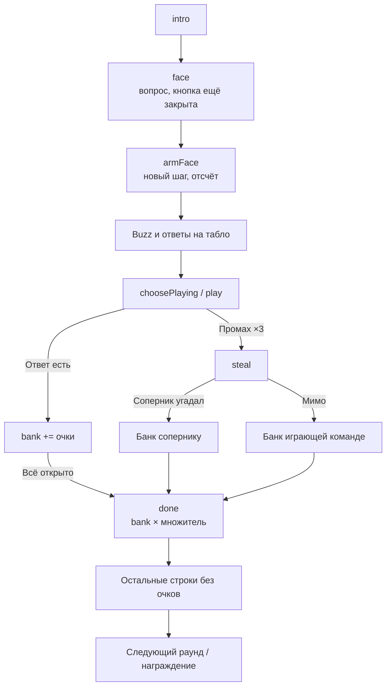

# Паспорт логики — Что скажет большинство

> Перед правкой обязательны [`../LOGIC.common.md`](../LOGIC.common.md), этот паспорт и `hundred.test.ts`.

- Составлен: 19.11.2026 по `main` после `1e6dd753`.
- Проверка: **16/16 профильных тестов**; новых подтверждённых дефектов не найдено.
- Браузер, PostgreSQL, два реальных пульта и test/production отдельно не проверялись.

## 1. Режимы

Игра с табло ответов поддерживает `solo`, `teams` и отсутствие общего экрана.

- **Классика:** две команды/игрока, розыгрыш «Жми первым!», банк, три ошибки и шанс соперника.
- **Двойная/тройная:** банк умножается на 2/3.
- **Наоборот:** очки зависят от места ответа снизу табло (от 15 до 240 при шести строках).
- **Большая игра:** пять вопросов, два игрока/захода, повтор ответа первого запрещён, бонус за цель.
- **Весь зал:** каждый пишет до трёх ответов; совпадения распознаются автоматически, остальные засчитывает ведущий.

Ответы могут быть оценкой JoyRest или предварительным опросом с честной подписью источника и числа участников.

## 2. Схема классического раунда

Промах розыгрыша не является одним из трёх крестиков. Если соперника нет, после третьей ошибки банк остаётся
играющему. Пары по умолчанию чередуются по кругу; ведущий может изменить пару до отсчёта.

## 3. Большая игра и «Весь зал»

В «Большой игре» лидер выбирается по счёту, при равенстве — по входу. Каждый из двух игроков отвечает на пять
вопросов со своим таймером. Повтор одного ответа табло вторым игроком не записывается. Итог = все очки + бонус при
достижении `bigGoal`.

В режиме «Весь зал»:

1. `hallOpen` открывает новый шаг и разрешает менять ответы до закрытия.
2. `hallClose` блокирует изменения.
3. `match.ts` сопоставляет синонимы и допустимые опечатки.
4. Ведущий связывает нераспознанные слова с ответом или отклоняет.
5. При открытии строки каждый совпавший получает её очки с множителем раунда.

Начисление — разница между прежним и новым состоянием (`hallDiff`), поэтому повторное открытие не удваивает выплаты.
«Большая игра» в этом режиме идёт как обычные вопросы зала.

## 4. Экран, телефон, пульт

- **Экран:** табло, банк, крестики, слово после buzz, большая игра, музыка и итоги.
- **Телефон:** кнопка «Жми первым!» только у пары; в режиме зала — до трёх слов с возможностью изменения.
- **Пульт:** выбор пары, отсчёт, открытие/промах, исход шанса, ответы большой игры, ручное сопоставление слов,
  открытие строк и «Назад». Для пересчёта используются ответы шага; пульт умеет запросить свежий список.

Скрытых ролей нет; ответы табло находятся в снимке игры и не являются криптографическим секретом.

## 5. Инварианты

- **ЧБ-1.** В buzz учитываются только свежие нажатия играющей пары.
- **ЧБ-2.** Открытая строка не добавляется в банк повторно; показ остальных очков не меняет.
- **ЧБ-3.** Три ошибки основной игры дают ровно один шанс сопернику.
- **ЧБ-4.** Банк получает один победитель с множителем раунда.
- **ЧБ-5.** Повтор второго игрока «Большой игры» не приносит очков.
- **ЧБ-6.** В «Весь зал» выплата идёт только за открытые совпавшие строки каждому автору.
- **ЧБ-7.** Ручное сопоставление после открытия сразу пересчитывает разницу, а не полную сумму повторно.
- **ЧБ-8.** Каждое действие, кроме служебных `silent`, помещается в стопку максимум 12 снимков.
- **ЧБ-9.** «Назад» восстанавливает фазу, шаг, таймер и снимает именно очки последнего действия.
- **ЧБ-10.** Ответы более новых отменённых шагов попадают в `clear` и не возвращаются в подсчёт.

## 6. «Назад», повторы и связи

`undo` хранит до 12 полных снимков `HundredCore`, стадии, шага, таймера и начислений. Для зала очки не хранятся в
снимке, а пересчитываются по ответам. Пьедестал использует общий возврат. Два реальных пульта и сетевая очистка ответов
в профильном запуске не проверялись; действуют общие ограничения сессии.

Связь: `content.ts`/`validate.ts`/`Editor.tsx` → `gameSnapshot` → `HostControls.tsx`/`logic.ts` → общий сервер и таблица.
`index.ts` включает `ownPeek`, шаги и музыку. Обычный банк пишется через `addScore`; `score()` умеет восстановить очки
по записанному итогу шага. Отдельной комнаты нет.

## 7. Код и проверка

| Файлы | Ответственность |
|---|---|
| `content.ts`, `validate.ts`, `Editor.tsx` | Раунды, ответы, источники, импорт |
| `logic.ts` | Все фазы, выплаты, стопка возврата |
| `match.ts` | Нормализация, синонимы, опечатки |
| `HostControls.tsx`, `views.tsx` | Пульт, телефон, экран |
| `hundred.test.ts` | 16 тестов |

Покрыты мусорный parse, шаблоны, источники, импорт, очки наоборот, классика, шанс, полный возврат к началу, большая
игра, опечатки, выплаты зала и пересчёт «Назад». Не проверены большие сотни гостей, гонки двух пультов, PostgreSQL,
реальные телефоны и визуальные размеры.

**Итог:** логика принята по 16 тестам; новых находок нет. Полный браузерно-серверный статус не присваивается.
