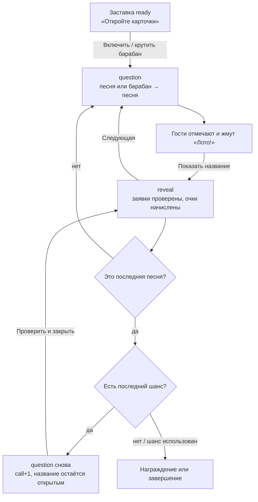

# Паспорт логики — Музыкальное лото

> **Эталон.** Этот файл описывает карточки, барабан, песни, отметки, честную заявку «Лото!», очки, последний шанс,
> видео/караоке и возврат «Назад». Перед правкой обязательны [`../LOGIC.common.md`](../LOGIC.common.md), этот паспорт и
> `lotto.test.ts`. Намеренное изменение правил фиксируется здесь в том же PR. Указатель паспортов — [`../LOGIC.md`](../LOGIC.md).

- Составлен: 18 ноября 2026, по коду рабочей версии `a782eed2ce5a44a2aae14cb59b3a2a7d4708c292` и текущим файлам.
- Статус: исходный паспорт; **49/49 профильных тестов прошли**. Полный браузерный результат не подтверждён — раздел 15.
- Входит: содержимое, карточки, порядок песен, фазы, заявки, очки, барабан, медиа, караоке, последний шанс, «Назад».
- Не входит: общая SSE-реализация, загрузка треков в музыкальную библиотеку, внешний вид за пределами логики показа.

## 1. Что за игра

У каждого игрока или команды своя карточка из названий песен. На экране зала звучит песня, гости отмечают её на карточке.
Кто выполнил правило победы, нажимает «Лото!». Ведущий видит заявки, показывает название и проверяет победителей по серверным
ответам. Первым — больший приз.

Поддерживаются `solo`, `teams` и режим без экрана. В командах заявку отправляет капитан. Обычные вопросы с вариантами ответа
не используются: шаг — одна песня, ответ — `{ marks: string[] }`.

Настройки:

- карточка 3×3, 4×4 или 5×5;
- правило: ряд, столбец, любая линия, две линии или вся карточка;
- 5–180 секунд общего фрагмента; у песни своя длина 5–900 секунд, 0 — до конца;
- до 100 песен, до 5 призовых значений 0–1000;
- стиль карточки «Классика», «Вечер», «День»;
- барабан `full`, `quick`, `off`;
- подсказка текущей песни, скрытие видео до ответа, проигрывание после названия;
- у песни — трек, начало трека, видео, начало видео, текст и разметка строк.

## 2. Содержимое и проверка

`LottoSong`:

- `id`, `title`, `artist`;
- `trackId`, `trackStart`;
- `video: { source, url, name }`, `videoStart`;
- `length`;
- `lyrics`, `times`, `lyricsShow`, `lyricsAt`.

Видео: ссылка YouTube / VK Видео / Rutube, файл на устройстве экрана или ролик из видео JoyRest (`server`). Ссылка другого
сайта считается ошибкой запуска.

`validateLotto` требует:

- песен не меньше, чем клеток карточки;
- непустое название;
- отсутствие повторов пары «название + исполнитель» без регистра, с `ё = е`;
- поддерживаемую ссылку на видео;
- положительный приз первому победителю.

Парсер не бросает ошибки: ограничивает поля, чинит повторные `id`, неизвестный размер превращает в 4, неизвестное правило —
в любую линию, старую игру без барабана — в `off`, без стиля — в «Классику».

## 3. Карточки и правила победы

`cardFor(content, pid)` тасует `id` песен детерминированно по `pid` и полному списку песен. Первая `size²` часть — карточка.
Телефон и пульт вычисляют одинаковую карточку без отдельной записи в базу. Песни внутри карточки не повторяются.

`cardLines(size)` содержит:

- `size` горизонтальных рядов;
- `size` вертикальных столбцов;
- две диагонали.

`isWin(card, marked, size, rule)`:

- `row` — хотя бы один ряд;
- `column` — хотя бы один столбец;
- `line` — любой ряд, столбец или диагональ;
- `twoLines` — минимум две такие линии;
- `full` — все клетки карточки;
- пустая карточка никогда не выигрывает.

Для выигрыша важны песни, которые уже прозвучали, а не просто отмеченные гостем клетки — см. честную заявку.

## 4. Порядок песен и барабан

Без барабана песни идут по списку. С барабаном порядок — случайная перестановка всех песен по `session.id` и их `id`.

- `playSong` записывает порядок один раз при первой песне.
- Порядок сохраняется при следующей песне, повторе и «Назад».
- `orderOf` принимает только полную перестановку без повторов; битый или старый пустой порядок читает как список.
- `songAt` / `songIndexAt` связывают шаг с индексом песни.
- `playedUpTo` включает текущую песню в уже звучавшие.
- `playedNumbers` формирует номера бочонков для табло.

Длительность до музыки:

- `full` — 12 900 мс, включая 3 секунды показа номера;
- `quick` — 7 200 мс;
- `off` — 0.

Пока барабан крутится, пульт не даёт показать название. Запас 1 500 мс учитывает разницу часов, но ожидание не бесконечно:
если пульт узнал о барабане позже, предел считается и от момента обнаружения.

## 5. Фазы песни

`lottoPrimary` не даёт перейти к награждению, пока есть следующая песня. Если таблица пуста, вместо награждения — завершение.

## 6. Отметки гостя и честное «Лото!»

### Подтверждённые и догадки

`revealedUpTo` считает песню открытой:

- на показе названия;
- в «Последнем шансе»;
- на награждении;
- у следующих шагов — все прежние песни.

Пока песня звучит, её название ещё не открыто. `splitMarks` делит отметки на:

- `confirmed` — название уже открыто;
- `pencil` — догадка «?», название ещё не открыто.

После открытия названия верная догадка становится подтверждённой, неверная снимается с объяснением. Отметки хранятся по
`storeScope(session)` и `pid`, чтобы блоки вечера не смешивались.

### Что телефон отправляет

Без подсказки (`hint = false`, знатоки) — все отметки как есть; честность проверяется при подсчёте.

С подсказкой `claimMarks` отправляет:

- подтверждённые отметки;
- текущую звучащую песню, только если из догадок отмечена **ровно она одна**.

Если гость отметил несколько догадок, звучащая в зачёт не идёт: телефон просит оставить одну. Это не позволяет собрать
линию из нескольких предположений сразу.

### Проверка на пульте

`honestClaim(card, marks, played, size, rule)`:

1. среди отметок собственной карточки не должно быть ещё не звучавших песен;
2. карточка должна быть собрана по правилу из **прозвучавших** песен;
3. забытая отметка не мешает: решает `played`, а не полнота отметок;
4. чужие/неизвестные `id` в списке не ломают заявку, но не дают очков.

Так нельзя отметить всё подряд и выиграть. Заявка может быть верной, даже если игрок не отметил часть уже звучавших песен.

## 7. Победители и очки

`score(step, answers, state)`:

- принимает только `{ marks: [] }`;
- не даёт второй приз тому, кто уже в `result.winners`;
- проверяет честность;
- сортирует по `submittedAt`, при равенстве — по `pid`;
- берёт одну заявку на участника;
- назначает приз по общему месту: первый элемент `prizes`, дальше по списку, после конца — последнее значение.

`revealSong`:

- перед подсчётом добавляет фактических участников в таблицу;
- использует ответы только текущего шага;
- добавляет победителей и их очки;
- записывает `last` новых победителей и `rejected` неподтверждённых;
- сохраняет победы по шагу в `wins: { step, prizes }`, чтобы возврат снимал ровно их;
- сохраняет видео, барабан и другие команды пульта.

Пульт перед показом названия пытается получить свежий список ответов с сервера и объединяет его по `id` с уже пришедшими.

## 8. Последний шанс «Лото!»

`canLastCall` разрешает действие только:

- игра ещё идёт;
- показано название последней песни;
- `call === 0`.

`lastCall`:

- снова переводит `stage = question`;
- не меняет `startedAt`, поэтому песня не перезапускается;
- сохраняет открытое название;
- очищает `last` и `rejected`;
- увеличивает `call`.

Прежние победители сохраняются. Новые получают следующий приз при повторном `revealSong`; `wins` объединяет обе проверки одной
песни. Повторный последний шанс недоступен.

«Назад» из последнего шанса возвращает показ названия, не снимая прежних побед и очков. «Назад» уже из показа после шанса
снимает все победы этой песни, включая добавленные позже.

## 9. Музыка, видео и караоке

### Музыка

- На заставке — встроенная `lottoIntro`.
- На вопросе — после барабана.
- На показе названия — только если песня уже звучала; открытие названия во время барабана не запускает песню с начала.
- При `playAfter = true` после названия продолжает играть на 60% (`AFTER_VOLUME`).
- `hushSong` увеличивает `hush`: экран глушит песню. Новая песня сбрасывает `hush`.
- После остановки/затухания песня сама не возвращается при навигации; для повторного запуска — «Повторить песню».
- На награждении песня не играет по правилу механики.

### Повтор и видео

- `replaySong` увеличивает `replay`, снимает паузу; экран начинает трек/видео с начала.
- Команды `play`, `pause`, `back`, `fwd`, `stop` увеличивают `video.n`; пауза/стоп сохраняют `paused`.
- `stop` возвращает видео в начало.
- Новая песня сбрасывает видео-команду, повтор, ручной текст, `hush` и последний шанс.
- Показ названия не обрывает видео.
- При `videoHide` картинка скрыта до названия, звук остаётся из видео.

### Караоке

- Текст состоит из непустых строк до 120 символов, до 200 строк.
- Время строк не убывает и не длиннее числа строк; дробь хранится с точностью до десятых.
- `lyricIndex` бинарным поиском находит текущую строку.
- `lineProgress`: от начала строки до следующей, последняя строка — 4 секунды.
- `lyricsShow = reveal`: текст после названия; `at`: с `lyricsAt` на треке.
- Пульт может показать, убрать или вернуть «как в настройке песни»: `on`, `off`, `auto`.
- `.lrc` читает метки, служебные теги, offset и повтор строки при нескольких метках; `toLrc` сохраняет название и артиста.

## 10. «Назад»

### Из показа названия (`reveal`)

- находит `wins` текущей песни;
- вычитает ровно записанные призы;
- удаляет новых победителей песни из общего списка;
- удаляет её запись `wins`;
- возвращает `question` для повторного приёма;
- для старых сессий без `wins` использует прежние `last` как совместимость.

### Из звучащей песни (`question`)

- если это последний шанс — возвращает название без удаления его победителей;
- на первой песне — возвращает заставку, сохраняет порядок барабана, очищает ответы шага;
- на следующей — возвращает показ предыдущей песни, восстанавливает её `last` по `wins`, очищает ответы текущего шага;
- музыка предыдущей песни не включается сама: `hush = 1`, видео — на паузе.

### С пьедестала

Используется общий `podiumBack`.

## 11. Карточка 5×5 и читаемость

Решение владельца 18 ноября 2026 уточнено после браузерной приёмки 19 ноября и записано в `docs/lotto-5x5-phone-spec.md`:

- базовый размер названия 5×5 остаётся `3.6cqw`;
- `cellFit` вычисляет уменьшение;
- минимум текста у 5×5 — **12 px** (вариант 10 px отклонён браузерной приёмкой);
- межстрочный интервал — 1,05;
- мягкие переносы по слогам сохраняются;
- исполнитель на 5×5 не показывается;
- клетка растёт по высоте **без фиксированного `line-clamp`**, чтобы минимум 12 px не обрезал длинное название;
- правила, порядок песен, очки и настройки игры не меняются.

`cellFit` сначала учитывает самое длинное слово, затем число строк и наличие исполнителя. Если название не помещается с
исполнителем, исполнитель убирается, а не обрезает название. `softHyphens` ставит U+00AD без изменения исходного текста.

**Локальная браузерная приёмка 320/360/390/412 px подтвердила читаемость 12 px и полный текст даже предельного названия
на 80 символов без обрезания и прокрутки.** Полный E2E на test после исправления ещё не выполнялся: для него нужна
отдельная выкладка исправления.

## 12. Инварианты

- **Л-1.** Карточка детерминирована игрой и `pid`, содержит `size²` неповторяющихся песен.
- **Л-2.** Песен для запуска не меньше, чем клеток; первая награда положительна.
- **Л-3.** Победа определяется прозвучавшими песнями по выбранному правилу, а не одним желанием гостя.
- **Л-4.** Среди собственных отметок не должно быть ещё не звучавших песен.
- **Л-5.** С подсказкой звучащая песня идёт в зачёт только как единственная догадка.
- **Л-6.** Одна заявка на участника и один приз на участника за всю игру.
- **Л-7.** Порядок заявок — по серверному времени, при равенстве — по `pid`.
- **Л-8.** Порядок барабана не меняется при навигации и повторах.
- **Л-9.** Во время барабана музыка ещё не играет, а название не открывается с пульта.
- **Л-10.** Новая песня очищает заявки и команды предыдущей, но сохраняет победителей, победы и порядок.
- **Л-11.** Последний шанс возможен один раз на названии последней песни и не перезапускает её.
- **Л-12.** Победы каждой песни хранятся отдельно; повторный показ не удваивает очки.
- **Л-13.** «Назад» снимает ровно очки соответствующей песни и восстанавливает прежнее состояние.
- **Л-14.** Возврат на прошлую песню не включает её музыку/видео автоматически.
- **Л-15.** Текст песни не раскрывается раньше выбранного правила, если пульт явно не включил его.
- **Л-16.** Чужой/неизвестный идентификатор в отметках не даёт преимущества.
- **Л-17.** Изменение оформления 5×5 не меняет игровую логику и размер 3×3/4×4.
- **Л-18.** В команде действие выполняет капитан, остальные видят текущее состояние.

## 13. Где это в коде

| Место | Ответственность |
|---|---|
| `content.ts` | Песни, настройки, лимиты, стили, LRC и подгонка текста |
| `validate.ts` | Допустимость игры |
| `logic.ts` | Карточки, порядок, заявки, очки, фазы, возврат и музыка |
| `HostControls.tsx` | Пульт, свежие ответы, барабан, видео и последний шанс |
| `views.tsx` | Карточка и отметки гостя |
| `hall.tsx` | Экран зала, барабан, песня, видео и караоке |
| `drum/*` | 3D-сцена барабана |
| `karaoke.tsx` | Текст и прогресс строки |
| `lotto.test.ts` | 49 профильных тестов |
| `docs/lotto-5x5-phone-spec.md` | Решение и приёмка карточки 5×5 |
| `scripts/e2e/lotto.mjs` | Полный браузерный сценарий на test |

## 14. Крайние случаи

- Мало песен, повторное название+исполнитель, пустое название — запуск запрещён.
- Больше песен, чем клеток: карточки различаются, но у каждого одна и та же при перезагрузке.
- Все песни сыграны: последняя ведёт к последнему шансу/награждению, а не к несуществующему шагу.
- Несколько победителей: после исчерпания списка наград используется последнее значение.
- Нет победителей: завершение без пьедестала.
- Неверная заявка: попадает в `rejected`, не получает очков.
- Догадок несколько: звучащая песня не добавляется в зачёт автоматически.
- Песня без трека/видео: ведущий использует свой плеер.
- Старые игры: без барабана, без новых полей, читаются значениями по умолчанию.

## 15. Проверка 19 ноября 2026

### Подтверждено

- `npx vitest run src/mechanics/lotto/lotto.test.ts` — **49 из 49 тестов прошли**.
- Полный набор версии с исправлением — **2572 passed, 213 skipped**; `npm run build` успешна.
- Полный E2E на test до исправления прошёл конструктор, барабан, табло 24/60/100, видео, заявки и «Последний шанс»,
  но выявил Л-Н-1: названия 5×5 уменьшались до 10 px вместо требуемых 12 px.
- Первое увеличение до 12 px выявило обрезание длинных названий после четвёртой строки. Поэтому для 5×5 дополнительно
  снято фиксированное ограничение строк: клетка растёт по высоте. Локальный Chromium проверил «Вечер» и «День»,
  `question` и `reveal`, ширины 320/360/390/412 px: названия ≥12 px, полный текст до 80 символов, обрезания и прокрутки нет.

### Л-Н-1 — исправлено в `main`, ожидает повторного E2E

`src/styles.css` теперь ограничивает названия 5×5 снизу 12 px и не обрезает их по строкам;
`docs/lotto-5x5-phone-spec.md` обновлён тем же решением. Коммит отправлен в `main`: `7b955284`.
Полный повторный E2E на test пока не выполнялся: сначала требуется отдельная выкладка этой правки на test.
Safari и production после исправления также ещё не проверены.

**Итоговый статус:** логика и локальная визуальная приёмка пройдены. Полный статус «исправление подтверждено на test и
production» не присваивается до отдельной выкладки и повторного прогона.
