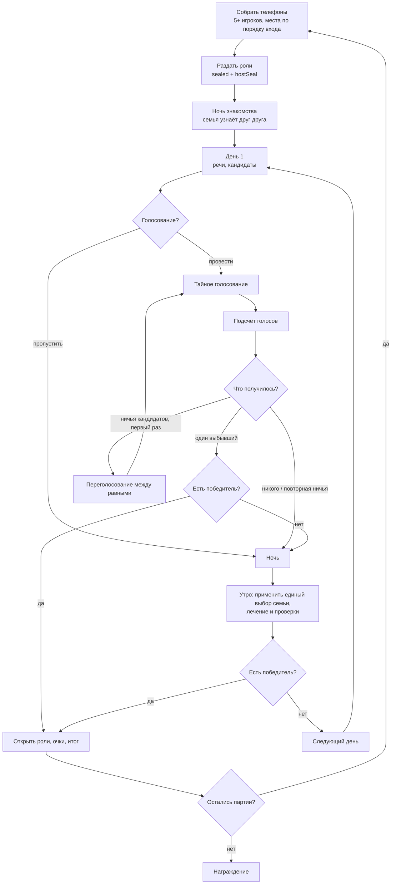

# Паспорт логики — Мафия

> **Эталон.** Этот файл описывает роли, ночные действия, дневное голосование, скрытые карты, очки, партии и «Назад».
> Перед правкой обязательны [`../LOGIC.common.md`](../LOGIC.common.md), этот паспорт и `mafia.test.ts`. Намеренное изменение
> правил фиксируется здесь в том же PR. Указатель паспортов — [`../LOGIC.md`](../LOGIC.md).

- Составлен: 18 ноября 2026; актуализирован 19 ноября 2026 после исправлений М-Н-2 и М-Н-3.
- Статус: лимит 30 игроков и восстановление первой проверки подтверждены тестами и браузерным сценарием; М-Н-1 закрыта обновлённым текстом Дона.
- Входит: настройки, места, шифрование, полный цикл партии, второй пульт, очки и возврат.
- Не входит: общая доставка SSE, внешний вид карт, «Мероприятие из блоков» кроме локальных ключей.

## 1. Что за игра

Клубная «Мафия» для **5–30 игроков**, каждый играет сам (`teams = false`). Экран показывает город, места, речи и публичные
итоги. Телефон хранит тайную роль, ночной ход и тайный голос. Пульт знает роли и ведёт фазы.

Роли:

| Роль | Сторона | Ночная функция |
|---|---|---|
| Мафия | Мафия | Выбирает жертву вместе с семьёй |
| Дон | Мафия | Выбирает жертву и отдельно проверяет игрока на Комиссара |
| Адвокат | Мафия | Выбирает жертву и скрывает одного своего от проверки Комиссара |
| Комиссар | Город | Проверяет, принадлежит ли игрок к мафии; Адвокат может дать ложный результат |
| Доктор | Город | Лечит от одного выстрела; не одного и того же две ночи подряд, себя — один раз |
| Красотка | Город | Блокирует ночное действие цели; визит к мафиози отменяет выстрел семьи |
| Маньяк | Самостоятельная | Выбирает собственную жертву; побеждает один или один на один |
| Мирный | Город | Делает ночной ход для вида; днём голосует |

Партий 1–10, очки накапливаются. Можно открывать роль выбывшего сразу или только в конце. Таймеры речи, последнего слова и
голосования — 10–300 секунд. Очки победителям и бонус выжившим — 0–1000. Два стиля карт: «Нуар» и «Классика»; у всех восьми
ролей есть портреты в обоих стилях.

`mafiaSteps()` и `score()` пусты: вопросов механики нет, очки записываются при завершении партии. `ownPeek` и `ownAward`
отключают общую таблицу/награждение посреди партии. Музыка `mafiaNight` играет в `deal`, `roles`, `meet`, `night`.

## 2. Модель скрытой информации

### Публичный `MafiaResult`

Содержит фазу, партию, день, места, живых, выбывших, кандидатов, счётчики, публичное голосование после подсчёта, итог и
открытые роли. Он не должен содержать скрытые роли в открытом виде до конца.

### Ключи и шифрование

- Телефон создаёт AES-GCM-ключ 256 бит и отправляет `{ key }` на шаге раздачи. Ответы видит только пульт.
- `sealed[pid]` — карта роли ключом телефона. Мафия, Дон и Адвокат получают в карте состав семьи.
- `hostSeal` — все роли ключом исходного пульта, для пульта и игроков без телефона.
- `whisper[pid]` — ночная подсказка ключом телефона: голоса семьи, проверка, блокировка или история роли.
- `checkLocks[pid]` — первая цель проверки Комиссара или Дона за текущую ночь, зашифрованная ключом этого телефона.
  Открытый идентификатор цели в общее состояние не записывается; при новой ночи словарь очищается.
- Карты и подсказки добиваются до общей длины в **байтах UTF-8**, чтобы размер шифра не выдавал роль или наличие семьи.
- Свой ключ хранится в `localStorage` `joyrest.mafia.<sessionId>.<pid>`; ключ пульта — `joyrest.mafia.host.<sessionId>`.

Чужой ключ и повреждённый шифр возвращают `null`, телефон предлагает тихо подойти к ведущему.

### Второй пульт

Может восстановить роли игроков с телефонами через их ключи и `sealed`. Роли игроков **без телефона** знает только исходный
пульт с `hostSeal`. Пока хотя бы одна роль неизвестна, утро и итог блокируются: нельзя рассчитывать ночь по неполным ролям.

## 3. Фазы партии

`MafiaMode`:

```text
deal → roles → meet → day → vote → verdict → night → morning → day → … → over
```

- `deal`: игроки собраны, телефоны присылают ключи.
- `roles`: роли разданы, каждый смотрит свою карту.
- `meet`: ночь знакомства, без стрельбы, лечения и проверок.
- `day`: речи и выставление кандидатов.
- `vote`: тайное голосование, новый шаг с таймером.
- `verdict`: публичный итог, выбывший или ничья.
- `night`: все живые делают ход, новый шаг, ответ можно менять.
- `morning`: жертва или тихая ночь, проверка победы.
- `over`: все роли открыты, победитель и очки записаны либо партия остановлена досрочно.

### Общая схема



## 4. Сбор игроков и раздача

`seatsOf` объединяет таблицу и фактических игроков, сортирует по `joinedAt`; добавленные ведущим — в конце по `pid`.
Нужны минимум 5 игроков для кнопки старта. В партию попадают первые 30 мест по этому порядку; 31-й и следующие не попадают.

Автоматические роли `autoCounts`:

| Игроков | Мафия + Дон | Адвокат | Комиссар | Доктор | Красотка | Маньяк |
|---|---:|---:|---:|---:|---:|---:|
| 5–6 | 1 | 0 | 1 | 0 | 0 | 0 |
| 7–9 | 2 | 0 | 1 | 1 с 7 | 0 | 0 |
| 10–11 | 3 | 0 | 1 | 1 | 1 | 0 |
| 12–13 | 3 | 0 | 1 | 1 | 1 | 1 |
| 14–16 | 4 | 1 | 1 | 1 | 1 | 1 |
| 17–20 | 5 | 1 | 1 | 1 | 1 | 1 |
| 21+ | `round(n / 4)` | 1 | 1 | 1 | 1 | 1 |

Остальные места — мирные. Красотка появляется с 10 игроков, Маньяк — с 12, Адвокат — с 14.

`countsFor(custom)`:

- семья с учётом Адвоката всегда меньше половины и содержит хотя бы одного члена;
- сначала уменьшаются обычные мафиози, затем при необходимости убираются Дон и Адвокат;
- при превышении числа игроков убираются Адвокат, Маньяк, Красотка, Доктор, Комиссар, затем лишние мафиози;
- свободные места остаются мирными.

`dealRoles` тасует места Фишером—Йетсом и раздаёт специальные роли по одному разу, остальным — `civilian`.

## 5. Ночь знакомства

После `roles` ведущий запускает `meet`:

- новый шаг и ответы не создаются;
- никто не стреляет, не лечит и не проверяет;
- мафия видит семью на телефоне и вживую;
- `done = 0`, ночные подсказки пустые;
- следующий `startDay` назначает `round = 1`.

Это отдельная обязательная фаза, а не сокращение первой ночи.

## 6. День и голосование

### Речи

Ведущий даёт `speechSeconds` живому игроку или `lastWordSeconds` выбывшему ночью/днём. Время окончания —
`speakEndsAt = серверное now + seconds`. Повторное действие останавливает речь. Таймер виден на экране и телефоне.

### Кандидаты

Ведущий переключает живых в `nominees`. Если список пуст, `voteCandidates` возвращает всех живых: голосование против любого
живого. Можно пропустить голосование с подтверждением и сразу начать ночь.

### Правила подсчёта `tallyVotes`

- голосуют только живые;
- голос за себя не засчитывается;
- можно голосовать за кандидата из списка или `none`;
- побеждает единственный кандидат с максимумом, если его голоса строго больше `none`;
- равные кандидаты — никто не выбывает, между ними возможно переголосование;
- если `none` не меньше лидера, никто не выбывает;
- переголосование допускается один раз: после повторной ничьей — ночь.

Выбывший удаляется из `alive`, добавляется в `deaths` с типом `vote`; его роль записывается только при `revealOnDeath`.
Сразу проверяется победа. После итога можно дать последнее слово.

## 7. Ночь и утро

### Ночные ответы

`startNight` создаёт новый шаг без общего таймера, добавляет его в `nights`, `changeable = true`. Все живые отправляют ход,
мирные — пустой/формальный, чтобы по числу нажатий нельзя было определить роль. До утра выбор можно менять.

Для игроков без телефона ведущий вводит ход вручную. Ответ телефона важнее ручного ввода. Ручной ввод хранится по
`storeScope(session)` и `step`, поэтому блоки вечера не смешиваются.

### Выстрел семьи

`mafiaChoice`: жертва назначается **только если все живые мафиози, включая Дона и Адвоката, выбрали одного живого игрока
вне семьи**. Разошлись или кто-то не выбрал — промах. Выбывшие не участвуют.

### Красотка

`canVisit` запрещает посещать себя и одного игрока две ночи подряд. Принятый визит блокирует действие цели в эту ночь.
Визит к любому члену семьи отменяет общий выстрел, к Маньяку — его отдельный выстрел, к Адвокату — его защиту. История
`visitHistory` восстанавливается по прошлым шагам; недопустимый повтор не срабатывает.

### Доктор

`canHeal`:

- нельзя лечить того же человека, кого лечили прошлой ночью;
- себя можно только один раз за всю партию;
- другого человека можно после промежуточной ночи с другим пациентом;
- недопустимое или заблокированное лечение не срабатывает и **не попадает в историю принятых лечений**.

`healHistory` восстанавливается по прошлым шагам и ручному вводу, храня `null` для несработавшего лечения. Один Доктор
спасает максимум одного игрока за ночь — от выстрела мафии или Маньяка.

### Проверки и Адвокат

- Комиссар проверяет живого другого игрока: `yes = isMafia(role)`, если цель не скрыта Адвокатом;
- Дон отдельно проверяет живого другого игрока: `yes = role === commissar`;
- Адвокат выбирает себя или другого живого члена семьи: проверка Комиссара покажет «не мафия»;
- защита не спасает от голосования и выстрелов и не меняет фактическую сторону;
- первая проверка Комиссара и Дона за ночь фиксируется `lockChecks` и зашифрованно сохраняется в `checkLocks`;
  после перезагрузки или на втором пульте восстанавливается именно первая цель, а не позднее изменённый ответ.

### Итог

`resolveNight` сначала применяет визит Красотки, затем защиту Адвоката, выстрелы семьи и Маньяка и одно лечение.
`victims` содержит все разные неспасённые цели; если оба стрелка выбрали одного игрока, смерть одна. Старое поле `victim`
содержит первую жертву для совместимости вызовов.

`morning` удаляет всех погибших из живых, добавляет смерти `night`, при необходимости раскрывает роли и проверяет победу.
Публичное `killed` — список; старое сохранённое значение строкой парсится как список из одного игрока. Каждому погибшему
ведущий может дать последнее слово.

### Подсказки

`whispers` выдаёт каждому живому с телефоном:

- семье — выбор каждого мафиози и отмену выстрела Красоткой;
- Дону и Комиссару — фактический результат проверки с учётом блокировки и Адвоката;
- Доктору — прошлое лечение и факт самолечения;
- Красотке — прошлый принятый визит;
- заблокированному игроку — признак `blocked`;
- мирному — пустую структуру той же длины шифра.

Синхронизация идёт с задержкой 500 мс, с `expect` на текущий `step` и `stage = question`.

## 8. Победа и очки

`winnerOf`:

- живой Маньяк один или один на один с любым игроком — Маньяк;
- без мафии и без Маньяка — город;
- при живой мафии и её численном паритете со всеми остальными — мафия;
- иначе игра продолжается, даже если мафия устранена, но Маньяк ещё жив.

`finishGame`:

- открывает все роли;
- каждому игроку победившей стороны: `winPoints`;
- если он остался жив: дополнительно `survivorBonus`;
- проигравшим: 0;
- очки добавляются к накопленным за прошлые партии, `last` равен дельте этой партии.

Пример из теста при 100/50: выживший Доктор победившего города получает 150, выбывший мирный — 100, мафия — 0.

`abortGame` открывает роли, но не назначает победителя и очков. Его можно отменить «Назад».

## 9. Несколько партий и «Назад»

После `over`:

- если `party < content.parties` — следующая партия;
- иначе награждение;
- ведущий может закончить раньше по общему счёту или сыграть ещё одну партию после последней.

Новая партия:

- увеличивает `party`;
- создаёт новый шаг раздачи;
- заново собирает места и роли;
- сохраняет накопленные очки;
- в `undo` хранит итог прошлой партии до момента новой раздачи.

`undo` — один переход. `mafiaBack` возвращает прежний `step`, `stage`, `result` и очищает ответы покинутого шага, если шаг
менялся. Вернуться из нормально завершённой партии с победителем нельзя; из досрочно остановленной (`winner = null`) можно.
Повторный «Назад» дальше одного сохранённого снимка не идёт.

## 10. Что видно участникам

| Фаза | Экран | Телефон | Пульт |
|---|---|---|---|
| `deal` | Число готовых телефонов | Отправляет ключ | Места, роли будущего состава, ключи |
| `roles` | «Посмотрите свою роль» | Своя карта, семья мафии | Все роли |
| `meet` | Ночь знакомства, без тайн | Семья или «город спит» | Список семьи и текст ведущему |
| `day` | Живые, кандидаты, речь | Обсуждение, своя карта | Слово, кандидаты, роли |
| `vote` | Кандидаты и число голосов, не имена голосующих | Один тайный голос | Голоса без телефона, счётчик |
| `verdict` | Таблица голосов и выбывший | Тот же итог | Переголосование/ночь/финал |
| `night` | Ночь и число сделавших ход | Ход роли и личная подсказка | Все выборы и предварительный итог |
| `morning` | Жертва/тихая ночь | Тот же публичный итог | Последнее слово/день/финал |
| `over` | Все роли и победитель | Своя роль, исход, все роли | Очки, следующая партия, награждение |

## 11. Инварианты

- **М-1.** Игра только `solo`, минимум 5 игроков; заявленный максимум — 30.
- **М-2.** Специальные роли раздаются не больше заданного числа, остальные — мирные.
- **М-3.** Мафии всегда меньше половины исходного состава и хотя бы одна.
- **М-4.** Скрытая роль не появляется в публичном состоянии открытым текстом до разрешённого раскрытия.
- **М-5.** Карты и ночные подсказки имеют одинаковую длину в байтах внутри одной раздачи.
- **М-6.** Ночь знакомства не создаёт выстрелов, лечения или проверок.
- **М-7.** Ночью ходят все живые, включая мирных; выбывшие не участвуют.
- **М-8.** Выстрел требует единогласия всех живых членов семьи.
- **М-9.** Доктор не лечит одного и того же две ночи подряд и лечит себя не более одного раза.
- **М-10.** Несработавшее лечение не входит в историю принятых.
- **М-11.** Допустимое лечение отменяет смерть только при совпадении с выбранной жертвой.
- **М-12.** Проверки не раскрываются городу на экране; результат видит только соответствующий телефон и пульт.
- **М-13.** Днём голос за себя и голос выбывшего не засчитываются.
- **М-14.** Кандидат выбывает только как единственный лидер с числом голосов больше `none`.
- **М-15.** Переголосование проходит только между равными лидерами и не более одного раза.
- **М-16.** Мафия побеждает при паритете с остальными живыми.
- **М-17.** Победители получают очки независимо от выживания; выжившие получают дополнительный бонус.
- **М-18.** Досрочное завершение не даёт победных очков и обратимо.
- **М-19.** Новая партия сохраняет общие очки, но создаёт новые роли и новый шаг раздачи.
- **М-20.** Второй пульт без ролей игроков без телефона не может рассчитать утро или итог.
- **М-21.** «Назад» очищает ответы покинутого шага, чтобы старое голосование/ночь не применились повторно.

## 12. Где это в коде

| Место | Ответственность |
|---|---|
| `content.ts` | Роли, лимиты, автоматический и ручной состав |
| `logic.ts` | Все фазы, ночь, голосование, очки, «Назад» |
| `deal.ts` | Ключи, восстановление ролей, ручной ввод |
| `seal.ts` | AES-GCM, ключи и локальное хранение |
| `HostControls.tsx` | Ведение, проверки, восстановление ролей и истории |
| `views.tsx` | Экран и личный телефон |
| `validate.ts` | Обязательная мафия и название города |
| `mafia.test.ts` | Роли, ночь, голосование, полный путь, партии, шифрование |
| `preview.ts` | Автоматический предпросмотр |

## 13. Находки и исправления

### М-Н-1. Карточка Дона обещала «решающий голос» — исправлено

Описание Дона приведено к фактическому правилу: выстрел семьи требует единогласия всех живых мафиози, отдельного
решающего голоса у Дона нет. Его отдельная ночная проверка на Комиссара сохраняется.

### М-Н-2. «Первая проверка» терялась после перезагрузки — исправлено 19 ноября 2026

Первая цель Комиссара и Дона теперь хранится в `checkLocks[pid]`, зашифрованная AES-GCM ключом соответствующего
телефона. Пульт восстанавливает её до расчёта ночи и синхронизации подсказок. Новая ночь начинается с пустого
`checkLocks`, поэтому цель прошлой ночи не переносится.

Браузерный сценарий в Chromium: цель `c` → новый ответ `d` → перезагрузка пульта. Во всех состояниях сохранилась
цель `c`; чужой ключ шифр не открывает. Также устранено голодание отложенной записи: стабильный список ответов не
пересоздаёт 500-миллисекундный таймер на каждом тике часов пульта.

### М-Н-3. Максимум 30 игроков не применялся — исправлено 19 ноября 2026

`seatsOf` ограничивает состав первыми 30 игроками по порядку входа. Тест с 35 участниками подтверждает ровно 30 мест
и последнее место `p29`.

## 14. Границы проверки

- Сценарий перезагрузки проверен в Chromium с локальным пультом и настоящим AES-GCM; реальные телефоны и Safari в этой
  проверке не запускались.
- Второй пульт использует тот же серверный `checkLocks` и ключи телефонов; отдельный двухбраузерный сценарий остаётся
  частью финальной приёмки.
- Визуальный аудит 20–30 игроков, длинных имён и режима без экрана этим исправлением не затрагивался.
- Поведение «Мафии» блоком вечера требует совместной проверки с паспортом вечера и `storeScope`.

## 15. Проверка паспорта

Минимум:

- `npx vitest run src/mechanics/mafia/mafia.test.ts src/mechanics/mafia/auditRecovery.test.ts`;
- полный цикл `deal → roles → meet → day → vote → verdict → night → morning → over`;
- единогласие/разногласие семьи, лечение и история, первая проверка после нового ответа и перезагрузки;
- одиночный лидер, ничья, `none`, одно переголосование, самоголос и голос выбывшего;
- свой/чужой ключ, второй пульт, игрок без телефона;
- «Назад» из ночи, утра, досрочного конца и новой партии;
- 5, 7, 20, 30 и 31+ игроков: мест не больше 30.

## 16. Параллельные роли и совместимость

Адвокат, Красотка и Маньяк входят в текущую модель. `killed` — список: мафия и Маньяк могут убить двух разных людей,
Доктор спасает одного. Парсер превращает старую строку в список. Победитель — `city | mafia | maniac`.

Старые тестовые ожидания `autoCounts(6)` без новых ролей и строкового `killed` обновлены до текущего контракта. Новые
поля `checkLocks` парсятся с безопасным значением `{}`, поэтому сохранённые партии прежней версии остаются читаемыми.
