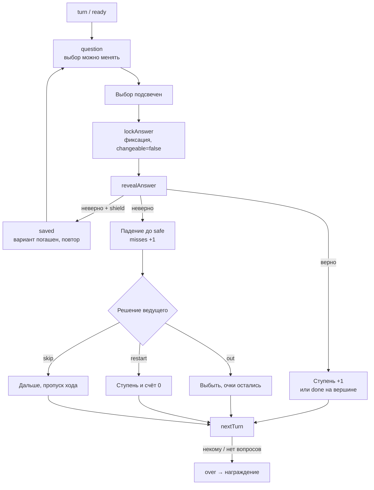

# Паспорт логики — Миллион на кону

> Перед правкой обязательны [`../LOGIC.common.md`](../LOGIC.common.md), этот паспорт и `millionaire.test.ts`.
> Изменение правил обновляет паспорт в том же PR.

- Составлен: 19.11.2026 по `main` после `1e6dd753`.
- Проверка: **29/29 профильных тестов**; совместно с двумя другими играми — 61/61.
- Браузер, PostgreSQL, два реальных пульта и test/production отдельно не проверялись.

## 1. Правила и содержимое

Команды или отдельные игроки ходят по очереди. У каждого своя лестница: новая игра — 15 ступеней с несгораемыми
5 и 10 и двумя попытками; старый формат — 12 ступеней с 4 и 8 без ограничения попыток. Поддерживаются `solo`, `teams`,
без экрана и режим одной выбранной команды.

На каждой ступени нужен хотя бы один вопрос с четырьмя вариантами. Показанные вопросы записываются в `seen` и не
повторяются для следующих команд. Счёт равен очкам текущей ступени, а не сумме всех прошлых наград.

## 2. Ход игры

После фиксации ответ телефона не меняется. Любая подсказка открывает новый шаг и сбрасывает прежний незафиксированный
выбор. Таймер нового вопроса — 30 секунд, старого без поля — без таймера; фиксация останавливает часы.

## 3. Подсказки

Каждая доступна команде один раз и только до фиксации:

- `fifty` — гасит два неверных, верный остаётся;
- `swap` — новый непоказанный вопрос той же ступени;
- `audience` — голоса телефонов и гостей по QR, команда текущего хода не голосует;
- `call` — добавляет время звонка по серверным часам;
- `mistake` — один неверный не роняет ступень, вариант гаснет и вопрос повторяется;
- `host` — разрешает показать текст подсказки ведущего.

Капитан может попросить подсказку с телефона; ведущий подтверждает или гасит запрос по номеру `n`.

## 4. Экран, телефон, пульт

- **Экран:** лестницы, текущий вопрос, погашенные варианты, помощь зала, QR, музыка напряжения и результаты.
- **Телефон:** выбор/изменение ответа до фиксации, запросы подсказок, голосование зала. Член команды отвечает только
  как отдельный голос зала, не вместо капитана.
- **Пульт:** ответ за команду, фиксация, подсказки, QR, наказание после ошибки, следующий ход и «Назад».
  Фиксация/показ используют свежие ответы сервера.

## 5. Инварианты

- **М-1.** Отвечает только текущий участник; чужой ответ не учитывается.
- **М-2.** После фиксации ответ неизменен; до неё можно передумать.
- **М-3.** Верный ответ поднимает не более чем на одну ступень; вершина завершает участие.
- **М-4.** Ошибка без щита опускает до несгораемой и увеличивает `misses` ровно на 1.
- **М-5.** Счёт соответствует ступени; выбывший сохраняет счёт, `restart` обнуляет оба значения.
- **М-6.** Подсказка не используется повторно той же командой и не применяется после фиксации.
- **М-7.** Погашенный вариант нельзя выбрать; верный не гасится.
- **М-8.** Вопросы не повторяются; замена требует запасной вопрос той же ступени.
- **М-9.** Зал не голосует за текущую команду; проценты считаются по принятым голосам.
- **М-10.** `skip` расходуется один раз; `done/out` больше не ходят.
- **М-11.** «Назад» с показа восстанавливает ступень, счёт, `done`, `misses`, щит и погашенные варианты.
- **М-12.** Любое решение, меняющее очки/участие, должно иметь обратимый сценарий.

## 6. «Назад» и отмена наказания

Из показа ответа возвращается вопрос с прежней ступенью и счётом; следующий возврат снимает фиксацию. Из вопроса без
подсказок — возврат на заставку. С пьедестала — общий `podiumBack`.

### М-Н-1 — исправлено: решение после ошибки обратимо

`wrongChoice` сохраняет `wrongBefore`: шаг, полный результат и счёт команды до наказания. `millionaireBack` сначала
восстанавливает этот снимок, включая `out`, `skip`, `misses`, ступень и очередь. Это работает и если наказание привело к `over`.

Добавлены тесты: возврат участника после `out`, восстановление ступени/счёта после `restart`, снятие пропуска после `skip`
и восстановление исхода ошибки после последнего выбывания. Инструкция ведущего `core/editorGuide/millionaire.ts` и
общая инструкция `core/guide.ts` явно описывают отмену наказания кнопкой «Назад».

## 7. Связи и код

`Editor.tsx` + `content.ts` + `validate.ts` формируют игру; `index.ts` регистрирует её и музыку. Содержимое попадает в
`gameSnapshot`, `MillionaireResult` — в общую сессию. `HostControls.tsx` создаёт `SessionChange`, сервер применяет общие
права/`expect`. Счёт записывается целой записью команды через `scoreChange`; общий `score()` пустой. Завершение общее.

| Файлы | Ответственность |
|---|---|
| `content.ts`, `validate.ts`, `Editor.tsx` | Лестница, вопросы, настройки, импорт |
| `logic.ts` | Ход, подсказки, очки, очередь, возврат |
| `HostControls.tsx` | Пульт, QR и свежие ответы |
| `views.tsx` | Телефон и экран |
| `millionaire.test.ts` | 32 теста |

## 8. Покрытие и ограничения

Подтверждены лестницы 12/15, импорт, очередь, верно/неверно, вершина, одна команда, все подсказки, голоса QR,
фиксация, наказания и их отмена, попытки, окно лестниц и таймеры. Не подтверждены реальные QR-гости,
два пульта, PostgreSQL, мобильная вёрстка и длинные серии с дефицитом вопросов.

**Итог:** основная логика принята по 32 тестам; М-Н-1 исправлена. Полный браузерно-серверный статус не присваивается.
