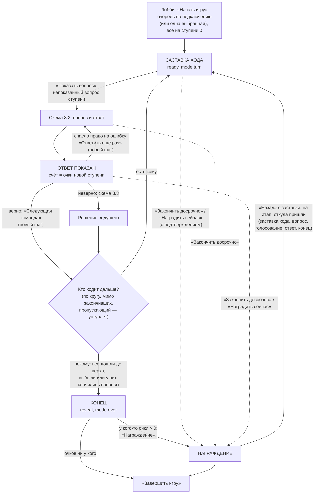
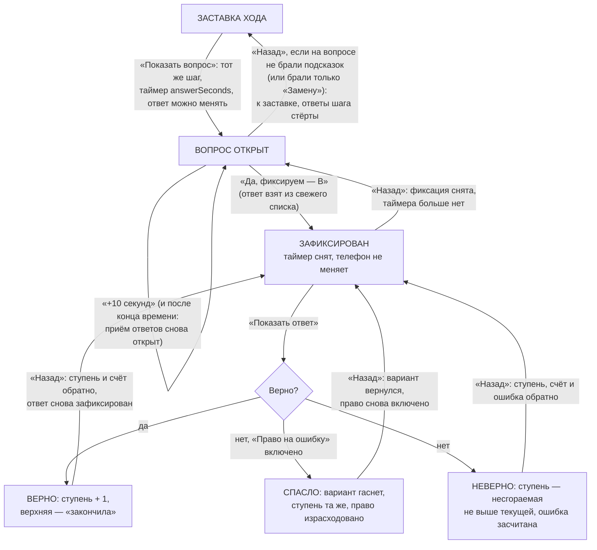
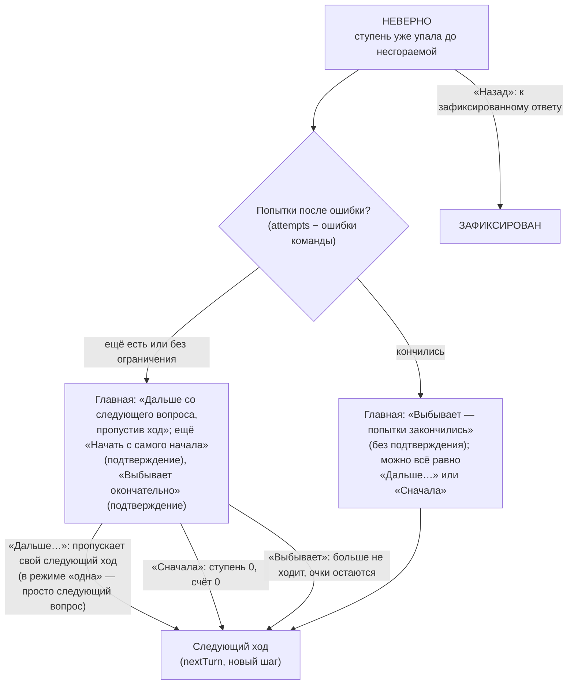
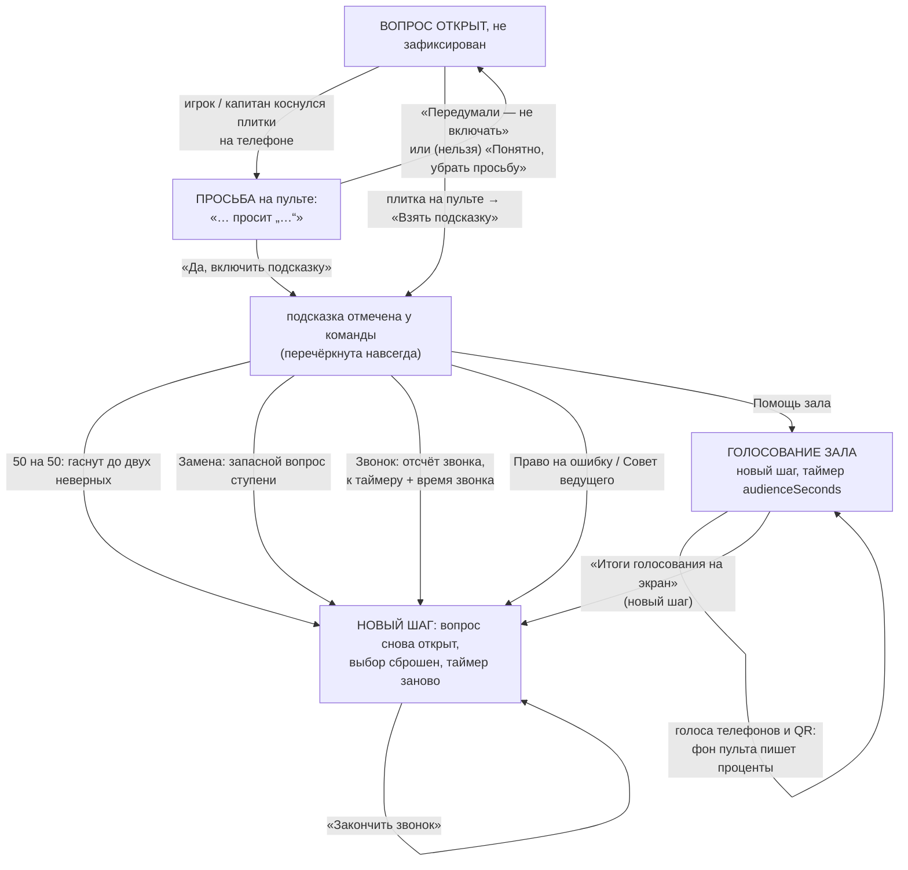

# Паспорт логики — «Миллион на кону»

> **Эталон.** Этот файл описывает, как *должен* работать «Миллион на кону»: очередь команд, лестница, вопрос, выбор и
> фиксация ответа, показ ответа, решение ведущего после ошибки, шесть подсказок, конец игры и «Назад». Любая правка
> игры идёт так: **прочитать паспорт → правка → сверить с паспортом → если логика изменилась намеренно, обновить
> паспорт в том же PR**. Расхождение кода с паспортом — ошибка. Общая часть (вход гостя, лобби, приём ответов, пульт,
> телефон, награждение, итоги) — в [`../LOGIC.common.md`](../LOGIC.common.md): здесь она не повторяется, ссылки вида
> «Н-1» ведут туда. Указатель всех паспортов — [`../LOGIC.md`](../LOGIC.md).

- Составлен: 14 ноября 2026, по коммиту `92cf7ce` (файлы `src/mechanics/millionaire/` в рабочей копии не менялись).
- Независимая проверка: 14 ноября 2026 (раздел 10).
- Что сюда **не входит**: «Мероприятие из блоков» (игра как блок вечера), репетиция, предпросмотр в конструкторе,
  Firebase-версия, внешний вид (карусель полосок, шестиугольные плашки, оформления «Студия» / «Вечер JoyRest»), звуки
  и музыка момента (`index.ts`, `music`).

## 1. Что за игра

У каждой команды (в режиме «каждый сам» — у каждого игрока) своя лестница из 12 или 15 ступеней. Команды ходят по
очереди: команда хода получает вопрос своей ступени с четырьмя вариантами, капитан выбирает ответ на телефоне (или
говорит вслух — ведущий отмечает на пульте), ведущий переспрашивает «Фиксируем ответ?», фиксирует и показывает ответ.
Верно — ступенью выше. Неверно — вниз до последней пройденной несгораемой ступени, и ведущий решает, что дальше с
командой. **Счёт команды — это очки её ступени** (а не сумма за вопросы). Дошла до верхней ступени — «Миллион!», больше
не ходит. Все закончили — награждение.

**Настройки игры** (`content.ts`, `MillionaireContent`):

| Поле | Что | По умолчанию (новая игра) | Старые игры без поля |
|---|---|---|---|
| `ladder` | очки ступеней, 12 или 15 чисел, каждая дороже прошлой | 15: 500 … 1 000 000 | 12: 1 000 … 1 000 000 |
| `safe` | несгораемые ступени (номера меньше числа ступеней) | 5 и 10 | 4 и 8 |
| `questions` | вопросы: ступень, текст, 4 варианта, верный (`correct`), пояснение `note`, наводка `hint` | по одному на ступень, пустые | — |
| `lifelines` | какие подсказки есть в игре | все шесть | все шесть |
| `players` | `all` — все по очереди; `one` — одна команда, выбирает ведущий перед началом | `all` | `all` |
| `answerSeconds` | время на ответ: 0 (без таймера), 15, 30, 45, 60, 90, 120 | 30 | 0 |
| `callSeconds` | «Звонок другу», 10–180 с | 60 | 60 |
| `audienceSeconds` | «Помощь зала», 90–300 с | 90 | 90 |
| `attempts` | сколько раз можно продолжить после ошибки, 0–3; `null` — без ограничения | 2 | `null` |
| `look` | оформление экрана зала | «Студия» | «Классика» |

**Подсказки** (`LIFELINES`), каждая — один раз у команды за игру:

| Подсказка | Что делает в логике |
|---|---|
| `fifty` 50 на 50 | гасит до двух неверных вариантов (случай с пульта) |
| `audience` Помощь зала | отдельный этап голосования: голосуют телефоны не из команды хода и гости по QR без входа; проценты на экране |
| `call` Звонок другу | отсчёт звонка по часам сервера; к времени ответа прибавляется время звонка |
| `mistake` Право на ошибку | первая ошибка на этом вопросе не роняет: вариант гаснет, ответ ещё раз |
| `swap` Замена вопроса | запасной непоказанный вопрос той же ступени |
| `host` Совет ведущего | пульт показывает наводку `hint` (или пояснение `note`); ведущий может вывести её на экран |

**Режимы** (`index.ts`, `supports`): каждый сам, команды, без экрана зала — все три. В командах отвечает и просит
подсказку капитан; голосует на «Помощи зала» каждый телефон своим голосом.

## 2. Этапы шага и что на них видно

Этапы общие (`state.stage`): `ready` — заставка хода, `question` — вопрос открыт (внутри — `result.mode`: `question`
или `audience`), `reveal` — ответ показан, `podium` — награждение. Этап `board` игра не использует. Номер шага
(`state.step`) растёт на каждом новом приёме ответа: следующий ход, любая подсказка, итоги голосования, «Ответить ещё
раз». Ответ прошлого шага на новом не считается.

| Этап (`stage` / `mode`) | Экран зала | Телефон команды хода | Телефон другой команды | Пульт |
|---|---|---|---|---|
| До начала (`ready`, очередь пуста) | эмблема, «Скоро начнём!», число ступеней и несгораемые | «Скоро начнём!» | то же | «Вопросов хватит на N …», при нехватке — «Команд N, а вопросов хватит только на M», выбор команды (режим «одна»), «Начать игру» |
| Заставка хода (`ready`, `turn`) | «Ход: …», «Вопрос N — очки», несгораемая, подсказки | «Ваш ход!», вопрос и очки, свои подсказки | «Ход: …» | «Показать вопрос» |
| Вопрос (`question`, `question`) | вопрос, варианты, выбор — оранжевой рамкой, таймер, звонок, совет, «Право на ошибку включено» | варианты (капитан), «Выбран B … можно передумать», плитки подсказок | «Отвечает … — вы наблюдаете», без кнопок | что выбрала команда, отметка за команду, подсказки плитками, просьба подсказки, «Да, фиксируем — B» |
| Ответ зафиксирован (`question`, `locked`) | «Ответ зафиксирован — B», таймер ушёл | «Ответ зафиксирован — B. Ждём!» | наблюдает | «Показать ответ (B)», «Назад» снимает фиксацию |
| Помощь зала (`question`, `audience`) | вопрос, QR, «N голосов», таймер; QR можно открыть на весь экран | «Зал голосует» | кнопки голоса → «Голос принят: B» | голоса по вариантам, QR на весь экран, «Итоги голосования на экран» |
| Ответ (`reveal`) | верный — зелёная бегущая рамка, салют; исход | «Верно!» / «Неверно» / «… право на ошибку спасает» | «Они ответили верно!» / «Они ошиблись» | «Следующая команда» / «Ответить ещё раз» / «Что дальше с …» |
| Конец (`reveal`, `over`) | «Игра окончена!» | «Игра окончена» | то же | «Все … закончили», «Награждение» или «Завершить игру» |
| Награждение (`podium`) | пьедестал (общая часть) | пьедестал | пьедестал | «Открыть следующее место» → «Завершить игру» |

Где в коде: экран — `views.tsx`, `MillionaireScreenView` (стр. 241); телефон — `views.tsx`, `MillionairePlayerView`
(стр. 380); пульт — `HostControls.tsx`. Пьедестал рисуют `HallScreen.tsx` и `Play.tsx`.

## 3. Блок-схемы

### 3.1. Ход игры целиком

Где в коде: `logic.ts` — `millionairePrimary` (стр. 187, главная кнопка), `startMillionaire` (229), `showQuestion`
(245), `nextTurn` (345), `nextPlayer` (211); награждение — `core/podium.ts` (`awardNow`, `podiumBack`).

### 3.2. Вопрос: выбор, фиксация, показ ответа

Время вышло — с вопросом ничего не происходит: телефон больше не отвечает (запас сервера 3 с), ведущий может отметить
ответ за команду и зафиксировать его (М-12). Где в коде: `showQuestion`, `teamPick` (256), `markPick` (269),
`syncChosen` (277), `lockAnswer` (286), `revealAnswer` (296), `retryQuestion` (325), `millionaireBack` (565).

### 3.3. После ошибки: решение ведущего

После решения «Назад» уже недоступен (М-Н-3). Где в коде: `wrongChoice` (370), `attemptsLeft` (159), пульт —
`HostControls.tsx`, стр. 403–481.

### 3.4. Подсказки

Подсказку нельзя: после фиксации ответа, вне открытого вопроса, если она уже использована или выключена в игре; «50 на
50» — если неверных вариантов осталось меньше двух; «Замену» — если нет запасного вопроса ступени. «Назад» подсказку не
отменяет. Где в коде: `lifelineState` (385, для телефона), `canUseLifeline` (397, для пульта), `applyLifeline` (433),
`requestedLifeline` (532), `refuseLifeline` (554), `audienceVotes` (467), `liveAudience` (494), `finishAudience` (503),
`showTip` (510), `endCall` (517).

## 4. Правила логики

Каждое правило должно выполняться всегда. «Где» — файл и функция; номера строк — по коммиту `92cf7ce`.

### Очередь и ход

- **М-1.** «Начать игру» ставит очередь по времени подключения (участники-игроки или команды, `scoringParticipants`),
  все на ступени 0, без подсказок, ошибок, выбывших и пропусков. В режиме «одна» в очереди только выбранная ведущим
  (нет выбора — первая). *Где:* `startMillionaire` (стр. 229), `orderOf` (164).
- **М-2.** Ход переходит по кругу к следующей в очереди, мимо закончивших (`done`): дошедших до верхней ступени,
  выбывших и тех, у кого кончились вопросы их ступени. Пропускающий ход (`skip`) один раз уступает, но если ходить больше
  некому — ходит. Некому ходить — конец игры (`mode: over`, этап `reveal`). *Где:* `nextPlayer` (211), `nextTurn` (345).
- **М-3.** В режиме «все по очереди» новые команды, подключившиеся во время игры, встают в конец очереди на ступень 0
  при следующей передаче хода; в режиме «одна» очередь не меняется. Убранная из игры команда выпадает из очереди в
  режиме «все»; в режиме «одна» очередь не пересчитывается и убранная остаётся в ходу (по коду).
  *Где:* `nextTurn` (стр. 348–349), `orderOf`.
- **М-4.** Команда, у которой нет непоказанного вопроса её следующей ступени, считается закончившей, и пульт с телефоном
  говорят почему: «кончились вопросы ступени N» (М-Н-1, исправлено 14 ноября 2026; `finishReason`, `outOfQuestions`). Показанный
  вопрос больше никогда не показывается (`seen`) — весь зал видел ответ. *Где:* `freshQuestion` (149), `nextTurn`
  (стр. 351–352).
- **М-5.** Главная кнопка одна на этапе (`millionairePrimary`): нет очереди — «Начать игру»; заставка — «Показать
  вопрос»; голосование — «Итоги голосования»; вопрос — «Да, фиксируем» / после фиксации «Показать ответ»; ответ —
  «Ответить ещё раз» (спасло), решение после ошибки, «Следующая команда»; конец — «Награждение» (есть очки) или
  «Завершить игру»; награждение — «Открыть следующее место» / «Завершить игру».

### Вопрос и ответ

- **М-6.** «Показать вопрос» берёт вопрос, уже выбранный в этом ходе (после «Назад» к заставке — тот же), иначе первый
  непоказанный вопрос ступени по порядку конструктора; вопрос отмечается показанным. Этап «вопрос», `startedAt` — часы
  сервера, таймер `answerSeconds` (0 — без таймера), ответ можно менять (`changeable`). *Где:* `showQuestion` (245).
- **М-7.** Ответ команды (`teamPick`): после фиксации — только зафиксированный; иначе ответ команды хода этого шага,
  пришедший не раньше показа вопроса и не на погашенный вариант; иначе отметка ведущего. Отвечает команда хода: в
  командах — капитан ответом команды (общая часть), в режиме «каждый сам» — сам игрок. *Где:* `teamPick` (256).
- **М-8.** Выбор команды подсвечивается на экране сразу: фон пульта пишет `chosen`, как только ответ пришёл или
  поменялся (не после фиксации). Отметка ведущего — тоже подсветка, но только пока с телефона нет ответа: есть ответ
  телефона — фон возвращает подсветку на него (М-Н-10). *Где:* `syncChosen` (277), `markPick` (269),
  `HostControls.tsx`, стр. 71–76.
- **М-9.** «Да, фиксируем» — только при открытом вопросе, не во время голосования и при наличии ответа; берёт ответ из
  свежего списка с сервера, кладёт его в `hostPick`, снимает таймер и запрещает менять ответ. *Где:* `lockAnswer` (286),
  `HostControls.tsx`, стр. 367.
- **М-10.** «Показать ответ» — только после фиксации (так ведёт главная кнопка). Верно — ступень + 1 (не выше верхней);
  дошла до верхней — команда «закончила». Неверно при «Праве на ошибку» — вариант гаснет, ступень та же, право
  израсходовано, исход «спасло». Неверно — ступень = последняя несгораемая не выше текущей пройденной (`safeFloor`),
  ошибка засчитывается (`misses`). *Где:* `revealAnswer` (296), `safeFloor` (`content.ts`).
- **М-11.** Счёт команды всегда = очки её ступени (`pointsAt`). Пульт пишет строку таблицы целиком (очки ступеней бывают
  больше лимита прибавки сервера 100 000), `last` = разница с прошлой ступенью. Ручные очки «Гостей» этим перезаписываются
  (М-Н-5). *Где:* `scoreChange` (176).
- **М-12.** Время вышло — игра сама ничего не решает: телефон перестаёт отвечать, ведущий отмечает и фиксирует ответ
  сам. Фиксация снимает таймер насовсем: «Назад» со снятием фиксации таймер не возвращает (М-Н-8). «+10 секунд»
  (общая кнопка) работает, пока таймер есть: время вышло — ещё 10 с с этой минуты, приём ответов с телефона снова
  открыт; во время голосования зала — продлевает голосование. *Где:* `lockAnswer`, `millionaireBack` (стр. 566–568).
- **М-13.** После «спасло» — «Ответить ещё раз»: новый шаг, тот же вопрос без погашенного варианта, таймер заново,
  выбор сброшен. *Где:* `retryQuestion` (325).

### После ошибки

- **М-14.** Решение ведущего — только на этапе ответа с исходом «неверно». «Дальше…» — команда пропустит свой
  следующий ход (ступень уже по несгораемой); «Сначала» — ступень и счёт 0; «Выбывает» — команда в `out` и
  «закончила», очки остаются. Сразу после решения — передача хода (М-2). *Где:* `wrongChoice` (370).
- **М-15.** Попытки: `attempts` — сколько раз можно продолжить после ошибки; осталось = `attempts` − ошибки команды.
  Осталось меньше нуля — пульт первым предлагает «Выбывает — попытки закончились», но «Дальше» и «Сначала» остаются.
  `null` — без ограничения. *Где:* `attemptsLeft` (159), `HostControls.tsx`, стр. 403–481.

### Подсказки

- **М-16.** Каждая подсказка — один раз у команды за игру; её можно взять только при открытом вопросе (не голосовании),
  до фиксации ответа и если она есть в игре. «50 на 50» — если неверных вариантов осталось хотя бы два: гасит два из
  оставшихся (из двух — один, чтобы осталось два варианта). «Замена» — если есть непоказанный вопрос той же ступени.
  *Где:* `lifelineState` (399), `canUseLifeline` (411), `applyLifeline` (433).
- **М-17.** Любая подсказка — новый шаг: прежний выбор не считается, подсветка и отметка ведущего сброшены, таймер
  заново (у звонка — плюс время звонка), просьба с телефона погашена. *Где:* `applyLifeline` (стр. 423–447).
- **М-18.** Просьба подсказки с телефона пульт сам не включает: ведущий переспрашивает и жмёт «Да, включить» или
  «Передумали». Просить может только игрок хода (каждый сам) или капитан команды хода своим личным ответом телефона;
  отклонённая просьба (по её номеру `n`) больше не показывается. *Где:* `requestedLifeline` (532), `refuseLifeline` (554).
- **М-19.** «Помощь зала»: голосуют телефоны не из команды хода (в командах — каждый телефон-игрок своим голосом, голос
  «за команду» не считается) и гости по QR без входа (сервер принимает голоса, пока `audienceVote`); голоса за погашенные
  варианты не считаются; проценты на экране обновляет фон пульта (раз в 1,5 с забирает счёт QR). «Итоги голосования» —
  новый шаг, вопрос снова открыт, проценты остаются на экране до конца хода. *Где:* `audienceVotes` (467), `tally` (486),
  `liveAudience` (494), `finishAudience` (503), `HostControls.tsx`, стр. 78–107.
- **М-20.** «Звонок другу» — отсчёт по часам сервера (`callEndsAt`), «Закончить звонок» обрезает его до «сейчас»; во
  время звонка музыка момента молчит. «Совет ведущего» — пульт показывает наводку `hint` (нет — пояснение `note`), на
  экран её выводит и убирает кнопка. *Где:* `endCall` (517), `showTip` (510), `index.ts` (`music`).

### «Назад» и запись пульта

- **М-21.** «Назад»: с ответа — к зафиксированному ответу (ступень, счёт, «закончила», ошибка и право на ошибку
  возвращаются); с зафиксированного — фиксация снята; с вопроса, на котором не брали подсказок, — к заставке хода, ответы
  шага стёрты (сначала запись, потом очистка — Н-3); с награждения — общая часть. С заставки хода, голосования, после
  подсказки и после решения ведущего «Назад» нет. Исключение — «Замена»: она сбрасывает всё, что проверяет «Назад», и
  «Назад» возвращает к заставке с запасным вопросом, а подсказка остаётся израсходованной (М-Н-12). *Где:* `millionaireBack` (565).
- **М-22.** Каждая кнопка пульта уходит через общую запись `useHostRun` с `expect`: этап, шаг и отпечаток итогов шага.
  Повтор после отказа — только если «момент» тот же (`millionaireMoment`: итоги без подсветки выбора и процентов зала —
  их пишет фон). Двойное касание и второй пульт не дают двойного хода: вторая запись получает отказ по этапу.
  *Где:* `HostControls.tsx`, стр. 46–58.
- **М-23.** Фоновые записи пульта: подсветка выбора и проценты зала — без «занято» на кнопках, по одной, пока ведущий
  не жмёт. *Где:* `HostControls.tsx`, стр. 71–107; `useHostRun.ts`, `quiet`.

### Конец игры

- **М-24.** Конец — когда ходить некому (М-2). «Закончить досрочно» (с подтверждением) — награждение с любого этапа, кроме
  самого награждения и конца, даже с открытым вопросом; общая «Наградить сейчас» — когда вопрос не открыт. «Назад» с
  заставки награждения возвращает на этап, откуда пришли. Награждение — общая часть, места по очкам ступеней. *Где:* `core/podium.ts`, `awardNow`.

## 5. Крайние случаи

| Случай | Что происходит | Где |
|---|---|---|
| Команд больше, чем вопросов на ступени | до начала — «Команд N, а вопросов хватит только на M»; лишние команды больше не ходят — пульт «У «D» кончились вопросы ступени 1», телефон «Вопросы вашей ступени закончились» (М-Н-1) | `nextTurn`, `outOfQuestions` |
| Ошибка на 3-й ступени, несгораемая 5 | падение на 0, счёт 0 | `safeFloor` |
| Ошибка на несгораемой ступени (например, 5-я пройдена, ошибка на 6-м вопросе) | остаётся на 5 | `safeFloor` (`s <= level`) |
| «Сначала» при малом запасе вопросов | команда больше не ходит, пульт и телефон пишут «кончились вопросы ступени 1» (М-Н-1) | `nextTurn`, `finishReason` |
| Команда дошла до верха | больше не ходит; в «Лестницах» — «прошла всю лестницу» | `revealAnswer`, `finishReason` |
| Режим «одна»: ошибка, «Дальше…» | та же команда, следующий вопрос (пропуск — уступить некому) | `nextPlayer` |
| Режим «одна»: «Выбывает» | конец игры | `nextTurn` |
| Все выбыли, очков ни у кого | «Завершить игру» без награждения | `millionairePrimary` |
| Телефона нет / капитан ответил вслух | ведущий отмечает ответ кнопками A–D | `markPick` |
| Выбрали погашенный вариант | не считается | `teamPick` |
| «50 на 50» после «спасло» | гаснет один, остаются два варианта | `applyLifeline` |
| «Замена» после «50 на 50» / голосования | новый вопрос, всё погашенное и проценты сброшены, звонок прерван; «Право на ошибку» сохраняется, «Совет» и его наводка сбрасываются (М-Н-2) | `applyLifeline` |
| Подсказка после фиксации | нельзя | `canUseLifeline` |
| Время вышло | ведущий решает сам; «+10 секунд» снова открывает приём ответов (М-12) | `core/session.ts`, `addTimeChange` |
| Убрали команду, чей ход | ход — первой в очереди (М-Н-9) | `nextPlayer` |
| Каждый сам: просьба подсказки после выбора | выбор стёрт (М-Н-4) | `views.tsx`, стр. 466–470 |
| Капитан коснулся не того, ведущий отметил верное | фиксируется вариант с телефона (М-Н-10) | `teamPick` |
| Две команды подряд ошиблись и обе «пропускают ход» | никто не пропускает (М-Н-11) | `nextPlayer` |

## 6. Конструктор → игра

- Лестница 12 или 15 ступеней (`resizeLadder`: очки и несгораемые по умолчанию для размера; вопросы выше верхней
  ступени переезжают на верхнюю).
- Проверка перед запуском (`validate.ts`): на каждой ступени хотя бы один вопрос; у каждого — текст, четыре разных
  варианта и отмеченный верный; каждая ступень дороже прошлой. Сколько команд сыграют без замен — `teamsCovered` (самая
  бедная ступень), показывается в конструкторе и на пульте до начала.
- Импорт списком (`parseMillionaireImport`): вопрос с новой строки, варианты «- …», «а)», «1.», верный «*», «# Ступень N»
  — с какой ступени дальше, иначе следующая по кругу; неразобранные строки показываются.
- Шаблон (`demo.ts`): 90 вопросов, по 6 на каждую из 15 ступеней — на 6 команд без замен (до 14 ноября 2026 — 45, по 3).

## 7. Где это в коде

| Что | Файл |
|---|---|
| Формат игры, подсказки, лестница, несгораемые, импорт | `src/mechanics/millionaire/content.ts` |
| Проверка перед запуском, запас вопросов | `src/mechanics/millionaire/validate.ts` |
| Ход: очередь, вопрос, выбор, фиксация, ответ, ошибка, подсказки, голосование, «Назад» | `src/mechanics/millionaire/logic.ts` |
| Пульт: кнопки, фоновые записи, просьбы подсказок, решение после ошибки | `src/mechanics/millionaire/HostControls.tsx` |
| Экран зала и телефон | `src/mechanics/millionaire/views.tsx` |
| Регистрация, музыка момента | `src/mechanics/millionaire/index.ts` |
| Голоса по QR (сервер, память) | `server/src/live.ts` (`/audience`), `src/data/server/` (`audienceRepo`) |
| Общая запись пульта | `src/components/live/useHostRun.ts` |
| Таймер, `expect`, приём ответов | `src/core/session.ts` |
| Награждение | `src/core/podium.ts` |
| Конструктор, шаблон, предпросмотр | `Editor.tsx`, `demo.ts`, `preview.ts` |
| Задуманные правила | `CLAUDE.md`, раздел 6; `src/core/guide.ts` (раздел «Миллион на кону»); `src/core/rules.ts` |
| Тесты как описание задуманного | `millionaire.test.ts` |

## 8. Находки

Статусы: **подтверждено прогоном** — чистые функции выполнены через замену vitest (временный файл `_probe.test.ts` рядом
с тестами игры, удалён), приведён вывод; **найдено по коду** — цепочка прочитана, без браузера не выполнить;
**предположение** — не проверено. В браузере не проверялась ни одна.

Двойного начисления не найдено: показ ответа и решение после ошибки защищены отказом сервера по этапу (М-22). Настоящих
тупиков нет: из любого этапа есть главная кнопка.

### М-Н-1. Команды, которым не хватило вопросов, молча «заканчивают» — важно

- **Статус:** исправлено 14 ноября 2026 (решение владельца — (а) + (в)). Пульт до начала: «Команд N, а вопросов на каждой
  ступени хватит только на M: K не сыграют…»; в игре и в конце — «У «…» кончились вопросы ступени N — команда больше не ходит,
  счёт остаётся», в «Лестницах» — причина («кончились вопросы ступени N», «выбыла», «прошла всю лестницу»); телефон —
  «Вопросы вашей ступени (N) закончились — дальше вы не ходите». Шаблон — 90 вопросов, по 6 на ступень. Тесты —
  `millionaire.test.ts`, «не хватило вопросов (М-Н-1)». Прежде — подтверждено прогоном:
- **Где:** `logic.ts`, `nextTurn` (стр. 351–352) + `freshQuestion` (149): команда без непоказанного вопроса своей ступени
  попадает в `done`.
- **Прогон 1.** По 3 вопроса на ступень, 4 команды: ходы `A:1 B:1 C:1 A:2 B:2 C:2`, `done: [D]` — команда D не сыграла
  ни одного вопроса. Шаблон «Миллион на кону» — ровно 3 вопроса на ступень, а на мероприятии обычно 4–8 команд.
- **Прогон 2.** 3 команды, по 3 вопроса на ступень, все прошли по 2 ступени, A ошиблась на 3-й и ведущий нажал «Начать
  с самого начала»: `done: [A]`, `levels {A:0, B:2, C:2}` — A больше не ходит. Так же после обычной ошибки с падением на
  ступень, вопросы которой уже показаны.
- **Что видно.** Пульт: в «Лестницах» — «· закончила»; телефон команды — «Сейчас не ваш ход — вы наблюдаете» до конца
  игры; экран — ничего. Ведущий не понимает, почему команда не ходит; «Начать с самого начала» обещает игру заново, а
  на деле команда выбыла с нулём. Предупреждение до начала («Вопросов хватит на 3 команды») есть, но не говорит, сколько
  команд в зале и что лишние не сыграют, и не учитывает падения.
- **Решение — за владельцем.** Варианты: (а) громко предупреждать — до начала «Команд 5, вопросов хватит на 3: две
  команды не сыграют», при передаче хода — «У „D“ кончились вопросы ступени 1 — команда закончила», на телефоне —
  «Вопросы вашей ступени закончились»; (б) когда непоказанных нет — давать вопрос, который *эта* команда не видела (зал
  его видел, ответ известен); (в) шаблон — 6 вопросов на ступень. Советую (а) + (в): честно и без подсказанных ответов.

### М-Н-2. «Совет ведущего»: на экране — наводка прошлого вопроса — средняя

- **Статус:** исправлено 14 ноября 2026: `tipText: null` в `base`, при взятии «Совета» и при «Замене». Тест —
  `millionaire.test.ts`, «наводка ведущего (М-Н-2)» (на старом коде падает). Прежде — подтверждено прогоном.
- **Где:** `logic.ts`, `base` (стр. 203–205) не сбрасывает `tipText`; `applyLifeline` (`host`, `swap`) — тоже.
- **Прогон.** Команда A взяла «Совет», ведущий показал наводку `наводка q1_0`. Ход B, вопрос `q1_1`: `tip false,
  tipText «наводка q1_0»`. B взяла «Совет» — `tip true`, на экране сразу «наводка q1_0» (от чужого вопроса), а на пульте
  вместо «Показать наводку на экране» — «Убрать наводку с экрана».
- **Чем грозит.** Зал видит наводку к другому вопросу, ведущий её не показывал; после «Замены» — наводка к заменённому.
- **Решение (советую).** `tipText: null` в `base`, при взятии «Совета» и при «Замене». Тест: наводка не переходит к
  следующему ходу и к запасному вопросу.

### М-Н-3. «Назад» не возвращает передачу хода и решение после ошибки — низкая

- **Статус:** найдено по коду.
- **Где:** `millionaireBack` (565) с этапа `ready` следующего хода возвращает `null`; `wrongChoice` сразу передаёт ход.
  «Дальше со следующего вопроса» и «Выбывает — попытки закончились» (главные кнопки) — без подтверждения.
- **Что происходит.** Ведущий случайно нажал «Следующая команда» до того, как зал увидел ответ, или «Выбывает» вместо
  «Дальше» — вернуть нельзя. Счёт и ступень при этом верны, ломается только ход.
- **Решение — за владельцем.** (а) Подтверждение у «Выбывает — попытки закончились»; (б) «Назад» с заставки хода к ответу
  прошлого хода (снимок, как у квиза). Советую (а) сейчас, (б) — если ведущие будут жаловаться.

### М-Н-4. Каждый сам: просьба подсказки стирает выбор ответа и наоборот — низкая

- **Статус:** найдено по коду.
- **Где:** `views.tsx`, стр. 466–470: в режиме «каждый сам» просьба уходит тем же ответом игрока (`onAnswer`), что и
  выбор варианта; ответ шага один (`step_pid`), сервер заменяет его (`changeable`). В командах просьба идёт личным ответом
  телефона и выбор команды не трогает.
- **Что происходит.** Игрок выбрал B и попросил «50 на 50» — подсветка B на экране гаснет (фон пульта видит, что ответа
  нет). Ведущий отклонил просьбу — игроку надо выбрать снова. Обратный случай: попросил подсказку, потом коснулся варианта
  — просьба пропала с пульта.
- **Решение (советую).** В режиме «каждый сам» слать просьбу личным ответом телефона (`personal`), как в командах.

### М-Н-5. Ручные очки «Гостей» стираются следующим ответом команды — низкая

- **Статус:** найдено по коду.
- **Где:** `scoreChange` (176) пишет строку таблицы целиком: счёт = очки ступени.
- **Что происходит.** Ведущий дал команде «+500» за песню — на следующем показе её ответа счёт снова равен очкам ступени.
  Так задумано («счёт = очки ступени»), но ведущего никто не предупреждает. Запись целиком со старой сессии может
  ещё вернуть команду, убранную в ту же секунду вторым пультом, и откатить переименование (как К-Н-3 у квиза).
- **Решение — за владельцем.** (а) Оставить и написать на пульте «Гости → Очки» у «Миллиона»: «очки меняет лестница»;
  (б) прибавкой разницы ступеней (как квиз), а записью целиком — только больше 100 000. Советую (а).

### М-Н-6. «Да, фиксируем — B» может зафиксировать C — низкая

- **Статус:** найдено по коду.
- **Где:** `HostControls.tsx`, стр. 367: фиксация берёт ответ из свежего списка, а не тот, что видел ведущий; сверки
  списка (`expect.answers`, Н-1) нет.
- **Что происходит.** Капитан переключился на C в ту же секунду, когда ведущий нажал «Да, фиксируем — B»: зафиксировано C.
  Ведущий видит это сразу («Ответ зафиксирован — C») и может «Назад».
- **Решение (советую).** Передавать в `lockAnswer` вариант с кнопки и не фиксировать, если свежий ответ другой («Команда
  передумала — переспросите»).

### М-Н-7. Правила на экране: «12 ступеней» — у новых игр 15 — мелочь

- **Статус:** найдено по коду.
- **Где:** `core/rules.ts`, стр. 116 (правила знают только режим, не игру). Комментарии `index.ts` («12 вопросов») и
  `HostControls.tsx` (стр. 53: «Это окончательный ответ?» — фраза ведущего теперь «Фиксируем ответ?») устарели.
- **Решение (советую).** «12 или 15 ступеней» или «ступени до миллиона» в правилах; поправить комментарии.

### М-Н-8. После снятия фиксации таймера больше нет — низкая

- **Статус:** найдено по коду.
- **Где:** `lockAnswer` ставит `timeLimit: null`, `millionaireBack` со снятием фиксации его не возвращает.
- **Что происходит.** Ведущий зафиксировал, потом «Назад» — вопрос открыт без таймера, телефон отвечает сколько угодно,
  «+10 секунд» нет. Ход не ломается: ведущий всё равно фиксирует сам.
- **Решение — за владельцем.** Оставить (ведущий снял фиксацию — сам ведёт время) или вернуть оставшееся время. Советую
  оставить и записать в инструкцию.

### М-Н-9. Убрали команду, чей ход, — ход начинается с первой в очереди — низкая

- **Статус:** найдено по коду.
- **Где:** `nextPlayer` (стр. 211): `from` не в очереди → `at = -1` → первая в очереди, а не следующая за убранной.
- **Что происходит.** Порядок сбивается на один круг: кто-то ходит раньше, кто-то пропускает очередь.
- **Решение (советую).** Помнить место хода в старой очереди и брать следующую за ним.

### М-Н-10. Ведущий не может перебить ответ, выбранный на телефоне — средняя

- **Статус:** подтверждено прогоном (независимая проверка).
- **Где:** `teamPick` (стр. 262–265): ответ телефона всегда важнее отметки ведущего; фон `syncChosen` возвращает
  подсветку на вариант телефона.
- **Прогон.** Капитан выбрал A, ведущий нажал B: `hostPick 1`, но `teamPick 0`; после фона `chosen 0`; «Да, фиксируем»
  фиксирует A. На пульте при этом написано «Вы отметили ответ: A».
- **Что происходит.** Капитан промахнулся пальцем, вслух сказал «B» — ведущий исправить не может; помогает только новое
  касание капитана.
- **Решение (советую).** Отметка ведущего, сделанная позже ответа телефона, важнее его: запоминать, когда отмечено, и
  брать более свежее.

### М-Н-11. Пропуск хода сгорает, если ошиблись обе команды — низкая

- **Статус:** подтверждено прогоном (независимая проверка).
- **Где:** `nextPlayer` (стр. 216–224): за один проход снимаются пропуски всех, кого обошли.
- **Прогон.** Две команды, обе ошиблись и обе «Дальше, пропустив ход»: ходы `A✗ B✗ A✓ B✓ A✓`, пропусков не осталось.
- **Решение (советую).** Снимать пропуск только у того, кому ход реально достался бы; если ходить некому, кроме
  пропускающих, — ходит первый из них, пропуск остальных сохраняется.

### М-Н-12. «Назад» после «Замены» возвращает к заставке — мелочь

- **Статус:** подтверждено прогоном (независимая проверка).
- **Где:** `millionaireBack` (стр. 565): «Замена» сбрасывает все признаки, по которым «Назад» запрещён.
- **Что происходит.** После «Назад» и «Показать вопрос» — тот же запасной вопрос, «Замена» остаётся израсходованной, на
  экране снова плашка «Замена вопроса». Ход не ломается.
- **Решение — за владельцем.** Оставить (так даже удобно — вернуться к заставке) или запретить «Назад» после «Замены».
  Советую оставить, плашку при повторном показе не показывать.

### М-Н-13. «Право на ошибку» после «Замены» остаётся — так задумано?

- **Статус:** подтверждено прогоном (независимая проверка).
- **Где:** `applyLifeline`, `swap` (стр. 435): `shield` не сбрасывается, `tip` — сбрасывается.
- **Что происходит.** Команда взяла «Право на ошибку», потом «Замену» — право действует и на новый вопрос. Это логично
  (подсказка взята на этот ход), но нигде не записано.
- **Решение — за владельцем.** Советую оставить и записать в инструкцию.

### Как игра связана с находками общей части

- **Н-1** (сверка списка ответов): у «Миллиона» очки не зависят от числа ответов — показ ответа берёт зафиксированный
  вариант. Сверка нужна только у фиксации (М-Н-6).
- **Н-3** (сначала запись, потом очистка): «Назад» с вопроса к заставке закрывает приём ответов — порядок верный.
- **Н-16** (повтор при новых ответах): касается только записей с `expect.answers` — у «Миллиона» их нет.

## 9. Что не проверено и почему

- **Ничего не запускалось в браузере и на сервере.** Прогоны — чистые функции `logic.ts` через замену vitest
  (`/tmp/claude-0/-home-claude/f7f4b586-e667-51c5-88fb-5e48895cd9fb/scratchpad/run.sh`): 4 команды на 3 вопроса на
  ступень, «Начать сначала» при малом запасе, «Совет ведущего» двумя командами, «50 на 50» после «спасло».
- **Тесты игры** (`millionaire.test.ts`) — 29 из 29 прошли.
- **Только чтение кода:** М-Н-3…М-Н-9, фоновые записи пульта (React-эффекты), голосование по QR (сервер), два пульта,
  обрывы связи.
- **Не читались целиком:** `Editor.tsx`, `preview.ts`, `views.tsx` до стр. 240 (лестницы, карусель, плашки),
  `server/src/live.ts` (`/audience` — по описанию в CLAUDE.md).
- **Не проверялись режимы:** репетиция, блок «Мероприятия из блоков», Firebase-версия, предпросмотр в конструкторе,
  «без экрана зала» (полоски на телефоне).

## 10. Проверка паспорта

- **Автор** составил паспорт по коду и прогонам (раздел 9). Схемы Mermaid собраны `mmdc`.
- **Независимый проверяющий (14 ноября 2026)**, не видевший составления: из 24 правил 20 верны, 4 неточны (М-3, М-8,
  М-12, М-21 — исправлены в тексте), неверных нет. Все 9 находок подтверждены (М-Н-1, 2, 4, 8, 9 — прогоном). Добавлены
  М-Н-10…М-Н-13. В схемах дописаны стрелки: к награждению с ответа, «Назад» с награждения на любой этап, «+10 секунд»,
  «Назад» после «Замены», «Понятно, убрать просьбу», «Закончить звонок». Тесты игры — 29 из 29.

**Проверка правок М-Н-1 и М-Н-2 (14 ноября 2026, независимый ревьюер):** логика `finishReason` / `outOfQuestions`
и сброс `tipText` верны, тесты зелёные. По замечаниям поправлено: «на каждого игрока», предупреждение до старта
называет самую бедную ступень («дальше ступени N не пройдут», если это не первая), склонение «на 1 команду»; в шаблоне
верные ответы раскиданы по A–D поровну (22/23/23/22), двусмысленный вопрос про «самый большой по площади орган» и
спорный про «самую длинную реку России» заменены, две формулировки упрощены, лёгкие вопросы переставлены выше.
