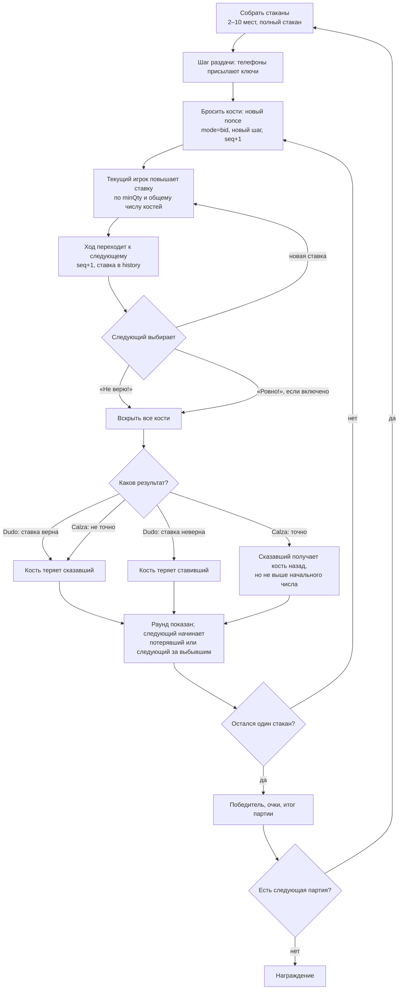

# Паспорт логики — Кости лжеца

> **Эталон.** Этот файл описывает ставки, скрытые кости, вскрытие, потерю костей, «Палифико», очки и возврат.
> Перед правкой обязательны [`../LOGIC.common.md`](../LOGIC.common.md), этот паспорт и `perudo.test.ts`. Намеренное изменение
> правил фиксируется здесь в том же PR. Указатель паспортов — [`../LOGIC.md`](../LOGIC.md).

- Составлен: 18 ноября 2026, по `main` `8f486f6ab7809045129e229c3f451faa6f484b9c`.
- Статус: исходный паспорт по коду и существующим тестам; новых дефектов не заявлено.
- Входит: стаканы, ключи и генерация костей, допустимые ставки, Dudo, Calza, Палифико, очки, партии и «Назад».
- Не входит: общая доставка SSE, внешний вид костей, внутренние правила других игр.

## 1. Что за игра

Перудо: у каждого стакана скрытые кости. Игроки по кругу повышают ставку «на столе не меньше N костей с гранью F».
Следующий может повысить, сказать «Не верю!» (Dudo) или, если разрешено, «Ровно!» (Calza). При вскрытии кто-то теряет
кость либо Calza возвращает кость. Последний стакан с костями побеждает.

- Игроки или команды; в команде стакан у капитана по общим правилам сессии.
- 2–10 стаканов; лишние ждут следующей партии.
- 1–6 костей у каждого в начале, по умолчанию 5.
- 1–5 партий, очки накапливаются.
- Настройки Calza, Палифико, очки за место и победу.
- Экран зала, телефоны и пульт; можно без экрана.

`perudoSteps()` и `score()` пусты: обычных вопросов нет. Ставки идут внутри одного шага раунда, а `seq` отличает действия.
`ownAward` включён: у игры собственный переход между партиями и награждением.

## 2. Скрытые кости без открытого хранения рук

Кости не записываются в общий результат до вскрытия. Они вычисляются детерминированно:

```text
diceOf(секретный ключ стакана, nonce раунда, число костей)
```

- Ключ телефона создаётся на раздаче и отправляется ответом `{ key }`; ответы видит только пульт.
- `nonce` создаёт пульт при броске через криптостойкий генератор: заранее подобрать ключ под будущий раунд нельзя.
- `cyrb128` создаёт 128-битное состояние, `sfc32` — последовательность; отбрасывание крайних значений убирает перекос по модулю 6.
- Одна пара ключ+nonce всегда даёт одинаковые кости; новый nonce — новый расклад.
- `prints[pid]` хранит только короткий отпечаток ключа, не сам ключ. Телефон сравнивает его перед показом: если пульт бросил
  без ключа телефона, устройство не должно показывать несуществующие «свои» кости.
- Стакан без телефона получает ключ `hostCupKey(host, pid)` от ключа исходного пульта; отпечаток имеет префикс `h`.

### Второй пульт

Ключи телефонов можно получить повторно из ответов раздачи. Но ключ стаканов без телефона знает только исходный пульт.
Если отпечаток не совпадает, стакан помечается `foreign`: вскрытие блокируется, чтобы не показать неверные кости.

## 3. Блок-схема партии



Если игрок потерял предпоследнюю кость и остался с одной, следующий раунд может стать «Палифико» и начинается с него.

## 4. Сбор стаканов и начало раунда

`startDeal`:

- использует `scoringParticipants`: игроков в `solo` или команды в `teams`;
- сортирует по входу, добавляет записи таблицы и места ведущего;
- берёт первые 10 стаканов, остальных помещает в `waiting`;
- выдаёт каждому `startDice`;
- первым начинает победитель прошлой партии, если он за столом, иначе первый;
- в новой партии увеличивает `party`, создаёт новый шаг и сохраняет очки.

`startRound` возможен только из `deal` или `reveal`, если есть не меньше двух стаканов с костями:

- устанавливает новый `nonce`;
- увеличивает `round` и `seq`;
- назначает `turn = starter` или следующий стакан с костями;
- очищает ставку, историю, вскрытие и итог вызова;
- включает `palifico = palificoNext`, затем сбрасывает `palificoNext`;
- сохраняет `prints` и `prev`;
- создаёт новый шаг сессии, `changeable = true`.

## 5. Допустимые ставки

`Bid`: `q` — количество, `f` — грань 1…6. Парсер допускает `q` от 1 до 200, но фактическая ставка также не должна
превышать общее число костей на столе.

### Обычный раунд

| Прежняя ставка | Новая грань | Минимальное новое `q` |
|---|---|---|
| Нет | 1 | Запрещено: открывать раунд единицами нельзя |
| Нет | 2–6 | 1 |
| `q, f` | та же `f` | `q + 1` |
| `q, f` | меньше `f` | `q + 1` |
| `q, f` | больше `f` | `q` |
| `q, f ≠ 1` | 1 | `ceil(q / 2)` |
| `q, 1` | 1 | `q + 1` |
| `q, 1` | 2–6 | `2q + 1` |

Таким образом повышение идёт по количеству или по старшей грани, а переходы на/с единиц используют отдельные формулы.

### Палифико

- Первая ставка может иметь любую грань и `q ≥ 1`.
- Дальше грань не меняется.
- Каждая следующая ставка увеличивает количество минимум на 1.
- Общий предел костей сохраняется.

`placeBid` принимает ставку только от того, чей `turn`, только в `mode = bid` и только при `isLegalBid`. Затем:
`bid`, `bidder`, `history`, `turn = nextCup`, `seq += 1`, `prev` сохраняется. Шаг сессии не меняется.

## 6. Подсчёт костей при вскрытии

`countFace(shown, f, palifico)`:

- считает кости с гранью `f`;
- в обычном раунде при ставке на 2–6 единицы — джокеры и тоже считаются;
- в Палифико единицы не джокеры;
- при ставке на сами единицы джокерное правило не нужно: считаются только единицы.

`resolveCall` требует текущего игрока, ставку и её автора. `shown` содержит кости всех стаканов, вычисленные пультом.

### «Не верю!» — Dudo

```text
ok = count >= bid.q
если ok: loser = тот, кто не поверил
иначе:  loser = автор ставки
```

### «Ровно!» — Calza

```text
ok = count == bid.q
если ok и у сказавшего меньше костей, чем в начале: gainer = сказавший
если не ok: loser = сказавший
```

Calza можно выключить настройкой; тогда такой вызов не принимается.

После вскрытия:

- `loser` теряет одну кость, но не ниже 0;
- `gainer` получает одну, но только если он был ниже начального числа;
- стакан с 0 костей попадает в `out`;
- вскрытые кости записаны в `shown`;
- `mode = reveal` или `over`, если остался один стакан;
- `turn = null`, `changeable = false`;
- очки сохраняются в `call.points` и `addScore`.

## 7. Палифико

Условия следующего раунда «Палифико»:

- настройка `palifico` включена;
- игрок только что потерял кость;
- до потери у него было ровно 2, после — 1;
- у него ещё не было Палифико в этой партии;
- за столом остаются минимум 3 стакана с костями.

Тогда:

- `palificoNext = true`;
- игрок добавляется в `palificoDone`;
- `starter = этот игрок`.

В следующем раунде единицы не джокеры и грань фиксирована после первой ставки. Один стакан может вызвать такой раунд
не более одного раза за партию.

## 8. Кто начинает следующий раунд

- После Dudo — потерявший кость; если он выбыл, следующий стакан с костями после него.
- После Calza — сказавший; при вскрытии без потерь тоже он.
- Если потерявший получил Палифико — именно он, даже при обычном правиле это уже выбрано.
- Если сохранённый `starter` больше не имеет костей, `startRound` находит следующий по кругу.

## 9. Очки и партии

Настройки:

- `placePoints` — очки за каждого, кто выбыл раньше;
- `winPoints` — дополнительная награда победителю.

При выбывании игрока на позиции `r.out.length` до добавления:

```text
выбывший получает placePoints × число выбывших раньше
```

Первый выбывший получает 0, второй — `placePoints`, третий — `2 × placePoints` и так далее.

Последний стакан получает:

```text
placePoints × общее число выбывших + winPoints
```

Это очки за текущую партию; они добавляются к общему `score`, а не заменяют прошлые партии.

После `over`:

- если `party < parties` — следующая партия;
- иначе награждение по накопленному счёту;
- можно закончить раньше или сыграть дополнительную партию;
- новая партия возвращает все стаканы с полным набором костей; начинает прошлый победитель.

## 10. Ходы с телефона и ручной ввод

`moveFromAnswers` принимает действие только:

- на текущем шаге;
- от игрока, чей сейчас `turn`;
- с `value.n === String(r.seq)`.

Так устаревшее касание не ложится на новый стол. Допускаются `bid`, `dudo` и `calza`; Dudo/Calza требуют существующей ставки.

Ведущий может ставить за стакан без телефона: интерфейс ограничивает грань и количество по `minQty` и общему числу костей.
Набранная ставка хранится в `usePultDraft` по шагу, раунду и `seq`, поэтому переживает вкладки и перезагрузку до следующего хода.

Перед броском и вскрытием пульт заново читает ключи раздачи с сервера. Фоновые изменения используют `moment = resultKey`:
если стол уже ушёл вперёд, старое действие не перезаписывает его.

## 11. «Назад»

`prev` хранит одно действие. `perudoBack`:

- возвращает прежние `step`, `stage`, `result`;
- если шаг изменился, очищает ответы покинутого шага;
- после вскрытия вычитает `call.points` через отрицательный `addScore`;
- увеличивает `seq` до `max(текущий, прежний) + 1`, даже если сам шаг не менялся;
- поэтому старый ответ телефона не выполняется повторно;
- устанавливает `prev = null`, дальше одного действия не идёт.

На пьедестале используется общий `podiumBack`.

## 12. Инварианты

- **К-1.** За столом 2–10 стаканов; лишние находятся только в `waiting`.
- **К-2.** У каждого стакана в начале партии одинаковое число костей от 1 до 6.
- **К-3.** Кости определяются ключом и nonce; одинаковые входные данные дают одинаковый расклад.
- **К-4.** Ключи не попадают в публичный `prints` — там только отпечатки.
- **К-5.** До вскрытия чужие кости не появляются в общем `shown`.
- **К-6.** Стакан без телефона использует ключ исходного пульта; чужой пульт не выдумывает его кости.
- **К-7.** Ставку делает только текущий игрок; действие телефона принимается только с текущим `seq`.
- **К-8.** Ставка не превышает общее число костей и соответствует `minQty`.
- **К-9.** Обычный раунд нельзя открыть единицами; переходы на/с единиц используют специальные формулы.
- **К-10.** В Палифико грань не меняется и единицы не джокеры.
- **К-11.** В обычном раунде единицы — джокеры только при ставке на 2–6.
- **К-12.** Dudo назначает потерю кости ошибившемуся: сказавшему при верной ставке, автору при неверной.
- **К-13.** Calza назначает потерю сказавшему при неточности и возвращает кость только при точности и нехватке костей.
- **К-14.** Стакан с 0 костей выбывает и не участвует в следующем круге.
- **К-15.** Палифико возникает только при переходе 2 → 1, один раз на стакан за партию и при минимум 3 стаканах.
- **К-16.** Следующий раунд начинает назначенный проигравший/сказавший или следующий активный после выбывшего.
- **К-17.** Партия заканчивается при ровно одном стакане с костями.
- **К-18.** Выбывшие и победитель получают очки по порядку выбывания без повторного начисления.
- **К-19.** Новая партия сохраняет общие очки и возвращает полные стаканы.
- **К-20.** «Назад» снимает очки вскрытия и увеличивает `seq`, чтобы старое действие не повторилось.

## 13. Где это в коде

| Место | Ответственность |
|---|---|
| `content.ts` | Настройки и лимиты |
| `dice.ts` | Детерминированные кости, nonce, ключи и отпечатки |
| `logic.ts` | Ставки, вскрытие, кости, очки, партии и возврат |
| `HostControls.tsx` | Ходы телефонов, ручная ставка, бросок и вскрытие |
| `views.tsx` | Экран, личный стакан и кости |
| `text.ts` | Русские подписи ставок и числа костей |
| `validate.ts` | Минимум одной кости |
| `perudo.test.ts` | Правила, генератор, полный путь, очки и возврат |
| `preview.ts` | Автоматический предпросмотр |

## 14. Что не проверено

- Новый дефект не заявлен: это исходный паспорт, не независимый полный аудит.
- Реальные телефоны, второй пульт, обрывы связи и визуальные состояния в этой работе не запускались.
- Тест генератора проверяет диапазон и грубую равномерность, но не является криптографической сертификацией.
- Взаимодействие с вечером из блоков требует отдельной проверки ключей, локальных черновиков и архивных ответов.

## 15. Проверка паспорта

Минимум:

- `npx vitest run src/mechanics/perudo/perudo.test.ts`;
- все ветки `minQty`, включая единицы и Палифико;
- ставка не того игрока, старый `seq`, превышение общего числа костей;
- Dudo верно/неверно, Calza точно/неточно, полный и неполный стакан;
- потеря последней кости, порядок очков, победитель и следующая партия;
- Палифико 2 → 1, повтор на том же стакане, меньше трёх стаканов;
- свой/чужой ключ, игрок без телефона, исходный и второй пульт;
- «Назад» после ставки без смены шага, после вскрытия и после победы.
