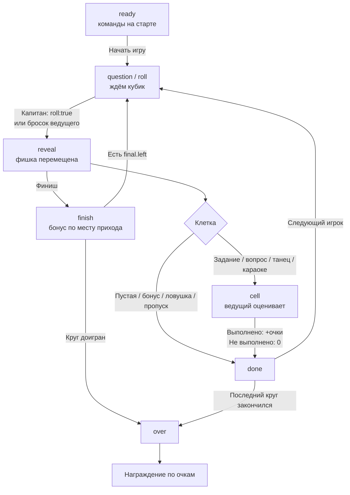

# Паспорт логики — Активная настолка

> **Эталон.** Перед правкой обязательны [`../LOGIC.common.md`](../LOGIC.common.md), этот паспорт и `quest.test.ts` / `paths.test.ts`.
> Намеренное изменение правил фиксируется здесь в том же PR. Указатель — [`../LOGIC.md`](../LOGIC.md).

- Составлен: 19 ноября 2026, по коду ветки `main` после `1e6dd753`.
- Проверка: **51/51 профильных тестов** совместно с «Гонкой» и «Драконом»; из них настолка — 16 + 3.
- Границы проверки: браузер, два настоящих пульта, PostgreSQL и test/production в этом аудите не запускались.
- «Олимп» в аудит не входил по отдельному запрещению владельца.

## 1. Назначение, режимы и содержимое

Командная или одиночная игра с полем на экране. Участники по очереди бросают кубик, перемещаются по клеткам,
выполняют задания и получают очки. Поддерживаются `solo`, `teams` и режим без общего экрана; в команде бросает капитан.

Поле содержит **40–100 клеток**:

- `task` — задание, оценивает ведущий;
- `question` — вопрос с ответом для ведущего;
- `dance`, `karaoke` — активное задание с возможными видео и музыкой;
- `bonus`, `trap` — одно перемещение на −6…+6 клеток;
- `skip` — пропуск следующего хода;
- `empty` — отдых без задания.

У задания может быть отдельный текст `solo`. Лимиты: текст 240, ответ 120, очки клетки 0–1000, финиш 0–1000,
видео только YouTube / VK Видео / Rutube. Музыкальный фрагмент использует общий `Clip`.

## 2. Блок-схема

Ведущий может объявить последний круг досрочно. Пока никто не финишировал, ручной круг можно отменить.
Досрочное награждение доступно с подтверждением.

## 3. Экран, телефон и пульт

- **Экран:** карта, фишки, очки, кубик, текущая клетка, видео/музыка, финиш и последний круг. После решения ведущего
  показывается ответ на вопрос. На общем экране отображаются первые 10 строк рейтинга и число остальных.
- **Телефон:** своя позиция, очередь, задание, финиш. Кнопка кубика только у текущего игрока/капитана и только при
  открытом приёме. В режиме без экрана добавляется уменьшенное поле. Обычный участник команды кубик не бросает.
- **Пульт:** запуск, бросок за игрока, ответ на вопрос, оценка задания, следующий ход, ручной последний круг,
  досрочное награждение и «Назад». Автоматический бросок с телефона обрабатывается через `rollChange`.

Ответы на вопросы и содержимое клеток входят в снимок игры на клиенте; это не защищённое от технически подготовленного
гостя хранилище секретов. Скрытых ролей и шифрования у механики нет.

## 4. Кубик, движение и очередь

- Телефон отправляет только `{ roll: true }`; значение вычисляет `dieOf(id, submittedAt)` из идентификатора и времени
  сервера, а не из выбранного гостем числа.
- Ведущий бросает через криптографический случайный байт; повторный бросок за игрока в репетиции допустим.
- `rollChange` принимает ответ только текущего шага, текущего `mover`, со значением `roll: true` и временем не раньше
  текущего показа.
- Позиции: 0 — старт, 1…N — клетки, N+1 — финиш. Переброс сверх финиша ограничивается финишем.
- Бонус/ловушка срабатывает один раз, без цепочки. Конечная позиция ограничена стартом и финишем.
- `skip` действует со следующего хода и снимается после пропуска. В последнем круге пропуск тоже сгорает.
- Новые участники добавляются в конец очереди на старт, удалённые выпадают при смене хода.

## 5. Финиш и победители

Первый финиш открывает последний круг: ходят те, кто был после финишировавшего в очереди. Финишировавшие больше
не ходят. Если первым финиширует последний в очереди, игра сразу переходит к итогам.

Бонус по месту прихода: **100% · 75% · 50% · 25%**, округление до кратного 5. Победитель награждения определяется
общей таблицей очков, а не только порядком финиша. При пустой таблице — завершение без пьедестала.

## 6. Инварианты

- **АН-1.** Число клеток при редактировании 40–100; для запуска вопросы и задания заполнены.
- **АН-2.** Число кубика 1–6 не выбирается телефоном.
- **АН-3.** Бросить может только текущий участник или ведущий за него; обычный член команды — нет.
- **АН-4.** Один бросок создаёт один ход и один ответ текущего шага.
- **АН-5.** Позиция никогда не меньше старта и не больше финиша.
- **АН-6.** Бонус/ловушка не запускает цепочку других спецклеток.
- **АН-7.** За задание очки начисляются только после «Выполнено»; повторная оценка не должна удвоить их без возврата.
- **АН-8.** Пропуск следующего хода применяется один раз и снимается.
- **АН-9.** Финишировавший больше не ходит; остальные доигрывают только остаток круга.
- **АН-10.** Бонус финиша соответствует порядку прихода и не начисляется дважды при повторном показе.
- **АН-11.** Итоговое награждение идёт по очкам.
- **АН-12.** «Назад» восстанавливает позицию, очки, жизнь круга и очередь, а не только экран.
- **АН-13.** Старый бросок до «Назад» не засчитывается повторно.
- **АН-14.** Медиа, ответы и результаты относятся к снимку игры, а не к последующим правкам конструктора.
- **АН-15.** При копировании игры должны сохраняться все нужные ей медиа — сейчас нарушено АН-Н-1.

## 7. «Назад», повторы и два пульта

- Из `cell/done/finish`: отменяется ход, снимаются очки клетки или финиша, фишка возвращается, бросок повторяется.
- Из броска следующего участника: сначала восстанавливается итог предыдущего хода через `before`, следующее нажатие
  отменяет сам ход.
- Из `over`: восстанавливается последний ход через `before`.
- Из первого броска: возврат к «Начать игру».
- С пьедестала: общий `podiumBack`.
- Очистка ответов передаётся через `clear`; `useHostRun` и `expect` должны согласовать повтор касания и конкурентный пульт.

Профильные тесты проверяют основные ветки возврата и отсутствие возврата при потерянных `prev/before`. Два реальных
пульта и гонка сетевых запросов отдельно не прогонялись.

## 8. Конструктор → сессия → сервер → история

1. `Editor.tsx` и `content.ts` создают/проверяют содержимое; `validate.ts` запрещает неполный запуск.
2. `index.ts` регистрирует механику, шаги, представления и предпросмотр.
3. При запуске общая платформа сохраняет неизменяемый `gameSnapshot`.
4. `HostControls.tsx` создаёт `SessionChange`; общий сервер применяет права, `expect`, время и таблицу.
5. Очки пишет сама механика через `addScore`; общий `score()` пустой.
6. Завершение и итоги выполняет общая платформа. Отдельной комнаты реального времени у игры нет.

## 9. Где это в коде

| Файл | Ответственность |
|---|---|
| `content.ts` | Клетки, лимиты, импорт списка, `Clip`, сбор музыкальных id |
| `validate.ts` | Проверка запуска |
| `logic.ts` | Кубик, ход, финиш, очки, очередь, «Назад» |
| `HostControls.tsx` | Пульт и автоматическая обработка броска |
| `views.tsx`, `QuestMap.tsx` | Экран и телефон |
| `Editor.tsx` | Конструктор |
| `preview.ts`, `paths.ts` | Репетиция и маршруты карты |
| `quest.test.ts`, `paths.test.ts` | 19 профильных тестов |

## 10. Крайние случаи и покрытие

Тесты подтверждают: размеры поля, импорт `=` и «Пропускаем…», тексты `solo`, все значения кубика в выборке,
оценку, спецклетки, финиш нескольких участников, ручной круг, пропуски, очередь, длительность, шаблоны и возвраты.

Отдельно не подтверждены: копирование музыки, реальные видео/аудио, Safari, 360 px, 10+ участников на экране,
два пульта, обрыв связи и восстановление после перезагрузки сервера.

## 11. Находки

### АН-Н-1 — открыта: музыка клеток не попадает в список медиа при копировании игры

**Доказательства:** `content.ts` содержит `questTrackIds(content)`, который собирает `trackId` из клеток, но `index.ts`
регистрирует `mediaIds: () => []`. Других использований `questTrackIds` не найдено.

**Последствие:** при копировании/переносе игры платформа не узнает, что треки клеток нужно скопировать. В копии могут
остаться ссылки на недоступную музыку.

**Проверка:** дефект виден по коду; профильный тест копирования медиа отсутствует. Исправление должно подключить
`questTrackIds` к `mediaIds` и проверить дубли/отсутствующие треки на реальном сценарии копирования. Код в этом аудите
не менялся.

## 12. Итог проверки 19 ноября 2026

`npx vitest run src/mechanics/quest src/mechanics/survival src/mechanics/dragon` — **51/51 passed**, из них настолка
19/19. Логика хода и возврата принята по unit-тестам. Полный статус «проверено в браузере и на test» не присваивается.
