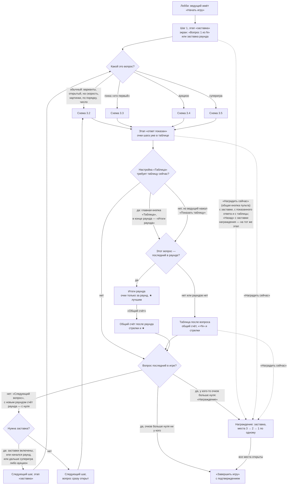
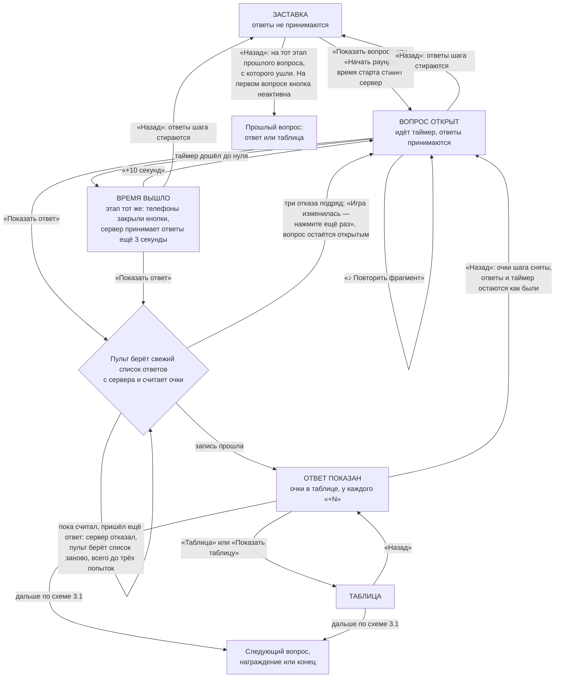
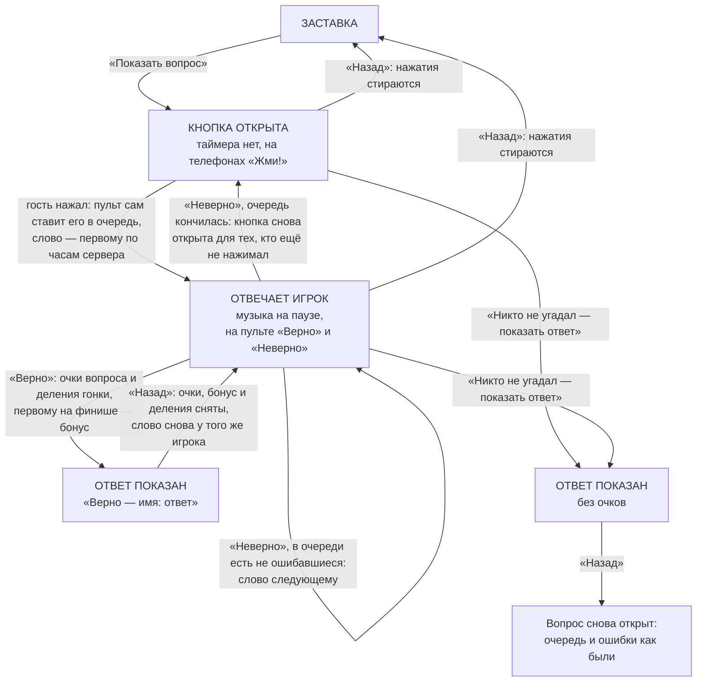
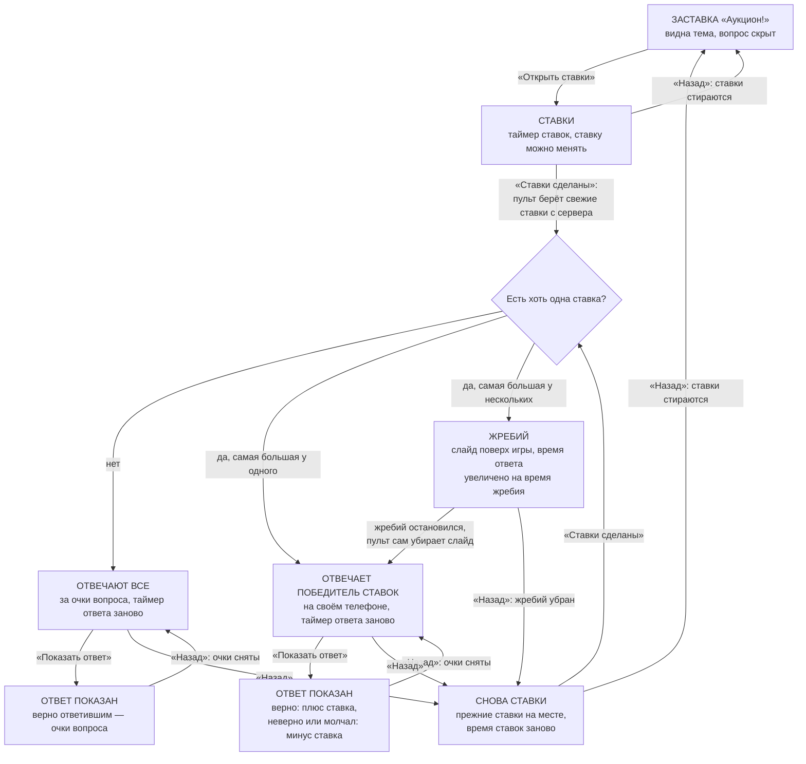
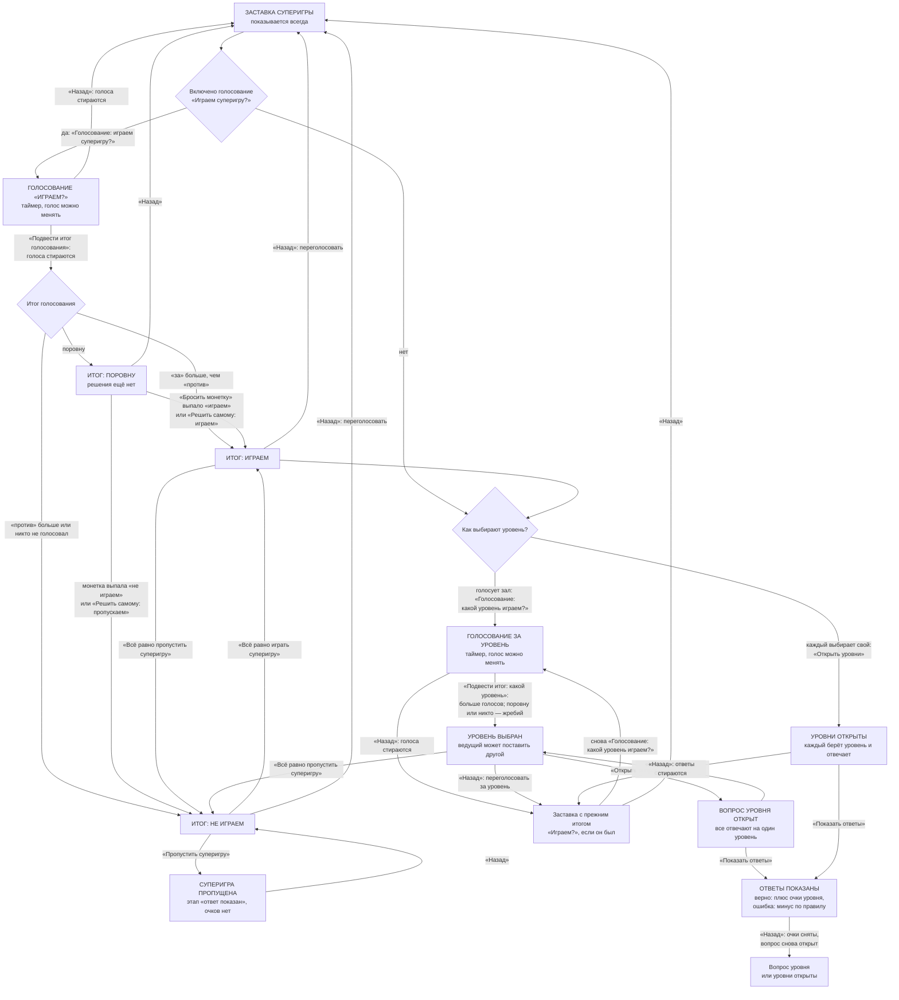
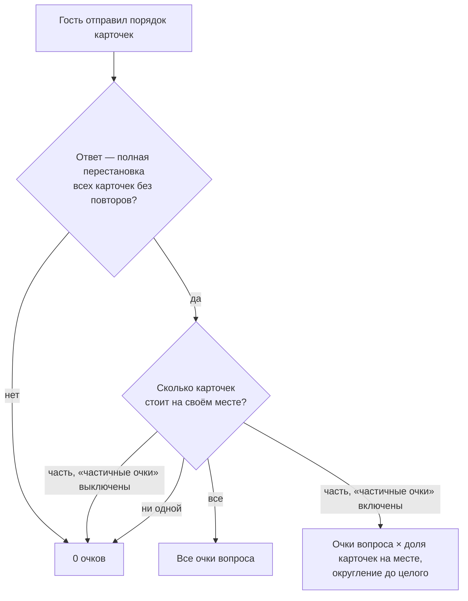
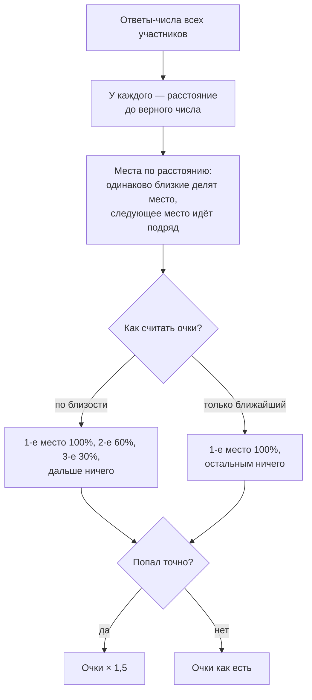

# Паспорт логики — Квиз (и «Узнай по нотам»)

> **Эталон.** Этот файл описывает, как *должен* работать квиз: ход игры, очки, «Назад», особые вопросы. Любая правка
> квиза идёт так: **прочитать паспорт → правка → сверить с паспортом → если логика изменилась намеренно, обновить
> паспорт в том же PR**. Расхождение кода с паспортом — ошибка. Общая часть (вход гостя, лобби, приём ответов, пульт,
> телефон, награждение, итоги) — в [`../LOGIC.common.md`](../LOGIC.common.md): здесь она не повторяется, ссылки вида
> «О-7», «Н-1» ведут туда. Указатель всех паспортов — [`../LOGIC.md`](../LOGIC.md).

- Составлен: 12 ноября 2026, по коммиту `afeceb5` + рабочая копия (правки общей части Н-1…Н-4 и сверка ответов в пульте
  квиза; к концу составления они записаны коммитами `7fc49cb` и `a47b40d` — паспорт сверен с `a47b40d`).
- Независимая проверка: 12 ноября 2026 (проверяющий не видел, как составлялся паспорт; итог — раздел 10). По её итогам
  уточнены шесть правил, дополнены схемы, добавлены находки К-Н-12…К-Н-18; К-Н-1 исправлена в коде.
- Что сюда **не входит**: «Мероприятие из блоков» (квиз как блок вечера), репетиция, предпросмотр в конструкторе,
  Firebase-версия, внешний вид (размеры, цвета, анимации).

## 1. Что за игра

Вопросы идут по очереди, один вопрос — один шаг игры. Ведущий ведёт шаг одной главной кнопкой пульта, гости отвечают
с телефонов, очки считает пульт в момент «Показать ответ».

**Виды вопросов** (`kind`, `content.ts`):

| Вид | Название в конструкторе | Что делает гость | Как проверяется |
|---|---|---|---|
| `choice` | Выбор варианта | касается одного из 2–6 вариантов | верных может быть несколько, засчитывается любой |
| `open` | Открытый ответ | пишет текст | совпадение без регистра, ё/е, пробелов и знаков; ведущий может «Засчитать» |
| `speed` | На скорость | касается варианта | верно + чем быстрее, тем больше очков |
| `buzz` | Гонка: кто первый | жмёт кнопку, отвечает голосом | ведущий жмёт «Верно» или «Неверно» |
| `pictures` | Несколько картинок | пишет ответ к каждой из 2–4 картинок | доля очков за каждую угаданную |
| `order` | Расставь по порядку | нумерует 3–6 карточек касаниями | всё верно — все очки; частично — доля |
| `number` | Угадай число | пишет число | места по близости к верному числу |
| `auction` | Аукцион | ставит очки, потом отвечает победитель ставок | верно +ставка, неверно −ставка |
| `super` | Суперигра | голосует, выбирает уровень, отвечает | верно + очки уровня, ошибка — штраф по правилу |

**Режимы** (`index.ts`, `supports`): каждый сам, команды, без экрана зала — все три. В командах отвечает капитан
(О-15); исключение — голосования суперигры: там голосует каждый телефон (К-36).

**Что ещё есть в коде:**

- **Раунды.** Раунд начинается с вопроса, у которого записано название раунда (`round`). Нет ни одного названия —
  раундов нет. Вопросы до первого названия — безымянный «Раунд 1» (`quizRounds`).
- **Заставки.** Заставка вопроса «Вопрос 2 из 8» (можно выключить настройкой), заставка раунда, заставки аукциона и
  суперигры (эти две показываются всегда).
- **Таблица.** После каждого вопроса, только в конце раунда или по кнопке — настройка игры. В конце раунда таблица
  двойная: «Итоги раунда» (очки только за раунд, ★ лучшим), затем «Общий счёт».
- **Гонка.** У вопросов «кто первый» участник за верный ответ проходит 1–3 деления. Кто первым набрал нужное число
  делений (настройка, 1–20, по умолчанию 5), получает бонус (по умолчанию 200). Квиз после финиша идёт дальше.
- **Музыка.** У любого вопроса, кроме суперигры, может быть трек: отрывок играет на экране зала при показе вопроса,
  на ответе — припев или тот же отрывок. Отдельно — «Музыка на ответ» у любого вопроса. Квиз с треками (или где хотя бы
  половина вопросов начинается с «♪») считается «Узнай по нотам» — это влияет только на фон экрана (`isMelodyQuiz`).
- **Картинки.** Одна картинка у вопроса, 2–4 в «Нескольких картинках», своя у каждого уровня суперигры. На телефонах
  картинка вопроса видна в режиме «без экрана» всегда, с экраном — по настройке.
- **Готовые шаблоны** (`demo.ts`): «Демо-квиз: Новогодняя вечеринка» (8 вопросов: варианты, на скорость, открытые),
  «Узнай по нотам: шаблон» (8 вопросов, 3 раунда, без заставок, таблица в конце раунда, треков нет — их ставит
  ведущий), «Квиз: порядок и числа» (6 вопросов «по порядку» и «число»).

## 2. Этапы шага и что на них видно

Этапы общие для платформы (`state.stage`): заставка `ready` → вопрос открыт `question` → ответ показан `reveal` →
таблица `board` → награждение `podium`. Особые вопросы (аукцион, суперигра) проходят `ready` и `question` по нескольку
раз внутри одного шага — что именно идёт, записано в итогах шага (`state.result`).

| Этап | Экран зала | Телефон гостя | Пульт |
|---|---|---|---|
| Заставка | «Вопрос N из M» и вид вопроса; у первого вопроса раунда — заставка раунда | «Приготовьтесь!», свои очки и место | «Показать вопрос» (с новым раундом — «Начать раунд»), текст вопроса, верный ответ, заметка |
| Вопрос открыт | вопрос, варианты, таймер, «Ответили: N» | варианты или поле ответа; после ответа — «Ответ принят»; участник команды — «Отвечает ваш капитан»; время вышло — «Время вышло» | таймер, «Ответили: N из M», кто ещё не ответил, ответы гостей с «Засчитать», «Показать ответ» |
| Ответ показан | верный ответ, сколько выбрали каждый вариант, «Верно ответили: N из M» | «Верно!» / «Неверно» / «Ответа не было», свой ответ, верный ответ, «+N» | распределение ответов, «Верно ответили: N из M», следующий вопрос заранее |
| Таблица | таблица (обычная, итоги раунда или общий счёт) | своё место, очки, стрелка | «Следующий вопрос» / «Общий счёт» / «Награждение» |
| Награждение | пьедестал (рисует общая часть) | пьедестал (общая часть) | «Показать N место» → «Завершить игру» |

Где в коде: экран — `views.tsx`, `QuizScreenView`; телефон — `views.tsx`, `QuizPlayerView`; пульт —
`HostControls.tsx`. На этапе награждения экран и телефон квиз не рисует: это делают `HallScreen.tsx` и `Play.tsx`.

## 3. Блок-схемы

### 3.1. Ход игры целиком

На схеме нет общей кнопки пульта «Таблица очков на экран» (`peek`): она кладёт таблицу поверх игры на любом этапе и
шага не двигает; любая смена шага или этапа убирает её сама (общая часть, О-11).

Где в коде: `flow.ts` — `primaryAction` (какая кнопка главная), `extraAction` («Показать таблицу»),
`boardAfterReveal`, `showBoard`, `showTotal`, `nextQuestion`, `afterStep`; награждение — `core/podium.ts`.

### 3.2. Обычный вопрос (варианты, открытый, на скорость, картинки, по порядку, число)

Развилок «верно / неверно / никто не ответил» в ходе шага нет: «Показать ответ» работает одинаково, различается только
подсчёт (раздел 4). Никто не ответил — очков нет ни у кого, шаг идёт дальше как обычно.

### 3.3. Гонка «кто первый»

Где в коде: `core/buzz.ts` (`syncBuzz`, `buzzWrong`, `buzzRight`, `buzzPhone`), `flow.ts` (`buzzSync`,
`buzzWrongAnswer`, `buzzRightAnswer`, `back`), `HostControls.tsx` (`rightChange`, `wrongChange`, фоновая запись
очереди).

### 3.4. Аукцион

На схеме не показано: на этапе ответа работают общие «+10 секунд» и «Засчитать» (открытый ответ); при возврате к
ставкам записи шага на сервере не стираются — прежние ставки живут в итогах шага (`auction.bets`), а форма ставки на
телефоне открывается пустой (К-Н-17).

Где в коде: `auction.ts` (`openBets`, `auctionBets`, `closeBets`, `auctionBackToBets`, `auctionMax`), `logic.ts`
(`score`, ветка `auction`; `auctionAnswers`), `HostControls.tsx` (`closeChange`), `auctionViews.tsx`.

### 3.5. Суперигра

На схеме не показано: «▶ Трек: уровень» (ведущий включает трек уровня на экране) и «Засчитать» ответ по уровню — шага
и этапа они не меняют.

Где в коде: `flow.ts` (`primaryAction`, `openSuperVote`, `closeSuperVote`, `coinSuperVote`, `overrideSuperVote`,
`skipSuper`, `openLevelVote`, `closeLevelVote`, `chooseLevel`, `superSync`, `back`), `core/supergame.ts` (подсчёт
голосов и очков), `logic.ts` (`superAllowed`), `components/live/SuperGame.tsx` (экран, телефон, список ответов).

### 3.6. «Расставь по порядку» — как считаются очки

Ход шага — как у обычного вопроса (схема 3.2). Карточки на экране и телефонах лежат вперемешку, одинаково у всех, и
никогда — в верном порядке (`orderShown`).

### 3.7. «Угадай число» — как считаются очки

Ход шага — как у обычного вопроса (схема 3.2).

## 4. Правила логики

Каждое правило должно выполняться всегда. «Где» — файл и функция; номера строк — по состоянию на дату паспорта.

### Ход шага и кнопки

- **К-1.** Один вопрос — один шаг. Число шагов равно числу вопросов; каждый шаг принимает ответы.
  *Где:* `logic.ts`, `steps` (стр. 13).
- **К-2.** На каждом этапе у пульта ровно одна главная кнопка; какая — решает одна функция по этапу, виду вопроса и
  итогам шага. Дополнительная кнопка «Показать таблицу» есть только на этапе ответа и только когда главная кнопка
  таблицу пропускает. *Где:* `flow.ts`, `primaryAction` (стр. 80), `extraAction` (стр. 109).
- **К-3.** Игра всегда начинается с заставки первого вопроса, даже если заставки вопросов выключены.
  *Где:* `core/session.ts`, `startState`; настройка `intro` читается только в `nextQuestion`.
- **К-4.** «Показать вопрос» ставит: этап «вопрос открыт», время старта — часы сервера, таймер — время вопроса (у
  гонки таймера нет), счётчик ответов 0, итоги шага — пустые (у гонки — с пустой очередью). У аукциона та же кнопка
  открывает ставки: таймер — время ставок, в итогах шага — аукцион и «ответ можно менять» (К-37). То, что должно пережить шаг
  (К-28), переносится. *Где:* `flow.ts`, `showQuestion` (стр. 242), `limitOf` (стр. 237), `carry` (стр. 152).
- **К-5.** «Следующий вопрос» открывает вопрос сразу, без заставки, только если одновременно: заставки выключены,
  раунд не начинается, следующий вопрос — не суперигра и не аукцион. Иначе — заставка.
  *Где:* `flow.ts`, `nextQuestion` (стр. 590–616).
- **К-6.** Таблица после ответа нужна: «после каждого вопроса» — всегда; «по кнопке» — никогда (только «Показать
  таблицу»); «в конце раунда» — на последнем вопросе раунда, а без раундов — только на последнем вопросе игры.
  *Где:* `flow.ts`, `boardAfterReveal` (стр. 65).
- **К-7.** Если таблицу открыли на последнем вопросе раунда (любой кнопкой), она открывается как «Итоги раунда»;
  следующая главная кнопка — «Общий счёт», и только потом — дальше. В середине раунда и без раундов — обычная таблица.
  *Где:* `flow.ts`, `showBoard` (стр. 578), `showTotal` (стр. 585), `boardView` (стр. 46).
- **К-8.** С первым вопросом нового раунда (кроме самого первого раунда игры) у всех участников запоминается счёт на
  старте раунда (`roundBase` = текущие очки). Очки раунда = очки − `roundBase`. Прежние значения едут в итогах шага
  (`prevRoundBase`), чтобы «Назад» их вернул. *Где:* `flow.ts`, `nextQuestion`; `core/rounds.ts`,
  `startRoundEntries`, `roundScore`.
- **К-9.** После последнего вопроса: есть участник с очками больше нуля — «Награждение», нет — сразу «Завершить
  игру». *Где:* `flow.ts`, `afterStep` (стр. 74); `core/podium.ts`, `hasPodium`.
- **К-10.** Каждая запись кнопки пульта уходит с отметкой «какой шаг и этап видел ведущий» (`expect`). Игра уже ушла
  дальше (двойное касание, второй пульт) — сервер отказывает, пульт молчит и ждёт свежее состояние. Ни одна кнопка
  квиза не сдвигает игру дважды. *Где:* `HostControls.tsx`, `run` (стр. 222–261); общая часть — О-9.
- **К-11.** Пока запись идёт, остальные кнопки пульта квиза неактивны; кнопка ждёт, пока своё изменение вернётся с
  сервера, но не дольше 3 секунд. Ошибка связи — «Не получилось. Проверьте интернет и нажмите ещё раз.»; три отказа
  сервера подряд (ответы ещё приходят или игру меняет второй пульт; между попытками — пауза до 0,3 с) — «Игра
  изменилась — нажмите ещё раз.» *Где:* `HostControls.tsx`, `run`, `nextSession`
  (стр. 208).

### Очки: когда и как

- **К-12.** Очки начисляются в одном месте — при «Показать ответ» (и «Верно» в гонке, которое делает то же самое).
  Каждому участнику из таблицы: очки += прибавка, `last` = прибавка шага (ноль, если ничего), `move` = на сколько мест
  он сдвинулся. Тем, у кого ничего не изменилось, запись не трогается. Очки уходят прибавкой (`addScore`), `last`,
  `move`, деления гонки — полями записи (`patch`): сервер прибавляет к своему счёту, а не перезаписывает его (К-Н-3).
  Считаются только ответы нынешнего показа вопроса — принятые не раньше времени показа (`shownAnswers`, К-Н-6).
  *Где:* `flow.ts`, `reveal`.
- **К-13.** Итог по ответам подводится по свежему списку с сервера, а запись несёт отметку этого списка: сколько
  ответов, время последнего и сумма времён. Если на сервере к моменту записи ответы уже другие (пришёл новый или
  сменился прежний) — отказ, пульт берёт список заново и повторяет: всего до трёх попыток, пока игра на том же шаге и
  этапе; после третьего отказа — сообщение ведущему (К-11), игра не сдвинута. Нет связи со списком — считает по тому,
  что пришло, без отметки. Так работают четыре записи: «Показать ответ», «Ставки сделаны», «Подвести итог голосования»,
  «Подвести итог: какой уровень». «Верно» в гонке отметку не несёт: очки там не зависят от списка ответов.
  *Где:* `HostControls.tsx`, `revealChange` (стр. 264–277), `marked` (стр. 284), `freshStepAnswers` (стр. 289),
  `closeChange` (стр. 299), `levelVoteDoneChange`, `voteDoneChange`, `perform` (стр. 325–348), `run` (`again`);
  `core/session.ts`, `answersMark`; сервер — `server/src/live.ts`, `change` (стр. 693–704).
- **К-14. Выбор варианта.** Ответ верен, если выбранный вариант — среди отмеченных верных. Очки — очки вопроса.
  *Где:* `logic.ts`, `isCorrect` (стр. 210), `score` (стр. 303–304); `content.ts`, `correctSet`.
- **К-15. Открытый ответ.** Сравнение после приведения: нижний регистр, ё → е, выброшены пробелы и знаки (остаются
  буквы и цифры; в числе с одним разделителем — десятичная точка без лишних нулей: «1,5» = «1.5» = «1,50», но не «15»;
  ровно три цифры после разделителя — разряды тысяч: «1.000» = «1000»; минус перед числом в начале или после пробела —
  «-5» не «5»). Верно, если совпало с одним из верных ответов или ведущий нажал «Засчитать» для этого
  написания. Ответ из одних знаков или смайликов сравнивается как написан (без пробелов): он виден ведущему и его можно
  засчитать (К-Н-7). Пустой ответ — неверен. Очки — очки вопроса.
  *Где:* `core/normalize.ts`, `normalizeAnswer`; `logic.ts`, `textMatches` (стр. 125); `flow.ts`, `toggleAccepted`.
- **К-16. На скорость.** Только верные ответы. Время ответа = время приёма ответа сервером − время показа вопроса, не
  меньше 0 и не больше времени вопроса; ответ без отметки времени считается «в последнюю секунду». Самый быстрый верный
  получает все очки вопроса; ответ на последней секунде — половину; между ними — по прямой:
  `очки × (1 − 0,5 × (время − лучшее) / (лимит − лучшее))`, округление до целого. Лимит — текущее время шага
  (`state.timeLimit`), то есть вместе с добавленными секундами. Один верный ответ или все в одно время — все получают
  максимум. *Где:* `logic.ts`, `score` (стр. 306–313), `answerTime` (стр. 233).
- **К-17. Несколько картинок.** `очки × угадано / всего картинок`, округление до целого. Зачёт ведущего — отдельно по
  каждой картинке (ключ «номер:ответ»). Телефон слова «Верно!» у картинок не пишет — только ✓ или ✕ у каждой; «угаданы
  все» идёт в счётчик экрана «Всё верно: N из M». *Где:* `logic.ts`,
  `picturesRight` (стр. 132), `score` (стр. 284–291).
- **К-18. По порядку.** Схема 3.6. *Где:* `logic.ts`, `parseOrder`, `orderHits`, `score` (стр. 293–301).
- **К-19. Угадай число.** Схема 3.7. Ответ принимается, только если это конечное число не больше 10¹² по модулю.
  Места «плотные»: двое на втором месте — следующий на третьем. Точное попадание даёт ×1,5, то есть больше очков
  вопроса. *Где:* `logic.ts`, `parseGuess`, `numberDeltas` (стр. 192–207).
- **К-20. Гонка.** Очки вопроса получает только тот, кому ведущий сказал «Верно». Он же проходит деления вопроса
  (1–3). Если до этого никто в таблице не был на финише, а он дошёл (делений ≥ цели) и бонус больше нуля — бонус
  прибавляется к очкам и входит в `last` (значит, «Назад» снимет и его). *Где:* `logic.ts`, `score` (стр. 272–275);
  `flow.ts`, `reveal` (стр. 548–565).
- **К-21. Аукцион.** Есть отвечающий: верно — +ставка, неверно или ответа нет — −ставка. Ставок не было: каждый
  верно ответивший получает очки вопроса. Ответом считается только то, что пришло после начала этапа ответа, и только
  число (вариант) или текст — ставки того же шага ответом не считаются. *Где:* `logic.ts`, `score` (стр. 260–270),
  `auctionAnswers` (стр. 320).
- **К-22. Суперигра.** Верный ответ — + очки уровня. Ошибка — штраф по правилу игры: «без штрафа» 0; «минус
  половина на золоте и бриллианте» (по умолчанию) — половина очков уровня только на двух старших; «минус половина
  везде»; «минус всё» — очки уровня целиком. Штраф считается от очков уровня, не от счёта участника. Когда уровень
  выбирал зал, считаются ответы только этого уровня. *Где:* `core/supergame.ts`, `superVerdicts`, `penaltyFor`,
  `superRight`; `logic.ts`, `superAllowed` (стр. 242), `score` (стр. 277–282).
- **К-23.** Все дробные очки округляются до ближайшего целого (`Math.round`). Счёт может стать отрицательным
  (аукцион, штраф суперигры, ручные правки); нижней границы в коде нет. На пьедестал попадают только те, у кого больше
  нуля (О-6).
- **К-24.** Очки получает только тот, кто есть в таблице в момент показа ответа. Участника, которого пульт ещё не
  успел внести в таблицу, «Показать ответ» вносит сам, если он получил очки за этот шаг (без очков его вносит пульт). Ответ того, кого в таблице
  нет (убранный гость), в очки не идёт, но входит в «ответили всего». *Где:* `flow.ts`, `reveal` (стр. 527–536).

### «Назад»

- **К-25. Куда ведёт «Назад»** (`flow.ts`, `back`, стр. 625–737):

  | Откуда | Куда | Что происходит с очками и ответами |
  |---|---|---|
  | Награждение, открыто хоть одно место | закрывает последнее открытое место | ничего |
  | Награждение, заставка | на этап, с которого пришли по «Наградить сейчас»; иначе — на таблицу | ничего |
  | Общий счёт после раунда | итоги раунда | ничего |
  | Таблица, итоги раунда | ответ показан | ничего |
  | Ответ показан | вопрос открыт | очки шага сняты (К-26), ответы остаются |
  | Суперигра пропущена | итог голосования | очков не было |
  | Вопрос открыт | заставка | ответы шага стираются (К-27) |
  | Аукцион: отвечают | снова ставки | ответы не стираются, прежние ставки остаются |
  | Голосование суперигры | заставка | голоса стираются |
  | Заставка суперигры с выбранным уровнем | заставка без уровня (переголосовать) | ничего |
  | Заставка суперигры с итогом «Играем?» | заставка без итога (переголосовать) | ничего |
  | Заставка вопроса | тот этап прошлого вопроса, с которого ушли (ответ или таблица) | возвращаются «+N», стрелки и старт раунда прошлого шага (К-28) |
  | Заставка первого вопроса игры | некуда, кнопка неактивна | — |

- **К-26.** «Назад» с показанного ответа: у каждого, у кого `last` не ноль, очки уменьшаются на `last`, а `last` и
  `move` обнуляются; у тех, кто очков не получил, обнуляется стрелка места `move` (К-Н-16). Очки снимаются прибавкой
  (−`last`), поля — `patch` (К-Н-3). В гонке у победителя ещё снимаются деления этого вопроса (не ниже нуля), а слово возвращается ему.
  Время старта и таймер не меняются, ответы на сервере остаются, зачёты ведущего и состояние аукциона сохраняются.
  Повторное «Показать ответ» считает всё заново — очки не удваиваются. *Где:* `flow.ts`, `back` (стр. 637–662).
- **К-27.** «Назад» с открытого вопроса: сначала записывается этап «заставка», и только после успешной записи
  стираются ответы шага. Сорвалась запись — ответы не тронуты. *Где:* `HostControls.tsx`, `run` (стр. 249);
  `flow.ts`, `back` (стр. 690–699).
- **К-28.** «Следующий вопрос» кладёт в стопку снимок пройденного шага: номер шага, этап (ответ или таблица),
  счётчик ответов, итоги шага, прибавки `last` и сдвиги `move`. Стопка едет в итогах шага через все этапы и кнопки.
  «Назад» с заставки берёт верхний снимок и возвращает ровно его. В стопке не больше 5 снимков и не больше 12 000
  знаков (старые уходят, последний остаётся всегда; К-Н-12). Нужного снимка нет — «Назад» с заставки неактивна: неверно снять
  очки нельзя. *Где:* `flow.ts`, `pushHistory` (стр. 214), `historyOf` (стр. 194), `carry` (стр. 152), `back`
  (стр. 700–724).
- **К-29.** Итоги голосований суперигры («Играем?» и «Какой уровень?») тоже едут через вопрос и ответ: «Назад» с
  вопроса не заставляет голосовать заново. *Где:* `flow.ts`, `carry`.

### Что лежит в записи участника и в итогах шага

- **К-30. Запись участника в таблице.** `score` — очки; `last` — прибавка за последний показанный ответ (экран и
  телефон показывают «+N»); `move` — сдвиг по местам после последнего ответа; `roundBase` — очки на старте раунда;
  `race` — пройденные деления гонки (копятся всю игру, на экране — не больше цели). Квиз меняет их только в четырёх
  местах: показ ответа, «Назад», начало раунда, «Пропустить суперигру» (обнуляет `last` и `move`).
- **К-31. Итоги шага (`state.result`) по этапам:**

  | Этап | Что там |
  |---|---|
  | Заставка | в начале игры — пусто; дальше — стопка «Назад» (`history`), на первом вопросе раунда — `prevRoundBase`, у суперигры — итоги голосований |
  | Вопрос открыт | `counts`, `correct`, `total` (нули), `accepted` (зачёты ведущего); по ходу — `buzz` (очередь гонки), `picks` (кто какой уровень взял), `superPlay` (трек уровня), `replay` (повтор фрагмента), `auction` (ставки, кто отвечает), `changeable` (ответ можно менять — ставки и голосования), `superVote`, `levelVote` |
  | Ответ показан | `counts` (сколько выбрали каждый вариант), `correct`, `total`, `accepted`; по виду вопроса — `right` (картинки, порядок), `guesses` (числа), `verdicts` (суперигра), `buzz`, `raceFinish`, `auction`; либо `skipped` |
  | Таблица | то же, что на ответе, плюс `board`: `round` (итоги раунда) или `total` (общий счёт) |
  | Награждение | то же плюс `podium` (сколько мест открыто) и `podiumFrom` |

  *Где:* `logic.ts`, `QuizResult`, `parseResult`, `resultOf`; `flow.ts`.

### Счётчик ответов, кого ждём, команды

- **К-32.** Счётчик «Ответили: N» на экране зала пишет общая часть пульта: число всех ответов текущего шага, не чаще
  раза в 2 секунды. Квиз сам ставит счётчик при показе вопроса (0), при показе ответа (число ответов в подсчёте) и во
  время голосований суперигры (число голосов). *Где:* `screens/HostConsole.tsx` (стр. 217–233); `flow.ts`.
- **К-33.** «Ответили: N из M» на пульте: M — участники таблицы, у которых есть телефон (есть в списке участников),
  плюс те, кого ещё не внесли в таблицу. Добавленных ведущим вручную («без телефона») не ждём. «Ещё не ответили» и
  «Ответили все!» не показываются у гонки и аукциона. *Где:* `HostControls.tsx` (стр. 184–198, 587–595).
- **К-34.** В командах на вопрос отвечает капитан; телефон участника видит «Отвечает ваш капитан» и не может
  отправить ответ. Ставку в аукционе делает капитан. *Где:* `views.tsx`, `canAnswer` (стр. 454) и ветки `member`;
  проверка на сервере — О-15.
- **К-35.** Голосования суперигры («Играем?» и «Какой уровень?») в командах — исключение: голосует каждый телефон
  своим личным ответом, голос считается по одному на телефон (последний), и только поданный после начала голосования.
  *Где:* `views.tsx` (стр. 468–506); `core/supergame.ts`, `tallySuperVote`, `tallyLevelVote`.

### Особые вопросы

- **К-36. Гонка.** Таймера нет, кнопка «+10 секунд» не появляется. Очередь нажатий ведёт пульт: порядок — по
  времени сервера, только дополняется (позднее нажатие не обгоняет записанные). Слово — у того, у кого оно уже есть,
  иначе у первого в очереди, кто ещё не ошибся. «Неверно» срабатывает только для того, кто отвечал в момент касания.
  Ошибившийся до конца вопроса не отвечает. Пока кто-то отвечает, музыка вопроса на паузе.
  *Где:* `core/buzz.ts`; `HostControls.tsx` (стр. 85–96, 359–376); `views.tsx` (стр. 135); кнопка «+10 секунд» —
  `components/live/AddTimeButton.tsx`.
- **К-37. Аукцион.** (1) Этап «заставка» есть всегда; если аукцион — первый вопрос раунда, экран зала показывает
  заставку раунда без темы (тема — на телефонах и пульте, на экране — после «Открыть ставки», К-Н-14). (2) Во время ставок ответ можно менять. (3) Потолок ставки —
  большее из трёх: свой счёт (вниз до целого), очки вопроса, 1. Пульт обрезает ставку до потолка, что бы ни прислал
  телефон. (4) «Ставки сделаны»: отвечает самая большая ставка; равные — жребий (слайд поверх игры, пульт убирает его
  сам через 4,5 с после остановки), ко времени ответа прибавляется время жребия; ставок нет — отвечают все за очки
  вопроса. (5) Этап ответа начинается с нового времени старта. (6) Принятые ставки запоминаются и возвращаются при
  «Назад» к ставкам; свежая ставка заменяет запомненную. (7) На экран до «Ставки сделаны» идут только имена
  поставивших, без сумм. (8) Повторить «Ставки сделаны» со второго пульта нельзя: запись несёт отпечаток итогов шага.
  (9) Ставка, пришедшая, пока пульт считал, не теряется: запись несёт отметку списка ставок (К-13).
  *Где:* `auction.ts`; `HostControls.tsx`, `closeChange` (стр. 299–311).
- **К-38. Суперигра.** (1) Заставка есть всегда. (2) «Играем?»: играем, если «за» строго больше «против»; никто не
  голосовал — не играем; поровну (и кто-то голосовал) — решения нет, пока не бросят монетку или не решит ведущий.
  (3) Ведущий может решить иначе в любую сторону, пока шаг на заставке. (4) «Пропустить суперигру» ставит этап «ответ
  показан» без очков и гасит «+N» прошлого вопроса. (5) Уровень: больше голосов; поровну или никто — жребий среди
  лидеров (никто не голосовал — среди всех уровней игры); ведущий может поставить другой уровень. (6) После каждого
  голосования голоса шага стираются. (7) Пока идёт любое голосование, пульт не пишет на экран «кто какой уровень
  взял». (8) Пока
  монетка или жребий уровня крутится на экране, главная кнопка пульта неактивна, телефоны решение не показывают.
  (9) В режиме без экрана слайдов монетки и жребия уровня нет — решение сразу. (10) Итоги обоих голосований
  подводятся со сверкой списка голосов (К-13).
  *Где:* `flow.ts`; `core/supergame.ts`, `votePassed`, `voteTied`, `levelVoteLeaders`; `HostControls.tsx`
  (стр. 156–174, 407).
- **К-39.** Слайды жребия (аукцион, монетка, жребий уровня) пульт убирает сам по таймеру и только если на экране
  всё ещё тот же слайд. *Где:* `HostControls.tsx` (стр. 156–174).
- **К-40. Музыка вопроса.** Отрывок играет на экране зала при каждом новом показе вопроса и по «♪ Повторить
  фрагмент», а ещё при «Назад» с ответа, при «Ставки сделаны» и при возврате к ставкам (К-Н-2). На таблице музыка
  обрывается; «Назад» с таблицы запускает музыку ответа заново. На ответе: есть «Музыка на ответ» — играет она; иначе, если у трека задан припев, — припев; иначе — снова
  отрывок (не короче 20 с). Экран, открытый или перезагруженный посреди этапа, музыку этапа не начинает. Трек уровня
  суперигры включает только ведущий кнопкой. Конфетти на ответе — только если оно включено у трека, кто-то ответил
  верно и у вопроса есть трек (или это гонка). *Где:* `views.tsx` (стр. 108–149, 247–250);
  `components/music/useFragment.ts`.
- **К-41. Картинки.** Экран зала заранее грузит картинки текущего и следующего вопроса (картинки уровней суперигры
  заранее не грузятся). На телефоне картинка
  вопроса: без экрана — всегда; с экраном — только при включённой настройке. Картинка уровня суперигры на телефоне
  показывается всегда. *Где:* `views.tsx` (стр. 99–106, 776, 864, 487).

### Данные игры

- **К-42. С чем игру нельзя запустить** (`validate.ts`):
  - нет ни одного вопроса; больше 100 вопросов;
  - пустой текст вопроса (кроме «картинок» и суперигры);
  - варианты (выбор, на скорость, аукцион с вариантами): меньше 2 или больше 6, есть пустой, два совпадают (после
    приведения как в К-15), не отмечен верный;
  - открытый, гонка, аукцион со своим ответом: нет ни одного непустого верного ответа;
  - картинки: не 2–4, у какой-то нет картинки или нет ответа;
  - по порядку: не 3–6 карточек, есть пустая, две совпадают;
  - число: не вписано верное число;
  - суперигра: не четыре уровня, включено меньше двух, у включённого уровня нет вопроса (текста, картинки или трека),
    нет верного ответа / вариантов / карточек / числа, очки не 1–5000;
  - время не 5–300 с (у гонки не проверяется), очки не 1–1000 (у суперигры не проверяются).

  **Не проверяется:** что картинка и трек существуют; длина текстов; названия раундов.
- **К-43. Что делает разбор с битыми данными** (`content.ts`, `parseContent` — ничего не бросает):
  - не объект или нет списка вопросов — пустой квиз (его не запустить, К-42);
  - вопросов больше 100 — лишние отброшены;
  - неизвестный вид вопроса — «выбор варианта»;
  - нет id — `q1`, `q2`…; одинаковые id делаются разными;
  - тексты обрезаются: вопрос 300, вариант 100, ответ 100, раунд 60, заметка 300, тема аукциона 80, единица числа 20;
    вариантов не больше 6, ответов не больше 10, картинок не больше 4;
  - номер верного варианта вне списка — «не выбран» (−1); лишние «ещё верные» отбрасываются;
  - время и очки: не число — значение по умолчанию для вида вопроса; число — округляется и зажимается в 5–300 и
    1–1000;
  - верное число: не число, бесконечность или больше 10¹² — «не задано»; округляется до тысячных;
  - суперигра: всегда ровно четыре уровня, недостающие — по умолчанию (100/200/300/500, без вопроса);
  - настройки: заставка включена, если явно не выключена; таблица — «после каждого», если значение неизвестно; картинки
    на телефонах — только при явном «да»; цель гонки 1–20 (по умолчанию 5); бонус гонки 0–2000.
- **К-44.** Правка игры в конструкторе не меняет идущую сессию: квиз читает снимок игры из сессии (О-2).

## 5. Крайние случаи

| Случай | Что происходит по коду | Оценка |
|---|---|---|
| 0 игроков | Все кнопки работают; на пульте «Ответили: 0 из 0»; показ ответа пишет нули; после последнего вопроса — сразу «Завершить игру» (проверено прогоном `reveal` с пустой таблицей) | нормально |
| 1 игрок | Место «1 из 1»; на скорость — максимум; число — первое место; в аукционе его ставка отвечает; голосование решает один голос | нормально |
| Никто не ответил | «Показать ответ» проходит, очков нет, «Верно ответили: 0 из 0», телефоны — «Ответа не было» | нормально |
| Все ответили одинаково | Все верно — всем очки вопроса; на скорость одинаковое время — всем максимум; число — все на первом месте | нормально |
| Ответ в последнюю секунду | Телефон закрывает кнопки ровно по нулю; сервер принимает ещё 3 с (О-7); на скорость такой ответ получает половину | нормально |
| Ответ после нуля и запаса | Сервер отклоняет, телефон пишет «Ответ не принят: время вышло», кнопки снова доступны (вдруг ведущий добавит время). Старая запись шага (ставка аукциона) ответом не считается — с 12 ноября 2026 | нормально (общая часть, К-Н-1) |
| «+10 секунд» | Таймер шага растёт, телефоны снова принимают ответ. В вопросе «на скорость» шкала очков растягивается на новое время (так и написано в инструкции ведущему). После долгой паузы растяжка почти уравнивает очки — правило оставлено, в инструкции совет задать вопрос заново | находка **К-Н-5** |
| «+10 секунд» в гонке | Кнопки нет: у гонки нет таймера | нормально |
| «Назад» с ответа и повторный показ | Очки сняты ровно на «+N», повторный показ считает заново; два раза очки не начисляются (тесты и прогон) | нормально |
| «Назад» с вопроса и повторный показ | Ответы стёрты, новый показ — новое время старта, все отвечают заново | нормально |
| То же, но стирание ответов не дошло до сервера | Ведущий видит «Не получилось…», вопрос уже на заставке. При новом показе старые ответы тех, кто не ответил заново, в подсчёт не входят (с 12 ноября 2026) | находка **К-Н-6**, исправлена |
| «Назад» с таблицы, итогов раунда, общего счёта | Шаг назад по таблицам, очки не меняются | нормально |
| «Назад» через несколько вопросов | Возвращает этап, итоги и «+N» каждого шага; очки снимаются по одному разу (тесты; прогон цепочки из 19 «Назад» до нуля) | нормально |
| «Назад» с заставки, когда снимок выпал из стопки (очень длинная игра с большими итогами шагов) | Кнопка неактивна; вперёд игра идёт | нормально: тупика нет |
| «Назад» с награждения, если на него пришли прямо с ответа (таблица «по кнопке») | Возврат на этап «таблица», которую до этого не показывали | нормально, мелкая неточность |
| Двойное касание | Вторая запись получает отказ сервера и молча пропадает (К-10) | нормально |
| Второй пульт | Запись отставшего пульта — отказ. Одновременные «+10» и «Показать ответ» с разных пультов — «+10» не пропадает: квиз пишет очки прибавкой (с 12 ноября 2026) | находка **К-Н-3**, исправлена |
| Второй пульт в гонке | «Неверно» сверяет, кому было слово; «Верно» — нет | находка **К-Н-9** |
| Гость вошёл посреди вопроса | Может ответить; «Показать ответ» сам вносит его в таблицу и даёт очки; на скорость его время считается от показа вопроса | нормально |
| Гостя убрали посреди вопроса | Очков не получает; его ответ входит в «ответили всего». В аукционе его ставка остаётся в игре | находка **К-Н-8** |
| Смена капитана посреди вопроса | Сервер принимает ответ только от текущего капитана; ответ команды один; новый капитан при попытке ответить получает уже записанный ответ команды | нормально (общая часть) |
| Пустой квиз | Запуск закрыт («Добавьте хотя бы один вопрос»). Если бы шаг оказался без вопроса: пульт — «В игре нет вопросов.», экран — «Вопросов нет», телефон — пустая карточка | нормально: недостижимо при запуске |
| Вопрос без вариантов, без верного, с одним вариантом | Запуск закрыт с подсказкой у поля (К-42) | нормально |
| Картинки нет на сервере | На её месте надпись «Картинка не найдена» или «Не удалось загрузить картинку» с кнопкой «Повторить»; игра идёт | нормально |
| Трека нет или он не скачался | Тишина, никакого сообщения ни на экране, ни на пульте; «♪ Повторить фрагмент» пробует скачать снова | находка **К-Н-10** |
| Аукцион с треком | Отрывок играет уже во время ставок, когда вопрос ещё скрыт | находка **К-Н-2** |
| Раунд без вопросов | Невозможен: раунд — это пометка на вопросе. Строка раунда без вопроса в импорте отбрасывается | нормально |
| Последний вопрос | После ответа или таблицы — «Награждение» либо «Завершить игру» (К-9) | нормально |
| Равные очки на пьедестале | Общее место, все на одной ступени (О-6) | нормально |
| Очень длинные тексты | Разбор обрезает до пределов (К-43). Как длинный текст помещается на экране — не проверялось | не проверено |
| Открытый ответ: ё/е, регистр, пробелы, знаки | «Ёлка!», «елка», « Е Л К А » — одно и то же (прогон) | нормально |
| Открытый ответ: числа со знаками | «1.5» и «1,5» — одно и то же, «15» — другое; «-5» и «5» — разные (с 12 ноября 2026) | находка **К-Н-7**, исправлена |
| Открытый ответ из одних знаков или смайликов | Виден в «Ответах гостей», ведущий может засчитать (с 12 ноября 2026) | находка **К-Н-7**, исправлена |
| «Угадай число»: отрицательные и дробные | Телефон принимает «-5», «1,5», «1 500»; подсчёт работает. Два одинаково близких дробных ответа могут получить разные места | находка **К-Н-4** |
| Ставка больше своих очков | Телефон не даёт поставить больше потолка, пульт обрезает ещё раз (прогон: 5000 → 200) | нормально |
| Ставка при нуле или минусе очков | Можно ставить до очков вопроса; проигрыш уводит счёт в минус (прогон: 0 → −200) | нормально: так написано в правилах аукциона |
| Аукцион: победитель ставок молчит | −ставка | нормально: так задумано |
| Аукцион первым вопросом игры или перезагрузка телефона победителя | Было: телефон победителя считал свою ставку уже данным ответом и не давал ответить. Теперь запись старше нынешнего показа ответом не считается | находка **К-Н-1**, исправлена 12 ноября 2026 |
| Суперигра без очков у участника | Штраф считается от очков уровня: счёт уходит в минус (прогон: 100 → −400 при «минус всё» на бриллианте). Правила о нижней границе в коде и документах нет | нормально по коду; решить владельцу |
| Суперигра: никто не голосовал «Играем?» | Итог «не играем», главная кнопка — «Пропустить суперигру», есть «Всё равно играть» | нормально |
| Суперигра: никто не выбрал уровень | Жребий среди всех уровней игры | нормально |
| Суперигра пропущена, а у неё задана «Музыка на ответ» | Музыка играет на экране «Суперигру не играем» | находка **К-Н-2** |
| Первый раунд игры | Экран показывает заставку раунда, а кнопка пульта называется «Показать вопрос», не «Начать раунд» | находка **К-Н-11** |
| Гонка: никто не нажал или все ошиблись | «Никто не угадал — показать ответ», очков нет | нормально |
| Аукцион, этап ответа: счётчик на пульте | «Ответили: 0 из N», хотя отвечает один | мелочь, не находка |

## 6. Конструктор → игра

### Настройки игры («⚙️ Настройки показа», `Editor.tsx`, `SettingsCard`)

| Настройка | Поле | Где применяется в игре |
|---|---|---|
| Заставка «Вопрос 2 из 8» | `settings.intro` | `flow.ts`, `nextQuestion`: без неё следующий вопрос открывается сразу (К-5) |
| Таблица: после каждого / в конце раунда / по кнопке | `settings.board` | `flow.ts`, `boardAfterReveal` (К-6) |
| Картинки вопросов на телефонах | `settings.phoneImages` | `views.tsx`: картинка вопроса и картинки «нескольких картинок» на телефоне |
| Фон экрана зала | `settings.art` | `index.ts`, `art` → `content.ts`, `quizArtOf` |
| Гонка: делений до финиша (видно, если есть вопросы-гонки) | `settings.raceTarget` | `flow.ts`, `reveal`; дорожки на экране; подписи на телефоне и пульте |
| Бонус за победу в гонке (там же) | `settings.raceBonus` | `flow.ts`, `reveal` |
| Жребий в аукционе (видно, если есть аукционы) | `settings.drawEffect` | `HostControls.tsx`: начальный эффект жребия; ведущий может сменить на пульте |

### Поля вопроса

| Поле | Где применяется |
|---|---|
| Вид вопроса, текст, варианты, верные варианты, ответы | экран, телефон, подсчёт (раздел 4) |
| Время | таймер шага; у гонки поля нет и оно не используется; у суперигры — время на ответ уровня |
| Очки | подсчёт; у суперигры поля нет (очки — у уровней); у аукциона — потолок ставки для тех, у кого мало очков, и очки при игре без ставок |
| Заметка ведущему | только пульт |
| Картинка вопроса (нет у суперигры и «картинок») | экран, телефон (по настройке) |
| Трек вопроса (нет у суперигры): отрывок, припев, звучание, конфетти | экран зала (К-40) |
| Музыка на ответ (есть у всех, включая суперигру) | экран зала на этапе ответа |
| Раунд | заставка раунда, итоги раунда, счёт раунда |
| Гонка: делений за верный ответ | `flow.ts`, `reveal` |
| По порядку: частичные очки | `logic.ts`, `score` |
| Число: единица, «по близости / только ближайший» | экран, `numberDeltas` |
| Аукцион: тема, «варианты / свой ответ», секунд на ставки | заставка, телефон, `openBets` |
| Суперигра: оформление, правило ошибки, голосование «Играем?», как выбирают уровень, секунд на голосование; у уровня — включён ли, очки, вид вопроса, варианты, число и допуск, картинка, трек | `flow.ts`, `core/supergame.ts`, `SuperGame.tsx` |

### Что не сходится

- **Настроек, которые сохраняются, но ни на что не влияют, не найдено.** Оговорки: «конфетти» у трека срабатывает
  только вместе с треком или у гонки (К-40); настройки гонки и жребия видны в конструкторе, только когда в игре есть
  такие вопросы, — но значения хранятся всегда.
- **Мест, где игра читает поле, которое нельзя задать в конструкторе, не найдено.** Доля «половина за последнюю
  секунду» в вопросе на скорость, доли 100/60/30% и «+50% за точное попадание» в «числе» — постоянные в коде, настроек
  у них нет.
- **Настройка есть, а действует не везде:** «Картинки на телефонах» не касается уровней суперигры — их картинка на
  телефоне есть всегда (К-41).
- **Конструктор разрешает сочетания, которые в игре ведут себя неожиданно:** трек у аукциона и «Музыка на ответ» у
  суперигры (К-Н-2).
- **Вставка списком** (`importText.ts`) создаёт только пять видов: варианты, открытый, по порядку, число и аукцион
  (из вариантов или открытого). На скорость, гонку, картинки и суперигру списком не добавить.

## 7. Где это в коде

| Что | Файл |
|---|---|
| Формат игры, пределы, разбор данных, раунды, настройки | `src/mechanics/quiz/content.ts` |
| Проверка перед запуском | `src/mechanics/quiz/validate.ts` |
| Ход шага: кнопки, показ вопроса и ответа, таблицы, «Назад», стопка снимков, голосования суперигры | `src/mechanics/quiz/flow.ts` |
| Подсчёт очков, итоги шага для экрана, группы открытых ответов | `src/mechanics/quiz/logic.ts` |
| Аукцион: ставки, жребий, возврат к ставкам | `src/mechanics/quiz/auction.ts` |
| Пульт: кнопки, запись с `expect`, свежие ответы и сверка, фоновые записи (очередь гонки, ставки, голоса, уровни) | `src/mechanics/quiz/HostControls.tsx` |
| Экран зала и телефон гостя | `src/mechanics/quiz/views.tsx` |
| Экран, телефон и пульт «по порядку» и «числа» | `src/mechanics/quiz/orderNumber.tsx`, `numberScale.ts` |
| Экран, телефон и пульт аукциона | `src/mechanics/quiz/auctionViews.tsx` |
| Суперигра: данные, очки, голосования | `src/core/supergame.ts` |
| Суперигра: экран, телефон, ответы на пульте | `src/components/live/SuperGame.tsx` |
| Кнопка «кто первый» | `src/core/buzz.ts`, `src/components/live/BuzzButton.tsx`, `RaceLanes.tsx` |
| Счёт раунда, стрелки мест | `src/core/rounds.ts` |
| Награждение | `src/core/podium.ts` |
| Сравнение открытых ответов | `src/core/normalize.ts` |
| Таймер, «+10 секунд», отметка списка ответов | `src/core/session.ts` |
| Конструктор: настройки, анкета вопроса, раунды, вставка списком | `Editor.tsx`, `RoundBlocks.tsx`, `roundsEdit.ts`, `importText.ts`, `listText.ts` |
| Готовые шаблоны | `src/mechanics/quiz/demo.ts` |
| Задуманные правила | `CLAUDE.md`, раздел 6; `src/core/guide.ts`, раздел квиза |
| Тесты как описание задуманного | `quiz.test.ts`, `auction.test.ts` |

## 8. Находки

Статусы: **подтверждено прогоном** — чистая функция выполнена через `tsx` (импорт по абсолютному пути из
`/home/claude/joyrest-games/src/…`), приведены вызов и вывод; **найдено по коду** — цепочка прочитана, но выполнить её
без браузера и сервера нельзя; **предположение** — не проверено. В браузере не проверялась ни одна. 12 ноября 2026
исправлены К-Н-1 и точечные К-Н-2, 4, 8–11, 13–18 (решение владельца: «точечные, без смены правил подсчёта»);
К-Н-3, 5, 6, 7, 12 меняют правила подсчёта или общую часть — решены владельцем в тот же день (вторая порция): К-Н-3 —
очки прибавкой, К-Н-6 — старый ответ не считается, К-Н-7 — числа различаются, К-Н-12 — пять шагов «Назад»; К-Н-5 — правило
«+10 секунд» не меняем, в инструкции — совет задать вопрос заново.

Тупиков — состояний, из которых нельзя выйти кнопками пульта, — в квизе не найдено. Двойного начисления очков не
найдено.

### К-Н-1. Аукцион: победитель ставок не может ответить — важно, исправлено

- **Статус:** найдено по коду автором, подтверждено независимой проверкой и перепроверено автором.
  **Исправлено 12 ноября 2026** (общая часть, «Решение Б»).
- **Где было:** `src/mechanics/quiz/views.tsx` (телефон считает «ответ дан», если запись не пустая);
  `src/screens/Play.tsx` (`useMyAnswer` и ветка «сервер отклонил ответ»); `server/src/live.ts` (сервер отдаёт запись
  шага, не глядя на время старта).
- **Что происходило.** Ставка и ответ в аукционе — одна запись на сервере (шаг + участник). После «Ставки сделаны»
  шаг получает новое время старта. Если телефон в это время спрашивал сервер «что у меня записано?», он получал свою
  старую ставку и считал её ответом: варианты неактивны, внизу «Ответ принят». Победитель «молчал» и терял ставку.
- **Когда это случалось.** (а) Аукцион на шаге, где телефон открыли: первый вопрос игры для всех вошедших в лобби,
  текущий вопрос для опоздавшего. (б) Победитель перезагрузил страницу после «Ставки сделаны». (в) Ответ победителя
  отклонён сервером (опоздал за запас 3 с, сменился капитан) — телефон находил ставку и писал «Ответ принят» вместо
  «время вышло»; работало на любом шаге. (г) «Назад» с ответа к ставкам и снова «Ставки сделаны»: на сервере лежал
  прежний ответ победителя, телефон показывал его как принятый, а пульт не считал. То же грозило суперигре в режиме
  «каждый сам», если стирание голосов не дошло: старый голос блокировал выбор уровня.
- **Как исправлено.** Запись сервера старше нынешнего показа вопроса телефон ответом не считает — то же правило, по
  которому сервер заменяет её новым ответом (О-17, О-18): `olderThanShow` и `staleAnswer` в `src/core/session.ts`,
  оба места в `Play.tsx`. Шаги, где ответ можно менять (ставки, голосования), и закрытый вопрос — как раньше. Игры с
  тайными картами проверены: время старта они меняют только вместе с новым шагом. Тест — `session.test.ts`, «ответ
  старше нынешнего показа вопроса…».
- **Что осталось (редко, не исправлено).** (д) Победитель сменил ставку в ту же секунду, когда ведущий нажал «Ставки
  сделаны»: поздняя ставка запишется уже после нового старта, и сервер не даст заменить её настоящим ответом. Лечится
  только на сервере (не принимать `{ bet }` после закрытия ставок — но сервер не знает формата игры). Выход ведущего
  сейчас: «Назад» к ставкам и снова «Ставки сделаны».
- **В браузере не проверялось** — нужна проверка на test с разрешения владельца.

### К-Н-2. Музыка звучит не к месту: аукцион с треком и пропущенная суперигра — средняя

- **Исправлено 12 ноября 2026:** трек вопроса не играет во время ставок аукциона, «♪ Повторить фрагмент» на ставках скрыт, «Музыка на ответ» не звучит при пропущенной суперигре (`views.tsx`, `HostControls.tsx`). Трек начинает играть на «Ставки сделаны»; при равных ставках экран вопроса закрыт слайдом жребия — когда слайд убран, трек играет сразу (`useFragment`, `startOnMount`; один раз на устройстве).
- **Статус:** найдено по коду.
- **Где:** `src/mechanics/quiz/views.tsx:116–137` (когда играть отрывок и «Музыку на ответ»);
  `src/mechanics/quiz/HostControls.tsx:411–415` (кнопка «♪ Повторить фрагмент»); конструктор —
  `Editor.tsx:1318–1331` (трек доступен аукциону, «Музыка на ответ» — суперигре).
- **Что происходит.** (а) У аукциона ставки идут на том же этапе «вопрос открыт», что и обычный вопрос, поэтому
  отрывок трека начинает играть уже при «Открыть ставки» — когда по правилам видна только тема, а вопрос скрыт. Потом
  он играет второй раз, на этапе ответа. Кнопка «♪ Повторить фрагмент» тоже видна во время ставок. (б) «Пропустить
  суперигру» ставит этап «ответ показан», и если у суперигры задана «Музыка на ответ», она заиграет на экране
  «Суперигру не играем».
- **Как повторить.** Аукцион «угадай песню» с треком: «Открыть ставки» — песня уже звучит.
- **Чем грозит.** Гости слышат вопрос до ставок — аукцион теряет смысл. Во втором случае — победная музыка на отказе.
- **Решение (советую).** В `views.tsx` не давать ключ проигрывания, пока у аукциона идут ставки, и не играть «Музыку на
  ответ», если суперигра пропущена; на пульте прятать «♪ Повторить фрагмент» во время ставок. Три условия, логика шага
  не меняется.

### К-Н-3. Квиз пишет строки таблицы целиком: ручные очки и убранный гость — средняя, в основном с двумя пультами

- **Исправлено 12 ноября 2026 (решение владельца «очки прибавкой»):** показ ответа, «Назад» с ответа и с заставки, пропуск суперигры и начало раунда пишут очки прибавкой (`addScore`), а «+100», стрелку, деления гонки и старт раунда — новым полем записи `patch` (сервер меняет их только у тех, кто уже в таблице). Новый участник вносится записью целиком, только если получил очки за этот ответ; без очков его вносит пульт (с защитой от только что убранных). Прибавка больше лимита сервера — записью целиком, как раньше. Тесты — «К-Н-3» (квиз) и «поля записи без очков» (сервер).
- **Статус:** найдено по коду (в общем паспорте это Н-6).
- **Где:** `src/mechanics/quiz/flow.ts` — `reveal` (стр. 527–545, 560–562), `back` (стр. 639–651, 708–717),
  `skipSuper` (стр. 440–443), `nextQuestion` (стр. 603, через `startRoundEntries`).
- **Что происходит.** В этих четырёх местах квиз отправляет запись участника целиком — с тем счётом, который был в
  копии таблицы на пульте. Если в ту же секунду с другого пульта пришло «+10» и ещё не дошло до этого пульта, оно
  затирается. Кроме того, «Показать ответ» сам вносит в таблицу всех, кто есть в списке участников: если гостя только
  что убрали, а список участников на пульте ещё не обновился, гость вернётся в таблицу с нулём (у общей части на это
  есть защита на 15 секунд, у квиза — нет).
- **Как повторить.** Два пульта: помощник жмёт «+10» в «Гостях», ведущий в тот же момент — «Показать ответ».
- **Чем грозит.** Пропадает ручная прибавка; убранный участник снова в таблице.
- **Решение А.** Сервер принимает частичную правку записи (`last`, `move`, `race`, `roundBase`) без очков, а очки —
  только прибавкой. Надёжно, но это правка общей части сервера.
- **Решение Б (советую сейчас).** В `reveal` не вносить в таблицу тех, кого пульт сам недавно убрал (передать в квиз
  тот же список «убранных за 15 с», что уже есть у общей части), а в инструкцию ведущим добавить: ручные очки ставить
  не в момент «Показать ответ». Решение А — отдельной задачей.

### К-Н-4. «Угадай число»: одинаково близкие дробные ответы могут получить разные места — низкая

- **Исправлено 12 ноября 2026:** расстояние до верного числа округляется до тысячных перед сравнением мест (`numberDeltas`); «точно в цель» (+50%) — только по настоящему расстоянию (2,0004 при верном 2 — первое место без бонуса); тесты — «К-Н-4».
- **Статус:** подтверждено прогоном.
- **Где:** `src/mechanics/quiz/logic.ts:192–207` (`numberDeltas`: расстояние считается вычитанием дробных чисел, места —
  по точному совпадению расстояний).
- **Прогон.** Верное число 0,3, «по близости», 100 очков; ответы А — 0,2 и Б — 0,4. `numberDeltas(...)` →
  `А: расстояние 0.09999999999999998, место 1, 100 очков; Б: расстояние 0.10000000000000003, место 2, 60 очков`.
  С целыми числами так не бывает: 90 и 110 при верном 100 → оба на одном месте.
- **Что происходит.** Компьютер хранит дроби неточно, и два ответа, которые отстоят от верного одинаково, оказываются
  «на волосок» разными.
- **Как повторить.** Вопрос с дробным ответом («Сколько литров…», «Какой рост в метрах…»), двое ответили на одинаковом
  расстоянии по разные стороны.
- **Чем грозит.** Один из двух одинаково близких получает 100%, другой — 60% (или ничего при «только ближайший»).
- **Решение (советую).** В `numberDeltas` округлять расстояние до тысячных (верное число уже хранится с точностью до
  тысячных) перед сравнением мест. Одна строка.

### К-Н-5. «+10 секунд» после долгой паузы почти уравнивает очки «на скорость» — низкая

- **Решение владельца 12 ноября 2026:** правило «+10 секунд» не меняем. В инструкции ведущему (`guide.ts`): после долгой паузы вопрос «на скорость» лучше задать заново — «Назад» и «Показать вопрос».
- **Статус:** подтверждено прогоном.
- **Где:** `src/mechanics/quiz/logic.ts:306–313` (шкала считается от текущего времени шага); `src/core/session.ts`,
  `addTimeChange` (время вышло — новое время шага = сколько прошло + 10 с).
- **Прогон.** Вопрос 15 с, 200 очков; А ответил на 2-й секунде, Б — на 14-й.
  `score(...)` при обычном таймере → `А 200, Б 108`. После `addTimeChange(state, старт + 20 минут)` время шага
  становится `1210` с, и `score(...)` → `А 200, Б 199`. Для сравнения, «+10» при идущем таймере (25 с) → `А 200, Б 148`.
- **Что происходит.** Инструкция ведущему прямо говорит, что шкала растягивается на новое время. Но после исправления
  Н-4 кнопка работает и через 20 минут после показа — и тогда «медленные» ответы получают почти максимум.
- **Чем грозит.** Вопрос «на скорость» перестаёт быть вопросом на скорость.
- **Решение А (советую).** Считать шкалу от времени вопроса из конструктора; всё, что пришло позже, — как «последняя
  секунда» (половина). Инструкцию поправить в том же PR.
- **Решение Б.** Оставить как есть и дописать в инструкцию: после перерыва вопрос на скорость лучше показать заново.

### К-Н-6. Ответ с прошлого показа вопроса входит в подсчёт и получает максимум «за скорость» — низкая

- **Исправлено 12 ноября 2026:** «Показать ответ», гонка (`buzzSync`) и список ответов на пульте берут только ответы нынешнего показа (`shownAnswers` в `logic.ts`: принятые не раньше `startedAt`). Тесты — «ответ с прошлого показа вопроса (К-Н-6)».
- **Статус:** подтверждено прогоном (подсчёт); условие появления — найдено по коду.
- **Где:** `src/mechanics/quiz/flow.ts:524–526` (в подсчёт идут все ответы шага; по времени отбираются только ответы
  аукциона); `src/mechanics/quiz/logic.ts:233–236`; `HostControls.tsx:249` (стирание ответов после записи).
- **Прогон.** `score` для вопроса на скорость с ответами «А — за 60 с до показа, Б — на 3-й секунде» →
  `А 200, Б 180` (без старого ответа Б получил бы 200).
- **Что происходит.** «Назад» с вопроса: запись прошла, а стирание ответов не дошло (обрыв связи) — пульт пишет «Не
  получилось…», вопрос уже на заставке. При новом показе тот, кто ответил заново, свой старый ответ заменяет (О-17).
  Кто не ответил заново — его старый ответ остаётся и считается, причём с нулевым временем.
- **Чем грозит.** На скорость старый ответ получает максимум и сдвигает остальных вниз; в гонке старое нажатие
  встаёт в очередь.
- **Решение (советую).** В `reveal` (и в `buzzSync`) не брать ответы, принятые раньше времени показа вопроса, — так
  же, как это уже сделано для аукциона и голосований.

### К-Н-7. Открытый ответ: числа со знаками совпадают, ответы из знаков не видны ведущему — низкая

- **Исправлено 12 ноября 2026 (решение Б):** общее сравнение (`core/normalize.ts`) сохраняет дробь и минус в числах: «1,5» = «1.5», но не «15»; «-5» — не «5»; «3.0» = «3»; «Ту-154» и «5-6» — как раньше; разряды тысяч («1.000», «12,500») и дата с несколькими точками — по цифрам, как раньше. Ответ из одних знаков или смайликов сравнивается как написан (без пробелов) — виден ведущему в «Ответах гостей», его можно засчитать. Верный ответ в конструкторе по-прежнему должен содержать букву или цифру. То же сравнение — у «Что скажет большинство», опросов гостей и суперигры. Тесты — «числа различаются…», «ответ из одних знаков…».
- **Статус:** подтверждено прогоном.
- **Где:** `src/core/normalize.ts:5–11`; `src/mechanics/quiz/logic.ts:125–129` и `383–386`.
- **Прогон.** Верные ответы `["1.5", "-5", "Ёлка"]`: `isCorrect` → `"15" true`, `"1,5" true`, `"1 5" true`,
  `"5" true`, `"−5" true`, `"!!!" false`, `"👍" false`. `groupOpenAnswers` для ответов `"!!!"`, `"👍"`, `"ёлка"` →
  в списке только «ёлка».
- **Что происходит.** При сравнении выбрасываются все знаки, поэтому «1.5» равно «15», а «−5» равно «5». Ответ, в
  котором нет ни одной буквы и цифры, не попадает в «Ответы гостей» на пульте: он учтён в «Ответили», но засчитать его
  нельзя.
- **Чем грозит.** Вопрос с числовым ответом в открытом виде засчитает неверное число.
- **Решение А (советую).** Подсказка в конструкторе: если верный открытый ответ — число с точкой, запятой или
  минусом, предложить вид «Угадай число».
- **Решение Б.** В сравнении сохранять десятичный знак между цифрами и минус перед числом. Это правка общего
  сравнения, им пользуются и другие игры.

### К-Н-8. Ставка убранного участника остаётся в аукционе — низкая

- **Исправлено 12 ноября 2026:** «Ставки сделаны» не берёт ставки тех, кого нет ни в таблице, ни в списке участников (`auctionBets`/`closeBets` с `present`, пульт передаёт проверку); тест — `auction.test.ts`.
- **Статус:** подтверждено прогоном.
- **Где:** `src/mechanics/quiz/auction.ts:30–47` (`auctionBets`), `93–116` (`closeBets`).
- **Прогон.** В таблице А и Б; ставки: Б — 100, Х (в таблице нет) — 200. `closeBets` →
  `{"phase":"answer","who":"X","bet":200}`; после `reveal` таблица не изменилась.
- **Что происходит.** Ведущий убрал гостя во время ставок, а его ставка — самая большая. Аукцион отдаёт ответ ему: на
  экране «Отвечает Игрок», отвечать некому, очков никто не получает.
- **Чем грозит.** Вопрос аукциона пропадает впустую (выход — «Назад» к ставкам уже не поможет: ставка запомнена; только
  «Назад» до заставки).
- **Решение (советую).** В `auctionBets` брать ставки только тех, кто есть в таблице.

### К-Н-9. Гонка: «Верно» не сверяет, кому было слово — низкая, только с двумя пультами

- **Исправлено 12 ноября 2026:** «Верно» в гонке, как и «Неверно», срабатывает только для того, кто отвечал, когда ведущий нажал (`rightChange` проверяет и до, и после запроса ответов).
- **Статус:** найдено по коду.
- **Где:** `src/mechanics/quiz/HostControls.tsx:359–367` (`rightChange`) против `373–376` (`wrongChange`).
- **Что происходит.** «Неверно» проверяет, что слово всё ещё у того, кого видел ведущий. «Верно» — нет: очки получает
  тот, у кого слово в свежем состоянии. Если второй пульт только что нажал «Неверно», очки уйдут следующему в очереди.
  В `CLAUDE.md` сказано только про «Неверно в квизе — только тому, кто отвечал».
- **Решение (советую).** Та же проверка в `rightChange`, что и в `wrongChange`.

### К-Н-10. Трек не скачался — тишина без сообщения — низкая

- **Исправлено 12 ноября 2026:** экран зала показывает «♪ Трек не загрузился — включите песню сами», когда трек вопроса не скачался (`useTrackFailed` в `useFragment.ts`). На пульт эта надпись не приходит — пульт о скачивании на экране не знает; проверка «трек существует» перед запуском — отдельной задачей.
- **Статус:** найдено по коду.
- **Где:** `src/components/music/useFragment.ts:8–20` и `62–71`; проверки трека нет в `validate.ts`.
- **Что происходит.** Трек удалён или не скачался на экран зала — отрывок просто не играет. Ни экран, ни пульт об
  этом не говорят.
- **Чем грозит.** В «Узнай по нотам» ведущий показывает вопрос, а в зале тишина; причина не видна.
- **Решение (советую).** Когда трек вопроса не получен, показать на экране зала рядом со значком «♪» короткую надпись
  «Трек не загрузился», а на пульте — «Трек не играет: включите песню сами». Проверку «трек существует» перед запуском —
  отдельной задачей.

### К-Н-11. На первом раунде кнопка называется «Показать вопрос», а не «Начать раунд» — низкая

- **Исправлено 12 ноября 2026:** на первом шаге игры с раундами кнопка называется «Начать раунд» (`actionLabel`); тест — «К-Н-11».
- **Статус:** подтверждено прогоном.
- **Где:** `src/mechanics/quiz/flow.ts:57–59` (`startsRound` — только для шага больше первого), `144`.
- **Прогон.** Квиз с раундом «Кино» с первого вопроса, шаг 1, заставка: `actionLabel(...)` → `Показать вопрос`.
- **Что происходит.** Экран зала на первом вопросе показывает заставку раунда, а пульт называет кнопку «Показать
  вопрос». В `CLAUDE.md` и в инструкции ведущему — «в начале раунда — «Начать раунд»».
- **Решение (советую).** В подписи кнопки считать началом раунда и первый шаг игры, если раунды есть. На ход игры не
  влияет.

### К-Н-12. Стопка «Назад» уходит всем телефонам при каждой записи — средняя

- **Исправлено 12 ноября 2026 (решение владельца «хранить 5 шагов»):** `HISTORY_MAX` = 5, `HISTORY_CHARS` = 12 000. Дальше пяти вопросов «Назад» с заставки гаснет (так и написано в инструкции ведущему). При 500 гостях один снимок сам по себе ~17 КБ — он остаётся (стопка не пустеет до нуля).
- **Статус:** найдено независимой проверкой; размер подтверждён прогоном.
- **Где:** `flow.ts` (история шагов в итогах шага, `HISTORY_CHARS`).
- **Что происходит.** Снимки для «Назад» лежат в итогах шага, а итоги шага — часть состояния, которое получает
  каждый телефон при каждой кнопке пульта и при обновлении счётчика «Ответили» (раз в 2 с). Прогон: 120 участников,
  вопросы «число» — через 8 шагов стопка 36 КБ. Оценка для 50 гостей и вопросов с вариантами — около 40 КБ к 25–30
  вопросу (оценка, не замер).
- **Чем грозит.** На слабом интернете площадки телефоны получают лишние десятки килобайт на каждое действие — вопрос
  может доходить с задержкой. Влияние на празднике не измерялось (то же — Н-15 общей части).
- **Решение (советую).** Хранить 3–5 последних снимков или снизить `HISTORY_CHARS` до ~10 КБ: «Назад» дальше пяти
  шагов на празднике не нужен. Перед правкой — замер на 50 гостях.

### К-Н-13. Пульт суперигры: «Верный ответ» показывает «—» — низкая

- **Исправлено 12 ноября 2026:** строка «Верный ответ» перечисляет только включённые уровни и ответ уровня любого вида (`correctText` через `levelAnswerText`).
- **Статус:** найдено по коду независимой проверкой.
- **Где:** `views.tsx` (строка пульта «Верный ответ» берёт только текстовые ответы).
- **Что происходит.** У уровней с вариантами, порядком и числом в строке «Верный ответ» стоит «—», и перечисляются
  выключенные уровни. Ниже, в списке ответов по уровням, верный ответ показан правильно.
- **Решение.** Брать текст верного ответа уровня (`levelAnswerText`) только по включённым уровням.

### К-Н-14. Аукцион первым в раунде: тема не видна на экране до ставок — низкая

- **Исправлено 12 ноября 2026:** заставка раунда, который начинается с аукциона, показывает «Тема аукциона: …» (или «Тема аукциона скрыта»).
- **Статус:** найдено по коду независимой проверкой.
- **Где:** `views.tsx` (заставка раунда проверяется раньше заставки аукциона).
- **Что происходит.** Экран зала показывает заставку раунда; «Аукцион!» и тему видят только телефоны и пульт.
- **Решение.** Добавить на заставку раунда строку «Аукцион · тема: …», когда первый вопрос раунда — аукцион.

### К-Н-15. Два пульта: «Засчитать» с обоих одновременно — один зачёт теряется — низкая

- **Исправлено 12 ноября 2026:** «Засчитать» пишется по свежей сессии с отпечатком итогов шага и с решением ведущего (`toggleAccepted(…, on)`); при отказе пульт повторяет то же решение до трёх раз, повтор зачёт не переворачивает; тест — «К-Н-15».
- **Статус:** найдено по коду независимой проверкой.
- **Где:** `flow.ts`, `toggleAccepted` (пишет итоги шага целиком, без отпечатка итогов).
- **Решение.** Добавить `expect.result` в запись «Засчитать»: второй пульт получит отказ и повторит по свежим итогам.

### К-Н-16. «Назад» с ответа оставляет стрелку места у тех, кто не получил очков — низкая

- **Исправлено 12 ноября 2026:** «Назад» с ответа обнуляет стрелку места у всех, у кого она есть; тест — «К-Н-16».
- **Статус:** подтверждено прогоном (поле остаётся); видно ли на экране — не проверено.
- **Где:** `flow.ts`, `back`.
- **Решение.** В `back` обнулять `move` у всех, у кого он не ноль.

### К-Н-17. Возврат к ставкам: телефон показывает пустую форму — низкая

- **Исправлено 12 ноября 2026:** форма ставки после «Назад» к ставкам показывает прежнюю ставку из итогов шага (её можно изменить).
- **Статус:** найдено по коду независимой проверкой.
- **Где:** `auctionViews.tsx` (форма берёт ставку только из своего ответа).
- **Что происходит.** После «Назад» к ставкам прежняя ставка гостя остаётся в игре (`auction.bets`) и сыграет, но
  телефон показывает пустую форму — гость думает, что ставки нет.
- **Решение.** Показывать в форме ставку из `auction.bets`, если своей свежей нет.

### К-Н-18. Расхождения с документами — мелочь

- **Исправлено 12 ноября 2026:** `guide.ts` — «очки начисляются сами»; `CLAUDE.md` — бонус гонки описан по коду; название кнопки первого раунда совпадает с инструкцией после К-Н-11.
- `src/core/guide.ts`: «сервер начисляет очки» — на деле очки считает пульт, сервер только записывает.
- `CLAUDE.md`: бонус гонки «один раз за игру» — по коду «пока в таблице нет финишировавшего» (`flow.ts`); если
  финишировавшего убрали из игры, бонус получит следующий дошедший.
- `guide.ts` называет кнопку первого раунда «Начать раунд», а на пульте — «Показать вопрос» (К-Н-11).
- **Решение.** Поправить тексты вместе с К-Н-11.

### Как квиз связан с находками общей части

- **Н-1** (ответ принят, но не посчитан): в квизе закрыта сверкой списка — для «Показать ответ», «Ставки сделаны» и
  итогов обоих голосований суперигры (К-13).
- **Н-2** (телефон показывает ответ, которого нет на сервере): исправлена в общей части. Обратный случай — телефон
  принимает за ответ старую запись с сервера — тоже исправлен: К-Н-1.
- **Н-3** (порядок «стереть — записать»): в квизе порядок правильный — сначала запись, потом стирание (К-27).
  Обратная сторона — К-Н-6, исправлена: квиз отбрасывает ответы старше нового показа (`shownAnswers`).
- **Н-4** («+10 секунд» после долгого перерыва): исправлена в общей части; следствие для вопросов на скорость —
  К-Н-5.
- **Н-6** (ручные очки при одновременном «Показать ответ»): подробно — К-Н-3, исправлена (очки прибавкой, поля — `patch`).
- **Н-5** (игра зависит от открытого пульта): в квизе без пульта не ведётся очередь гонки, не обновляются «кто
  поставил», счёт голосов и «кто какой уровень взял», не убираются слайды жребия.
- **Н-7** (первый шаг: телефон спрашивает сервер): из-за неё К-Н-1 была обязательной для аукциона первым вопросом
  (до исправления).
- **Н-15** (размер записи при сотнях гостей): размер стопки «Назад» замерен — К-Н-12.
- **Н-16** (одно касание в большом зале — «нажмите ещё раз»): «Показать ответ», «Ставки сделаны» и итоги голосований
  суперигры. Исправлено 14 ноября 2026: отказ из-за новых ответов — повтор сразу, до 5 попыток.
- **Н-17** (Firebase: двойные очки с двух пультов): известное ограничение Firebase-версии, не исправляем.
- **К-Н-7, следствие (аудит 13 ноября 2026):** новое сравнение чисел меняет ключи ответов: «1,2» и «1, 2» больше не
  одно и то же («1.2» и «12»). Объединения в опросах «Что скажет большинство» (`edits.merges`), сохранённые до выкладки
  для ответов вида «1,5» или «-5», перестанут срабатывать — их надо объединить заново. Идущие игры не задеты: выкладка
  во время игры заблокирована.

## 9. Что не проверено и почему

- **Ничего не запускалось в браузере и на сервере.** В сессии составления нет установленных пакетов: автотесты
  (`vitest`) не запускались, экраны не открывались. Через `tsx` выполнялись только чистые функции: `flow.ts`,
  `logic.ts`, `auction.ts`, `validate.ts`, `content.ts`, `core/session.ts`, `core/podium.ts`, `core/supergame.ts`.
  Прогнаны: обычный вопрос, гонка с финишем, аукцион, суперигра с обоими голосованиями, раунды, награждение, цепочки
  «Назад» до начала игры.
- **К-Н-1, К-Н-2, К-Н-3, К-Н-9, К-Н-10** — только чтение кода: они живут в компонентах экрана, телефона и пульта
  и в связке с сервером.
- **Код менялся, пока паспорт составлялся** (коммиты `7fc49cb` и `a47b40d` — правки общей части и сверка ответов в
  пульте квиза). Разделы про сверку (К-11, К-13, К-37, К-38), номера строк `HostControls.tsx` и связь с находками
  общей части пересмотрены по `a47b40d`; прогоны «на скорость» повторены после него. Остальные прогоны делались до
  `a47b40d`; файлы `flow.ts`, `logic.ts`, `auction.ts`, `views.tsx`, `content.ts`, `validate.ts` этими коммитами не
  менялись.
- **Внешний вид:** длинные тексты, много участников на экране, тёмные и светлые темы — не смотрелись.
- **Прочитано не целиком:** `Editor.tsx` (настройки, поля времени и очков, картинка и трек, поиск по остальным
  полям), `listText.ts` (только то, что вызывает `importText.ts`), тесты (`quiz.test.ts`, `auction.test.ts` — по
  названиям проверок), `server/src/live.ts` (приём и выдача ответов, запись с отметкой списка), `screens/Play.tsx`
  (запоминание ответа и отправка), `screens/HostConsole.tsx` (счётчик ответов, перенос участников).
- **Не читались:** `previewDriver.ts`, `Preview.tsx`, `ImportSheet.tsx`, `KindIcon.tsx`, `art.test.ts`,
  `importLists.test.ts`, `numberScale.test.ts`, `roundsEdit.test.ts`.
- **Не проверялись режимы:** репетиция (применяет записи в памяти — соблюдает ли она `expect`, не смотрел), квиз
  блоком «Мероприятия из блоков», Firebase-версия.
- **Сценарии с двумя пультами** и обрывами связи описаны по коду, не воспроизводились.

## 10. Проверка паспорта

- **Автор** составил паспорт по коду и прогонам чистых функций (раздел 9).
- **Независимый проверяющий** (12 ноября 2026; не видел, как составлялся паспорт) сверил правила, схемы и находки с
  кодом и повторил прогоны: из 44 правил 38 верны, 6 неточны (К-4, К-17, К-26, К-37, К-40, К-41 — исправлены в этой
  версии), неверных нет. Стрелок, которых нет в коде, на схемах не нашёл; пропущенные переходы добавлены (3.1, 3.5) или
  описаны под схемой (3.4). Все 11 находок автора подтверждены; К-Н-1 оказалась шире — добавлены условия (в)–(д).
  Добавлены находки К-Н-12…К-Н-18. Формулы очков всех видов вопросов, гонка, аукцион, суперигра, цепочки «Назад» до
  начала игры прогнаны повторно — тупиков, двойного начисления, `undefined` и `NaN` нет.
- **Автор перепроверил** К-Н-1 по коду (телефон, сервер, момент смены времени старта) и исправил её; проверил, что
  правка не задевает игры с тайными картами.
- **Правки 12 ноября 2026** (`cae7eb3`) прошли независимую проверку: 11 из 12 верны; найдено и исправлено — при равных
  ставках аукциона трек вопроса не звучал совсем (экран вопроса закрывал слайд жребия), почти точный ответ «Угадай число»
  получал бонус «точно в цель», надпись «Трек не загрузился» на ставках и при пропущенной суперигре, надпись в предпросмотре.
  Осталось низкое: на экране в «поставили» может остаться убранный гость (`auctionSync`); «Показать ответ» без отпечатка
  итогов шага — зачёт со второго пульта может не успеть (как и до правок).
- **Не проверялось и проверяющим:** браузер и сервер; `vitest`; репетиция, квиз блоком вечера, Firebase-версия;
  сценарии с двумя пультами и обрывами связи — только по коду; жребий аукциона при равных ставках — только чтение.
