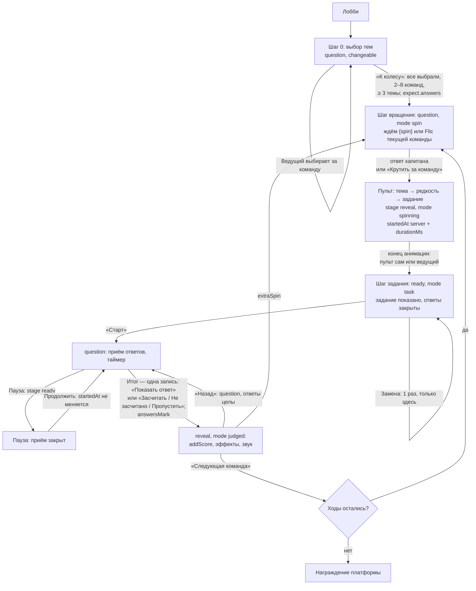

# Паспорт логики — Рулетка судьбы

> Перед правкой обязательны [`../LOGIC.common.md`](../LOGIC.common.md), этот паспорт, `roulette.test.ts` и `spin.test.ts`.

- Составлен: 28.11.2026, этап 0 (до кода), по `main` `95dc89de`. Версия 2 — после независимой проверки (23 находки).
- Основа: ТЗ Kimi v2.0 (`public/TZ.md` прототипа), ревью прототипа и ТЗ, разбор платформы, независимая проверка.
- Статус: **согласован владельцем 28.11.2026.** Этап 1 (модель, случайность, выбор тем, подключение) — в коде, игра
  скрыта от ведущих (`hidden.ts`). Решения, принятые при реализации, — раздел 14.
- Пометки: **[согласовано]** — решение владельца; **[предложение]** — моё решение спорного места, владелец может
  изменить до этапа 1; **[ТЗ: …]** — где и почему отступили от ТЗ.

## 0. Решения владельца (28.11.2026)

| Вопрос | Решение |
|---|---|
| Где считается результат вращения | **Пульт ведущего**, как во всех играх. Результат записывается в сессию до анимации |
| Очки за скорость | **Как в квизе**: самый быстрый верный — 100 %, ответ в последнюю секунду — 50 %, линейно |
| Скрытие ответов от телефонов на сервере | **Позже, отдельным этапом.** До этого скрыты интерфейсом, как в квизе |
| Конструктор | **Свой дизайн из прототипа**: светлый «бумажный» стиль, 5 разделов, «темы → задания → редактор» |
| Порядок работы | Этап 0 — паспорт, потом код по этапам с показом после каждого |

Согласовано также: «Назад» отменяет оценку, но не вращение; одна замена за ход; для каждого типа задано, кто
отвечает и кто получает очки; в колесе минимум 3 темы; от 2 до 8 команд; соседние секторы разного цвета, на секторе
короткая подпись; при отсутствии редкости веса пересчитываются; после сброса колоды последнее задание не выпадает сразу;
18+ фильтруется, а не блокирует запуск; поле «безалкогольная/безопасная замена»; без штрафа за отказ от напитка, 18+ и
спортивного задания; вращение кнопкой Flic; драматичное замедление с тиканьем и вибрация телефона капитана.

## 1. Что за игра

Командная игра. Капитаны выбирают темы, из выбранных тем собирается общее колесо на экране зала. Команды по очереди
крутят колесо: оно определяет тему, а пульт заранее выбирает задание этой темы с учётом редкости. Ведущий проводит
задание и начисляет очки. После всех кругов — общее награждение платформы.

- Обычная механика основного канала (`sessions.state`, запись пультом с `expect`), **не быстрая комната**.
- `supports: { teams: true, solo: false, noScreen: false }`.
- `ownAnswered: true` — счётчик «Ответили» пишет сама игра: только те, кто отвечает на текущем этапе (п. 3.4).
- `ownAward` не используется: общая кнопка «Наградить сейчас» доступна на `ready` и `reveal` (`canAwardNow`), то есть
  и во время вращения, и на «Задание показано», и на «Пауза». Досрочное награждение на этих этапах разрешено; «Назад»
  с заставки возвращает туда же (`podiumFrom`). Очки незакрытого хода при этом не начисляются.
- Очки пишет механика прибавкой `addScore`; `steps()` номинальный, `score()` пустой (как «Правда или действие»).

## 2. Ход по шагам платформы

**Р-1.** Каждый шаг платформы (`state.step`) даёт команде одно место для ответа (О-14). Поэтому:

- шаг 0 — **выбор тем**;
- каждый ход команды — **два шага**: шаг вращения и шаг задания. Ответ `{spin}` и ответ на задание не мешают
  друг другу. Дополнительное вращение (`extraSpin`) — ещё пара шагов.

**Р-2.** Этапы и что на них принимается:

| Этап | Шаг | `stage` | `result.mode` | Ответы | Таймер |
|---|---|---|---|---|---|
| Выбор тем | 0 | question, `changeable` | themes | `{themes, confirmed}` капитанов | нет (`timeLimit: null`) |
| Ждём вращения | вращения | question | spin | `{spin}` / кнопка Flic **текущей** команды | нет |
| Вращение | вращения | reveal | spinning | закрыты | нет |
| Задание показано | задания | ready | task | закрыты | нет |
| Приём ответов | задания | question | task | по типу задания (п. 3.4) | `startedAt: "server"`, `timeLimit` = секунды или `null` |
| Пауза | задания | **ready** | task + `pause` | закрыты сервером сразу | стоит; «+10 секунд» неактивна сама |
| Итог | задания | reveal | judged | закрыты | — |

Заставка перед заданием (`intro`, если включена) — только картинка на экране в первые ≈2 с этапа «Задание показано»;
на ход игры не влияет.

**Р-3.** `startedAt: "server"` ставят только две записи: вход в «Ждём вращения» и «Старт» задания. **«Продолжить»
после паузы `startedAt` не трогает** — меняет только `stage` и `timeLimit` (Р-19). Ответ, записанный раньше нынешнего
`startedAt`, пульт не учитывает, а сервер позволяет его перезаписать (`live.ts`, только на шагах без `changeable`).
Скорость считается от `startedAt` «Старта» минус паузы (Р-20).

## 3. Правила

### 3.1. Выбор тем (шаг 0)

- **Р-4.** Каталог содержит только **активные** темы, в которых есть хотя бы одно доступное задание с учётом
  настройки 18+ игры. Пустые темы капитаны не видят — тема без заданий не может попасть в колесо.
- **Р-5.** Каждая команда выбирает ровно столько тем, сколько указано в правилах (1 или 2), и подтверждает выбор.
  До «К колесу» выбор можно менять (шаг `changeable`). Лишнюю тему телефон выбрать не даёт; пульт берёт из ответа не
  больше разрешённого числа тем.
- **Р-6.** Ведущий может выбрать темы за команду: `choices[команда] = {themes, by: "host"}`. Более поздний ответ
  капитана заменяет выбор ведущего — до «К колесу».
- **Р-7.** «К колесу» доступно, когда у каждой команды есть выбор (ответ капитана или выбор ведущего), в очереди
  **от 2 до 8 команд** и в колесе **не меньше 3 различных тем**. Если тем меньше, ведущий добавляет темы из каталога.
  Запись «К колесу» несёт `expect.answers = answersMark` шага выбора тем: пришёл или сменился ответ — 409, пульт
  перечитывает выбор. **[согласовано]**
- **Р-8.** Девятая и следующие команды в очередь не попадают; пульт предупреждает ведущего. Сервер команды не
  ограничивает (общий лимит платформы 100), правки сервера нет. Ответы команд вне очереди (в том числе на заданиях
  «отвечают все») пульт не учитывает.
- **Р-9.** Секторы — объединение выбранных тем без повторов, в порядке каталога. Повторный выбор одной темы разными
  командами шанс не увеличивает. Очередь — порядок команд в таблице на момент «К колесу». Секторы не меняются до
  конца игры.
- **Р-10.** Опоздавшая команда встаёт в конец очереди и играет на уже собранном колесе, темы не выбирает
  (как опоздавшие в «Активной настолке»). **[согласовано]** Если в очереди уже 8 команд — Р-8.

### 3.2. Вращение (шаг вращения)

- **Р-11.** Крутит только текущая команда: ответ капитана `{spin: true}`, кнопка Flic этой команды (`{buzz: true}`,
  п. 5) или ведущий кнопкой «Крутить за команду». Ответы других команд на этом шаге пульт не учитывает.
- **Р-12.** Второе нажатие, второй пульт или одновременное нажатие капитана и ведущего не создают второго вращения:
  запись вращения идёт с `expect { step, stage, result }`, лишняя получает 409.
- **Р-13.** Случайность считает пульт. Для вращения по ответу капитана зерно — `answer.id + submittedAt` (время ставит
  сервер, `id` = шаг + участник), поэтому любой открытый пульт получит тот же результат. Для вращения ведущего зерно —
  `crypto.getRandomValues`. Из зерна генератор выдаёт **последовательность** чисел: тема, редкость, задание,
  угол, кривая замедления.
- **Р-14.** Запись вращения: `stage: "reveal"`, `mode: "spinning"`, `startedAt: "server"` и
  `spin = {id, themeId, taskId, rarity, angle, durationMs, curve}`. Конец анимации = `startedAt + durationMs`.
  Анимация — функция только от `(angle, durationMs, curve, время)`, без случайности на устройствах. Поэтому
  экраны, тиканье и перезагрузка посреди вращения показывают одно и то же.
- **Р-15.** После конца анимации пульт сам переводит игру на шаг задания (`ready`, `mode: "task"`). Запись несёт
  `expect {step, stage: "reveal", result}`. При 409 пульт перечитывает сессию и пишет снова, **только если игра всё ещё
  на `mode: "spinning"` того же шага** — иначе её уже перевёл второй пульт или ведущий. Конец анимации считается по
  часам сервера (смещение часов клиента). Ведущий может перевести кнопкой и сам — например, если вкладка пульта спит.
  Пауза перед открытием (≈1 с) входит в `durationMs`.

### 3.3. Отбор задания

- **Р-16.** Тема — равновероятно среди секторов. Эффект `chooseTheme` заменяет случайную тему выбором капитана (п. 3.6).
- **Р-17.** Отбор задания внутри темы — строго в таком порядке:
  1. активные задания, подходящие под 18+ игры;
  2. ещё не показанные в этой теме в этой игре; если таких нет — **колода темы сбрасывается** (только эта тема), но
     только что показанное задание исключается, если есть другое; **[согласовано]**
  3. на дополнительном вращении — без бонусов `extraSpin`;
  4. если прошлое задание **этой команды** было легендарным и запрет включён — без легендарных; **[предложение:
     область — команда]**
  5. редкость по весам (по умолчанию 60/30/10) **среди редкостей, которые остались в пуле**: веса пересчитываются.
     Если сумма весов оставшихся редкостей 0 — равновероятно; **[согласовано]**
  6. задание — равновероятно внутри выбранной редкости.
  Если после шагов 3 или 4 пул пуст, этот шаг отменяется, причина пишется в журнал (`extraSpinFallback`,
  `legendaryFallback`); пересчёт весов — `rarityFallback`.
- **Р-18.** Замена задания: **один раз за ход**, только на этапе «Задание показано» (до «Старта»). Новое задание —
  той же темы и **той же редкости**, если такая есть, иначе по Р-17. Так ведущий не может «поднять» редкость заменой.
  Заменённое задание считается показанным. **[согласовано: одна замена; предложение: та же редкость]**

### 3.4. Задание (шаг задания)

- **Р-19.** Таймер и пауза:
  - «Старт» пишет `stage: "question"`, `startedAt: "server"`, `timeLimit` = секунды задания (или `null` без таймера).
  - **Пауза** доступна, только пока таймер задан и ещё идёт. Она пишет `stage: "ready"` (сервер сразу закрывает приём,
    общая кнопка «+10 секунд» неактивна сама, потому что этап не `question`) и `pause = {at, leftMs}`. Ответы,
    принятые до паузы, остаются в силе.
  - **Продолжить** пишет `stage: "question"`, `startedAt` не трогает, `timeLimit = прошло + leftMs / 1000`, и добавляет
    паузу в `result.pauses`. Это продление не ограничено потолком 900 с (сервер лимит пульта не режет; после него
    общий «+10 секунд» берёт потолок 12 ч, О-12).
  - Вне паузы «+10 секунд» — общий механизм О-12.
  - После нуля таймера итог ведущему доступен; пауза после нуля и без таймера недоступна.
- **Р-20.** Время ответа для скорости = `submittedAt` − `startedAt` «Старта» − сумма пауз, закончившихся до
  `submittedAt`.
- **Р-21.** Карточку задания нельзя закрыть «просто так» и крутить заново: это не диалог, Escape и клик по фону её не
  закрывают. Ход закрывается только итогом. *(Ошибка прототипа: Escape, крестик и фон возвращали кнопку вращения.)*
- **Р-22.** Итог хода — **одна запись**, которая сразу закрывает приём (`stage: "reveal"`, `revealed: true`), несёт
  `expect` и `expect.answers = answersMark` шага задания (О-8) и начисляет очки `addScore`:
  - у автоматических типов это кнопка «Показать ответ» (очки по свежему списку ответов);
  - у ручных типов это «Засчитать / Не засчитано / Пропустить», которые нажимаются прямо на приёме ответов или после
    нуля таймера, — отдельного «Показать ответ» перед ними нет (ответ ведущий видит на пульте всё время).

**Кто отвечает и как считаются очки** **[согласовано]**:

| Тип | Кто отвечает | Итог |
|---|---|---|
| `task` — активное задание | Текущая команда выполняет | «Засчитать» — очки задания, «Не засчитано» — 0, «Пропустить» — Р-30 |
| `choice` — варианты 2–6 | Капитан текущей команды | Один правильный: выбран он — 100 %. Несколько правильных: режим «любой» — капитан выбирает **ровно один**, режим «все» — точное совпадение набора |
| `open` — открытый ответ | Капитан текущей команды | Сравнение как в квизе (`textMatches`) с одним из до 10 написаний; похожий ответ ведущий засчитывает вручную **[ТЗ §8.2: берём нормализацию квиза]** |
| `order` — порядок 3–6 | Капитан текущей команды | Полный — 100 %; частично (если включено) — `round(очки × верных позиций / всего)` |
| `pictures` — 2–4 картинки | Капитан текущей команды | `round(очки × угадано / всего)` |
| `speed` — на скорость | **Капитаны всех команд** | Только верные; как в квизе: самый быстрый 100 %, последняя секунда 50 %, линейно (Р-20) |
| `number` — угадай число | **Капитаны всех команд** | Как в квизе (`numberDeltas`): «ближайший» или «по местам» 100/60/30 %, точный +50 %. Ничьи — общее место (1, 1, 3) |
| `buzz` — кто первый | **Капитаны всех команд**, кнопки Flic | Первый нажавший отвечает вслух. Верно — очки задания; неверно — 0, ведущий открывает ответ или даёт попытку следующему. Шкалы «делений» нет **[ТЗ §8.7: перенесено из другой игры]** |
| `dance`, `karaoke` | Текущая команда выступает | Ведущий; или оценки 1–5 капитанов других команд: `round(очки × среднее / 5)` |
| `battle` — батл | Текущая команда и соперник | Соперник: выбирает капитан, ведущий или случайный (не повторяет прошлого, если есть другой). Решает ведущий, голосуют капитаны остальных команд (не за себя) или зал (личные голоса участников остальных команд). Победитель — очки задания. Ничья — ведущий выбирает победителя или «Поровну» (каждому половина, вниз). Нейтральных капитанов нет — решает ведущий. Голоса скрыты до закрытия **[согласовано: ТЗ §8.8 + вариант «Поровну»]** |
| `bonus` — бонус | Текущая команда | «Засчитать» включает эффект (п. 3.6), «Не засчитано» — без эффекта; очков само не даёт |

- **Р-23.** Кнопки итога: у ручных типов (`task`, `dance`, `karaoke`, `battle`, `bonus`) — «Засчитать / Не засчитано /
  Пропустить»; у автоматических (`choice`, `open`, `order`, `pictures`, `speed`, `number`) — «Показать ответ»;
  у `buzz` — «Верно / Неверно» по каждой попытке, итог — по последней. После итога у всех есть «Свои очки»: они меняют
  итог только на разницу; ручной зачёт похожих ответов `open` — тоже после итога, разницей.
- **Р-24.** Округление одно на всю игру: **после всех множителей, половина — от нуля** (2,5 → 3; −2,5 → −3).
- **Р-25.** Очки начисляются ровно один раз: `addScore` с `expect`; итоговая запись несёт отметку списка ответов (Р-22).
- **Р-26.** Изменение «очков редкостей» в конструкторе меняет только значения по умолчанию для новых заданий; свои
  очки заданий не затираются. *(Ошибка прототипа: смена редкости затирала очки.)*

### 3.5. 18+, напитки, спорт, отказ

- **Р-27.** Режим 18+ — настройка игры, копируется в сессию при запуске (О-2) и посреди сессии не меняется. Задания 18+
  при выключенном режиме **не блокируют запуск, а не попадают в пул**; темы без доступных заданий скрыты (Р-4).
  **[согласовано; ТЗ §20 и §21 противоречили друг другу]**
- **Р-28.** У задания есть отметки `adult`, `alcohol`, `sport` и текст безопасной замены `alt` («Безалкогольная
  замена» / «Безопасная замена»). Задание с `alcohol` или `sport` без `alt` не проходит проверку. Замена показывается
  на экране вместе с заданием. **[согласовано]**
- **Р-29.** «Не засчитано» — 0 без штрафа.
- **Р-30.** «Пропустить» = отказ: 0; штраф за отказ — необязательная настройка игры, по умолчанию выключена, и
  **никогда не применяется** к заданиям с `adult`, `alcohol`, `sport` или `alt`. `freePass` снимает штраф. **[согласовано]**

### 3.6. Бонусы

Эффект хранится в `result.effects`: `id`, команда, вид, состояние `active / consumed / cancelled`. Повторный итог и
«Назад» не включают эффект второй раз. Эффекты действуют **только на задания своего хода** (не на «отвечают все» в
чужой ход). В конце игры активные эффекты сгорают; у удалённой команды — `cancelled`.

| Эффект | Когда | Правило |
|---|---|---|
| `extraSpin` | Сразу после хода | Та же команда крутит ещё раз (ещё пара шагов). Не считается в ходы круга. Цепочек нет (Р-17 п. 3) |
| `doubleNext` | Следующее задание своего хода | ×2 к итогу |
| `doubleOrNothing` | Перед следующим заданием своего хода | Капитан решает, рискнуть ли. Успех ×2; неудача — минус очки задания (с учётом других множителей), но не больше счёта, который видит пульт; фактическое вычитание хранится для «Назад». **[согласовано; в ТЗ неудача давала 0 — риска не было]** |
| `chooseTheme` | Следующее вращение своей команды | Капитан выбирает одну из **своих** тем; колесо анимируется к этой теме; дальше Р-17 |
| `freePass` | Один раз до конца игры | Снимает штраф за «Пропустить» |

- **Р-31.** Множители перемножаются, не больше ×4.
- **Р-32.** `randomOpponent` из ТЗ — **не бонус, а настройка батла** («соперник: случайный»). **[предложение]**
- **Р-33.** В первой версии (MVP) — только `extraSpin`; остальные — на этапе 7.

### 3.7. Звук и медиа

- **Р-34.** Звучит один источник. Видео глушит трек. На время вращения музыка приглушается — звучит тиканье.
- **Р-35.** После «Засчитать» (или верного итога автоматического типа): музыка на ответ → иначе припев основного трека
  → иначе стандартный звук верного ответа. После «Не засчитано» — стандартный звук. Музыка на ответ во время приёма
  ответов не играет. Конфетти — по верному итогу, если включено. **[ТЗ §12.5 уточнён]**
- **Р-36.** Затухания, припев и переход работают **в игре**, а не только в конструкторе (`core/clip.ts`,
  `TrackTimeline`, `useFragment`). Сумма затуханий не длиннее отрывка.
- **Р-37.** Картинки, видео и треки — только через медиатеку платформы (id; не `blob:` и не base64 в игре). Локальное
  видео экрана — `localVideo`; если файла нет на этом устройстве, экран просит выбрать его заново.

## 4. «Назад»

- **Р-38.** «Назад» с итога хода снимает ровно начисленное (`addScore: −x`, для `doubleOrNothing` — фактическое
  вычитание), возвращает эффекты и пишет `stage: "question"`, `revealed: false`; **`startedAt` и `timeLimit` не
  меняются, ответы сохраняются** и при новом итоге считаются заново. Если время вышло — приём закрыт, ведущий может дать
  «+10 секунд» (О-12). **[согласовано]**
- **Р-39.** «Назад» со следующего хода — только пока он на «Ждём вращения» (`mode: "spin"`): возвращает итог прошлого
  хода. После вращения «Назад» недоступен до итога. На этапах «Вращение» и «Задание показано» кнопки «Назад» нет.
- **Р-40.** **Результат вращения «Назад» не отменяет никогда**: `played` (показанные задания) не откатывается. Иначе
  «Назад» стал бы перекруткой. **[согласовано]**
- **Р-41.** Снимок для «Назад» (`before`, `makeBefore` из `core/backStack.ts`) не содержит постоянных частей:
  `sectors`, `order`, `choices`, `played`, `log`. Возврат пишется **своей функцией**:
  `result = {...постоянные части текущего result, ...before.result}`, шаг − 1. Общий `beforeChange` не используется —
  он записал бы `before.result` целиком и стёр постоянные части. Глубина — сколько помещается в 24 000 знаков,
  минимум 1. Тесты: после «Назад» `sectors`, `order` и `played` на месте; размер при 15 темах × 20 заданиях, 8 командах.
- **Р-42.** «Назад» с первого хода к выбору тем — только до первого вращения.
- **Р-43.** При «Назад», который меняет шаг (Р-39), чистятся ответы только покидаемого шага хода, и только после записи
  шага назад (Н-3). «Назад» внутри шага (Р-38) ответы не чистит. Ответы шага выбора тем не чистятся никогда.

## 5. Экран, телефон, пульт

- **Экран зала:** выбор тем и готовность команд → колесо и текущая команда → вращение → задание (картинки, видео,
  замена `alt`, таймер) → голосование → ответ → итог → таблица → награждение. Ответ, заметка ведущему и музыка на ответ
  не показываются раньше времени.
- **Телефон капитана:** темы и подтверждение; кнопка «Крутить» (`disabled / ready / sending / spinning`); задание и
  поле ответа по типу; итог. **Вибрация при остановке колеса — где поддерживается (Android; в iOS Safari её нет)**,
  после первого касания страницы.
- **Телефон участника:** то же без кнопок команды; личный голос, где он предусмотрен (зал в батле).
- **Пульт:** готовность команд и выбор за команду, «К колесу», «Крутить за команду», замена, «Старт», пауза, +10 с,
  повтор трека, «Показать ответ», кнопки итога (Р-23), похожие ответы, заметка ведущему, таблица на экран, «Назад»,
  «Следующая команда». Если в игре меньше 2 команд — пульт предлагает «Наградить».
- **Колесо:** SVG, 4 стиля, 9 указателей (стрелка, бутылка, кинжал, меч, копьё, трезубец, ключ, скипетр, перо),
  длительность 2–8 с. Один сектор — круг. **Соседние секторы разного цвета, включая пару «последний — первый»**
  (при `n % 6 = 1` последний сектор берёт другой цвет). На секторе — короткая подпись темы, текст ужимается под ширину.
- **Драматичное вращение [согласовано]:** разгон, затем долгое неравномерное замедление по кривой из Р-14; тиканье на
  каждом проходе границы сектора, реже к концу; последний «щелчок» и пауза перед открытием задания. Звук синтезируется
  на экране зала (без файлов) после общего разблокирования звука экрана. Reduced motion — короткая остановка без
  долгого вращения, тиканье выключено.
- **Физические кнопки [согласовано]:** кнопка пишет общий ответ `{buzz: true}`. Ветка `roulette` в `core/hardware.ts`
  (правка общего кода, п. 10) разрешает его, когда `stage: "question"` и либо `mode: "spin"` и участник — текущая
  команда (пульт считает это вращением), либо `mode: "task"` и тип задания `spin.taskId` в снимке игры — `buzz`.
  В том же PR обновить раздел 11 `LOGIC.common.md` (сейчас там «кнопка принимается только на buzz-шаге»).

## 6. Конструктор (свой дизайн)

- Отдельный ленивый чанк `editor/lazy.tsx` с `ChunkGuard`, как у «Матрёшки».
- Корень `.fr-editor`, все классы с префиксом `fr-`. Внутри корня — «бумажная» палитра через переопределение токенов
  `--color-*`: общие поля и кнопки (`.btn`, `.btn--secondary`, `.btn--quiet`, высота ≥ 52 px) сами принимают этот
  вид. Контраст — по `themes/contrast.test.ts`. **Конструктор всегда светлый «бумажный», в любой теме студии
  (светлой и тёмной). [согласовано]**
- Разделы: **Содержание · Темы и задания · Редкость и шансы · Колесо и эффекты · Правила и очки**. «Темы и задания» —
  три зоны: темы → список заданий → редактор задания. Блоки медиа раскрываются по мере надобности.
- Сохранение, черновики, конфликты и «сервер отклонил» делает общая оболочка `GameEditor`.
- По событию `joyrest:reveal-issues` редактор сам открывает раздел, тему, задание и поле первой ошибки.
- **Правка общего кода:** флаг механики `wideEditor` → `GameEditor` даёт странице ширину 1100 px.
- Название, возраст и режим игры — в общей карточке «Настройки»; раздел «Содержание» показывает их сводку. Описание
  игры хранится в `content`.
- Настройки из ТЗ §13.2 сохраняются: заставка перед заданием (`intro`), таблица — после каждого хода / в конце круга /
  по кнопке (`boardMode`), картинки на телефонах (`phoneImage`), число кругов (`rounds`), тем на команду (1–2).
- Массовое добавление: `Название | текст | common/rare/legendary | очки`. Строгий разбор: неизвестная редкость,
  отрицательные или нечисловые очки, пустое название — ошибка строки; импорт только когда ошибок нет.
- Смена типа задания скрывает несовместимые поля, а не стирает (как `changeKind` в квизе).
- Поле ответов к картинкам хранит сырую строку и разбирает её при потере фокуса (в прототипе пробел не вводился).

## 7. Проверка игры перед запуском (`validate`)

Путь ошибки — `themes/{themeId}/tasks/{taskId}/{поле}`. Запуск закрыт, если: нет названия; сумма весов не 100; в
каталоге больше 15 тем; **меньше 3 активных тем с доступными заданиями с учётом настройки 18+**; пустой текст задания;
нет правильного варианта; меньше 2 вариантов или 3 карточек; пустой ответ у `open`; меньше 2 картинок у `pictures`;
нет числа у `number`; неподдерживаемая ссылка на видео; отрывок трека выходит за трек; `alcohol` или `sport` без `alt`.

Не проверяется на запуске (это состояние сессии): выбор тем командами и число команд — кнопка «К колесу» (Р-7).

## 8. Что хранится в сессии

`state.result` — **только id**, чтобы рассылка оставалась лёгкой при 50–100 гостях:

- постоянные: `choices` {команда: {themes, by}}, `sectors`, `order`, `rounds`, `played` {тема: [задания]}, `log`
  (последние 20 записей);
- ход: `mode`, `turn` {номер, круг, команда, extra}, `spin` {id, theme, task, rarity, angle, durationMs, curve,
  replaced}, `lastRarity` {команда: редкость}, `effects`, `pause`, `pauses`, `judged` {очки по командам, вычитание};
- `before` — снимок для «Назад» без постоянных частей (Р-41).

Колода — в снимке игры (`gameSnapshot`). Отдельной таблицы журнала в MVP нет.

## 9. Круги, состав команд, крайние случаи

- **Круг** — каждая команда очереди на начало круга (плюс опоздавшие по Р-10) сходила по разу; доп. ход не считается.
  Игра кончается после круга `rounds`.
- Текущую команду удалили посреди хода → ход закрывается без очков, дальше следующая команда; её эффекты `cancelled`.
- Удалили соперника в батле → ведущий выбирает другого соперника или закрывает задание без очков.
- Осталась одна команда → пульт предлагает «Наградить».
- Две команды и батл со «случайным соперником» → соперник всегда тот же (повтор разрешён, другого нет).
- Капитан сменился посреди хода → безопасно: ответ хранится по команде.
- Капитан молчит → роль передаётся через 90 с (О-22); ведущий крутит за команду.
- Два пульта → 409 у лишней записи, одно вращение (Р-12).
- Экран перезагрузили посреди вращения → та же анимация с того же места (Р-14).
- Тема исчерпана → сброс только этой темы без немедленного повтора (Р-17 п. 2).
- В теме остались только легендарные, прошлое было легендарным → легендарное, `legendaryFallback`.
- Локальное видео не найдено на экране → понятное сообщение и выбор файла.

## 10. Где в коде (план)

| Файл | Что |
|---|---|
| `content.ts`, `validate.ts` | Модель, `create`, `parse` (без исключений, замена старых указателей `cupid/zeus/target`), проверка — **этап 1** |
| `spin.ts` | Генератор из зерна, отбор темы, редкости и задания (Р-13, Р-16…Р-18), угол и анимация колеса — чистые функции — **этап 1** |
| `logic.ts` | Шаги и этапы (п. 2), выбор тем, очередь, итог, эффекты, пауза, «Назад» — **этап 1: выбор тем, «К колесу», очередь, «Назад» к темам** |
| `HostControls.tsx`, `views.tsx` | Пульт, экран зала, телефоны |
| `Wheel.tsx`, `pointers.tsx`, `tick.ts` | Колесо, кривая вращения, стили, указатели (дизайн из прототипа), тиканье |
| `editor/` | Свой конструктор (`lazy.tsx`, `Editor.tsx`, разделы, `editor.css`) |
| `preview.ts`, `demo.ts` | Предпросмотр и шаблон на 12 тем |
| `roulette.test.ts`, `spin.test.ts` | Тесты |
| **Общий код** | `registry.ts`, `categories.ts`, `core/rules.ts`, `core/guide.ts`, `core/editorGuide/roulette.ts`; флаг `wideEditor` в `types.ts` и `screens/studio/GameEditor.tsx`; ветка `roulette` в `core/hardware.ts` + тест |

## 11. Ошибки прототипа Kimi и как они закрыты

| Ошибка прототипа | Чем закрыта |
|---|---|
| Прогресс терялся при уходе с экрана | Состояние в сессии на сервере (п. 8) |
| Escape, крестик и фон давали перекрутку | Р-21 |
| Повторы после исчерпания колоды | Р-17 п. 2 |
| Замена после старта таймера, без лимита, редкость заново | Р-18 и этап «Задание показано» в сессии (п. 2) |
| localStorage переполнялся картинками | Р-37, медиатека платформы |
| `blob:`-ссылки умирали после перезагрузки | Р-37 |
| Звук в игре без припева и затуханий | Р-35, Р-36 |
| Колесо из одной темы пустое | Р-7 и п. 5 (один сектор — круг) |
| Подписи секторов налезали, соседние одного цвета | п. 5 |
| Пустую тему можно было выбрать | Р-4 |
| Импорт молча принимал ошибки | п. 6 |
| Пробел в ответах к картинкам | п. 6 |
| Невидимые надписи кнопок таймлайна | Общие кнопки платформы + `contrast.test.ts` |
| Фокус терялся после вращения | Фокус в карточку задания, возврат на кнопку (проверка клавиатурой) |
| Таймер на посекундных тиках | Р-19 (`startedAt` + `timeLimit`) |

## 12. Открытые вопросы владельцу

Все закрыты 28.11.2026: опоздавшая команда играет на готовом колесе (Р-10); `doubleOrNothing` — неудача минус очки
задания, счёт не ниже 0 (п. 3.6); ничья в батле — ведущий выбирает победителя или «Поровну» (п. 3.4); конструктор
всегда светлый «бумажный» (п. 6). Остаются **[предложение]**: область правила «два легендарных подряд» — команда
(Р-17 п. 4), замена задания — той же редкости (Р-18), `randomOpponent` — настройка батла (Р-32).

## 13. Проверка паспорта

- 28.11.2026 — независимая проверка версии 1: 23 находки (4 высокие, 10 средних, 9 низких). Все внесены в версию 2:
  этапы хода по шагам платформы (п. 2), пауза через обрезку `timeLimit` (Р-19), «Назад» без отката вращения и без
  постоянных частей в снимке (Р-39…Р-41), порядок отбора задания (Р-17), итоги хода (Р-23, Р-29, Р-30), круги и состав
  команд (п. 9), правки общего кода (п. 10).
- 28.11.2026 — повторная проверка версии 2: 20 прежних находок закрыты, 3 частично; 10 новых точечных (2 высокие).
  Все внесены: «Продолжить» не трогает `startedAt` (Р-3), пауза через `stage: "ready"` (Р-19, без правки общего кода),
  свой возврат снимка (Р-41), «Назад» с итога без смены времени (Р-38), итог — одна запись (Р-22, Р-23), автопереход
  без перескока шага (Р-15), досрочное награждение (п. 1), условия кнопки Flic (п. 5), мелочи (Р-8, Р-20, `intro`).
  Проверяющий: после этих правок паспорт можно отдавать в этап 1 без ещё одного полного круга.
- Дальше: по ходу кода — тест на каждое правило, предпросмотр от начала до награждения, нагрузка на 50 гостей в
  командах, отметка «проверено в браузере / на test».

## 14. Решения при реализации

### Этап 1 (28.11.2026, ветка `claude/roulette`)

Сделано: `content.ts`, `validate.ts`, `spin.ts`, `logic.ts` (шаг 0 и «К колесу»), простые экран, телефон и пульт
выбора тем, предпросмотр (`preview.ts`: выбор тем и сборка колеса), временная сводка вместо конструктора, шаблоны «Рулетка судьбы» и «… 18+» (12 тем), регистрация (скрыта),
инструкции, правила для слайда. Тесты: `roulette.test.ts`, `spin.test.ts`.

Независимая проверка этапа 1 (28.11.2026): высоких находок нет, 4 средние и 8 низких — все исправлены или записаны
ниже (выбор ведущего со второго пульта, «Снять выбор», окно выбора при отказе, телефон по сессии, замена при сбросе
колоды, команды сверх восьми, повтор при сбое сети, тесты).

Уточнения паспорта (не меняют согласованных правил):

- **Очередь (Р-9)** — команды по времени входа, потом команды без телефона в порядке таблицы. «Порядок в таблице» при
  нулевых очках — это алфавит, поэтому взят порядок входа (как в «Правде или действии»).
- **Выбор ведущего и капитана (Р-6).** У выбора есть `at`: у капитана — время его ответа, у ведущего — время
  последнего ответа капитана, который видел пульт. Ответ капитана новее `at` заменяет выбор. «Изменить» у капитана и
  «Снять выбор» у ведущего пишут запись с пустым списком тем и той же отметкой: команда не готова, и старый ответ
  (в том числе у второго пульта, который его ещё видит) готовность не вернёт — вернёт только новый ответ капитана.
  Темы выбора — в порядке каталога.
- **Очередь на шаге выбора тем** — `result.queue` (первые 8 команд по времени входа): по ней экран показывает
  команды, телефон команды сверх восьми пишет, что она в этой игре не участвует, «Ответили» считает только её.
- **«К колесу»** несёт и сверку ответов (`expect.answers`), и отпечаток итогов (`expect.result`): выбор ведущего и
  его темы со второго пульта — не ответы, их ловит отпечаток. Колесо уже собрал второй пульт — пульт молчит.
- **Телефон капитана** показывает выбор по сессии, когда он важнее памяти телефона: выбор ведущего (сделан или снят),
  своего ответа нет (после «Назад к выбору тем» или перезагрузки).
- **Записи пульта на выборе тем** («За команду», «+ тема», «Назад к выбору тем») строятся по свежей сессии; отказ 409 —
  ждать новую сессию и построить заново (до трёх раз), потом «Игра изменилась — нажмите ещё раз». Окно выбора за
  команду закрывается только после записи. «+ тема» — явное «добавить/убрать»: повтор не переключает обратно.
  Перенос выбора в сессию при сбое сети повторяется через 3 с.
- **Темы ведущего (Р-7)** — постоянная часть итогов `added` (как `choices`, `sectors`): секторы = темы команд
  очереди ∪ `added` в порядке каталога.
- **Пульт пишет выбор в сессию** (`syncThemes`) с отпечатком итогов `expect.result`: экран видит готовность команд,
  выбор ведущего со второго пульта не затирается; «Ответили» — число команд с выбором (`ownAnswered`).
- **`spin` в сессии** — поля `themeId`, `taskId` (в п. 8 сокращённо `theme`, `task`).
- **Генератор** — cyrb128 + sfc32; из зерна по порядку: тема, редкость, задание, отступ в секторе, кривая. Угол —
  `3 + spinSeconds` полных оборотов и точка внутри сектора (15–85 % ширины, не на границе); `durationMs` =
  `spinSeconds` + 1 с паузы. `deckReset` пишется в журнал вместе с остальными причинами.
- **Число кругов** берётся из снимка игры (`content.rounds`, О-2 — посреди сессии не меняется), в `result` его нет.
- **Замена при сброске колоды (Р-18):** заменённое задание остаётся показанным и в новой колоде.
- **Проверка (п. 7)** смотрит только задания, которые могут выпасть: включённые, во включённой теме, подходящие под
  18+. Предел 15 тем — для каталога (выключенные и пустые темы можно держать про запас). Отрывок в пределах длины трека проверяет конструктор (длина известна после загрузки трека); `validate` — что
  затухания не длиннее отрывка. Бонусы, кроме «Ещё вращение», до этапа 7 не проходят проверку (Р-33).
- **Модель:** время 0 — без таймера (иначе 5–900 с); настройки прототипа «без повторов» и «безалкогольный режим» убраны
  (повторов нет всегда, Р-17; замена — поле `alt` у задания); «картинки на телефонах» — одна настройка игры.
- **Не покрыто автотестом:** порядок «сначала запись шага назад, потом очистка ответов» (Н-3) в пульте — проверен
  глазами и в браузере; функции хода покрыты.
- **Раздел библиотеки** — «Приключения и настолки» (рядом с «Активной настолкой»). **[предложение]**
- **На этап 2 (открытый вопрос, решу при «Назад» хода):** после «Назад» на прошлый ход (Р-39) сервер даёт только
  `startedAt: null`, поэтому повторный «Назад» с итога (Р-38) вернёт приём ответов без таймера, а скорость пульт
  посчитает по сохранённому в итогах времени «Старта». Проверю тестом вместе с итогом хода.
