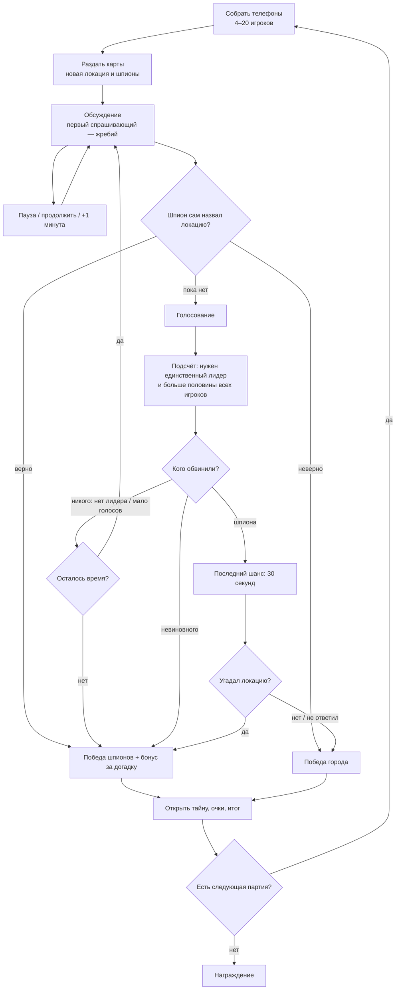

# Паспорт логики — Шпион

> **Эталон.** Этот файл описывает раздачу тайных карт, обсуждение, догадку шпиона, голосование, очки и партии.
> Перед правкой обязательны [`../LOGIC.common.md`](../LOGIC.common.md), этот паспорт и `spy.test.ts`. Намеренное изменение
> правил фиксируется здесь в том же PR. Указатель паспортов — [`../LOGIC.md`](../LOGIC.md).

- Составлен: 18 ноября 2026, по `main` `8f486f6ab7809045129e229c3f451faa6f484b9c`.
- Статус: исходный паспорт по коду и существующим тестам; новых дефектов не заявлено.
- Входит: колода локаций, шпионы, ключи и шифрование, таймер, голосование, последний шанс, очки, партии, «Назад».
- Не входит: общая доставка SSE, внешний вид карточек, внутренние правила других игр.

## 1. Что за игра

По мотивам Spyfall: все игроки, кроме шпионов, знают локацию и свою роль. Шпионы по вопросам пытаются понять место; город
пытается вычислить шпиона. Игроки по очереди задают друг другу вопросы, затем голосуют. Шпион может сам назвать локацию
во время обсуждения или использовать последний шанс после обвинения.

- Только `solo`, 4–20 игроков.
- Один шпион по умолчанию; с 11 игроков — двое.
- Можно принудительно задать 1 или 2 шпиона, но не больше трети игроков и минимум один.
- 1–10 партий; очки накапливаются.
- Обсуждение 3–15 минут, голосование 15–120 секунд, последний шанс — 30 секунд.
- 24 локации по умолчанию, у каждой 6–8 ролей; редактор допускает 6–40 локаций и до 10 ролей у каждой.
- Названия и роли до 40 символов.

`spySteps()` и `score()` пусты: обычных вопросов механики нет. Очки записываются в конце партии. `ownPeek` и `ownAward`
отключают общую таблицу и общую кнопку награждения посреди партии.

## 2. Тайная и публичная модель

### `SpySecret` — тайна партии

- `location` — индекс локации в колоде;
- `spies` — `pid` шпионов;
- `roles` — роли не-шпионов.

Хранится в `hostSeal`, зашифрованном ключом исходного пульта, а в конце партии появляется в публичном `reveal`.

### `SpyCard` — личная карта

У не-шпиона: место, локация, название места и роль. У шпиона: `spy = true`, локация `null`, название и роль пустые.

- Карта шифруется ключом телефона в `sealed[pid]`.
- Все карты одной длины в байтах UTF-8, чтобы шпиона нельзя было выделить размером шифра.
- Телефон создаёт AES-GCM-ключ на раздаче; ответы с ключами видит только пульт.
- Ключ телефона хранится локально; ключ пульта — `joyrest.spy.host.<sessionId>`.
- Чужой ключ не открывает карту.

### Второй пульт

`secretFromCards` восстанавливает тайну по картам телефонов. Если хотя бы один игрок без телефона, `complete = false`.
На таком пульте действия, требующие полной тайны, блокируются: итог партии нужно вести с исходного устройства.

## 3. Блок-схема партии



Досрочное завершение из любой активной фазы открывает тайну без победителя и очков; его можно отменить «Назад».

## 4. Колода и раздача

`playable(content)` возвращает только локации с непустым названием и хотя бы одной непустой ролью.

`dealSecret`:

1. Берёт несыгранные в этой игре локации (`used`).
2. Если сыграны все, берёт любую, кроме прошлой; если доступна только одна — её.
3. Тасует игроков и выбирает шпионов по `spiesFor`.
4. Тасует роли локации и раздаёт не-шпионам по кругу; если игроков больше ролей, роли повторяются.
5. Сохраняет индекс локации, а не только название: догадка сравнивается по индексу.

Правило числа шпионов:

```text
auto: 1; при players ≥ 11 → 2
ручной выбор: 1 или 2
итог ограничен min(выбранное, floor(players / 3) || 1), минимум 1
```

Места — по `joinedAt`, добавленные ведущим без фактического участника — в конце по `pid`. Кнопка старта проверяет диапазон
4–20. После итога `startDeal` увеличивает партию, создаёт новый шаг, сохраняет очки и `used`.

## 5. Обсуждение и его таймер

`startTalk`:

- создаёт новый шаг с `stage = question`, но `timeLimit = null`: шпион может присылать догадку весь период;
- выбирает первого спрашивающего случайно из мест;
- ставит `talkEndsAt = now + roundMinutes × 60 000` по серверному времени;
- сохраняет `undo`.

`pauseTalk` переводит текущий остаток в `talkLeft`, убирает `talkEndsAt`, ставит `paused = true`.
`resumeTalk` ставит новый `talkEndsAt = now + talkLeft`.
`addMinute` добавляет 60 секунд к текущему остатку, включая состояние после 0; на паузе меняется `talkLeft`.

Таймер не завершает партию автоматически. Ведущий запускает финальное голосование или явно выбирает «Время вышло — шпион
побеждает» после нерешённого голосования.

## 6. Догадка шпиона во время обсуждения

`pendingGuess`:

- смотрит только ответы текущего шага;
- принимает только `pid` настоящих шпионов;
- принимает только целый индекс существующей playable-локации;
- сортирует по `submittedAt` и выбирает первую валидную догадку.

Пульт видит, кто и что назвал, и запускает `resolveGuess`:

- индекс совпал с секретным — шпионы, причина `guess-right`;
- не совпал — город, причина `guess-wrong`.

Для шпиона без телефона ведущий выбирает локацию вручную и подтверждает завершение.

## 7. Голосование

`startVote`:

- создаёт новый шаг и таймер `voteSeconds`;
- останавливает обсуждение, сохраняя остаток в `talkLeft`;
- разрешает менять голос (`changeable = true`);
- очищает прежний итог.

`tallyVotes`:

- принимает один голос от игрока за столом;
- не принимает голос за себя или за того, кто не за столом;
- считает `cast` только валидные голоса;
- обвиняет только единственного лидера, если его голоса строго больше половины **всех игроков за столом**.

Формула кода: `max > 0`, один лидер, `max × 2 > cast`, `max × 2 > seats.length`. Второе условие делает правило строго
больше половины состава, даже если часть игроков воздержалась.

`verdict` открывает таблицу голосов. Если обвиняемого нет:

- при остатке времени — `continueTalk`, новый шаг обсуждения с сохранённым остатком;
- если времени нет — `timeUp`, победа шпионов.

## 8. Обвинение и последний шанс

`openAccused` раскрывает карту обвиняемого:

- невиновный — немедленная победа шпионов, причина `innocent`;
- шпион — новый шаг `last`, 30 секунд, `accusedSpy = true`, тайный ответ уже не меняется.

`resolveLast` сравнивает догадку обвинённого с локацией:

- угадал — шпионы, причина `caught-right`;
- ошибся или не ответил — город, причина `caught-wrong`.

Для шпиона без телефона ведущий вводит ответ вручную. Попытка принять ответ другого игрока в эту функцию не входит:
используется только `pid` обвинённого.

## 9. Очки и итоги

`partyPoints` записывает очки каждому месту:

- город победил: каждому не-шпиону `townPoints`, шпионам 0;
- шпионы победили: каждому шпиону `spyPoints`;
- шпион, который сам сделал правильную догадку, получает ещё `guessBonus`;
- досрочное завершение: всем 0.

`finishParty` добавляет очки к прежнему `score`, ставит `last = delta`, открывает `reveal`, сохраняет причину, догадку и
локацию в `used`. Локация добавляется один раз.

Типы причин:

| Причина | Смысл |
|---|---|
| `guess-right` | Шпион сам назвал локацию верно |
| `guess-wrong` | Шпион сам назвал неверно |
| `caught-right` | Шпиона обвинили, но он использовал последний шанс |
| `caught-wrong` | Шпиона обвинили, локация не названа верно |
| `innocent` | Город обвинил невиновного |
| `time` | Время кончилось без согласия города |
| `abort` | Партия остановлена, победителя и очков нет |

После последней партии — награждение по накопленному счёту. Можно сыграть дополнительную партию после последней.

## 10. «Назад»

`undo` хранит один переход. `spyBack`:

- возвращает прежние `step`, `stage`, `result`;
- очищает ответы покинутого шага, если шаг изменился;
- при возврате на шаг `question` снова разрешает приём ответов;
- после итога вычитает записанные `points` из очков и обнуляет `last`;
- снимает `reveal`, потому что восстанавливается прежний результат;
- устанавливает `undo = null`, поэтому дальше одного действия не уходит.

Отдельно работает общий возврат пьедестала.

## 11. Инварианты

- **Ш-1.** Игра только `solo`; старт разрешён при 4–20 игроках.
- **Ш-2.** В партии минимум один шпион и не больше трети игроков.
- **Ш-3.** Локация и шпионы выбираются случайно; не-шпионы получают роли выбранной локации.
- **Ш-4.** Пока есть несыгранные локации, повторов нет; после полного цикла следующая не равна прошлой, если есть выбор.
- **Ш-5.** Карта шпиона не содержит локацию и роль.
- **Ш-6.** Публичное состояние не раскрывает `SpySecret` до итога.
- **Ш-7.** Все личные карты одной длины шифра внутри раздачи.
- **Ш-8.** Догадка принимается только от шпиона и только для существующей локации.
- **Ш-9.** Первая догадка на шаге определяется по серверному `submittedAt`.
- **Ш-10.** Пауза не уменьшает остаток обсуждения; продолжение начинается с сохранённого остатка.
- **Ш-11.** Голосование останавливает обсуждение и сохраняет его остаток.
- **Ш-12.** Обвинение требует единственного лидера и строго больше половины всех мест.
- **Ш-13.** Голос за себя, чужого вне стола и повторный голос не засчитываются.
- **Ш-14.** Обвинение невиновного сразу приносит победу шпионам.
- **Ш-15.** Обвинённый шпион получает один последний шанс на новом шаге.
- **Ш-16.** Отсутствие согласия после окончания времени приносит победу шпионам.
- **Ш-17.** Правильная собственная догадка даёт бонус только её автору-шпиону.
- **Ш-18.** Досрочное завершение не даёт очков.
- **Ш-19.** Новая партия сохраняет накопленные очки и список сыгранных локаций.
- **Ш-20.** Возврат с итога снимает ровно очки этой партии.
- **Ш-21.** Возврат очищает ответы покинутого шага.
- **Ш-22.** Второй пульт с неполной тайной не выполняет итоговые действия, требующие полной тайны.

## 12. Крайние случаи

- Меньше ролей, чем не-шпионов: роли повторяются, игра не ломается.
- Все локации сыграны: разрешён новый цикл без повтора прошлой, если возможно.
- Ровно половина голосов: обвинения нет.
- Несколько лидеров: обвинения нет.
- Часть игроков не голосовала: лидер всё равно должен набрать больше половины всех мест.
- Шпионов двое: очки получает каждый, бонус — только автор правильной догадки.
- Шпион молчит в последнем шансе: город побеждает.
- Игрок без телефона: ведущий показывает карту и вводит его голос/догадку, но второй пульт без него имеет неполную тайну.
- Досрочная остановка и последующий «Назад»: очки не появляются и не исчезают повторно.

## 13. Где это в коде

| Место | Ответственность |
|---|---|
| `content.ts` | Колода, лимиты, число шпионов, настройки |
| `validate.ts` | Минимум локаций, повторы, роли и число партий |
| `logic.ts` | Раздача, фазы, догадки, голоса, очки, возврат |
| `deal.ts` | AES-ключи, шифрование и восстановление тайны |
| `HostControls.tsx` | Пульт, ручной ввод, проверка полноты тайны |
| `views.tsx` | Экран и телефон |
| `spy.test.ts` | Колода, шифрование, голоса, все исходы, партии и возврат |
| `preview.ts` | Автоматический предпросмотр |

## 14. Что не проверено

- Новый дефект не заявлен: паспорт фиксирует существующее поведение, а не независимый полный аудит.
- Реальный браузер, телефоны, второй пульт и обрывы сети в этой работе не запускались.
- Визуальная проверка 20 игроков, длинных названий и режима без экрана не выполнялась.
- Взаимодействие с вечером из блоков требует совместной проверки `storeScope`: ручные голоса и догадки имеют разные ключи у разных блоков.

## 15. Проверка паспорта

Минимум:

- `npx vitest run src/mechanics/spy/spy.test.ts`;
- полный путь с самостоятельной догадкой, невиновным, последним шансом и истёкшим временем;
- два шпиона, границы 4/10/11/20 игроков;
- голосование: единственный лидер, ровно половина, ничья, воздержание, голос за себя;
- пауза и продолжение, `+1 минута`, повторное обсуждение после ничьей;
- свой/чужой телефон, игрок без телефона, исходный и второй пульт;
- «Назад» из итога, голосования и следующей партии;
- несколько партий без повтора локаций.
