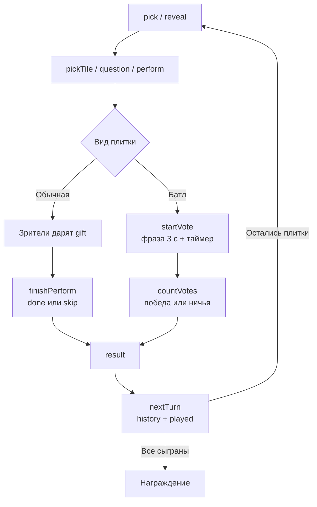

# Паспорт логики — Танцуй как звезда / Караоке на поле

> Перед правкой обязательны [`../LOGIC.common.md`](../LOGIC.common.md), этот паспорт, `stage.test.ts` и `back.test.ts`.

- Составлен: 19.11.2026 по `main` после `1e6dd753`.
- Проверка: **10/10 тестов**; новых подтверждённых дефектов не найдено.
- Браузер, PostgreSQL, два реальных пульта и test/production отдельно не проверялись.

## 1. Правила

Командная игра на поле категорий и стоимостей. Ведущий выбирает плитку за текущую команду. Плитки содержат состав
выступающих (до пяти человек), видео YouTube/VK/Rutube, локальный файл или серверное видео.

Обычное выступление: «Выступили» даёт очки плитки и зрительскую симпатию, «Не вышли» — ноль. Каждая другая команда
может подарить один раз; даритель платит только имеющиеся очки и не уходит в минус, а выступающий получает подарок полностью.

Батл: две команды, голоса телефонов зрителей; стороны батла не голосуют. Победитель получает очки плитки, ничья или
отсутствие голосов — поровну. Ведущий может исправить исход с пересчётом разницы.

По умолчанию батлы закрыты, пока каждая команда не выступила хотя бы раз. Ведущий может открыть их раньше; когда
обычные плитки закончились, ограничение снимается само.

## 2. Схема

## 3. Экран, телефон, пульт

- **Экран:** поле, переворот плитки, видео, полный экран, подарки, голоса и исход.
- **Телефон:** `{ gift: true }` на выступлении и `{ vote: pid }` на батле. В командах голосует каждый телефон как
  игрок; ответ «за команду» не дублирует голос капитана. Голос можно менять до закрытия.
- **Пульт:** плитка, соперник, плеер (play/pause/±10/stop), полный экран, ручной исход, досрочное открытие батлов,
  жеребьёвка первого хода и «Назад».

Видео YouTube/Rutube поддерживает управление, VK — без управления. Реальные ролики в аудите не запускались.

## 4. Инварианты

- **С-1.** Сыгранная плитка не выбирается повторно без возврата.
- **С-2.** Подарок принимается один раз от стороны и не от выступающих/соперника.
- **С-3.** Даритель не уходит ниже нуля; возврат восстанавливает и получателя, и дарителя.
- **С-4.** Стороны батла не голосуют; один телефон — один действующий голос.
- **С-5.** Ничья делит очки поровну с округлением вниз; смена исхода применяет только разницу.
- **С-6.** «Не вышли» не отмечает команду как выступившую для открытия батлов.
- **С-7.** `history` ограничена 30 ходами и примерно 24 КБ; «Назад» не стирает сыгранное без восстановления очков.
- **С-8.** Каждая команда видео увеличивает `n`; новый ход сбрасывает плеер и голоса.
- **С-9.** «Назад» снимает именно очки текущего исхода и очищает ответы отменённого шага.

## 5. «Назад» и связи

Из выступления — другая плитка с очисткой подарков шага; из голосования — к выступлению; из результата — снимаются
очки и открывается perform/vote. Из выбора — предыдущий результат через `history`, `played` и `done` восстанавливаются.
С пьедестала — общий возврат.

Связь: `content.ts`/`validate.ts`/`Editor.tsx` → `gameSnapshot` → `HostControls.tsx`/`logic.ts` → общий сервер и
таблица. `index.ts` включает `ownAnswered`, оформление и жеребьёвку. Общий `score()` пустой; очки пишет механика.

## 6. Код и проверка

| Файлы | Ответственность |
|---|---|
| `content.ts`, `who.ts`, `validate.ts` | Плитки, составы, настройки |
| `logic.ts` | Выступления, подарки, батлы, история |
| `video.ts` | Источники и возможности плеера |
| `HostControls.tsx`, `views.tsx` | Пульт, телефон, экран |
| `stage.test.ts`, `back.test.ts` | 10 тестов |

Подтверждены составы, подарки без минуса, блокировка батлов, возврат `done`, голоса, ничья, поправка победителя,
плеер, ссылки, шаблоны, мусорный parse и репетиция без команд. Не проверены реальные видео, длинная история 30+,
два пульта, PostgreSQL и мобильная вёрстка.

**Итог:** логика принята по 10 тестам; новых находок нет. Полный браузерно-серверный статус не присваивается.
