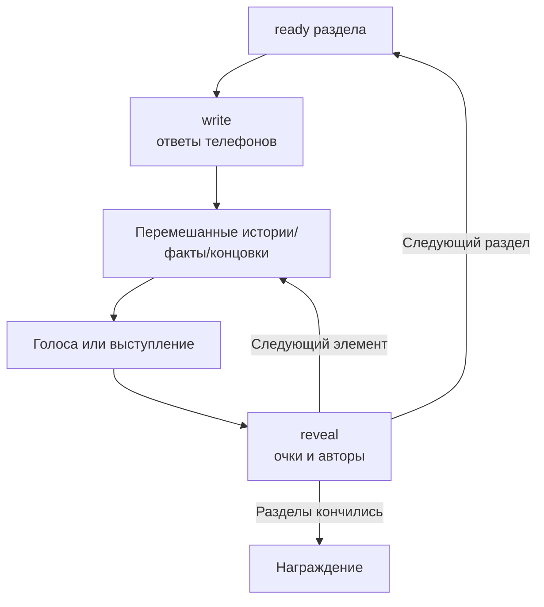

# Паспорт логики — Давайте знакомиться

> Перед правкой обязательны [`../LOGIC.common.md`](../LOGIC.common.md), этот паспорт и `story.test.ts`.

- Составлен: 19.11.2026 по `main` после `1e6dd753`.
- Проверка: **12/12 тестов**; ДЗ-Н-1 исправлена.
- Браузер, PostgreSQL, два реальных пульта и test/production отдельно не проверялись.

## 1. Разделы

Игра поддерживает команды и одиночный режим. В командах истории принадлежат телефонам гостей, очки начисляются командам.
Разделы можно сочетать:

1. **Чья история / Кто это сказал:** гости пишут тексты, зал угадывает автора.
2. **Сочиняем историю:** слова на виртуальных бумажках, шаблон с пропусками, рулетка исполнителя и оценки звёздами.
3. **Что было дальше:** настоящая концовка перемешивается с выдумками гостей.
4. **Две правды и ложь:** угадывание лжи, очки угадавшим и авторам за обманутых.

Во время записи ответ можно менять; после перехода к угадыванию — нет. Ведущий может скрыть неподходящие истории.

## 2. Общая схема

У каждого раздела собственные вложенные состояния (`words`, `lies`, `ending`) и возвраты. `part` определяет текущий
раздел, `prevPart` позволяет вернуться с заставки следующего.

## 3. Очки и голоса

- За верно угаданного автора начисляются `guessPoints` угадавшей стороне.
- Автор получает `authorBonus`, только если чужие голосовали и никто не угадал.
- Голос автора, голос за себя и голоса команды автора не считаются.
- В «Две правды и ложь» автор получает долю `foolPoints` за обманутых чужих участников.
- В «Что было дальше» очки получают угадавшие настоящую концовку и авторы выдумок за чужие голоса.
- В «Сочиняем историю» средняя оценка умножается на `starPoints` и округляется.

Все дельты хранятся в соответствующем `reveal` и снимаются при возврате.

## 4. Экран, телефон, пульт и приватность

- **Экран:** анонимные тексты, голоса, шаблон, рулетка, результаты и авторы после открытия.
- **Телефон:** запись и изменение своих текстов, голоса, слова, оценки. Собственный ответ хранится на сервере.
- **Пульт:** модерация, перемешивание, запуск этапов, ручные переходы и «Назад».

В публичном `result.stories` автор не записан; пульт восстанавливает его из ответов шага записи. Однако способ поиска
по тексту имеет дефект ДЗ-Н-1. Это не шифрование: административный доступ к ответам всё равно раскрывает авторов.

## 5. Инварианты

- **ДЗ-1.** Ответы записи можно менять только до угадывания; скрытые ведущим не участвуют.
- **ДЗ-2.** Порядок историй случаен и сохраняется; автор не публикуется в `stories`.
- **ДЗ-3.** Автор, голос за себя и команда автора не получают преимущества в подсчёте.
- **ДЗ-4.** Бонус «никто не угадал» требует хотя бы одного чужого голоса.
- **ДЗ-5.** Очки относятся к команде телефона и полностью обратимы.
- **ДЗ-6.** Каждый текст связан с его фактическим автором, даже если тексты совпадают.
- **ДЗ-7.** «Назад» восстанавливает текущий/предыдущий раздел и очищает ответы отменённых шагов.

## 6. «Назад» и связи

Из `reveal` снимаются дельты и открывается голосование; из текущей истории — предыдущая через `history`; из первой —
запись. Вложенные разделы имеют собственные `liesBack`, `endingBack`, `wordsBack`; с заставки — `prevPart`.

Связь: `content.ts`/`validate.ts`/`Editor.tsx` → `gameSnapshot` → `HostControls.tsx` + `logic.ts`/`words.ts`/`lies.ts`/
`ending.ts` → общий сервер и таблица. `storySteps()` и `score()` пустые, потому что шаги динамические, а очки пишет механика.

## 7. Находка ДЗ-Н-1 — исправлено: одинаковые истории сохраняют разных авторов

`StoryItem.source` хранит индекс исходного ответа до перемешивания, а `authorOfStory` использует его вместо поиска по
тексту. Индекс не раскрывает автора другим гостям. Старые сессии без `source` продолжают читаться прежним способом.

Добавлен тест двух одинаковых историй: разные авторы сохраняются, угадавшие получают очки. Инструкции
`core/editorGuide/story.ts` и `core/guide.ts` явно фиксируют это поведение.

## 8. Код и проверка

| Файлы | Ответственность |
|---|---|
| `logic.ts`, `text.ts` | Общие разделы, авторы, голоса, возврат |
| `words.ts` | Бумажки, шаблон, рулетка, звёзды |
| `lies.ts` | Две правды и ложь |
| `ending.ts` | Настоящие и выдуманные концовки |
| `HostControls.tsx`, `views.tsx` | Пульт, телефон, экран |
| `story.test.ts` | 12 тестов |

Покрыты шаблоны, все пять видов разделов, очки, команды, одинаковые истории, последовательность разделов и возврат.
Не покрыты большие группы, два пульта, PostgreSQL и мобильная вёрстка.

**Итог:** основная логика принята по 12 тестам; ДЗ-Н-1 исправлена. Полный браузерно-серверный статус не присваивается.
