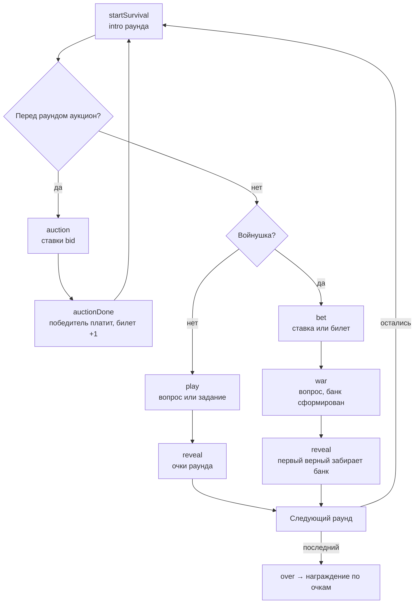

# Паспорт логики — Гонка на выживание

> **Эталон.** Перед правкой обязательны [`../LOGIC.common.md`](../LOGIC.common.md), этот паспорт и `survival.test.ts`.
> Намеренное изменение правил фиксируется здесь в том же PR. Указатель — [`../LOGIC.md`](../LOGIC.md).

- Составлен и актуализирован: 19 ноября 2026 после исправления Г-Н-1.
- Проверка: **20/20 профильных и серверных тестов**, сборка успешна.
- Браузер, два реальных пульта, PostgreSQL и test/production в этом прогоне не запускались; серверный E2E добавлен
  в `live.test.ts` и ожидает окружение с `TEST_DATABASE_URL`.

## 1. Назначение и режимы

Гонка по очкам на 5–30 раундов: никто не выбывает. Поддерживаются `solo`, `teams` и отсутствие общего экрана.
В командах отвечает капитан, остальные видят ход игры.

Виды раундов:

- `choice` — четыре варианта и один верный;
- `open` — текстовый ответ, несколько верных вариантов через `|`;
- `task` — ведущий отмечает выполнивших; возможны отдельный текст `solo` и тайные слова через `|`.

Каждый `warEvery`-й раунд (2–10, по умолчанию 5) — войнушка со ставками. После второй войнушки можно назначить до
трёх аукционов билета освобождения. Таймеры ставок/аукциона 5–180 секунд; у обычного вопроса 0–180, у задания общий
приём без таймера, отдельный показ — 30 секунд.

## 2. Блок-схема

Ведущий может закончить досрочно с подтверждением. Пьедестал и завершение — общие.

## 3. Экран, телефон и пульт

- **Экран:** трасса по очкам, раунд, войнушка, банк, ставки, билеты, вопрос/задание и 30-секундный показ.
  Верный вариант открывается только на `reveal`.
- **Телефон:** ответы, ставка `bet`, аукционная ставка `bid`, использование билета `ticket`. В войнушке по билету
  участник видит исход, но не отвечает. Член команды не отправляет действия.
- **Пульт:** этапы раунда, ручные отметки задания/открытого вопроса, запуск отдельных 30 секунд, итоги по свежим
  ответам, досрочное завершение и «Назад». Перед аукционом, закрытием ставок и показом вызывается `freshAnswers`.

Тайные слова выдаёт сервер персонально: пульт получает весь список, капитан — только своё слово текущего задания
во время `stage = question`, `phase = play`; обычный участник и экран — ни одного. Слова других и будущих раундов
в клиентский `gameSnapshot` не попадают. Несекретный `hasWords` сохраняет подсказки интерфейса при пустом `answer`.

## 4. Обычные раунды

- Верный `choice` определяется строгим совпадением индекса.
- `open` нормализуется общей `matchesAnswer`; автоматически засчитанного нельзя снять ручной отметкой, но ведущий может
  засчитать дополнительного участника.
- За обычный раунд каждый верный/отмеченный получает `round.points`.
- Ответы учитываются только текущего шага и не раньше текущего `startedAt`.
- Новые участники включаются в таблицу; удалённые не получают новые автоматические начисления.

## 5. Войнушка

1. Приз — `warPrize × warIndex`: 100%, 200%, 300%… от базового.
2. Минимальная ставка — половина неотрицательного счёта вверх; максимум — весь счёт.
3. Нет ответа или некорректное число — серверная логика пульта назначает минимум.
4. Билет списывается один раз, ставка не назначается, участник попадает в `freed`.
5. Банк = все ставки + приз.
6. Побеждает самый ранний верный ответ среди сделавших ставку.
7. Победитель получает `bank − bet`, остальные теряют ставку. Верных нет — все ставки сгорают.

Очки применяются через `addScore`, а при превышении общего лимита — через целую таблицу. Начисления сохраняются в
`deltas` для точного возврата.

## 6. Аукцион билета

- Назначается только после второй войнушки, не на саму войнушку, не более трёх раз.
- Ставка ограничена текущим счётом; нулевая не участвует.
- Выигрывает большая ставка, при равенстве — более ранняя.
- Только победитель платит и получает один билет. Если ставок нет, билет не продан.
- `auctioned` не даёт повторить аукцион того же раунда без «Назад».

## 7. Инварианты

- **ГВ-1.** Никто не выбывает; после последнего раунда — итог по очкам.
- **ГВ-2.** Войнушка использует только `choice`.
- **ГВ-3.** Ставка находится в пределах от половины до всего неотрицательного счёта.
- **ГВ-4.** Билет имеет эффект только при фактическом наличии и расходуется один раз.
- **ГВ-5.** В банк входят все принятые ставки и приз текущей войнушки.
- **ГВ-6.** Банк получает только первый верный среди поставивших; при отсутствии верных он никому не достаётся.
- **ГВ-7.** За аукцион платит только победитель; билет начисляется один раз.
- **ГВ-8.** Ответы прошлого показа/шага не участвуют в подсчёте.
- **ГВ-9.** Обычные очки и изменения войнушки/аукциона записаны в `deltas` и обратимы.
- **ГВ-10.** Повторный показ без «Назад» не должен удваивать очки; общий `expect` защищает запись.
- **ГВ-11.** Таймер отдельного задания не изменяет счёт и не принимает ответы сам.
- **ГВ-12.** В команде отправляет капитан; сервер выдаёт только его текущее слово, участникам и экрану слова не отправляются.
- **ГВ-13.** «Назад» возвращает не только фазу, но и очки/билеты.

## 8. «Назад» и повторные действия

- Из `reveal`: снимаются `deltas`, возвращается `war` или `play`, можно поправить отметки и показать снова.
- Из `war`: ставки очищаются, билеты восстанавливаются из `prevTickets`, ответы текущего шага очищаются.
- Из `auctionDone`: списывается билет, возвращаются очки и аукцион снова открывается.
- Из `play/bet/auction`: возврат на заставку с очисткой шага.
- Из заставки и `over`: восстанавливается предыдущий итог через `before`.
- С первой заставки: к «Начать игру»; с пьедестала — общий `podiumBack`.

Проверены основные цепочки возврата, включая аукцион и финиш. Два реальных пульта, сетевой обрыв между записью и
очисткой ответов в профильном запуске не проверялись; применяются общие ограничения Н-3 и Н-17.

## 9. Конструктор → сессия → сервер → история

1. `Editor.tsx`, `content.ts` и `validate.ts` формируют 5–30 допустимых раундов.
2. `index.ts` регистрирует представления, шаги и репетицию; внешних медиа у механики нет.
3. Полная игра хранится в базе; `server/src/survivalPrivacy.ts` формирует персональный `gameSnapshot` для каждого
   REST-ответа и SSE-снимка. Состояние `SurvivalResult` остаётся общим и не содержит слов.
4. Пульт создаёт `SessionChange`; общий сервер проверяет права, ожидаемое состояние и ответы.
5. Механика сама начисляет очки, общий `score()` пустой.
6. Общая платформа выполняет пьедестал, завершение и сохранение результатов.

## 10. Где это в коде

| Файл | Ответственность |
|---|---|
| `content.ts` | Раунды, лимиты, импорт, слова, `hasWords` и оформление |
| `validate.ts` | Полнота содержимого и ограничения войнушки |
| `logic.ts` | Фазы, ставки, аукцион, очки, «Назад» |
| `HostControls.tsx` | Пульт, свежие ответы, отметки и таймеры |
| `views.tsx` | Экран, трасса, телефон и формы |
| `preview.ts` | Репетиция |
| `survival.test.ts` | 15 профильных тестов |
| `server/src/survivalPrivacy.ts` | Персональная серверная выдача слов в REST и SSE |
| `server/src/survivalPrivacy.test.ts` | 5 тестов прав капитана, участника, экрана и пульта |
| `server/src/live.test.ts` | PostgreSQL E2E персональной выдачи |

## 11. Покрытие и крайние случаи

Тесты подтверждают: 30 раундов, допустимые билеты, импорт, тексты `solo`, проверку шаблона, обычные очки,
минимум/максимум ставки, банк, сгорание, рост приза, аукцион при равных ставках, расход/возврат билета, отсутствие
выбывания, тайные слова по очереди, оформление и возвраты.

Отдельно подтверждены: своя/чужая команда, два капитана, одиночный режим, участник и экран без слов, будущий раунд,
закрытая фаза, полный список у пульта, персонализация SSE и сохранение `hasWords` без раскрытия `answer`.

Не подтверждены: равные метки времени аукциона, 30+ участников, одновременные действия двух пультов, реальная
PostgreSQL, обрыв связи и реальные телефоны капитанов. PostgreSQL E2E написан, но без `TEST_DATABASE_URL` пропускается.

## 12. Находки

### Г-Н-1 — исправлена 19 ноября 2026: слова выдаются сервером персонально

Раньше весь список `round.answer` попадал в общий клиентский `gameSnapshot`, а `taskWordFor` лишь скрывал чужие слова
в UI. Теперь `survivalSessionFor` удаляет слова из всех заданий для обычного зрителя и оставляет капитану только его
слово текущего открытого задания. Пульт и администратор получают полный снимок.

`sessionOf` применяет фильтр к ответам по id, коду и списку сессий. Поток сессии получил персональный `transform`,
поэтому полный снимок при смене блока вечера также не утекает другим участникам. Обычные patch-события не меняются.
`hasWords` отделён от `answer`: экран и член команды видят правильную инструкцию, не получая самого слова.

## 13. Итог проверки 19 ноября 2026

Профильные и серверные тесты — **20/20 passed**, сборка успешна. Основные игровые правила, возврат и модель прав
секретности подтверждены автоматически. Реальный PostgreSQL E2E, браузер и test/production остаются этапом финальной
приёмки; до него выкладка не считается подтверждённой.
