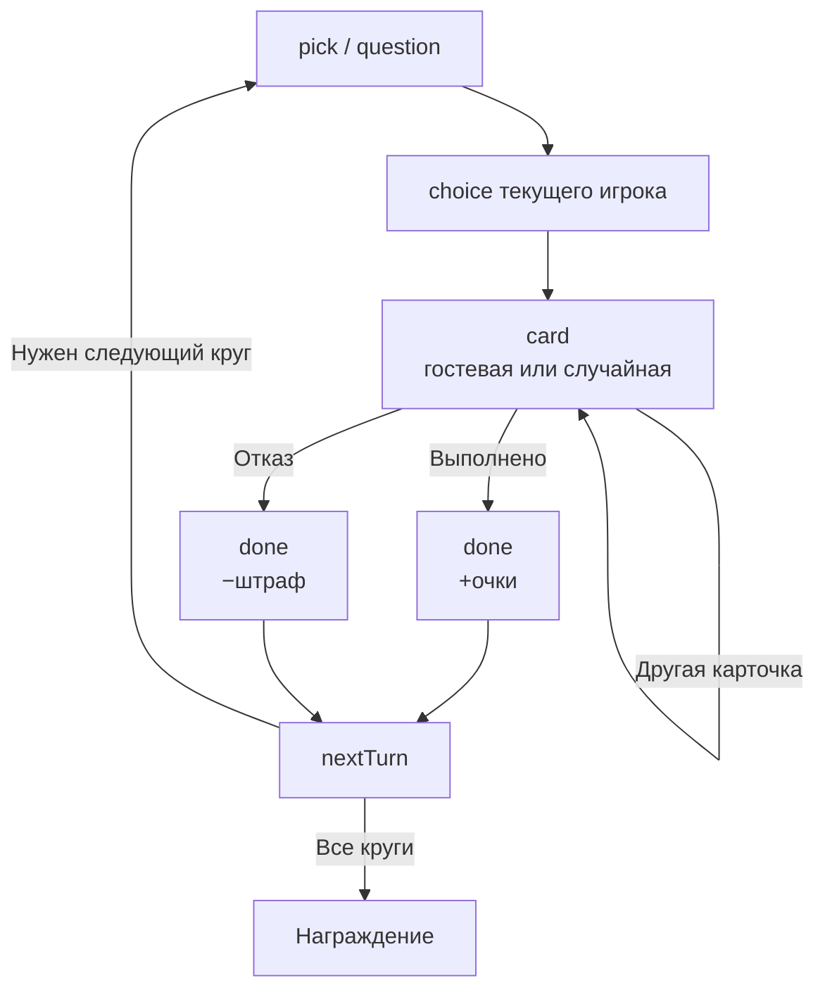

# Паспорт логики — Правда или действие

> Перед правкой обязательны [`../LOGIC.common.md`](../LOGIC.common.md), этот паспорт и `truth.test.ts`.

- Составлен: 19.11.2026 по `main` после `1e6dd753`.
- Проверка: **12/12 тестов**; новых подтверждённых дефектов не найдено.
- Браузер, PostgreSQL, два реальных пульта и test/production отдельно не проверялись.

## 1. Правила

Игроки/команды ходят по очереди. Текущий игрок выбирает «Правда» или «Действие», получает карточку и выполняет её.
«Выполнено» начисляет очки соответствующего вида, «Отказ» вычитает штраф. Карточки 18+ попадают в колоду только при
включённой настройке.

Колода не повторяется, пока не кончится; затем начинается заново без немедленного повтора последней карточки.
Принятые задания гостей выпадают первыми. Гости предлагают свои вопросы/действия, ведущий принимает или отклоняет.

## 2. Схема

Новые участники встают в конец текущего круга и получают ход до награждения. Удаление текущего/следующего не должно
пропускать очередь. Старое состояние без `who/round` читается по номеру хода.

## 3. Экран, телефон, пульт

- **Экран:** текущий игрок, карточка, исход и счёт.
- **Телефон:** выбор только текущего игрока/капитана; предложения `{ suggest }` от остальных.
- **Пульт:** выбор/замена карточки, исход, модерация предложений, следующий ход и «Назад».
  Ответы хода очищаются при возврате к выбору.

Скрытых ролей нет. Тексты гостей ограничены `cleanText`; модерация фиксируется через `handled` без повторного принятия.

## 4. Инварианты

- **ПД-1.** Выбирает только текущий участник.
- **ПД-2.** Карточка соответствует выбранному виду и настройке 18+.
- **ПД-3.** Гостевая карточка не теряется при замене/возврате, а возвращается в очередь.
- **ПД-4.** Разрешение принимает только очки текущего игрока; «Назад» снимает их полностью.
- **ПД-5.** Круги считаются по проходу очереди с учётом опоздавших/удалённых.
- **ПД-6.** Предложение обрабатывается один раз и выпадает раньше основной колоды.
- **ПД-7.** При исчерпании колоды последняя карточка не повторяется сразу, если есть альтернатива.

## 5. «Назад» и связи

Из `done` снимается `delta`; из карточки — возврат к выбору с восстановлением `used/extra`; из следующего выбора —
прежний итог через `prev`, принятые предложения сохраняются. С пьедестала — общий возврат.

Связь: `content.ts`/`validate.ts`/`Editor.tsx` → `gameSnapshot` → `HostControls.tsx`/`logic.ts` → общий сервер и таблица.
`truthSteps()` и `score()` пустые: ходы создаются динамически, очки пишет механика. Отдельной комнаты нет.

## 6. Код и проверка

| Файлы | Ответственность |
|---|---|
| `content.ts`, `validate.ts`, `Editor.tsx` | Колода, 18+, импорт, настройки |
| `logic.ts` | Очередь, карточки, предложения, очки, возврат |
| `HostControls.tsx`, `views.tsx` | Пульт, телефон, экран |
| `truth.test.ts` | 12 тестов |

Покрыты импорт, 18+, уникальность, гостевые карточки, выбор, замена, очки/отказ, круги, опоздавших, удалённых,
старая сессия и последний гость перед награждением. Не проверены длинные пользовательские тексты в браузере,
два пульта, PostgreSQL и сетевые гонки.

**Итог:** логика принята по 12 тестам; новых находок нет. Полный браузерно-серверный статус не присваивается.
